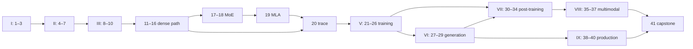

# Book plan (Stage 2 blueprint)

## Title

***Inside AnuLM***
*A Language Model You Can Read, Line by Line: the theory, the mathematics,
and the 1,224 lines that implement a modern LLM*

## What kind of book this is

This is the **reference companion** to `course/` (*Build Your Own LLM, from
Scratch to Omni*). The two books divide the work:

| | `course/` (lab book) | `book/` (this book) |
|---|---|---|
| The reader... | writes stubs, runs labs | reads, derives, traces |
| Depth per idea | enough to build it | the full why, the maths, the real code |
| Code shown | the reader's own stub | `anulm/model.py` and friends, with line citations |
| Proof | checks and mutants | tests in `tests/test_model.py`, results in `docs/RESULTS.md` |

Every chapter that has a matching lab ends with a **"Build it"** box naming
that course chapter, and the material is not repeated.

## Audience

The book is for an ambitious software engineer who:

- writes Python every day and has used PyTorch at least a little;
- wants to understand an LLM well enough to change one, not only call one;
- may have forgotten linear algebra and calculus. Part II rebuilds exactly
  the pieces the book uses.

It is not for a reader who wants an API tutorial or a survey of models.

## Prerequisites

- **Required:** Python, NumPy-style array thinking, and a terminal.
- **Rebuilt in Part II:** matrix multiplication, dot products, exp and log,
  softmax, derivatives and the chain rule, and expectation.
- **Software:** Python ≥ 3.10 and `torch` ≥ 2.1. Every chapter's
  examples run on a CPU using the `tiny()` and `tiny_gqa` sizes. A GPU is
  needed only for the optional "at real scale" runs.

## Running examples

These follow `STYLE.md` §5.

| Example | Used for |
|---|---|
| **The released model**, `AnuLM-Base-v2-400M` | Every "at real scale" number: 397.7M parameters, about 173M active, 20 KiB of KV cache per token |
| **The test model**, `tiny()` in `tests/test_model.py` | Every printed tensor shape |
| **The 2-D toy:** three tokens, `The dog bit`, with two-number vectors | Every by-hand calculation, carried from Ch 11 to Ch 20 |
| **The 17M preset**, `tiny_gqa` | Every training run the reader does (a few minutes on a CPU) |

---

## Table of contents

There are 41 chapters in ten parts. Each chapter lists:

- **Repo:** the code it explains (paths and symbols are in `REPOSITORY_SOURCE_MAP.md`);
- **Proof:** the tests it cites;
- **Evidence:** the `docs/RESULTS.md` sections it draws on;
- **Build it:** the matching course chapter.

The chapter template is in `STYLE.md` §3.

Status markers: ● the mechanism is in the repo · ◐ partly in the repo,
or a special case of what is · ○ not in the repo (background or extension).

### Part I: Foundations (accent: slate)

**1. What this book builds** ●
- The four-step loop: read, score, pick, repeat.
- A tour of AnuLM: what is in `anulm/model.py`, and what the other 60-odd files are for.
- How to read a code citation.
- Repo: `anulm/model.py` overview, `anulm/inference/sample.py`, `anulm/quickstart.py`. Build it: course Ch 1.

**2. From counts to transformers** ○
- Bag of words, word2vec, RNNs, attention (2014), transformers (2017).
- Encoder, decoder and encoder–decoder.
- Why the design here is decoder-only.
- Pure history, labelled `NOT IN THE REPO`. It ends on `anulm/bidirectional.py` as the one place the repo makes its decoder read both ways.

**3. The one job: a probability for every next token** ●
- Loss as average surprise; nats and bits; why a fresh model sits at ln V; bits per byte.
- Repo: `AnuLM.forward` loss (lines 922–928); `anulm/training/train.py` bits/byte (line 906); `__main__` smoke test (1119–1144).
- Proof: `initial_loss_is_ln_vocab`.

### Part II: Just enough mathematics (accent: slate)

**4. Tensors, shapes and the matrix multiply** ●
- Shapes as types. Reading `(B, S, D)`, view and transpose, broadcasting, `nn.Linear` as `xWᵀ`.
- Repo: `GQAttention.forward` reshapes (lines 457–463) as the worked case.

**5. Softmax, temperature and cross-entropy** ●
- exp/normalise; why subtract the max; the derivative p − y; the temperature as division.
- Repo: `generate` (1100–1105); `F.cross_entropy` with `ignore_index=-1`.

**6. Gradients and backpropagation** ●
- The chain rule as bookkeeping; autograd; a gradient step by hand.
- Repo: `loss.backward()` in `anulm/training/train.py` (line 868).
- Proof: `all_parameters_receive_gradients`, `causality_holds_under_gradients_too`.

**7. Optimisation: AdamW, schedules and clipping** ●
- Momentum, the second moment and bias correction.
- Decoupled weight decay, and why norms and biases skip it.
- Warmup, cosine, warmup-stable-decay (WSD) and rewarmup; gradient clipping; Muon as a sidebar.
- Repo: `make_optimizer` (310–337), `lr_at` (248–269), `OptimizerSet`, `anulm/muon.py`.
- Proof: `wsd_schedule_is_flat_then_decays_to_min_lr`, `batched_muon_matches_per_matrix_muon`.
- Evidence: RESULTS §6, §32.

### Part III: From text to vectors (accent: coral)

**8. Bytes as tokens** ●
- UTF-8; a 259-id vocabulary; document separators and EOS; why bytes are the honest baseline.
- Repo: `train.load_bytes` (62–98), `BYTE_EOS`.
- Proof: `byte_loader_inserts_eos_at_document_boundaries`. Build it: course Ch 2.

**9. Byte-level BPE from scratch** ●
- Pair merges; the pre-tokeniser regex; the incremental pair index and lazy heap; rank-ordered encoding; fertility.
- Repo: `anulm/bpe.py` (all of it).
- Proof: `bpe_documents_get_eos_and_the_vocab_is_exact`, `hf_tokenizer_conversion_is_exact`.
- Evidence: RESULTS §7, §22. Build it: course Ch 3.

**10. Embeddings and the output table** ●
- A lookup as a one-hot matmul; untied in and out tables; initialisation.
- Sidebar: the merge-tree reparameterisation.
- Repo: `AnuLM.__init__` (782–808), `_init_weights`, `_table`, `merge_tree_matrix`, `bake_merge_tree`.
- Proof: `merge_tree_composes_trains_and_bakes_losslessly`. Build it: course Ch 4.

### Part IV: Inside the transformer (accent: gold)

**11. Attention from first principles** ●
- Q, K and V as a soft database lookup; dot products; ÷√d and why it matters at width 64; the full formula by hand on `The dog bit`.
- Repo: `_sdpa` (393–397), `GQAttention.scale` (424). Build it: course Ch 6.

**12. Causal masking** ●
- Why the future must be invisible; −∞ before softmax.
- Two subtle cases: the offset mask against a KV cache, where `is_causal` aligns top-left, and the sliding window.
- Repo: `_attn_mask` (344–360).
- Proof: `causal_mask_does_not_leak_future`, `sliding_window_limits_reach`.

**13. Many heads, shared keys: multi-head and grouped-query attention** ●
- Heads as slices; the fused QKV projection; MHA and MQA as config cases; `repeat_interleave` vs native GQA; QK-norm.
- Repo: `GQAttention` (404–465), line by line.
- Proof: `native_gqa_matches_repeat_interleave`.

**14. Word order: rotary position embeddings** ●
- History first: learned tables and sinusoids (○).
- Then rotation by hand; relative distance from the difference of angles; the split-halves convention; cached tables keyed by device and dtype.
- Repo: `Rotary` (259–324), `rotate_half`, `apply_rope` (327–341).
- Proof: `rope_is_relative`, `rope_preserves_norms`, `rotary_cache_tracks_dtype_and_positions`. Build it: course Ch 5.

**15. Normalisation and the residual stream** ●
- LayerNorm (○) vs RMSNorm; why fp32 inside; pre-norm vs post-norm; the residual stream as a bus; scaled init of the output projections.
- Repo: `RMSNorm` (213–223), `Block.forward` (771–779), init (805–808). Build it: course Ch 4.

**16. The feed-forward network: SwiGLU** ●
- What the MLP does per token; the gate; three matrices and 3·D·I parameters; GELU 4× as history.
- Repo: `SwiGLU` (226–236), the dense layer 0 (`first_k_dense_replace`).

**17. Mixture of experts I: the router** ●
- Store a lot, use a little.
- The sigmoid scores; the bias that picks but never weights; group-limited top-k; the routed scaling factor.
- Why the router runs in fp32 with autocast off.
- Repo: `Router` (550–637).
- Proof: `router_weights_come_from_unbiased_scores`, `router_respects_group_limits`, `config_rejects_unreachable_topk`. Build it: course Ch 7.

**18. Mixture of experts II: dispatch and balance** ●
- Three dispatch paths, each equivalent: sparse gather, dense one-hot and grouped GEMM.
- Aux-loss-free balancing by the sign rule; the sequence balance loss; the router z-loss; reading imbalance.
- Repo: `MoE` (640–749), `update_expert_biases` (1014–1044).
- Proof: `moe_matches_naive_per_token_loop`, `dense_and_sparse_moe_agree`, `bias_update_recovers_from_collapse`, `seq_balance_loss_matches_the_formula`.
- Evidence: RESULTS §4, §5, §10, §16.

**19. Latent attention (MLA)** ●
- Compress K and V into one latent; why RoPE needs a decoupled key; what the cache holds; cache arithmetic against GQA.
- Repo: `MLAttention` (472–543).
- Proof: `mla_shares_one_rope_key_across_heads`. Evidence: RESULTS §1–2.

**20. The whole model, traced end to end** ●
- One forward pass from token ids to loss, shape by shape, through `tiny()`.
- The 400M parameter arithmetic, active vs total.
- Repo: `AnuLM.forward` (822–873), `num_params`.
- Proof: `param_count_matches_analysis`.

### Part V: Training (accent: teal)

**21. Data: corpora, documents, windows and splits** ●
- Building a corpus; DOC_SEP; memory-mapped ids.
- Windows without replacement; why a tail split lies; interleaved validation.
- Repo: `WindowSampler`, `load_memmap`, `interleaved_split`, `make_batch`; `experiments/build_v2.py`.
- Proof: `window_sampler_*`, `interleaved_split_samples_the_whole_corpus`, `memmap_batches_match_in_memory_batches`.
- Evidence: RESULTS §8, §11, §13. Build it: course Ch 2.

**22. The training loop, line by line** ●
- `train.py main()` in full: presets and `--cfg` overrides; the compile probe; the step; gradient accumulation; logging.
- Repo: `anulm/training/train.py` 399–750.
- Proof: `gradient_accumulation_equals_large_batch`. Build it: course Ch 8.

**23. Precision, memory and speed** ●
- bf16 autocast (fp16 with GradScaler is ○); the fp32 router; gradient checkpointing; chunked cross-entropy.
- `torch.compile` and graph breaks; choosing a MoE path; `fit_memory`; spilling to system RAM on Windows.
- Repo: `anulm/training/train.py` 498–503, 590–610; `anulm/model.py` 847–852, 875–901, 1205–1224; `warn_if_spilling`.
- Proof: compile tests, `chunked_loss_matches_the_full_loss_and_its_gradients`.
- Evidence: RESULTS §4, §6.

**24. Measuring progress honestly** ●
- What a val loss's error bar is worth; standard error; strided windows; bits per byte across tokenizers; golden sets.
- Repo: `evaluate` (340–396), `strided_windows`; `anulm/eval/eval_golden.py`.
- Proof: `eval_windows_are_frozen_and_strided_windows_cover_the_split`.
- Evidence: RESULTS §19, §26.

**25. Checkpoints, resuming and failure** ●
- Atomic saves; best vs `.last`; what has to be saved (optimizer moments, sampler position, eval spec); falling back.
- Repo: `atomic_save`, `anulm/training/train.py` resume 614–675, `load_checkpoint`.
- Proof: `checkpoint_roundtrip_is_exact`, `window_sampler_resumes_exactly`.

**26. Debugging: when the loss goes down and the model is still wrong** ●
- The silent-failure method: equivalence tests, invariance tests and conservation tests.
- The repo's real bugs as case studies: bf16 routing, the merge-tree cache, the tail split, and eval noise.
- Repo: `tests/test_model.py` as a whole. Build it: course checks.

### Part VI: Generation (accent: teal)

**27. Autoregressive decoding and the KV cache** ●
- Prefill vs decode; what to cache and why queries are not cached.
- Cache layout for GQA vs MLA; absolute `start`; the context slide at `block_size`; cached = uncached.
- Repo: `generate` (1058–1116), `new_cache`, attention cache code.
- Proof: `incremental_forward_matches_full_forward`, `cached_generation_matches_uncached`, `cache_holds_what_it_should`.

**28. Choosing the next token** ◐
- Greedy, temperature, top-k, CTRL repetition penalty, n-gram blocking and EOS handling.
- Top-p is taught and given as an `EXTENSION` patch with a test.
- Repo: `generate` 1091–1115, `decode_from_embeds` (959–1005); `anulm/inference/api.py` defaults.
- Proof: `generation_is_deterministic_at_top_k_1`, `generation_stops_at_eos`.
- Evidence: RESULTS §30.

**29. Long context: sliding windows and YaRN** ●
- Why RoPE fails past its training length; NTK-by-parts; the band blend; the attention temperature; what the window costs.
- Repo: `_build_inv_freq` (286–303), YaRN helpers (243–256), `Rotary` mscale.
- Proof: `yarn_blends_the_right_bands`, `yarn_temperature_reaches_attention`, `sliding_window_agrees_with_cache`.
- Evidence: RESULTS §3, §15, §27, §28. Build it: course Ch 16.

### Part VII: After pre-training (accent: plum)

**30. Instruction tuning** ●
- From a base model to an answering model; templates; masking prompt tokens; packing without splitting examples; replaying the base data.
- Repo: `anulm/training/finetune.py` (`pack` 84–111, `main`), `anulm/data/make_chat.py`, `anulm/data/make_qa.py`.
- Proof: `qa_packing_masks_prompts_and_keeps_examples_whole`.
- Evidence: RESULTS §20, §23, §25. Build it: course Ch 9.

**31. LoRA** ●
- Low-rank updates; why B starts at 0; α/r; merging.
- MoE-specific traps: grouped experts, and saving the router biases.
- Repo: `anulm/lora.py`.
- Proof: `lora_starts_as_the_base_model_and_merges_back_exactly`.
- Evidence: RESULTS §29. Build it: course Ch 10.

**32. Classification heads and calibration** ●
- Scoring options in one pass at their last tokens; temperature scaling; ECE, Brier and selective accuracy.
- Repo: `anulm/tasks/decide.py`, `anulm/bidirectional.py`.
- Proof: `decide_scores_each_option_at_its_last_token_and_calibrates`.
- Evidence: RESULTS §34, §36, §38. Build it: course Ch 12.

**33. Retrieval and readers** ●
- BM25 from scratch, dense retrieval (borrowed e5), reciprocal-rank fusion; generative vs span-extracting readers.
- Repo: `anulm/inference/rag.py`, `anulm/tasks/rc_pointer.py`. Evidence: RESULTS §33. Build it: course Ch 12.

**34. Preference optimisation and reinforcement learning** ○
- RLHF, DPO and GRPO maths with worked numbers.
- What it would take to add them here (`EXTENSION`).
- Cross-links the course's DPO and RL chapters, which implement them as stubs.
- Build it: course Ch 11, Ch 19.

### Part VIII: Beyond text (accent: plum)

**35. A wider vocabulary and inputs that are not tokens** ●
- Growing the tables; audio-codec ids; control tokens; the `embeds=` bypass; masking non-text ids when generating text.
- Repo: `anulm/multimodal/speech_vocab.py`, `AnuLM.forward` 836–839, `generate` 1092–1095. Build it: course Ch 13.

**36. Seeing and hearing: frozen encoders and projectors** ●
- SigLIP patches and pooling; Whisper frames and stacking; the projector; answer-only targets; caching frozen features.
- Repo: `anulm/multimodal/vision_encoder.py`, `anulm/multimodal/speech_encoder.py`, `anulm/multimodal/audio_codec.py`.
- Proof: `cached_embeds_decoding_matches_prefix_replay`.
- Evidence: RESULTS §39. Build it: course Ch 13.

**37. One model, many tasks** ●
- Task sampling; per-task held-out scores normalised to step 0; matching projector norms.
- Repo: `anulm/multimodal/omni_train.py`, `anulm/multimodal/omni.py`. Evidence: RESULTS §39, §40. Build it: course Ch 14.

### Part IX: To production (accent: teal)

**38. Serving: engine, API and streaming** ◐
- The engine; one GPU lock; OpenAI-compatible routes; streaming with incomplete UTF-8 held back; cancellation.
- Repo: `anulm/inference/serve.py`, `anulm/inference/api.py`.

**39. Exporting to the ecosystem** ●
- safetensors and dtype choices (the router bias stays fp32); a `transformers` wrapper that reuses native modules; a custom cache; what the wrapper does not support.
- Repo: `anulm/hf/export_hf.py`, `anulm/hf/modeling_anulm.py`, `anulm/hf/configuration_anulm.py`.
- Proof: `transformers_wrapper_matches_the_native_model`, `an_exported_folder_loads_everywhere_a_pt_does`. Build it: course Ch 15.

**40. The production gap** ○
- What a large serving stack adds, each item with arithmetic on the 400M model:
  - paged KV cache and continuous batching
  - quantisation (INT8/INT4/FP8)
  - speculative decoding
  - FlashAttention kernels
  - distributed training (DP/TP/PP/ZeRO)
  - monitoring, safety and prompt injection
- Every one is labelled `NOT IN THE REPO`.

### Part X: Capstone

**41. Capstone: train it, open it, change it** ●
1. Train `tiny_gqa` on your own text.
2. Trace one prediction through every chapter's code, printing shapes.
3. Implement top-p as a real extension, with a test that would catch the classic bugs (threshold off by one, renormalisation forgotten).
4. Run the full test suite, then compare against the released model.

### Appendices

- A. Tensor-shape reference for every module
- B. The 400M arithmetic: parameters, active parameters, KV cache and training memory
- C. Test index: every test, the concept it pins, the chapter that uses it
- D. Glossary (index-ready)
- E. Bibliography (`RESEARCH_REFERENCES.md`)
- F. Reproducing every number: the audit script and how to run it

---

## Chapter dependencies

Reading paths, after the reference deck's "four ways to read":

1. **Understand a modern LLM:** 1–20.
2. **Train one:** 3, 7, 20–26.
3. **Ship one:** 27–29, 38–40.
4. **Adapt one:** 30–37.

## Diagram plan

Every diagram is Mermaid in the source, drawn in the part's accent colour.
Anything that does not exist in the code is drawn dashed and labelled
`EXTENSION`.

| # | Diagram | Chapter |
|---|---|---|
| D1 | Repository map by role | 1 |
| D2 | The four-step generation loop | 1, 27 |
| D3 | Model anatomy: embed → 20 blocks (dense layer 0, MoE layers 1–19, windowed layers 0–9) → norm → head | 1, 20 |
| D4 | Block internals: pre-norm, attention, residual, norm, MLP/MoE, residual | 15 |
| D5 | Attention data flow with shapes: fused QKV → split → QK-norm → RoPE → cache → SDPA → dense | 13 |
| D6 | Causal, offset-causal and windowed mask grids | 12 |
| D7 | RoPE pair rotation and frequency bands (normal vs YaRN) | 14, 29 |
| D8 | Router: sigmoid → +bias → (group mask) → top-k → gather unbiased weights → normalise → ×2.5 | 17 |
| D9 | The three MoE dispatch paths side by side | 18 |
| D10 | MLA: latent + rope key cached, expanded per step | 19 |
| D11 | Training loop flow with checkpoint branches | 22, 25 |
| D12 | Prefill vs decode, and cache growth and slide | 27 |
| D13 | SFT packing with masked labels | 30 |
| D14 | LoRA beside a frozen W, merge arrow | 31 |
| D15 | Multimodal sequence layouts (speech and image) | 35, 36 |
| D16 | Serving path: HTTP → lock → generate → stream | 38 |
| D17 | The production gap: repo vs serving stack, with absent parts dashed | 40 |

## Code examples written for the book

These go in `book/code-examples/`, each labelled **Book example, not
repository code**.

- `trace_forward.py`: hooks on `tiny()` that print every shape (Ch 20, 41).
- `by_hand.py`: recomputes every illustrative number in the book. This is the audit script (Appendix F).
- `history_positions.py`: sinusoidal and learned position tables (Ch 14).
- `layernorm_vs_rmsnorm.py` (Ch 15).
- `top_p_patch.py` and its test (Ch 28, 41).
- `arithmetic_400m.py`: Appendix B's numbers.

## Capstone plan

Chapter 41 has four checkpoints, each with expected outputs the reader can
compare against:

1. A training run with a loss curve, starting near ln V.
2. A printed shape trace that matches Appendix A.
3. The top-p extension passing three tests, among them one that a known-wrong
   implementation fails.
4. The full `tests/test_model.py` passing.

It ends by pointing at three larger extensions:

- a paged cache
- INT8 weight-only inference
- DPO (via the course stub)

## Research plan

Governed by `RESEARCH_REFERENCES.md` §1–§3 (requirements 16–22 of the
master prompt):

- **Two sources of truth.** Repository facts come only from
  `REPOSITORY_SOURCE_MAP.md` and the code; external claims only from
  references whose status is CHECKED. A chapter joins the two explicitly,
  and only where the implementation supports it.
- **Stage 3 verifies every reference** at its source: title, first author,
  year, identifier, venue, relevance, and whether it supports each claim in
  its row. Each one ends CHECKED, CORRECTED (and then CHECKED) or REJECTED,
  with corrections logged, never overwritten.
- **Every chapter ends with its reference list** and each entry's status
  (`STYLE.md` §6a).
- **The research-and-implementation matrix** (`RESEARCH_REFERENCES.md` §7)
  is updated whenever a chapter finds a difference between paper and code.
- **The audit** (`tools/research_audit.py`) runs after every change to the
  register or a chapter. The book is not research-complete while a CITED
  reference remains, or a claim lacks evidence.
- Quality claims about this model come only from `docs/RESULTS.md`, with the
  section named.

### Historical progressions

For each development, the chapter explains the problem that motivated it,
how the mechanism differs mathematically, and the engineering trade-off.
Steps the repository doesn't implement are marked `NOT IN THE REPO`.

| Progression | Steps and references | In the repository | Chapters |
|---|---|---|---|
| Attention heads | MHA (2017) [R01] → MQA (November 2019) [R13] → GQA (May 2023) [R12] → MLA (May 2024) [R19] | GQA (released), MLA (option); MHA and MQA as `n_kv_head` settings | 11–13, 19 |
| Positions | sinusoidal, with learned embeddings tried alongside (2017) [R01]; position embeddings in an encoder (2018) [S01] → RoPE (2021) [R06] → position interpolation (June 2023) [S02] → YaRN (September 2023) [R07]; ALiBi (2021) [S03] as a side branch | RoPE and YaRN | 14, 29 |
| Normalisation | LayerNorm (2016) [R09]; two later changes, in parallel: moving it to each sub-block's input, used by GPT-2 (February 2019) [R04] and analysed by Xiong et al. (2020) [R10]; and dropping the re-centring, RMSNorm (October 2019) [R08] | pre-norm RMSNorm: both changes together | 15 |
| Feed-forward | two lines: the dense FFN, GELU (2016) [S04] → gated SwiGLU (2020) [R11]; and sparse experts, older than both: mixtures of experts (1991) [S05] → sparsely-gated MoE (2017) [R15] → GShard (2020) [S06] → Switch (2021) [R16] → DeepSeekMoE (January 2024) [S07] → DeepSeek-V3 (December 2024) [R20]; balancing: z-loss (2022) [R17], aux-loss-free (August 2024) [R18] | SwiGLU layer 0, MoE layers 1–19 | 16–18 |
| Attention kernels | materialised attention (2017) [R01] → FlashAttention (May 2022) [R29] → FlashAttention-2 (July 2023) [S08] | PyTorch SDPA chooses the kernel; no kernel here | 23, 40 |
| Adaptation | full fine-tuning → adapters (February 2019) [S09] → LoRA (June 2021) [R32] → QLoRA (May 2023) [R33] | full fine-tuning and LoRA; QLoRA in `course/` only | 30–31 |
| Decoding | recompute every step → KV cache (no single origin; see the register); then two separate lines of work: speculative decoding (November 2022) [R47] and speculative sampling (February 2023) [S10], and paged KV memory, PagedAttention (September 2023) [R46]. They solve different problems (latency per token; memory for many requests) and are not a sequence | KV cache only | 27, 40 |
| Alignment | SFT → RLHF with PPO (PPO 2017 [S12]; InstructGPT March 2022 [R39]) → DPO (May 2023) [R40] → GRPO (February 2024) [R41] | SFT only; the rest in `course/` | 30, 34 |

Stage 3 (2026-10-31) checked each arrow against the sources' first-version
dates (arXiv v1, or the publication year). Three orders were wrong in the first
draft and are fixed above: pre-norm and RMSNorm are parallel changes, both
before Xiong et al.'s 2020 analysis; sparse MoE is older than SwiGLU, not its
successor; and speculative decoding came before PagedAttention, as a separate
line of work. The master prompt's own example, "KV caching → PagedAttention →
speculative decoding", has the same problem, so the book does not present it
as a sequence.

## Page budget and code share (set 2026-10-31)

The book is to be **at least 300 to 400 printed pages** (the user's words: a floor, not a cap), at 7 × 9.25 in, as rendered by
`tools/build_preview.py --print`, cover included. It is to be **mostly code**:
the reader should spend more of each chapter reading `anulm/model.py`, `anulm/training/train.py` and
the book's own runnable examples than reading prose about them.

**Measured so far.** Chapters 11 and 20 print at about 20 pages each. Quoted code
is about 2% and 15% of their lines. At that length, 41 chapters would be about
800 pages, and the code share is far too low. So the budget below shortens most
chapters and changes their balance: fewer words around each idea, more code,
each excerpt walked through line by line.

| Part | Chapters | Pages per chapter | Pages |
|---|---|---|---|
| Front matter: cover, about, contents | | | 5 |
| Part dividers | 10 | 1 | 10 |
| I · Foundations | 1–3 | 5 | 15 |
| II · Just enough mathematics | 4–7 | 7 | 28 |
| III · From text to vectors | 8–10 | 7 (9: 8) | 22 |
| IV · Inside the transformer | 11–20 | 10 (11 and 20: 18) | 116 |
| V · Training | 21–26 | 10 | 60 |
| VI · Generation | 27–29 | 9 | 27 |
| VII · After pre-training | 30–34 | 7 | 35 |
| VIII · Beyond text | 35–37 | 7 | 21 |
| IX · To production | 38–40 | 6 | 18 |
| X · Capstone | 41 | 10 | 10 |
| Appendices A–F, sources, index | | | 20 |
| **Total** | | | **387** |

**Revised 2026-11-01.** At the code standard below, with full page furniture, chapters print at about twice
the per-chapter figures in this table (Part III measured 13–17 pages against 7–8). The table is a guide
to relative length; no figure, test, excerpt or walkthrough is cut to meet it. The expected total is
roughly 600–750 pages, well above the floor.

**The code standard for every chapter** (checked by `tools/verify_chapters.py`):

1. **Code share at least 45%** of a chapter's body lines. This counts Python
   blocks only: repository excerpts and book examples, not printed output or
   tables.
2. **At least four repository excerpts**, each one an **In the repo** citation,
   followed by a walkthrough that names the lines it explains, in order.
3. **One runnable book example** per chapter in `code-examples/`, quoted in
   the chapter where it teaches, and checked against the repository code it
   mirrors.
4. **Prose earns its place.** An idea is stated once; its theory is as short
   as correctness allows, and anything a first reading can skip goes in a
   Details box.

Chapters 11 and 20 are to be brought to this standard. Mostly that means
adding code: Chapter 11 has 10 quoted lines. Their figures and verified
content stay.

## Writing order (Stage 4)

The chapters are not written in book order. Each one is reviewed (Stage 5)
before the next starts.

1. **Ch 20, the end-to-end trace.** It fixes the shapes and notation every other chapter uses.
2. **Ch 11–13, attention.** The core of the book, and the place to settle the by-hand toy.
3. Ch 14–19, then Ch 1–10.
4. Ch 21–29, then Ch 30–40.
5. Ch 41 and the appendices.
