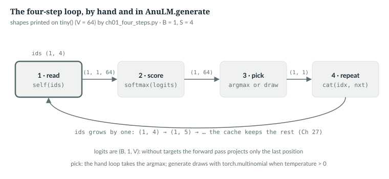
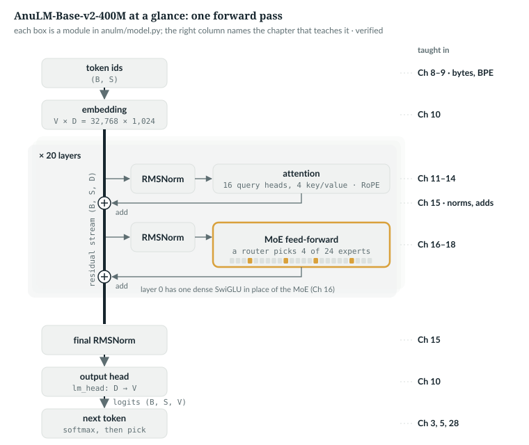
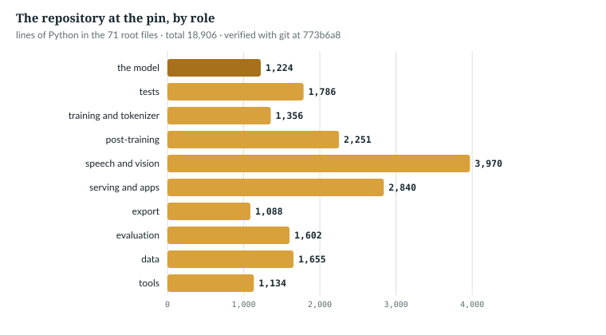

# 1  What this book builds

Give the model this book is about the words "The first railway line in India"
and it carries on in fluent English:

```text
The first railway line in India was opened in 1889. The second was extended in 1895. The first rail line was opened in 1883 and the third in 1888.
```

*measured*: one sample, seed 0, run in 1.3. The first line opened in 1889, it
says, and two sentences later in 1883. Nothing in the model checks a fact. It
was trained to do one thing, give a probability to every possible next piece of
text, and it does that well enough to sound sure of itself. This book shows how
that one job is built, line by line, in a model you can download and run.

That model is AnuLM, a 400M-parameter language model trained from scratch on
Hindi, English and Python on one consumer GPU. Its architecture combines
published ideas, each credited to its paper where it is built: grouped-query
attention [R12], multi-head latent attention [R19], sigmoid routing with
bias-only load balancing [R20], SwiGLU [R11], RMSNorm [R08], QK-norm [R14]
and YaRN [R07]. It is a
mixture of experts: of its 397.7M parameters,
173.5M are used for any one token (Chapter 20). The released model is
`AnuLM-Base-v2-400M`, the file `ckpt_base_v2.pt`, published on Hugging Face as
`toonist/AnuLM-Base-v2-400M`.

A language model reads some text, gives a probability to every possible next
piece, picks one and appends it, over and over. This chapter writes that loop
by hand (1.1), finds it in AnuLM's code (1.2), runs it on the released model
(1.3), draws the whole model on one page (1.4), and maps the repository and the
rest of the book (1.5–1.7).

**New words.** Part I starts here; these terms recur throughout the book.

| Term | Meaning |
|---|---|
| token | one piece of text the model reads or writes: a byte, or a sub-word piece from a tokenizer (Chapters 8–9) |
| vocabulary, V | the set of all token ids; the released model has V = 32,768 |
| B, S, D | batch size (sequences processed together), sequence length in tokens, and the model's width: the length of the vector it keeps per token (D = 1,024 here) |
| forward pass | one call of the model on a batch of ids: ids in, scores out |
| logits | the forward pass's output, one raw score per vocabulary id; larger means more likely |
| softmax | the function that turns logits into probabilities that sum to 1 (Chapter 5) |
| loss | the average of −log p over the true next tokens (Chapter 3) |
| checkpoint | a file of trained weights and their configuration, such as `ckpt_base_v2.pt` |
| preset | a named configuration of sizes in `anulm/model.py`, such as `tiny_gqa` |
| the pin | commit `b42998d`, which every line number in this book refers to: the `anulm/` package layout after a code-quality pass, on the GitHub branch `port-bundle-fixes` (1.7) |

---

## 1.1  The four-step loop, by hand

`book/code-examples/ch01_four_steps.py` (**Book example, not repository
code**) writes the loop in ten lines, picking the most likely id each time:

```python
def four_steps(model: AnuLM, ids: torch.Tensor, n: int, show: bool = False) -> torch.Tensor:
    """Greedy decoding with no cache: the loop at its plainest."""
    for step in range(n):
        logits, _ = model(ids)                        # 1. read: the whole sequence so far
        probs = F.softmax(logits[:, -1, :], dim=-1)   # 2. score: one probability per vocabulary id
        nxt = probs.argmax(dim=-1, keepdim=True)      # 3. pick: here, the most likely id
        if show and step == 0:
            print(f"read   ids    {tuple(ids.shape)}    logits {tuple(logits.shape)}")
            print(f"score  probs  {tuple(probs.shape)}  sum {probs.sum().item():.4f}")
            print(f"pick   nxt    {tuple(nxt.shape)}   id {nxt.item()}, p = {probs.max().item():.4f}")
        ids = torch.cat([ids, nxt], dim=1)            # 4. repeat: append, and go again
    return ids
```

- **Read.** `model(ids)` runs a forward pass on `ids`, a (B, S) tensor of token
  ids. Called without targets, it returns logits for the last position only,
  (B, 1, V) (1.2).
- **Score.** `logits[:, -1, :]` drops the length-1 axis, (B, V), and the
  softmax turns each row into probabilities.
- **Pick.** `argmax` takes the most likely id, (B, 1).
- **Repeat.** `torch.cat` appends it along the sequence axis, and the loop
  reads the longer sequence again.

The example runs it beside the repository's own loop, `generate`, with
`top_k=1`, which leaves the best id as the only possible pick:

```python
    torch.manual_seed(0)
    cfg = tiny()
    model = AnuLM(cfg).eval()
    prompt = torch.randint(0, cfg.vocab_size, (1, 4))
    with torch.no_grad():
        mine = four_steps(model, prompt.clone(), 12, show=True)
    ours = model.generate(prompt.clone(), 12, top_k=1)                    # KV cache on
    ours_nc = model.generate(prompt.clone(), 12, top_k=1, use_cache=False)
    assert torch.equal(mine, ours) and torch.equal(mine, ours_nc), "the hand loop and generate disagree"
```

`tiny()` is the test suite's small configuration (`tests/test_model.py` lines
44–49): V = 64, three layers, D = 32. Untrained, it picks noise, but the same
noise:

```text
read   ids    (1, 4)    logits (1, 1, 64)
score  probs  (1, 64)  sum 1.0000
pick   nxt    (1, 1)   id 18, p = 0.0204
by hand        [38, 2, 0, 59, 18, 11, 25, 14, 29, 27, 25, 14, 17, 44, 46, 37]
generate       [38, 2, 0, 59, 18, 11, 25, 14, 29, 27, 25, 14, 17, 44, 46, 37]
by-hand loop == generate(top_k=1), with and without the cache: True
```

*verified*: printed by `ch01_four_steps.py`. The first pick's 0.0204 is close
to a uniform 1/64 = 0.0156 (Chapter 3 explains why). The test
`generation_is_deterministic_at_top_k_1` (`tests/test_model.py` line 495) requires
two greedy runs to agree.



*Figure 1.1 · The four-step loop.* One pass, with each tensor's shape. The
pick is where the two loops differ: the hand loop above takes the argmax, and
`generate` (1.2) draws with `torch.multinomial` unless the temperature is 0 or
less. *verified*: shapes printed by `ch01_four_steps.py` on `tiny()`.

`IN THE REPO`

## 1.2  The same loop in `generate`

The repository's loop is a method on the model, `generate` (line 1126). With
its optional features elided:

> **In the repo** · `anulm/model.py` · `AnuLM.generate` · lines 1154–1183 · @2e80b3e

```python
        for _ in range(max_new_tokens):
            if not use_cache:
                logits, _ = self(idx[:, -bs:])
            else:
                if cache is None or start + pending.shape[1] > bs:
                    cache, start, pending = self.new_cache(), 0, idx[:, -bs:]
                logits, _ = self(pending, cache=cache, start=start)
                start += pending.shape[1]
            logits = logits[:, -1, :].float()
            # ...
            if temperature <= 0:
                nxt = logits.argmax(dim=-1, keepdim=True)              # (B, 1), no draw
            else:
                logits = logits / temperature
                # ...
                probs = F.softmax(logits, dim=-1)
                nxt = torch.multinomial(probs, num_samples=1)          # (B, 1)
            # ...
            idx = torch.cat((idx, nxt), dim=1)
            pending = nxt
```

Against the hand loop, three things differ:

- **The KV cache.** Without it (`use_cache=False`) the model rereads the last
  `bs` tokens each step (`block_size`, its longest context). With it, the
  model keeps the keys and values its attention layers computed for earlier
  tokens (Chapter 11's terms), and each step reads only `pending`, the tokens
  not seen yet; `start` is how many it has seen (Chapter 27).
- **Temperature.** The logits are divided by it before the softmax: below 1
  sharpens the distribution, above 1 flattens it (Chapter 5). A temperature
  of 0 or less takes the argmax instead, with no random draw, so the output
  does not depend on the seed.
- **Sampling.** Otherwise `torch.multinomial` draws one id per row in
  proportion to its probability, instead of taking the argmax.

The elided lines mask audio and image ids in a model whose vocabulary was
grown for them, apply an optional repetition penalty, apply an optional
`top_k` cut that keeps only the k highest scores, and keep finished rows at
the end-of-sequence id (Chapter 28). Reading costs little at the output,
because without targets the forward pass projects only the last position:

> **In the repo** · `anulm/model.py` · `AnuLM.forward` · lines 925–928 · @2e80b3e

```python
        if targets is None:
            # Inference shortcut: only the last position matters.
            logits = self._head(x[:, -1:, :])
            return logits, None
```

`x` is the final (B, S, D) stack of vectors; slicing with `-1:` keeps the
axis, so the logits are (B, 1, V).

`IN THE REPO`

## 1.3  The loop on the released model

`anulm/inference/sample.py` runs `generate` on a checkpoint from the command line:

> **In the repo** · `anulm/inference/sample.py` · `main` · lines 69–77 · @2e80b3e

```python
    else:
        # Byte-level: the prompt is its own UTF-8 encoding. 257 is EOS.
        prompt_ids = list(args.prompt.encode("utf-8")) or [10]
        eos_id = 257
    ids = torch.tensor([prompt_ids], dtype=torch.long, device=args.device)
    t0 = time.time()
    with torch.autocast(device_type="cuda", dtype=torch.bfloat16, enabled=args.device.startswith("cuda")):
        out = model.generate(ids, args.tokens, temperature=args.temperature, top_k=args.top_k,
                             eos_id=eos_id, use_cache=not args.no_cache)
```

The released model uses a BPE tokenizer (a vocabulary of sub-word pieces
learned from text, Chapter 9), handled by the branch above this one; this
`else` serves byte-level models, whose prompt bytes are their ids. `ids` is a
(1, S) batch of one. On a GPU, autocast runs the matrix multiplies in bf16, a
16-bit float format (Chapter 23). The defaults are temperature 0.8 and
`top_k` 50 (lines 34–35). One run:

```text
$ python -m anulm sample --ckpt ckpt_base_v2.pt --prompt "The first railway line in India" --tokens 60 --seed 0
loaded step 1899999, val loss 3.3523  (moe_impl=grouped, cache=on)

[60 tokens in 5.2s, 12 tok/s]

The first railway line in India was opened in 1889. The second was extended in 1895. The first rail line was opened in 1883 and the third in 1888.
Highway construction and maintenance of railway lines were carried out in India in the late nineteenth century by the Indian Railway. In 1923 the first rail line
```

*measured*: `anulm/inference/sample.py` at the pin, unchanged, on this machine's GPU, seed 0,
bf16 autocast with the experts in bf16 (`moe_impl=grouped`; Appendix F.6); one sample, not
a benchmark. This is the chapter's opening sample: fluent, on topic, and with
dates that contradict each other. That is what a base model is: a
next-token predictor with no notion of checking a fact. Its model card says
the same (`docs/MODEL_CARD_BASE_V2.md`).

`IN THE REPO` · `MEASURED`

## 1.4  A tour of `anulm/model.py`

The loop's first step, `model(ids)`, is the whole model. Figure 1.3 draws it on
one page; the rest of the book opens its boxes one at a time.



*Figure 1.3 · The whole model at a glance.* One forward pass of the released
model, each box labelled with the chapter that teaches it. *verified*: the
sizes are the released configuration's, and the boxes are the modules
`AnuLM.__init__` and `Block.__init__` build, in order; `tools/figures/part_i_ii.py`
asserts both.

Read it from the top:

- **In.** Each token id picks one row of the embedding table: a vector of
  D = 1,024 numbers per token, so a (B, S) batch of ids becomes a (B, S, D)
  tensor.
- **The residual stream.** That tensor runs down the left of the figure through
  all 20 layers. A layer never replaces it: it branches off twice, normalises a
  copy (RMSNorm), computes something from it and adds the result back at a ⊕.
- **Attention**, the first branch, lets each position mix in information from
  the positions before it: 16 query heads share 4 key/value heads, and RoPE
  rotates the vectors by position.
- **The mixture of experts**, the second branch, is a feed-forward network per
  token, but sparse: a router scores 24 small networks and runs only 4 of them.
  This is why only 173.5M of the 397.7M parameters work on any one token.
  Layer 0 uses one dense feed-forward network instead.
- **Out.** A final RMSNorm, then the output head maps each D-vector to V =
  32,768 logits; softmax and a pick give the next token.

Chapter 20 traces the same path with every shape and writes it as six
equations (20.3). In the file, the architecture is 1,367 lines in banner
sections:

| Banner | Starts at | What it holds | In one line | Chapters |
|---|---|---|---|---|
| CONFIG | 36 | `AnuLMConfig` and the presets | every size and switch | 1, 20 |
| NORM / MLP | 222 | `RMSNorm`, `SwiGLU` | RMSNorm rescales each vector to unit root mean square; SwiGLU is a gated feed-forward network | 15, 16 |
| ROPE | 257 | YaRN helpers, `Rotary`, `apply_rope`, `_attn_mask`, `NATIVE_GQA`, `merge_tree_matrix`, `_sdpa` | RoPE rotates queries and keys by position; YaRN stretches it to longer contexts; then the attention mask and kernel call | 12, 14, 29 |
| ATTENTION -- GQA | 422 | `GQAttention` | grouped-query attention: groups of query heads share key/value heads | 11, 13 |
| ATTENTION -- MLA | 498 | `MLAttention` | latent attention: keys and values compressed into one small vector | 19 |
| MoE | 582 | `Router`, `MoE` | a mixture of experts: a router sends each token to a few of many feed-forward "experts" | 17, 18 |
| BLOCK / MODEL | 794 | `Block`, `AnuLM`, `safe_load`, `load_checkpoint`, `fit_memory` | the layers, the model, weights-only loading | 15, 20, 27 |

*verified*: banner lines and contents read at the pin.

The model class builds everything in its first twelve lines:

> **In the repo** · `anulm/model.py` · `AnuLM.__init__` · lines 837–853 · @2e80b3e

```python
class AnuLM(nn.Module):
    # ...
    def __init__(self, cfg: AnuLMConfig):
        super().__init__()
        self.cfg = cfg
        self.embed_tokens = nn.Embedding(cfg.vocab_size, cfg.hidden_size)
        rope_dim = cfg.qk_rope_head_dim if cfg.attn == "mla" else cfg.head_dim
        self.rotary = Rotary(cfg, rope_dim)
        self.layers = nn.ModuleList([Block(cfg, i, self.rotary) for i in range(cfg.n_layer)])
        self.norm = RMSNorm(cfg.hidden_size, cfg.rms_norm_eps)
        self.lm_head = nn.Linear(cfg.hidden_size, cfg.vocab_size, bias=False)
        if cfg.tie_word_embeddings:
            self.lm_head.weight = self.embed_tokens.weight
```

In order: an embedding table, one D-wide vector per token id (Chapter 10); a
shared table of rotary position angles (Chapter 14); `n_layer` blocks of
attention and feed-forward (Chapters 11–18); a final normalisation; and the
output head, a D → V linear map that produces the logits. The released model
does not tie the input and output tables (the last two lines).

`IN THE REPO`

## 1.5  The rest of the package, and the folders

Grouped by role, as `ch01_four_steps.py` counts them at the pin:

| Role | Files | Lines | Examples | Part |
|---|---|---|---|---|
| the model | 1 | 1,367 | `anulm/model.py` | I–IV |
| tests | 14 | 5,543 | `tests/test_model.py`, `tests/test_training_pipeline.py`, `tests/test_quality_loading.py` | every chapter |
| training and tokenizer | 9 | 3,124 | `anulm/training/train.py`, `anulm/training/finetune.py`, `anulm/bpe.py`, `anulm/muon.py` | III, V, VII |
| data | 17 | 2,270 | `anulm/data/fetch_web.py`, `anulm/data/make_chat.py`, `anulm/data/mix_corpus.py` | V, VII |
| evaluation | 8 | 1,355 | `anulm/eval/eval_golden.py`, `anulm/eval/eval_code.py` | V |
| post-training | 5 | 1,516 | `anulm/lora.py`, `anulm/tasks/decide.py`, `anulm/bidirectional.py` | VII |
| speech and vision | 11 | 4,084 | `anulm/multimodal/vision_encoder.py`, `anulm/multimodal/speech_encoder.py`, `anulm/multimodal/omni_train.py` | VIII |
| serving and apps | 17 | 4,985 | `anulm/inference/sample.py`, `anulm/inference/serve.py`, `anulm/inference/api.py`, `anulm/inference/rag.py`, `anulm/quickstart.py` | VI, VII, IX |
| export | 7 | 1,260 | `anulm/hf/export_hf.py`, `anulm/hf/modeling_anulm.py` | IX |
| package entry | 3 | 108 | `anulm/__main__.py`, the root `anulm/model.py` | |
| tools | 12 | 1,502 | `tools/sweep.py`, `tools/update_tasks.py` | |
| `course/` | 87 | 13,589 | the lab book's code: stubs, solutions, checks | Build it boxes |
| `experiments/` | 26 | 4,950 | run scripts, among them the released runs' | V, VII |
| `examples/` | 3 | 683 | API usage examples | IX |
| `book/` | 85 | 17,341 | this book's examples and figure tools | every chapter |
| `space_omni/` | 1 | 48 | the demo as a Hugging Face Space (Chapter 38) | 38 |

*verified*: 306 Python files, 104 of them in `anulm/`, `tests/`, `tools/` and
the root, counted by `ch01_four_steps.py` with `git ls-tree` at the pin. The
roles are the book's grouping, by package folder; Appendix F.7 shows the code
that counts them.

`anulm/__main__.py` is what makes `python -m anulm train` work: it maps each
command name to a module of the package.

> **Details.** The only Python file left at the root is `anulm/model.py`, a 9-line
> alias that lets checkpoints saved before the package layout, which name
> `model.AnuLMConfig`, still load. Each folder's `__init__.py` is counted in
> its folder's role.



*Figure 1.2 · The repository by role.* Lines of Python per role in `anulm/`,
`tests/`, `tools/` and the root; the model is 5% of them (1,367 of 27,114). *verified*: drawn from the same count.

From a fresh clone, `quickstart.py --train` trains and samples a model:

> **In the repo** · `anulm/quickstart.py` · `train` · lines 185–192 · @2e80b3e

```python
    rc = run([sys.executable, "-u", "-m", "anulm", "train", "--preset", "tiny-gqa", "--steps", "200",
              "--eval-every", "50", "--out", "ckpt_quickstart.pt"])
    if rc:
        print("\nTraining failed. The full log is above; docs/TUTORIAL.md has a")
        print("troubleshooting section for the usual causes.")
        return rc
    rc = run([sys.executable, "-m", "anulm", "sample", "--ckpt", "ckpt_quickstart.pt",
              "--prompt", "KING RICHARD II:", "--tokens", "120"])
```

It runs `anulm/training/train.py` for 200 steps, then `anulm/inference/sample.py` on the result. (`--demo`,
line 226, instead downloads a released checkpoint, the coder model, and
serves it.) The `tiny-gqa`
preset is a method on `AnuLMConfig`:

> **In the repo** · `anulm/model.py` · `AnuLMConfig.tiny_gqa` · lines 154–167 · @2e80b3e

```python
    @staticmethod
    def tiny_gqa(**kw) -> "AnuLMConfig":
        """17M total / 6.6M active: grouped-query attention, high rope_theta,
        no YaRN. The quickstart and test model."""
        cfg = dict(
            attn="gqa", n_layer=8, hidden_size=384, n_head=6, head_dim=64,
            n_kv_head=2, num_experts=16, num_experts_per_tok=2,
            moe_intermediate_size=96,      # hidden/4
            intermediate_size=768,         # hidden*2
            n_group=1, topk_group=1,       # no group-limited routing
            rope_theta=1e6, yarn=False,
        )
        cfg.update(kw)
        return AnuLMConfig(**cfg)
```

A preset is a dictionary of sizes; `**kw` overrides any of them, which is how
`anulm/training/train.py` sets the vocabulary and context (Chapter 22). This one has 8 layers
of width 384 and 16 experts, 2 active per token: 17.4M parameters, 6.6M active
(Chapter 20).

`IN THE REPO`

## 1.6  The book's ten parts

| Part | Chapters | What it opens up |
|---|---|---|
| I · Foundations | 1–3 | the loop, the history, the one objective |
| II · Just enough mathematics | 4–7 | shapes, softmax, gradients, optimisers, on AnuLM's own lines |
| III · From text to vectors | 8–10 | bytes, BPE, embeddings |
| IV · Inside the transformer | 11–20 | attention, masks, heads, positions, norms, experts, the whole model |
| V · Training | 21–26 | data, the loop, precision, measurement, checkpoints, debugging |
| VI · Generation | 27–29 | the KV cache, choosing tokens, long context |
| VII · After pre-training | 30–34 | instruction tuning, LoRA, classifiers, retrieval, preference learning |
| VIII · Beyond text | 35–37 | speech and image inputs, one model for many tasks |
| IX · To production | 38–40 | serving, export, what a large stack adds |
| X · Capstone | 41 | train it, trace it, change it |

Parts I–IV build on each other. Part IV is the core: Chapters 11–18 take the
boxes of Figure 1.3 one at a time, Chapter 19 shows a second kind of attention
the code also supports, and Chapter 20 puts the boxes back together with every
shape. After Part IV the parts lean less on each other. Where to go, by what
you want:

| If you want to | Read |
|---|---|
| understand how the model computes a next token | Parts I–IV in order |
| skip what you know about transformers | Figure 1.3, then Chapter 20; go back to a box's chapter when a line is unfamiliar |
| train the model, or understand its training run | Part V, after Part IV |
| generate text from it, faster or longer | Part VI |
| adapt it to a task, or give it speech and images | Parts VII and VIII |
| serve or export it | Part IX |
| change it and check the change | Chapter 41, with Appendix C's test index |

The appendices are for looking things up: every tensor shape (A), the
parameter arithmetic (B), the tests (C), a glossary (D), the bibliography (E),
and how to reproduce every number (F).

`IN THE REPO`

## 1.7  How to read a citation, and the evidence labels

A citation, such as 1.2's, names a file, a symbol, the lines and the commit.
The pin, `b42998d`, is the `anulm/` package layout after a code-quality pass
(weights-only loading, exceptions for bad input, honest test skips). It is on
the GitHub branch `port-bundle-fixes`; the default branch, `main` (`ae59238`),
still has the old flat layout, whose line numbers differ, so always read the
code at the pin (the front matter has the details). From a clone:

```bash
git show b42998d:anulm/model.py | sed -n '1144,1173p'
```

Excerpts are copied from the pin, with `# ...` for elided lines. The book's
tools check that every quoted line occurs inside the cited range of the file
at the pin; Appendix F.7 shows the check and runs it on 1.2's excerpt.

Every number and section carries a label:

| Label | Meaning |
|---|---|
| *verified* | checked against the code at the pin, or recomputed by a book script |
| *measured* | from a recorded run in `docs/RESULTS.md` or `logs/`, or a book script on the released checkpoint, saved in `book/measurements/` |
| *cited* | from a paper or document whose register entry is CHECKED |
| *illustrative* | made up for teaching, and said so |
| `IN THE REPO` / `NOT IN THE REPO` | the mechanism is, or is not, implemented here |
| `MEASURED` | the section rests on a measurement |
| `EXTENSION`, `ANALOGY`, `RULE OF THUMB`, `IMPLEMENTATION-DEPENDENT` | a proposed change; a teaching shortcut; a heuristic; behaviour that depends on the PyTorch version or hardware |

A bracketed ID such as [R12] cites an entry of the book's research register,
listed at the end of each chapter and in full in Appendix E.

`IN THE REPO`

## 1.8  Common mistakes, and how to catch them

- **Reading line numbers from a newer commit.** Files may change on `main`
  after the book's commit. *Catch it:* `git show b42998d:<file>`.
- **Expecting `generate` to be repeatable.** It samples, from PyTorch's global
  random generator. *Catch it:* pass `temperature=0` (exact greedy, no draw)
  or `top_k=1`, or call `torch.manual_seed` first, as
  `anulm/inference/sample.py` does with `--seed`.

`IN THE REPO`

## 1.9  Exercises

1. In `four_steps`, replace `argmax` with `torch.multinomial(probs, 1)`. Does
   it still match `generate(..., top_k=1)`? Why not?
2. What shape does `logits` have inside `generate` after
   `logits[:, -1, :]` for a batch of three prompts and the released model?
3. Which line of `AnuLM.__init__` decides how many blocks the model has?

**Answers.**
1. No. With `top_k=1` every id but the best gets probability 0, so
   `generate` always returns the argmax; an unrestricted draw usually does not.
2. (3, 32,768): B = 3 rows of V scores.
3. `self.layers = nn.ModuleList([... for i in range(cfg.n_layer)])`.

*verified*: against `anulm/model.py` at @2e80b3e.

> **Build it.** The lab book's Chapter 1 (`course/ch01-smallest-model`) trains
> a 0.9M-parameter model in about two minutes and samples it with this loop.

---

## Key points

- A language model reads a sequence, scores every vocabulary id, picks one and
  appends it; ten lines of Python do it, and `AnuLM.generate` is the same loop
  with a KV cache, a temperature and sampling.
- Called without targets, the forward pass returns logits for the last
  position only, (B, 1, V); the softmax turns them into probabilities.
- With `top_k=1` sampling becomes greedy, and a hand-written loop matches
  `generate` token for token, with and without the cache.
- The released 400M model, run through `anulm/inference/sample.py`, writes fluent text whose
  facts it does not check: it is a base model.
- The architecture is `anulm/model.py`, 1,367 lines: an embedding, 20 layers
  that each add attention and a mixture of experts to a residual stream, a final
  norm and an output head (Figure 1.3). The rest of the repository trains,
  tests, serves and adapts it.
- Every citation names a file, a symbol, lines and the pin `b42998d`, the
  `anulm/` layout after the code-quality pass.

> **In one breath.** AnuLM writes text by reading the sequence, scoring all
> 32,768 ids, drawing one and appending it, over and over; `generate` in
> `anulm/model.py` is that loop. The rest of the repository trains, tests, serves
> and adapts that one file, and every citation here points at commit b42998d.

## References

Research references cited in this chapter (`RESEARCH_REFERENCES.md`), each
used only for the claim in its register row:

| ID | Used for | Status |
|---|---|---|
| [R12] | grouped-query attention, AnuLM's default attention | CHECKED |
| [R19] | multi-head latent attention, the `tiny-mla` preset's attention | CHECKED |
| [R20] | the router's sigmoid scores and bias-only load balancing | CHECKED |
| [R11] | SwiGLU, the experts' MLP | CHECKED |
| [R08] | RMSNorm | CHECKED |
| [R14] | QK-norm | CHECKED |
| [R07] | YaRN, the context extension | CHECKED |

Repository evidence, all at @2e80b3e:
- `anulm/model.py`: banner lines 32, 232, 267, 432, 508, 592, 804;
  `AnuLMConfig.tiny_gqa` 154–167; `Block` 807–834 (Figure 1.3's sublayers;
  layer 0 dense, line 821); `AnuLM.__init__` 837–853;
  `AnuLM.forward` 925–928; `AnuLM.generate` 1125–1190 (loop 1154–1183;
  the `temperature <= 0` greedy branch 1171–1172).
- `tests/test_model.py`: `tiny` 44–49; `generation_is_deterministic_at_top_k_1` 495.
- `anulm/inference/sample.py`: `main` 26–93 (defaults 34–35, generation 69–77).
- `anulm/quickstart.py`: `train` 173–198 (lines 185–192); `--demo` 226.
- `docs/MODEL_CARD_BASE_V2.md`: the released model; `README.md` line 28: its
  Hugging Face name.
- `anulm/__main__.py`: the command table; `anulm/model.py` (root): the 9-line alias.
- The file list and line counts: `git ls-tree` and `git show` at the pin, via
  `book/code-examples/ch01_four_steps.py` (its code in Appendix F.7).
- Figure 1.3's sizes: the released configuration, `trace_forward.released()`,
  which matches `ckpt_base_v2.pt`'s stored config in every shape.
- The public commit: `book/FRONT_MATTER.md`.

The book example is `code-examples/ch01_four_steps.py`.
