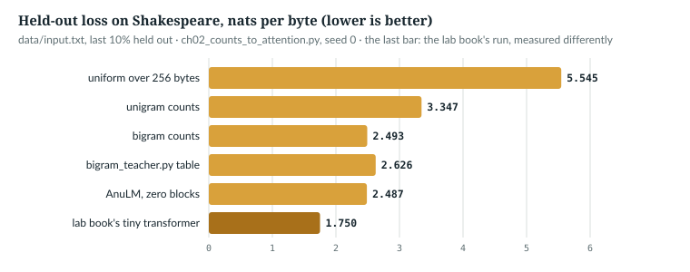
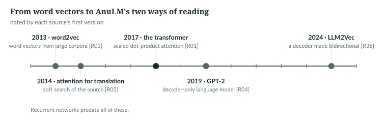
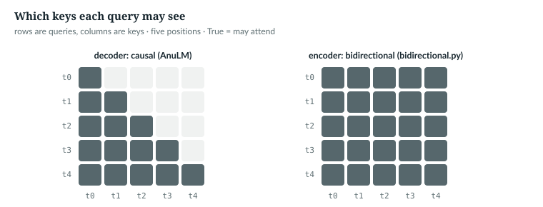

# 2  From counts to transformers

How much of the earlier text can a model use, and how cheaply? This chapter
answers historically, with a ladder of models scored on the lab book's
Shakespeare (`data/input.txt`, bytes, last 10% held out). The score is the
loss: the average of −ln p over every true next byte, in nats (Chapter 3).
Lower is better, and a uniform guess over 256 bytes scores ln 256 = 5.545.
The numbers come from `book/code-examples/ch02_counts_to_attention.py`
(**Book example, not repository code**).

---

## 2.1  Counting: no order, then one byte of order

A **unigram** model counts how often each byte occurs and ignores order, the
byte-level cousin of a bag of words. A **bigram** model counts which byte
follows each byte:

```python
def unigram_loss(train, val, V=256):
    counts = torch.ones(V).index_add_(0, train, torch.ones(len(train)))   # add-one smoothing
    p = counts / counts.sum()                                               # order ignored
    return -p[val[1:]].log().mean().item()


def bigram_loss(train, val, V=256, alpha=1.0):
    counts = torch.full((V, V), alpha)                                      # every pair starts at alpha (1: add-one)
    counts.index_put_((train[:-1], train[1:]), torch.ones(len(train) - 1), accumulate=True)
    p = counts / counts.sum(1, keepdim=True)                                # row = previous byte
    return -p[val[:-1], val[1:]].log().mean().item()
```

Counts start at 1 (add-one smoothing), so no pair is impossible. `index_put_`
with `accumulate=True` adds one at (previous, next) for every pair; dividing
each row by its sum gives P(next | previous). The repository keeps one count
model, as a training aid:

> **In the repo** · `anulm/bigram_teacher.py` · `build_bigram_teacher` · lines 42–51 · @fdbb09a

```python
    V = vocab_size
    ids = train_ids.to(device).long()
    uni = torch.bincount(ids, minlength=V).float() + 0.5
    log_uni = (uni / uni.sum()).log()
    pairs = ids[:-1] * V + ids[1:]
    keys, cnt = torch.unique(pairs, return_counts=True)
    prev, nxt = keys // V, keys % V
    n = torch.bincount(ids[:-1], minlength=V).float()[prev]
    lam = n / (n + 5.0)
    p_bi = lam * cnt.float() / n.clamp(min=1) + (1 - lam) * uni[nxt] / uni.sum()
```

`bincount` counts unigrams. Each pair becomes one integer, `prev · V + next`,
so `torch.unique` counts all pairs at once and keeps only those that occur; a
dense (V, V) table at V = 32,768 would hold a billion entries. λ = n/(n + 5)
blends in the unigram where the previous token is rare. Training can pull the
model toward this table early and fade it out (`docs/RESULTS.md` §32).

> **Details.** The ladder in 2.3 also scores this table as if it were a model,
> normalised the way `teacher_kl` (lines 65–70) normalises it: a softmax over
> scores in which each unseen pair keeps its full unigram score. That gives
> unseen pairs more than the blend's (1 − λ) share, takes mass from seen
> pairs, and costs 0.13 nats against the plain table: 2.6264 against 2.4931.
> The table was built as a soft target that fades out during training, not as
> a model.

`NOT IN THE REPO` (count models as models) · `IN THE REPO` (`anulm/bigram_teacher.py`)

## 2.2  Vectors instead of counts

A count table shares nothing between tokens; learned vectors can. word2vec
learned continuous vectors for words from large corpora [R03]. AnuLM begins
with a table of vectors and ends with a matrix:

> **In the repo** · `anulm/model.py` · `AnuLM.__init__` · lines 836–841 · @fdbb09a

```python
        self.embed_tokens = nn.Embedding(cfg.vocab_size, cfg.hidden_size)
        rope_dim = cfg.qk_rope_head_dim if cfg.attn == "mla" else cfg.head_dim
        self.rotary = Rotary(cfg, rope_dim)
        self.layers = nn.ModuleList([Block(cfg, i, self.rotary) for i in range(cfg.n_layer)])
        self.norm = RMSNorm(cfg.hidden_size, cfg.rms_norm_eps)
        self.lm_head = nn.Linear(cfg.hidden_size, cfg.vocab_size, bias=False)
```

With `n_layer = 0` the block list is empty, and the forward pass's loop does
nothing:

> **In the repo** · `anulm/model.py` · `AnuLM.forward` · lines 900–912 · @fdbb09a

```python
        aux_total = None
        for i, layer in enumerate(self.layers):
            # ...
                x, aux = layer(x, cos, sin, cache[i] if cache is not None else None, start)
            # ...
        x = self.norm(x)
```

(The elided lines are gradient checkpointing, which computes the same thing,
and the experts' regulariser.) What is left maps one token's vector to the
next token's logits: a learned bigram. The example trains it with `anulm/training/train.py`'s
own batches and optimizer:

```python
def zero_block_model(train, val, steps=1500, seed=0):
    torch.manual_seed(seed)
    cfg = AnuLMConfig(vocab_size=259, n_layer=0, hidden_size=64, n_head=4, block_size=len(val))
    model = AnuLM(cfg)
    args = SimpleNamespace(weight_decay=0.0, device="cpu", optimizer="adamw", lr=1e-2)
    opt = make_optimizer(model, args)                                       # train.py's AdamW
    g = torch.Generator().manual_seed(seed)
    model.train()
    for step in range(steps):
        ix = torch.randint(len(train) - 129, (32,), generator=g)
        x, y = make_batch(train, ix, 128, "cpu")                            # y = x shifted by one
        _, loss = model(x, y)
        opt.zero_grad()
        loss.backward()
        opt.step()
    model.eval()
    with torch.no_grad():                                                   # every pair of the split
        _, val_loss = model(val[:-1][None], val[1:][None])
    return model, val_loss.item(), sum(p.numel() for p in model.parameters())
```

V = 259 is `anulm/training/train.py`'s byte vocabulary, 256 bytes and three special ids. Each
step draws 32 windows of 128 bytes (Chapter 22's loop in miniature);
`block_size=len(val)` lets the evaluation score the whole held-out split as
one sequence.

`IN THE REPO` (the tables) · `NOT IN THE REPO` (word2vec)

## 2.3  The ladder

The example loads the lab book's split and runs every model on it:

```python
def load() -> tuple[torch.Tensor, torch.Tensor]:
    """The lab book's split (course/ch01-smallest-model/lab.py, load_bytes)."""
    data = torch.tensor(list((ROOT / "data" / "input.txt").read_bytes()), dtype=torch.long)
    cut = int(0.9 * len(data))
    return data[:cut], data[cut:]
```

```python
    train, val = load()
    print(f"data/input.txt: {len(train):,} training bytes, {len(val):,} held-out bytes")
    uniform = math.log(256)
    uni, bi, teach = unigram_loss(train, val), bigram_loss(train, val), teacher_loss(train, val)
    model, zero, n_params = zero_block_model(train, val)
    course = json.loads((ROOT / "course" / "ch01-smallest-model" / "results.json").read_text())
    # ...
```

```text
held-out loss, nats per byte
  uniform guess over 256 bytes               5.5452
  unigram counts (order ignored)             3.3475
  bigram counts (one byte back)              2.4931
  bigram_teacher.py's table                  2.6264
  AnuLM, zero blocks (33,216 params)         2.4871
  lab book's tiny transformer (recorded)     1.7505
```

*verified*: printed by the book example, seed 0, on a CPU;
`book/measurements/part_i_ii_ladder.json`. The bigram row reproduces the lab
book's 2.4931 (asserted). The last row is the lab book's own recorded run
(`course/ch01-smallest-model/results.json`), and it is measured differently:
the mean over 20 random batches of 32 windows of 128 bytes, by a different
model (LayerNorm and learned position vectors, 0.9M parameters). Read it as
the order of magnitude a transformer reaches, not to the third decimal.



*Figure 2.1 · The ladder.* The same numbers. *verified*, same file.

Frequency alone is worth 2.20 nats; one byte of order adds 0.85. The
zero-block AnuLM lands 0.006 below the count table, and smoothing accounts
for that: less of it moves the table below the zero-block model.

```python
    smooth = {a: bigram_loss(train, val, alpha=a) for a in (0.5, 0.1)}
    print("bigram counts with less smoothing: " + ", ".join(f"add-{a}: {v:.4f}" for a, v in smooth.items()))
```

```text
bigram counts with less smoothing: add-0.5: 2.4878, add-0.1: 2.4850
```

*verified*: printed by the example. On bytes, where every common pair is seen
thousands of times, learned vectors buy nothing over counts; with a large
vocabulary of rare tokens they might, *not measured here*. The jump to 1.75
needs a model that reads further back.

`IN THE REPO` (the zero-block model) · `NOT IN THE REPO` (count models as models)

## 2.4  Reading further back: recurrence, then attention

Change every token but the last, and see how far the last logits move:

```python
def last_logits_move(model, vocab, seed=0) -> float:
    """Change every token but the last; how far do the last position's logits move?"""
    torch.manual_seed(seed)
    a = torch.randint(0, vocab, (1, 16))
    b = torch.randint(0, vocab, (1, 16))
    b[0, -1] = a[0, -1]
    with torch.no_grad():
        return (model(a)[0] - model(b)[0]).abs().max().item()
```

The script runs it on the trained zero-block model and on an untrained
`tiny()`, which has three blocks, and asserts the results along with the
ladder's:

```python
    assert abs(bi - course["bigram_val_loss"]) < 1e-3, "the count table should reproduce the lab book's 2.4931"
    assert abs(zero - bi) < 0.05, "a model with no blocks can only learn a bigram"
    zero_move = last_logits_move(model, 259)
    torch.manual_seed(0)
    deep_move = last_logits_move(AnuLM(tiny()).eval(), 64)
    # ...
    assert zero_move == 0.0 and deep_move > 1e-4
```

```text
last-position logits move when earlier tokens change:
  zero blocks     0.00e+00
  tiny(), 3 blocks 8.77e-02
```

*verified*: printed by the example. With no blocks the past cannot reach the
output at all. Two designs let it in:

- A **recurrent network** (RNN) carries a state vector from position to
  position, updating it with each token: unlimited context in principle, but
  one position at a time. Elman's network feeds its hidden state back to
  itself, a memory of its earlier states [S14]; the LSTM adds gate units that
  keep error flowing across time lags of more than 1,000 steps [S15].
- **Attention.** In 2014 a translation model learned to soft-search the source
  sentence for the parts relevant to each target word [R02]. The 2017
  **transformer** was built from scaled dot-product and multi-head attention
  [R01]: every position reads every allowed position in one parallel step
  (Chapter 11).



*Figure 2.2 · Five dated steps.* Each at its source's first-version year.

`NOT IN THE REPO` (recurrence; the 2014 model) · `IN THE REPO` (attention, Chapter 11)

## 2.5  Encoder, decoder, and why AnuLM is a decoder

The 2017 transformer had an encoder and a decoder [R01]. An **encoder** reads
the whole input, every position seeing every other; BERT pre-trains such
representations, conditioning on left and right context in all layers [S01].
A **decoder** writes one
token at a time, each position seeing only earlier ones. GPT-2 was a decoder
only, trained as a language model on web text [R04]. AnuLM is a decoder too:

> **In the repo** · `anulm/model.py` · `_sdpa` · lines 414–418 · @fdbb09a

```python
def _sdpa(q, k, v, mask, S, scale, dropout_p):
    return F.scaled_dot_product_attention(
        q, k, v, attn_mask=mask, is_causal=(mask is None and S > 1),
        scale=scale, dropout_p=dropout_p,
    )
```

With no explicit mask and more than one query, `is_causal` hides every later
position (Chapter 12). Reading one way gives three things: S graded
predictions per window of S tokens (Chapter 3); generation that is just
reading one more token; and a past that never changes, so it can be cached:

> **In the repo** · `anulm/model.py` · `GQAttention.forward` · lines 470–476 · @fdbb09a

```python
        if cache is not None:
            # Cache the Hkv heads, not their H broadcast copies -- that ratio
            # (16:1 in the real 30B) is GQA's entire inference saving.
            if "k" in cache:
                k = torch.cat([cache["k"], k], dim=2)
                v = torch.cat([cache["v"], v], dim=2)
            cache["k"], cache["v"] = k, v
```

Each call appends the new tokens' keys and values (Chapter 11) along the
position axis, dimension 2. The comment's terms: H<sub>kv</sub> is the number
of key/value heads, fewer than the H query heads, which share them
(grouped-query attention, Chapter 13); "the 30B" is the Sarvam model AnuLM
follows. In a bidirectional model a new token would change every earlier
position, and the cache would go stale (Chapter 27).



*Figure 2.3 · Who may see whom.* *verified*: the causal grid is
`_attn_mask(5, 5, 0, 5, "cpu")`'s output: a window as wide as the sequence.

`IN THE REPO`

## 2.6  The one place AnuLM reads both ways

For classification (Chapter 32), a causal model reads each option against the
message and the options before it, never those after. `anulm/bidirectional.py`
makes the decoder an encoder, following LLM2Vec's bidirectional attention and
masked next-token prediction [R35]:

> **In the repo** · `anulm/bidirectional.py` · `bidir_hidden` · lines 40–53 · @fdbb09a

```python
def bidir_hidden(m: AnuLM, idx: torch.Tensor, attn: torch.Tensor | None = None) -> torch.Tensor:
    """Final hidden states with bidirectional attention. `attn` (B, S) marks
    real tokens; padding is never attended to."""
    if attn is None:
        attn = torch.ones_like(idx, dtype=torch.bool)
    key = attn.bool()[:, None, None, :]
    x = F.embedding(idx, m._table("in"))
    cos, sin = m.rotary(idx.shape[1], x.device, x.dtype)
    for layer in m.layers:
        if m.grad_ckpt and m.training:
            x, _ = torch.utils.checkpoint.checkpoint(layer, x, cos, sin, None, 0, key, use_reentrant=False)
        else:
            x, _ = layer(x, cos, sin, bidir_mask=key)
    return m.norm(x)
```

It repeats `AnuLM.forward`'s steps with one change: each block gets
`bidir_mask`, (B, 1, 1, S), `True` for every real token, which
`GQAttention.forward` uses instead of the causal mask (line 481).
`m._table("in")` is the input embedding table (Chapter 10). No cache, no
head: it returns the normalised vectors, (B, S, D). The adaptation that
follows is masked next-token prediction (MNTP): hide 20% of the tokens and
predict each one from the position before it:

> **In the repo** · `anulm/bidirectional.py` · `adapt` · lines 82–93 · @fdbb09a

```python
        masked = torch.rand(x.shape, device=x.device) < a.mask_frac
        masked[:, 0] = False                              # position 0 has no previous position
        inp = x.masked_fill(masked, mask_id)
        lr = a.lr * min(1.0, (step + 1) / 100) * max(0.0, 1 - step / a.steps)
        for g in opt.param_groups:
            g["lr"] = lr
        with ac:
            h = bidir_hidden(m, inp)
            # MNTP: the token at position i is predicted from position i-1
            tgt = x[:, 1:].masked_fill(~masked[:, 1:], -1)
            logits = m.lm_head(h[:, :-1])
        loss = F.cross_entropy(logits.float().reshape(-1, logits.shape[-1]), tgt.reshape(-1), ignore_index=-1)
```

Hidden tokens are replaced by a placeholder id; targets are kept only where a
token was hidden, −1 elsewhere, so only the hidden tokens are graded. Did it
help? On BANKING77 intent classification, the bidirectional version scored
+0.3 points trained and 1.6 points worse zero-shot: within noise, so making
AnuLM bidirectional did not help there (`docs/RESULTS.md` §36).

`IN THE REPO`

## 2.7  Exercises

1. Why does the zero-block model's last output not move at all?
2. Express the unigram–bigram gap, 0.85 nats per byte, in bits per byte.

**Answers.**
1. With no blocks, position s's output is `lm_head(norm(embed(x_s)))`, a
   function of token s alone.
2. 0.85 / ln 2 ≈ 1.23 bits per byte (Chapter 3).

> **Build it.** The lab book's Chapters 1 and 4 (`course/ch01-smallest-model`,
> `course/ch04-skeleton`) build the count table and hit the same ceiling.

---

## Key points

- A unigram ignores order (3.35 nats per byte on Shakespeare); a bigram uses
  one byte of it (2.49); a transformer that reads further back reaches 1.75.
- Learned vectors replace counts; with no blocks, AnuLM is exactly a learned
  bigram, and on bytes it lands on the count table's loss.
- With no blocks the past cannot move the output at all; attention is what
  lets earlier tokens in.
- Recurrent networks read one step at a time; the transformer's scaled
  dot-product attention reads every allowed position in one parallel step
  [R01].
- AnuLM is a decoder: causal attention, one prediction per position, and a
  cache of the past that never has to be recomputed.
- `anulm/bidirectional.py` is the one place the decoder reads both ways; for
  classification it did not help (`docs/RESULTS.md` §36).

> **In one breath.** Counting gives a unigram and a bigram; vectors make the
> bigram learnable but, on bytes, no better; only reading further back beats it, first
> with recurrence, then with attention. AnuLM keeps the transformer's decoder
> half, causal and cacheable, and turns it bidirectional in one file.

## References

Research references cited in this chapter (`RESEARCH_REFERENCES.md`), each
used only for the claim in its register row:

| ID | Used for | Status |
|---|---|---|
| [R01] | the transformer: scaled dot-product and multi-head attention; the encoder–decoder structure | CHECKED |
| [R02] | 2014 attention as a soft search of the source sentence | CHECKED |
| [R03] | word2vec: continuous word vectors learned from large corpora | CHECKED |
| [R04] | GPT-2, a decoder-only language model trained on WebText | CHECKED |
| [R35] | LLM2Vec: bidirectional attention and masked next-token prediction | CHECKED |
| [S01] | BERT: deep bidirectional representations, conditioned on left and right context | CHECKED |
| [S14] | Elman's recurrent links: hidden state fed back as a memory of prior states | CHECKED |
| [S15] | LSTM: gate units keeping error flow constant over long time lags | CHECKED |


Repository evidence, all at @fdbb09a:
- `anulm/model.py`: `_sdpa` 414–418; `GQAttention.forward` 470–476, 481;
  `AnuLM.__init__` 836–841; `AnuLM.forward` 900–912.
- `anulm/bigram_teacher.py`: `build_bigram_teacher` 34–62 (counts 42–51),
  `teacher_kl` 65–70.
- `anulm/bidirectional.py`: `bidir_hidden` 40–53; `adapt` 56–105 (MNTP 82–93).
- `docs/RESULTS.md` §32 (the teacher) and §36 (bidirectional for Decide).
- `anulm/training/train.py`: `make_batch` 237–250, `make_optimizer` 447–474.
- `course/ch01-smallest-model/results.json`: the lab book's recorded bigram
  (2.4931) and tiny transformer (1.7505).
- Measurements: `book/measurements/part_i_ii_ladder.json`.

The book example is `code-examples/ch02_counts_to_attention.py`.
