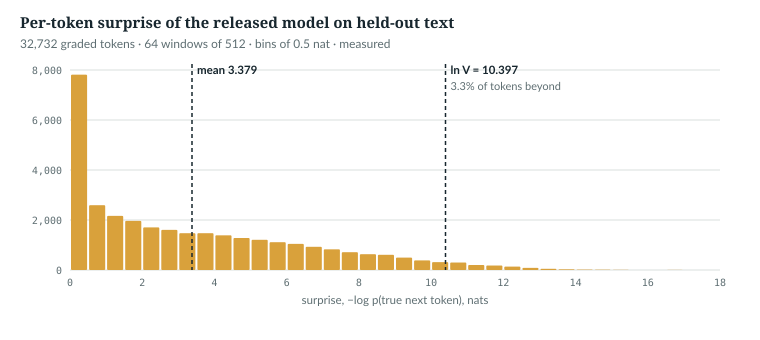
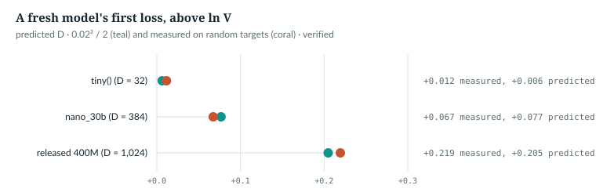

# 3  The one job: a probability for every next token

AnuLM learns from one number: how surprised it was by each true next token.
This chapter recomputes that loss, explains why a fresh model starts at ln V,
and converts it to bits per byte. Numbers come from
`book/code-examples/ch03_one_job.py` and, for the released model,
`measure_part_i_ii.py` (both **Book example, not repository code**).

---

## 3.1  The job, as tensors

The batch makes the next tokens by shifting:

> **In the repo** · `anulm/training/train.py` · `make_batch` · lines 237–247 · @fdbb09a

```python
def make_batch(data: torch.Tensor, ix: torch.Tensor, block_size: int, device: str):
    if isinstance(data, np.ndarray):            # a memory-mapped corpus (load_memmap)
        rows = np.stack([data[i: i + block_size + 1] for i in ix.tolist()]).astype(np.int64)
        x, y = torch.from_numpy(rows[:, :-1]), torch.from_numpy(rows[:, 1:])
    else:
        x = torch.stack([data[i: i + block_size] for i in ix]).long()
        y = torch.stack([data[i + 1: i + 1 + block_size] for i in ix]).long()
```

For each of the B offsets in `ix`, the memory-mapped branch reads
`block_size + 1` ids; `x` drops the last and `y` the first, both (B, S). So
`y[b, s]` follows `x[b, s]`: S predictions to grade per window.

`IN THE REPO`

## 3.2  Loss as average surprise

For each position the model outputs V logits, and the softmax turns them into
probabilities p (Chapter 5). If the true next token is t, the model's
**surprise** is −log p[t]: 0 when it was certain and right, large when it gave
t little probability. The **loss** is the mean surprise over graded positions:

> **In the repo** · `anulm/model.py` · `AnuLM.forward` · lines 922–928 · @fdbb09a

```python
        logits = self._head(x)
        loss = F.cross_entropy(
            logits.view(-1, logits.size(-1)).float(), targets.reshape(-1), ignore_index=-1
        )
        if aux_total is not None:
            loss = loss + aux_total
        return logits, loss
```

`_head` maps the final (B, S, D) vectors to (B, S, V) logits; `view` and
`reshape` flatten logits and targets to (B·S, V) and (B·S,).
`F.cross_entropy` takes −log softmax(row)[target] per row and averages, in
fp32 (Chapter 5). Rows whose target is −1 are skipped, in the sum and the
count; fine-tuning marks prompt tokens that way (Chapter 30). `aux_total` is
the experts' regulariser: `None` in evaluation mode and when both of its
coefficients are 0, the default; the released run trained with both on, at
10⁻⁴ and 10⁻³ (Chapter 18). By hand:

```python
def surprise_by_hand(logits: torch.Tensor, targets: torch.Tensor) -> torch.Tensor:
    """Mean of -log p(target) over the positions whose target is not -1."""
    logp = F.log_softmax(logits.float(), dim=-1)                  # (B, S, V): log-probabilities
    keep = targets != -1                                          # (B, S): graded positions
    s = -logp[keep].gather(1, targets[keep][:, None])[:, 0]       # (n,): one surprise per graded token
    return s.mean()
```

`logp[keep]` keeps the n graded rows, (n, V); `gather` picks each row's
target entry. The check runs it beside the model:

```python
def check_loss() -> None:
    torch.manual_seed(0)
    cfg = tiny()
    model = AnuLM(cfg).eval()
    x = torch.randint(0, cfg.vocab_size, (2, 8))
    y = torch.randint(0, cfg.vocab_size, (2, 8))
    y[:, :3] = -1                                                 # a prompt: not graded
    with torch.no_grad():
        logits, loss = model(x, y)
    mine = surprise_by_hand(logits, y)
    print(f"model loss {loss.item():.6f}   by hand {mine.item():.6f}   graded {(y != -1).sum().item()} of {y.numel()}")
    assert abs(loss.item() - mine.item()) < 1e-5
```

```text
model loss 4.183871   by hand 4.183871   graded 10 of 16
```

*verified*: asserted to 10⁻⁵.

`IN THE REPO`

## 3.3  Nats, bits and perplexity

The natural log gives **nats**; divided by ln 2 they are **bits**.
e<sup>loss</sup> is the **perplexity**: the size of an equally uncertain
uniform choice. The measurement script runs the released model on 64 windows
of 512 tokens drawn (numpy seed 0) from the held-out split of its own corpus,
the same windows Chapter 20 uses, and keeps one surprise per graded token.
The mean is 3.379 nats per token: 4.875 bits, perplexity 29.3,
against V = 32,768. The spread is wide:

| Tokens whose surprise is | Share of tokens | Share of the total loss |
|---|---|---|
| below 0.1 nats (p above 0.90) | 13.4% | |
| below 1 nat (p above 0.37) | 31.8% | |
| 6 nats or more (p below 0.0025) | 21.3% | 52.7% |
| 8 nats or more | 10.5% | 30.8% |
| above ln V = 10.397 (worse than uniform) | 3.3% | |

| Statistic | Value |
|---|---|
| median surprise | 2.54 nats |
| largest surprise | 17.40 nats |
| top guess right | 40.1% of tokens |

*measured*: `ckpt_base_v2.pt` on `data/v2/val.u16`, 32,732 graded tokens, at
the settings of Appendix F, F.6; `book/measurements/part_i_ii_released.json`.
`docs/RESULTS.md` §39's 3.3523 ± 0.049 was read differently, on 400 evenly
spaced 1,024-token windows in bf16, so the two agree only to about the error
bar.

> **Details.** The script's loop, which keeps one surprise per graded token:
>
> ```python
>             rows = np.stack([val[s: s + SEQ + 1] for s in starts[b: b + BATCH]]).astype(np.int64)
>             x = torch.from_numpy(rows[:, :-1]).to(dev)
>             y = torch.from_numpy(rows[:, 1:]).to(dev).masked_fill(torch.from_numpy(rows[:, :-1]).to(dev) == EOS, -1)
>             batches.append((x, y))
>             logits, loss = m(x, y)
>             keep = y != -1
>             z = logits[keep].float()                                    # (n, V) graded positions
>             t = y[keep]
>             logp = F.log_softmax(z, -1)
>             s = -logp.gather(1, t[:, None])[:, 0]
>             surprise.append(s.cpu())
>             top1.append((z.argmax(-1) == t).cpu())
> ```
>
> Rows split as in `make_batch`; a target after an end-of-document id (32,767)
> is set to −1.



*Figure 3.1 · How surprised the released model is.* Per-token surprise in
half-nat bins: 23.9% of tokens fall in the first bin, and a long tail reaches
past ln V. *measured*, same file.

Most of the loss is in the tail: a fifth of the tokens carry over half of it.

> **Details.** The script's shares, from the per-token surprises `s`:
>
> ```python
>            "tail": {str(c): {"share_of_tokens": (s >= c).double().mean().item(),
>                              "share_of_loss": (s[s >= c].sum() / s.sum()).item()} for c in (4, 6, 8)},
> ```

`MEASURED`

## 3.4  Why a fresh model sits at ln V

A model that gives every id probability 1/V has surprise ln V on every token.
An untrained AnuLM is close to that because its weights start small:

> **In the repo** · `anulm/model.py` · `AnuLM.__init__` · lines 859–863 · @fdbb09a

```python
        self.apply(self._init_weights)
        # nanoGPT's scaled init for the residual output projections.
        for name, p in self.named_parameters():
            if name.endswith(("o_proj.weight", "dense.weight", "down_proj.weight")):
                nn.init.normal_(p, mean=0.0, std=cfg.initializer_range / math.sqrt(2 * cfg.n_layer))
```

> **In the repo** · `anulm/model.py` · `AnuLM._init_weights` · lines 865–871 · @fdbb09a

```python
    def _init_weights(self, m):
        if isinstance(m, nn.Linear):
            nn.init.normal_(m.weight, mean=0.0, std=self.cfg.initializer_range)
            if m.bias is not None:
                nn.init.zeros_(m.bias)
        elif isinstance(m, nn.Embedding):
            nn.init.normal_(m.weight, mean=0.0, std=self.cfg.initializer_range)
```

`self.apply` calls `_init_weights` on every submodule, so each linear map and
the embedding table start from N(0, 0.02²) (`initializer_range`). The loop in
`__init__` then shrinks, by √(2L) for L layers, the projections that write
into the residual stream, the running sum of vectors each layer adds to
(Chapter 15).

The model's last step before the head is an RMSNorm,
which divides each vector by its root mean square (Chapter 15), leaving it
with root mean square 1. So a logit, a sum of D such entries times N(0, 0.02²)
weights, has variance σ² = D · 0.02². For z ~ N(0, σ²), E[e<sup>z</sup>] =
e<sup>σ²/2</sup>, so for many independent logits the log of the softmax's
denominator, log Σ e<sup>z</sup>, is about ln(V · e<sup>σ²/2</sup>) =
ln V + σ²/2. The target's own logit is 0 on average, so the first loss is
about **ln V + D · 0.02²/2**:

```python
def initial_loss(cfg: AnuLMConfig, B: int = 16, S: int = 128, seed: int = 0) -> tuple[float, float]:
    """Measured loss of a fresh model on random targets, and the prediction ln V + D * std**2 / 2."""
    torch.manual_seed(seed)
    model = AnuLM(cfg).eval()
    S = min(S, cfg.block_size)
    x = torch.randint(0, cfg.vocab_size, (B, S))
    y = torch.randint(0, cfg.vocab_size, (B, S))
    with torch.no_grad():
        _, loss = model(x, y)
    var = cfg.hidden_size * cfg.initializer_range ** 2           # each logit's variance at init
    return loss.item(), math.log(cfg.vocab_size) + var / 2
```

The script runs it on three configurations at std 0.02 and one at std 1.0:

```python
    for name, cfg in [("tiny()", tiny()), ("nano_30b", AnuLMConfig.nano_30b()), ("released 400M", released()),
                      ("tiny(), init std 1.0", tiny(initializer_range=1.0))]:
        got, pred = initial_loss(cfg)                       # 16 sequences of up to 128 tokens: a small sample
        # ...
        if "1.0" not in name:
            assert abs(got - pred) < 0.05, "the small-variance prediction should hold at std 0.02"
```

```text
  tiny()                 V=    64 D=   32  loss  4.1704  ln V  4.1589  predicted  4.1653
  nano_30b               V=   259 D=  384  loss  5.6242  ln V  5.5568  predicted  5.6336
  released 400M          V= 32768 D= 1024  loss 10.6166  ln V 10.3972  predicted 10.6020
  tiny(), init std 1.0   V=    64 D=   32  loss 14.5305  ln V  4.1589  predicted 20.1589
```

*verified*: printed by `ch03_one_job.py`, on 512 random tokens for `tiny()`
(its context is 32) and 2,048 for the others; across seeds 0 to 3 every
std-0.02 case stayed within 0.015 of its prediction. At std 1.0 the logits are
large, the small-σ approximation fails, and the loss is three and a half
times ln V. The released model's trained 3.379 is about 7.2 nats below where a
fresh model of its shape starts.



*Figure 3.2 · Where a fresh model starts.* Distance of the first loss above
ln V, predicted and measured, for the three models at std 0.02. *verified*:
the figure reruns `initial_loss`.

The test suite pins this:

> **In the repo** · `tests/test_model.py` · `initial_loss_is_ln_vocab` · lines 349–359 · @fdbb09a

```python
def initial_loss_is_ln_vocab():
    for attn in ("gqa", "mla"):
        torch.manual_seed(0)
        cfg = tiny(attn=attn)
        m = AnuLM(cfg).eval()
        x = torch.randint(0, cfg.vocab_size, (4, 32))
        with torch.no_grad():
            _, loss = m(x, x)
        expected = math.log(cfg.vocab_size)
        assert abs(loss.item() - expected) < 0.35, \
            f"{attn}: init loss {loss.item():.3f}, expected ~{expected:.3f} -- init is off"
```

For both attention types it builds `tiny()`, scores random ids against
themselves (an untrained model cannot exploit that), and requires the loss
within 0.35 of ln 64. A model initialised at std 1.0 misses by about 10.

> **Details.** `anulm/model.py` runs the same check on its two presets when
> executed directly:
>
> > **In the repo** · `anulm/model.py` · `__main__` · lines 1196–1205 · @fdbb09a
>
> ```python
>         x = torch.randint(0, cfg.vocab_size, (2, 64))
>         model.train()
>         logits, loss = model(x, x)
>         loss.backward()
>         # Smoke test: an untrained model should sit at ln(V), every parameter
>         # should have received a gradient, and the bias update should run.
>         no_grad = [n for n, p in model.named_parameters() if p.grad is None]
>         imbalance = model.update_expert_biases()
>         print(f"{'':18s}  logits {tuple(logits.shape)}  loss {loss.item():.4f}  "
>               f"(ln(V) = {math.log(cfg.vocab_size):.4f})")
> ```
>
> ```text
> nano_30b (GQA)      total  17.44M   active/token   6.60M (37.9%)   layers 8
>                     logits (2, 64, 259)  loss 5.6245  (ln(V) = 5.5568)
>                     [two more lines for nano_30b, and the nano_105b block, omitted]
> ```
>
> *verified*: `python -m anulm model` at the pin, output trimmed. 5.6245 is ln V plus
> 0.068, close to the σ²/2 = 0.077 of the table above.

`IN THE REPO`

## 3.5  Bits per byte

Loss per token cannot compare models with different tokenizers: a token of
the 32,768-id vocabulary covers 6.4 bytes of this corpus on average, a byte
token covers one. Dividing by the bytes each token covers removes that:

> **In the repo** · `anulm/training/train.py` · `main` · lines 906–908 · @fdbb09a

```python
            bpb = val / math.log(2) / args.bytes_per_token
            print(f"  eval @ {step:5d} | val loss {val:6.4f} +/- {val_sem:.4f} | "
                  f"bits/byte {bpb:5.3f}{flag}")
```

`val` is in nats per token. `bytes_per_token` starts at 1.0, right for byte
data, and is replaced by the corpus's own figure for BPE data, read from the
corpus's metadata. For the released model's corpus that `meta.json` says
6.397; it is local corpus metadata, not part of the repository.

> **Details.** Where `main` reads the figure:
>
> > **In the repo** · `anulm/training/train.py` · `main` · lines 656–671 · @fdbb09a
>
> ```python
>     tokenizer_path, vocab_size, args.bytes_per_token = None, 259, 1.0
>     # ...
>     split_encoded = bool(args.data and args.data.endswith("splits.json"))
>     memmapped = bool(args.data and args.data.endswith("meta.json"))
>     if split_encoded:
>         train_data, val_data, test_data, meta = load_encoded_splits(args.data)
>         # ...
>         args.bytes_per_token = meta["bytes_per_token"]
>         # ...
>     elif memmapped:
>         train_data, val_data, meta = load_memmap(args.data)
>         vocab_size, tokenizer_path = meta["vocab_size"], meta["tokenizer"]
>         args.bytes_per_token = meta["bytes_per_token"]
> ```
>
> Both corpus formats carry the figure in their metadata: `splits.json`, a
> document-grouped build with a test split, and `meta.json`, the format the
> released model was trained from.

The example repeats the conversion:

```python
def bits_per_byte(nats_per_token: float, bytes_per_token: float) -> float:
    return nats_per_token / math.log(2) / bytes_per_token         # anulm/training/train.py line 906
```

```python
    meta = json.loads((ROOT / "data" / "v2" / "meta.json").read_text())
    print(f"\nbytes per token in data/v2 (meta.json): {meta['bytes_per_token']}")
    for label, nats in [("RESULTS.md §39 final val", 3.3523), ("Chapter 20 sample", 3.3790)]:
        print(f"  {label:26s} {nats:.4f} nats/token = {nats / math.log(2):.3f} bits/token = "
              f"{bits_per_byte(nats, meta['bytes_per_token']):.4f} bits/byte")
```

```text
bytes per token in data/v2 (meta.json): 6.397
  RESULTS.md §39 final val   3.3523 nats/token = 4.836 bits/token = 0.7560 bits/byte
  Chapter 20 sample          3.3790 nats/token = 4.875 bits/token = 0.7621 bits/byte
```

*verified*: printed by `ch03_one_job.py`. The final validation loss and its
0.756 bits per byte are the model card's (`docs/MODEL_CARD_BASE_V2.md` lines
32–33). 6.397 is a corpus-wide average: by the same local metadata, Hindi web
text runs 9.4 bytes per token (a Devanagari character is 3 bytes of UTF-8) and
English 4.4, so a sample with its own mix has its own figure (Chapter 24).

`IN THE REPO`

## 3.6  Common mistakes, and how to catch them

- **Unshifted targets.** `model(x, x)` grades each token against itself; a
  trained model learns to copy. The tests use it only untrained. *Catch it:*
  check `y[:, :-1] == x[:, 1:]` for a language-model batch.
- **Averaging over ungraded positions.** Dividing by B·S when some targets
  are −1 understates the loss. *Catch it:* compare with 3.2's check.

`IN THE REPO`

## 3.7  Exercises

1. A model's loss is 2.0 nats per token on byte data. What is it in bits per
   byte, and what is its perplexity?
2. Predict the first loss of a fresh `tiny()` with `hidden_size=512` and
   `head_dim=8`, using 3.4's formula.

**Answers.**
1. 2.0 / ln 2 = 2.885 bits per byte; perplexity e² ≈ 7.39.
2. ln 64 + 512 · 0.0004 / 2 = 4.1589 + 0.1024 = 4.261.

*verified*: by arithmetic.

> **Build it.** The lab book's Chapter 1 (`course/ch01-smallest-model`)
> defines surprise and loss on bytes; its Chapter 4 (`course/ch04-skeleton`)
> checks a fresh model against ln V.

---

## Key points

- The batch makes the job: `y` is `x` shifted by one, so a window of S tokens
  gives S predictions.
- The loss is the mean surprise, −log p(true next token), over positions whose
  target is not −1; `F.cross_entropy` computes it in fp32.
- Nats divided by ln 2 are bits; e<sup>loss</sup> is the perplexity. The
  released model: 3.379 nats, 4.875 bits, perplexity 29.3, top-1 right 40.1%.
- Most of the loss is in a tail: the median surprise is 2.54 nats, but the 21%
  of tokens at 6 nats or more carry 53% of the loss.
- A fresh model starts at about ln V + D · 0.02²/2, because its logits are
  small; `initial_loss_is_ln_vocab` holds it within 0.35 of ln V.
- Bits per byte divides by the bytes each token covers, so tokenizers compare:
  0.756 for the released model's final validation loss.

> **In one breath.** The model's one job is a probability for the true next
> token; the loss is the mean of −log of it, in nats. Small initial weights
> put a fresh model near ln V, training brought the released one to 3.38 nats,
> and dividing by ln 2 and by 6.4 bytes per token gives 0.76 bits per byte.

## References

This chapter cites no research references.

Repository evidence, all at @fdbb09a:
- `anulm/model.py`: `AnuLM.__init__` 859–863, `AnuLM._init_weights` 865–871,
  `AnuLM.forward` 922–928, `__main__` 1183–1208.
- `anulm/training/train.py`: `make_batch` 237–250; `main` 656–671 (bytes per token) and
  906–908 (bits per byte).
- `tests/test_model.py`: `tiny` 44–49, `initial_loss_is_ln_vocab` 349–359.
- `docs/MODEL_CARD_BASE_V2.md` lines 32–33: final validation loss 3.3523 and
  0.756 bits per byte; `docs/RESULTS.md` §39.
- Local corpus metadata, `data/v2/meta.json` (not in the repository): 6.397
  bytes per token overall, 9.371 for Hindi web text, 4.426 for English.
- Measurements: `book/measurements/part_i_ii_released.json`, written by
  `code-examples/measure_part_i_ii.py`.

The book example is `code-examples/ch03_one_job.py`.
