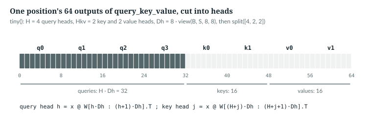
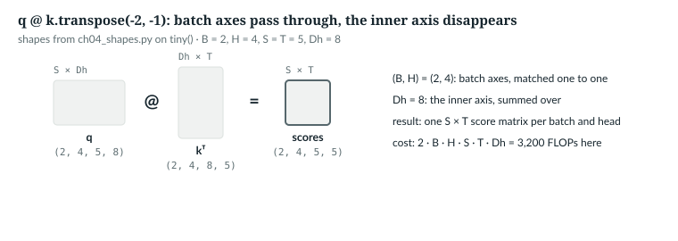

# 4  Tensors, shapes and the matrix multiply

Part II rebuilds the mathematics the book uses, on the lines of AnuLM that
need it. This chapter is about shapes: reading `(B, S, D)`; what `nn.Linear`,
`view`, `split`, `transpose` and broadcasting do; and what a matrix multiply
costs. `book/code-examples/ch04_shapes.py` (**Book example, not repository
code**) replays `GQAttention.forward` by hand on `tiny()`, checking each step
against the module. Its driver:

```python
    torch.manual_seed(0)
    model = M.AnuLM(tiny()).eval()
    attn = model.layers[0].attn
    x = torch.randn(2, 5, 32)                            # (B, S, D)
    with torch.no_grad():
        qkv = linear_is_x_wT(attn, x)
        q, k, v = heads_by_hand(attn, x, qkv)
        kk, vv = k.repeat_interleave(attn.n_rep, dim=1), v.repeat_interleave(attn.n_rep, dim=1)
        y = M._sdpa(q, kk, vv, None, 5, attn.scale, 0.0)          # attention's output, (B, H, S, Dh)
        print(f"_sdpa output {tuple(y.shape)} strides {y.stride()} contiguous: {y.is_contiguous()}")
        y2 = M._sdpa(q.contiguous(), kk, vv, None, 5, attn.scale, 0.0)          # the same, from a contiguous q
        print(f"_sdpa output from a contiguous q: strides {y2.stride()} contiguous: {y2.is_contiguous()}")
        view_needs_contiguous(y.contiguous())          # a copy laid out as (B, H, S, Dh)
        # ...
```

**New words for Part II.**

| Term | Meaning |
|---|---|
| tensor | an n-dimensional array of numbers with one dtype, such as fp32 or bf16 |
| shape | the size of each axis, written (B, S, D); in a contiguous tensor the last axis varies fastest in memory |
| stride | how many elements to step in memory to move one place along an axis |
| broadcasting | stretching size-1 axes so two tensors of different shapes combine elementwise |
| gradient | the derivative of the loss with respect to each parameter (Chapter 6) |
| learning rate | the size of each optimiser step (Chapter 7) |

**Notation for Part II.** Sizes are plain capitals, as in Part IV:

| Symbol | Meaning | `tiny()` | Released 400M |
|---|---|---|---|
| B | sequences in a batch | 2 here | any |
| S | tokens per sequence in this call | 5 here | up to 1,024 |
| T | key length (T = S without a cache) | 5 here | up to 1,024 |
| D | hidden size, `hidden_size` | 32 | 1,024 |
| H, H<sub>kv</sub> | query heads, key/value heads | 4, 2 | 16, 4 |
| D<sub>h</sub> | width of one head, `head_dim` | 8 | 64 |
| V | vocabulary size | 64 | 32,768 |

---

## 4.1  Shapes are types

A shape is the most useful type annotation a tensor has; AnuLM writes them as
comments, as on `GQAttention.forward`'s lines 432–434 (4.3). The dangerous bugs are shapes that are right in
size but wrong in meaning: two axes swapped, a head read from the wrong slice.
The running input is `x`, a (2, 5, 32) tensor: B = 2 sequences of S = 5
positions, each a D = 32 vector.

`IN THE REPO`

## 4.2  `nn.Linear` computes x Wᵀ

The attention layer's two matrices are built here:

> **In the repo** · `model.py` · `GQAttention.__init__` · lines 412–416 · @773b6a8

```python
        # One fused projection: (H + 2*Hkv) * Dh, exactly as the 30B does.
        self.query_key_value = nn.Linear(
            cfg.hidden_size, (cfg.n_head + 2 * cfg.n_kv_head) * cfg.head_dim, bias=False
        )
        self.dense = nn.Linear(cfg.n_head * cfg.head_dim, cfg.hidden_size, bias=False)
```

`nn.Linear(in, out)` stores a weight of shape **(out, in)** and computes
`x @ W.T` (plus a bias, absent here). For `tiny()`, in = D = 32 and out =
(4 + 2·2)·8 = 64:

```python
def linear_is_x_wT(attn: M.GQAttention, x: torch.Tensor) -> torch.Tensor:
    W = attn.query_key_value.weight                     # (out, in) = ((H + 2Hkv) * Dh, D)
    mine = x @ W.T                                      # (B, S, D) @ (D, out) -> (B, S, out)
    theirs = attn.query_key_value(x)
    print(f"W {tuple(W.shape)}   x {tuple(x.shape)}   x @ W.T {tuple(mine.shape)}")
    assert torch.allclose(mine, theirs, atol=1e-6)
    return theirs
```

```text
W (64, 32)   x (2, 5, 32)   x @ W.T (2, 5, 64)
```

With a 2-D right operand, `@` sums over the last axis of the left and the
first of the right: (…, 32) @ (32, 64) gives (…, 64), and the leading B and S
pass through (4.6 covers two batched operands). Each
output is one input row's dot product with one row of W.

`IN THE REPO`

## 4.3  `view`, `split` and `transpose`: cutting the width into heads

> **In the repo** · `model.py` · `GQAttention.forward` · lines 428–434 · @773b6a8

```python
        B, S, _ = x.shape
        qkv = self.query_key_value(x)
        qkv = qkv.view(B, S, self.n_head + 2 * self.n_kv_head, self.head_dim)
        q, k, v = qkv.split([self.n_head, self.n_kv_head, self.n_kv_head], dim=-2)
        q = q.transpose(1, 2)                         # (B, H,   S, Dh)
        k = k.transpose(1, 2)                         # (B, Hkv, S, Dh)
        v = v.transpose(1, 2)                         # (B, Hkv, S, Dh)
```

Line by line:

1. **`view`** reinterprets the last axis of 64 as (8, 8): eight slots of
   D<sub>h</sub> = 8. No data moves; only the shape changes.
2. **`split`** along the slot axis (dim −2) takes the first H = 4 slots as
   queries, the next 2 as keys, the last 2 as values. Each piece is a view of
   the same memory.
3. **`transpose(1, 2)`** swaps the position and head axes, so attention sees
   each head as an (S, D<sub>h</sub>) matrix. No data moves; only the strides
   change.

Because `view` reads the 64 outputs in order, query head h is made by rows
h·D<sub>h</sub> to (h+1)·D<sub>h</sub> − 1 of W, and key head j by the rows
after all H query heads. The example checks both:

```python
def heads_by_hand(attn: M.GQAttention, x: torch.Tensor, qkv: torch.Tensor):
    B, S, _ = x.shape
    H, Hkv, Dh = attn.n_head, attn.n_kv_head, attn.head_dim
    v4 = qkv.view(B, S, H + 2 * Hkv, Dh)                # cut the last axis into 8 slots of Dh
    q, k, v = v4.split([H, Hkv, Hkv], dim=-2)           # 4 query, 2 key, 2 value slots
    q, k, v = q.transpose(1, 2), k.transpose(1, 2), v.transpose(1, 2)
    W = attn.query_key_value.weight
    for h in range(H):                                  # query head h is rows h*Dh .. (h+1)*Dh of W
        assert torch.allclose(q[:, h], x @ W[h * Dh:(h + 1) * Dh].T, atol=1e-6)
    for j in range(Hkv):                                # key head j comes after all H query heads
        assert torch.allclose(k[:, j], x @ W[(H + j) * Dh:(H + j + 1) * Dh].T, atol=1e-6)
    print(f"view {tuple(v4.shape)}  q {tuple(q.shape)}  k {tuple(k.shape)}  v {tuple(v.shape)}")
    print(f"q strides {q.stride()}  contiguous: {q.is_contiguous()}")
    return q, k, v
```

```text
view (2, 5, 8, 8)  q (2, 4, 5, 8)  k (2, 2, 5, 8)  v (2, 2, 5, 8)
q strides (320, 8, 64, 1)  contiguous: False
```

*verified*: printed by `ch04_shapes.py`. One step in B skips 320 numbers
(5 · 64), in H 8 (a slot), in S 64 (a row of `qkv`), in D<sub>h</sub> 1: the
tensor is not **contiguous**, not stored in the order its shape suggests.



*Figure 4.1 · One row of qkv, cut into heads.* The 64 outputs of one
position, as `view` and `split` divide them. *verified*: slot boundaries from
`tiny()`'s configuration.

`IN THE REPO`

## 4.4  `contiguous`: when a view needs a copy

After attention, the heads are laid side by side again:

> **In the repo** · `model.py` · `GQAttention.forward` · lines 454–465 · @773b6a8

```python
        if NATIVE_GQA and self.n_rep > 1:
            # SDPA broadcasts the Hkv heads itself: no (B, H, T, Dh) copies.
            y = F.scaled_dot_product_attention(
                q, k, v, attn_mask=mask, is_causal=(mask is None and S > 1),
                scale=self.scale, dropout_p=drop, enable_gqa=True)
        else:
            # Broadcast each KV head across its query group explicitly.
            k = k.repeat_interleave(self.n_rep, dim=1)    # (B, H, T, Dh)
            v = v.repeat_interleave(self.n_rep, dim=1)
            y = _sdpa(q, k, v, mask, S, self.scale, drop)                    # (B, H, S, Dh)
        y = y.transpose(1, 2).contiguous().view(B, S, -1)
        return self.dense(y)
```

`NATIVE_GQA` is `False` by default (line 366), so the `else` branch runs
(Chapter 13). Either way `y` is (B, H, S, D<sub>h</sub>).
`transpose(1, 2)` makes `y` (B, S, H, D<sub>h</sub>), and `view(B, S, -1)`
merges the last two axes into H·D<sub>h</sub> = 32 (`-1`: whatever is left).
`view` can only merge axes that are adjacent in memory. After a transpose of a (B, H, S,
D<sub>h</sub>) layout they are not, so `contiguous()` first copies the data
into the new order:

```python
def view_needs_contiguous(y: torch.Tensor) -> None:
    B, H, S, Dh = y.shape
    t = y.transpose(1, 2)                               # (B, S, H, Dh), same memory, new strides
    try:
        t.view(B, S, -1)
        print("view after transpose: worked")
    except RuntimeError as e:
        print(f"view after transpose: RuntimeError ({str(e).split('.')[0]})")
    flat = t.contiguous().view(B, S, -1)                # copy into the new order, then view
    print(f"contiguous().view -> {tuple(flat.shape)}; head 1 sits in columns {Dh}..{2 * Dh - 1}")
    assert torch.equal(flat[..., Dh:2 * Dh], y[:, 1])
```

```text
_sdpa output (2, 4, 5, 8) strides (160, 8, 32, 1) contiguous: False
_sdpa output from a contiguous q: strides (160, 40, 8, 1) contiguous: True
view after transpose: RuntimeError (view size is not compatible with input tensor's size and stride (at least one dimension spans across two contiguous subspaces))
contiguous().view -> (2, 5, 32); head 1 sits in columns 8..15
```

*verified*: printed by `ch04_shapes.py`, on a contiguous copy of the
attention output. The first two lines show why the copy is sometimes free: on
this CPU with torch 2.11, the kernel's output follows the layout of `q`. Here
`q` is a transposed view of `qkv`, so the output came back stored as
(B, S, H, D<sub>h</sub>) and a plain `view` would have worked; from a
contiguous `q` it is stored as (B, H, S, D<sub>h</sub>) and the copy is needed.
`contiguous()` returns the tensor itself when it is already in order and
copies otherwise, so line 464 is correct for either layout.

`IMPLEMENTATION-DEPENDENT` (the kernel's output layout) · `IN THE REPO`

## 4.5  Broadcasting

Rotary position embeddings (Chapter 14) multiply every head of every sequence
by the same per-position table:

> **In the repo** · `model.py` · `apply_rope` · lines 327–341 · @773b6a8

```python
def rotate_half(x):
    x1, x2 = x[..., : x.shape[-1] // 2], x[..., x.shape[-1] // 2:]
    return torch.cat((-x2, x1), dim=-1)


def apply_rope(q, k, cos, sin):
    """q, k: (B, H, S, Dr). cos/sin: (S, Dr) -> broadcast over batch and heads.

    Split-halves (GPT-NeoX) convention. Sarvam's 105B checkpoint stores its rope
    dims interleaved and permutes before rotating; we train from scratch, so we
    pick one convention and stay in it.
    """
    cos = cos[None, None, :, :]
    sin = sin[None, None, :, :]
    return (q * cos) + (rotate_half(q) * sin), (k * cos) + (rotate_half(k) * sin)
```

`rotate_half` slices the last axis with `...`, which stands for every axis
before it, so it works on any number of leading axes. Indexing with `None`
inserts a size-1 axis: (S, D<sub>h</sub>) becomes (1, 1, S, D<sub>h</sub>).
Broadcasting aligns shapes from the right and stretches every size-1 axis to
match, without copying, so each of the B·H heads is multiplied by the same
table. RMSNorm uses the rule the other way, keeping a reduced axis to divide
by:

> **In the repo** · `model.py` · `RMSNorm.forward` · lines 219–223 · @773b6a8

```python
    def forward(self, x):
        dtype = x.dtype
        x = x.float()
        x = x * torch.rsqrt(x.pow(2).mean(-1, keepdim=True) + self.eps)
        return (x.to(dtype)) * self.weight
```

`mean(-1, keepdim=True)` turns (B, S, D) into (B, S, 1), one mean square per
token, which broadcasts back over D. Without `keepdim` it would be (B, S), and
aligning from the right would pair S with D: usually an error, and a silent
wrong answer when the sizes happen to fit (B = 1 and S = D, say). The gain
`self.weight`, (D,), broadcasts over B and S.

```python
def broadcasting(q: torch.Tensor, cos: torch.Tensor) -> None:
    c = cos[None, None, :, :]                            # (S, Dh) -> (1, 1, S, Dh)
    out = q * c                                          # (B, H, S, Dh) * (1, 1, S, Dh)
    print(f"cos {tuple(cos.shape)} -> {tuple(c.shape)}; q * cos {tuple(out.shape)}")
    assert torch.equal(out[1, 3], q[1, 3] * cos)        # every (batch, head) pair sees the same table
    x = torch.randn(2, 5, 32)
    ms = x.pow(2).mean(-1, keepdim=True)                # (B, S, 1): one number per token
    print(f"RMSNorm: mean(-1, keepdim=True) {tuple(ms.shape)}; x * rsqrt(...) {tuple((x * ms.rsqrt()).shape)}")
    assert torch.allclose(M.RMSNorm(32)(x), x * torch.rsqrt(ms + 1e-6), atol=1e-6)
```

```text
cos (5, 8) -> (1, 1, 5, 8); q * cos (2, 4, 5, 8)
RMSNorm: mean(-1, keepdim=True) (2, 5, 1); x * rsqrt(...) (2, 5, 32)
```

*verified*: printed by `ch04_shapes.py`.

`IN THE REPO`

## 4.6  The batched matrix multiply, and what it costs

First, the cache grows the key axis. With a KV cache (Chapter 27), new keys
are joined to the stored ones along dimension 2:

> **In the repo** · `model.py` · `GQAttention.forward` · lines 441–448 · @773b6a8

```python
        if cache is not None:
            # Cache the Hkv heads, not their H broadcast copies -- that ratio
            # (16:1 in the real 30B) is GQA's entire inference saving.
            if "k" in cache:
                k = torch.cat([cache["k"], k], dim=2)
                v = torch.cat([cache["v"], v], dim=2)
            cache["k"], cache["v"] = k, v
        T = k.shape[2]
```

`torch.cat` needs every axis but the joined one to match: (B, H<sub>kv</sub>,
T<sub>old</sub>, D<sub>h</sub>) and (B, H<sub>kv</sub>, S, D<sub>h</sub>) give
(B, H<sub>kv</sub>, T<sub>old</sub> + S, D<sub>h</sub>). That is why T, the
key length, can differ from S, the query length. Then every query meets every
key, **Q** **K**ᵀ per batch and head; `@` treats all axes but the last two as
batch axes:

```python
def scores_and_groups(attn: M.GQAttention, q: torch.Tensor, k: torch.Tensor) -> None:
    scores = q @ k.repeat_interleave(attn.n_rep, dim=1).transpose(-2, -1)   # (B, H, S, Dh) @ (B, H, Dh, T)
    print(f"q @ k^T: {tuple(q.shape)} @ {tuple(k.repeat_interleave(attn.n_rep, dim=1).transpose(-2, -1).shape)}"
          f" -> {tuple(scores.shape)}")
    kk = k.repeat_interleave(attn.n_rep, dim=1)
    print("query head -> key/value head:", [h // attn.n_rep for h in range(attn.n_head)])
    for h in range(attn.n_head):
        assert torch.equal(kk[:, h], k[:, h // attn.n_rep])
```

```text
q @ k^T: (2, 4, 5, 8) @ (2, 4, 8, 5) -> (2, 4, 5, 5)
query head -> key/value head: [0, 0, 1, 1]
released query_key_value: (1, 1024) @ (1024, 1536) per token: 1,572,864 multiply-adds = 3,145,728 FLOPs
```

*verified*: printed by `ch04_shapes.py`. The result is one (S, T) score matrix
per batch and head. `repeat_interleave(n_rep, dim=1)` turns the H<sub>kv</sub>
= 2 key heads into H = 4 by repeating each in place, so query heads 0 and 1
share key head 0: grouped-query attention, as an explicit broadcast
(Chapter 13).

A product of (m, k) and (k, n) does m·n·k multiply-adds, 2·m·n·k
floating-point operations (FLOPs). Every `nn.Linear` therefore costs
2 · in · out per token, so each weight a token passes through costs it two
FLOPs:

```python
def flops() -> None:
    cfg = released()
    out = (cfg.n_head + 2 * cfg.n_kv_head) * cfg.head_dim
    print(f"released query_key_value: (1, {cfg.hidden_size}) @ ({cfg.hidden_size}, {out}) per token: "
          f"{cfg.hidden_size * out:,} multiply-adds = {2 * cfg.hidden_size * out:,} FLOPs")
```



*Figure 4.2 · The batched matrix multiply.* Batch axes pass through; the
inner axes must match and disappear. *verified*: shapes from `ch04_shapes.py`.

`IN THE REPO`

## 4.7  Common mistakes, and how to catch them

- **`reshape` or `view` where a `transpose` was meant.** `x.view(B, H, S, Dh)`
  on a (B, S, H·D<sub>h</sub>) tensor has the right shape and scrambles
  positions with heads. *Catch it:* compare one head against its slice of W,
  as 4.3 does.
- **Reducing without `keepdim`.** *Catch it:* assert the reduced tensor's shape
  before dividing by it.

`IN THE REPO`

## 4.8  Exercises

1. What is the shape of `query_key_value.weight` in the released model?
2. For the released model, what are the strides of `q` after line 432, for a
   batch of S = 1,024 positions?
3. Which key/value head does query head 13 of the released model use?

**Answers.**
1. (1,536, 1,024): out = (16 + 2·4)·64 = 1,536, in = 1,024.
2. (1,024 · 1,536, 64, 1,536, 1) = (1,572,864, 64, 1,536, 1).
3. n_rep = 16/4 = 4, so head 13 uses key/value head 13 // 4 = 3.

*verified*: by arithmetic from the configuration.

> **Build it.** The lab book's Chapter 6 (`course/ch06-attention`) has you
> write these reshapes yourself, with grouped-query attention.

---

## Key points

- A shape is a type: (B, S, D) names what each axis means, and most bugs here
  are a right-sized, wrong-meaning shape.
- `nn.Linear(in, out)` stores W as (out, in) and computes x Wᵀ over the last
  axis; every leading axis passes through.
- `view` and `split` cut the fused (H + 2H<sub>kv</sub>)·D<sub>h</sub> output
  into heads without moving data; query head h is rows h·D<sub>h</sub> onward
  of W.
- `transpose` changes strides, not data; `view` after it needs `contiguous()`,
  which copies only when the layout requires it.
- Broadcasting aligns shapes from the right and stretches size-1 axes:
  `cos[None, None]` reaches every head, `keepdim=True` keeps a norm's divisor
  aligned.
- A (m, k) @ (k, n) product costs 2mnk FLOPs, so each weight a token passes
  through costs it two.

> **In one breath.** Read every tensor by its shape: a linear layer multiplies
> the last axis by Wᵀ, `view` and `split` carve that axis into heads,
> `transpose` reorders axes by changing strides, `contiguous` pays for a copy
> only when a view needs one, broadcasting stretches size-1 axes, and a matmul
> costs two FLOPs per weight per token.

## References

This chapter cites no research references.

Repository evidence, all at @773b6a8:
- `model.py`: `RMSNorm.forward` 219–223; `rotate_half` 327–329;
  `apply_rope` 332–341; `_sdpa` 393–397; `GQAttention.__init__` 412–416;
  `NATIVE_GQA` 366; `GQAttention.forward` 428–434, 441–448 and 454–465.
- `test_model.py`: `tiny` 33–38.

The book example is `code-examples/ch04_shapes.py`.
