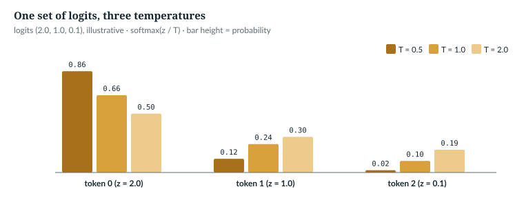
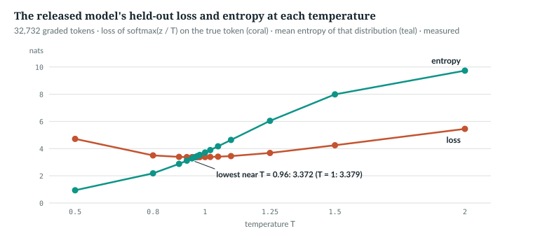
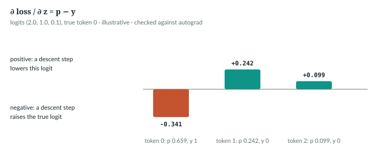

# 5  Softmax, temperature and cross-entropy

Three small functions sit between the model's last layer and everything it
does. The **softmax** turns V logits into probabilities. The **temperature**
reshapes those probabilities before sampling. **Cross-entropy** scores them
against the true token, and its gradient, p − y, is what training follows.
`book/code-examples/ch05_softmax.py` (**Book example, not repository code**)
computes each by hand and checks it against PyTorch and `anulm/model.py`; its
driver runs the checks in this chapter's order:

```python
if __name__ == "__main__":
    by_hand()
    p = top_k_cut(torch.tensor([[2.0, 1.0, 0.1, -1.0]]), 2)
    print(f"top-2 of [2.0, 1.0, 0.1, -1.0]: p {[round(v, 4) for v in p[0].tolist()]}")
    bf16_cost()
    temperature_zero_is_greedy()
    gradient_is_p_minus_y()
```

---

## 5.1  Exponentiate, then normalise

softmax(z)<sub>i</sub> = e<sup>z<sub>i</sub></sup> / Σ<sub>j</sub>
e<sup>z<sub>j</sub></sup>. The exponential makes every score positive and
keeps their order; dividing by the sum makes them add to 1. Adding the same
constant c to every logit multiplies top and bottom by e<sup>c</sup>, so the
result does not change. Implementations use that to subtract the maximum:

```python
def softmax_naive(z: torch.Tensor) -> torch.Tensor:
    e = z.exp()
    return e / e.sum(-1, keepdim=True)


def softmax_stable(z: torch.Tensor) -> torch.Tensor:
    e = (z - z.max(-1, keepdim=True).values).exp()      # largest entry becomes e^0 = 1
    return e / e.sum(-1, keepdim=True)
```

```text
z [2.0, 1.0, 0.1] -> p [0.659, 0.2424, 0.0986]  sum 1.0000
z + 1000: naive [nan, nan, nan]  stable [0.659, 0.2424, 0.0986]
```

*illustrative* logits; *verified* outputs, printed by this function of
`ch05_softmax.py`:

```python
def by_hand() -> None:
    z = torch.tensor([2.0, 1.0, 0.1])                   # illustrative logits
    p = softmax_stable(z)
    print(f"z {[round(v, 4) for v in z.tolist()]} -> p {[round(v, 4) for v in p.tolist()]}  sum {p.sum().item():.4f}")
    assert torch.allclose(p, F.softmax(z, -1))
    big = z + 1000                                      # same differences, shifted
    print(f"z + 1000: naive {softmax_naive(big).tolist()}  stable {[round(v, 4) for v in softmax_stable(big).tolist()]}")
    for T in (0.5, 1.0, 2.0):
        print(f"T = {T}: p {[round(v, 4) for v in F.softmax(z / T, -1).tolist()]}")
```

e<sup>1000</sup> overflows fp32 to infinity, and ∞/∞ is NaN. After
subtracting the maximum the largest term is e<sup>0</sup> = 1 and nothing can
overflow. `F.softmax`, `F.log_softmax` and `F.cross_entropy` all do this
internally, which is why AnuLM never subtracts a maximum itself.

Softmax makes entries compete; where AnuLM wants scores that do not, it uses a
sigmoid:

> **In the repo** · `anulm/model.py` · `Router._gate` · lines 624–626 · @fdbb09a

```python
    def _gate(self, x_flat, seq_len: Optional[int]):
        logits = F.linear(x_flat, self.weight.float())             # (N, E)
        scores = torch.sigmoid(logits)                             # independent, not softmax
```

Each of the E experts gets its own score in (0, 1) (Chapter 17).

`IN THE REPO`

## 5.2  Why the logits are cast to fp32

AnuLM casts the output logits to 32-bit floats before every softmax over the
vocabulary:

> **In the repo** · `anulm/model.py` · `AnuLM.forward` · lines 923–925 · @fdbb09a

```python
        loss = F.cross_entropy(
            logits.view(-1, logits.size(-1)).float(), targets.reshape(-1), ignore_index=-1
        )
```

Under bf16 autocast the head's output is bf16, which keeps 8 significant bits,
between 2 and 3 decimal digits. Where does that cost accuracy? The example
separates the three places a bf16 cross-entropy can lose it, on random logits
of the released vocabulary's width:

```python
def bf16_cost(seed: int = 0) -> None:
    """Where a bf16 cross-entropy goes wrong: the logits, the log-softmax, or the mean."""
    torch.manual_seed(seed)
    z = torch.randn(4096, 32768) * 3.0                  # a batch of logit rows, V = 32,768
    t = torch.randint(0, 32768, (4096,))
    exact = F.cross_entropy(z.double(), t).item()
    rounded = F.cross_entropy(z.bfloat16().double(), t).item() - exact          # bf16 logits, fp64 maths
    lp16 = F.log_softmax(z.bfloat16(), -1)                                        # bf16 log-softmax
    lsm = -lp16.double().gather(1, t[:, None]).mean().item() - exact              # ... averaged in fp64
    whole = F.cross_entropy(z.bfloat16(), t).item() - exact                       # bf16 in, bf16 mean
    with torch.autocast("cpu", dtype=torch.bfloat16):
        auto = F.cross_entropy(z.bfloat16(), t)                                   # autocast upcasts it
    print(f"cross-entropy over 4,096 rows, fp64: {exact:.6f}; error from bf16 logits {rounded:+.1e}, "
          f"bf16 log-softmax {lsm:+.1e}, F.cross_entropy on bf16 {whole:+.4f}; "
          f"under autocast: {auto.dtype}, {auto.item() - exact:+.1e}")
    err = (lp16.double() - F.log_softmax(z.double(), -1)).abs()
    i = int(err.argmax())
    print(f"largest bf16 log-prob error {err.max().item():.2f}, at log-prob "
          f"{F.log_softmax(z.double(), -1).flatten()[i].item():.1f}")
```

```text
cross-entropy over 4,096 rows, fp64: 14.856146; error from bf16 logits -1.2e-05, bf16 log-softmax -4.9e-04, F.cross_entropy on bf16 +0.0814; under autocast: torch.float32, -1.2e-05
largest bf16 log-prob error 0.12, at log-prob -25.0
```

*verified*: printed by `ch05_softmax.py` (random logits with standard deviation
3, seed 0). Read it in order:

- **Rounding the logits** to bf16 moves the mean loss by 1.2 × 10⁻⁵.
- **A bf16 log-softmax**, averaged in fp64, is off by 5 × 10⁻⁴. Single entries
  err by up to 0.12, at log-probabilities near −25, where bf16's spacing is
  0.125.
- **`F.cross_entropy` on bf16 tensors** is off by +0.081, and almost all of
  that is its mean: the sum of 4,096 losses, about 60,800, held in bf16, whose
  spacing there is 256. That is this CPU's reduction; on this machine's GPU
  the same call was off by +0.019.
- **Under autocast** PyTorch runs `cross_entropy` in fp32 by itself, on CPU
  and, checked the same way, on CUDA; the error is back to 10⁻⁵.

Training runs under autocast whenever the GPU supports bf16:

> **In the repo** · `anulm/training/train.py` · `main` · lines 645–650 · @fdbb09a

```python
    torch.manual_seed(args.seed)
    dtype = (torch.bfloat16 if args.device.startswith("cuda")
             and torch.cuda.is_bf16_supported() else torch.float32)
    args.autocast = (torch.autocast(device_type="cuda", dtype=dtype)
                     if args.device.startswith("cuda") and dtype is torch.bfloat16
                     else torch.autocast(device_type="cpu", enabled=False))
```

On a CPU everything stays fp32. So the `.float()` at line 924 is insurance:
it matters in bf16 without autocast (bf16 weights, say). In `generate` the
cast at line 1152 (5.3) also keeps the temperature division, the `top_k`
comparison and the repetition penalty in fp32.

`IN THE REPO`

## 5.3  Temperature is a division

Sampling divides the logits by the temperature T before the softmax:

> **In the repo** · `anulm/model.py` · `AnuLM.generate` · lines 1152–1169 · @fdbb09a

```python
            logits = logits[:, -1, :].float()
            # ...
            if temperature <= 0:
                nxt = logits.argmax(dim=-1, keepdim=True)              # (B, 1), no draw
            else:
                logits = logits / temperature
                if top_k is not None:
                    v, _ = torch.topk(logits, min(top_k, logits.size(-1)))
                    logits[logits < v[:, [-1]]] = -float("inf")
                probs = F.softmax(logits, dim=-1)
                nxt = torch.multinomial(probs, num_samples=1)          # (B, 1)
```

T ≤ 0 takes the `if` branch: the largest logit's id, the first one on a tie,
with no random draw. Any T > 0 takes the `else` branch: divide, cut to the
top k, softmax, and draw one id per row, `(B, 1)`.

Dividing by T multiplies every gap between logits by 1/T. Below 1 the gaps
grow and the distribution sharpens; above 1 they shrink and it flattens:

```text
T = 0.5: p [0.8638, 0.1169, 0.0193]
T = 1.0: p [0.659, 0.2424, 0.0986]
T = 2.0: p [0.5017, 0.3043, 0.194]
```

As T falls toward 0, all the probability goes to the largest logit: at
T = 10⁻⁵ a gap of 10⁻³ becomes 100 nats, so the draw is the argmax unless two
logits nearly tie. T = 0 itself would divide by zero, so `generate` does not
divide at all; it takes the limit directly with `argmax`, which is exact even
for near-ties and does not touch the random generator. (Until November 2026
the code clamped T to 10⁻⁵ and still sampled, so near-ties could go either way.)
The example checks T = 0 against `top_k` = 1, which samples from a
distribution with one nonzero entry:

```python
def temperature_zero_is_greedy() -> None:
    torch.manual_seed(0)
    m = AnuLM(tiny()).eval()
    prompt = torch.randint(0, 64, (1, 4))
    torch.manual_seed(1)
    cold = m.generate(prompt.clone(), 10, temperature=0.0)            # T <= 0: argmax, no draw
    greedy = m.generate(prompt.clone(), 10, top_k=1)
    print(f"temperature 0 {cold[0, 4:].tolist()}\ntop_k 1       {greedy[0, 4:].tolist()}")
    assert torch.equal(cold, greedy)
```

```text
temperature 0 [18, 11, 25, 14, 29, 27, 25, 14, 17, 44]
top_k 1       [18, 11, 25, 14, 29, 27, 25, 14, 17, 44]
```

*verified*: printed by `ch05_softmax.py`. The serving API passes the
request's temperature through unclamped:

> **In the repo** · `anulm/inference/api.py` · `Generation.run` · lines 446–448 · @fdbb09a

```python
                self.eng.model.generate(x, self.max_tokens, temperature=self.temperature,  # 0 = exact greedy
                                        top_k=self.top_k or None, eos_id=eos,
                                        repetition_penalty=self.rep, on_token=on_token)
```

Its field description says "0 = greedy" (line 218), and the field allows
0 to 2 (`ge=0, le=2`), so a request's 0 reaches `generate` as 0 and takes the
exact argmax branch. A small positive T still samples: at T = 10⁻³ a logit
0.005 below the best gets e<sup>−5</sup> ≈ 0.7% of the best one's weight.
`anulm/inference/sample.py` defaults to T = 0.8 and `top_k` 50
(lines 34–35).

The `top_k` lines keep the k largest logits and set the rest to −∞, which the
softmax turns into exactly 0:

```python
def top_k_cut(z: torch.Tensor, k: int) -> torch.Tensor:
    z = z.clone()
    v, _ = torch.topk(z, k)
    z[z < v[..., [-1]]] = -float("inf")                 # generate's lines 1166–1167
    return F.softmax(z, -1)
```

```text
top-2 of [2.0, 1.0, 0.1, -1.0]: p [0.7311, 0.2689, 0.0, 0.0]
```

Greedy decoding needs no softmax, which keeps the logits' order. Like
`generate`'s T ≤ 0 branch, the decoder for image and audio prompts takes the
argmax of the raw scores:

> **In the repo** · `anulm/model.py` · `AnuLM.decode_from_embeds` · lines 1038–1049 · @fdbb09a

```python
            scores = logits[0, -1].float()
            if repetition_penalty != 1.0 and out:
                ids = torch.tensor(sorted(set(out)), device=scores.device)
                seen = scores[ids]
                scores[ids] = torch.where(seen > 0, seen / repetition_penalty, seen * repetition_penalty)
            n = no_repeat_ngram
            if n and len(out) >= n - 1:
                tail = tuple(out[len(out) - (n - 1):])
                for j in range(len(out) - n + 1):
                    if tuple(out[j:j + n - 1]) == tail:
                        scores[out[j + n - 1]] = float("-inf")
            nxt = int(scores.argmax())
```

The middle lines edit the scores before the choice: a repetition penalty on
ids already emitted, and −∞ for any id that would repeat an n-gram
(Chapter 28). The last line picks the largest score, no softmax needed.



*Figure 5.1 · Temperature reshapes, never reorders.* The three-logit example
at T = 0.5, 1 and 2. *illustrative* logits, *verified* probabilities, printed
by `book/code-examples/ch05_softmax.py`.

`IN THE REPO`

## 5.4  What temperature does to the released model

On Chapter 3's 64 held-out windows, the released model's distribution at each
temperature:

| T | loss, nats | entropy, nats | probability of the top token |
|---|---|---|---|
| 0.5 | 4.713 | 0.937 | 0.724 |
| 0.8 | 3.499 | 2.183 | 0.552 |
| 0.9 | 3.390 | 2.876 | 0.490 |
| 0.93 | 3.377 | 3.114 | 0.471 |
| 0.95 | 3.373 | 3.279 | 0.458 |
| **0.96** | **3.372** | 3.363 | 0.452 |
| 0.97 | 3.373 | 3.449 | 0.445 |
| 0.98 | 3.374 | 3.535 | 0.439 |
| 1.0 | 3.379 | 3.712 | 0.426 |
| 1.02 | 3.387 | 3.892 | 0.413 |
| 1.05 | 3.406 | 4.167 | 0.394 |
| 1.1 | 3.451 | 4.636 | 0.362 |
| 1.25 | 3.678 | 6.043 | 0.271 |
| 1.5 | 4.244 | 7.989 | 0.145 |
| 2.0 | 5.449 | 9.733 | 0.030 |

*measured*: `measure_part_i_ii.py`, 32,732 graded tokens, fp32 except the
experts, which the checkpoint's grouped path runs in bf16;
`book/measurements/part_i_ii_released.json`. For each batch of graded rows
`z` with targets `t`, the script accumulates:

```python
            for T in TEMPS:
                lp = F.log_softmax(z / T, -1)
                ce[T] += -lp.gather(1, t[:, None]).sum().item()
                ent[T] += -(lp.exp() * lp).sum(-1).sum().item()
                pmax[T] += lp.max(-1).values.exp().sum().item()
```

The entropy, −Σ p log p, is the average surprise the model expects of itself.

Among the temperatures tried, the loss is lowest near T = 0.96, at 3.372:
0.0065 below T = 1. On this sample the trained model is very slightly
under-confident, and a small sharpening helps its score; training with
cross-entropy left it close to, not exactly at, its best temperature. (Fitting
a temperature on held-out data, temperature scaling, returns in Chapter 32.)
Sampling at 0.8
is a different choice: it gives up 0.12 nats of fit against T = 1 to make the
top token's share rise from 0.43 to 0.55. Whether that improves text is a
quality claim *not measured here*.



*Figure 5.2 · The released model under temperature.* Held-out loss (coral)
and entropy (teal) against T. *measured*, same file.

`MEASURED`

## 5.5  Cross-entropy, and why its gradient is p − y

For one position with logits z and true token t, the cross-entropy is
−log softmax(z)<sub>t</sub> = log Σ<sub>j</sub> e<sup>z<sub>j</sub></sup> −
z<sub>t</sub>: the log of the denominator minus the true logit. `logsumexp`
computes the first term with the maximum subtracted:

```python
def cross_entropy_by_hand(z: torch.Tensor, t: torch.Tensor) -> torch.Tensor:
    keep = t != -1
    lse = torch.logsumexp(z[keep], -1)                  # log of the softmax denominator, stable
    return (lse - z[keep].gather(1, t[keep][:, None])[:, 0]).mean()
```

Differentiate it with respect to z<sub>j</sub>. The first term gives
e<sup>z<sub>j</sub></sup>/Σe<sup>z</sup> = p<sub>j</sub>; the second gives 1
when j = t and 0 otherwise, a one-hot y. So **∂loss/∂z = p − y**: every wrong
token's logit is pushed down by its probability, and the true one is pushed
up by 1 − p<sub>t</sub>. Averaged over n graded positions, each row is divided
by n. The example checks autograd against that formula, with two rows marked
−1:

```python
def gradient_is_p_minus_y(seed: int = 0) -> None:
    torch.manual_seed(seed)
    z = torch.randn(6, 10, requires_grad=True)
    t = torch.tensor([3, 1, -1, 7, 0, -1])             # two rows not graded
    loss = F.cross_entropy(z, t, ignore_index=-1)
    loss.backward()
    keep = t != -1
    p = F.softmax(z.detach(), -1)
    y = F.one_hot(t.clamp(min=0), 10).float() * keep[:, None]
    mine = (p - y) * keep[:, None] / keep.sum()         # ungraded rows get no gradient
    # ...
    assert torch.allclose(z.grad, mine, atol=1e-7)
```

```text
cross-entropy 2.599766  by hand 2.599766
gradient: largest |autograd - (p - y)/n| = 1.5e-08; rows 2 and 5 all zero: True
```

*verified*: printed by `ch05_softmax.py`. The −1 rows contribute nothing to
the loss and receive exactly zero gradient, which is how fine-tuning keeps a
prompt from being trained (Chapter 30). The denominator is the number of
graded rows, not all rows; the chunked loss makes that explicit:

> **In the repo** · `anulm/model.py` · `AnuLM._chunked_loss` · lines 944–956 · @fdbb09a

```python
    def _chunked_loss(self, x, targets):
        xf = x.reshape(-1, x.shape[-1])
        tf = targets.reshape(-1)
        total = xf.new_zeros((), dtype=torch.float32)
        for i in range(0, xf.shape[0], self.ce_chunk):
            total = total + torch.utils.checkpoint.checkpoint(
                self._ce_sum, xf[i:i + self.ce_chunk], tf[i:i + self.ce_chunk],
                use_reentrant=False)
        # The mean over labelled positions, as F.cross_entropy(ignore_index=-1).
        return total / (tf != -1).sum().clamp(min=1)

    def _ce_sum(self, h, t):
        return F.cross_entropy(self._head(h).float(), t, ignore_index=-1, reduction="sum")
```

It flattens the (B, S, D) stream to rows, runs the head and a **summed**
cross-entropy on `ce_chunk` rows at a time (checkpointed, so only one chunk's
(rows, V) logits exist at once; Chapter 23), and divides the total by the
count of labelled targets. `clamp(min=1)` keeps a batch with no labels from
dividing by zero.



*Figure 5.3 · The gradient of cross-entropy.* For the three-logit example with
true token 0: p, y and p − y. *illustrative*. The arithmetic: logits (2.0, 1.0,
0.1) give e<sup>z</sup> = (7.389, 2.718, 1.105), which sum to 11.212, so
p = (0.659, 0.242, 0.099); with y = (1, 0, 0), p − y = (−0.341, 0.242, 0.099).
The figure script, `book/tools/figures/part_i_ii.py`, recomputes it and checks
it against autograd.

`IN THE REPO`

## 5.6  Common mistakes, and how to catch them

- **Softmax over the wrong axis.** Over the batch instead of the vocabulary,
  rows no longer sum to 1. *Catch it:* `probs.sum(-1)` must be all ones.
- **Taking `log(softmax(z))`.** A probability that underflows to 0 gives
  −∞. *Catch it:* use `F.log_softmax` or `F.cross_entropy`, which never form
  the probability first.


`IN THE REPO`

## 5.7  Exercises

1. Logits (3, 1). What are the probabilities at T = 1 and T = 0.5?
2. With p = (0.7, 0.2, 0.1) and true token 1, what is the gradient of the loss
   with respect to the logits?
3. Why is −∞ safe in a softmax when at least one entry is finite?

**Answers.**
1. T = 1: (0.881, 0.119). T = 0.5: logits (6, 2), (0.982, 0.018).
2. p − y = (0.7, −0.8, 0.1).
3. e<sup>−∞</sup> = 0 exactly, so that entry adds nothing to the sum, and the
   finite entry keeps the denominator positive.

*verified*: by arithmetic.

> **Build it.** The lab book's Chapter 8 (`course/ch08-pretrain`, §8.1)
> generates text with temperature and top-k from your own model.

---

## Key points

- softmax(z) = e<sup>z</sup>/Σe<sup>z</sup>; subtracting the maximum changes
  nothing and prevents overflow, and PyTorch's functions do it internally.
- AnuLM casts output logits to fp32 before every vocabulary softmax; under
  autocast PyTorch upcasts the cross-entropy anyway, and without it a bf16
  mean on this CPU was 0.08 nats off.
- Temperature divides the logits: below 1 sharpens, above 1 flattens, and
  T ≤ 0 is exact greedy (argmax, no draw); `top_k` sets the rest to −∞.
- On held-out text the released model's loss is lowest near T = 0.96 (3.372,
  against 3.379 at T = 1); sampling at 0.8 trades 0.12 nats of fit for a
  sharper top choice.
- Cross-entropy is logsumexp(z) − z<sub>t</sub>, averaged over targets that are
  not −1, and its gradient is p − y divided by the number graded.
- Positions marked −1 get no gradient on their logits: the model is never
  trained to predict the prompt, though the prompt still shapes the gradient
  as context and costs a full forward and backward pass.

> **In one breath.** The softmax exponentiates and normalises, safely after
> subtracting the maximum and in fp32; temperature divides the logits before
> it, sharpening or flattening without reordering; and cross-entropy is minus
> the log-probability of the true token, whose gradient p − y pushes every
> wrong token down and the right one up.

## References

This chapter cites no research references.

Repository evidence, all at @fdbb09a:
- `anulm/model.py`: `Router._gate` 624–626; `AnuLM.forward` 923–925;
  `AnuLM._chunked_loss` 944–953, `AnuLM._ce_sum` 955–956;
  `AnuLM.decode_from_embeds` 1038–1049; `AnuLM.generate` 1152–1169.
- `anulm/inference/api.py`: `Generation.run` 446–448; the request field's description,
  "0 = greedy", line 218.
- `anulm/inference/sample.py`: defaults, lines 34–35.
- `anulm/training/train.py`: `main` 645–650 (autocast).
- Measurements: `book/measurements/part_i_ii_released.json`, written by
  `code-examples/measure_part_i_ii.py`.

The book example is `code-examples/ch05_softmax.py`.
