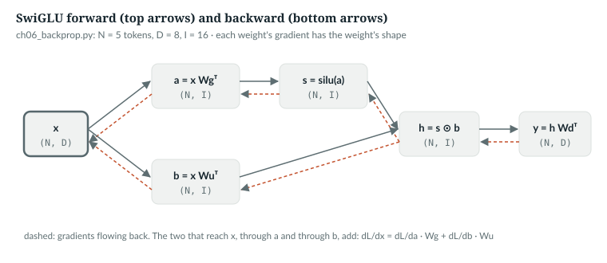
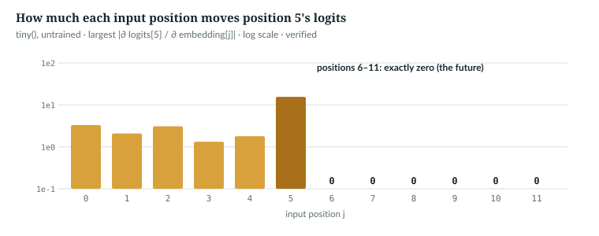

# 6  Gradients and backpropagation

Training changes every one of the released model's 397.7M parameters a little
at each step, using each one's **gradient**: how the loss would change if that
parameter moved. (The optimiser of Chapter 7 does not simply step against the
gradient, but every step starts from it.) Backpropagation is how PyTorch computes it
for every parameter in one backward pass. This chapter checks a gradient
numerically, works the chain rule by hand through `anulm/model.py`'s SwiGLU, takes
one gradient step, and reads the training loop's `backward` call and the tests
that guard it. The numbers come from `book/code-examples/ch06_backprop.py`
(**Book example, not repository code**).

---

## 6.1  A derivative is a sensitivity

The derivative of the loss L with respect to one weight w says how much L
changes per unit change of w, near its current value. You can estimate it
without any calculus by nudging w both ways:
∂L/∂w ≈ (L(w + ε) − L(w − ε)) / 2ε. The example does that for the entry with
the largest gradient in one weight matrix of a `tiny()` model, and compares
with what autograd computes:

```python
def finite_difference(seed: int = 0) -> None:
    torch.manual_seed(seed)
    m = AnuLM(tiny(first_k_dense_replace=3)).double().eval()   # dense layers only: no discrete routing
    x = torch.randint(0, 64, (2, 16))
    y = torch.randint(0, 64, (2, 16))
    loss_of = lambda: F.cross_entropy(m(x, y)[0].double().flatten(0, 1), y.flatten())   # the loss, in fp64
    w = m.layers[1].mlp.down_proj.weight
    loss_of().backward()
    i, j = divmod(w.grad.abs().argmax().item(), w.shape[1])   # the entry with the largest gradient
    auto = w.grad[i, j].item()
    eps = 1e-3
    with torch.no_grad():
        w[i, j] += eps
        up = loss_of().item()
        w[i, j] -= 2 * eps
        down = loss_of().item()
        w[i, j] += eps
    numeric = (up - down) / (2 * eps)                          # central difference
    print(f"d loss / d w[{i}, {j}]: autograd {auto:.6f}   (L(w+e) - L(w-e)) / 2e {numeric:.6f}")
    assert abs(auto - numeric) < 1e-3 * abs(auto)
```

```text
d loss / d w[20, 56]: autograd -0.005589   (L(w+e) - L(w-e)) / 2e -0.005588
```

*verified*: printed by `ch06_backprop.py`. Three choices make the check
honest:
- `first_k_dense_replace=3` makes all three layers dense. In a mixture of
  experts a nudge can flip which experts a token uses, a jump the derivative
  does not see.
- The model runs in float64, and the loss is recomputed in float64 from the
  logits. The model's own loss is fp32 (Chapter 5); near 4 its spacing is
  4.8 × 10⁻⁷, so it resolves the 1.1 × 10⁻⁵ difference only to a few percent,
  far short of the 0.1% the check asserts.
- The largest entry is chosen so the gradient is well above the noise of the
  fp32 RMSNorm inside.

Nudging costs two forward passes per parameter: 795M for the released model.
Backpropagation gets all of them from one backward pass.

`IN THE REPO` (the model) · `NOT IN THE REPO` (finite differences, a check only)

## 6.2  The chain rule as bookkeeping

A network is a chain of simple operations. If y = f(u) and u = g(x), then
∂L/∂x = ∂L/∂y · ∂y/∂u · ∂u/∂x. Backpropagation applies that rule from the loss
back to the input, one operation at a time, passing each operation the
gradient of the loss with respect to its output and asking it for the gradient
with respect to its inputs and weights. Here is one operation chain from
`anulm/model.py`, the feed-forward network of layer 0 and of every expert:

> **In the repo** · `anulm/model.py` · `SwiGLU` · lines 242–253 · @b42998d

```python
class SwiGLU(nn.Module):
    """The expert body and the dense layer-0 MLP. 3 * D * I params."""

    def __init__(self, hidden_size: int, intermediate_size: int):
        super().__init__()
        self.gate_proj = nn.Linear(hidden_size, intermediate_size, bias=False)
        self.up_proj = nn.Linear(hidden_size, intermediate_size, bias=False)
        self.down_proj = nn.Linear(intermediate_size, hidden_size, bias=False)

    def forward(self, x):
        # ...
        return self.down_proj(F.silu(self.gate_proj(x)) * self.up_proj(x))
```

Name the steps: a = x W<sub>g</sub>ᵀ and b = x W<sub>u</sub>ᵀ, both (N, I);
s = silu(a) = a·σ(a), where σ is the sigmoid; h = s ⊙ b, elementwise; and
y = h W<sub>d</sub>ᵀ, (N, D) (Chapter 16 explains why it is built this way).
Given G = ∂L/∂y, walk back:

| Step back through | Gradient | Shape |
|---|---|---|
| y = h W<sub>d</sub>ᵀ | ∂L/∂h = G W<sub>d</sub>; ∂L/∂W<sub>d</sub> = Gᵀ h | (N, I); (D, I) |
| h = s ⊙ b | ∂L/∂s = ∂L/∂h ⊙ b; ∂L/∂b = ∂L/∂h ⊙ s | (N, I) each |
| s = silu(a) | ∂L/∂a = ∂L/∂s ⊙ σ(a)(1 + a(1 − σ(a))) | (N, I) |
| a, b = x W<sub>g</sub>ᵀ, x W<sub>u</sub>ᵀ | ∂L/∂W<sub>g</sub> = (∂L/∂a)ᵀ x; ∂L/∂W<sub>u</sub> = (∂L/∂b)ᵀ x | (I, D) each |
| x, used twice | ∂L/∂x = ∂L/∂a W<sub>g</sub> + ∂L/∂b W<sub>u</sub> | (N, D) |

Two rules cover everything. For a matrix product, the gradient of each factor
is the incoming gradient multiplied by the other factor, transposed so the
shapes fit; each weight's gradient therefore has the weight's own shape. And
when a value feeds two places, as x does here, the gradients from both add.
The example writes the table as code and compares with autograd:

```python
def swiglu_by_hand(seed: int = 0) -> dict:
    torch.manual_seed(seed)
    f = SwiGLU(8, 16)                                    # D = 8, I = 16
    x = torch.randn(5, 8, requires_grad=True)            # 5 tokens
    G = torch.randn(5, 8)                                # dL/dy, arriving from above
    y = f(x)
    (y * G).sum().backward()                             # a loss whose gradient at y is G
    Wg, Wu, Wd = f.gate_proj.weight, f.up_proj.weight, f.down_proj.weight
    with torch.no_grad():
        a, b = x @ Wg.T, x @ Wu.T                        # (5, 16) each
        sig = torch.sigmoid(a)
        s = a * sig                                      # silu(a)
        h = s * b                                        # (5, 16)
        dh = G @ Wd                                      # back through down_proj: (5, 8) @ (8, 16)
        dWd = G.T @ h                                    # (8, 5) @ (5, 16) = (8, 16), down_proj's shape
        ds, db = dh * b, dh * s                          # product rule
        da = ds * sig * (1 + a * (1 - sig))              # silu'(a) = sig + a * sig * (1 - sig)
        dWg, dWu = da.T @ x, db.T @ x                    # (16, 8) each
        dx = da @ Wg + db @ Wu                           # x feeds both branches: the gradients add
    err = {"down_proj": (dWd - Wd.grad).abs().max().item(), "gate_proj": (dWg - Wg.grad).abs().max().item(),
           "up_proj": (dWu - Wu.grad).abs().max().item(), "x": (dx - x.grad).abs().max().item()}
    print("SwiGLU by hand vs autograd, largest difference: " + ", ".join(f"{k} {v:.1e}" for k, v in err.items()))
    assert max(err.values()) < 1e-5
    return err
```

`(y * G).sum()` is a stand-in loss whose gradient with respect to y is exactly
G, so autograd starts from the same G as the hand computation.

```text
SwiGLU by hand vs autograd, largest difference: down_proj 2.4e-07, gate_proj 0.0e+00, up_proj 6.0e-08, x 1.5e-08
```

*verified*: printed by `ch06_backprop.py`; the differences are fp32 rounding.



*Figure 6.1 · Backpropagation through SwiGLU.* The forward pass left to right
with shapes; the backward pass returns along the same edges, and the two
gradients reaching x add. *verified*: shapes from `ch06_backprop.py`.

`IN THE REPO`

## 6.3  The residual stream passes gradients through

Every block adds its sublayers' outputs to its input rather than replacing it:

> **In the repo** · `anulm/model.py` · `Block.forward` · lines 820–824 · @b42998d

```python
        x = x + self.attn(self.input_layernorm(x), cos, sin,
                          cache=cache, start=start, window=self.window, bidir_mask=bidir_mask)
        h = self.mlp(self.post_attention_layernorm(x))
        h, aux = h if self.is_moe else (h, None)
        return x + h, aux
```

For out = x + f(x), the chain rule gives ∂L/∂x = ∂L/∂out + (∂f/∂x)ᵀ ∂L/∂out.
Here ∂f/∂x is the matrix of f's partial derivatives (its Jacobian), and the
transpose carries a gradient from f's output back to its input, as Wᵀ did in
6.2. The incoming gradient reaches x **unchanged**, plus whatever flows back
through f. Stacked over 20 layers, there is a path from the top of the stack
(the final norm's input) down to the embeddings on which the gradient is not
multiplied by any weight matrix. Normalising each sublayer's input rather
than its output, *pre-norm*, keeps that path clean; Chapter 15 explains why it
matters for training a deep stack.

`IN THE REPO`

## 6.4  Autograd, and the step in `anulm/training/train.py`

PyTorch records each operation on tensors that require gradients, and
`backward()` replays the record in reverse, applying the rules above. It
**adds** each result into the parameter's `.grad`, rather than overwriting it.
`anulm/training/train.py` relies on that:

> **In the repo** · `anulm/training/train.py` · `main` · lines 855–873 · @b42998d

```python
        opt.zero_grad(set_to_none=True)
        loss_acc = aux_acc = 0.0
        for _ in range(args.grad_accum):
            ix = (torch.randint(len(train_data) - args.block_size - 1, (args.batch_size,))
                  if args.sample_with_replacement else sampler.next())
            x, y = make_batch(train_data, ix, args.block_size, args.device)
            with args.autocast:
                logits, loss = model(x, y)
            lm_loss = loss
            tw = (teacher_weight(step, args.steps, args.bigram_teacher, args.teacher_until)
                  if teacher is not None else 0.0)
            if tw > 0:
                loss = loss + tw * teacher_kl(logits, x, teacher)
            (loss / args.grad_accum).backward()
            loss_acc += lm_loss.item() / args.grad_accum
            if raw_model.aux_loss is not None:
                aux_acc += raw_model.aux_loss.item() / args.grad_accum
            tokens_seen += x.numel()
```

Line by line:

- **`zero_grad(set_to_none=True)`** clears the previous step's gradients,
  setting each `.grad` to `None` rather than to a tensor of zeros.
- **The micro-batch loop** runs `grad_accum` forward and backward passes. Each
  loss is divided by `grad_accum` before `backward()`, so the summed `.grad`
  is the gradient of the mean loss over all micro-batches: the same as one
  batch `grad_accum` times larger, at a fraction of the activation memory
  (Chapter 22).
- **The teacher lines** add a KL term toward the corpus bigram when
  `--bigram-teacher` is on (Chapter 2); `lm_loss` keeps the plain
  cross-entropy for the log.
- **`.item()`** copies a number to Python for logging; it is outside the
  autograd record.

After the loop the optimiser reads `.grad` and updates the weights
(Chapter 7). Code that only evaluates turns the recording off:
`AnuLM.generate` (line 1116) and `evaluate` (line 478) are decorated with
`@torch.no_grad()`, and `AnuLM.forward` keeps the router's regulariser for the
log with `aux_total.detach()` (line 913), a copy cut out of the record.

The equivalence of accumulation and a large batch is a test:

> **In the repo** · `tests/test_model.py` · `gradient_accumulation_equals_large_batch` · lines 545–563 · @b42998d

```python
def gradient_accumulation_equals_large_batch():
    """Two half-batches accumulated must equal one full batch."""
    torch.manual_seed(0)
    cfg = tiny()
    m = AnuLM(cfg).train()
    x = torch.randint(0, cfg.vocab_size, (8, 16))

    _, loss = m(x, x)
    loss.backward()
    full = [p.grad.clone() for p in m.parameters()]
    m.zero_grad(set_to_none=True)

    for half in (x[:4], x[4:]):
        _, l = m(half, half)
        (l / 2).backward()
    split = [p.grad.clone() for p in m.parameters()]

    err = max((a - b).abs().max().item() for a, b in zip(full, split))
    assert err < 2e-5, f"grad accumulation differs from one big batch by {err:.2e}"
```

The halves hold equal numbers of graded tokens, so the mean of their two means
is the full batch's mean. Accumulating halves with unequal counts of −1
targets would weight them differently, which is worth remembering for
fine-tuning batches.

`IN THE REPO`

## 6.5  One gradient step by hand

The simplest optimiser moves every parameter against its gradient:
w ← w − η · ∂L/∂w, with η the learning rate. The example takes one such step
on `tiny()` and scores the same batch again:

```python
def one_step(lr: float = 0.5, seed: int = 0) -> None:
    torch.manual_seed(seed)
    m = AnuLM(tiny()).train()
    x = torch.randint(0, 64, (4, 32))
    y = torch.roll(x, -1, dims=1)                         # any fixed targets will do
    _, before = m(x, y)
    before.backward()
    with torch.no_grad():
        for p in m.parameters():
            p -= lr * p.grad                             # w <- w - lr * dL/dw
    _, after = m(x, y)
    print(f"one step of plain gradient descent, lr {lr}: loss {before.item():.4f} -> {after.item():.4f}")
    assert after.item() < before.item()
```

```text
one step of plain gradient descent, lr 0.5: loss 4.1837 -> 3.9260
```

*verified*: printed by `ch06_backprop.py`. The update runs under
`torch.no_grad()`, so it is not itself recorded. Every parameter has a
gradient here because a `tiny()` batch of 128 tokens reaches every expert; in
general a parameter that received none has `.grad` set to `None`, and this
loop would fail on it. Real training uses AdamW instead of this plain rule
(Chapter 7).

`IN THE REPO`

## 6.6  The tests: every weight learns, and none sees the future

A model can train with some weights cut off from the loss: the others make up
for them, and the loss still falls. This test finds such weights:

> **In the repo** · `tests/test_model.py` · `all_parameters_receive_gradients` · lines 415–424 · @b42998d

```python
def all_parameters_receive_gradients():
    """With enough tokens every expert should be hit at least once."""
    for attn in ("gqa", "mla"):
        torch.manual_seed(0)
        m = AnuLM(tiny(attn=attn)).train()
        x = torch.randint(0, 64, (16, 32))
        _, loss = m(x, x)
        loss.backward()
        missing = [n for n, p in m.named_parameters() if p.grad is None]
        assert not missing, f"{attn}: no gradient for {missing[:4]}"
```

After one backward pass, any parameter whose `.grad` is still `None` was never
on a path to the loss. The batch of 512 tokens is large enough that every
expert is chosen at least once; `anulm/model.py`'s own smoke test, with 128 tokens,
reports 45 parameters without a gradient in `tiny_gqa`, all belonging to
experts that batch happened to miss (Chapter 3).

Gradients also give evidence of causality: a zero gradient is necessary for
independence, though not by itself proof of it. If position 5's output depended on position
6's input, the gradient between them would be nonzero:

> **In the repo** · `tests/test_model.py` · `causality_holds_under_gradients_too` · lines 78–93 · @b42998d

```python
def causality_holds_under_gradients_too():
    """Gradient of loss at position t w.r.t. embedding at t+1 must be zero."""
    torch.manual_seed(0)
    m = AnuLM(tiny(attn="mla"))
    x = torch.randint(0, 64, (1, 12))
    emb = m.embed_tokens(x).detach().requires_grad_(True)
    h = emb
    cos, sin = m.rotary(12, emb.device, emb.dtype)
    for layer in m.layers:
        h, _ = layer(h, cos, sin)
    logits = m.lm_head(m.norm(h))
    logits[0, 5].sum().backward()
    future_grad = emb.grad[0, 6:].abs().max().item()
    past_grad = emb.grad[0, :6].abs().max().item()
    assert future_grad == 0.0, f"position 5 has gradient {future_grad:.2e} into the future"
    assert past_grad > 0.0, "position 5 has no gradient into its own past -- something is severed"
```

It detaches the embeddings and marks them as requiring gradients, so they
become the leaves of the record; runs the blocks by hand; backpropagates from
position 5's logits only; and requires the gradient to be exactly zero at
positions 6 to 11 and nonzero somewhere in 0 to 5. The book example repeats it
on the GQA model and keeps the size at every position:

```text
largest |gradient| at each input position, output position 5:
  0:3.3e+00  1:2.1e+00  2:3.1e+00  3:1.3e+00  4:1.8e+00  5:1.6e+01  6:0.0e+00  7:0.0e+00  8:0.0e+00  9:0.0e+00  10:0.0e+00  11:0.0e+00
```

*verified*: printed by `ch06_backprop.py`;
`book/measurements/part_i_ii_causal_grad.json`. Position 5's own input has
the largest gradient, through the residual path of 6.3.



*Figure 6.2 · Gradients respect causality.* Largest gradient of position 5's
logits with respect to each input embedding, on `tiny()` at initialisation.
*verified*.

`IN THE REPO`

## 6.7  Exercises

1. In the table of 6.2, why is ∂L/∂W<sub>d</sub> = Gᵀ h and not h Gᵀ?
2. With `--grad-accum 4`, what would go wrong if `anulm/training/train.py` called
   `loss.backward()` without dividing by 4?
3. Why does the causality test detach the embeddings before setting
   `requires_grad_(True)`?

**Answers.**
1. W<sub>d</sub> is (D, I); Gᵀ h is (D, N)·(N, I) = (D, I), summing over the
   N tokens. h Gᵀ would be (N, N).
2. The gradients would be four times the mean's. For plain gradient descent
   (6.5) that is a four-times-larger learning rate. AdamW divides by √v, which
   grows by the same factor, so its update barely changes (ε aside, Chapter 7).
   What does change: the logged gradient norm, how often `--grad-clip` fires,
   and so what that setting means.
3. To make them a leaf of the autograd record whose `.grad` is kept;
   otherwise the gradient would flow on into the embedding table and not be
   stored per position.

*verified*: by the shapes in `ch06_backprop.py` and `anulm/training/train.py` at @b42998d.

> **Build it.** The lab book's Chapter 8 (`course/ch08-pretrain`, §8.4)
> builds the training step with gradient accumulation.

---

## Key points

- A gradient is a sensitivity, ∂L/∂w; a central difference on one weight
  agrees with autograd to three significant figures; the rest is fp32 noise
  from the RMSNorm inside.
- Backpropagation applies the chain rule from the loss back, one operation at
  a time; a weight's gradient has the weight's shape, and gradients from two
  uses of a value add.
- Written out by hand through `SwiGLU`, the five backward steps match
  autograd to fp32 rounding.
- The residual stream hands every block's incoming gradient straight to its
  input, so from the top of the stack to the embeddings no weight matrix
  stands in the way.
- `backward()` adds into `.grad`; `anulm/training/train.py` divides each micro-batch loss by
  `grad_accum`, and a test holds accumulation equal to one large batch.
- Tests use gradients to prove that every parameter is on a path to the loss
  and that no position's output depends on a later input.

> **In one breath.** A gradient says how the loss moves with each weight;
> backpropagation gets all of them in one backward pass by the chain rule,
> adding where a value is used twice. `anulm/training/train.py` accumulates them over
> micro-batches, and the tests read them to prove every weight learns and the
> future stays invisible.

## References

This chapter cites no research references.

Repository evidence, all at @b42998d:
- `anulm/model.py`: `SwiGLU` 242–253; `Block.forward` 820–824;
  `AnuLM.forward` 913; `AnuLM.generate` 1115–1116 (`@torch.no_grad()`).
- `anulm/training/train.py`: `evaluate` 477–478 (`@torch.no_grad()`); `main` 855–873.
- `tests/test_model.py`: `causality_holds_under_gradients_too` 78–93;
  `all_parameters_receive_gradients` 415–424;
  `gradient_accumulation_equals_large_batch` 545–563.
- Measurements: `book/measurements/part_i_ii_causal_grad.json`.

The book example is `code-examples/ch06_backprop.py`.
