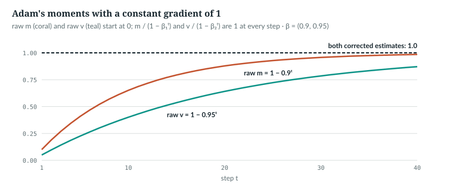
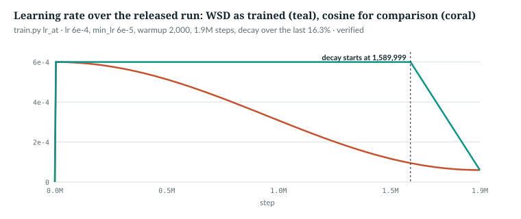

# 7  Optimisation: AdamW, schedules and clipping

Chapter 6's plain step, w ← w − η·g, is not what trains AnuLM. `anulm/training/train.py`
uses AdamW, which adapts the step size per parameter from running averages of
the gradient; a schedule that changes η over the run; and a clip that caps the
size of any one step. This chapter derives each, checks it against the
repository's code, and ends with Muon, the alternative optimiser the
repository also carries. `book/code-examples/ch07_optim.py` (**Book example,
not repository code**) prints every number.

The released run's settings, from its command line (`_v2_run.cmd` at the pin):
AdamW, peak learning rate 6 × 10⁻⁴, minimum 6 × 10⁻⁵, 2,000 warmup steps, the
WSD schedule with its decay over the last 16.3% of 1,900,000 steps; weight
decay 0.1 and clipping at 1.0 are `anulm/training/train.py`'s defaults (lines 555–556).

---

## 7.1  Momentum, the second moment and bias correction

Adam keeps two running averages per parameter [R21]. The first moment m is an
exponential moving average of the gradient g; it smooths the noise between
batches, like momentum. The second moment v averages g², so √v estimates how
large that parameter's gradients usually are. The step is m/√v: each
parameter moves by about η whatever the scale of its gradients, and a
parameter whose gradient keeps changing sign gets a small m and moves less.

Both averages start at zero, so early on they are too small. After t steps
of a constant gradient g, m = (1 − β₁<sup>t</sup>)·g, so dividing by
1 − β₁<sup>t</sup> recovers g exactly; that is the bias correction [R21]. The
book example writes the whole step out:

```python
def adamw_by_hand(p, g, state, lr, wd, b1=0.9, b2=0.95, eps=1e-8):
    """One AdamW step on tensor p with gradient g. state holds m, v and the step count t."""
    state["t"] += 1
    t = state["t"]
    state["m"].mul_(b1).add_(g, alpha=1 - b1)                  # first moment: a running mean of g
    state["v"].mul_(b2).addcmul_(g, g, value=1 - b2)           # second moment: a running mean of g^2
    m_hat = state["m"] / (1 - b1 ** t)                         # bias correction: both start at 0
    v_hat = state["v"] / (1 - b2 ** t)
    p.mul_(1 - lr * wd)                                        # decoupled weight decay
    p.add_(-lr * m_hat / (v_hat.sqrt() + eps))
```

```text
constant gradient 1:  t=1: m 0.100, m_hat 1.000  t=2: m 0.190, m_hat 1.000  t=3: m 0.271, m_hat 1.000  t=4: m 0.344, m_hat 1.000  t=5: m 0.410, m_hat 1.000
```

*verified*: printed by `ch07_optim.py`. Without the correction, at the first
step m would be ten times too small and √v, with β₂ = 0.95, about 4.5 times
too small (√0.05 ≈ 0.22). The errors do not cancel, and they fade at different
rates. ε = 10⁻⁸ only guards against dividing by zero.



*Figure 7.1 · Bias correction.* With a constant gradient of 1, the raw first
and second moments climb from 0; both corrected estimates are 1 from the first
step. *illustrative* gradient, *verified* arithmetic: `book/code-examples/ch07_optim.py`
prints the first moment; the second follows the same rule with β₂ = 0.95.

`IN THE REPO` (through `torch.optim.AdamW`)

## 7.2  Decoupled weight decay, and what skips it

Weight decay shrinks weights toward zero each step. AdamW applies it directly
to the weight, w ← w·(1 − η·λ), rather than adding λw to the gradient, where
Adam's division by √v would rescale it differently for every parameter [R22].
`anulm/training/train.py` builds two groups:

> **In the repo** · `anulm/training/train.py` · `make_optimizer` · lines 447–474 · @b42998d

```python
def make_optimizer(model: AnuLM, args):
    """Weight-decay the matmul weights, not the norms/biases/router bias.

    The router's `expert_bias` is a buffer rather than a parameter precisely so
    it cannot end up here -- it is updated by its own rule, and letting AdamW
    or weight decay touch it would fight the balancing.
    """
    decay, no_decay = [], []
    for name, p in model.named_parameters():
        if not p.requires_grad:
            continue
        (decay if p.dim() >= 2 else no_decay).append(p)
    groups = [
        {"params": decay, "weight_decay": args.weight_decay},
        {"params": no_decay, "weight_decay": 0.0},
    ]
    fused = args.device.startswith("cuda") and "fused" in torch.optim.AdamW.__init__.__code__.co_varnames
    if args.optimizer == "muon":
        from anulm.muon import build_optimizers
        opts, desc = build_optimizers(model, muon_lr=args.muon_lr, adamw_lr=args.lr,
                                      weight_decay=args.weight_decay, fused=fused)
        print(f"optimizer: {desc}")
        return OptimizerSet(opts)
    adamw = torch.optim.AdamW(groups, lr=args.lr, betas=(0.9, 0.95), eps=1e-8,
                              **({"fused": True} if fused else {}))
    print(f"optimizer: AdamW{' (fused)' if fused else ''}, "
          f"{sum(p.numel() for p in decay+no_decay)/1e6:.1f}M params")
    return OptimizerSet(adamw)
```

In order:

- **The split** is by dimension. Matrices, `p.dim() >= 2`, are decayed:
  every linear map, the embedding table and the router. Vectors are not: the
  RMSNorm and QK-norm gains, whose job is to set a scale, and which decay
  would pull toward zero for the whole run. AnuLM has no biases.
- **`fused`** asks PyTorch for its single-kernel AdamW on a GPU, when the
  installed version has the argument.
- **The Muon branch** hands over to `anulm/muon.py` (7.5).
- **betas (0.9, 0.95)**: β₂ is lower than PyTorch's default 0.999, so v
  forgets old gradients faster.
- **`OptimizerSet`** wraps one or more optimisers behind one interface (7.3).

On `tiny()` the split is:

```text
tiny(): 67 tensors decayed (47,616 numbers), 13 not (272); e.g. layers.0.input_layernorm.weight, norm.weight
  expert_bias is a buffer, in no group: ['layers.1.mlp.router.expert_bias', 'layers.2.mlp.router.expert_bias']
```

The router's balancing bias is a **buffer**, a tensor a module keeps but
`named_parameters()` does not return, so no optimiser sees it; its own rule
updates it after each step (Chapter 18). The example then steps
`make_optimizer`'s AdamW and the hand-written one side by side:

```python
def check_adamw(steps: int = 5) -> None:
    torch.manual_seed(0)
    m = AnuLM(tiny())
    mine = {n: p.detach().clone() for n, p in m.named_parameters()}
    args = SimpleNamespace(weight_decay=0.1, device="cpu", optimizer="adamw", lr=3e-4)
    with contextlib.redirect_stdout(io.StringIO()):
        opt = make_optimizer(m, args)                          # train.py's two groups and betas
    state = {n: {"t": 0, "m": torch.zeros_like(p), "v": torch.zeros_like(p)} for n, p in mine.items()}
    for _ in range(steps):
        for n, p in m.named_parameters():
            p.grad = torch.randn_like(p)
        opt.step()
        for n, p in m.named_parameters():
            wd = args.weight_decay if p.dim() >= 2 else 0.0    # make_optimizer's rule
            adamw_by_hand(mine[n], p.grad, state[n], args.lr, wd)
    # ...
    assert err < 1e-6
```

```text
AdamW by hand vs make_optimizer's AdamW after 5 steps: largest difference 7.5e-09
```

*verified*: printed by `ch07_optim.py`.

AdamW's memory follows from the state. With fp32 weights, gradients and two
moments, each parameter costs 16 bytes during training; Muon (7.5) keeps one
momentum buffer, 12 bytes, but only for the hidden matrices it handles. The
example asks `anulm/muon.py` for its own split of the released model, built on
PyTorch's `meta` device, which records shapes without allocating memory:

```python
def memory() -> None:
    """Training-state bytes for the released model, from muon.py's own split of its parameters."""
    from muon import build_optimizers                          # unchanged
    sys.path.insert(0, str(ROOT / "book" / "code-examples"))
    from trace_forward import released                         # Chapter 20's released configuration
    with torch.device("meta"):                                  # shapes only: no memory, no init cost
        m = AnuLM(released())
    n = sum(p.numel() for p in m.parameters())
    opts, desc = build_optimizers(m)                            # Muon on hidden 2-D weights, AdamW on the rest
    on_muon = sum(p.numel() for g in opts[0].param_groups for p in g["params"])
    print(f"released model, {n:,} parameters; {desc}")
    print(f"AdamW on everything: 16 bytes/param -> {16 * n / 1e9:.2f} GB")
    print(f"--optimizer muon: 12 x {on_muon:,} + 16 x {n - on_muon:,} -> {(12 * on_muon + 16 * (n - on_muon)) / 1e9:.2f} GB"
          f"  (12 bytes on every parameter would be {12 * n / 1e9:.2f} GB)")
```

```text
released model, 397,659,648 parameters; Muon: 1411 tensors, 330.0M params | AdamW: 102 tensors, 67.6M params
AdamW on everything: 16 bytes/param -> 6.36 GB
--optimizer muon: 12 x 330,039,296 + 16 x 67,620,352 -> 5.04 GB  (12 bytes on every parameter would be 4.77 GB)
```

*verified*: printed by `ch07_optim.py`. `build_optimizers` keeps the
embedding table, the output head, the routers and the 1-D gains on AdamW
(`anulm/muon.py` lines 152–165), so the saving is 1.32 GB, not the 1.59 GB that
12 bytes on every parameter would give. Every expert's state exists whether or not a token used
it, which is why the `nano_350m` preset (353M parameters; the released
configuration is that preset with `--cfg` overrides) was sized by peak memory
on an 8 GB card (§6).

`IN THE REPO`

## 7.3  The learning-rate schedule

`anulm/training/train.py` computes the learning rate for every step from the step number:

> **In the repo** · `anulm/training/train.py` · `lr_at` · lines 375–400 · @b42998d

```python
def lr_at(step: int, args, start_step: int = 0) -> float:
    if step < args.warmup:
        return args.lr * (step + 1) / max(args.warmup, 1)
    if getattr(args, "schedule", "cosine") == "wsd":
        # Warmup-stable-decay (MiniCPM, DeepSeek-V3): flat at the peak, then a
        # linear decay over the last --decay-frac of --steps. A phased run can
        # stop or be extended anywhere in the flat part without the jump a
        # cosine re-declared over new --steps makes; only the tail is final.
        decay_start = int(args.steps * (1 - args.decay_frac))
        if step < decay_start:
            return args.lr
        frac = min((step - decay_start) / max(args.steps - decay_start, 1), 1.0)
        return args.lr + (args.min_lr - args.lr) * frac
    progress = min((step - args.warmup) / max(args.steps - args.warmup, 1), 1.0)
    lr = args.min_lr + 0.5 * (args.lr - args.min_lr) * (1 + math.cos(math.pi * progress))
    # Extending a finished run (--resume with a larger --steps) lands mid-cosine,
    # several times the lr the weights last saw. --rewarmup ramps back up to
    # the schedule over N steps instead of jumping.
    rewarmup = getattr(args, "rewarmup", 0)
    if rewarmup and start_step and step < start_step + rewarmup:
        lr *= (step - start_step + 1) / rewarmup
    return lr
```

Three shapes:

- **Warmup**, for the first `warmup` steps: a straight line from lr/warmup to
  lr. The usual reason given is that Adam's first moments rest on very few
  gradients; what warmup buys this model is *not measured here*.
- **WSD**: the warmup-stable-decay scheduler [R23]. Here it is flat at the peak,
  then a straight line to `min_lr` over the last `decay_frac` of the run. The
  straight-line tail is this code's choice; the register's claim for [R23]
  covers the scheduler, not the shape of its decay. While it is flat the run
  can stop or be extended without disturbing anything already done.
- **Cosine**, the default: half a cosine wave from lr down to `min_lr` over the
  run. That is the cosine annealing of SGDR [R55], taken as a single run:
  this code has none of SGDR's warm restarts. Its value at every step depends
  on `--steps`, so extending a finished
  run jumps back up the curve; `--rewarmup` multiplies by a ramp from the
  resume point to soften that.

`anulm/training/train.py` turns the rate into a factor, so that every optimiser and group
keeps its own base rate:

> **In the repo** · `anulm/training/train.py` · `main` · lines 852–853 · @b42998d

```python
        lr = lr_at(step, args, start_step)
        opt.set_lr_scale(lr / args.lr)
```

> **In the repo** · `anulm/training/train.py` · `OptimizerSet.set_lr_scale` · lines 416–420 · @b42998d

```python
    def set_lr_scale(self, scale: float):
        for o, bases in zip(self.opts, self._base):
            for g, b in zip(o.param_groups, bases):
                g["lr"] = b * scale
```

With Muon, whose base rate is 0.02, beside AdamW's 3 × 10⁻⁴, one factor
moves both and keeps their ratio. The released run's schedule, beside the
cosine the same settings would give:

```python
def schedules() -> dict:
    cos = SimpleNamespace(**{**vars(RELEASED), "schedule": "cosine"})
    pts = [0, 999, 1999, 2000, 500_000, 1_000_000, 1_589_999, 1_590_000, 1_700_000, 1_899_999]
    rows = {s: (lr_at(s, RELEASED), lr_at(s, cos)) for s in pts}
    # ...
```

```text
step        WSD (released)   cosine (same lr, min_lr, warmup)
        0   3.000e-07        3.000e-07
      999   3.000e-04        3.000e-04
    1,999   6.000e-04        6.000e-04
  500,000   6.000e-04        5.134e-04
1,000,000   6.000e-04        3.081e-04
1,589,999   6.000e-04        9.477e-05
1,700,000   4.084e-04        7.466e-05
1,899,999   6.000e-05        6.000e-05
WSD decay starts at step 1,589,999
```

*verified*: printed by `ch07_optim.py` (two rows omitted). For the last 16%
of the run the cosine would already sit near its minimum while WSD is still
at its peak. The last step trained is `steps − 1`, so the rate ends a hair
above `min_lr`; the test below checks `min_lr` at step `steps` itself.

> **Details.** The decay starts at step 1,589,999, not 1,590,000. The cause is
> the seven-digit `--decay-frac 0.1631579`, 5.3 × 10⁻⁹ above 31/190:
> 1,900,000 × (1 − 0.1631579) is 1,589,999.99 exactly, and `int()` truncates
> it. One step early changes nothing.



*Figure 7.2 · Two schedules.* `lr_at` at the released run's settings: WSD
(teal), as trained, and cosine (coral), for comparison. *verified*: the
figure calls `lr_at`.

The WSD shape is pinned by a test:

> **In the repo** · `tests/test_model.py` · `wsd_schedule_is_flat_then_decays_to_min_lr` · lines 1800–1809 · @b42998d

```python
def wsd_schedule_is_flat_then_decays_to_min_lr():
    from types import SimpleNamespace
    from anulm.training.train import lr_at
    a = SimpleNamespace(lr=1e-3, min_lr=1e-4, warmup=10, steps=100, schedule="wsd",
                        decay_frac=0.2, rewarmup=0)
    lrs = [lr_at(s, a) for s in range(100)]
    assert lrs[0] < lrs[9] == 1e-3, "warmup ramps to the peak"
    assert all(v == 1e-3 for v in lrs[10:80]), "flat until the last 20%"
    assert all(x > y for x, y in zip(lrs[80:], lrs[81:])), "strictly decreasing in the tail"
    assert abs(lr_at(100, a) - 1e-4) < 1e-12, "ends at min_lr"
```

It builds a 100-step schedule from a plain namespace, the same trick the book
example uses, and checks the three phases: a rising warmup, an exactly flat
middle, a strictly falling tail that reaches `min_lr`.

`IN THE REPO`

## 7.4  Gradient clipping

One unusual batch can produce a gradient many times the usual size. The step
after the backward pass caps it:

> **In the repo** · `anulm/training/train.py` · `main` · lines 874–878 · @b42998d

```python
        if args.grad_clip > 0:
            torch.nn.utils.clip_grad_norm_(raw_model.parameters(), args.grad_clip)
        opt.step()
        # Out-of-band, after the gradient step, never part of the loss.
        imbalance = raw_model.update_expert_biases()
```

`clip_grad_norm_` treats all gradients as one long vector, computes its length
‖g‖, and if that exceeds `grad_clip` multiplies every gradient by
`grad_clip / ‖g‖`. The direction is kept; only the length is capped. This is
gradient norm clipping, proposed against exploding gradients [R56]. Then the
optimiser steps, and then, outside the loss, the experts' bias update runs
(Chapter 18). By hand:

```python
def clip_by_hand(seed: int = 0) -> None:
    torch.manual_seed(seed)
    m = AnuLM(tiny())
    _, loss = m(*(2 * [torch.randint(0, 64, (4, 32))]))
    loss.backward()
    grads = [p.grad.clone() for p in m.parameters()]
    total = math.sqrt(sum(float(g.pow(2).sum()) for g in grads))     # one norm over every parameter
    max_norm = 0.05
    scale = min(1.0, max_norm / (total + 1e-6))
    reported = torch.nn.utils.clip_grad_norm_(m.parameters(), max_norm)
    err = max((g * scale - p.grad).abs().max().item() for g, p in zip(grads, m.parameters()))
    # ...
    assert abs(total - reported.item()) < 1e-4 and err < 1e-7
```

```text
total gradient norm 1.3602 (clip_grad_norm_ returned 1.3602); clip at 0.05: scale 0.0368; largest difference 0.0e+00
```

*verified*: printed by `ch07_optim.py`. How often does the clip act? On the
released model at the end of training, measured on held-out batches shaped
like its training batches (4 × 1,024 tokens, bf16 autocast, the router's
regularisers on):

```text
released model, gradient norm per 4 x 1,024 batch: 4.25, 4.60, 4.25, 4.44; clip 1.0 scales by 0.22 to 0.24
```

*measured*: `measure_part_i_ii.py`, four batches, numpy seed 1, otherwise at
the settings of Appendix F, F.6; `book/measurements/part_i_ii_released.json`.
Each of these batches' gradients would have been cut to under a quarter of its
length. With Adam that matters less than it sounds: dividing by √v makes the step nearly independent of the
gradient's overall scale, so a clip that acts on every step changes the
balance between this step and the running averages, not the step size
directly. Whether clipping at 1.0 helped this run is *not measured here*.

`IN THE REPO` · `MEASURED`

## 7.5  Muon, in brief

Muon is an optimiser for the hidden layers' matrices: it keeps one momentum
buffer and replaces the update matrix by an orthogonalised version of it,
computed with a Newton–Schulz iteration [R24]. Its source is a blog post, not
a peer-reviewed paper. Orthogonalising keeps the update's directions and sets
how far it moves along each of them to about the same amount. The released
run used AdamW. In the repository's measurements (`docs/RESULTS.md`) Muon was
the largest single gain in an 88M proxy, −0.371 in held-out loss at 25M
tokens, but at 400M parameters a combined recipe including it led plain AdamW
by only about one standard error, at 43% more time per token, and the next
run kept plain AdamW (§32).

> **Details.** How `anulm/muon.py` orthogonalises. Any matrix G can be
> written U S Vᵀ, where U and V have orthonormal columns and S is diagonal;
> S's entries are the **singular values**, how much G stretches each
> direction. *Orthogonalising* G replaces it by U Vᵀ: the same directions,
> every stretch set to 1. `anulm/muon.py` approximates that:
>
> > **In the repo** · `anulm/muon.py` · `zeropower_via_newtonschulz5` · lines 35–56 · @b42998d
>
> ```python
> def zeropower_via_newtonschulz5(G: torch.Tensor, steps: int = 5, eps: float = 1e-7):
>     """Approximate the orthogonal factor of G via a quintic Newton-Schulz iteration.
>
>     Returns a matrix close to `U @ V.T` where `G = U S V.T`, without ever forming
>     an SVD. The coefficients (3.4445, -4.7750, 2.0315) are tuned so the iteration
>     converges fast for singular values in [0, 1] while tolerating the sloppiness
>     of bf16 -- it does not converge to machine precision and is not meant to.
>     """
>     assert G.ndim == 2, "Muon operates on 2D parameters only"
>     a, b, c = 3.4445, -4.7750, 2.0315
>     X = G.bfloat16()
>     X = X / (X.norm() + eps)          # ensure top singular value <= 1
>     transposed = G.size(0) > G.size(1)
>     if transposed:                     # iterate on the smaller Gram matrix
>         X = X.T
>     for _ in range(steps):
>         A = X @ X.T
>         B = b * A + c * (A @ A)
>         X = a * X + B @ X
>     if transposed:
>         X = X.T
>     return X
> ```
>
> `X.norm()` is the Frobenius norm, the square root of the sum of all squared
> entries; it is at least the largest singular value, so dividing by it puts
> every singular value in [0, 1]. Each
> iteration applies the polynomial aX + b(XXᵀ)X + c(XXᵀ)²X, which acts on each
> singular value separately and pushes it toward 1 while keeping the singular
> vectors. Five iterations in bf16 land close to, not exactly at, 1:
>
> ```python
> def newton_schulz(seed: int = 0) -> None:
>     torch.manual_seed(seed)
>     G = torch.randn(64, 24) @ torch.diag(torch.logspace(-2, 0, 24))   # singular values over two decades
>     X = zeropower_via_newtonschulz5(G).float()
>     s_in, s_out = torch.linalg.svdvals(G), torch.linalg.svdvals(X)
>     print(f"Newton-Schulz on a (64, 24) update: singular values {s_in.min():.3f}..{s_in.max():.3f} -> "
>           f"{s_out.min():.3f}..{s_out.max():.3f}")
> ```
>
> ```text
> Newton-Schulz on a (64, 24) update: singular values 0.065..8.058 -> 0.680..1.193
> ```
>
> *verified*: printed by `ch07_optim.py` on a random matrix with singular values
> spread over two decades. Every direction of the update then moves by about the
> same amount.
>
> In practice `Muon.step` (default `batched=True`) does not call this function
> for groups of same-shaped updates, such as all the experts' matrices of one
> projection. It stacks them and calls `zeropower_batched` (line 59), the same
> iteration over a batch of matrices:
>
> > **In the repo** · `anulm/muon.py` · `Muon.step` · lines 125–133 · @b42998d
>
> ```python
>             by_shape: dict = {}
>             for p, d in todo:
>                 by_shape.setdefault(tuple(d.shape) if self.batched else id(p), []).append((p, d))
>             for items in by_shape.values():
>                 if len(items) > 1:
>                     outs = zeropower_batched(torch.stack([d for _, d in items]),
>                                              steps=group["ns_steps"]).unbind(0)
>                 else:
>                     outs = [zeropower_via_newtonschulz5(items[0][1], steps=group["ns_steps"])]
> ```
>
> Speed, from `docs/RESULTS.md`: on one 8 GB GPU at 443M parameters Muon
> fitted where AdamW did not, but ran 2.6× slower per step, orthogonalising
> hundreds of small matrices one at a time (§6). Batching cut the gap: in the
> 88M proxy Muon went from about a third of AdamW's speed to about
> four-fifths (61k against 78k tokens per second; §32). The 400M combined
> recipe was Muon, tied embeddings, merge-tree embeddings and a bigram
> teacher (§32). The batching is a pure speed change:
> `batched_muon_matches_per_matrix_muon` (`tests/test_model.py` line 1902) requires
> the two to agree to 10⁻⁶.

`IN THE REPO` · `MEASURED`

## 7.6  Common mistakes, and how to catch them

- **Decaying the norm gains.** Putting every parameter in one decayed group
  drags each RMSNorm gain toward zero. *Catch it:* print each group's tensor
  names once, as 7.2 does.
- **Extending a cosine run without rewarmup.** A larger `--steps` moves the
  whole curve, and the first resumed step jumps to a much higher rate. *Catch
  it:* print `lr_at` at the resume step before resuming, or use WSD.
- **Clipping before the last micro-batch.** Clipping inside the accumulation
  loop caps a partial gradient. *Catch it:* clip once, after the loop, as
  `anulm/training/train.py` does.

`IN THE REPO`

## 7.7  Exercises

1. With β₂ = 0.95, what fraction of v's final value is present after one step
   of a constant gradient, before correction?
2. At the released settings, what is the learning rate at step 1,745,000,
   halfway through the decay?
3. A gradient has norm 4.4 and `grad_clip` is 1.0. By what is each gradient
   multiplied?

**Answers.**
1. 1 − 0.95 = 0.05.
2. About halfway between 6 × 10⁻⁴ and 6 × 10⁻⁵: 3.3 × 10⁻⁴.
3. 1.0 / 4.4 ≈ 0.227.

*verified*: answer 2 with `lr_at` (3.30 × 10⁻⁴); the others by arithmetic.

> **Build it.** The lab book's Chapter 8 (`course/ch08-pretrain`, §8.2–8.4)
> builds `lr_at`, the optimiser groups and the training step.

---

## Key points

- Adam steps by m/√v from running averages of g and g², corrected for their
  start at zero; AdamW applies weight decay to the weight directly.
- `make_optimizer` decays only matrices; norm gains are skipped, and the
  router's bias is a buffer no optimiser sees. A hand-written AdamW matches it
  to 10⁻⁸.
- AdamW holds 16 bytes per parameter in training: 6.36 GB for the released
  model, every idle expert included.
- `lr_at` gives warmup, then cosine or WSD; the released run was WSD at
  6 × 10⁻⁴, decaying to 6 × 10⁻⁵ over its last 16.3%, and the schedule reaches
  the optimiser as a factor.
- Clipping rescales the whole gradient to a maximum length; at the end of
  training the released model's batch gradients measure 4.25–4.60, so a clip
  at 1.0 acts on all four batches measured.
- Muon orthogonalises each hidden matrix's update; it was the largest gain in
  a small proxy, and at 400M a combined recipe including it led by only about
  one standard error.

> **In one breath.** AnuLM trains with AdamW: per-parameter steps from
> bias-corrected averages of the gradient and its square, weight decay on
> matrices only, a learning rate from `lr_at` that warms up, holds and decays,
> and a clip on the total gradient length before every step.

## References

Research references cited in this chapter (`RESEARCH_REFERENCES.md`), each
used only for the claim in its register row:

| ID | Used for | Status |
|---|---|---|
| [R21] | Adam: moving averages of the gradient and its square, with bias correction | CHECKED |
| [R22] | AdamW: weight decay decoupled from the gradient update | CHECKED |
| [R23] | the warmup-stable-decay (WSD) schedule | CHECKED |
| [R24] | Muon, an orthogonalised update by Newton–Schulz iteration; a blog post | CHECKED |
| [R55] | cosine annealing of the learning rate (SGDR; the repo uses no restarts) | CHECKED |
| [R56] | gradient norm clipping against exploding gradients | CHECKED |

Warmup is described without a citation; a proposal is in
`technical-review/register-additions/part_i_ii.md`.

Repository evidence, all at @b42998d:
- `anulm/training/train.py`: `lr_at` 375–400; `OptimizerSet` 403–444 (`set_lr_scale`
  416–420); `make_optimizer` 447–474; `main` defaults 555–556, schedule
  852–853, clip and step 874–878.
- `anulm/muon.py`: `zeropower_via_newtonschulz5` 35–56;
  `zeropower_batched` 59–82; `Muon` 85–141 (`step` 125–133);
  `build_optimizers` 144–182 (split 152–165).
- `tests/test_model.py`: `wsd_schedule_is_flat_then_decays_to_min_lr` 1800–1809;
  `batched_muon_matches_per_matrix_muon` 1902.
- `_v2_run.cmd`: the released run's command line.
- `docs/RESULTS.md` §6 and §32.
- Measurements: `book/measurements/part_i_ii_released.json`.

The book example is `code-examples/ch07_optim.py`.
