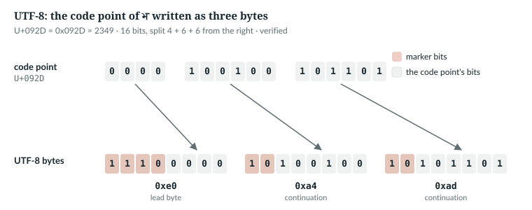
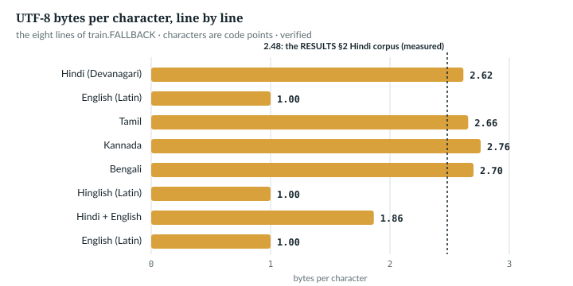

# 8  Bytes as tokens

A language model reads integers, not text. Part III is the road from one to
the other: this chapter turns text into ids with no learning at all, Chapter 9
learns a better set of ids, and Chapter 10 turns each id into a vector.

The simplest choice, one token per byte, is what `anulm/training/train.py` does with a plain
`.txt` file. This chapter reads that path line by line, with its test and its
cost.

**New words.** Part III starts here; these terms recur through Chapter 10.

| Term | Meaning |
|---|---|
| token | one unit the model reads or writes; here, one integer id |
| vocabulary | the set of ids the model knows; its size is V |
| code point | the number Unicode gives one character, written U+092D |
| UTF-8 | the rule that writes each code point as 1 to 4 bytes |
| document separator | `DOC_SEP`, three newlines, the mark between documents in a corpus file |
| EOS | the end-of-sequence id, put after every document |
| fertility | how many tokens a tokenizer spends on a given text (Chapter 9) |
| bits per byte | the loss in bits, spread over the bytes of text, so models with different vocabularies compare |

**Notation for Part III.** These symbols follow Part IV's (Chapter 11).

| Symbol | Meaning | Byte model | Released model |
|---|---|---|---|
| V | vocabulary size, `vocab_size` | 259 | 32,768 |
| D | width of a token vector, `hidden_size` | per preset | 1,024 |
| B, S | sequences in a batch, tokens in a sequence | any | any, S ≤ 1,024 |

---

## 8.1  Text is bytes

Unicode gives every character a number, its code point, and UTF-8 writes that
number as one to four bytes [R54]. Every byte after the first has the bit pattern
`10xxxxxx`, a *continuation byte*; the first byte's leading bits say how many
follow. The whole rule fits in a function (*verified* against Python's
encoder):

> Book example, not repository code · `book/code-examples/ch08_bytes.py` · `utf8_encode` and `main`

```python
def utf8_encode(cp: int) -> bytes:
    """One code point to UTF-8, by the bit patterns of the standard."""
    if cp < 0x80:                                   # 0xxxxxxx
        return bytes([cp])
    if cp < 0x800:                                  # 110xxxxx 10xxxxxx
        return bytes([0xC0 | cp >> 6, 0x80 | cp & 0x3F])
    if cp < 0x10000:                                # 1110xxxx 10xxxxxx 10xxxxxx
        return bytes([0xE0 | cp >> 12, 0x80 | cp >> 6 & 0x3F, 0x80 | cp & 0x3F])
    return bytes([0xF0 | cp >> 18, 0x80 | cp >> 12 & 0x3F,      # 11110xxx + three
                  0x80 | cp >> 6 & 0x3F, 0x80 | cp & 0x3F])
    # ...
    every = [cp for cp in range(0x110000) if not 0xD800 <= cp <= 0xDFFF]   # surrogates are not characters
    assert all(utf8_encode(cp) == chr(cp).encode("utf-8") for cp in every)
    print(f"utf8_encode matches str.encode on all {len(every):,} code points from U+0000 to U+10FFFF")
    dev = {chr(cp).encode("utf-8")[:2].hex(" ") for cp in range(0x0900, 0x0980)}
```

Each branch takes the code point's bits six at a time from the right
(`cp & 0x3F`, then `cp >> 6 & 0x3F`), puts `10` in front of each group, and
writes the high bits after a lead marker, `110`, `1110` or `11110`:

```
U+0061 'a'   -> 61  01100001
U+00E9 'é'   -> c3 a9  11000011 10101001
U+092D 'भ'   -> e0 a4 ad  11100000 10100100 10101101
U+20AC '€'   -> e2 82 ac  11100010 10000010 10101100
U+1F600 '😀'   -> f0 9f 98 80  11110000 10011111 10011000 10000000
utf8_encode matches str.encode on all 1,112,064 code points from U+0000 to U+10FFFF
every Devanagari code point (U+0900-U+097F) starts with one of: ['e0 a4', 'e0 a5']
```

In this book a *character* is one code point.



*Figure 8.1 · One Devanagari letter as three bytes.* The 16 bits of U+092D
split into groups of 4, 6 and 6; the marker bits, in coral, say "lead of
three" and "continuation". *verified* by `ch08_bytes.py`.

So any text, in any script, is a sequence of values 0 to 255, and 256 ids
cover everything. The price is length outside ASCII (8.5).

`IN THE REPO` (UTF-8 is what `load_bytes` reads, 8.3)

## 8.2  A vocabulary of 259 ids

> **In the repo** · `anulm/model.py` · `AnuLMConfig` · line 47 · @fdbb09a

```python
    vocab_size: int = 259           # 256 bytes + BOS + EOS + PAD (byte mode)
```

> **In the repo** · `anulm/training/train.py` · `BYTE_EOS` · line 101 · @fdbb09a

```python
BYTE_EOS = 257          # byte mode: 256 BOS, 257 EOS, 258 PAD
```

Ids 0 to 255 are the bytes themselves, so encoding and decoding need no
table. Above them, only EOS is ever written into data. In `anulm/model.py`,
`anulm/training/train.py` and `anulm/inference/sample.py`, 256 (beginning of sequence) and 258 (padding) as
ids appear only in comments (`anulm/model.py` 47, `anulm/training/train.py` 101, `anulm/inference/sample.py` 86);
elsewhere 258 occurs only in a merge-tree test as an ordinary row (*verified*,
`git grep` at @fdbb09a, `course/` excluded). They are reserved rows that the
model still scores. `anulm/inference/sample.py` encodes a byte prompt and sets the
stop id:

> **In the repo** · `anulm/inference/sample.py` · `main` · lines 70–72 · @fdbb09a

```python
        # Byte-level: the prompt is its own UTF-8 encoding. 257 is EOS.
        prompt_ids = list(args.prompt.encode("utf-8")) or [10]
        eos_id = 257
```

`str.encode` gives the bytes and `list` the ids. An empty prompt becomes
`[10]`, a newline, so generation has an id to start from.

`IN THE REPO`

## 8.3  Documents end with EOS

A model that never sees where a document ends cannot learn to end its own
text, and `generate` has nothing to stop on. So each boundary in a corpus file
is a separator, turned into EOS on loading. It lives in `anulm/bpe.py`, and
`anulm/training/train.py` imports it (`anulm/training/train.py` line 28):

> **In the repo** · `anulm/bpe.py` · `DOC_SEP` · lines 40–45 · @fdbb09a

```python
# Document separator in corpus .txt files. fetch_hindi.py writes one article
# per document; `encode` turns each boundary into EOS so the model learns
# where documents end and `generate` has something to stop on. Three
# newlines is unambiguous: strip_wikitext collapses any run of 3+ inside an
# article down to 2. Older corpora without it just become one long document.
DOC_SEP = "\n\n\n"
```

Three newlines are a safe marker only because the cleaner guarantees no
article contains three in a row; the comment records that contract. The
loader first finds the bytes:

> **In the repo** · `anulm/training/train.py` · `load_bytes` · lines 62–85 · @fdbb09a

```python
def load_bytes(path: str | None) -> torch.Tensor:
    """Return the corpus as a tensor of ids. Bytes 0..255 map to ids 0..255.
    At every DOC_SEP an EOS (257) is inserted, which needs int16 storage; a
    corpus without separators stays uint8 -- one document, no EOS."""
    if path:
        raw = Path(path).read_bytes()
    else:
        # ...
```

`read_bytes()` reads in binary mode, with no decoding, so the bytes on disk
are the ids whatever the script. With no path the loader still finds bytes;
its last resort is 400 copies of `FALLBACK` (`anulm/training/train.py` lines
51–59): eight lines in five languages (Hindi, English, Tamil, Kannada,
Bengali), two of them code-mixed Hindi and English. So
`anulm/training/train.py` runs with no data and no network.

> **Details.** The `else` branch (lines 68–85) uses `data/input.txt` if it
> exists. Otherwise it downloads a small Shakespeare corpus (karpathy's
> tinyshakespeare, with a 15-second timeout) and writes it there; if the
> download raises, it writes the `FALLBACK` copies to that path instead, so
> the next run reads them from disk.

Then the boundaries:

> **In the repo** · `anulm/training/train.py` · `load_bytes` · lines 86–98 · @fdbb09a

```python
    # Text files written on Windows carry CRLF; the tokenizer path reads them
    # in text mode and never sees it, so the byte path normalises too -- one
    # byte per newline, and DOC_SEP matches whichever platform wrote the file.
    raw = raw.replace(b"\r\n", b"\n")
    sep = DOC_SEP.encode("utf-8")
    if sep not in raw:
        return torch.frombuffer(bytearray(raw), dtype=torch.uint8)
    parts = []
    for doc in raw.split(sep):
        if doc.strip():
            parts.append(torch.frombuffer(bytearray(doc), dtype=torch.uint8).to(torch.int16))
            parts.append(torch.tensor([BYTE_EOS], dtype=torch.int16))
    return torch.cat(parts)
```

| Lines | What happens | Result |
|---|---|---|
| 86–89 | CRLF becomes LF, so `DOC_SEP` matches a Windows file and a newline costs one position | bytes |
| 90–92 | no separator: the file is one document | (N,) `uint8`, no EOS |
| 93–97 | each non-empty document: its bytes widened to `int16`, then one EOS; `doc.strip()` skips the empty piece after a trailing separator | pieces of `int16` |
| 98 | the pieces joined; the separator bytes are gone, replaced by EOS | (N,) `int16` |

257 does not fit in a byte, hence the wider type. `BYTE_EOS` is defined at
line 101, after the function: Python looks a global up when the function
runs, not when it is defined.

`IN THE REPO`

## 8.4  The proof

The book example re-implements the loader and compares id for id, on a
two-document file written with CRLF line ends:

> Book example, not repository code · `book/code-examples/ch08_bytes.py` · `my_load_bytes` and `main`

```python
def my_load_bytes(raw: bytes) -> list[int]:
    """train.load_bytes, for a file that exists, as a plain list of ids."""
    raw = raw.replace(b"\r\n", b"\n")
    sep = DOC_SEP.encode("utf-8")
    if sep not in raw:
        return list(raw)                            # one document, no EOS
    ids = []
    for doc in raw.split(sep):
        if doc.strip():
            ids += list(doc) + [BYTE_EOS]
    return ids
    # ...
    docs = ["शीर्षक\n\nपहला दस्तावेज़।", "Title\n\nThe dog bit."]
    raw = (DOC_SEP.join(docs) + DOC_SEP).replace("\n", "\r\n").encode("utf-8")
    with tempfile.TemporaryDirectory() as d:
        p = os.path.join(d, "corpus.txt")
        Path(p).write_bytes(raw)
        ids = load_bytes(p)
        # ...
    assert ids.tolist() == my_load_bytes(raw)
    # ...
    wide = torch.tensor([BYTE_EOS], dtype=torch.int16)
    print(f"EOS cast to uint8: {wide.to(torch.uint8).item()} (silent); ", end="")
    try:
        torch.tensor([BYTE_EOS], dtype=torch.uint8)
    except RuntimeError as e:
        print(f"built as uint8: RuntimeError ({e})")
```

```
the file holds 10 CR bytes and 2 separators of 3 bytes each
load_bytes: 98 bytes on disk -> 84 ids, dtype torch.int16, EOS (257) at [63, 83]
without DOC_SEP: dtype torch.uint8, 17 ids, EOS count 0
my_load_bytes agrees id for id
EOS cast to uint8: 1 (silent); built as uint8: RuntimeError (value cannot be converted to type uint8 without overflow)
```

98 bytes, less 10 CR bytes and two 3-byte separators, plus two EOS ids, make
84. The repository's own test checks the same properties:

> **In the repo** · `tests/test_model.py` · `byte_loader_inserts_eos_at_document_boundaries` · lines 1430–1448 · @fdbb09a

```python
def byte_loader_inserts_eos_at_document_boundaries():
    import os, tempfile
    from anulm.bpe import DOC_SEP
    from anulm.training.train import BYTE_EOS, load_bytes
    docs = ["शीर्षक\n\nपहला दस्तावेज़।", "दूसरा\n\nदूसरा दस्तावेज़।"]
    with tempfile.TemporaryDirectory() as d:
        p = os.path.join(d, "c.txt")
        # CRLF on purpose: what a Windows text-mode write produces
        raw = (DOC_SEP.join(docs) + DOC_SEP).replace("\n", "\r\n").encode("utf-8")
        open(p, "wb").write(raw)
        data = load_bytes(p)
        assert data.dtype == torch.int16, "EOS does not fit uint8; loader must widen"
        assert int((data == BYTE_EOS).sum()) == 2, "one EOS per document"
        assert b"\r" not in bytes(data[data < 256].to(torch.uint8).tolist()), "CRLF was not normalised"
        body = bytes(data[data < 256].to(torch.uint8).tolist()).decode("utf-8")
        assert body == "".join(docs).replace("\n", "\n"), "bytes between the EOS are not the documents"
        plain = os.path.join(d, "plain.txt")
        open(plain, "wb").write("बिना सीमा".encode("utf-8"))
        assert load_bytes(plain).dtype == torch.uint8, "a corpus without DOC_SEP must stay uint8"
```

Each assertion stops a failure that training would not notice:
- **`int16`:** building 257 as `uint8` raises, but the cast `.to(torch.uint8)`
  silently gives 1, and the model would never see an EOS (output above).
- **two EOS:** one per document, none for the empty piece at the end.
- **no `\r`:** CRLF was normalised.
- **the body:** the bytes between the EOS ids are the documents joined (the
  `.replace("\n", "\n")` is a harmless no-op).
- **the last line:** a file without a separator stays `uint8`.

`IN THE REPO`

## 8.5  What bytes cost

The script counts bytes per character in each line of `FALLBACK`
(*verified*):

```
line of FALLBACK                     chars  bytes  bytes/char  continuation bytes
भारत एक विशाल देश है जहाँ अनेक भाष      52    136        2.62                62%
India is a vast country where many      56     56        1.00                 0%
தமிழ் ஒரு பழமையான மொழி ஆகும்.           29     77        2.66                62%
ಕನ್ನಡ ಭಾಷೆಯು ಸುಂದರವಾಗಿದೆ.               25     69        2.76                64%
আমি বাংলায় গান গাই।                    20     54        2.70                63%
Yaar, this code-mixing is totally       44     44        1.00                 0%
मैं office जा रहा हूँ, meeting है       37     69        1.86                46%
The quick brown fox jumps over the      44     44        1.00                 0%
```



*Figure 8.2 · Bytes per character, by script.* The same eight lines: Latin
text costs one byte a character and the four Indic scripts 2.6 to 2.8. Of the
two code-mixed lines, the romanised one costs 1.00 and the Devanagari one
1.86. *verified* by `ch08_bytes.py`.

Spaces and punctuation cost one byte, which keeps a Hindi line below 3. On
the 12.59 MB Hindi corpus of `docs/RESULTS.md` §2 it is 2.48 bytes per
character (*measured*), so a 1,024-byte window holds about 413 Hindi
characters against 1,024 English ones.

**Comparing losses.** Nats per token do not compare across vocabularies: a
32k-vocabulary token carries far more text than a byte. `anulm/training/train.py` prints
bits per byte instead, `val / math.log(2) / args.bytes_per_token` (lines
906–908, quoted in 3.5). `val` is nats per token (Chapters 3 and 5); ÷ ln 2
makes bits, ÷ bytes per token (1.0 for bytes, line 656) spreads them over the
text. A tokenized corpus remembers how many bytes each token covers, so the
figure stays comparable across both formats (the comment at lines 652–655).
Applied to two 17M byte models, Hindi from §2 and English from §1:

> Book example, not repository code · `book/code-examples/ch08_bytes.py` · `main`

```python
    val_nats = 0.6734                               # docs/RESULTS.md §2, GQA 2000, nats per byte
    bpb = val_nats / math.log(2) / 1.0              # bytes_per_token is 1.0 for bytes
    print(f"\nval loss {val_nats} nats/byte -> {bpb:.3f} bits/byte -> {bpb * 2.48:.2f} bits/char at 2.48 bytes/char")
    print(f"English (§1, tinyshakespeare): 2.192 bits/byte x 1.00 bytes/char = {2.192 * 1.00:.2f} bits/char")
```

```
val loss 0.6734 nats/byte -> 0.972 bits/byte -> 2.41 bits/char at 2.48 bytes/char
English (§1, tinyshakespeare): 2.192 bits/byte x 1.00 bytes/char = 2.19 bits/char
```

Per byte, Hindi looks more than twice as easy; per character the two land
close. The runs differ in corpus, steps (2,000 against 1,000) and window (512
against 256), so this shows how the units move, not which language is harder.
Why per byte flatters Hindi: a Devanagari code point is always three bytes,
E0, then A4 or A5, then one carrying the letter's low six bits (printed in
8.1). The first two are nearly fixed and only the last names the letter, so
two bytes in three are almost free. §2 says only that continuation bytes are
"nearly free to predict".

`MEASURED`

## 8.6  Why bytes are the honest baseline

`anulm/training/train.py`'s docstring calls bytes "the honest placeholder": the worst
fertility and no training cost. Nothing is out of vocabulary, the round trip
is exact, and a byte model's bits per byte is the number every tokenizer
must beat (Chapter 9). Decoding is where bytes bite: `anulm/inference/sample.py` guards
against ids that are not bytes and bytes that are not UTF-8:

> **In the repo** · `anulm/inference/sample.py` · `main` · lines 85–93 · @fdbb09a

```python
        # Two ways a byte model produces something that is not a byte string:
        #  * ids 256-258 (BOS/EOS/PAD) are in the 259-token vocab and never
        #    appear in training data, but the head still scores them and top-k
        #    can pick one -- `bytes()` raises on anything above 255, so drop
        #    them here rather than crashing after a minute of generation;
        #  * invalid UTF-8 mid-sequence, especially early in training --
        #    multi-byte scripts need several correct bytes in a row.
        raw = bytes(i for i in out[0].tolist() if i < 256)
        print(raw.decode("utf-8", errors="replace"))
```

The filter drops EOS too: 257 is in the training data when the corpus has
separators, and `generate` returns it as the last id when it stops
(`anulm/model.py` lines 1171–1179).
`errors="replace"` turns a broken sequence into U+FFFD instead of raising:

```
first  1 bytes decode to '�'
first  4 bytes decode to 'भ�'
first 11 bytes decode to 'भार�'
bytes(ids) with EOS in it: ValueError (bytes must be in range(0, 256))
sample.py's rule, drop ids >= 256 then decode: 'भा�'
```

A trained byte model rarely needs it: `docs/RESULTS.md` §2 records zero
decode errors in 1,512 bytes from the 17M Hindi model (*measured*).

> **Details.** Training windows are cut at arbitrary byte offsets
> (Chapter 21), so a window can start or end inside a character. The model
> sees the orphaned continuation bytes in training and learns to continue
> them; nothing aligns windows to characters.

`IN THE REPO`

## 8.7  Common mistakes, and how to catch them

| Mistake | What happens, silently | Catch it |
|---|---|---|
| EOS cast to a byte | `.to(torch.uint8)` turns 257 into 1; the model never sees an end | assert the dtype after loading, as the test does |
| CRLF left in | `DOC_SEP` never matches; the corpus becomes one document | `anulm/training/train.py` prints an EOS count (line 688) only when there is one: its absence is the symptom |
| nats per token compared across vocabularies | a 259-id and a 32k model are scored in different units | report bits per byte, and bits per character across scripts |
| generated ids decoded with `bytes()` | raises on 256 to 258 after minutes of generation | drop ids above 255 and decode with `errors="replace"` |
| a separator that can occur inside a document | documents split at random | check that no document contains `DOC_SEP` before joining |

`IN THE REPO`

## 8.8  Exercises

1. Encode U+0915 (क) by hand with the rule of 8.1.
2. A Windows file has three documents, each followed by a separator. How many
   EOS ids does `load_bytes` produce, and in what dtype?
3. A byte model on English reports 1.50 bits per byte. What is its val loss?
4. Without `doc.strip()`, what would a trailing separator add?

**Answers.**
1. Three bytes, since 0x800 ≤ 0x0915 < 0x10000: `e0 a4 95`.
2. Three, in `int16`.
3. 1.50 × ln 2 = 1.040 nats per byte.
4. An EOS after an empty document: two EOS in a row at the end.

*verified*: answers 1 and 3 are printed by `ch08_bytes.py`.

> **Build it.** The lab book's Chapter 2 (`course/ch02-data`) builds the
> corpus side: documents, separators, cleaning and an honest validation
> split. Its Chapter 1 trains the smallest byte model end to end.

---

## Key points

- UTF-8 writes every character as 1 to 4 bytes, so 256 byte ids cover any
  text in any script.
- The byte vocabulary has V = 259: ids 0–255 are the bytes, 257 is EOS, and
  256 and 258 are reserved but never written.
- `load_bytes` normalises CRLF, turns every `DOC_SEP` into one EOS, and widens
  to `int16` only when it has to.
- `byte_loader_inserts_eos_at_document_boundaries` pins the dtype, the EOS
  count, the CRLF fix and the exact bytes.
- Hindi costs 2.48 bytes a character in the §2 corpus, so a byte window holds
  less than half the text it holds in English.
- Compare models by bits per byte, `val / ln 2 / bytes_per_token`, and across
  scripts by bits per character.

> **In one breath.** A byte model reads the file's UTF-8 bytes as ids 0–255,
> adds EOS (257) at every three-newline document boundary, and needs no
> tokenizer at all. It never meets an unknown word, but non-Latin scripts cost
> two to three positions a character, which is what Chapter 9's BPE fixes.

## References

Research references cited in this chapter (`RESEARCH_REFERENCES.md`), each
used only for the claim in its register row:

| ID | Used for | Status |
|---|---|---|
| [R54] | UTF-8: one to four bytes per character; the first byte's high bits give the length, continuation bytes are `10xxxxxx` | CHECKED |

The UTF-8 rule as coded here is also checked against Python's encoder.

Repository evidence, all at @fdbb09a:
- `anulm/model.py`: `AnuLMConfig` line 47; `AnuLM.generate` 1171–1179.
- `anulm/training/train.py`:
  - import of `DOC_SEP` line 28, `FALLBACK` 51–59, `load_bytes` 62–98,
    `BYTE_EOS` 101;
  - `main` 652–656, 688 and 906–908.
- `anulm/bpe.py`: `DOC_SEP` 40–45.
- `anulm/inference/sample.py`: `main` 70–72 and 85–93.
- `tests/test_model.py`: `byte_loader_inserts_eos_at_document_boundaries`
  1430–1448.
- `docs/RESULTS.md` §2: bytes per character, bits per byte and per character,
  and the decode-error count.

The book example is `code-examples/ch08_bytes.py`.
