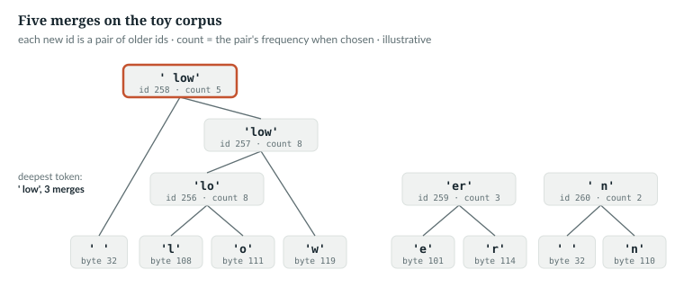
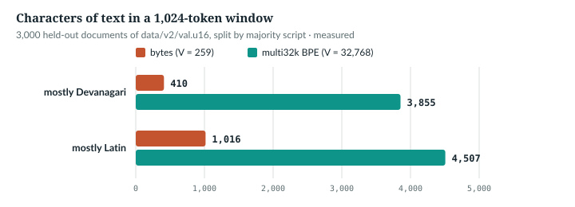
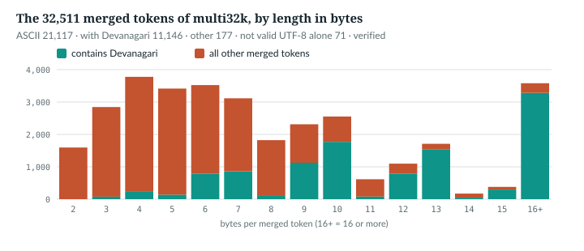

# 9  Byte-level BPE from scratch

Chapter 8's byte model spends about 2.5 positions per character of Hindi text. A
tokenizer spends fewer by giving frequent byte sequences ids of their own. The
released model's tokenizer, `multi32k`, was trained by `anulm/bpe.py`, whose
tokenizer class needs only the standard library. This chapter reads it line by
line: the pre-tokeniser, training with an incremental pair index and a lazy
heap, encoding by merge rank, the tests, and what it buys. Each fast routine
is checked against a slow, obvious one written for the book.

---

## 9.1  The idea, by hand

Byte pair encoding (BPE) starts from a base vocabulary and repeatedly merges
the most frequent pair of adjacent tokens into a new token. Sennrich and
colleagues adapted it to split words into subword units for translation
[R05]; GPT-2 ran it on bytes, with a base vocabulary of 256 [R04]. AnuLM does
the same: ids 0–255 are bytes, merge *i* gets id 256 + *i*.

On a ten-word toy corpus, five merges (*illustrative*; printed by
`book/code-examples/ch09_bpe_from_scratch.py`):

```
chunks: ['low', ' lower', ' lowest', ' low'] ...
merge 0: id 256 = b'l' + b'o' -> b'lo'  (count 8)
merge 1: id 257 = b'lo' + b'w' -> b'low'  (count 8)
merge 2: id 258 = b' ' + b'low' -> b' low'  (count 5)
merge 3: id 259 = b'e' + b'r' -> b'er'  (count 3)
merge 4: id 260 = b' ' + b'n' -> b' n'  (count 2)
encode(' slowest') -> [32, 115, 257, 101, 115, 116] [' ', 's', 'low', 'e', 's', 't']
vocab_size 262, eos_id 261
```



*Figure 9.1 · Five merges on a toy corpus.* Each new token is a pair of
older ones; the number is the pair's count when it was chosen. *illustrative*;
the counts are printed by `book/code-examples/ch09_bpe_from_scratch.py`.

`(l, o)` and `(o, w)` both occur 8 times; the tie goes to the smaller pair,
108 < 111. And ` slowest` keeps ` ` and `s` apart: no merge makes ` s`.

`NOT IN THE REPO` (the history) · `IN THE REPO` (the mechanism, 9.2–9.6)

## 9.2  Chunks: the pre-tokeniser

The *pre-tokeniser* cuts text into chunks before any merging, and merges never
cross a chunk boundary. It is one regular expression:

> **In the repo** · `anulm/bpe.py` · `CHUNK_RE` · line 39 · @2e80b3e

```python
CHUNK_RE = re.compile(r"\s*\S+|\s+")
```

`\s*\S+` is non-space characters with the whitespace before them; `\s+`
catches trailing whitespace. Every character lands in exactly one chunk, so
the chunks join back into the text. A leading space stays with its word, as
do newlines and indentation, so `' dog'` and `'dog'` are different tokens and
`'\n    return'` is one token of `multi32k` (9.6). Training skips long chunks:

> **In the repo** · `anulm/bpe.py` · `MAX_TRAIN_CHUNK_BYTES` · lines 46–48 · @2e80b3e

```python
MAX_TRAIN_CHUNK_BYTES = 48        # ignore absurd chunks (URLs, minified junk)
                                  # when *counting merges*; encoding still
                                  # handles any length.
```

`IN THE REPO`

## 9.3  The vocabulary is the merge list

A tokenizer is fully described by its ordered list of merges:

> **In the repo** · `anulm/bpe.py` · `BPE.__init__` · lines 64–83 · @2e80b3e

```python
class BPE:
    def __init__(self, merges: list[tuple[int, int]]):
        self.merges = merges
        # rank = priority at encode time = order the merge was learned
        self.ranks = {tuple(p): 256 + i for i, p in enumerate(merges)}
        self.vocab = {i: bytes([i]) for i in range(256)}
        for i, (a, b) in enumerate(merges):
            self.vocab[256 + i] = self.vocab[a] + self.vocab[b]
        # EOS sits above the merges, so bytes and merges keep their ids and a
        # tokenizer file needs no new field. `train` reserves the slot so a
        # `--vocab 16384` tokenizer is 16,384 ids *including* EOS.
        self.eos_id = 256 + len(merges)
        self._cache: dict[bytes, list[int]] = {}

    @property
    def vocab_size(self) -> int:
        return self.eos_id + 1
```

- **`ranks`** maps a pair to the id it creates, 256 + *i*, which is also its
  priority when encoding: lower id, earlier merge.
- **`vocab`** maps every id to its bytes; a merge's bytes are its two parts
  joined, and merges refer only to earlier ids, so one pass fills it.
- **`eos_id`** is one past the last merge. `multi32k` has 32,511 merges, so
  EOS is 32,767 and V = 32,768 (*verified*, 9.7).

`IN THE REPO`

## 9.4  Training, the slow way

First what the trainer computes, written the obvious way: count every
adjacent pair, merge the most frequent, count again.

> Book example, not repository code · `book/code-examples/ch09_bpe_from_scratch.py` · `naive_train`

```python
def naive_train(text: str, vocab_size: int, log: list | None = None) -> list[tuple[int, int]]:
    """Recount every pair of every chunk after every merge."""
    chunks = Counter(c.encode("utf-8") for c in CHUNK_RE.findall(text))
    words = [(list(c), f) for c, f in chunks.items()
             if 2 <= len(c) <= bpe.MAX_TRAIN_CHUNK_BYTES]
    merges = []
    while 256 + len(merges) < vocab_size - 1:              # one id kept for EOS
        counts = Counter()
        for seq, f in words:
            for p in zip(seq, seq[1:]):
                counts[p] += f
        if not counts:
            break
        best = min(counts, key=lambda p: (-counts[p], p))  # most frequent; ties: smallest pair
        if counts[best] < 2:
            break
        merges.append(best)
        if log is not None:
            log.append(counts[best])
        words = [(merge(seq, *best, 255 + len(merges)), f) for seq, f in words]
    return merges
```

It counts each *unique* chunk once, weighted by its frequency `f`. `merge`
(same file) replaces every non-overlapping `(a, b)`, left to right, by the new
id, 255 + len(merges) after the append. The cost is the recount: every merge
walks every pair of every chunk.

`NOT IN THE REPO` (a specification for 9.5)

## 9.5  Training, the fast way

`BPE.train` keeps the counts up to date instead of recounting. First, the
chunks and the two indexes:

> **In the repo** · `anulm/bpe.py` · `BPE.train` · lines 87–111 · @2e80b3e

```python
    @classmethod
    def train(cls, text: str, vocab_size: int, verbose: bool = True) -> "BPE":
        assert vocab_size > 256
        t0 = time.time()
        chunks = Counter(
            c.encode("utf-8") for c in CHUNK_RE.findall(text)
        )
        seqs, freqs = [], []
        for chunk, f in chunks.items():
            if len(chunk) <= MAX_TRAIN_CHUNK_BYTES and len(chunk) >= 2:
                seqs.append(list(chunk))
                freqs.append(f)
        # ...
        pair_counts: dict[tuple[int, int], int] = defaultdict(int)
        pair_where: dict[tuple[int, int], set[int]] = defaultdict(set)
        for i, (seq, f) in enumerate(zip(seqs, freqs)):
            for p in zip(seq, seq[1:]):
                pair_counts[p] += f
                pair_where[p].add(i)
```

- **Lines 94–101:** unique chunks and their frequencies, as in 9.4; a
  one-byte chunk has no pair. Lines 102–104, elided, print progress.
- **`pair_counts`:** every pair's weighted count, 9.4's numbers.
- **`pair_where`:** the *pair index*, the chunks that contain each pair. When
  a pair is merged, only those chunks change.

Then the loop, which takes the best pair from a heap:

> **In the repo** · `anulm/bpe.py` · `BPE.train` · lines 113–126 · @2e80b3e

```python
        heap = [(-c, p) for p, c in pair_counts.items()]
        heapq.heapify(heap)
        merges: list[tuple[int, int]] = []

        while 256 + len(merges) < vocab_size - 1 and heap:      # -1: EOS slot
            neg, pair = heapq.heappop(heap)
            # lazy deletion: stale entries no longer match the live count
            if -neg != pair_counts.get(pair, 0):
                continue
            if -neg < 2:
                break                      # nothing left worth merging
            new_id = 256 + len(merges)
            merges.append(pair)
            a, b = pair
```

- **The heap.** `heapq` keeps the smallest item on top, so counts go in
  negated: the top is the largest count, ties to the smallest pair, exactly
  9.4's `min(..., key=(-count, pair))`.
- **Lazy deletion.** A changed count is pushed as a new entry; the old one
  stays. A popped entry that no longer matches the live count is stale and
  skipped (lines 120–121): one comparison instead of a search.
- **The stop.** At `vocab_size − 1` ids, leaving one for EOS, or when the best
  count is below 2.

Then the update:

> **In the repo** · `anulm/bpe.py` · `BPE.train` · lines 128–162 · @2e80b3e

```python
            touched: set[tuple[int, int]] = set()
            for i in list(pair_where[pair]):
                seq, f = seqs[i], freqs[i]
                # subtract this chunk's current pairs
                for p in zip(seq, seq[1:]):
                    pair_counts[p] -= f
                    pair_where[p].discard(i)
                    touched.add(p)
                # apply the merge
                out, j = [], 0
                while j < len(seq):
                    if j < len(seq) - 1 and seq[j] == a and seq[j + 1] == b:
                        out.append(new_id)
                        j += 2
                    else:
                        out.append(seq[j])
                        j += 1
                seqs[i] = out
                # add back the new pairs
                for p in zip(out, out[1:]):
                    pair_counts[p] += f
                    pair_where[p].add(i)
                    touched.add(p)
            for p in touched:
                c = pair_counts.get(p, 0)
                if c > 0:
                    heapq.heappush(heap, (-c, p))
            # ...
        return cls(merges)
```

For each chunk holding the pair (`list(...)` copies the set the loop
changes): **subtract** all its pairs, **merge** left to right without overlap
(`a a a` with `(a, a)` merges only the first two), and **add back** the new
pairs. Redoing the whole chunk is simpler than tracking which pairs changed,
and exact even with overlaps. Lines 151–154 push every changed count; lines
155–161, elided, print progress. Work per merge grows with the chunks that
hold the pair, not with the corpus, and the merges equal 9.4's:

```
300 merges on 162,043 bytes: same merges; bpe.py 0.2 s, naive 4.8 s
1000 merges on 162,043 bytes: same merges; bpe.py 0.3 s, naive 16.1 s
```

*verified* on `docs/RESULTS.md` at the pin; times are one run on this machine.
`docs/RESULTS.md` records 10 s for a 16,384-id tokenizer on 12.6 MB (§7) and
588 s for `multi32k` on 550 MB (§22) (*measured*).

`IN THE REPO`

## 9.6  Encoding by rank

Encoding replays training's merges on new text, chunk by chunk, always
applying the earliest-learned merge present:

> **In the repo** · `anulm/bpe.py` · `BPE._encode_chunk` · lines 166–189 · @2e80b3e

```python
    def _encode_chunk(self, chunk: bytes) -> list[int]:
        hit = self._cache.get(chunk)
        if hit is not None:
            return hit
        seq = list(chunk)
        while len(seq) >= 2:
            best_rank, best_pair = min(
                (self.ranks.get(p, 1 << 30), p) for p in zip(seq, seq[1:])
            )
            if best_rank == 1 << 30:
                break
            a, b = best_pair
            out, j = [], 0
            while j < len(seq):
                if j < len(seq) - 1 and seq[j] == a and seq[j + 1] == b:
                    out.append(best_rank)
                    j += 2
                else:
                    out.append(seq[j])
                    j += 1
            seq = out
        if len(chunk) <= 64:               # don't let one giant blob evict RAM
            self._cache[chunk] = seq
        return seq
```

- **167–169:** a chunk seen before comes from the cache. In
  `docs/RESULTS.md`, 70% of the 27,949 chunks repeat an earlier cachable one
  (*verified* by the example).
- **172–176:** the lowest rank among adjacent pairs; unknown pairs get 2³⁰,
  and if nothing is known, stop.
- **177–186:** merge every occurrence; the rank *is* the new id, so
  `out.append(best_rank)` writes the token.
- **187–188:** cache chunks up to 64 bytes only.

The obvious encoder replays every merge in learned order. A merge only
creates pairs of higher rank than its own (a merge using token *t* was learned
after *t*), so both give the same tokens:

> Book example, not repository code · `book/code-examples/ch09_bpe_from_scratch.py` · `naive_encode`

```python
def naive_encode(text: str, merges: list[tuple[int, int]]) -> list[int]:
    """Every merge, in the order learned, over each chunk."""
    ids = []
    for c in CHUNK_RE.findall(text):
        seq = list(c.encode("utf-8"))
        for i, (a, b) in enumerate(merges):
            seq = merge(seq, a, b, 256 + i)
        ids += seq
    return ids
```

```
encode: first 20,000 characters of README.md -> 8,825 ids for 20,088 bytes, same as the naive encoder; decode(encode(x)) == x
```

The text is the first 20,000 characters of `README.md` at the pin. The naive
version makes 32,511 passes per chunk for `multi32k`; `_encode_chunk` makes
two per merge applied (find the minimum, then rewrite). Around it:

> **In the repo** · `anulm/bpe.py` · `BPE.encode` · lines 191–217 · @2e80b3e

```python
    def encode(self, text: str) -> list[int]:
        # ...
        ids: list[int] = []
        for c in CHUNK_RE.findall(text):
            ids.extend(self._encode_chunk(c.encode("utf-8")))
        return ids

    def encode_documents(self, text: str) -> list[int]:
        """`encode`, plus EOS after every document. Documents are DOC_SEP-separated;
        a corpus without DOC_SEP is one document and gets a single EOS at the end."""
        ids: list[int] = []
        for doc in text.split(DOC_SEP):
            if doc.strip():
                ids.extend(self.encode(doc))
                ids.append(self.eos_id)
        return ids

    def decode(self, ids) -> str:
        """Text for `ids`. Ids outside the vocabulary, EOS among them, are dropped;
        invalid UTF-8 becomes U+FFFD."""
        # EOS (and anything else outside the vocab) decodes to nothing.
        return b"".join(self.vocab.get(int(i), b"") for i in ids).decode("utf-8", errors="replace")

    def decode_complete(self, ids) -> str:
        """`decode` for text still being generated: a trailing, incomplete UTF-8
        character is held back rather than shown as U+FFFD (`complete_utf8`)."""
        return complete_utf8(b"".join(self.vocab.get(int(i), b"") for i in ids))
```

`encode_documents` is Chapter 8's rule with tokens: EOS after every
non-empty document. `decode` joins the bytes and decodes once, because a token
can be part of a character; bytes that are not valid UTF-8 become U+FFFD.
Text that is still being generated can end in the middle of a character, so
`decode_complete` hands the bytes to `complete_utf8` (lines 51–59), an
incremental UTF-8 decoder that holds an unfinished last character back instead
of printing U+FFFD for it. A real U+FFFD in the text (bytes EF BF BD) is kept.
The server and the API stream replies through it. The example checks it on
two of the three bytes of `भ` (E0 A4 AD), which are byte ids 224 and 164:

```
two of the three bytes of 'भ': decode -> '\ufffd' (U+FFFD), decode_complete -> ''; all three -> 'भ'
```

On the released tokenizer:

```
'The dog bit the man.'     -> ['The', ' dog', ' bit', ' the', ' man', '.']
' भारत की राजधानी'         -> [' भारत', ' की', ' राजधानी']
'def f(x):\n    return x'  -> ['def', ' f', '(x):', '\n    return', ' x']
```

`IN THE REPO`

## 9.7  The proof

Two tests pin the tokenizer. The first checks the vocabulary size and EOS:

> **In the repo** · `tests/test_model.py` · `bpe_documents_get_eos_and_the_vocab_is_exact` · lines 970–985 · @2e80b3e

```python
def bpe_documents_get_eos_and_the_vocab_is_exact():
    from anulm.bpe import BPE, DOC_SEP
    from anulm.training.train import FALLBACK
    tok = BPE.train(FALLBACK * 20, 300, verbose=False)
    # EOS is the last id; `--vocab N` means N ids INCLUDING it (fewer only if
    # the text runs out of pairs worth merging before the cap).
    assert tok.vocab_size == 256 + len(tok.merges) + 1 <= 300, \
        f"vocab {tok.vocab_size}, merges {len(tok.merges)}"
    assert tok.eos_id == tok.vocab_size - 1 and tok.eos_id not in tok.vocab
    docs = ["पहला लेख\n\nयह पहला है।", "दूसरा लेख\n\nयह दूसरा है।", "तीसरा"]
    ids = tok.encode_documents(DOC_SEP.join(docs) + DOC_SEP)
    assert ids.count(tok.eos_id) == 3, "one EOS per document"
    assert tok.decode(ids) == "".join(docs), "decode must drop EOS and round-trip the text"
    assert tok.eos_id not in tok.encode(docs[0]), "plain encode must never emit EOS"
    # a document-less corpus is one document
    assert tok.encode_documents("कुछ पाठ").count(tok.eos_id) == 1
```

The second holds `tokenizer.json`, the format the model ships in, to
`anulm/bpe.py` token for token. It is read by Hugging Face's `tokenizers` library,
written in Rust; when that library is not installed the test raises
`unittest.SkipTest`, and the runner prints SKIP and counts it as skipped,
not passed (lines 1520–1523):

> **In the repo** · `tests/test_model.py` · `hf_tokenizer_conversion_is_exact` · lines 1530–1540 · @2e80b3e

```python
    tok = BPE.train(FALLBACK * 8, 400, verbose=False)
    with tempfile.TemporaryDirectory() as d:
        out = Path(d) / "tokenizer.json"
        out.write_text(__import__("json").dumps(conv.build(tok), ensure_ascii=False),
                       encoding="utf-8")
        fast = Tokenizer.from_file(str(out))
        probes = conv.PROBES + [FALLBACK[:2000], FALLBACK[3000:5000]]
        for text in probes:
            ours, theirs = tok.encode(text), fast.encode(text, add_special_tokens=False).ids
            assert ours == theirs, f"{text[:40]!r}: {ours[:12]} != {theirs[:12]}"
            assert tok.decode(ours) == text, f"round trip failed on {text[:40]!r}"
```

`conv.build` (`anulm/hf/hf_tokenizer.py`) writes the same regex as a `Split`
pre-tokeniser and the merges in rank order. The test uses a small tokenizer,
so the book example checks the released tokenizer on five files at the pin
(*verified*):

```
multi32k: 32,511 merges, vocab_size 32,768, eos_id 32767
tokenizer.json == bpe.py on 5 files at the pin, 300,004 bytes, 85,827 tokens
```

The training corpus was encoded with that Rust library; `experiments/build_v2.py`'s
docstring says it was checked identical on 400 Hindi and 400 English
documents. The book's script repeats the check on held-out text: 3,000
documents from `data/v2/val.u16`, decoded and re-encoded with `anulm/bpe.py`, all
come back as exactly the stored ids (*measured*,
`code-examples/ch09_measure_fertility.py`, seed 0).

> **Details.** `save` writes `{"type", "version", "merges"}` as JSON, and
> `load` accepts only the type id `anulm-bpe` (lines 220–239; test
> `bpe_files_load_and_foreign_ones_are_refused`). Any other type raises
> `ValueError` naming the file (lines 236–238), not an assert, so
> `python -O` cannot remove the check.
> `cmd_encode` (lines 293–341) encodes a corpus with a pool of worker
> processes, about 4 million characters of whole documents per batch (around
> 10 MB of Hindi), into an `int16` array, two
> bytes a token; it asserts V ≤ 32,768 so every id fits.

`IN THE REPO`

## 9.8  Fertility: what the tokenizer buys

`bpe.py stats` reports compression and fertility:

> **In the repo** · `anulm/bpe.py` · `_stats` · lines 344–352 · @2e80b3e

```python
def _stats(tok, text):
    ids = tok.encode(text)
    raw = text.encode("utf-8")
    words = len([c for c in CHUNK_RE.findall(text) if c.strip()])
    print(f"  bytes/token : {len(raw)/len(ids):5.2f}   (byte tokenizer: 1.00)")
    print(f"  tokens/word : {len(ids)/max(words,1):5.2f}   "
          f"(bytes were ~15-20)")
    rt = tok.decode(ids)
    print(f"  exact roundtrip: {rt == text}")
```

Bytes per token: higher is cheaper. Tokens per word, a word being a chunk
that is not only whitespace: lower is cheaper. On the 3,000 held-out
documents, split by majority script (*measured*; the sample cannot reach the
148 documents too long for its window, 3.45% of held-out tokens, and draws
documents over 4,096 tokens, 17.0% of tokens, less often, which is part of why
its overall 5.97 differs from the build's 6.397):

| documents | count | bytes/token | characters/token | tokens/word | tokens that are one byte |
|---|---|---|---|---|---|
| mostly Devanagari | 1,220 | 9.41 | 3.77 | 1.35 | 2.32% |
| mostly Latin (English, Python) | 1,780 | 4.44 | 4.40 | 1.42 | 6.42% |
| all | 3,000 | 5.97 | 4.21 | 1.40 | 5.16% |



*Figure 9.2 · Characters in a 1,024-token window.* The model's context holds
about 3,855 Hindi characters with `multi32k` and about 410 as bytes. *measured*
on the same sample; the build's `data/v2/meta.json` records 9.37 bytes per
token for Hindi web text and 4.43 for English.



*Figure 9.3 · What the 32,511 merged tokens are.* Merged tokens by length in
bytes. 21,117 are ASCII and 11,146 contain Devanagari. Of those, 9,934 are only
Devanagari after any leading spaces, so their length is three bytes per code
point plus one per space, and they pile up at 6–7 (1,639 tokens), 9–10, 12–13
and 16 or more; the other 1,212 mix Devanagari with other characters. 71 tokens
are not valid UTF-8 on their own: fragments of characters. *verified*.

29,666 of the 32,768 ids occur at least once in the 3,000-document sample
(*measured*); the rest are rare enough to matter in Chapter 10.

Does compression help the model? `docs/RESULTS.md` measured it:
- **§7:** two 353M-trunk models, 6,000 steps, differing only in tokenizer.
  Bytes reach 0.862 bits per byte, a 16,384-id Hindi BPE 0.700; each step saw
  9.64 times more text. §7's own caveat: the BPE run cycled its corpus 2.4
  times, the byte run saw 0.25 of it.
- **§22:** the Hindi-only 16k tokenizer against `multi32k`: Hindi loses 1–4%
  of its compression, English and Python double or triple theirs.

`MEASURED`

## 9.9  Common mistakes, and how to catch them

| Mistake | What happens, silently | Catch it |
|---|---|---|
| decoding token by token | a token can be part of a character; each piece becomes U+FFFD | join the bytes, then decode once, as `decode` does; while streaming, `decode_complete` |
| encoding by frequency, or left to right | different ids from training; the model reads text it never saw | encode by rank; compare with a naive replay of the merges |
| a second tokenizer that differs on one merge | plausible text, different numbers | compare ids token for token, as `hf_tokenizer_conversion_is_exact` does |
| removing stale heap entries eagerly | correct but slow | skip them on pop, as lines 120–121 do |
| `--vocab N` without the EOS slot | N + 1 ids, one more than the model's table | `vocab_size == 256 + len(merges) + 1`, the test's first assertion |
| comparing losses across tokenizers | different units | bits per byte (Chapter 8) |

`IN THE REPO`

## 9.10  Exercises

1. In the toy of 9.1, which pair would merge sixth?
2. Why does `_encode_chunk` need only `ranks`, not the merge list?
3. A tokenizer has 16,127 merges. What are `eos_id` and `vocab_size`?
4. Write the chunks of `"a  b\n"` under `CHUNK_RE`.

**Answers.**
1. `(' ', 's')`: the remaining count-2 pairs tie, and (32, 115) is smallest.
2. A pair's rank is the id it creates: priority and output in one lookup.
3. 16,383 and 16,384.
4. `'a'`, `'  b'`, `'\n'`.

*verified*: answers 1, 3 and 4 were recomputed by script.

> **Build it.** The lab book's Chapter 3 (`course/ch03-tokenizer`) has you
> write this tokenizer, prove it matches `anulm/bpe.py` merge for merge, and measure
> what it buys on your own text.

---

## Key points

- BPE merges the most frequent adjacent pair, again and again; AnuLM starts
  from the 256 bytes, so any text encodes.
- `CHUNK_RE` splits text into a word with its leading whitespace, or a run of
  whitespace; merges never cross a chunk.
- Training counts unique chunks once, keeps pair counts current through a
  pair-to-chunk index, and takes the best pair from a heap whose stale entries
  are skipped on pop.
- Encoding applies the lowest-rank pair first; the rank is the new id, and
  the result equals replaying every merge in order.
- `multi32k` has 32,511 merges, EOS 32,767 and V = 32,768; `tokenizer.json`
  and `anulm/bpe.py` agree token for token on every text checked.
- In mostly-Devanagari held-out documents a token averages 9.41 bytes; in
  mostly-Latin, 4.44. §7 measured the switch from bytes as worth 0.162 bits
  per byte.

> **In one breath.** Split text into words with their leading space, then
> merge the most frequent byte pair, again and again, keeping the counts
> current with an index and a lazy heap. Encode new text by replaying the
> merges in learned order, and the released 32k vocabulary fits nine Hindi
> bytes into one token.

## References

Research references cited in this chapter (`RESEARCH_REFERENCES.md`), each
used only for the claim in its register row:

| ID | Used for | Status |
|---|---|---|
| [R04] | byte-level BPE with a base vocabulary of 256 | CHECKED |
| [R05] | byte pair encoding adapted to segment words into subword units | CHECKED |

Repository evidence, all at @2e80b3e:
- `anulm/bpe.py`: `CHUNK_RE` 39, `MAX_TRAIN_CHUNK_BYTES` 46–48, `BPE.__init__`
  64–83, `BPE.train` 87–162, `_encode_chunk` 166–189, `encode`,
  `encode_documents`, `decode`, `decode_complete` 191–217, `complete_utf8` 51–59, `save`/`load` 225–240, `cmd_encode`
  293–341, `_stats` 344–352.
- `tests/test_model.py`: `bpe_documents_get_eos_and_the_vocab_is_exact` 970–985,
  `hf_tokenizer_conversion_is_exact` 1517–1540,
  `bpe_files_load_and_foreign_ones_are_refused` 1544.
- `anulm/hf/hf_tokenizer.py`: `build`, `PROBES`; `experiments/build_v2.py`
  docstring.
- `data/multi32k.json`, the tokenizer, committed at the pin; `docs/RESULTS.md`
  §7 and §22.

Local files, not in the commit (released or gitignored): the released
tokenizer `release/AnuLM-Base-v2-400M/tokenizer.json` and
`tokenizer.multi32k.json` (identical merges to `data/multi32k.json`), and
the build's `data/v2/meta.json` and `val.u16`.
- Measurements: `book/measurements/part_iii_fertility.json`, written by
  `code-examples/ch09_measure_fertility.py --save` (without `--save` it
  writes to the current directory).

The book examples are `code-examples/ch09_bpe_from_scratch.py` and
`code-examples/ch09_measure_fertility.py`.
