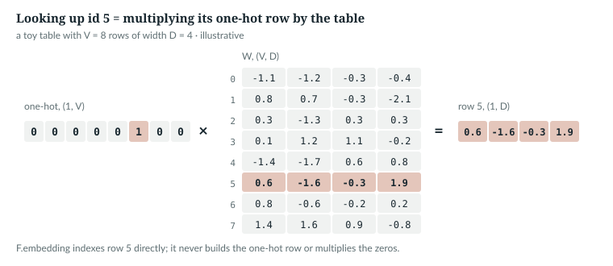
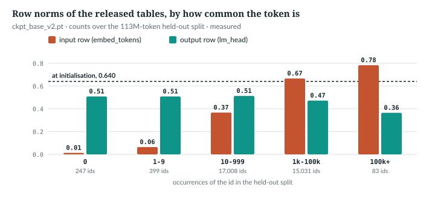

# 10  Embeddings and the output table

Chapters 8 and 9 turn text into ids. This chapter turns ids into vectors and
vectors back into a score per id, with two tables of one row per vocabulary
entry: the *embedding table* at the input and the *output table*, or head, at
the end. It reads how they are built, initialised and trained, and an optional
reparameterisation that ties rare tokens to their BPE parts.

---

## 10.1  A lookup is a one-hot matrix multiply

An embedding table **W** has shape (V, D), one row per id. Looking up id *t*
returns row *t*: the same as multiplying a *one-hot* vector, zeros except a 1
at position *t*, by **W** (*verified* on `tiny()`):

> Book example, not repository code · `book/code-examples/ch10_embeddings.py` · `lookup_is_a_matmul`

```python
    torch.manual_seed(0)
    m = M.AnuLM(tiny())
    W = m.embed_tokens.weight                                  # (V, D) = (64, 32)
    idx = torch.tensor([[5, 9, 5]])                            # (B, S) = (1, 3)
    x = F.embedding(idx, W)                                    # (1, 3, 32)
    one_hot = F.one_hot(idx, num_classes=W.shape[0]).float()   # (1, 3, 64)
    assert torch.equal(x, one_hot @ W)
    x.sum().backward()
    rows = W.grad.abs().sum(-1).nonzero().flatten().tolist()
```

```
F.embedding == one_hot @ W: (1, 3) ids -> (1, 3, 32) vectors; rows with a gradient: [5, 9], row 5 grad = 2 (used twice)
```



*Figure 10.1 · A lookup is a one-hot product.* The one-hot row for id 5 picks
row 5 of **W**; every other row is multiplied by 0. *illustrative*.

Two consequences follow from the matrix form. The lookup is linear, so its
gradient is the one-hot matrix transposed times the incoming gradient: only
rows of ids in the batch get a gradient, and an id used twice gets the sum.
And `F.embedding` never builds the (B, S, V) one-hot tensor; it indexes,
which costs D numbers per token instead of V × D multiplies.

`IN THE REPO` (`F.embedding`, 10.4)

## 10.2  Two tables, built untied

> **In the repo** · `anulm/model.py` · `AnuLM.__init__` · lines 820–837 · @084cbdd

```python
class AnuLM(nn.Module):
    def __init__(self, cfg: AnuLMConfig):
        super().__init__()
        self.cfg = cfg
        self.embed_tokens = nn.Embedding(cfg.vocab_size, cfg.hidden_size)
        rope_dim = cfg.qk_rope_head_dim if cfg.attn == "mla" else cfg.head_dim
        self.rotary = Rotary(cfg, rope_dim)
        self.layers = nn.ModuleList([Block(cfg, i, self.rotary) for i in range(cfg.n_layer)])
        self.norm = RMSNorm(cfg.hidden_size, cfg.rms_norm_eps)
        self.lm_head = nn.Linear(cfg.hidden_size, cfg.vocab_size, bias=False)
        if cfg.tie_word_embeddings:
            self.lm_head.weight = self.embed_tokens.weight
```

- **`embed_tokens`:** an `nn.Embedding(V, D)`, a (V, D) weight read by index.
  `rotary`, `layers` and `norm` are Part IV's.
- **`lm_head`:** an `nn.Linear(D, V)` without bias. Its weight is stored
  (out, in), so it is also (V, D), and `lm_head(h)` computes h **W**ᵀ: one
  score, a *logit*, per id.
- **Tying:** with `tie_word_embeddings`, line 836 makes the head's weight *the
  same tensor* as the embedding. The default is `False` (line 117, "Sarvam
  unties both models"), and so is the released model (*verified*).

```
tie_word_embeddings=False: same tensor? False parameters 47,888
tie_word_embeddings=True : same tensor? True  parameters 45,840
released model: each table 32768 x 1024 = 33,554,432 parameters, both 67,108,864, 16.9% of its 397,659,648 (Chapter 20)
```

Tying saves V × D parameters, 33.5M in the released model. `docs/RESULTS.md`
§32 measured it: in an 88M proxy at 25M tokens, tying lowered held-out loss by
0.207; at 400M, a recipe that included tying ended within about one standard
error of plain AdamW (*measured*). Tying alone was not run at 400M.

`IN THE REPO`

## 10.3  Initialisation and the first loss

> **In the repo** · `anulm/model.py` · `AnuLM.__init__` · lines 847–859 · @084cbdd

```python
        self.apply(self._init_weights)
        # nanoGPT's scaled init for the residual output projections.
        for name, p in self.named_parameters():
            if name.endswith(("o_proj.weight", "dense.weight", "down_proj.weight")):
                nn.init.normal_(p, mean=0.0, std=cfg.initializer_range / math.sqrt(2 * cfg.n_layer))

    def _init_weights(self, m):
        if isinstance(m, nn.Linear):
            nn.init.normal_(m.weight, mean=0.0, std=self.cfg.initializer_range)
            if m.bias is not None:
                nn.init.zeros_(m.bias)
        elif isinstance(m, nn.Embedding):
            nn.init.normal_(m.weight, mean=0.0, std=self.cfg.initializer_range)
```

`self.apply` visits every module, so both tables are drawn from N(0, 0.02²)
(`initializer_range`, line 118): the head as an `nn.Linear`, the embedding by
its own branch. Lines 805–808 rescale residual output projections (Chapter
15), not the tables. For the head this sets the first loss. The model's last
normalisation layer (RMSNorm, Chapter 15) hands it vectors of root mean square 1, so ‖h‖ = √D, and each logit has spread
0.02 × √D: small, so the first softmax is nearly uniform and the loss near
ln V (Chapter 3). The test holds `tiny()` to that:

> **In the repo** · `tests/test_model.py` · `initial_loss_is_ln_vocab` · lines 338–348 · @084cbdd

```python
def initial_loss_is_ln_vocab():
    for attn in ("gqa", "mla"):
        torch.manual_seed(0)
        cfg = tiny(attn=attn)
        m = AnuLM(cfg).eval()
        x = torch.randint(0, cfg.vocab_size, (4, 32))
        with torch.no_grad():
            _, loss = m(x, x)
        expected = math.log(cfg.vocab_size)
        assert abs(loss.item() - expected) < 0.35, \
            f"{attn}: init loss {loss.item():.3f}, expected ~{expected:.3f} -- init is off"
```

At the released size the book example simulates just the head, drawn as
`_init_weights` draws it, on synthetic unit-RMS inputs (*illustrative*):

> Book example, not repository code · `book/code-examples/ch10_embeddings.py` · `first_loss`

```python
    V, D = 32768, 1024
    g = torch.Generator().manual_seed(0)
    W = torch.randn(V, D, generator=g) * 0.02
    h = torch.randn(256, D, generator=g)
    h = h / h.pow(2).mean(-1, keepdim=True).sqrt()             # RMS exactly 1
    z = h @ W.T                                                # (256, V)
    y = torch.randint(0, V, (256,), generator=g)
```

```
tiny(): logit std 0.118 (0.02 x sqrt(32) = 0.113), loss 4.186, ln V = 4.159
released size: logit std 0.640 (0.02 x sqrt(1024) = 0.64), loss 10.581, ln V = 10.397, ln V + std^2/2 = 10.602
```

With independent logits of spread σ, the first loss is about ln V + σ²/2:
the softmax denominator sums V terms whose mean is e^(σ²/2). That predicts
0.006 above ln V for `tiny()` and 0.205 for the released size; the gaps
are 0.027 for `tiny()` and 0.184 for the simulated head, inside the test's
0.35. The whole released configuration at random initialisation starts
0.224 above ln V (*verified*):

> Book example, not repository code · `book/code-examples/ch10_measure_tables.py` · `main`

```python
    from trace_forward import released
    torch.manual_seed(0)
    m = M.AnuLM(released()).eval()
    x = torch.randint(0, V, (4, 256))
    with torch.no_grad():
        logits, loss = m(x, x)
```

```
released config at random init (seed 0, 4 x 256 random ids): loss 10.621, logit std 0.640, ln V 10.397
``` The bump grows with the
square of the initial spread: at `initializer_range` 0.05 the released head
would start 1.28 above ln V (*illustrative*, printed by the example).

`IN THE REPO`

## 10.4  How the forward pass reads the tables

`AnuLM.forward` never touches `embed_tokens` directly:

> **In the repo** · `anulm/model.py` · `AnuLM.forward` · line 884 · @084cbdd

```python
            x = F.embedding(idx, self._table("in"))               # (B, S, D)
```

> **In the repo** · `anulm/model.py` · `AnuLM._table` · lines 954–958 · @084cbdd

```python
    def _table(self, side: str):
        """The embedding ("in") or output ("out") table as the model uses it."""
        W = self.embed_tokens.weight if side == "in" else self.lm_head.weight
        if not self.cfg.merge_tree or self.cfg.merge_tree not in (side, "both"):
            return W
```

> **In the repo** · `anulm/model.py` · `AnuLM._head` · lines 980–983 · @084cbdd

```python
    def _head(self, h):
        if self.cfg.merge_tree in ("out", "both"):
            return F.linear(h, self._table("out"))
        return self.lm_head(h)
```

Line 841 turns (B, S) ids into (B, S, D) vectors. `_table` picks the raw
weight and, with no merge tree on that side, returns it unchanged: the
released model's path. `_head` is then the plain `lm_head(h)`, (…, D) →
(…, V); with a merge tree, the same product with the composed table (10.6).
`forward` applies it to the last position only, or to all when computing the
loss (Chapter 20).

`IN THE REPO`

## 10.5  What training did to the released tables

The measurement script reads both tables from `ckpt_base_v2.pt` and counts
each id in the 113,221,976 held-out tokens. Every row started near
0.02 × √1024 = 0.640 (*measured*, `code-examples/ch10_measure_tables.py`):

| held-out count | ids | input row norm | output row norm | cos(input row, output row) |
|---|---|---|---|---|
| 0 | 247 | 0.013 | 0.508 | 0.000 |
| 1–9 | 399 | 0.064 | 0.508 | −0.005 |
| 10–999 | 17,008 | 0.367 | 0.513 | 0.000 |
| 1k–100k | 15,031 | 0.666 | 0.472 | 0.000 |
| 100k+ | 83 | 0.783 | 0.365 | −0.014 |



*Figure 10.2 · Row norms by how common the token is.* Rare tokens' input rows
have shrunk almost to zero. Output rows stay between 0.36 and 0.51, and fall
as the token gets more common: the 100k+ bucket keeps 57% of its starting
size. *measured* on `ckpt_base_v2.pt`.

- **Rare input rows shrink.** An input row gets a gradient only when its id is
  in the batch (10.1), but AdamW's decoupled weight decay (Chapter 7, 7.2)
  shrinks every 2-D parameter at every step, embeddings included
  (`make_optimizer`, `anulm/training/train.py` lines 451–478). The run's launch scripts
  (`_v2_run.cmd`, `experiments/v2_train.sh`) pass no `--weight-decay`, so the
  default 0.1 applied (line 559), and `ckpt_base_v2.pt.last` stores it: 0.1 on
  1,432 tensors, 0.0 on 81, fused. Decay alone over the run's schedule would
  multiply a row by 10⁻⁴⁶ (1 − lr × 0.1 per step on `lr_at`'s schedule, code
  below), so even the 0.013 rows got occasional
  gradients: their size is a balance of gradient against decay. That fits
  the table; nothing here isolates decay as the cause.
- **Output rows do not.** The gradient on logit *j* is p<sub>j</sub> −
  y<sub>j</sub> (Chapter 5), non-zero for every *j*: every output row trains
  at every step.
- **The two tables are not aligned.** A token's input row and output row
  point in unrelated directions: cosine 0.000 on average, as for random
  pairs. Their neighbourhoods do overlap: for 2,000 tokens seen at least 1,000
  times, 4.9% of the ten nearest rows agree between the tables, against 0.031%
  by chance (10 of 32,767).

> Book example, not repository code · `book/code-examples/ch10_measure_tables.py` · `main`

```python
    from types import SimpleNamespace
    from train import lr_at
    run = SimpleNamespace(lr=6e-4, min_lr=6e-5, warmup=2000, steps=1900000, schedule="wsd",
                          decay_frac=0.1631579)               # the flags in _v2_run.cmd / experiments/v2_train.sh
    wd = groups[0]["weight_decay"]
    log_keep = sum(math.log1p(-lr_at(s, run) * wd) for s in range(run.steps))
```

```
ckpt_base_v2.pt.last optimizer groups: [{'weight_decay': 0.1, 'tensors': 1432, 'fused': True}, {'weight_decay': 0.0, 'tensors': 81, 'fused': True}]
decay alone over 1,900,000 steps multiplies a row by 10^-45.8: 0.640 -> 9.0e-47
```

Within the input table, neighbours by cosine show what the rows encode:

```
' dog'    id  6884: ' dogs' 0.39, ' Dog' 0.35, ' car,' 0.20, ' car' 0.20, ' animal' 0.19
' India'  id  8466: ' India.' 0.44, ' India,' 0.41, ' Asia' 0.31, ' China' 0.31, ' इण्डिया' 0.31
' भारत'   id  1525: '\nभारत' 0.52, 'भारत' 0.51, ' केंद्र' 0.31, ' देश' 0.30, ' we' 0.26
' the'    id   286: ' The' 0.68, '\nThe' 0.64, ' कि' 0.25, ' की' 0.24, ' और' 0.20
```

Spelling variants come first, and ` India` has its Devanagari spelling
nearby. Four hand-picked tokens illustrate; they test nothing.

`MEASURED`

## 10.6  Sidebar: the merge-tree reparameterisation

> **Details.** Everything in this section is off in the released model
> (`merge_tree = ""` in its configuration) and can be skipped on a first
> reading. It is a training-time option, measured in `docs/RESULTS.md` §32.

The rows of a rare token learn slowly, as 10.5 shows. But every BPE token is a
merge of two older ones, so its row could start from theirs. With
`merge_tree`, row *t* of a table is trained as

  E[t] = W[t] + (E[a] + E[b]) / 2   for merge t = (a, b),

recursively, with E = W for the bytes. Unrolled, E = **P** **W** for a fixed
sparse (V, V) matrix **P**:

> **In the repo** · `anulm/model.py` · `merge_tree_matrix` · lines 383–404 · @084cbdd

```python
def merge_tree_matrix(merges, vocab_size: int) -> torch.Tensor:
    """Sparse (V, V) matrix P with E = P @ W unrolling E[t] = W[t] + (E[a] + E[b]) / 2.

    `merges` is the BPE merge list (token 256 + i = merges[i]); bytes, EOS and
    any id past the merges are their own row. For multi32k it has 393,657
    nonzeros -- about 12 per token -- so P @ W costs ~0.4 GFLOP at width 1024.
    """
    coef = [{i: 1.0} for i in range(256)]
    for a, b in merges:
        c = {len(coef): 1.0}
        for q in (a, b):
            for k, v in coef[q].items():
                c[k] = c.get(k, 0.0) + 0.5 * v
        coef.append(c)
    while len(coef) < vocab_size:
        coef.append({len(coef): 1.0})
    rows, cols, vals = [], [], []
    for t, c in enumerate(coef[:vocab_size]):
        for k, v in c.items():
            rows.append(t); cols.append(k); vals.append(v)
    return torch.sparse_coo_tensor(torch.tensor([rows, cols]), torch.tensor(vals),
                                   (vocab_size, vocab_size), check_invariants=True).coalesce()
```

`coef[t]` is row *t* of **P** as {column: weight}. A byte is itself
(line 390); a merge is 1 on its own row plus half of each parent's row
(377–382), so ancestors weigh ½, ¼, …, and a self-pair adds its parent twice.
EOS and extra ids are their own row (383–384). The docstring's "~0.4 GFLOP"
counts multiply-adds: 393,657 × 1,024 = 0.40 G, which is 0.81 GFLOP per
table per forward pass. For the merges ab, abc,
abcabc, the book example prints:

```
E[97] = 1*W[97]
E[256] = 0.5*W[97] + 0.5*W[98] + 1*W[256]
E[257] = 0.25*W[97] + 0.25*W[98] + 0.5*W[99] + 0.5*W[256] + 1*W[257]
E[258] = 0.25*W[97] + 0.25*W[98] + 0.5*W[99] + 0.5*W[256] + 1*W[257] + 1*W[258]
```

The test asserts the same rows:

> **In the repo** · `tests/test_model.py` · `merge_tree_composes_trains_and_bakes_losslessly` · lines 1629–1636 · @084cbdd

```python
    merges = [[97, 98], [256, 99], [257, 257], [100, 101]]      # ab, abc, abcabc, de
    P = merge_tree_matrix(merges, 261)
    W = torch.randn(261, 4)
    E = torch.sparse.mm(P, W)
    assert torch.allclose(E[97], W[97])
    assert torch.allclose(E[256], W[256] + (W[97] + W[98]) / 2)
    assert torch.allclose(E[257], W[257] + (E[256] + W[99]) / 2)
    assert torch.allclose(E[258], W[258] + E[257]), "a self-pair counts both halves"
```

The product runs in fp32 with autocast off, since the sparse multiply has no
bf16 path here:

> **In the repo** · `anulm/model.py` · `AnuLM._compose` · lines 947–952 · @084cbdd

```python
    def _compose(self, W):
        """P @ W in fp32 outside autocast (sparse matmul has no bf16 path here)."""
        if self.merge_P.device != W.device:
            self.merge_P = self.merge_P.to(W.device)
        with torch.autocast(device_type=W.device.type, enabled=False):
            return torch.sparse.mm(self.merge_P, W.float()).to(W.dtype)
```

`_table` composes in training and caches in evaluation:

> **In the repo** · `anulm/model.py` · `AnuLM._table` · lines 959–978 · @084cbdd

```python
        if self.training:
            return self._compose(W)
        # Eval: compose once and reuse -- a decode step would otherwise redo
        # the whole-vocabulary product. The cache is dropped by train(), i.e.
        # every time training resumes. It must NOT be keyed on W._version:
        # the fused AdamW step updates weights without bumping it, and a
        # version-keyed cache served step-999 tables to every later eval of
        # the 400M check (val 6.37 -> 10.66 while train loss fell to 4.43).
        if self._merged is None:
            self._merged = {}
        if side not in self._merged:
            with torch.no_grad():
                self._merged[side] = self._compose(W)
        return self._merged[side]

    def train(self, mode: bool = True):
        self._merged = None             # weights may change from here on
        return super().train(mode)
```

In training the product is recomputed every call, so gradients reach every
ancestor row through **P**; in evaluation it is computed once per side. The
comment records a real bug (§32): a cache keyed on the version counter, which
the fused (single-kernel, CUDA) AdamW step does not bump, served stale tables to every later
evaluation. Now `train()` drops the cache, and
`merge_tree_eval_cache_sees_optimizer_updates` (`tests/test_model.py` line 1659)
fakes an update with `.data.add_`, which leaves the counter alone too
(*verified*: `W._version moves by 0`).

For serving, the composition is written back:

> **In the repo** · `anulm/model.py` · `AnuLM.bake_merge_tree` · lines 985–1001 · @084cbdd

```python
    @torch.no_grad()
    def bake_merge_tree(self):
        """Replace the raw tables by their composed values and switch the
        reparameterisation off. Outputs are unchanged; afterwards this is an
        ordinary checkpoint for serve.py, export_hf.py and the HF wrapper."""
        if not self.cfg.merge_tree:
            return
        ein, eout = self._compose(self.embed_tokens.weight), self._compose(self.lm_head.weight)
        side = self.cfg.merge_tree
        tied = self.lm_head.weight is self.embed_tokens.weight
        assert not (tied and side != "both"), "a tied table composed on one side only cannot be baked"
        if side in ("in", "both"):
            self.embed_tokens.weight.copy_(ein)
        if side in ("out", "both") and not tied:
            self.lm_head.weight.copy_(eout)
        self.cfg.merge_tree = ""
        self.merge_P, self._merged = None, None
```

Both tables are composed before either is overwritten, because a tied pair is
one tensor; and a tied table composed on one side only cannot be baked, since
one tensor cannot be both **P** **W** and **W**. The rest of the test (lines
1637–1655) checks that an ancestor gets a gradient through the tree and that
baking changes no output by more than 10⁻⁵, tied or not; the book example
finds a largest change of `0.00e+00`.

Quality, from §32: in the 88M proxy at 25M tokens, the merge tree lowered
held-out loss by 0.187 on the input side and 0.194 on the output side; on top
of Muon and tied tables, it and a bigram teacher together added about 0.04;
and at 400M the full recipe's early lead did not hold (*measured*).

`IN THE REPO` (off by default)

## 10.7  Common mistakes, and how to catch them

| Mistake | What happens, silently | Catch it |
|---|---|---|
| a large `initializer_range` | logits start wide; the first loss sits well above ln V | assert the first loss near ln V, as `initial_loss_is_ln_vocab` does |
| tying by copying instead of sharing | two tensors that drift apart, twice the memory | check `lm_head.weight is embed_tokens.weight` |
| a vocabulary larger than the table | an index error, or a wrong row if ids were remapped | assert `max(ids) < vocab_size` when loading data |
| a cache keyed on `_version` | fused optimizers and `.data` updates do not bump it; stale tables | drop caches on `train()`, as `_table` does |
| reading rare rows' norms as meaning | a row's size reflects how often it got a gradient against decay, not only what it means | compare against token counts, as 10.5 does |

`IN THE REPO`

## 10.8  Exercises

1. How large is `F.one_hot(idx, 32768).float()` for `idx` of shape (8, 1,024)?
   (`F.one_hot` itself returns int64.)
2. How many parameters and MiB in fp32 would tying save in the released model?
3. Why does an output row train even when its token is absent from the batch?
4. Write row 259 of **P** for the merges ab, abc, abcabc, de of 10.6.

**Answers.**
1. (8, 1,024, 32,768); 268,435,456 entries, 1 GiB.
2. 33,554,432 parameters, 128 MiB.
3. Its logit is in every softmax denominator, so its gradient p<sub>j</sub> ≠ 0.
4. Merge 3 is (100, 101): E[259] = W[259] + ½W[100] + ½W[101].

*verified*: answers 1, 2 and 4 are printed by `ch10_embeddings.py`.

> **Build it.** The lab book's Chapter 4 (`course/ch04-skeleton`) builds the
> embedding, the head and their initialisation in your own model file, and
> checks the first loss against ln V.

---

## Key points

- An embedding lookup is a one-hot row times the (V, D) table; only the rows
  of ids in the batch get a gradient.
- AnuLM builds two tables, `embed_tokens` and `lm_head`, each (V, D); they are
  untied by default and in the released model, 67.1M parameters together.
- Both start at N(0, 0.02²), so the first logits have spread 0.02·√D and the
  first loss sits near ln V: 10.58 against 10.40 at the released size.
- `forward` reads both through `_table` and `_head`, which return the plain
  weights unless the merge tree is on.
- In the released model, rare tokens' input rows have shrunk almost to zero,
  output rows have not, and a token's two rows point in unrelated directions.
- The merge tree trains E = **P** **W** so rare tokens share their parts'
  rows, caches it safely in evaluation, and bakes back into a plain table.

> **In one breath.** Each id selects a row of a (V, D) table at the input, and
> an untied (V, D) head scores every id at the output. Both start small enough
> that the first loss is ln V. Training leaves rare input rows near zero, and
> an optional merge tree lets rare tokens borrow rows from their BPE parts.

## References

Research references cited in this chapter (`RESEARCH_REFERENCES.md`): none.
The merge tree is this repository's own idea, measured only in
`docs/RESULTS.md` §32. A register entry for weight tying is proposed in
`technical-review/register-additions/part_iii.md`.

Repository evidence, all at @084cbdd:
- `anulm/model.py`:
  - `AnuLMConfig` lines 117–118 and 119–124;
  - `merge_tree_matrix` 383–404;
  - `AnuLM.__init__` 820–851, `_init_weights` 853–859;
  - `AnuLM.forward` 884; `_compose` 947–952, `_table` 954–972,
    `train` 974–978, `_head` 980–983, `bake_merge_tree` 985–1001.
- `anulm/training/train.py`: `make_optimizer` 451–478, `--weight-decay` 559.
- `tests/test_model.py`: `initial_loss_is_ln_vocab` 338–348,
  `merge_tree_composes_trains_and_bakes_losslessly` 1623,
  `merge_tree_eval_cache_sees_optimizer_updates` 1659.
- `experiments/v2_train.sh` (the run's flags); `docs/MODEL_CARD_BASE_V2.md`
  (AdamW schedule); `docs/RESULTS.md` §32.

Local files, not in the commit: `ckpt_base_v2.pt` and `ckpt_base_v2.pt.last`
(the released run's weights, configuration and optimizer state),
`_v2_run.cmd`, and `data/v2/val.u16`. Measurements:
`book/measurements/part_iii_tables.json`, written by
`code-examples/ch10_measure_tables.py --save`.

The book examples are `code-examples/ch10_embeddings.py` and
`code-examples/ch10_measure_tables.py`.
