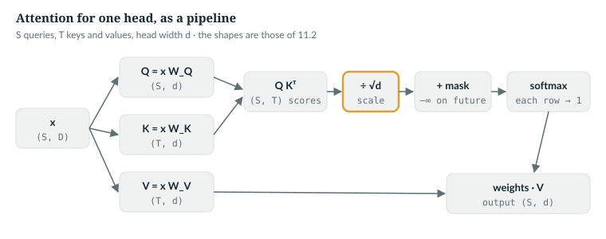
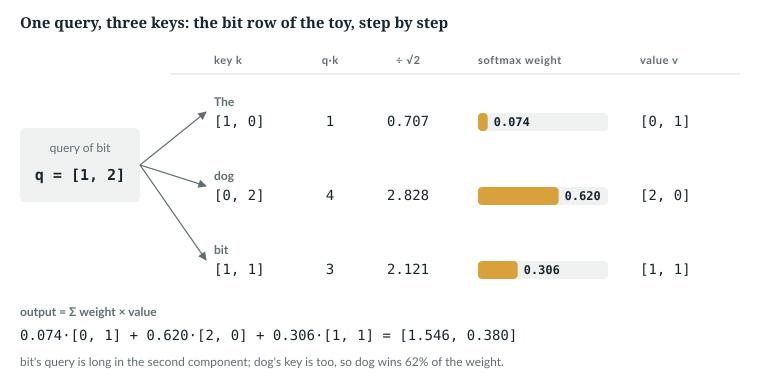
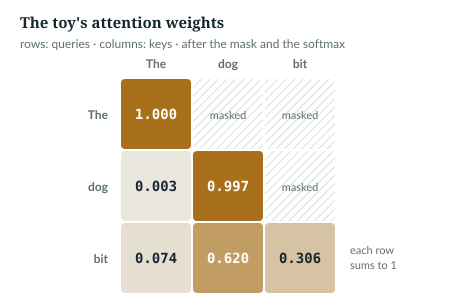
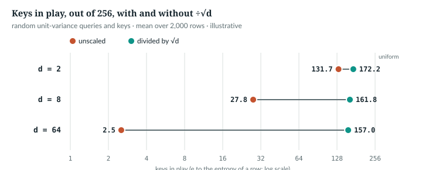
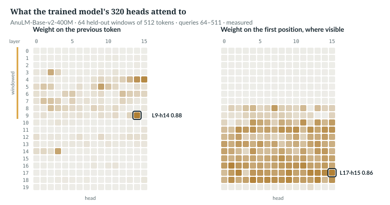

# 11  Attention from first principles

After the embedding lookup of Chapter 10, every token is a vector that knows
only which token it is. Attention lets each position read the earlier ones and
add what it finds to its own vector. This chapter builds it by hand, in ten
lines of PyTorch, in `anulm/model.py`, and measures it in the trained model.

Prerequisites: shapes and matrix multiplies (Chapter 4), the softmax (Chapter 5).

**New words.** Part IV starts here; these terms recur through Chapter 20.

| Term | Meaning |
|---|---|
| query | the vector a position uses to ask what it is looking for |
| key | the vector a position uses to say what it contains |
| value | the vector a position hands over if it is chosen |
| score | the dot product of one query with one key: how well they match |
| attention weight | a score after the softmax: a number in [0, 1], and a row of them sums to 1 |
| head | one complete set of queries, keys and values; the model runs several side by side (Chapter 13) |
| residual stream | the running sum of vectors that every layer reads from and adds to (Chapter 15) |
| kernel | the compiled low-level routine that actually runs an operation on the hardware |

**Notation for Part IV.** Matrices of many vectors are bold (**Q**, **K**,
**V**); single vectors are lower case (q, k, v). Plain capitals are sizes.

| Symbol | Meaning | Released model |
|---|---|---|
| B | sequences in a batch | any |
| S | queries: the new tokens in this call | up to 1,024 |
| T | keys: the tokens a query may look at (T = S until Chapter 27's cache) | up to 1,024 |
| D | the model's width, `hidden_size` | 1,024 |
| H | heads per layer, `n_head` | 16 |
| D<sub>h</sub> | one head's width, `head_dim`; this chapter writes d for short | 64 |
| L | layers | 20 |
| V | vocabulary size (never the value matrix, which is bold **V**) | 32,768 |
| E, A | experts per MoE layer, and experts active per token (Chapters 17–18) | 24, 4 |


---

## 11.1  The problem: a token needs its context

To predict what follows `The dog bit`, the vector at *bit* should carry some of
*dog*, and which earlier token matters changes with every sentence. So each
position computes weights over the positions it may see, from their content,
and returns a weighted average of what they offer, **added** to its own vector
(Chapters 15 and 20). A 2014 translation model already searched its source
sentence softly this way [R02]; the 2017 transformer was built on the scaled
dot-product form below [R01].

`NOT IN THE REPO` (the history) · `IN THE REPO` (the mechanism, 11.6)

## 11.2  Queries, keys and values: a soft lookup

A dictionary returns the value whose key equals the query. In attention every
key matches a little, by a dot product, and every value contributes, weighted by
its match. All three come from the token's vector x by learned matrices:
q = x W<sub>Q</sub>, k = x W<sub>K</sub>, v = x W<sub>V</sub>.

Each has width d = 64 in the released model. Sixteen heads run side by side,
and 16 × 64 = 1,024 = D, so their queries and outputs fill the model's width.
Their keys and values are shared four ways (Chapter 13). With the S queries
stacked as **Q**, the T keys and values as **K** and **V**, and a mask **M**
that is 0 where a query may look and −∞ where it may not:

  Attention(**Q**, **K**, **V**) = softmax(**Q** **K**ᵀ / √d + **M**) · **V**

| Tensor | Shape | Read it as |
|---|---|---|
| **Q** | (S, d) | S queries of width d |
| **K**, **V** | (T, d) | T keys and T values; in this model a value is d wide too |
| **Q** **K**ᵀ | (S, T) | one score for every query–key pair |
| softmax(…) | (S, T) | each row turned into weights that sum to 1 |
| output | (S, d) | one weighted average of the values per query |

The softmax runs along each **row**, over the keys. The mask hides every key
after its query, so no position sees the future (Chapter 12). Unlike a
dictionary, attention returns a blend that no position stored.



*Figure 11.1 · Scaled dot-product attention, one head.* The formula as a
pipeline, with the shape of every tensor. The step drawn in gold, ÷√d, is the
subject of 11.5.

`ANALOGY`

## 11.3  By hand: `The dog bit`

The book's running toy has three tokens with two-number vectors. Every number
here is *illustrative* and recomputed by
`book/code-examples/ch11_attention_from_scratch.py` (**Book example, not
repository code**), which sets up the toy like this:

```python
    X = torch.tensor([[1., 0.], [0., 2.], [1., 1.]])
    W_q = torch.tensor([[1., 0.], [0., 2.]])
    W_k = torch.eye(2)
    W_v = torch.tensor([[0., 1.], [1., 0.]])
    out, w = attention(X @ W_q, X @ W_k, X @ W_v, causal(3))
```

`X @ W_q` multiplies each row by the matrix; *bit*'s query is [1, 1] ×
W<sub>Q</sub> = [1, 0] + [0, 2] = [1, 2].

```
Q = X W_Q:  The [1, 0]   dog [0, 4]   bit [1, 2]
K = X W_K:  The [1, 0]   dog [0, 2]   bit [1, 1]
V = X W_V:  The [0, 1]   dog [2, 0]   bit [1, 1]
```



*Figure 11.2 · One attention row by hand.* *illustrative*; the numbers are
recomputed by `book/code-examples/attention_by_hand.py` (11.3), and the figure
is drawn by `tools/make_figures.py` from the same matrices.

| Step | Operation | The *bit* row |
|---|---|---|
| 1 | dot each query with each key | [1, 2]·[1, 0] = 1, [1, 2]·[0, 2] = 4, [1, 2]·[1, 1] = 3 |
| 2 | divide by √2 = 1.414 | 0.707, 2.828, 2.121 |
| 3 | mask the future: −∞ above the diagonal | nothing is masked in the last row |
| 4 | softmax each row | exp gives 2.028, 16.919, 8.342; sum 27.289; weights 0.074, 0.620, 0.306 |
| 5 | average the values | 0.074·[0, 1] + 0.620·[2, 0] + 0.306·[1, 1] = [1.546, 0.380] |

```
              scores        ÷√2, masked               weights            output
query The    1   0   1     0.707   −∞     −∞      1.000 0.000 0.000    [0.000, 1.000]
query dog    0   8   4     0.000  5.657   −∞      0.003 0.997 0.000    [1.993, 0.003]
query bit    1   4   3     0.707  2.828  2.121    0.074 0.620 0.306    [1.546, 0.380]
```



*Figure 11.3 · The toy's attention weights.* Darker cells carry more weight;
hatched cells are masked.

*bit* picks *dog* by geometry: its query [1, 2] weighs the second component
twice, and *dog*'s key [0, 2] is long in exactly that one. *The* sees only
itself, so its weight is 1.

`IN THE REPO` (the same computation runs through `_sdpa`, 11.6)

## 11.4  Attention in ten lines of PyTorch

Here is the formula of 11.2 as code, from the same book example:

```python
def attention(q, k, v, mask=None, scale=None):
    """q: (..., S, d); k, v: (..., T, d); mask: (S, T) bool, True = may attend."""
    d = q.shape[-1]
    scale = 1 / math.sqrt(d) if scale is None else scale
    scores = (q @ k.transpose(-2, -1)) * scale           # (..., S, T)
    if mask is not None:
        scores = scores.masked_fill(~mask, float("-inf"))
    weights = scores.softmax(dim=-1)                     # each row sums to 1
    return weights @ v, weights                          # (..., S, d), (..., S, T)


def causal(S: int, T: int | None = None) -> torch.Tensor:
    """(S, T) bool: query i may see key j when j <= i + (T - S)."""
    T = S if T is None else T
    return torch.ones(S, T, dtype=torch.bool).tril(T - S)
```

Line by line:
- **`k.transpose(-2, -1)`** turns (…, T, d) into (…, d, T), so `q @ …` gives
  one score per query–key pair, (…, S, T). The leading `...` dimensions, batch
  and heads, ride along untouched.
- **`masked_fill(~mask, -inf)`** sets forbidden scores to −∞, and the softmax
  turns e<sup>−∞</sup> into a weight of exactly 0.
- **`softmax(dim=-1)`** normalises over the last dimension, the keys.
- **`causal`** builds the lower-triangular mask. The offset `T - S` handles
  queries that arrive after T − S cached keys (Chapter 27).

The same example then checks this against PyTorch and against `anulm/model.py`, at
the released model's head shape:

```python
    torch.manual_seed(0)
    B, H, S, d = 2, 16, 12, 64
    q, k, v = (torch.randn(B, H, S, d) for _ in range(3))
    mine, w = attention(q, k, v, causal(S))
    fused = F.scaled_dot_product_attention(q, k, v, is_causal=True)
    repo = M._sdpa(q, k, v, None, S, d ** -0.5, 0.0)
```

Its last check is the case of Chapter 27, three new queries after nine cached
keys, where T > S and the mask is offset:

```python
    q3 = q[..., -3:, :]
    m = causal(3, S)
    mine3, _ = attention(q3, k, v, m)
    fused3 = F.scaled_dot_product_attention(q3, k, v, attn_mask=m)
```

```
toy weights, row bit: [0.074, 0.62, 0.306]
toy output,  row bit: [1.546, 0.38]
shapes: q (2, 16, 12, 64) -> weights (2, 16, 12, 12) -> out (2, 16, 12, 64)
rows sum to 1: largest error 2.4e-07
future weights: largest 0.0e+00
mine vs PyTorch's fused function: largest difference 3.6e-07
mine vs model._sdpa:              largest difference 3.6e-07
3 queries, 12 keys, mask (3, 12): largest difference 3.0e-07
first new query may see keys 10 of 12
```

*verified*: printed by the example; ten lines match the repository to rounding.

`IN THE REPO`

## 11.5  Why divide by √d

A score is a sum of d products, q·k = q<sub>1</sub>k<sub>1</sub> + … +
q<sub>d</sub>k<sub>d</sub>. If the components are independent with mean 0 and
variance 1, each product has variance 1, and the variances add: the score has
standard deviation √d, which is 8 at d = 64. Dividing by √d brings it back to 1
at every width. The transformer paper gives this argument; its authors
suspected that large dot products push the softmax into regions of extremely
small gradients [R01].

The companion `attention_by_hand.py` measures what happens without the scale:

```python
    g = torch.Generator().manual_seed(0)
    n_q, n_k = 2000, 256
    for d in (2, 8, 64):
        q = torch.randn(n_q, d, generator=g)
        k = torch.randn(n_k, d, generator=g)
        s = q @ k.T
        for logits in (s, s / math.sqrt(d)):
            p = logits.softmax(-1)
            top = p.max(-1).values.mean().item()
            in_play = (-(p * p.clamp_min(1e-30).log()).sum(-1)).exp().mean().item()   # exp(entropy)
            saturated = (p.max(-1).values > 0.99).float().mean().item()
```

It scores 2,000 random queries against the same 256 random keys. For each
row of weights it records three things: the largest weight; the *keys in play*,
e<sup>H</sup> with H = −Σ p log p, which is 256 for uniform weights and 1 for
one-hot; and whether the largest weight exceeds 0.99. Each is averaged over the
rows (*illustrative*, seed 0; `book/code-examples/attention_by_hand.py`):

| d | std of q·k | √d | largest weight, unscaled | keys in play, unscaled | rows above 0.99, unscaled | largest weight, ÷√d | keys in play, ÷√d |
|---|---|---|---|---|---|---|---|
| 2 | 1.39 | 1.41 | 0.097 | 131.7 | 0.0% | 0.050 | 172.2 |
| 8 | 2.81 | 2.83 | 0.322 | 27.8 | 0.2% | 0.045 | 161.8 |
| 64 | 8.03 | 8.00 | 0.740 | 2.5 | 12.7% | 0.043 | 157.0 |



*Figure 11.4 · Why divide by √d.* The keys in play from the table, on a log
scale. *illustrative*; `tools/make_figures.py` repeats the seeded draw of
`book/code-examples/attention_by_hand.py`.

Unscaled, a random width-64 head uses 2.5 of 256 keys, and one row in eight is
nearly one-hot. There ∂p<sub>i</sub>/∂s<sub>j</sub> =
p<sub>i</sub>(δ<sub>ij</sub> − p<sub>j</sub>) (δ<sub>ij</sub> = 1 if i = j,
else 0) is near 0, so almost no gradient flows through the scores on those
rows. Scaled, every
width behaves alike. 11.8 measures the trained model.

`IN THE REPO` (the scale is set in 11.6)

## 11.6  In the code

`anulm/model.py` runs attention in one function:

> **In the repo** · `anulm/model.py` · `_sdpa` · lines 414–418 · @fdbb09a

```python
def _sdpa(q, k, v, mask, S, scale, dropout_p):
    return F.scaled_dot_product_attention(
        q, k, v, attn_mask=mask, is_causal=(mask is None and S > 1),
        scale=scale, dropout_p=dropout_p,
    )
```

PyTorch documents `scaled_dot_product_attention` by a reference version that
matches `attention()`: scale **Q** **K**ᵀ, add −∞ where a boolean mask is
`False`, softmax over keys, dropout, times **V** [R50]. `is_causal` asks
PyTorch for the causal mask whenever no mask is passed and S > 1.

The layer that calls it sets up its projections and scale once:

> **In the repo** · `anulm/model.py` · `GQAttention.__init__` · lines 430–449 · @fdbb09a

```python
    def __init__(self, cfg: AnuLMConfig, rotary: Rotary):
        super().__init__()
        self.n_head = cfg.n_head
        self.n_kv_head = cfg.n_kv_head
        self.n_rep = cfg.n_head // cfg.n_kv_head
        self.head_dim = cfg.head_dim
        self.dropout = cfg.dropout
        # One fused projection: (H + 2*Hkv) * Dh, exactly as the 30B does.
        self.query_key_value = nn.Linear(
            cfg.hidden_size, (cfg.n_head + 2 * cfg.n_kv_head) * cfg.head_dim, bias=False
        )
        self.dense = nn.Linear(cfg.n_head * cfg.head_dim, cfg.hidden_size, bias=False)
        self.use_qk_norm = cfg.use_qk_norm
        if cfg.use_qk_norm:
            self.query_layernorm = RMSNorm(cfg.head_dim, cfg.rms_norm_eps)
            self.key_layernorm = RMSNorm(cfg.head_dim, cfg.rms_norm_eps)
        # YaRN's temperature term lives here, not in the rotary tables --
        # the same place MLA puts it. Without this, `--yarn` on a GQA model
        # would apply the band blend and silently drop half of YaRN.
        self.scale = cfg.head_dim ** -0.5 * (rotary.attn_mscale ** 2)
```

- **Lines 438–441.** W<sub>Q</sub>, W<sub>K</sub> and W<sub>V</sub> are one
  matrix, `query_key_value`, 1,024 → (16 + 2·4)·64 = 1,536 wide. `dense` is
  the output projection back to D. Both are Chapter 13's subject.
- **Lines 443–445.** One RMSNorm for queries and one for keys (11.7).
- **Line 449.** The scale is 1/√64 = 0.125, times a temperature that YaRN adds
  when the context is stretched (Chapter 29). Without YaRN, `attn_mscale` is
  1.0 (line 298), so the released scale is exactly 0.125. MLA and the band
  blend in the comment belong to Chapters 19 and 29; the test that pins the
  YaRN temperature is in the Details at the end of this section.

The forward pass first makes the queries, keys and values for every head:

> **In the repo** · `anulm/model.py` · `GQAttention.forward` · lines 451–476 · @fdbb09a

```python
    def forward(self, x, cos, sin, cache: Optional[dict] = None, start: int = 0,
                window: Optional[int] = None, bidir_mask: Optional[torch.Tensor] = None):
        # ...
        B, S, _ = x.shape
        qkv = self.query_key_value(x)
        qkv = qkv.view(B, S, self.n_head + 2 * self.n_kv_head, self.head_dim)
        q, k, v = qkv.split([self.n_head, self.n_kv_head, self.n_kv_head], dim=-2)
        q = q.transpose(1, 2)                         # (B, H,   S, Dh)
        k = k.transpose(1, 2)                         # (B, Hkv, S, Dh)
        v = v.transpose(1, 2)                         # (B, Hkv, S, Dh)

        if self.use_qk_norm:                          # before RoPE, as in the 30B
            q = self.query_layernorm(q)
            k = self.key_layernorm(k)
        q, k = apply_rope(q, k, cos, sin)

        if cache is not None:
            # Cache the Hkv heads, not their H broadcast copies -- that ratio
            # (16:1 in the real 30B) is GQA's entire inference saving.
            if "k" in cache:
                k = torch.cat([cache["k"], k], dim=2)
                v = torch.cat([cache["v"], v], dim=2)
            cache["k"], cache["v"] = k, v
```

Lines 458–463 are x **W** for all three roles at once, then a cut into
16 query heads and 4 key and 4 value heads, each (B, heads, S, 64). Lines
465–468 normalise (11.7) and rotate (Chapter 14). Lines 470–476 append to the
KV cache (Chapter 27). Then comes the attention call:

> **In the repo** · `anulm/model.py` · `GQAttention.forward` · lines 477–494 · @fdbb09a

```python
        T = k.shape[2]

        # bidir_mask (B, 1, 1, T), True = a real token: BIDIRECTIONAL attention
        # over the unpadded tokens (bidirectional.py's encoder use). None = causal.
        mask = bidir_mask if bidir_mask is not None else _attn_mask(S, T, start, window, x.device)
        drop = self.dropout if self.training else 0.0
        if NATIVE_GQA and self.n_rep > 1:
            # ...
        else:
            # Broadcast each KV head across its query group explicitly.
            k = k.repeat_interleave(self.n_rep, dim=1)    # (B, H, T, Dh)
            v = v.repeat_interleave(self.n_rep, dim=1)
            y = _sdpa(q, k, v, mask, S, self.scale, drop)                    # (B, H, S, Dh)
        y = y.transpose(1, 2).contiguous().view(B, S, -1)
        return self.dense(y)
```

- **Line 477.** T, the number of keys, includes any cached ones.
- **Line 481.** The mask comes from `_attn_mask` (Chapter 12, 12.3, quotes
  it): `None` when PyTorch's own causal mask is enough, a boolean (S, T) mask
  for the windowed layers and for several new tokens against a cache. The
  bidirectional mask is for the one place the repository reads text in both
  directions.
- **Line 482.** PyTorch applies whatever dropout it is given, in training or
  not [R50], so the layer passes 0.0 outside training. The released model has
  `dropout = 0.0`.
- **Lines 483–492.** With `NATIVE_GQA` off, the default (line 387), each
  key/value head is copied to its four query heads and `_sdpa` runs
  (Chapter 13, 13.4, quotes the other branch). The
  (B, H, …) dimensions are the `...` of `attention()`: all sixteen heads in one
  call.
- **Lines 493–494.** The heads are laid side by side again and projected back
  to width D.

> **Details.** Who masks, case by case, and the two tests behind this
> section's window and scale.
>
> Three cases follow from `_attn_mask`'s early return (line 374) and `_sdpa`'s
> `is_causal` (line 416):
>
> | Call | `_attn_mask` returns | `is_causal` | Who masks |
> |---|---|---|---|
> | several tokens, no cache, no window (layers 10–19 in training) | `None` | `True` | PyTorch's built-in causal mask |
> | one token against a cache, no window | `None` | `False` | nobody: the newest token may see every key |
> | a window (layers 0–9, always), or several tokens against a cache | a boolean (S, T) mask | `False` | the explicit mask, lines 376–380 |
>
> The explicit mask is the causal rule in absolute positions, the same rule as
> `causal()` in 11.4, plus the window: the last 256 tokens, the query's own
> included (Chapters 12 and 29). `sliding_window_limits_reach` (line 653,
> quoted in 12.6) pins the window to the token: a token exactly W back must
> change the last position's output by exactly zero, one W − 1 back by
> something.
>
> The repository passes the scale explicitly because YaRN changes it, and the
> comment at lines 446–448 says what goes wrong otherwise. It did go wrong:
>
> > **In the repo** · `tests/test_model.py` · `yarn_temperature_reaches_attention` · lines 144–164 · @fdbb09a
>
> ```python
> def yarn_temperature_reaches_attention():
>     """BOTH attention paths must carry the mscale**2 logit temperature.
>
>     YaRN is two halves: the band blend in the rotary tables and the softmax
>     temperature. Applying only the first is not YaRN, and it fails silently --
>     the model still runs, still extends, and reports numbers you would then
>     attribute to the wrong mechanism. GQA dropped this half until it was
>     caught by reading, not by any test, which is why this covers both.
>     """
>     mla = tiny(attn="mla", yarn=True, yarn_factor=40.0, qk_nope_head_dim=8,
>                qk_rope_head_dim=8, v_head_dim=8, kv_lora_rank=16)
>     a = MLAttention(mla, Rotary(mla, dim=8))
>     expected = (16 ** -0.5) * (yarn_mscale(40.0, 1.0) ** 2)
>     assert abs(a.scale - expected) < 1e-9, f"mla scale {a.scale} != {expected}"
>     assert a.scale > 16 ** -0.5, "mla: YaRN temperature term was dropped"
>
>     gqa = tiny(attn="gqa", yarn=True, yarn_factor=40.0, head_dim=8)
>     g = GQAttention(gqa, Rotary(gqa, dim=8))
>     expected = (8 ** -0.5) * (yarn_mscale(40.0, 1.0) ** 2)
>     assert abs(g.scale - expected) < 1e-9, f"gqa scale {g.scale} != {expected}"
>     assert g.scale > 8 ** -0.5, "gqa: YaRN temperature term was dropped"
> ```
>
> It requires both attention types to carry the YaRN temperature; its docstring
> records that no test failed when the GQA path dropped it.

`IN THE REPO`

## 11.7  What QK-norm does to the scores

11.5 assumed components of variance about 1. AnuLM enforces it: each query
head and each key head passes through an RMSNorm before the scores
(`GQAttention.forward` lines 465–467; Chapter 15). There is one norm for
queries and one for keys, and each has a 64-wide gain γ shared by all heads of
its kind.

> **In the repo** · `anulm/model.py` · `RMSNorm` · lines 225–239 · @fdbb09a

```python
class RMSNorm(nn.Module):
    # ...
    def __init__(self, dim: int, eps: float = 1e-6):
        super().__init__()
        self.weight = nn.Parameter(torch.ones(dim))
        self.eps = eps

    def forward(self, x):
        # ...
        dtype = x.dtype
        x = x.float()
        x = x * torch.rsqrt(x.pow(2).mean(-1, keepdim=True) + self.eps)
        return (x.to(dtype)) * self.weight
```

Line 238 makes the mean squared component 1, so the length is √64 = 8 (less a
hair for ε); line 231 starts γ at ones. RoPE then rotates without changing
length (`rope_preserves_norms`, `tests/test_model.py` line 120).

Since |q·k| ≤ ‖q‖ ‖k‖ (the Cauchy–Schwarz inequality), a scaled score is at
most 8 · 8 · 0.125 = 8. A released-size layer,
initialised as `AnuLM._init_weights` does and fed a random input of 256
tokens, agrees (*illustrative*, seed 0, `attention_by_hand.py`):

| | value |
|---|---|
| query length before QK-norm (mean) | 5.08 |
| query length after QK-norm and RoPE | 8.000 |
| standard deviation of the scaled scores | 1.001 |
| largest \|scaled score\|, over all 256 × 256 query–key pairs, unmasked | 4.338 |
| limit, ‖q‖·‖k‖·scale | 8.000 |

Training then moves the gains. A gain vector stretches a head to at most
max|γ|·√D<sub>h</sub>, so a layer's limit becomes
max|γ<sub>q</sub>|·max|γ<sub>k</sub>|·8. The script reads the trained gains
straight from the checkpoint:

```python
    scale = cfg.head_dim ** -0.5
    lims = []
    for i in range(cfg.n_layer):
        gq = sd[f"layers.{i}.attn.query_layernorm.weight"].float()
        gk = sd[f"layers.{i}.attn.key_layernorm.weight"].float()
        # ‖g ⊙ x̂‖ ≤ max|g| · ‖x̂‖ = max|g| · √Dh, so |score| ≤ max|g_q| · max|g_k| · Dh · scale
        lim = gq.abs().max().item() * gk.abs().max().item() * cfg.head_dim * scale
        lims.append(lim)
```

From `ckpt_base_v2.pt` (*verified*):

| layers | gains | limit |
|---|---|---|
| 0 | means 0.06 (queries), 0.10 (keys); largest 0.85, 1.04 | 7.1 |
| 1–19 | largest between 2.5 and 6.1 | 59.1 to 225.6 |
| all 20 | | median 127.8 |

Layer 0's small gains fit its near-uniform attention in 11.8, though they are
not shown to cause it. The scale and QK-norm remove sharpness that comes from
width alone; training then sharpens heads where that helps, limited only by
the gains.

> **Details.** QK-norm was proposed with ℓ2 normalisation and a single learned
> scale [R14]. AnuLM uses RMSNorm with a gain per dimension, before the
> rotation. AnuLM's design follows Sarvam AI's open 30B and 105B models, whose
> modelling code the repository keeps, annotated, in `sarvam/`; the comment at
> line 465 says "before RoPE, as in the 30B".

`IN THE REPO`

## 11.8  What the trained model's heads do

`book/code-examples/measure_attention.py` (**Book example, not repository
code**) runs `ckpt_base_v2.pt` unchanged on 64 held-out windows of 512 tokens
(`data/v2/val.u16`, seed 0; statistics only). It wraps `_sdpa`, recomputes
each layer's attention weights with 11.4's `attention()`, checks that they
reproduce the kernel's output (largest difference 3.1 × 10⁻⁵), and reads them
for queries from position 64 on. Loss 3.379 nats against ln V = 10.397, at
the settings of Appendix F, F.6 (`docs/RESULTS.md` §39's 3.3523 used 400 bf16
windows). Three findings, *measured*, `book/measurements/`:

- **A few heads copy the previous token.** 6 of 320 heads put over half their
  weight on it; the strongest, layer 9 head 14, puts 0.881.
- **Many deep heads look at the first position.** Layers 10–18 put 40% to 67%
  of their weight there on average, and 97 of 320 heads over half. It begins
  at layer 8: on queries that can still see position 0, layers 0–7 put at
  most 0.007 there.
- **Attention narrows with depth.** Layer 0 spreads over 191.6 of the 215
  keys a query can see on average; layers 10–18 keep only 5.7 to 26.0 of 288
  in play, and layer 19 widens again to 181.2.

> **Details.** The full table, and how it was measured.
>
> | Finding | Numbers |
> |---|---|
> | a few heads copy the previous token | 6 of 320 heads put over half their weight there: layer 9 head 14 0.881, layer 4 head 15 0.797, layer 4 head 14 0.717, layer 5 head 9 0.612, layer 14 head 3 0.584, one in layer 3 |
> | many deep heads look at the first position | layers 10–18 put 40% to 67% there on average; 97 of 320 heads over half; strongest layer 17 head 15, 0.860 |
> | … starting at layer 8, where it is visible | on queries that can still see position 0: layers 0–7 at most 0.007, about uniform; layers 8 and 9 0.263 and 0.158; one layer-8 head 0.643 |
> | width of attention changes with depth | keys in play, against the mean number of keys a query at positions 64–511 can see (215.07 in the windowed layers 0–9, 288.5 in the full layers 10–19): layer 0 191.6 of 215; layers 1–2 89.8 and 97.1; layers 3–9 35.7 to 80.1; layers 10–18 5.7 to 26.0 of 288; layer 19 181.2; single heads 1.4 to 208.0 |
>
> The wrapper around `_sdpa`:
>
> ```python
>     def __call__(self, q, k, v, mask, S, scale, drop):
>         y = self.orig(q, k, v, mask, S, scale, drop)
>         layer = self.calls % self.n_layer
>         self.calls += 1
>         T = k.shape[-2]
>         s = (q.float() @ k.float().transpose(-2, -1)) * scale                  # (B, H, S, T)
>         if mask is None:
>             mask = torch.ones(S, T, dtype=torch.bool, device=q.device).tril(T - S) if S > 1 else None
>         if mask is not None:
>             s = s.masked_fill(~mask, float("-inf"))
>         w = s.softmax(-1)
>         # the recomputed weights must reproduce the kernel's output, or every statistic below is wrong
>         err = ((w @ v.float()) - y.float()).abs().max().item()
>         assert err < 1e-3, f"layer {layer}: recomputed attention differs from _sdpa by {err:.2e}"
> ```
>
> The statistics read the weights for queries from position 64 on:
>
> ```python
>         rows = w[:, :, self.lo:, :]                                                   # (B, H, S-lo, T)
>         qpos = pos[self.lo:]
>         self.prev[layer] += rows.gather(-1, (qpos - 1).view(1, 1, -1, 1).expand(B, H, -1, 1)).mean((0, 2, 3)).double().cpu()
>         self.first[layer] += rows[..., 0].mean((0, 2)).double().cpu()
>         sees0 = mask[self.lo:, 0] if mask is not None else torch.ones_like(qpos, dtype=torch.bool)
>         self.first_visible[layer] += rows[:, :, sees0, 0].mean((0, 2)).double().cpu()
>         ent = -(rows * rows.clamp_min(1e-30).log()).sum(-1)                           # (B, H, S-lo)
>         self.inplay[layer] += ent.exp().mean((0, 2)).double().cpu()
> ```
>
> `gather` takes each query's weight one position back; column 0 is the first
> position, and `sees0` keeps queries whose window still includes it.

The windows start at random offsets, so the first-position weight follows the
position, not a word. Whether later layers use the previous-token heads is not
measured here.



*Figure 11.5 · What the trained heads attend to.* One cell per head; darker
means more weight where the panel says. The ringed cells are the strongest.
*measured*, from `book/measurements/attention.json`.

On the sentence `The dog bit the man because it was hungry.`, written for the
book, the largest weight from *bit* to *dog* is 0.996, in layer 4 head 15.
That is a previous-token head, and *dog* is the token before *bit*. From *it*,
layer 12 head 6 puts 0.843 on *dog*, but it was picked as the largest of 320,
and layer 7 head 14 puts 0.677 on *man*. One sentence shows sharp heads; it
does not show that the model resolves pronouns.

`MEASURED`

## 11.9  Costs, kernels and alternatives

Every query meets every key, so a layer computes H·S·T scores per sequence.
Stored, a number takes 4 bytes in fp32 and 2 in bf16, the 16-bit format the
model trains in (Chapter 23). `attention_by_hand.py` counts it:

```python
    H, Dh, D, Hkv = cfg.n_head, cfg.head_dim, cfg.hidden_size, cfg.n_kv_head
    for S in (1024, 4096):
        scores = H * S * S
        core = 2 * (2 * S * S * Dh * H)             # Q Kᵀ and weights · V, 2 FLOPs per multiply-add
        proj = 2 * S * D * (H + 2 * Hkv) * Dh + 2 * S * H * Dh * D
```

For 16 heads:

| S = T | scores per layer | if stored, bf16 | if stored, fp32 | **Q** **K**ᵀ and ·**V** | qkv and output projections |
|---|---|---|---|---|---|
| 1,024 | 16,777,216 | 32 MiB | 64 MiB | 4.3 GFLOP | 5.4 GFLOP |
| 4,096 | 268,435,456 | 512 MiB | 1,024 MiB | 68.7 GFLOP | 21.5 GFLOP |

*verified*: printed by that code, over the full S × T matrix; a causal kernel
may skip the upper half. At the released
1,024 tokens attention costs about what the projections do; at 4,096 it costs
three times as much. The window does not reduce this here: it reaches PyTorch
as an ordinary mask, which the kernel cannot use to skip blocks (Chapter 29).

PyTorch's documentation lists three kernels, FlashAttention-2, a
memory-efficient one and a C++ reference, picked automatically, the optimised
ones on CUDA only [R50]. FlashAttention computes the exact result in tiles to
cut GPU memory traffic [R29]; the repository writes no kernel. Shared keys
(Chapter 13), MLA (Chapter 19) and windows change what enters the formula, not
the formula.

> **Details.** The installed PyTorch 2.11 does more than its documentation
> says. On this machine's CPU, `attention_by_hand.py` finds a fused
> flash-attention kernel for causal and boolean-mask calls
> (`aten::_scaled_dot_product_flash_attention_for_cpu`), the reference only
> with dropout on, and a fourth backend, cuDNN. *verified on this machine,
> PyTorch 2.11.0*. Results agree across kernels only to rounding.

`IMPLEMENTATION-DEPENDENT` (which kernel runs)

## 11.10  Common mistakes, and how to catch them

| Mistake | What happens | Catch it |
|---|---|---|
| scale dropped | attention sharpens with width (11.5) | assert `scale` against `head_dim ** -0.5` times the temperature, as `yarn_temperature_reaches_attention` does |
| scale applied twice | scores divided by 64 at width 64: nearly uniform attention | the same assertion |
| softmax over queries | weights still look plausible | every row of weights sums to 1 over the keys |
| dropout at evaluation | PyTorch applies any `dropout_p` it is given [R50] | pass 0.0 outside training (line 482); two evaluation passes must match |
| boolean mask inverted | PyTorch's `True` means *may attend*; `nn.MultiheadAttention`'s padding mask means the opposite [R50] | `incremental_forward_matches_full_forward` (`tests/test_model.py` line 561), `sliding_window_limits_reach` (line 653, shown in 12.6) and `sliding_window_agrees_with_cache` fail with `_attn_mask`'s output inverted |
| comparing kernels exactly | sums in different orders differ in the last bits | compare with a tolerance suited to the dtype |

The causal test, `causal_mask_does_not_leak_future` (line 57), does **not**
catch it: at its settings `_attn_mask` returns `None` before building a mask, so
an inverted output never reaches it (Chapter 12 inverts the whole function).
*verified*: each test run with the mask inverted.

`IN THE REPO`

## 11.11  Exercises

1. Compute the *dog* row of the toy by hand, from the scores to the output.
2. Repeat it without dividing by √2. How close to one-hot is it, and what does
   11.5 say that does to the gradients?
3. Why does the *The* row need no arithmetic?
4. With QK-norm at its initial gains, what is the largest possible scaled score
   for a head width of 128?
5. How many MiB would one layer's scores take in bf16 at S = T = 2,048 for the
   released model?
6. Edit `W_q` in the example's toy so that *bit* attends most to itself.

**Answers.**
1. Scores (0, 8) → (0, 5.657); weights (0.003, 0.997); output [1.993, 0.003].
2. Weights (0.00034, 0.99966); every |∂p<sub>i</sub>/∂s<sub>j</sub>| ≤ 0.00034.
3. The mask leaves one key, and a softmax over one entry is 1.
4. √128 · √128 / √128 = √128 ≈ 11.31.
5. 16 · 2,048² · 2 bytes = 128 MiB.
6. q = [a, b] scores a, 2b, a + b, so *bit* wins when 0 < b < a; `[[2, 0], [0, 1]]`
   gives scaled scores (1.414, 1.414, 2.121), weights (0.248, 0.248, 0.503).

*verified*: every answer was recomputed by script.

> **Build it.** The lab book's Chapter 6 (`course/ch06-attention`) has you
> write this attention yourself, add the causal mask, train it on text, and
> look at what one of its heads attends to.

---

## Key points

- Attention gives each position a weighted average of the values it may see,
  added to its own vector; the weights come from the content.
- Queries, keys and values are learned projections of the same vector; a score
  is a query's dot product with a key.
- softmax(**Q** **K**ᵀ/√d + **M**)·**V** is ten lines of PyTorch, and they match
  `anulm/model.py`'s `_sdpa` to rounding.
- Unscaled scores grow as √d and make the softmax nearly one-hot at width 64;
  dividing by √d makes every width start alike.
- `_attn_mask` returns `None` when PyTorch's causal mask suffices, and an
  explicit mask for windows and multi-token steps against a cache.
- QK-norm bounds scaled scores by 8 at initialisation; trained gains raise the
  limit to 225.6, and trained heads include previous-token heads and heads that
  watch the first position.

> **In one breath.** Each token's query is scored against every visible key,
> divided by √d, masked, softmaxed into weights, and used to average the values
> into an addition to its own vector; in AnuLM that is one PyTorch call with
> scale 0.125.

## References

Research references cited in this chapter (`RESEARCH_REFERENCES.md`), each
used only for the claim in its register row:

| ID | Used for | Status |
|---|---|---|
| [R01] | scaled dot-product attention; the √d argument and the authors' suspicion about small softmax gradients | CHECKED |
| [R02] | 2014 attention as a soft search of the source sentence | CHECKED |
| [R14] | QK-norm as ℓ2 normalisation with a learned scale | CHECKED |
| [R29] | FlashAttention: exact attention computed in tiles to cut memory traffic | CHECKED |
| [R50] | PyTorch's `scaled_dot_product_attention`: reference formula, default scale, mask meaning, dropout, the kernels its documentation lists | CHECKED |

Repository evidence, all at @fdbb09a:
- `anulm/model.py`:
  - `RMSNorm` 225–239, `Rotary.__init__` line 298;
  - `_attn_mask` 365–381, `NATIVE_GQA` 387, `_sdpa` 414–418;
  - `GQAttention.__init__` 430–449, `GQAttention.forward` 451–494.
- `tests/test_model.py`:
  - `causal_mask_does_not_leak_future` 57, `rope_preserves_norms` 120;
  - `yarn_temperature_reaches_attention` 144–164;
  - `incremental_forward_matches_full_forward` 561, `sliding_window_limits_reach` 653–675.
- The QK-norm gains, stored in `ckpt_base_v2.pt`.
- Measurements of the released model: `book/measurements/attention.json` and
  `attention_report.txt`; `docs/RESULTS.md` §39.

The book examples are `code-examples/ch11_attention_from_scratch.py`,
`code-examples/attention_by_hand.py` and `code-examples/measure_attention.py`.
