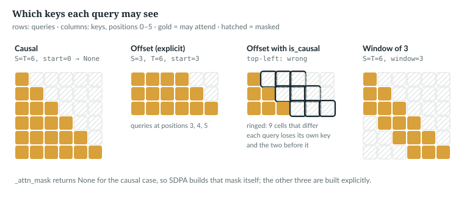
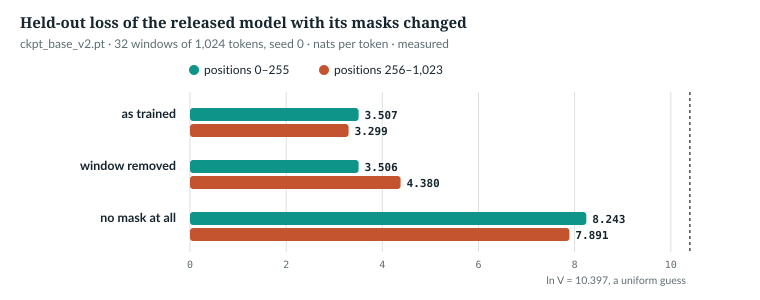

# 12  Causal masking

Chapter 11 added a mask **M** to the scores and said only that it hides the
future. This chapter reads the 17 lines that build it, works through the two
cases where PyTorch's built-in causal mask is not enough (new tokens against a
KV cache, and the sliding window), measures what the masks are worth to the
trained model, and finds which tests catch a broken mask.

| Term | Meaning |
|---|---|
| mask | a boolean (S, T) grid: `True` where query s may attend to key t |
| causal | each query sees its own position and earlier ones, never later ones |
| KV cache | the keys and values of tokens already processed, kept so that the next call need not recompute them (Chapter 27) |
| `start` | how many tokens the cache already holds; the new queries sit at absolute positions `start` … `start + S − 1` |
| sliding window | a limit on how far back a query may look: the last `window` positions, its own included |

---

## 12.1  Why the future must be invisible

A language model trains on all S positions of a sequence in one pass. The
target at position s is the *input* at position s + 1, so if s could attend to
s + 1 it would read its answer, and, as the test that guards this warns
(12.6), "every loss number reported so far is meaningless". So query s may
attend to key t only when t ≤ s, and the weights form a lower triangle.

`IN THE REPO`

## 12.2  −∞ before the softmax, not 0 after it

A masked score becomes −∞ before the softmax, so its weight is
e<sup>−∞</sup> = 0 and each row still sums to 1 over the allowed keys. Zeroing
weights *after* the softmax is not the same. The book example runs both on the
toy (**Book example, not repository code**):

```python
def before_and_after() -> None:
    print("12.2  −∞ before the softmax, not 0 after it (toy, illustrative)")
    Q, K, V = toy()
    s = Q @ K.T / math.sqrt(2)                                  # (S, T) = (3, 3)
    allowed = torch.ones(3, 3, dtype=torch.bool).tril()         # True = may attend
    right = s.masked_fill(~allowed, float("-inf")).softmax(-1)
    wrong = s.softmax(-1) * allowed                             # zeroed after the softmax
    print("  −∞ before:  rows", [round(r, 3) for r in right[0].tolist()],
          "sums", [round(x, 3) for x in right.sum(-1).tolist()])
    print("  0 after:    rows", [round(r, 3) for r in wrong[0].tolist()],
          "sums", [round(x, 3) for x in wrong.sum(-1).tolist()])
    print("  a row with every key masked:", torch.full((3,), float("-inf")).softmax(-1).tolist())
```

`toy()` returns Chapter 11's **Q**, **K** and **V**; `s` is (3, 3). It prints
(*illustrative*):

```
  −∞ before:  rows [1.0, 0.0, 0.0] sums [1.0, 1.0, 1.0]
  0 after:    rows [0.401, 0.0, 0.0] sums [0.401, 0.944, 1.0]
  a row with every key masked: [nan, nan, nan]
```

Zeroed afterwards, *The* keeps 0.401 of its attention; the rest went to keys
it may not see. And a row with *no* allowed key is 0/0. A causal row always
keeps its own key; the configuration refuses a window of 0, which would not:

> **In the repo** · `anulm/model.py` · `AnuLMConfig.__post_init__` · lines 132–134 · @084cbdd

```python
        if self.sliding_window is not None:
            assert self.sliding_window >= 1 and self.max_window_layers >= 1, (
                "sliding_window needs max_window_layers >= 1 to apply to any layer")
```

`IN THE REPO`

## 12.3  In the code: `_attn_mask`

Every attention layer gets its mask from one function:

> **In the repo** · `anulm/model.py` · `_attn_mask` · lines 358–374 · @084cbdd

```python
def _attn_mask(S: int, T: int, start: int, window: Optional[int], device):
    """Boolean (S, T) mask, True = may attend. The S queries sit at absolute
    positions start..start+S-1; the T keys at 0..T-1 (T == start + S).

    Returns None whenever SDPA's built-in `is_causal` (or no mask at all, for a
    single decode step) is enough, so the fused kernels keep their fast path.
    An explicit mask is needed for a multi-token step against a non-empty cache
    -- `is_causal` aligns top-left, which is wrong there -- and for windows.
    """
    if window is None and (start == 0 or S == 1):
        return None
    q_pos = torch.arange(start, start + S, device=device)[:, None]
    k_pos = torch.arange(T, device=device)[None, :]
    mask = k_pos <= q_pos
    if window is not None:
        mask &= k_pos > q_pos - window
    return mask
```

Line by line:

- **Convention.** `True` = may attend, as PyTorch's attention expects [R50].
- **Early return.** With no window, `start == 0` means no cache, and `_sdpa`
  passes `is_causal=True` so PyTorch builds the triangle; `S == 1` is one new
  query that may see every key, so `_sdpa` passes no mask at all.
- **Positions.** `q_pos` is a column, (S, 1); `k_pos` a row, (1, T).
- **The comparison.** `k_pos <= q_pos` broadcasts to (S, T): the causal mask.
- **The window.** `k_pos > q_pos - window` drops keys `window` or more back.

The book example calls it for each case it handles:

```
  S=3 T=3 start=0 window=None: None
  S=1 T=3 start=2 window=None: None
  S=2 T=3 start=1 window=None: (2, 3)
    1 1 .
    1 1 1
  S=3 T=3 start=0 window=2: (3, 3)
    1 . .
    1 1 .
    . 1 1
  S=1 T=3 start=2 window=2: (1, 3)
    . 1 1
```

*verified*: printed by `ch12_masks.py`. The last is a cached step on a
windowed layer: one query, but the window hides the oldest key.

`IN THE REPO`

## 12.4  The offset case: new tokens against a cache

`GQAttention.forward` calls it after appending to the cache, so T counts
cached and new keys:

> **In the repo** · `anulm/model.py` · `GQAttention.forward` · lines 470–475 · @084cbdd

```python
        T = k.shape[2]

        # bidir_mask (B, 1, 1, T), True = a real token: BIDIRECTIONAL attention
        # over the unpadded tokens (bidirectional.py's encoder use). None = causal.
        mask = bidir_mask if bidir_mask is not None else _attn_mask(S, T, start, window, x.device)
        drop = self.dropout if self.training else 0.0
```

`k` is (B, H<sub>kv</sub>, T, D<sub>h</sub>). `bidir_mask` serves
`anulm/bidirectional.py` alone (Chapter 32); MLA makes the same call (line 568).
With S > 1 *and* a non-empty cache, `is_causal` is wrong. On the toy, the
cache holds *The* and one call brings *dog* and *bit*:

```python
    full = M._sdpa(Q, K, V, None, 3, scale, 0.0)[0, 0]          # whole sequence: is_causal
    q = Q[:, :, 1:]                                             # the S = 2 new queries
    mask = M._attn_mask(2, 3, 1, None, cpu)                     # start = 1 token cached
    explicit = M._sdpa(q, K, V, mask, 2, scale, 0.0)[0, 0]
    top_left = M._sdpa(q, K, V, None, 2, scale, 0.0)[0, 0]      # what is_causal would do
```

```
  full forward, rows dog and bit: [[1.993, 0.003], [1.546, 0.38]]
  explicit offset mask:           [[1.993, 0.003], [1.546, 0.38]]
  is_causal (top-left):           [[0.0, 1.0], [1.786, 0.107]]
  the mask is_causal builds for (2, 3):
    1 . .
    1 1 .
```

*verified* by the script's assertions. The explicit mask reproduces Chapter
11's rows; `is_causal` starts its triangle in the top-left corner, so neither
new token sees itself.



*Figure 12.1 · Causal, offset and windowed masks.* The third grid is the
second built the wrong way. *verified*: drawn from `_attn_mask`'s output.

`anulm/model.py`'s own `generate` never makes this call:

> **In the repo** · `anulm/model.py` · `AnuLM.generate` · lines 1132–1139 · @084cbdd

```python
        for _ in range(max_new_tokens):
            if not use_cache:
                logits, _ = self(idx[:, -bs:])
            else:
                if cache is None or start + pending.shape[1] > bs:
                    cache, start, pending = self.new_cache(), 0, idx[:, -bs:]
                logits, _ = self(pending, cache=cache, start=start)
                start += pending.shape[1]
```

The prompt goes in at `start = 0` (and again whenever the context fills and
the cache is rebuilt); after it, `pending` is one sampled token (line 1161).
The `transformers` wrapper passes every id its cache has not seen:

> **In the repo** · `anulm/hf/modeling_anulm.py` · `AnuLMForCausalLM.prepare_inputs_for_generation` · lines 274–282 · @084cbdd

```python
    def prepare_inputs_for_generation(self, input_ids, past_key_values=None,
                                      attention_mask=None, use_cache=True, **kwargs):
        # With a cache, only the tokens it has not seen are new.
        if past_key_values is not None:
            input_ids = input_ids[:, past_key_values.seen:]
        return {"input_ids": input_ids, "past_key_values": past_key_values,
                "use_cache": use_cache}
```

So a caller that appends several tokens to a used cache, a second chat turn
for example, makes the offset call (Chapter 39).

`IN THE REPO`

## 12.5  The sliding window, and what the masks are worth

Each block decides its window once, when it is built:

> **In the repo** · `anulm/model.py` · `Block.__init__` · lines 805–807 · @084cbdd

```python
        # Sliding window on the first max_window_layers layers, full attention
        # on the rest (Qwen2 semantics). None = full attention.
        self.window = cfg.sliding_window if layer_idx < cfg.max_window_layers else None
```

The released model has a 256-token window on layers 0–9. At S = T = 1,024 it
keeps 229,504 of the 524,800 causal pairs, 43.7% (*verified*). **The cache is
not trimmed**, as 12 cached steps through `tiny()` with a window of 4 show:

```python
    torch.manual_seed(0)
    model = M.AnuLM(T.tiny(sliding_window=4, max_window_layers=2)).eval()
    cache = model.new_cache()
    with torch.no_grad():
        for i in range(12):
            model(torch.randint(0, 64, (1, 1)), cache=cache, start=i)
    print(f"  tiny() with a window of 4, after 12 cached steps: layer 0 caches "
          f"{cache[0]['k'].shape[2]} positions")
```

```
  tiny() with a window of 4, after 12 cached steps: layer 0 caches 12 positions
```

*verified*. So the window saves no memory and, in this implementation, no
compute (Chapter 11). `docs/RESULTS.md` §10 calls it "the cheapest KV cache
reduction available", a saving no code at the pin realises. Its quality is
*measured* there, on 2,000-step ablation models: free at 512 tokens (§10), and
0.07 nats better than full attention at 2,048 (§15).

**What the masks are worth.** `ch12_measure_masks.py` runs `ckpt_base_v2.pt`
on 32 held-out windows of 1,024 tokens (`data/v2/val.u16`, seed 0) as
trained, with every `window` set to `None`, and with an all-`True` mask. It
runs in fp32 without autocast, except the experts (Chapters 17–18), which the
released configuration computes in bf16 (`anulm/model.py` lines 749 and 777).



*Figure 12.2 · What the masks are worth to the trained model.* Loss per token,
split at position 256. *measured*, on a sample of 32,738 graded tokens;
`book/measurements/part_iv_a_masks.json`.

| | all positions | positions 0–255 | positions 256–1,023 |
|---|---|---|---|
| as trained | 3.351 | 3.507 | 3.299 |
| window removed | 4.162 | 3.506 | 4.380 |
| no mask at all | 7.979 | 8.243 | 7.891 |

- **The window is part of the trained function.** Before position 256 it
  hides nothing (the 0.0003 difference is rounding on another kernel path);
  beyond, layers 0–9 meet keys they
  never saw in training, and the loss rises 1.08 nats.
- **The future does not help a model trained without it**: the loss more than
  doubles. A leak's danger is in *training*, where a model could learn to use
  it (*not measured here*).

`IN THE REPO` · `MEASURED`

## 12.6  The tests, and what each one misses

The test named for the mask:

> **In the repo** · `tests/test_model.py` · `causal_mask_does_not_leak_future` · lines 46–63 · @084cbdd

```python
def causal_mask_does_not_leak_future():
    """Changing token t+1.. must not change logits at positions <= t.

    If this fails the model is training on answers it can see, and every loss
    number reported so far is meaningless.
    """
    for attn in ("gqa", "mla"):
        torch.manual_seed(0)
        m = AnuLM(tiny(attn=attn)).eval()
        x = torch.randint(0, 64, (2, 16))
        with torch.no_grad():
            a, _ = m(x, x)
        x2 = x.clone()
        x2[:, 8:] = torch.randint(0, 64, (2, 8))     # rewrite the future
        with torch.no_grad():
            b, _ = m(x2, x2)
        drift = (a[:, :8] - b[:, :8]).abs().max().item()
        assert drift < 1e-5, f"{attn}: past logits moved by {drift:.2e} when the future changed"
```

It rewrites positions 8–15; logits at 0–7 must not move. But with `start = 0`
and no window, `_attn_mask` returns `None` and only PyTorch's mask runs. The
offset case has its own test:

> **In the repo** · `tests/test_model.py` · `incremental_forward_matches_full_forward` · lines 550–567 · @084cbdd

```python
def incremental_forward_matches_full_forward():
    """Feeding a sequence in pieces through the cache must give the same last
    logits as feeding it whole -- for both attention variants, and for a
    multi-token chunk against a non-empty cache (the case `is_causal` gets wrong)."""
    for attn in ("gqa", "mla"):
        torch.manual_seed(0)
        m = AnuLM(tiny(attn=attn)).eval()
        x = torch.randint(0, 64, (2, 20))
        with torch.no_grad():
            full, _ = m(x, x)                         # (B, 20, V), all positions
            cache = m.new_cache()
            outs = []
            for lo, hi in ((0, 7), (7, 8), (8, 15), (15, 20)):   # prefill, 1, chunk, chunk
                lg, _ = m(x[:, lo:hi], cache=cache, start=lo)
                outs.append(lg[:, -1, :])
        for (lo, hi), got in zip(((0, 7), (7, 8), (8, 15), (15, 20)), outs):
            err = (got - full[:, hi - 1, :]).abs().max().item()
            assert err < 1e-4, f"{attn}: cached logits at position {hi-1} differ by {err:.2e}"
```

The pieces are a prefill, one token, and two chunks against a filled cache,
every branch but the window's. The window has its own:

> **In the repo** · `tests/test_model.py` · `sliding_window_limits_reach` · lines 642–664 · @084cbdd

```python
def sliding_window_limits_reach():
    """On a windowed layer, a token more than `window` back must not influence
    the output; one inside the window must. Checked on the attention module
    directly (the residual stream would smear the effect across layers)."""
    torch.manual_seed(0)
    W = 4
    for attn in ("gqa", "mla"):
        cfg = tiny(attn=attn, sliding_window=W, max_window_layers=2)
        m = AnuLM(cfg).eval()
        a0, a2 = m.layers[0].attn, m.layers[2].attn      # windowed, and not
        assert m.layers[0].window == W and m.layers[2].window is None
        x = torch.randn(1, 12, cfg.hidden_size)
        cos, sin = m.rotary(12, x.device, x.dtype)
        with torch.no_grad():
            base = a0(x, cos, sin, window=W)[0, 11]
            far = x.clone(); far[0, 11 - W] += 3.0      # exactly W back: outside
            near = x.clone(); near[0, 11 - W + 1] += 3.0  # W-1 back: inside
            d_far = (a0(far, cos, sin, window=W)[0, 11] - base).abs().max().item()
            d_near = (a0(near, cos, sin, window=W)[0, 11] - base).abs().max().item()
            d_full = (a2(far, cos, sin)[0, 11] - a2(x, cos, sin)[0, 11]).abs().max().item()
        assert d_far == 0.0, f"{attn}: token outside the window moved the output by {d_far:.2e}"
        assert d_near > 1e-6, f"{attn}: token inside the window had no effect"
        assert d_full > 1e-6, f"{attn}: the non-windowed layer lost its reach"
```

A change exactly W back from query 11 must have no effect, W − 1 back must:
the boundary pair catches an off-by-one. A fourth test decodes greedily with
and without the cache, on windowed layers:

> **In the repo** · `tests/test_model.py` · `sliding_window_agrees_with_cache` · lines 668–675 · @084cbdd

```python
def sliding_window_agrees_with_cache():
    torch.manual_seed(0)
    cfg = tiny(attn="gqa", sliding_window=5, max_window_layers=3, block_size=32)
    m = AnuLM(cfg).eval()
    start = torch.randint(0, 64, (1, 3))
    a = m.generate(start.clone(), 20, top_k=1, use_cache=False)
    b = m.generate(start.clone(), 20, top_k=1, use_cache=True)
    assert torch.equal(a, b), "windowed attention diverges between cached and uncached decoding"
```

Which test catches which mistake? `ch12_masks.py` swaps wrong masks into
`anulm/model.py` one at a time. One keeps a key too many:

```python
        return (k <= q) & (k >= q - window)                     # window + 1 keys
```

Two more keep the function's early return of `None` and change only the mask
it builds: one inverts it, one ignores `start`. The last always builds a mask,
and writes the comparison the wrong way round:

```python
    def inverted(S, T_, start, window, device):
        m = real(S, T_, start, window, device)
        return None if m is None else ~m

    def reversed_always(S, T_, start, window, device):           # no early return, comparison reversed
        q = torch.arange(start, start + S, device=device)[:, None]
        k = torch.arange(T_, device=device)[None, :]
        return k >= q
```

The loop restores the real function after each test:

```python
    real = M._attn_mask
    for name, fn in [("the real _attn_mask", real)] + wrong_masks():
        failed = []
        for t in tests:
            M._attn_mask = fn
            try:
                with contextlib.redirect_stdout(io.StringIO()):
                    t()
            except Exception:                                   # AssertionError, or a crash
                failed.append(t.__name__)
            finally:
                M._attn_mask = real
        print(f"  {name:22s} fails: {', '.join(failed) or 'nothing'}")
```

The swap works because `GQAttention.forward` looks the name up in `model`'s
namespace on every call. `tests` holds the four tests.

```
  the real _attn_mask    fails: nothing
  window one too wide    fails: sliding_window_limits_reach
  returned mask inverted fails: incremental_forward_matches_full_forward, sliding_window_limits_reach, sliding_window_agrees_with_cache
  offset ignored         fails: incremental_forward_matches_full_forward, sliding_window_agrees_with_cache
  reversed, always built fails: causal_mask_does_not_leak_future, incremental_forward_matches_full_forward, sliding_window_limits_reach
```

*verified*. The causality test catches only the last: a mask that is always
built reaches its call, while the first three leave its `None` path intact.
The cache test passes a window one too wide, and a reversed mask: both its
runs share the wrong mask, and an agreement test cannot see a bug both sides
have.

`IN THE REPO`

## 12.7  Common mistakes, and how to catch them

- **Masking after the softmax.** *Catch it:* every row must sum to 1.
- **Trusting `is_causal` with a cache.** *Catch it:* feed a sequence whole and
  in multi-token pieces, as `incremental_forward_matches_full_forward` does.
- **A window off by one.** It still trains. *Catch it:* perturb exactly
  `window` back, as `sliding_window_limits_reach` does.
- **An empty row**, from a mask that hides a query's own key: NaN. *Catch it:*
  the `sliding_window >= 1` check.

`IN THE REPO`

## 12.8  Exercises

1. Write out `_attn_mask(2, 4, 2, None, ...)`.
2. Which keys does a windowed query at position 600 see?
3. Why does the causality test pass when the mask `_attn_mask` returns is
   inverted?
4. At S = T = 512, what fraction of causal pairs does a 256-token window keep?

**Answers.** (1) Rows `1 1 1 .` and `1 1 1 1`. (2) Positions 345–600, 256
keys. (3) At `start = 0` with no window `_attn_mask` returns `None` before its
comparison. (4) 98,432 of 131,328, 75.0%. *verified*: 1, 2 and 4 are printed
by `ch12_masks.py`.

> **Build it.** The lab book's Chapter 6 (`course/ch06-attention`, §6.2) has you
> write this mask and check it against `anulm/model.py`'s.

---

## Key points

- The mask lets query s attend to key t only when t ≤ s; it enters as −∞
  before the softmax, so each row's weights still sum to 1.
- `_attn_mask` returns `None` when PyTorch's `is_causal`, or no mask at all,
  is enough, so the fused kernels keep their fast path.
- Several new tokens against a non-empty cache need an explicit, offset mask,
  because `is_causal` aligns top-left; `generate` never makes that call, the
  `transformers` wrapper can.
- Layers 0–9 of the released model see only the last 256 positions; the
  cache still keeps every position.
- Measured on held-out text, removing the window costs the trained model 1.08
  nats past position 256, and removing the mask more than doubles its loss.
- The test named for causality never reaches `_attn_mask`'s explicit mask;
  the cache and window tests do, and an agreement test cannot catch a bug
  both sides share.

> **In one breath.** A mask of −∞ before the softmax keeps every query from
> seeing later keys. `anulm/model.py` lets PyTorch build the plain triangle and
> builds the mask itself only for a window or for new tokens against a cache,
> where PyTorch's triangle would sit in the wrong corner.

## References

Research references cited in this chapter (`RESEARCH_REFERENCES.md`), each
used only for the claim in its register row:

| ID | Used for | Status |
|---|---|---|
| [R50] | PyTorch's `scaled_dot_product_attention`: `True` in a boolean mask means take part | CHECKED |

Repository evidence, all at @084cbdd:
- `anulm/model.py`: `AnuLMConfig.__post_init__` 132–134, `_attn_mask` 358–374,
  `GQAttention.forward` 470–475, `MLAttention.forward` 568, `Block.__init__`
  805–807, `AnuLM.generate` 1132–1139 and 1161.
- `anulm/hf/modeling_anulm.py`: `AnuLMForCausalLM.prepare_inputs_for_generation` 274–282.
- `tests/test_model.py`: tests at lines 46, 550, 642 and 668.
- `docs/RESULTS.md` §10 and §15; `book/measurements/part_iv_a_masks.json`.

Book examples: `code-examples/ch12_masks.py`, `code-examples/ch12_measure_masks.py`.
