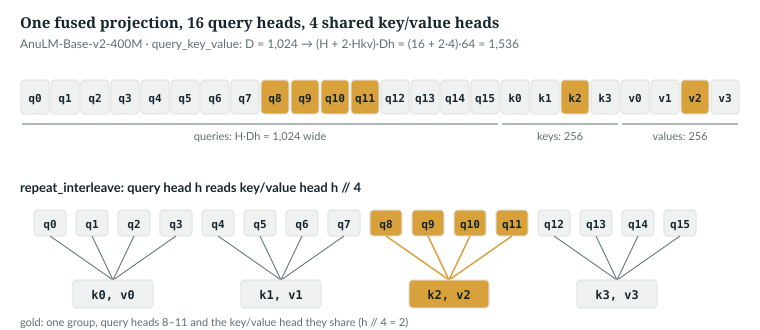
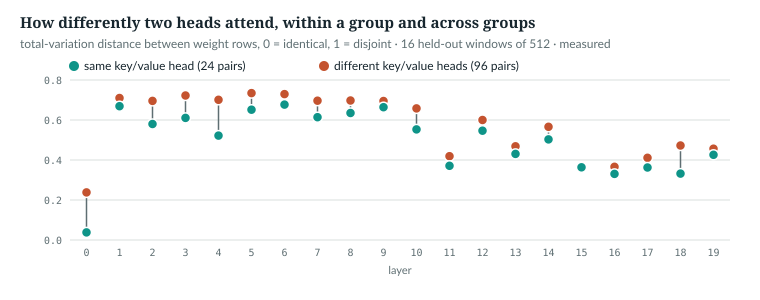

# 13  Many heads, shared keys: multi-head and grouped-query attention

Chapter 11 followed one head; the released model runs 16 per layer, and
Chapter 11 measured them doing different jobs. This chapter reads
`GQAttention` line by line: one fused projection cut into heads, the
reshapes, the cache, and how 16 query heads share 4 key/value heads.

| Term | Meaning |
|---|---|
| multi-head attention (MHA) | H heads, each with its own queries, keys and values |
| multi-query attention (MQA) | H query heads sharing one key/value head |
| grouped-query attention (GQA) | H query heads in H<sub>kv</sub> groups, each group sharing one key/value head |
| H<sub>kv</sub> | key/value heads per layer, `n_kv_head`: 4 in the released model |
| `n_rep` | query heads per key/value head, H / H<sub>kv</sub>: 4 |

---

## 13.1  Heads are slices

A head is Chapter 11's attention on a D<sub>h</sub>-wide slice; H of them
side by side cost about what one head of width H·D<sub>h</sub> would, and
each learns its own pattern. The configuration fixes the sizes:

> **In the repo** · `anulm/model.py` · `AnuLMConfig.__post_init__` · lines 150–154 · @fdbb09a

```python
        if self.attn == "gqa":
            if self.head_dim is None:
                self.head_dim = self.hidden_size // self.n_head
            check(self.n_head % self.n_kv_head == 0,
                  f"n_kv_head={self.n_kv_head} must divide n_head={self.n_head}")
```

The released model's preset sets `head_dim=64` explicitly (`nano_350m`, line
192), so the default branch is not its path, though it gives the same 64 =
1,024 / 16. The check makes the query heads split evenly into groups;
`check` raises `ValueError` (lines 129–131), so a bad `--cfg` or a downloaded
`config.json` is refused even under `python -O`.

`IN THE REPO`

## 13.2  One fused projection

> **In the repo** · `anulm/model.py` · `GQAttention.__init__` · lines 430–445 · @fdbb09a

```python
    def __init__(self, cfg: AnuLMConfig, rotary: Rotary):
        super().__init__()
        self.n_head = cfg.n_head
        self.n_kv_head = cfg.n_kv_head
        self.n_rep = cfg.n_head // cfg.n_kv_head
        self.head_dim = cfg.head_dim
        self.dropout = cfg.dropout
        # One fused projection: (H + 2*Hkv) * Dh, exactly as the 30B does.
        self.query_key_value = nn.Linear(
            cfg.hidden_size, (cfg.n_head + 2 * cfg.n_kv_head) * cfg.head_dim, bias=False
        )
        self.dense = nn.Linear(cfg.n_head * cfg.head_dim, cfg.hidden_size, bias=False)
        self.use_qk_norm = cfg.use_qk_norm
        if cfg.use_qk_norm:
            self.query_layernorm = RMSNorm(cfg.head_dim, cfg.rms_norm_eps)
            self.key_layernorm = RMSNorm(cfg.head_dim, cfg.rms_norm_eps)
```

- **`n_rep`** is the group size, 16 / 4 = 4.
- **`query_key_value`** maps D to (H + 2H<sub>kv</sub>)·D<sub>h</sub> =
  (16 + 8)·64 = 1,536: one matrix multiply instead of three.
- **`dense`** maps the heads' outputs, H·D<sub>h</sub> wide, back to D.
- **QK-norm** is one RMSNorm over D<sub>h</sub> for queries, one for keys
  (11.6). The scale, line 449, is Chapter 11's.

Which rows make which head? The book example checks each D<sub>h</sub>-row
slice against `forward`'s split, on `tiny()` (**Book example, not repository
code**):

```python
    W = attn.query_key_value.weight                          # ((H + 2 Hkv) Dh, D) = (64, 32)
    x = torch.randn(2, 5, cfg.hidden_size)                   # (B, S, D)
    qkv = attn.query_key_value(x).view(2, 5, H + 2 * Hkv, Dh)
    q, k, v = qkv.split([H, Hkv, Hkv], dim=-2)               # as GQAttention.forward does
    rows = lambda i: W[i * Dh:(i + 1) * Dh]                  # the Dh rows of "head slot" i
    for h in range(H):
        assert torch.allclose(q[:, :, h], x @ rows(h).T, atol=1e-6)
    for j in range(Hkv):
        assert torch.allclose(k[:, :, j], x @ rows(H + j).T, atol=1e-6)
        assert torch.allclose(v[:, :, j], x @ rows(H + Hkv + j).T, atol=1e-6)
```

```
  weight (64, 32); rows 0–31 queries, 32–47 keys, 48–63 values; q (2, 5, 4, 8), k (2, 5, 2, 8)
```

*verified*. `nn.Linear` computes x Wᵀ (Chapter 4), so each output is one
weight row: query heads first, then key heads, then value heads.



*Figure 13.1 · Heads as slices of one projection.* The released model's
1,536 outputs, and which key/value head each query head reads (13.4).
*verified*: the figure script asserts the mapping.

`IN THE REPO`

## 13.3  Reshape, normalise, rotate

> **In the repo** · `anulm/model.py` · `GQAttention.forward` · lines 451–468 · @fdbb09a

```python
    def forward(self, x, cos, sin, cache: Optional[dict] = None, start: int = 0,
                window: Optional[int] = None, bidir_mask: Optional[torch.Tensor] = None):
        B, S, _ = x.shape
        qkv = self.query_key_value(x)
        qkv = qkv.view(B, S, self.n_head + 2 * self.n_kv_head, self.head_dim)
        q, k, v = qkv.split([self.n_head, self.n_kv_head, self.n_kv_head], dim=-2)
        q = q.transpose(1, 2)                         # (B, H,   S, Dh)
        k = k.transpose(1, 2)                         # (B, Hkv, S, Dh)
        v = v.transpose(1, 2)                         # (B, Hkv, S, Dh)

        if self.use_qk_norm:                          # before RoPE, as in the 30B
            q = self.query_layernorm(q)
            k = self.key_layernorm(k)
        q, k = apply_rope(q, k, cos, sin)
```

With `tiny()`'s B = 2, S = 5 (Chapter 20 prints these shapes):

- **Project and `view`.** `qkv` (2, 5, 64) becomes (2, 5, 8, 8): 8 slots of
  8, the slices of 13.2. No data moves.
- **`split`** takes 4, 2 and 2 slots: q (2, 5, 4, 8), k and v (2, 5, 2, 8).
- **`transpose(1, 2)`** puts heads before positions, (B, H, S, D<sub>h</sub>).
- **QK-norm** normalises each head at each position, with one shared gain:

```
  gain shape (8,); whole tensor vs one head at a time: 0.0e+00
```

- **RoPE** rotates queries and keys, not values, by position (Chapter 14).

`IN THE REPO`

## 13.4  The cache, and sharing the heads

> **In the repo** · `anulm/model.py` · `GQAttention.forward` · lines 470–477 · @fdbb09a

```python
        if cache is not None:
            # Cache the Hkv heads, not their H broadcast copies -- that ratio
            # (16:1 in the real 30B) is GQA's entire inference saving.
            if "k" in cache:
                k = torch.cat([cache["k"], k], dim=2)
                v = torch.cat([cache["v"], v], dim=2)
            cache["k"], cache["v"] = k, v
        T = k.shape[2]
```

New keys and values are appended along positions, so `cache["k"]` is (B,
H<sub>kv</sub>, T, D<sub>h</sub>), stored *after* QK-norm and RoPE; that is
why `start` must give absolute positions (Chapter 14). The example checks,
then repeats the call under bf16 autocast, as the serving code runs:

```python
    with torch.no_grad(), torch.autocast("cpu", dtype=torch.bfloat16):
        model(idx, cache=cache)
```

```
  cache[0]['k'] (1, 2, 9, 8) (B, Hkv, T, Dh); equals the keys after QK-norm and RoPE: True
  under bf16 autocast the cache holds k in float32, v in bfloat16
```

*verified*. The keys come out fp32 because QK-norm's gain is an fp32
parameter (Chapter 15), which is why Chapter 20 counts 30 KiB per token as
served, not 20. A test pins the layout; this is its GQA half:

> **In the repo** · `tests/test_model.py` · `cache_holds_what_it_should` · lines 582–590 · @fdbb09a

```python
def cache_holds_what_it_should():
    """GQA caches Hkv heads (not the H broadcast copies); MLA caches the latent
    plus one rope key -- the whole reason MLA exists."""
    torch.manual_seed(0)
    g = AnuLM(tiny(attn="gqa", n_head=4, n_kv_head=2, head_dim=8)).eval()
    cache = g.new_cache()
    with torch.no_grad():
        g(torch.randint(0, 64, (1, 9)), cache=cache)
    assert cache[0]["k"].shape == (1, 2, 9, 8), f"gqa cached {tuple(cache[0]['k'].shape)}, want (1, 2, 9, 8)"
    # ...
```

Only after caching are the shared heads copied for attention:

> **In the repo** · `anulm/model.py` · `GQAttention.forward` · lines 483–494 · @fdbb09a

```python
        if NATIVE_GQA and self.n_rep > 1:
            # SDPA broadcasts the Hkv heads itself: no (B, H, T, Dh) copies.
            y = F.scaled_dot_product_attention(
                q, k, v, attn_mask=mask, is_causal=(mask is None and S > 1),
                scale=self.scale, dropout_p=drop, enable_gqa=True)
        else:
            # Broadcast each KV head across its query group explicitly.
            k = k.repeat_interleave(self.n_rep, dim=1)    # (B, H, T, Dh)
            v = v.repeat_interleave(self.n_rep, dim=1)
            y = _sdpa(q, k, v, mask, S, self.scale, drop)                    # (B, H, S, Dh)
        y = y.transpose(1, 2).contiguous().view(B, S, -1)
        return self.dense(y)
```

`repeat_interleave(n_rep, dim=1)` repeats each head in place, so query head h
reads key/value head h // `n_rep`. A tiled `repeat` pairs them differently:

```python
    k = torch.arange(2.).view(1, 2, 1, 1)                   # head j holds the number j
    print("  repeat_interleave:", k.repeat_interleave(2, dim=1).flatten().tolist())
    print("  repeat (tiled):   ", k.repeat(1, 2, 1, 1).flatten().tolist())
```

```
  repeat_interleave: [0.0, 0.0, 1.0, 1.0]
  repeat (tiled):    [0.0, 1.0, 0.0, 1.0]
  enable_gqa vs repeat_interleave: 0.0e+00; vs tiled: 2.93
```

*verified*: `enable_gqa` groups the heads the same way; the tiled pairing
differs by 2.93 without any error. PyTorch's documentation says the same: with
`enable_gqa=True` its reference implementation repeats each key and value head
with `repeat_interleave`, and it calls GQA an experimental feature [R50]. After attention, `transpose` and `view` lay
the H outputs side by side, (B, S, H·D<sub>h</sub>), for `dense`.

The other branch is a switch:

> **In the repo** · `anulm/model.py` · `NATIVE_GQA` · lines 384–387 · @fdbb09a

```python
# GQA through SDPA's own `enable_gqa` instead of repeat_interleave. Same
# maths; whether it is faster depends on which kernel accepts it, so it is a
# switch, measured before it becomes the default (see docs/RESULTS.md).
NATIVE_GQA = False
```

`train.py --native-gqa` turns it on (lines 637–643); `docs/RESULTS.md` §32
records it as written and tested but not yet measured on the GPU, so it stays
off. Its test:

> **In the repo** · `tests/test_model.py` · `native_gqa_matches_repeat_interleave` · lines 1602–1623 · @fdbb09a

```python
def native_gqa_matches_repeat_interleave():
    """NATIVE_GQA hands the Hkv heads to SDPA's enable_gqa instead of copying
    them; outputs must agree on the full-sequence, cached and windowed paths."""
    from anulm import model as M
    torch.manual_seed(2)
    m = AnuLM(tiny(n_kv_head=1, sliding_window=4, max_window_layers=1)).eval()
    x = torch.randint(0, 64, (2, 12))
    saved = M.NATIVE_GQA
    try:
        outs = []
        for native in (False, True):
            M.NATIVE_GQA = native
            with torch.no_grad():
                full, _ = m(x, x)
                cache = m.new_cache()
                m(x[:, :8], cache=cache)
                step, _ = m(x[:, 8:], cache=cache, start=8)
            outs.append((full, step))
    finally:
        M.NATIVE_GQA = saved
    assert torch.allclose(outs[0][0], outs[1][0], atol=1e-5), "full-sequence logits differ"
    assert torch.allclose(outs[0][1], outs[1][1], atol=1e-5), "cached-step logits differ"
```

With `n_kv_head=1` every query head reads the same key/value head, so a native
path that tiled would pass it; the example's grouping check would not.

`IN THE REPO` · `IMPLEMENTATION-DEPENDENT` (which is faster)

## 13.5  MHA, GQA and MQA are one class

The transformer of 2017 gave every head its own keys and values [R01].
Multi-query attention shared one key/value head across all heads, to cut the
memory traffic of decoding one token at a time [R13]. Grouped-query
attention takes any number in between [R12]. Here all three are
`GQAttention` with a different `n_kv_head`:

```
  released MHA Hkv=16: qkv width 3,072; attention params per layer  4,194,432; KV cache  81,920 bytes/token in bf16
  released GQA Hkv= 4: qkv width 1,536; attention params per layer  2,621,568; KV cache  20,480 bytes/token in bf16
  released MQA Hkv= 1: qkv width 1,152; attention params per layer  2,228,352; KV cache   5,120 bytes/token in bf16
```

*verified*: `ch13_gqa.py` builds each `GQAttention` and counts its
parameters, QK-norm gains included. The cache is 20 layers × 2 ×
H<sub>kv</sub> × 64 × 2 bytes if all of it is bf16; as served, with fp32
keys, it is half as much again. The cost in quality is *not measured here*:
no run in `docs/RESULTS.md` varies `n_kv_head`. The paper reaches GQA by
uptraining a trained MHA model [R12]; AnuLM trains GQA from the start.

`IN THE REPO` (MQA and MHA as settings)

## 13.6  Do heads that share keys attend alike?

Heads in a group see identical keys. `ch13_measure_groups.py` runs
`ckpt_base_v2.pt` on 16 held-out windows of 512 tokens (`data/v2/val.u16`,
seed 0), recomputes the weights beside `_sdpa`, and measures for every pair of
heads the total-variation distance between their weight rows: half the summed
absolute difference, 0 when identical, 1 when disjoint. It runs in fp32
without autocast, except the experts, which the released configuration
computes in bf16 (`anulm/model.py` lines 756 and 784).



*Figure 13.2 · Do heads that share keys attend alike?* *measured*, queries
64–511; `book/measurements/part_iv_a_groups.json`.

- **Shared keys pull heads together, mildly**: 0.494 within groups, 0.570
  across, over all layers; closer within in 19 of 20 layers.
- **Layer 0's grouped heads are nearly identical**, 0.038 against 0.238.
  Its query gains are tiny (11.6), which is consistent with this, not shown
  to cause it.
- **Elsewhere sharing keys does not make heads redundant**: within a group,
  layers average 0.33 to 0.68.

`MEASURED`

## 13.7  Common mistakes, and how to catch them

- **Tiling instead of interleaving.** `repeat` pairs query head h with
  key/value head h mod H<sub>kv</sub>. *Catch it:* the index check of 13.4,
  with H<sub>kv</sub> > 1.
- **Caching the copies.** Storing k after `repeat_interleave` multiplies the
  cache by `n_rep`. *Catch it:* `cache_holds_what_it_should`.

`IN THE REPO`

## 13.8  Exercises

1. What shape is the released model's `query_key_value.weight`?
2. Which key/value head does query head 9 read?
3. How many bytes do one layer's `repeat_interleave` copies of k and v take at
   T = 1,024, batch 1: all in bf16, and as served under autocast?

**Answers.**

```
  1. released qkv weight: (1536, 1024)
  2. query head 9 reads key/value head 2
  3. repeat_interleave copies at T=1024, one layer: 4,194,304 bytes (4 MiB) all in bf16, against 1,048,576 for the Hkv heads; 6,291,456 bytes with fp32 keys and bf16 values, as under autocast
```

*verified*: printed by `ch13_gqa.py`.

> **Build it.** The lab book's Chapter 6 (`course/ch06-attention`, §6.3)
> builds this class and checks it against `anulm/model.py`'s, including a mutant
> with the heads tiled.

---

## Key points

- A head is attention on a D<sub>h</sub>-wide slice; the released model runs
  16 per layer, 16 × 64 = 1,024.
- One fused matrix makes every head's query, key and value; its output rows
  are the heads, queries first, then keys, then values.
- `view`, `split` and `transpose` give q (B, H, S, D<sub>h</sub>) and k, v
  (B, H<sub>kv</sub>, S, D<sub>h</sub>); QK-norm and RoPE follow.
- The cache stores the 4 shared key/value heads, normalised and rotated:
  20 KiB per token in bf16, against 80 KiB with 16; 30 KiB as served (fp32
  keys, bf16 values; Chapter 20).
- `repeat_interleave` lets query head h read key/value head h // 4; tiling
  would pair them wrongly and silently. `NATIVE_GQA` is off, unmeasured.
- Measured, heads that share keys attend a little more alike, and in layer 0
  almost identically.

> **In one breath.** One fused projection cuts each token into 16 query
> heads and 4 key/value heads; the cache keeps the 4, normalised and rotated;
> `repeat_interleave` hands each to its group of 4 query heads; their outputs
> are laid side by side and projected back to width D.

## References

Research references cited in this chapter (`RESEARCH_REFERENCES.md`), each
used only for the claim in its register row:

| ID | Used for | Status |
|---|---|---|
| [R01] | multi-head attention | CHECKED |
| [R12] | grouped-query attention; reached by uptraining MHA checkpoints | CHECKED |
| [R13] | multi-query attention: keys and values shared across all heads, for incremental decoding | CHECKED |
| [R50] | the documented `enable_gqa` behaviour of SDPA (`repeat_interleave` of key and value heads; experimental) | CHECKED |

Repository evidence, all at @fdbb09a:
- `anulm/model.py`: `AnuLMConfig.__post_init__` 129–131 and 150–154, `NATIVE_GQA` 384–387,
  `GQAttention.__init__` 430–445 and 449, `GQAttention.forward` 451–494.
- `anulm/training/train.py`: `--native-gqa`, lines 637–643.
- `tests/test_model.py`: `cache_holds_what_it_should` 582, `native_gqa_matches_repeat_interleave` 1602.
- `docs/RESULTS.md` §32; `book/measurements/part_iv_a_groups.json`.

Book examples: `code-examples/ch13_gqa.py`, `code-examples/ch13_measure_groups.py`.
