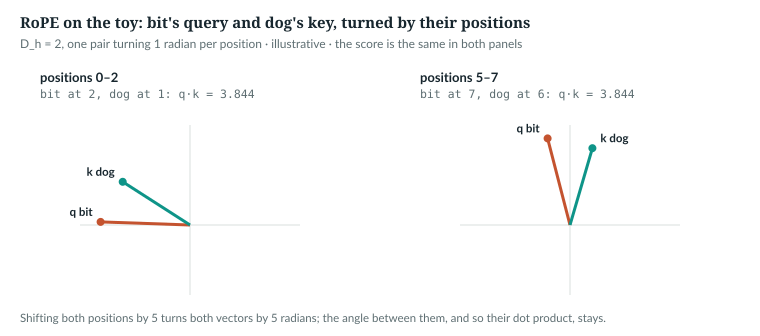
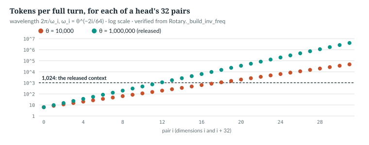
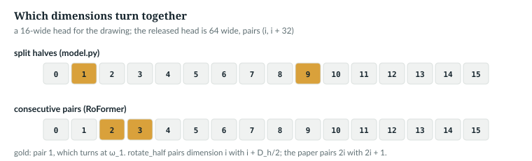

# 14  Word order: rotary position embeddings

Chapter 11's attention compares contents only; nothing in a score says how
far apart two tokens are. AnuLM's fix turns each query and key by an angle
proportional to its position, so that a score depends on the *distance*
between two tokens. This chapter builds it by hand, reads the code, and
measures how relative the trained model really is.

| Term | Meaning |
|---|---|
| position embedding | any way of telling the model where a token sits |
| RoPE | rotary position embedding: queries and keys rotated by position |
| pair | two dimensions of a head that rotate together, as one 2-D vector |
| frequency ω<sub>i</sub> | how many radians pair i turns per position |
| θ | the base that sets the frequencies, `rope_theta`: 10<sup>6</sup> in the released model |

---

## 14.1  Attention cannot see order

A query's output is an average over the keys before it, weighted by content.
Shuffle those tokens and the same keys come back with the same scores: the
average does not change. The book example shuffles five tokens before a sixth
and runs a `tiny()` attention layer without rotation (cos = 1, sin = 0), then
with RoPE (**Book example, not repository code**):

```python
    x = torch.randn(1, 6, cfg.hidden_size)                     # six token vectors
    shuffled = x[:, [3, 0, 4, 1, 2, 5]]                         # same tokens, last one kept last
    cos, sin = M.Rotary(cfg, cfg.head_dim)(6, cpu, torch.float32)
    no_pos = (torch.ones_like(cos), torch.zeros_like(sin))      # cos 1, sin 0: no rotation
    with torch.no_grad():
        for name, (c, s) in (("no positions", no_pos), ("RoPE", (cos, sin))):
            d = (attn(x, c, s)[0, -1] - attn(shuffled, c, s)[0, -1]).abs().max()
            print(f"  {name:12s}: last output moves by {d:.1e}")
```

```
  no positions: last output moves by 1.6e-09
  RoPE        : last output moves by 1.9e-03
```

*verified*. Without positions the change is rounding.

`IN THE REPO`

## 14.2  Before RoPE

The transformer of 2017 used a fixed sinusoidal positional encoding, and
reported that learned position embeddings gave nearly identical results [R01].
BERT summed token, segment and position embeddings [S01]. These mark
*absolute* positions; any sense of distance has to be learned. ALiBi instead
biases each score linearly with distance [S03]. None of these is in this
repository.

`NOT IN THE REPO`

## 14.3  By hand: a rotation by position

RoPE rotates queries and keys, and so makes attention depend on relative
position [R06]. Turn a 2-D query at position m by m·ω and a key at n by n·ω:

  (R<sub>mω</sub> q) · (R<sub>nω</sub> k) = q · R<sub>(n−m)ω</sub> k

The angle between them, and so their dot product, depends on n − m only. The
toy has D<sub>h</sub> = 2, one pair turning 1 radian per position. The
example checks `apply_rope` against an explicit rotation, at positions 0–2
and 5–7:

```python
def rotate(v, angle):
    """Turn a 2-vector by `angle` radians: the matrix [[cos, −sin], [sin, cos]]."""
    c, s = math.cos(angle), math.sin(angle)
    return torch.tensor([c * v[0] - s * v[1], s * v[0] + c * v[1]])
```

```python
    for start in (0, 5):
        cos, sin = rot(3, cpu, torch.float32, start=start)     # positions start .. start + 2
        q, k = M.apply_rope(Q[None, None], K[None, None], cos, sin)
        hand = torch.stack([rotate(Q[i], start + i) for i in range(3)])
        assert torch.allclose(q[0, 0], hand, atol=1e-6)
        s = q[0, 0] @ k[0, 0].T
```

```
  inv_freq [1.0]
  positions 0–2: bit's query [-2.235, 0.077], scores of bit [-2.235, 3.844, 3.0]
  positions 5–7: bit's query [-0.56, 2.165], scores of bit [-2.235, 3.844, 3.0]
  |q_bit| before 2.236, after 2.236
```

*illustrative*, printed by `book/code-examples/ch14_rope.py`. The query moves
with the shift; its scores do not. Against
*dog* the score was 4 unrotated (Chapter 11) and is 3.844 here; against itself it
stays 3, and the length is preserved.



*Figure 14.1 · A rotation by position.* *illustrative*; drawn from
`apply_rope`'s output, as `book/code-examples/ch14_rope.py` prints it.

`IN THE REPO`

## 14.4  The frequencies

A real head has D<sub>h</sub> = 64: 32 pairs, each with its own frequency.

> **In the repo** · `anulm/model.py` · `Rotary._build_inv_freq` · lines 304–309 · @fdbb09a

```python
    @staticmethod
    def _build_inv_freq(cfg: AnuLMConfig, dim: int) -> torch.Tensor:
        idx = torch.arange(0, dim, 2, dtype=torch.float32) / dim
        freq_extra = 1.0 / (cfg.rope_theta ** idx)
        if not cfg.yarn:
            return freq_extra
```

`idx` is 0, 2/64, …, 62/64, so ω<sub>i</sub> = θ<sup>−2i/64</sup>, i = 0 …
31: the paper's formula with `rope_theta` for its 10,000 [R06]. The rest is
YaRN (Chapter 29). The example prints both bases:

```python
    for theta in (1e4, 1e6):
        cfg = M.AnuLMConfig(rope_theta=theta)
        f = M.Rotary._build_inv_freq(cfg, 64)                   # radians per position, (32,)
        wave = 2 * math.pi / f                                  # positions per full turn
```

```
  θ = 1e+04: fastest 1.000 rad/token (6.28 tokens a turn), slowest 1.33e-04 (47,117 tokens); pairs that turn fully within 1,024 tokens: 18 of 32
  θ = 1e+06: fastest 1.000 rad/token (6.28 tokens a turn), slowest 1.54e-06 (4,080,185 tokens); pairs that turn fully within 1,024 tokens: 12 of 32
```

*verified*. Fast pairs tell neighbours apart; slow pairs barely move across
the context. A larger θ makes more pairs slow. `docs/RESULTS.md` §3 measured,
across a 4× extension, a GQA preset at θ = 10<sup>6</sup> going from 1.51 to
1.86 nats and an MLA preset at θ = 10<sup>4</sup> from 1.54 to 3.03; the
presets differ in more than θ.



*Figure 14.2 · How fast each pair turns.* *verified*: computed by
`Rotary._build_inv_freq`.

`IN THE REPO`

## 14.5  The tables, built once and cached

One `Rotary` serves every layer: `AnuLM.__init__` builds it (lines 837–839)
and `AnuLM.forward` asks it once per call (line 899). It keeps the
frequencies, and its tables (lines 301–302), as buffers that are not saved
with the model:

> **In the repo** · `anulm/model.py` · `Rotary.__init__` · lines 282–287 · @fdbb09a

```python
    def __init__(self, cfg: AnuLMConfig, dim: int):
        super().__init__()
        self.dim = dim
        self.cfg = cfg
        inv_freq = self._build_inv_freq(cfg, dim)
        self.register_buffer("inv_freq", inv_freq, persistent=False)
```

A buffer moves with `.to(device)` but, with `persistent=False`, is left out of
the state dict, so a checkpoint never carries stale tables. `_grow` fills them:

> **In the repo** · `anulm/model.py` · `Rotary._grow` · lines 324–337 · @fdbb09a

```python
    def _grow(self, seq_len: int, device, dtype):
        # Keyed on device and dtype as well as length: a model moved with .to()
        # or run under a different autocast dtype must not be handed stale tables.
        key = (device, dtype)
        if seq_len <= self._cached_len and self._cached_key == key:
            return
        n = max(seq_len, self._cached_len)
        t = torch.arange(n, device=device, dtype=torch.float32)
        freqs = torch.outer(t, self.inv_freq.to(device))          # (T, dim/2)
        emb = torch.cat((freqs, freqs), dim=-1)                   # (T, dim)
        self.cos_cached = (emb.cos() * self.table_mscale).to(dtype)
        self.sin_cached = (emb.sin() * self.table_mscale).to(dtype)
        self._cached_len = n
        self._cached_key = key
```

- **Early return** unless a longer sequence, device or dtype arrives.
- **`freqs`**, (T, 32), is every angle m·ω<sub>i</sub>, in fp32 whatever
  `dtype` is.
- **`cat((freqs, freqs))`**, (T, 64), gives dimensions i and i + 32 the same
  angle: the split-halves layout (14.6). `table_mscale` is 1.0 without YaRN.

> **In the repo** · `anulm/model.py` · `Rotary.forward` · lines 339–343 · @fdbb09a

```python
    def forward(self, seq_len: int, device, dtype, start: int = 0):
        """cos/sin for absolute positions [start, start + seq_len). `start` is
        the number of tokens already in the KV cache when decoding; 0 otherwise."""
        self._grow(start + seq_len, device, dtype)
        return self.cos_cached[start:start + seq_len], self.sin_cached[start:start + seq_len]
```

The slice gives absolute positions `start` … `start + S − 1`, so a cached
step rotates its new key by its true position (Chapter 13). Four calls on a
fresh table:

```
  rot( 8, float32 , start=0): returns (8, 8) float32; table now 8 rows, float32
  rot( 4, float32 , start=2): returns (4, 8) float32; table now 8 rows, float32
  rot( 8, bfloat16, start=0): returns (8, 8) bfloat16; table now 8 rows, bfloat16
  rot(20, bfloat16, start=0): returns (20, 8) bfloat16; table now 20 rows, bfloat16
```

*verified*: a slice, a rebuild for the dtype, a growth. A test pins both:

> **In the repo** · `tests/test_model.py` · `rotary_cache_tracks_dtype_and_positions` · lines 636–645 · @fdbb09a

```python
def rotary_cache_tracks_dtype_and_positions():
    cfg = tiny()
    rot = Rotary(cfg, dim=8)
    c32, _ = rot(8, torch.device("cpu"), torch.float32)
    assert c32.dtype == torch.float32
    c16, _ = rot(8, torch.device("cpu"), torch.bfloat16)
    assert c16.dtype == torch.bfloat16, "rotary handed back a stale-dtype table"
    full, _ = rot(16, torch.device("cpu"), torch.float32)
    tail, _ = rot(4, torch.device("cpu"), torch.float32, start=12)
    assert torch.equal(tail, full[12:16]), "start offset does not index absolute positions"
```

`IN THE REPO`

## 14.6  The rotation: split halves

> **In the repo** · `anulm/model.py` · `rotate_half` · lines 346–350 · @fdbb09a

```python
def rotate_half(x):
    x1, x2 = x[..., : x.shape[-1] // 2], x[..., x.shape[-1] // 2:]
    return torch.cat((-x2, x1), dim=-1)
```

> **In the repo** · `anulm/model.py` · `apply_rope` · lines 353–362 · @fdbb09a

```python
def apply_rope(q, k, cos, sin):
    """q, k: (B, H, S, Dr). cos/sin: (S, Dr) -> broadcast over batch and heads.

    Split-halves (GPT-NeoX) convention. Sarvam's 105B checkpoint stores its rope
    dims interleaved and permutes before rotating; we train from scratch, so we
    pick one convention and stay in it.
    """
    cos = cos[None, None, :, :]
    sin = sin[None, None, :, :]
    return (q * cos) + (rotate_half(q) * sin), (k * cos) + (rotate_half(k) * sin)
```

For a pair a = x<sub>i</sub>, b = x<sub>i+32</sub> at angle α, `rotate_half`
puts −b in slot i and a in slot i + 32, so the last line gives a cos α −
b sin α and b cos α + a sin α: the rotation of (a, b) by α. `cos[None, None]`
broadcasts the (S, 64) tables over batch and heads. The paper pairs
neighbours, (x<sub>2i</sub>, x<sub>2i+1</sub>) [R06]. The example writes that
form out and compares, after listing the dimensions as 0, 2, …, 62, 1, …, 63:

```python
    def consecutive(x):                                         # turn pair (2i, 2i+1) by pos·f[i]
        a = torch.arange(S)[:, None] * f[None, :]               # (S, D/2)
        x1, x2 = x[..., 0::2], x[..., 1::2]
        out = torch.empty_like(x)
        out[..., 0::2], out[..., 1::2] = x1 * a.cos() - x2 * a.sin(), x2 * a.cos() + x1 * a.sin()
        return out
```

```python
    perm = torch.cat([torch.arange(0, D, 2), torch.arange(1, D, 2)])   # 0,2,..,62, 1,3,..,63
    qh, kh = M.apply_rope(q[..., perm], k[..., perm], cos, sin)
    print(f"  apply_rope(x[perm]) vs consecutive(x)[perm]: {(qh - consecutive(q)[..., perm]).abs().max():.1e}")
```

```
  apply_rope(x[perm]) vs consecutive(x)[perm]: 0.0e+00
  scores, the two conventions: 2.0e-06
```

*verified*: the same rotation in another order. The docstring says Sarvam's
105B code permutes the dimensions at run time, before rotating. Converting the
weights instead would mean permuting the query and key rows of the projection
and also QK-norm's per-dimension gains, which act before RoPE.



*Figure 14.3 · Split halves against consecutive pairs.* *verified*: the
figure script checks that `Rotary` gives dimensions i and i + D<sub>h</sub>/2
the same angle.

Two tests guard the rotation:

> **In the repo** · `tests/test_model.py` · `rope_is_relative` · lines 101–116 · @fdbb09a

```python
def rope_is_relative():
    """q.k after RoPE must depend only on (i - j), not on absolute i and j."""
    torch.manual_seed(0)
    cfg = tiny()
    rot = Rotary(cfg, dim=8)
    cos, sin = rot(32, torch.device("cpu"), torch.float32)
    q = torch.randn(1, 1, 32, 8)
    k = torch.randn(1, 1, 32, 8)
    # The SAME q and k content rotated to every position; q.k must then depend
    # only on the gap between the positions it is read at.
    qq, kk = apply_rope(q[:, :, :1].expand(1, 1, 32, 8).clone(),
                        k[:, :, :1].expand(1, 1, 32, 8).clone(), cos, sin)
    for gap in (1, 5, 11):
        vals = [(qq[0, 0, i] @ kk[0, 0, i - gap]).item() for i in range(gap, 25, 6)]
        spread = max(vals) - min(vals)
        assert spread < 1e-4, f"gap {gap}: dot product varies by {spread:.2e} with absolute position"
```

It puts one query and one key at every position; q·k must depend only on the
gap. The other requires lengths to be preserved:

> **In the repo** · `tests/test_model.py` · `rope_preserves_norms` · lines 120–127 · @fdbb09a

```python
def rope_preserves_norms():
    torch.manual_seed(0)
    rot = Rotary(tiny(), dim=8)
    cos, sin = rot(16, torch.device("cpu"), torch.float32)
    q = torch.randn(2, 3, 16, 8)
    qr, _ = apply_rope(q, q, cos, sin)
    err = (qr.norm(dim=-1) - q.norm(dim=-1)).abs().max().item()
    assert err < 1e-5, f"rotation changed vector norms by {err:.2e}"
```

`IN THE REPO`

## 14.7  How relative is the trained model?

In exact arithmetic, shifting every position by the same offset changes
nothing. One more piece of the model matters here. From layer 1 on, the
feed-forward half is a mixture of experts: a router, running in fp32, picks 4
of 24 small networks for each token (Chapters 17–18), a discrete choice.
`ch14_measure_shift.py` shifts the positions of 16 held-out windows of 512
tokens (`data/v2/val.u16`, seed 0) through `ckpt_base_v2.pt` with the experts
on two paths: the released `grouped` path, which computes them in bf16
(`anulm/model.py` lines 756 and 784), and the `sparse` path, fp32 throughout. It
also records each token's chosen experts in every MoE layer, and repeats
offset 0 as a control. A forward hook keeps each router's chosen ids, sorted
so that two sets compare equal whatever their order:

```python
    routes = []
    for i, layer in enumerate(m.layers):
        if layer.is_moe:                     # Router.forward returns (topk_idx, topk_w, aux); keep the ids
            layer.mlp.router.register_forward_hook(
                lambda mod, inp, out, i=i: routes.append((i, out[0].sort(-1).values.cpu())))
```

The shift itself is one wrapper around the model's own `Rotary`:

```python
            m.rotary.forward = lambda S, device, dtype, start=0, off=off: real(S, device, dtype, start=start + off)
            try:
                loss, n, out, a, chosen = forward_all(m, val, starts, dev, att, routes)
            finally:
                m.rotary.forward = real
```

| offset | layer-0 attention change | sparse: expert sets changed | sparse: median logit change | sparse: top-1 changed | grouped: expert sets changed | grouped: median logit change | grouped: top-1 changed |
|---|---|---|---|---|---|---|---|
| 0, again | 0 | 0 | 0 | 0.00% | 0 | 0 | 0.00% |
| 1,024 | 3.8·10⁻⁷ | 1 | 2.2·10⁻⁵ | 0.00% | 623 | 0.023 | 0.40% |
| 65,536 | 1.5·10⁻⁵ | 303 | 0.0023 | 0.07% | 807 | 0.025 | 0.39% |
| 1,048,576 | 4.2·10⁻⁴ | 1,659 | 0.028 | 0.59% | 1,868 | 0.040 | 0.73% |

*measured*, `book/measurements/part_iv_a_shift.json`. The attention change
is relative to its largest output. Expert sets are counted over 155,648
(token, MoE layer) pairs. The loss stays between 3.1749 and 3.1760.

- **RoPE is relative up to fp32 rounding**, which grows with the position,
  because a large angle is stored with a larger absolute error. The control
  run is bit-identical, so the changes come from the shift.
- **Discrete routing amplifies it.** On the fp32 path at offset 1,024 one
  token in one layer switches experts, and one logit moves by 0.92. With bf16 experts, whose outputs feed the next
  layers' routers, 623 expert sets change and 0.4% of predictions differ.

`MEASURED` · `IMPLEMENTATION-DEPENDENT`

## 14.8  Common mistakes, and how to catch them

- **Mixing the two layouts.** It runs and gives wrong scores. *Catch it:*
  compare with the original implementation on one input.
- **Cached steps that restart at position 0.** *Catch it:*
  `incremental_forward_matches_full_forward` (Chapter 12).
- **A stale table** after `.to()` or a dtype change. *Catch it:*
  `rotary_cache_tracks_dtype_and_positions`.

`IN THE REPO`

## 14.9  Exercises

1. How fast does pair 1 of a released head turn?
2. How many bytes do the released model's cos and sin tables take at 1,024
   positions in fp32?

**Answers.** (1) 0.6494 radians per token, a turn every 9.7 tokens.
(2) 2 × 1,024 × 64 × 4 = 524,288 bytes. *verified*: printed by `ch14_rope.py`.

> **Build it.** The lab book's Chapter 5 (`course/ch05-positions`, §5.5) has
> you write `rotate_half` and the tables, with checks that catch a table laid
> out differently from the rotation and a stale cache.

---

## Key points

- Attention compares contents only; without positions, shuffling the tokens
  before a query leaves its output unchanged.
- RoPE turns each 2-D pair of a query or key by position × frequency; turning
  both by the same amount keeps their angle, so scores depend on the gap.
- A 64-wide head has 32 frequencies θ<sup>−2i/64</sup>; with θ = 10<sup>6</sup>
  only 12 pairs complete a turn within 1,024 tokens.
- One `Rotary` builds fp32 angles once, caches cos and sin per length, device
  and dtype, and slices rows from `start` for cached decoding.
- `anulm/model.py` pairs dimension i with i + 32 (split halves); the paper pairs
  neighbours; the two differ by a fixed permutation.
- Measured, the trained model is relative up to rounding, which grows with
  position; bf16 experts, and the routing they feed, turn that rounding into
  0.4% changed predictions.

> **In one breath.** RoPE turns every query and key pair by an angle that
> grows with position, so a score sees only how far apart two tokens are.
> `anulm/model.py` builds the angles once in fp32, caches them, pairs dimension i
> with i + 32, and rotates after QK-norm, before the cache.

## References

Research references cited in this chapter (`RESEARCH_REFERENCES.md`), each
used only for the claim in its register row:

| ID | Used for | Status |
|---|---|---|
| [R01] | sinusoidal positional encoding; learned position embeddings worked about as well | CHECKED |
| [R06] | RoPE: rotating queries and keys makes attention depend on relative position; θ<sub>i</sub> = 10000<sup>−2(i−1)/d</sup>; consecutive pairs | CHECKED |
| [S01] | BERT sums token, segment and position embeddings | CHECKED |
| [S03] | ALiBi: linear biases on attention scores | CHECKED |

Repository evidence, all at @fdbb09a:
- `anulm/model.py`: `Rotary` 278–343, `rotate_half` 346–350, `apply_rope` 353–362,
  `MoE` 756 and 784 (bf16 casts), `AnuLM.__init__` 837–839, `AnuLM.forward` 899.
- `tests/test_model.py`: tests at lines 101, 120 and 636.
- `docs/RESULTS.md` §3; `book/measurements/part_iv_a_shift.json`.

Book examples: `code-examples/ch14_rope.py`, `code-examples/ch14_measure_shift.py`.
