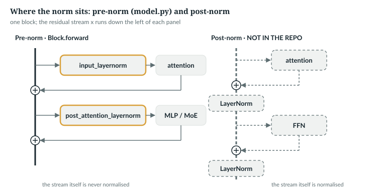
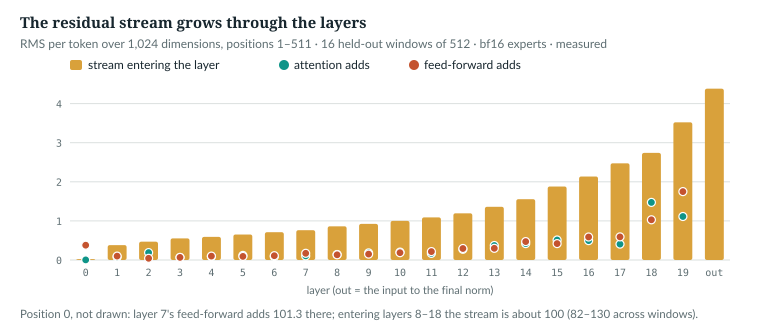

# 15  Normalisation and the residual stream

Every block reads one running tensor, the residual stream, and adds to it.
Two pieces keep that sum trainable: RMSNorm, which hands each sublayer an
input of a set size however large the stream grows, and the scaled
initialisation, which keeps the stream small at the start. This chapter reads
both and measures the released model's stream.

| Term | Meaning |
|---|---|
| residual stream | the (B, S, D) tensor each block reads and adds to |
| RMS | root mean square: √(mean of the squares) of a vector's components |
| RMSNorm | divides a vector by its RMS, then multiplies by a learned gain γ |
| LayerNorm | subtracts the mean, divides by the standard deviation, then gain and bias |
| pre-norm | normalise a copy of the stream before each sublayer; the stream itself is never normalised |

---

## 15.1  By hand: RMSNorm and LayerNorm

LayerNorm normalises with the mean and variance of a layer's inputs [R09].
RMSNorm drops the re-centring and divides by the root mean square alone
[R08]. The book example runs both on the toy's three vectors, with gains of 1
(**Book example, not repository code**):

```python
    X = torch.tensor([[1., 0.], [0., 2.], [1., 1.]])           # The, dog, bit
    rms = X.pow(2).mean(-1, keepdim=True).sqrt()
    norm = M.RMSNorm(2)                                         # gain 1, eps 1e-6
    ln = torch.nn.LayerNorm(2, elementwise_affine=False, eps=1e-6)
    print("  rms of each row:", [round(v, 3) for v in rms.flatten().tolist()])
    print("  RMSNorm:  ", [[round(v, 3) for v in r] for r in norm(X).tolist()])
    print("  LayerNorm:", [[round(v, 3) for v in r] for r in ln(X).tolist()])
```

```
  rms of each row: [0.707, 1.414, 1.0]
  RMSNorm:   [[1.414, 0.0], [0.0, 1.414], [1.0, 1.0]]
  LayerNorm: [[1.0, -1.0], [-1.0, 1.0], [0.0, 0.0]]
  model.RMSNorm vs F.rms_norm: 0.0e+00
```

*illustrative*, printed by `book/code-examples/ch15_norms.py`. RMSNorm keeps
each direction and sets the RMS to 1.
LayerNorm subtracts the mean first, which in two dimensions leaves ±(1, −1)
or zero: *bit*, [1, 1], vanishes. At width 1,024 re-centring discards one
direction of 1,024. `anulm/model.py`'s RMSNorm matches PyTorch's `F.rms_norm`.

LayerNorm is not in `anulm/model.py`; the speech and image projectors use it, to
bring encoder features to the scale the blocks expect (Chapter 36):

> **In the repo** · `anulm/multimodal/speech_encoder.py` · `AudioProjector.__init__` · lines 79–82 · @fdbb09a

```python
        hidden = hidden or max(out_dim, d)
        self.net = nn.Sequential(
            nn.Linear(d, hidden), nn.GELU(), nn.Linear(hidden, out_dim), nn.LayerNorm(out_dim),
        )
```

`anulm/multimodal/vision_encoder.py` line 124 is the same line for images.

`IN THE REPO`

## 15.2  In the code: `RMSNorm`

> **In the repo** · `anulm/model.py` · `RMSNorm` · lines 225–239 · @fdbb09a

```python
class RMSNorm(nn.Module):
    def __init__(self, dim: int, eps: float = 1e-6):
        super().__init__()
        self.weight = nn.Parameter(torch.ones(dim))
        self.eps = eps

    def forward(self, x):
        dtype = x.dtype
        x = x.float()
        x = x * torch.rsqrt(x.pow(2).mean(-1, keepdim=True) + self.eps)
        return (x.to(dtype)) * self.weight
```

- **`weight`** is the gain γ, one per dimension, starting at 1; no bias.
- **`x.float()`**: the arithmetic runs in fp32 whatever the input's dtype.
- **The normalisation.** The mean square over the last dimension is
  (…, 1); ε = 10⁻⁶ guards a zero vector; `rsqrt` is 1/√. Each vector along
  the last dimension is normalised alone: a token, or a query head (Chapter 13).
- **The return** casts back to the input's dtype, then multiplies by γ.

Why fp32 inside? The example normalises large 16-bit activations both ways
against an fp64 reference:

```python
    for dtype, scale in ((torch.float16, 300), (torch.bfloat16, 30)):
        x = (torch.randn(4096, 1024) * scale).to(dtype)        # large activations, stored in 16 bits
        ref = x.double() * torch.rsqrt(x.double().pow(2).mean(-1, keepdim=True) + 1e-6)
        naive = x * torch.rsqrt(x.pow(2).mean(-1, keepdim=True) + 1e-6)   # every step in 16 bits
        for name, y in (("inside fp32", norm(x)), ("inside " + str(dtype)[6:], naive)):
            rel = ((y.double() - ref).norm(dim=-1) / ref.norm(dim=-1)).mean()
```

```
  float16  input × 300, inside fp32    : output float32, mean relative error 2.1e-04
  float16  input × 300, inside float16 : output float16, mean relative error 1.0e+00
  bfloat16 input × 30, inside fp32    : output float32, mean relative error 1.7e-03
  bfloat16 input × 30, inside bfloat16: output bfloat16, mean relative error 2.6e-03
  bf16 input, fp32 inside and no cast back: 4.6e-08
  the gain is float32; bf16 × fp32 gives float32
```

The fifth line comes from the same fp32 arithmetic without the cast back:

```python
    y = F.rms_norm(x.float(), (1024,), eps=1e-6)                # the same, without the cast back to bf16
```

*verified*. In fp16, squares above 65,504 overflow and the output is
garbage. bf16 has fp32's range, so there fp32 buys precision only, and most
of the error left is the cast back. The last line is why Chapter 20 found
fp32 keys in the cache under autocast: the gain is an fp32 parameter, and a
16-bit tensor times an fp32 one is fp32.

`IN THE REPO`

## 15.3  Pre-norm: where the norms sit

Each block owns two norms:

> **In the repo** · `anulm/model.py` · `Block.__init__` · lines 802–811 · @fdbb09a

```python
    def __init__(self, cfg: AnuLMConfig, layer_idx: int, rotary: Rotary):
        super().__init__()
        self.input_layernorm = RMSNorm(cfg.hidden_size, cfg.rms_norm_eps)
        self.attn = (
            GQAttention(cfg, rotary) if cfg.attn == "gqa" else MLAttention(cfg, rotary)
        )
        self.post_attention_layernorm = RMSNorm(cfg.hidden_size, cfg.rms_norm_eps)
        # Layer 0 dense, the rest MoE -- first_k_dense_replace = 1 in both models.
        self.is_moe = layer_idx >= cfg.first_k_dense_replace
        self.mlp = MoE(cfg) if self.is_moe else SwiGLU(cfg.hidden_size, cfg.intermediate_size)
```

and uses them like this:

> **In the repo** · `anulm/model.py` · `Block.forward` · lines 816–824 · @fdbb09a

```python
    def forward(self, x, cos, sin, cache: Optional[dict] = None, start: int = 0,
                bidir_mask: Optional[torch.Tensor] = None):
        """Returns (x, aux). aux is the MoE regulariser or None. With bidir_mask
        the attention is bidirectional (the sliding window does not apply)."""
        x = x + self.attn(self.input_layernorm(x), cos, sin,
                          cache=cache, start=start, window=self.window, bidir_mask=bidir_mask)
        h = self.mlp(self.post_attention_layernorm(x))
        h, aux = h if self.is_moe else (h, None)
        return x + h, aux
```

Line 775, inside out: normalise a copy of `x`, attend, add the result to `x`.
Lines 777–779 do the same for the feed-forward half. The norm never replaces
the stream, so the stream is a plain sum, (B, S, D) throughout: the embedding
plus every sublayer's output. Each sublayer reads everything before it, and
the gradient reaches every layer directly through the additions. One more
RMSNorm, built once for the whole model, normalises the stream at the end,
before the output head:

> **In the repo** · `anulm/model.py` · `AnuLM.__init__` · lines 839–841 · @fdbb09a

```python
        self.layers = nn.ModuleList([Block(cfg, i, self.rotary) for i in range(cfg.n_layer)])
        self.norm = RMSNorm(cfg.hidden_size, cfg.rms_norm_eps)
        self.lm_head = nn.Linear(cfg.hidden_size, cfg.vocab_size, bias=False)
```

> **In the repo** · `anulm/model.py` · `AnuLM.forward` · line 912 · @fdbb09a

```python
        x = self.norm(x)
```

The other arrangement normalises the stream itself, *after* each addition:
post-norm, drawn in Figure 15.1, the original Transformer's LayerNorm(x +
Sublayer(x)) [R01]. GPT-2 moved layer normalisation to each
sub-block's input [R04], and a later analysis found pre-norm models train
without the warm-up stage and reach comparable results [R10]. AnuLM has
pre-norm and RMSNorm.



*Figure 15.1 · Pre-norm and post-norm.* Post-norm is drawn dashed: it is not
in the repository.

`IN THE REPO`

## 15.4  The stream in the trained model

`ch15_measure_stream.py` runs `ckpt_base_v2.pt` on 16 held-out windows of 512
tokens (`data/v2/val.u16`, seed 0), in fp32 without autocast except the
experts, which the released configuration computes in bf16 (`anulm/model.py` lines
749 and 777). Forward hooks record each token's RMS entering every layer and
of what each half adds, position 0 apart:

```python
def rms(t):
    """Per-token RMS over the last dimension: (B, S, D) -> (B, S)."""
    return t.float().pow(2).mean(-1).sqrt()
```

```python
    def add(key, layer, t):
        r = rms(t)
        acc[key][layer, 0] += r[:, 1:].mean().item()
        acc[key][layer, 1] += r[:, 0].mean().item()

    hooks = []
    for i, block in enumerate(m.layers):
        hooks.append(block.register_forward_pre_hook(lambda mod, args, i=i: add("stream", i, args[0])))
        hooks.append(block.attn.register_forward_hook(lambda mod, args, out, i=i: add("attn", i, out)))
        hooks.append(block.mlp.register_forward_hook(
            lambda mod, args, out, i=i: add("mlp", i, out[0] if isinstance(out, tuple) else out)))
```

A pre-hook sees a module's input; a forward hook its output. From layer 1 on,
the feed-forward half is a mixture of experts (Chapters 17–18), which returns
`(y, aux)`, hence `out[0]`. The stream at position 0 is also kept per window:

```python
        if key == "stream":
            pos0[layer] += r[:, 0].tolist()
```



*Figure 15.2 · The residual stream of the released model.* *measured*,
positions 1–511; `book/measurements/part_iv_a_stream.json`.

| | layer 0 | layer 5 | layer 10 | layer 15 | layer 19 | into the final norm |
|---|---|---|---|---|---|---|
| stream entering | 0.023 | 0.652 | 1.001 | 1.878 | 3.521 | 4.381 |
| attention adds | 0.002 | 0.119 | 0.202 | 0.511 | 1.111 | |
| feed-forward adds | 0.378 | 0.093 | 0.187 | 0.419 | 1.749 | |
| mean \|γ\| of `input_layernorm` | 0.0031 | 0.168 | 0.549 | 3.22 | 0.093 | 6.34 (final norm) |

- **The stream grows about 190-fold**, from 0.023 to 4.38, yet each sublayer
  sees an input sized by its own gain: what pre-norm buys.
- **Layer 0's attention adds almost nothing**, 0.002. Its input gain, mean
  |γ| 0.0031, does not flatten the pattern: QK-norm renormalises queries and
  keys after the projection, and how flat layer 0 attends is set by the QK
  gains (Chapter 11). The small gain shrinks the values, so the output is small.
- **Position 0 is different.** Layer 7's feed-forward half adds RMS 101.3
  there, and the stream entering layers 8 through 18 stays about 100 (82–130
  across windows), whatever the token; layer 18's feed-forward half adds 55.8
  and the stream entering layer 19 is 62.0. Chapter 11's heads turn to
  position 0 from layer 8; the link between the two is *not measured here*.

`MEASURED`

## 15.5  The scaled initialisation

The stream sums 40 sublayer outputs, so at initialisation the code shrinks
the matrices that write into it:

> **In the repo** · `anulm/model.py` · `AnuLM.__init__` · lines 859–863 · @fdbb09a

```python
        self.apply(self._init_weights)
        # nanoGPT's scaled init for the residual output projections.
        for name, p in self.named_parameters():
            if name.endswith(("o_proj.weight", "dense.weight", "down_proj.weight")):
                nn.init.normal_(p, mean=0.0, std=cfg.initializer_range / math.sqrt(2 * cfg.n_layer))
```

> **In the repo** · `anulm/model.py` · `AnuLM._init_weights` · lines 865–871 · @fdbb09a

```python
    def _init_weights(self, m):
        if isinstance(m, nn.Linear):
            nn.init.normal_(m.weight, mean=0.0, std=self.cfg.initializer_range)
            if m.bias is not None:
                nn.init.zeros_(m.bias)
        elif isinstance(m, nn.Embedding):
            nn.init.normal_(m.weight, mean=0.0, std=self.cfg.initializer_range)
```

`_init_weights` draws every linear and embedding weight from N(0, 0.02²).
The loop then redraws the *last* matrix of every residual branch, `dense`
(`o_proj` in MLA) and every `down_proj`, with standard deviation
0.02/√(2L): two branches per layer. The comment credits nanoGPT; GPT-2's
report describes the same 1/√N rule for N residual layers [R04]. The example
runs one random batch through the freshly built released model, then again with those matrices at 0.02:

```python
    for label in ("scaled (model.py)", "all 0.02"):
        if label == "all 0.02":
            with torch.no_grad():
                for n in names:
                    dict(model.named_parameters())[n].normal_(0.0, cfg.initializer_range)
        rms = []
        hooks = [b.register_forward_pre_hook(lambda mod, args: rms.append(args[0].pow(2).mean().sqrt().item()))
                 for b in model.layers]
        hooks.append(model.norm.register_forward_pre_hook(lambda mod, args: rms.append(args[0].pow(2).mean().sqrt().item())))
        with torch.no_grad():
            model(x)
```

```
  477 matrices (dense, down_proj); std 0.02 / √40 = 0.00316; measured, mean over the matrices 0.00316
  scaled (model.py) : stream rms at layers 0, 5, 10, 15 and the end: 0.0199, 0.0929, 0.1601, 0.2049, 0.2477  (growth 12.42×)
  all 0.02          : stream rms at layers 0, 5, 10, 15 and the end: 0.0199, 0.6390, 1.0520, 1.3232, 1.5816  (growth 79.29×)
```

*verified*: 20 `dense`, layer 0's `down_proj` and 19 × 24 experts' make 477.
Unscaled, the untrained stream grows 79-fold; scaled, 12-fold. The effect on
the trained model's quality is *not measured here*. The test that guards the
start checks the loss:

> **In the repo** · `tests/test_model.py` · `initial_loss_is_ln_vocab` · lines 349–359 · @fdbb09a

```python
def initial_loss_is_ln_vocab():
    for attn in ("gqa", "mla"):
        torch.manual_seed(0)
        cfg = tiny(attn=attn)
        m = AnuLM(cfg).eval()
        x = torch.randint(0, cfg.vocab_size, (4, 32))
        with torch.no_grad():
            _, loss = m(x, x)
        expected = math.log(cfg.vocab_size)
        assert abs(loss.item() - expected) < 0.35, \
            f"{attn}: init loss {loss.item():.3f}, expected ~{expected:.3f} -- init is off"
```

The lab book found that embeddings fifty times too large pass it; so here:

```python
        model = M.AnuLM(cfg).eval()
        if std is not None:
            torch.nn.init.normal_(model.embed_tokens.weight, std=std)
        x = torch.randint(0, cfg.vocab_size, (4, 32))
        with torch.no_grad():
            _, loss = model(x, x)
```

```
  as model.py initialises : initial loss 4.186 (ln V = 4.159; the test allows 0.35)
  embeddings at std 1.0   : initial loss 4.155 (ln V = 4.159; the test allows 0.35)
```

*verified*: the final RMSNorm rescales whatever reaches it.

`IN THE REPO`

## 15.6  Common mistakes, and how to catch them

- **Statistics in 16 bits.** Fine in bf16 at these widths, garbage in fp16.
  *Catch it:* compare against an fp64 reference on large inputs (15.2).
- **Post-norm by accident**, `x = norm(x + f(x))`. It still trains. *Catch
  it:* the lab book's `block_is_a_pre_norm_residual` check.
- **Unscaled output projections.** *Catch it:* check the weights' spread;
  the loss test cannot (15.5).

`IN THE REPO`

## 15.7  Exercises

1. How many RMSNorm gains does the released model have?
2. What standard deviation would the scaled initialisation give a 40-layer
   model?

**Answers.** (1) 2 × 20 + 1 = 41 norms of width 1,024: 41,984 gains, plus
40 QK-norms of width 64 (Chapter 11). (2) 0.02/√80 = 0.00224. *verified*:
printed by `ch15_norms.py`.

> **Build it.** The lab book's Chapter 4 (`course/ch04-skeleton`, §4.2 and
> §4.6) builds RMSNorm and the pre-norm block, with checks for statistics in
> bfloat16, post-norm and an unscaled `down_proj`.

---

## Key points

- RMSNorm divides each vector by its RMS and multiplies by a learned gain;
  unlike LayerNorm it does not subtract the mean.
- `anulm/model.py` computes the statistics in fp32, casts back, then multiplies by
  the gain, an fp32 parameter, so a 16-bit input comes out fp32.
- Pre-norm: each sublayer reads a normalised copy and adds its output to the
  stream, which is never normalised until the final norm.
- Measured, the released model's stream grows about 190-fold through 20
  layers; layer 0's attention adds almost nothing; position 0 carries a
  vector of RMS about 100 into layers 8–18.
- The last matrix of every residual branch starts with standard deviation
  0.02/√(2L) = 0.00316; at initialisation that keeps the stream's growth to
  12-fold instead of 79-fold.
- The initial-loss test cannot see a badly scaled stream, because the final
  norm rescales it.

> **In one breath.** The residual stream is a running sum that every sublayer
> reads through its own RMSNorm and adds to; nothing normalises the sum until
> the end. Scaled initialisation keeps the sum small at the start, and the
> trained model lets it grow about 190-fold.

## References

Research references cited in this chapter (`RESEARCH_REFERENCES.md`), each
used only for the claim in its register row:

| ID | Used for | Status |
|---|---|---|
| [R01] | post-norm: LayerNorm(x + Sublayer(x)) around each sub-layer | CHECKED |
| [R04] | GPT-2 moved layer normalisation to the input of each sub-block; residual-layer weights scaled at initialisation by 1/√N | CHECKED |
| [R08] | RMSNorm: normalising by the root mean square, without re-centring | CHECKED |
| [R09] | LayerNorm: normalising with the mean and variance within a layer | CHECKED |
| [R10] | pre-norm transformers without the warm-up stage reach comparable results | CHECKED |

Repository evidence, all at @fdbb09a:
- `anulm/model.py`: `RMSNorm` 225–239, `Block.__init__` 802–811, `Block.forward`
  816–824, `AnuLM.__init__` 839–841 and 859–863, `AnuLM._init_weights` 865–871,
  `AnuLM.forward` 912.
- `anulm/multimodal/speech_encoder.py` 79–82 and `anulm/multimodal/vision_encoder.py` 124 (LayerNorm in the projectors).
- `tests/test_model.py`: `initial_loss_is_ln_vocab` 349.
- `book/measurements/part_iv_a_stream.json`.

Book examples: `code-examples/ch15_norms.py`, `code-examples/ch15_measure_stream.py`.
