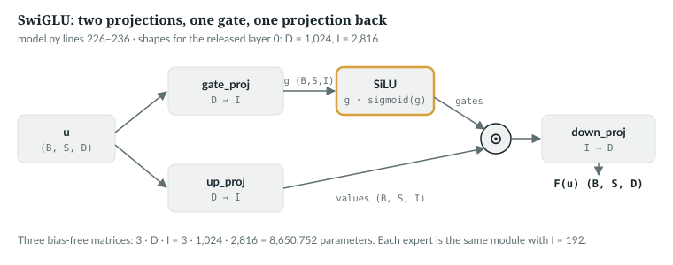
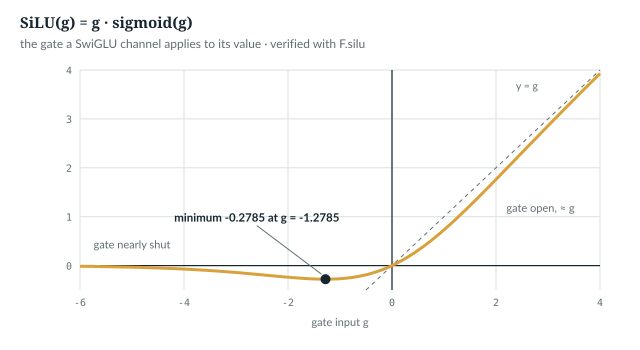
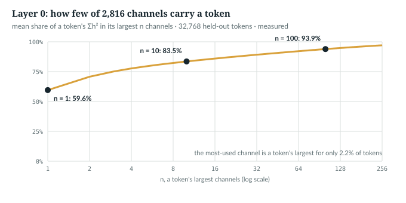

# 16  The feed-forward network: SwiGLU

Attention moves information between positions (Chapters 11–15). The second
half of every block, the feed-forward network, works on each position alone.
In AnuLM it is a SwiGLU: the whole second half of layer 0, and the body of each
of the 456 experts in layers 1–19 (Chapters 17–18).

**New words.**

| Term | Meaning |
|---|---|
| feed-forward network (FFN) | the per-token second half of a block; `anulm/model.py` calls it the MLP |
| inner width, I | how many numbers the FFN expands a token to; `intermediate_size` |
| channel | one of those I inner numbers |
| gate | a per-channel factor, computed from the token, that scales what the channel writes |
| SiLU | the function g · sigmoid(g), which turns a gate input g into a gate |
| dense layer | an FFN every token passes through in full, unlike the experts |

---

## 16.1  What the second half does

Block ℓ's second half adds F(u) to the stream, for u = RMSNorm(h), the
normalised stream after attention (20.3). An ungated feed-forward network puts
one activation function, applied channel by channel, between two matrices; the
GELU is one such activation function [S04]. Gated variants add a second
projection of the token that multiplies the first channel by channel; SwiGLU is
one of them [R11], and the only one here.

`NOT IN THE REPO` (ungated feed-forward networks)

## 16.2  By hand: one token, three channels

`book/code-examples/ch16_swiglu.py` (**Book example, not repository code**)
sends *bit*'s token vector from Chapter 11's toy, [1, 1], through a SwiGLU with
D = 2 and I = 3, then loads the same *illustrative* matrices into the
repository's module, transposed because `nn.Linear` stores (out, in):

```python
x = torch.tensor([1., 1.])                       # bit's token vector, Chapter 11's toy
W_gate = torch.tensor([[1., -1., 0.],            # (D, I) = (2, 3)
                       [0., 1., -2.]])
W_up = torch.tensor([[1., 0., 1.],
                     [1., 2., 0.]])
W_down = torch.tensor([[1., 0.],                 # (I, D) = (3, 2)
                       [0., 1.],
                       [1., 1.]])
g = x @ W_gate                                   # gate inputs, one per channel
a = g * torch.sigmoid(g)                         # SiLU(g) = g * sigmoid(g)
up = x @ W_up                                    # what each channel would write
h = a * up                                       # the gate scales it
out = h @ W_down                                 # back to width D
# ...
ffn = M.SwiGLU(2, 3)                             # the repository's module
with torch.no_grad():                            # nn.Linear stores W transposed: (out, in)
    ffn.gate_proj.weight.copy_(W_gate.T)
    ffn.up_proj.weight.copy_(W_up.T)
    ffn.down_proj.weight.copy_(W_down.T)
    got = ffn(x)
assert torch.allclose(got, out, atol=1e-6), (got, out)
```

```
g        tensor([ 1.,  0., -2.])
SiLU(g)  tensor([ 0.731,  0.000, -0.238])
up       tensor([2., 2., 1.])
h        tensor([ 1.462,  0.000, -0.238])
out      tensor([ 1.224, -0.238])
model.SwiGLU gives tensor([ 1.224, -0.238]) (matches)
```

- **Channel 1 is open:** SiLU(1) = 0.731 lets 73% of its value, 2, through.
- **Channel 2 is shut:** SiLU(0) = 0, so its value, also 2, adds nothing. The
  gate decided, not the value.
- **Channel 3 leaks:** SiLU(−2) = −0.238 passes a small, sign-flipped share.

`W_down` mixes them back into [1.224, −0.238]. *verified*.

`IN THE REPO`

## 16.3  In the code

> **In the repo** · `anulm/model.py` · `SwiGLU` · lines 242–253 · @fdbb09a

```python
class SwiGLU(nn.Module):
    """The expert body and the dense layer-0 MLP. 3 * D * I params."""

    def __init__(self, hidden_size: int, intermediate_size: int):
        super().__init__()
        self.gate_proj = nn.Linear(hidden_size, intermediate_size, bias=False)
        self.up_proj = nn.Linear(hidden_size, intermediate_size, bias=False)
        self.down_proj = nn.Linear(intermediate_size, hidden_size, bias=False)

    def forward(self, x):
        # ...
        return self.down_proj(F.silu(self.gate_proj(x)) * self.up_proj(x))
```

- **`gate_proj`** and **`up_proj`**: (B, S, D) → (B, S, I), the gate inputs g
  and the values; **`down_proj`**: (B, S, I) → (B, S, D). No biases.
- **`forward`**, right to left: SiLU turns g into gates, `*` multiplies gates
  and values element by element, `down_proj` projects back. In symbols,
  F(u) = (SiLU(uW<sub>gate</sub>) ⊙ uW<sub>up</sub>)W<sub>down</sub>.

Nothing looks across the S positions; the example shuffles them to check:

```python
def per_token():
    torch.manual_seed(0)
    ffn = M.SwiGLU(32, 64).eval()
    x = torch.randn(2, 5, 32)                        # (B, S, D)
    perm = torch.randperm(5)
    with torch.no_grad():
        assert torch.allclose(ffn(x)[:, perm], ffn(x[:, perm]), atol=1e-6)
```



*Figure 16.1 · The SwiGLU, one token.* Shapes for the released layer 0.

**SiLU** is near g for large g, near 0 for very negative g, and dips below zero
in between:

```python
def silu_shape():
    x = torch.linspace(-6, 0, 600_001, dtype=torch.float64)
    y = F.silu(x)
    i = y.argmin()
    print(f"SiLU is negative for every x < 0; smallest value {y[i]:.4f} at x = {x[i]:.4f}; "
          f"SiLU(-4) = {F.silu(torch.tensor(-4.)):.4f}, SiLU(4) = {F.silu(torch.tensor(4.)):.4f}")
```

```
SiLU is negative for every x < 0; smallest value -0.2785 at x = -1.2785; SiLU(-4) = -0.0719, SiLU(4) = 3.9281
```

So a gate is not a switch. It multiplies the value by any factor from −0.28
upward: close to 0 for very negative g, about g itself for large g (SiLU(4) =
3.93), and for −1.28 < g < 0 a small negative factor.



*Figure 16.2 · SiLU, the gate function.* g · sigmoid(g), its minimum marked.
*verified*: computed with `F.silu`.

`IN THE REPO`

## 16.4  Three matrices: 3·D·I parameters

> **In the repo** · `anulm/model.py` · `AnuLMConfig` · lines 77–79 · @fdbb09a

```python
    moe_intermediate_size: int = 96
    intermediate_size: int = 768    # the dense layer-0 MLP
    first_k_dense_replace: int = 1
```

These are I<sub>e</sub>, an expert's width; I, layer 0's; and the number of
dense layers from the bottom. The released model's preset sets I:

> **In the repo** · `anulm/model.py` · `AnuLMConfig.nano_350m` · lines 191–200 · @fdbb09a

```python
        cfg = dict(
            attn="gqa", n_layer=20, hidden_size=1024, n_head=16, head_dim=64,
            n_kv_head=4,                   # 4:1, closer to the real 30B's 16:1
            num_experts=12, num_experts_per_tok=3,
            moe_intermediate_size=384,
            intermediate_size=2816,
            n_group=1, topk_group=1,
            rope_theta=1e6, yarn=False,
            block_size=512,
        )
```

The released run kept I = 2,816 and overrode the experts to 24 of width 192,
4 per token, none shared (20.1). The example counts it module by module:

```python
def arithmetic():
    cfg = released()
    D, I, Ie, E, A = (cfg.hidden_size, cfg.intermediate_size, cfg.moe_intermediate_size,
                      cfg.num_experts, cfg.num_experts_per_tok)
    m = M.AnuLM(cfg)
    kinds = ["MoE" if b.is_moe else "dense SwiGLU" for b in m.layers]
    # ...
    dense = sum(p.numel() for p in m.layers[0].mlp.parameters())
    expert = sum(p.numel() for p in m.layers[1].mlp.experts[0].parameters())
    router = m.layers[1].mlp.router.weight.numel()
    assert dense == 3 * D * I and expert == 3 * D * Ie
    swiglus = sum(isinstance(mod, M.SwiGLU) for mod in m.modules())
    # ...
    active = A * expert + router
```

```
layer 0: dense SwiGLU; layers 1-19: {'MoE'}
SwiGLU modules in the released model: 457 (1 dense + 19 x 24 experts)
dense layer 0: 3*D*I = 3*1024*2816 = 8,650,752 parameters, all used by every token
one expert: 3*D*I_e = 3*1024*192 = 589,824; one MoE layer holds 14,180,352
per token, multiply-adds: layer 0 8,650,752; an MoE layer 4*589,824 + router 24,576 = 2,383,872; ratio 3.63
a two-matrix FFN at 4D: 2*D*4D = 8,388,608; SwiGLU width with the same count, (2/3)*4D = 2730.67; the configured I is 2816 = 1.03125 times that
(2/3)*4D rounded up to a multiple of 256: 2816
```

Two readings (*verified*):
- **Layer 0 does the most work per token.** An MoE layer stores 1.6 times its
  parameters, but a token uses 4 of 24 experts: layer 0 does 3.63 times more.
- **The 2/3 rule, roughly.** A third matrix makes a gated FFN 1.5 times as
  large, so the SwiGLU paper shrank the width by 2/3 to keep parameters and
  computation constant [R11]. Against a two-matrix FFN of width 4·D, that
  width is 2,730.67; I = 2,816 is that width rounded up to a multiple of 256. The code
  does not say that this is how it was chosen.

> **Details.** The smaller presets set I to 2·D (`nano_30b`, line 166) and
> 4·D (`nano_105b`, line 213), mirroring Sarvam's 30B and 105B
> (`docs/RESULTS.md`, "The two presets").

`IN THE REPO`

## 16.5  Dense layer 0, and the experts that replace it

> **In the repo** · `anulm/model.py` · `Block.__init__` · lines 809–811 · @fdbb09a

```python
        # Layer 0 dense, the rest MoE -- first_k_dense_replace = 1 in both models.
        self.is_moe = layer_idx >= cfg.first_k_dense_replace
        self.mlp = MoE(cfg) if self.is_moe else SwiGLU(cfg.hidden_size, cfg.intermediate_size)
```

Only layers below `first_k_dense_replace`, here layer 0, get a SwiGLU of width
I. "Both models" are Sarvam's 30B and 105B, whose configurations set the value
to 1 [R49]; the repository gives no other reason. Every expert is a SwiGLU:

> **In the repo** · `anulm/model.py` · `MoE.__init__` · lines 688–694 · @fdbb09a

```python
        self.experts = nn.ModuleList(
            [SwiGLU(cfg.hidden_size, cfg.moe_intermediate_size) for _ in range(cfg.num_experts)]
        )
        self.shared_expert = (
            SwiGLU(cfg.hidden_size, cfg.moe_intermediate_size * cfg.num_shared_experts)
            if cfg.num_shared_experts > 0 else None
        )
```

`experts` holds E of width I<sub>e</sub>. A shared expert, which every token
uses, is one SwiGLU of width I<sub>e</sub> · `num_shared_experts`, so several
are stored as one wider one; the released model has none.

Every `down_proj`, dense or expert, starts small: the scaled initialisation
quoted in 15.5 (`anulm/model.py` lines 860–863) draws it with standard
deviation 0.02/√40 = 0.00316 against 0.02 for the other two, so each block
first adds little to the stream; the example measures 0.00316.

`IN THE REPO`

## 16.6  What the trained layer 0 does

`book/code-examples/ch16_measure_trained.py` (**Book example, not repository
code**) runs `ckpt_base_v2.pt` over Chapter 11's 64 held-out windows of 512
tokens (loss 3.379; settings in Appendix F, F.6). Layer 0 comes before any
expert, so it runs entirely in fp32. A hook on layer 0's SwiGLU keeps
statistics only.

> **Details.** The hook. `top[..., n − 1]` is the share of a token's Σh² in
> its n largest channels. `per_channel` is each channel's total Σh² over all
> tokens; `top_channel` counts how often each channel is a token's largest.
>
> ```python
> def swiglu_hook(store):
>     def hook(mod, inp, out):
>         u = inp[0]
>         with torch.no_grad():
>             g = mod.gate_proj(u)
>             up = mod.up_proj(u)
>             h = F.silu(g) * up                                           # (B, S, I)
>             store["n"] += g.numel() // g.shape[-1]
>             store["gate_neg"] += (g < 0).float().mean(-1).sum().item()
>             store["gate_lt_m4"] += (g < -4).float().mean(-1).sum().item()
>             h2 = h.pow(2)
>             pr = h2.sum(-1).pow(2) / h2.pow(2).sum(-1)                   # participation ratio, channels in play
>             store["in_play"] += pr.sum().item()
>             top = h2.sort(-1, descending=True)[0].cumsum(-1) / h2.sum(-1, keepdim=True)
>             store["ch90"] += ((top < 0.9).sum(-1) + 1).float().sum().item()
>             store["cum"] = store.get("cum", 0) + top[..., :256].reshape(-1, 256).sum(0).double().cpu()
>             store["out_norm"] += out.norm(dim=-1).sum().item()
>             # ...
>             flat = h2.reshape(-1, h2.shape[-1])
>             store["per_channel"] = store.get("per_channel", 0) + flat.sum(0).double().cpu()
>             store["top_channel"] = store.get("top_channel", 0) + torch.bincount(
>                 flat.argmax(-1), minlength=flat.shape[-1]).cpu()
> ```

*measured*, over 32,768 tokens:

| | layer 0 |
|---|---|
| gate inputs below 0 / below −4 | 58.6% / 0.0% of channels |
| share of a token's Σh² in its largest channel | 59.6% (mean over tokens) |
| channels holding 90% of a token's Σh² | 53.4 of 2,816 |
| tokens whose largest channel is the most-used channel | 2.2% |
| ‖F(u)‖ against the stream it is added to, L2 norms, mean | 12.08 against 0.73 |

- **Most gates damp, almost none shut.** 58.6% of gate inputs are negative, so
  those channels pass at most 0.28 of their value, sign flipped; none falls
  below −4, where the gate is nearly 0. Yet one channel carries 60% of a
  token's Σh², and 53 carry 90%.
- **Which channel depends on the token.** The most-used channel, the one with
  the largest total Σh² (channel 1,203, 1.5% of the total), is a token's
  largest for only 2.2% of tokens. Different tokens use different small sets
  of channels stored in one matrix. Chapter 17 builds that idea into the
  layer's structure.
- **Layer 0 writes most of the stream:** its output is 16.5 times the stream
  entering it. These are L2 norms over D = 1,024, 32 times an RMS: 0.378 and
  0.023 as RMS, the figures in Chapter 15's table (positions 1–511 there; all
  positions here). Layer 10's MoE output is 0.15 times its stream, but that
  ratio includes position 0, whose stream Chapter 15 shows has RMS about 100
  entering layers 8 through 18 (layer 7's feed-forward half puts it there).



*Figure 16.3 · How few channels carry a token.* Mean share of a token's Σh² in
its largest n channels. *measured*. Whether a dense layer 0 beats an MoE there
is *not measured here*.

`MEASURED`

## 16.7  Common mistakes, and how to catch them

Loading mistakes are silent when D = I, the case the example builds:

```python
    a = M.SwiGLU(8, 8).eval()                        # D = I, the case where mistakes load silently
    b = M.SwiGLU(8, 8).eval()
    x = torch.randn(4, 8)
    with torch.no_grad():
        b.load_state_dict(a.state_dict())
        b.gate_proj.weight.copy_(a.up_proj.weight)   # gate and up swapped
        b.up_proj.weight.copy_(a.gate_proj.weight)
        swapped = (a(x) - b(x)).abs().max().item()
        b.load_state_dict(a.state_dict())
        b.gate_proj.weight.copy_(a.gate_proj.weight.T)   # a forgotten transpose: no error when D = I
        transposed = (a(x) - b(x)).abs().max().item()
```

```
output scale 0.4609; gate/up swapped: max difference 0.1585; gate transposed: 0.5985; neither raised an error
```

- **A forgotten transpose** changed the output by more than its own scale
  (0.5985 against 0.4609), without an error. *Catch it:* test with D ≠ I, where
  the shapes no longer fit.
- **Swapped `gate_proj` and `up_proj`** changed it by about a third of its
  scale (0.1585). Both are (I, D), so no shape test sees it. *Catch it:* compare
  outputs with the source on the same input, as
  `transformers_wrapper_matches_the_native_model` (`tests/test_model.py`
  line 1285) does. That test returns early, and counts as a pass, when `transformers` is
  not installed.
- **A projection built but never used** still lets the loss fall. *Catch it:*
  `all_parameters_receive_gradients` (`tests/test_model.py` line 336).

`IN THE REPO`

## 16.8  Exercises

1. Change the toy's second `W_gate` row to [0, 1, 0]. What is the output?
2. How many parameters would layer 0 hold at I = 4,096?
3. For `nano_30b` (D = 384, I = 768, I<sub>e</sub> = 96, A = 2, one shared
   expert), compare layer 0's multiply-adds per token with an MoE layer's
   experts.

**Answers.** 1. g = [1, 0, 0], so channel 3 shuts and the output is
[1.462, 0]. 2. 3·1,024·4,096 = 12,582,912. 3. 884,736 against
2·110,592 + 110,592 = 331,776, plus 6,144 for the router. *verified*: printed
by `ch16_swiglu.py`.

> **Build it.** The lab book's Chapter 4 (`course/ch04-skeleton`, §4.3) has you
> write this SwiGLU as the MLP of your first block.

---

## Key points

- The feed-forward half works on each token alone; attention is the only place
  positions meet.
- A SwiGLU projects a token twice to width I, gates one copy with SiLU,
  multiplies, and projects back: F(u) =
  (SiLU(uW<sub>gate</sub>) ⊙ uW<sub>up</sub>)W<sub>down</sub>.
- SiLU is g · sigmoid(g): a factor from −0.2785 upward, about g for large g,
  so gates scale and leak rather than switch.
- Three bias-free matrices hold 3·D·I parameters: 8,650,752 in the released
  layer 0, all used by every token.
- Only layer 0 is dense; the 456 experts of layers 1–19 are SwiGLUs of width
  192, 4 used per token, so layer 0 does 3.63 times their per-token work.
- Measured on held-out text, layer 0 carries each token mostly in one channel,
  a different one for different tokens.

> **In one breath.** The second half of every block transforms each token on
> its own: two projections to width I, one gated by SiLU, multiplied and
> projected back. Layer 0 does this densely with 2,816 channels; every later
> layer does it with 4 of 24 small experts of the same shape.

## References

Research references cited in this chapter (`RESEARCH_REFERENCES.md`), each
used only for the claim in its register row:

| ID | Used for | Status |
|---|---|---|
| [R11] | gated FFN variants, SwiGLU among them; the inner width shrunk by 2/3 to keep parameters and computation constant | CHECKED |
| [R49] | Sarvam's 30B and 105B configurations, which set `first_k_dense_replace` to 1 | CHECKED |
| [S04] | the GELU activation | CHECKED |

Repository evidence, all at @fdbb09a:
- `anulm/model.py`: `AnuLMConfig` 77–79, `nano_30b` line 166, `nano_350m` 191–200,
  `nano_105b` line 213; `SwiGLU` 242–253, `MoE.__init__` 688–694,
  `Block.__init__` 809–811, `AnuLM.__init__` 860–863.
- `tests/test_model.py`: `all_parameters_receive_gradients` 336,
  `transformers_wrapper_matches_the_native_model` 1285.
- `sarvam/sarvam-30b/config.json`, `sarvam/sarvam-105b/config.json`:
  `first_k_dense_replace`.
- `docs/RESULTS.md`, "The two presets".
- Measurements: `book/measurements/part_iv_b_trained.json` and
  `part_iv_b_trained_report.txt`, from `code-examples/ch16_measure_trained.py`.

The book examples are `code-examples/ch16_swiglu.py` and
`code-examples/ch16_measure_trained.py`.
