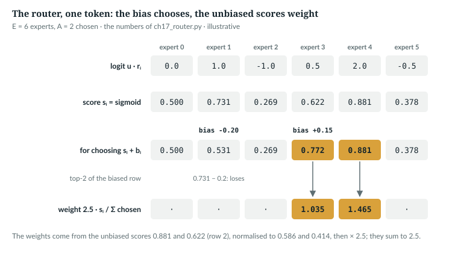
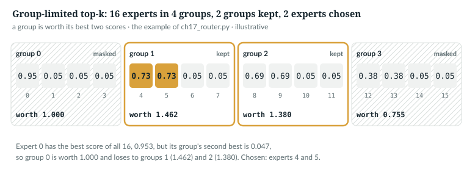
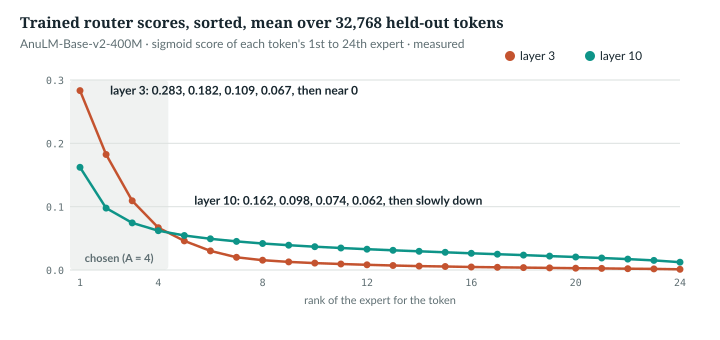

# 17  Mixture of experts I: the router

Chapter 16 found that layer 0 carries each token mostly in a few of its 2,816
channels, different ones for different tokens. A mixture of experts makes that
explicit: from layer 1 on, the feed-forward half is E = 24 small SwiGLUs, the
experts, and a router picks A = 4 of them per token. This chapter reads the
router, `anulm/model.py` lines 585–672; Chapter 18 covers what happens after the
choice.

**New words.**

| Term | Meaning |
|---|---|
| expert | one of the E small SwiGLUs in an MoE layer |
| router | the module that scores every expert for every token and picks A of them |
| router score, s<sub>i</sub> | the router's sigmoid affinity of a token for expert i, in (0, 1); not Chapter 11's attention score q·k |
| balancing bias, b<sub>i</sub> | a per-expert number added to s<sub>i</sub> for choosing only; not trained by gradients |
| combine weight, w<sub>i</sub> | how much of expert i's output the token receives |
| routed scaling factor | a constant, 2.5, multiplying every combine weight |
| group-limited routing | choosing the best groups of experts first, then experts inside them |

---

## 17.1  Store a lot, use a little

| Year | Step | Router | In the repo |
|---|---|---|---|
| 1991 | mixtures of experts [S05] | a gating network over experts | no |
| 2017 | sparsely-gated MoE [R15] | softmax gate, noisy top-k, an importance loss | no |
| 2020 | GShard [S06] | top-2 gating, MoE in every other layer | no |
| 2021 | Switch Transformer [R16] | each token to one expert, a balancing loss | no |
| 2024 | DeepSeekMoE [S07] | fine-grained experts, shared experts always on | fine-grained experts, 24 of width 192 (`docs/RESULTS.md` §10, §16); the shared expert, as an option |
| 2024 | DeepSeek-V3 [R20] | sigmoid affinity scores | yes |

AnuLM follows the last row, with a balancing bias used only to choose [R18].

`NOT IN THE REPO` (the softmax gates and their losses)

## 17.2  By hand: six experts, two chosen

`book/code-examples/ch17_router.py` (**Book example, not repository code**)
routes one token with E = 6, A = 2 and *illustrative* numbers, then feeds them
through `model.Router` with an identity weight matrix, so its input is its
logits:

```python
def by_hand():
    logits = torch.tensor([0.0, 1.0, -1.0, 0.5, 2.0, -0.5])          # one token, E = 6
    bias = torch.tensor([0.0, -0.2, 0.0, 0.15, 0.0, 0.0])           # the balancing bias
    s = torch.sigmoid(logits)                                        # independent scores in (0, 1)
    choice = (s + bias).topk(2).indices                              # the bias picks ...
    w = s[choice] / s[choice].sum()                                  # ... the unbiased scores weight
    w = w * 2.5                                                      # routed_scaling_factor
    # ...
    r, x = router_with_logits(logits.tolist(), num_experts_per_tok=2)
    with torch.no_grad():
        r.expert_bias.copy_(bias)
        idx, wr, aux = r(x)
    assert idx[0].tolist() == choice.tolist() and torch.allclose(wr[0], w), (idx, wr)
```

```
scores         tensor([0.500, 0.731, 0.269, 0.622, 0.881, 0.378])
scores + bias  tensor([0.500, 0.531, 0.269, 0.772, 0.881, 0.378])
top-2 without bias: [4, 1]  with bias: [4, 3]
weights tensor([1.465, 1.035]) sum 2.500
model.Router: [4, 3] tensor([1.465, 1.035]) (matches)
```

The bias changed the choice: expert 3 (0.622, +0.15) beat expert 1 (0.731,
−0.2). It did not change the weights, which come from the unbiased 0.881 and
0.622, normalised and times 2.5. *verified*.



*Figure 17.1 · The router, one token.* The example's numbers: biased scores
choose, unbiased scores weight. *illustrative*; printed by
`book/code-examples/ch17_router.py`.

`IN THE REPO`

## 17.3  The module: weights and buffers

> **In the repo** · `anulm/model.py` · `Router.__init__` · lines 594–609 · @b42998d

```python
    def __init__(self, cfg: AnuLMConfig):
        super().__init__()
        self.top_k = cfg.num_experts_per_tok
        self.num_experts = cfg.num_experts
        self.n_group = cfg.n_group
        self.topk_group = cfg.topk_group
        self.routed_scaling_factor = cfg.routed_scaling_factor

        self.weight = nn.Parameter(torch.empty(cfg.num_experts, cfg.hidden_size))
        nn.init.kaiming_uniform_(self.weight, a=math.sqrt(5))
        # Buffers, not parameters: no grad, but they must ride along in the
        # state dict and follow .to(device).
        self.register_buffer("expert_bias", torch.zeros(cfg.num_experts))
        self.register_buffer("load_counts", torch.zeros(cfg.num_experts))
        self.seq_balance_alpha = cfg.seq_balance_alpha
        self.router_z_alpha = cfg.router_z_alpha
```

- **`weight`**, (E, D): row i is expert i's direction; 24,576 numbers a layer.
- **`kaiming_uniform_(a=√5)`**: uniform on ±1/√D, an `nn.Linear`'s default.
  `AnuLM._init_weights` re-initialises only `nn.Linear` and `nn.Embedding`, so
  the router keeps it.
- **`expert_bias`**, **`load_counts`**, (E,): buffers, saved and moved with the
  model, no gradient (Chapter 18). The last two lines are Chapter 18's
  regularisers.

```
router weight: max |w| 0.03125, bound 1/sqrt(D) = 0.03125; std 0.01801, 1/sqrt(3D) = 0.01804
tiny(), after AnuLM.__init__: router max |w| 0.1753 (uniform bound 0.1768); a Linear's std 0.0195
at init: logit std 0.576 (1/sqrt(3) = 0.577); mean score 0.500; sum of 24 scores 12.00
```

The router's input has RMS 1 (Chapter 15), so logits start with spread
1/√3 = 0.577 and every score near 0.5 (*verified*, by the example).

`IN THE REPO`

## 17.4  Why the gate runs in fp32 with autocast off

> **In the repo** · `anulm/model.py` · `Router.forward` · lines 611–622 · @b42998d

```python
    def forward(self, x_flat, seq_len: Optional[int] = None):   # (N, D)
        """Returns (topk_idx, combine weights, aux) -- aux is None unless one of
        the regularisers is on and the module is training. `seq_len` lets the
        sequence-wise balance loss see the (B, S) layout of a flat batch."""
        # fp32 router: top-k is discrete, and bf16 rounding would flip choices.
        # Casting the inputs is not enough -- autocast re-casts F.linear to
        # bf16 whatever dtype it is handed, and every GPU run before this fix
        # routed in bf16 (3.2% of expert sets differed from fp32 on a real
        # checkpoint). Autocast has to be off for the whole gate.
        with torch.autocast(device_type=x_flat.device.type, enabled=False):
            topk_idx, w, aux = self._gate(x_flat.float(), seq_len)
        return topk_idx, w.to(x_flat.dtype), aux
```

The input is the batch flattened to N = B·S tokens. The `with` block turns
autocast off and casts to fp32, so the whole gate runs in fp32; the weights go
back in the caller's dtype. The comment's claim holds on this machine:

```python
def autocast():
    x, W = torch.randn(4, 32), torch.randn(8, 32)
    with torch.autocast("cpu", dtype=torch.bfloat16):
        inside = F.linear(x.float(), W.float()).dtype
        with torch.autocast("cpu", enabled=False):
            off = F.linear(x.float(), W.float()).dtype
```

```
F.linear on fp32 inputs under bf16 autocast: torch.bfloat16; with autocast disabled: torch.float32
```

On the released checkpoint a bf16 gate picks a different expert set for 3.17%
of token-layer choices, 10.95% in layer 1; Chapter 23 (23.3) measures it and
is the book's reference for the figure.

> **Details.** A second, separate measurement comes from 17.7's script,
> `ch16_measure_trained.py`, which calls `_gate` under bf16 autocast on the
> gate's fp32 inputs (64 windows of 512 tokens; settings in Appendix F, F.6).
> There the sets differ for 3.18% of tokens on average over the 19 layers
> (median 2.7%; 1.9% in layer 19 to 10.9% in layer 1). *measured*. It agrees
> with 23.3's figure to within a few hundredths of a point.

`IN THE REPO` · `IMPLEMENTATION-DEPENDENT` (which operations autocast re-casts)

## 17.5  Scores, choice and weights

> **In the repo** · `anulm/model.py` · `Router._gate` · lines 624–645 · @b42998d

```python
    def _gate(self, x_flat, seq_len: Optional[int]):
        logits = F.linear(x_flat, self.weight.float())             # (N, E)
        scores = torch.sigmoid(logits)                             # independent, not softmax

        scores_for_choice = scores + self.expert_bias[None, :]
        if self.n_group > 1:
            # ...
        topk_idx = scores_for_choice.topk(self.top_k, dim=-1)[1]           # (N, k)
        # Gather from the UNBIASED scores: the bias picks, it never weights.
        w = scores.gather(1, topk_idx)                                     # (N, k)
        if self.top_k > 1:
            w = w / (w.sum(-1, keepdim=True) + 1e-20)
        w = w * self.routed_scaling_factor
```

- **`logits`, `scores`**, (N, E): a sigmoid of each logit on its own. Unlike a
  softmax, raising one score leaves the others alone.
- **`scores_for_choice`**: plus the bias, (E,), broadcast over N.
- **`topk_idx`**, (N, A): the A best biased scores.
- **`w`**, (N, A): the *unbiased* scores of those experts, normalised to sum to
  1 (`1e-20` guards a zero sum), then times 2.5.

The test that pins "the bias picks, it never weights":

> **In the repo** · `tests/test_model.py` · `router_weights_come_from_unbiased_scores` · lines 233–248 · @b42998d

```python
def router_weights_come_from_unbiased_scores():
    """The balancing bias must steer selection without changing magnitudes."""
    torch.manual_seed(0)
    cfg = tiny(num_experts=8, num_experts_per_tok=2)
    r = Router(cfg).eval()
    x = torch.randn(32, cfg.hidden_size)
    idx0, w0, _ = r(x)
    r.expert_bias[3] += 5.0            # make expert 3 irresistible
    idx1, w1, _ = r(x)
    assert not torch.equal(idx0, idx1), "a huge bias did not change routing at all"
    assert (idx1 == 3).any(), "biased expert was never selected"
    # For tokens whose selection is unchanged, weights must be identical.
    same = (idx0 == idx1).all(-1)
    if same.any():
        err = (w0[same] - w1[same]).abs().max().item()
        assert err < 1e-6, f"bias leaked into combine weights by {err:.2e}"
```

Gathering from `scores_for_choice` instead would fail the last assertion.

**Why 2.5.** The code gives no reason for the value; it is the default of
`routed_scaling_factor` in `AnuLMConfig`, and no preset changes it. In exact arithmetic the factor can be folded into the experts:

```python
    a = M.MoE(tiny(num_shared_experts=0)).eval()                     # routed_scaling_factor 2.5
    b = M.MoE(tiny(num_shared_experts=0, routed_scaling_factor=1.0)).eval()
    b.load_state_dict(a.state_dict())
    with torch.no_grad():
        for e in b.experts:
            e.down_proj.weight.mul_(2.5)                             # fold 2.5 into every expert
```

```
factor 2.5 vs factor 1.0 with down_proj x 2.5: largest difference 8.9e-08
```

So 2.5 adds nothing the layer could not represent. It changes where training
starts and how far a step moves the output.

`IN THE REPO`

## 17.6  Group-limited top-k

With `n_group > 1`, each group of E/G experts is worth its best two scores, and
only the best `topk_group` groups may supply the A experts:

> **In the repo** · `anulm/model.py` · `Router._gate` · lines 629–638 · @b42998d

```python
        if self.n_group > 1:
            N = scores.shape[0]
            per_group = self.num_experts // self.n_group
            grouped = scores_for_choice.view(N, self.n_group, per_group)
            # A group is worth its best two experts.
            g_score = grouped.topk(min(2, per_group), dim=-1)[0].sum(-1)   # (N, G)
            g_idx = g_score.topk(self.topk_group, dim=-1)[1]               # (N, Gk)
            g_mask = torch.zeros_like(g_score).scatter_(1, g_idx, 1.0)
            mask = g_mask.unsqueeze(-1).expand(N, self.n_group, per_group).reshape(N, -1)
            scores_for_choice = scores_for_choice.masked_fill(~mask.bool(), float("-inf"))
```

G is `n_group`, the number of groups. `grouped` is (N, G, E/G) and holds the
*biased* scores, so the bias also steers which groups survive; `g_score`,
(N, G), sums each group's two best; `g_idx` keeps the best `topk_group`
groups; `mask`, (N, E), marks their experts; every other expert gets −∞. The
example, with zero bias, gives the single best expert a weak group:

```python
    #           group 0                group 1              group 2              group 3
    logits = [3.0, -3., -3., -3.,  1.0, 1.0, -3., -3.,  0.8, 0.8, -3., -3.,  -.5, -.5, -3., -3.]
    r, x = router_with_logits(logits, num_experts_per_tok=2, n_group=4, topk_group=2)
    s = torch.sigmoid(x[0])
    g_score = s.view(4, 4).topk(2, dim=-1).values.sum(-1)           # a group is worth its best two
```

```
group scores tensor([1.000, 1.462, 1.380, 0.755]) -> groups [1, 2]
best single expert: 0 (0.953); chosen: [4, 5] weights tensor([1.250, 1.250])
without groups: [0, 4]
config refused: top_k=8 exceeds the 4 experts reachable through 1 of 4 groups
```

Expert 0 scores 0.953, the best of 16, but its group's second best is 0.047, so
the group is worth 1.000 and loses. *illustrative*; printed by
`book/code-examples/ch17_router.py`.



*Figure 17.2 · Group-limited routing.* The example's scores in four groups;
expert 0 is masked with its group. *illustrative*; the scores of
`book/code-examples/ch17_router.py`.

The test checks the limit and the sum of 2.5 on 64 random tokens:

> **In the repo** · `tests/test_model.py` · `router_respects_group_limits` · lines 218–229 · @b42998d

```python
def router_respects_group_limits():
    torch.manual_seed(0)
    cfg = tiny(num_experts=16, num_experts_per_tok=2, n_group=4, topk_group=2)
    r = Router(cfg).eval()
    x = torch.randn(64, cfg.hidden_size)
    idx, w, _ = r(x)
    per_group = 16 // 4
    for n in range(64):
        groups = {(e // per_group) for e in idx[n].tolist()}
        assert len(groups) <= 2, f"token {n} routed into {len(groups)} groups, limit is 2"
    assert (w.sum(-1) - cfg.routed_scaling_factor).abs().max() < 1e-5, \
        "combine weights do not sum to routed_scaling_factor"
```

The configuration refuses an A the groups cannot supply, which `topk` would
otherwise fill with −∞ experts:

> **In the repo** · `anulm/model.py` · `AnuLMConfig.__post_init__` · lines 144–148 · @b42998d

```python
        per_group = self.num_experts // self.n_group
        check(self.num_experts_per_tok <= per_group * self.topk_group,
              f"top_k={self.num_experts_per_tok} exceeds the {per_group * self.topk_group} "
              f"experts reachable through {self.topk_group} of {self.n_group} groups")
        check(self.topk_group <= self.n_group,
```

`check` (lines 129–131) raises `ValueError`, a real exception rather than an
assert, so `python -O` cannot remove it; `config_rejects_unreachable_topk`
(`tests/test_model.py` line 520) expects that `ValueError`. The released model
has `n_group = 1`, so lines 629–638 never run in it; `tiny_mla` keeps 2 of 4
groups per token. DeepSeek-V3 limits each token's routing to a few machines,
the idea that group-limited top-k borrows [R20].

`IN THE REPO`

## 17.7  The trained routers

`book/code-examples/ch16_measure_trained.py` hooks all 19 routers of
`ckpt_base_v2.pt` on Chapter 16's held-out sample (64 × 512 tokens; settings
in Appendix F, F.6) and keeps statistics only. *measured*:

| | median over layers | range |
|---|---|---|
| mean logit | −3.40 | −4.65 to −3.24 |
| mean score s<sub>i</sub>; scores above 0.5 | 0.041; 0.016% | 0.035 to 0.042; 0% to 0.18% |
| mean 1st / 4th / 5th score | 0.186 / 0.061 / 0.052 | |
| Σ of a token's 24 scores | 0.993 | 0.840 to 1.012 |
| largest / smallest combine weight (of 2.5) | 1.07 / 0.36 | layer 3: 1.74 / 0.09 |



*Figure 17.3 · Trained router scores by rank.* Mean score of each token's 1st
to 24th expert in layer 3, the most selective, and layer 10, a typical one.
*measured*.

- **Router scores sit far below 0.5.** At the mean logit, −3.40, sigmoid(x)
  and eˣ differ by 3%; at the mean top score, 0.186 (logit −1.48), by 23% (the
  example prints both):

```python
    for x in (-3.4, math.log(0.186 / (1 - 0.186))):                   # the mean logit; the mean top score's logit
        print(f"logit {x:.2f}: sigmoid {torch.sigmoid(torch.tensor(x)):.4f}, exp {math.exp(x):.4f}, "
              f"exp/sigmoid = {math.exp(x) / torch.sigmoid(torch.tensor(x)).item():.3f}")
```

```
logit -3.40: sigmoid 0.0323, exp 0.0334, exp/sigmoid = 1.033
logit -1.48: sigmoid 0.1860, exp 0.2285, exp/sigmoid = 1.229
```

  Normalising over the chosen four cancels much of that:
  measured on the trained logits, the weights differ from a softmax over the
  same four logits by 0.013 per weight on average (weights summing to 1;
  median over layers, 0.007 to 0.020). So the weights act nearly like such a
  softmax.
- **The 4th and 5th choices are close**, 0.061 against 0.052; the bias can reorder
  them: its spread within one layer (largest minus smallest) ranges from 0.02
  to 0.28 across the 19 layers (Chapter 18).
- **Layer 3 specialises:** its top expert takes 1.74 of the 2.5 on average.

Whether sigmoid routing beats softmax routing here is *not measured here*.

`MEASURED`

## 17.8  Common mistakes, and how to catch them

- **Weighting with the biased scores** trains, but with the released model's
  biases near 430 every chosen expert gets about 2.5/4 = 0.625, whatever its
  score; negative biases could push the sum towards 0 instead. The example
  shows the flattening:

```python
    r = M.Router(tiny(num_experts=24, num_experts_per_tok=4)).eval()
    with torch.no_grad():
        r.expert_bias.copy_(430.0 + 0.03 * torch.rand(24))         # trained-like: a large common offset
        x = torch.randn(3, 32)
        idx, w, _ = r(x)
        s = torch.sigmoid(F.linear(x, r.weight))
        wrong = (s + r.expert_bias).gather(1, idx)                   # the mistake: gather the biased scores
        wrong = wrong / wrong.sum(-1, keepdim=True) * 2.5
```

```
correct weights, token 0: [0.641, 0.633, 0.62, 0.606]
biased-score weights, token 0: [0.625, 0.625, 0.625, 0.625] (all near 2.5/4 = 0.625)
```

  *Catch it:* `router_weights_come_from_unbiased_scores`.
- **Routing under autocast**, even with fp32 inputs (17.4). *Catch it:* compare
  `topk_idx` with autocast on and off on real activations.
- **Re-initialising the router as a Linear.** *Catch it:* check `max |w|`
  against 1/√D after construction, as the example does.

`IN THE REPO`

## 17.9  Exercises

1. In the six-expert example, take A = 3. Which experts, with what weights?
2. Lower expert 4's bias by 0.5 instead. What does the router choose?
3. With E = 16 in 4 groups and `topk_group = 2`, what is the largest A allowed?

**Answers.** 1. Experts 4, 3, 1; weights 0.986, 0.696, 0.818. 2. Experts 3 and
1, weights 1.150 and 1.350: the best score loses. 3. 8. *verified*: printed by
`ch17_router.py`.

> **Build it.** The lab book's Chapter 7 (`course/ch07-experts`, §7.2) has you
> write this router and check it against `anulm/model.py`'s.

---

## Key points

- An MoE layer stores E = 24 SwiGLU experts and runs A = 4 per token; the
  router decides which.
- Each expert gets an independent sigmoid score; a balancing bias is added to
  choose the top A, and the weights come from the unbiased scores.
- The chosen scores are normalised and multiplied by 2.5, a constant that could
  be folded into the experts' `down_proj`.
- With `n_group > 1`, only the best groups, each worth its best two scores,
  may supply experts; the released model has one group.
- The gate runs in fp32 with autocast off; on the released checkpoint a bf16
  gate would choose a different expert set for 3.17% of token-layer choices
  (Chapter 23's measurement), 10.95% in layer 1.
- Trained router scores average 0.04, and the measured weights differ from a
  softmax over the chosen four logits by about 0.013 per weight.

> **In one breath.** The router scores every expert with its own sigmoid, adds
> a balancing bias to pick the best four, weights them by their unbiased
> scores scaled to sum to 2.5, and does all of it in fp32 because a rounding
> error in a discrete choice changes which experts run.

## References

Research references cited in this chapter (`RESEARCH_REFERENCES.md`), each
used only for the claim in its register row:

| ID | Used for | Status |
|---|---|---|
| [R15] | sparsely-gated MoE: a softmax gate with noisy top-k and an importance loss | CHECKED |
| [R16] | Switch Transformer: each token to a single expert; a load balancing loss | CHECKED |
| [R18] | the expert-wise bias used only for selection | CHECKED |
| [R20] | DeepSeek-V3: sigmoid affinity scores; node-limited routing | CHECKED |
| [S05] | the original mixture-of-experts idea | CHECKED |
| [S06] | GShard: top-2 gating in every other layer | CHECKED |
| [S07] | fine-grained and shared experts | CHECKED |

Repository evidence, all at @b42998d:
- `anulm/model.py`: `AnuLMConfig.__post_init__` 144–148; `Router.__init__` 594–609,
  `Router.forward` 611–622, `Router._gate` 624–645 (groups 629–638).
- `tests/test_model.py`: `router_respects_group_limits` 218–229,
  `router_weights_come_from_unbiased_scores` 233–248,
  `config_rejects_unreachable_topk` 520.
- Measurements: `book/measurements/part_iv_b_trained.json`, from
  `code-examples/ch16_measure_trained.py`.

The book examples are `code-examples/ch17_router.py` and
`code-examples/ch16_measure_trained.py`.
