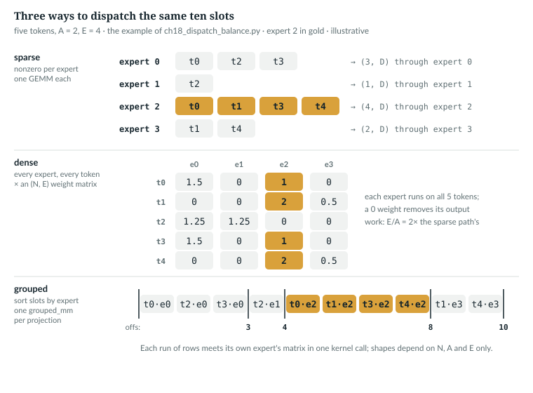
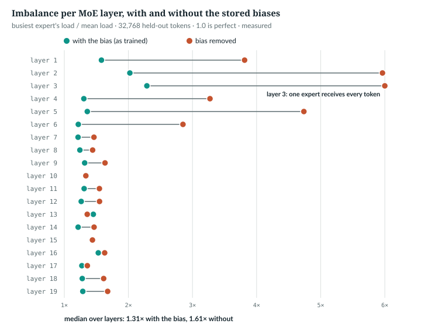

# 18  Mixture of experts II: dispatch and balance

Chapter 17's router returns, for N tokens, (N, A) expert ids and (N, A)
weights. **Dispatch** runs each token through its A experts and sums the
weighted outputs, three ways that must agree. **Balance** keeps tokens from
crowding onto a few experts: a bias nudged after every step, and two small
regularisers. The released model, measured at the end, depends on its biases
more than the code suggests.

**New words.**

| Term | Meaning |
|---|---|
| slot | one (token, choice) pair; N tokens fill N·A slots |
| GEMM | a general matrix multiply, one kernel call |
| dispatch | sending each slot's token to its expert and combining the results |
| load | how many slots an expert received in a step |
| imbalance | the busiest expert's load divided by the mean load; 1.0 is perfect |
| sequence balance loss | a small loss that penalises one sequence crowding onto few experts |
| router z-loss | a small loss on the size of the router's logits |

---

## 18.1  Dispatch by hand

`book/code-examples/ch18_dispatch_balance.py` (**Book example, not repository
code**) dispatches five tokens, A = 2, E = 4, chosen by hand (*illustrative*):

```python
    idx = torch.tensor([[0, 2], [2, 3], [0, 1], [2, 0], [3, 2]])     # (N, A): the router's choice
    w = torch.tensor([[1.5, 1.0], [2.0, 0.5], [1.25, 1.25], [1.0, 1.5], [0.5, 2.0]])
    flat_expert = idx.reshape(-1)                                    # (N*A,) one slot per (token, choice)
    tok_of_slot = torch.arange(5).repeat_interleave(2)               # which token owns each slot
    order = torch.argsort(flat_expert, stable=True)                  # slots grouped by expert
    counts = torch.zeros(4, dtype=torch.int64).scatter_add_(0, flat_expert, torch.ones_like(flat_expert))
    offs = counts.cumsum(0)
```

```
flat_expert [0, 2, 2, 3, 0, 1, 2, 0, 3, 2]
tok_of_slot [0, 0, 1, 1, 2, 2, 3, 3, 4, 4]
order       [0, 4, 7, 5, 1, 2, 6, 9, 3, 8] -> experts [0, 0, 0, 1, 2, 2, 2, 2, 3, 3]
counts [3, 1, 4, 2] offs [3, 4, 8, 10]
```

Slot 6 is token 3's first choice, expert 2. Sorted by expert, the slots form
runs of 3, 1, 4 and 2 ending at offsets 3, 4, 8, 10. Every path computes
Σ<sub>slots of token n</sub> w · Expert(x<sub>n</sub>); they differ in how they
find each expert's tokens.



*Figure 18.1 · Three ways to dispatch.* The example's ten slots through the
sparse, dense and grouped paths. *illustrative*; the index tensors printed by
`book/code-examples/ch18_dispatch_balance.py`.

`IN THE REPO`

## 18.2  The sparse path: one GEMM per expert

> **In the repo** · `anulm/model.py` · `MoE._route_sparse` · lines 709–727 · @fdbb09a

```python
    def _route_sparse(self, x_flat, topk_idx, topk_w):
        """One GEMM per expert over its own tokens. Default."""
        N, D = x_flat.shape
        flat_expert = topk_idx.reshape(-1)                    # (N*k,)
        # Which token each (token, slot) assignment belongs to.
        tok_of_slot = torch.arange(N, device=x_flat.device).repeat_interleave(self.top_k)

        out = x_flat.new_zeros(N * self.top_k, D)
        for e in range(self.num_experts):
            sel = (flat_expert == e).nonzero(as_tuple=True)[0]
            if sel.numel() == 0:
                continue
            # index_select + index_put with distinct indices: differentiable,
            # so unlike the released 105B this path trains. No repeat_interleave
            # of the hidden states, so peak memory stays at O(N*k) rows touched
            # rather than O(N*k) rows materialised up front.
            out[sel] = self.experts[e](x_flat[tok_of_slot[sel]]).to(out.dtype)

        return (out.view(N, self.top_k, D) * topk_w.unsqueeze(-1)).sum(1)
```

- **`flat_expert`**, **`tok_of_slot`**, (N·A,): as in the example.
- **`out`**, (N·A, D): one row per slot.
- **The loop**: for each expert, `nonzero` finds its slots, `sel`; the expert
  runs on just those tokens, (|sel|, D), and the rows go back to their slots.
- **The return**: (N, A, D) times the weights, (N, A, 1), summed over A to
  (N, D).

`nonzero`'s output length depends on the data. `torch.compile` captures code
as graphs through its tracer, Dynamo (Chapter 23), and must stop the graph
wherever a shape depends on the data: a *graph break*. The example counts them
on this machine:

```python
    for name, cfg in (("tiny()", tiny(moe_impl="sparse")), ("nano_30b", M.AnuLMConfig.nano_30b(moe_impl="sparse"))):
        torch.manual_seed(0)
        m = M.AnuLM(cfg).eval()
        x = torch.randint(0, cfg.vocab_size, (2, 16))
        dynamo.reset()
        e = dynamo.explain(lambda t: m(t, t))(x)
```

```
sparse path, tiny(), torch 2.11.0+cu128: 9 graph breaks, 10 graphs
sparse path, nano_30b, torch 2.11.0+cu128: 10 graph breaks, 11 graphs
```

The count depends on the PyTorch version; the test `sparse_moe_breaks_the_graph_as_documented`
(`tests/test_model.py` line 506) asserts only that there is at least one.

`IN THE REPO`

## 18.3  The dense and grouped paths

> **In the repo** · `anulm/model.py` · `MoE._route_dense` · lines 729–738 · @fdbb09a

```python
    def _route_dense(self, x_flat, topk_idx, topk_w):
        """Every expert on every token, combined through a one-hot weight
        matrix. Static shapes throughout, so Dynamo captures the whole block in
        one graph -- at num_experts/top_k times the expert FLOPs."""
        N, D = x_flat.shape
        weights = x_flat.new_zeros(N, self.num_experts).scatter_(1, topk_idx, topk_w)
        y = x_flat.new_zeros(N, D)
        for e in range(self.num_experts):
            y = y + weights[:, e: e + 1] * self.experts[e](x_flat)
        return y
```

`weights`, (N, E), holds each token's A weights in its experts' columns and 0
elsewhere. Every expert runs on all N tokens and is multiplied by its column:
static shapes, at E/A = 6 times the expert work in the released model.

> **In the repo** · `anulm/model.py` · `MoE._route_grouped` · lines 775–790 · @fdbb09a

```python
        N, D = x_flat.shape
        E, k = self.num_experts, self.top_k
        flat_expert = topk_idx.reshape(-1)                                  # (N*k,)
        order = torch.argsort(flat_expert, stable=True)                     # slots, grouped by expert
        # Per-expert counts via scatter_add rather than bincount: bincount's
        # output length depends on the data, which is itself a graph break.
        counts = torch.zeros(E, dtype=torch.int64, device=x_flat.device).scatter_add_(
            0, flat_expert, torch.ones_like(flat_expert))
        offs = counts.cumsum(0).to(torch.int32)
        xs = x_flat[order // k].to(torch.bfloat16)                          # (N*k, D) expert-sorted
        w_gate, w_up, w_down = self._stacked_weights()
        h = F.silu(F.grouped_mm(xs, w_gate, offs=offs)) * F.grouped_mm(xs, w_up, offs=offs)
        ys = F.grouped_mm(h, w_down, offs=offs)                              # (N*k, D) expert-sorted
        out = x_flat.new_zeros(N * k, D)
        out[order] = ys.to(out.dtype)                                        # back to slot order
        return (out.view(N, k, D) * topk_w.unsqueeze(-1)).sum(1)
```

- **`order`, `counts`, `offs`**: the example's tensors; every shape is fixed
  by N, A and E, not the data, so the graph compiles whole.
- **`xs`**, (N·A, D) bf16: sorted slot s holds token `order[s] // k`.
- **`_stacked_weights()`**: each projection of all E experts as one
  (E, in, out) bf16 tensor, below.
- **`F.grouped_mm`**: row run e times matrix e [R53]; three calls make every
  expert's SwiGLU at once. `out[order]` restores slot order.

The stacked weights come from one helper:

> **In the repo** · `anulm/model.py` · `MoE._stacked_weights` · lines 750–759 · @fdbb09a

```python
        # Keyed on the parameters' in-place version counters, so a
        # load_state_dict() after the first forward invalidates the copy too.
        key = sum(p._version for e in self.experts for p in e.parameters())
        if not self.training and self._stacked is not None and self._stacked[0] == key:
            return self._stacked[1]
        stacked = tuple(
            torch.stack([getattr(e, name).weight.t() for e in self.experts]).to(torch.bfloat16)
            for name in ("gate_proj", "up_proj", "down_proj"))
        self._stacked = (key, stacked) if not self.training else None
        return stacked
```

- **`key`**: the sum of the expert parameters' version counters, which PyTorch
  increments on every in-place change, such as an optimiser step or
  `load_state_dict`.
- **The early return**: in evaluation mode, with unchanged weights, the cached
  copy is reused.
- **`stacked`**: for each projection, the E transposed weights stacked into
  (E, in, out) and cast to bf16. In training the copy is rebuilt every call
  and not kept.

The released run trained with this path (`moe_impl = "grouped"`).

`IN THE REPO`

## 18.4  Proving the paths equal

The example runs all three on its five tokens against a plain loop:

```
sparse  vs naive loop: 1.6e-07
dense   vs naive loop: 1.8e-07
grouped vs sparse, both under bf16 autocast: 0.0e+00; grouped vs fp32 loop: 3.8e-03 (output scale 0.71)
```

So do the tests: `moe_matches_naive_per_token_loop` (`tests/test_model.py`
line 180), `dense_and_sparse_moe_agree` (line 474), and the grouped test, which
is skipped on a PyTorch without `F.grouped_mm`:

> **In the repo** · `tests/test_model.py` · `grouped_moe_matches_sparse_under_bf16` · lines 694–711 · @fdbb09a

```python
def grouped_moe_matches_sparse_under_bf16():
    """Same weights, same routing, one grouped GEMM per projection. Both run in
    bf16 (the grouped kernel's contract), so agreement is to bf16 precision."""
    import torch.nn.functional as F
    if not hasattr(F, "grouped_mm"):
        raise unittest.SkipTest("this torch has no F.grouped_mm")
    for attn in ("gqa", "mla"):
        torch.manual_seed(0)
        a = AnuLM(tiny(attn=attn, moe_impl="sparse")).eval()
        b = AnuLM(tiny(attn=attn, moe_impl="grouped")).eval()
        b.load_state_dict(a.state_dict())
        x = torch.randint(0, 64, (2, 16))
        with torch.no_grad(), torch.autocast("cpu", dtype=torch.bfloat16):
            ya, _ = a(x, x)
            yb, _ = b(x, x)
        err = (ya.float() - yb.float()).abs().max().item()
        scale = ya.float().abs().max().item()
        assert err < 0.05 * scale, f"{attn}: grouped MoE differs from sparse by {err:.3e} (scale {scale:.2e})"
```

Without `F.grouped_mm` the test raises `unittest.SkipTest`, and the runner
prints SKIP and counts it as skipped, not passed; on this machine's PyTorch
2.11.0 the test runs. **At real scale**, `ch16_measure_trained.py` runs the
three paths on layer 10's inputs, 2,048 held-out tokens, on an RTX 5070 Ti (*measured*):

| | value |
|---|---|
| dense against sparse, fp32 | 2.9·10⁻⁶ |
| grouped against sparse, both under bf16 autocast | 0 (identical) |
| sparse in bf16 against sparse in fp32 | 2.5·10⁻² on outputs up to 5.86 |

At equal precision, grouped changes only speed; the difference from fp32 is
bf16's. Grouped was the fastest of the three in every run.

> **Details.** The timings, per call under bf16 autocast, median of 7 rounds
> [min, max]:
>
> | path | time per call |
> |---|---|
> | sparse | 6.40 [6.31, 10.39] ms |
> | dense | 3.32 [3.22, 4.84] ms |
> | grouped | 1.54 [1.52, 2.25] ms |
>
> Each round is 20 calls after 3 warm-ups, on a GPU shared with other work.
> Only "grouped is fastest" held in every run; sparse and dense swapped places
> between runs, and `docs/RESULTS.md` §4 found sparse faster than dense, 574
> against 1,350 ms a step, for the small `nano_30b` in eager mode. The grouped
> timing is in evaluation mode, where `_stacked_weights` reuses its cached
> copy (lines 753–754); in training it restacks the weights every step.

`IN THE REPO` · `IMPLEMENTATION-DEPENDENT` (the timings)

## 18.5  Balance without a loss: the sign rule

During training the router counts each expert's slots:

> **In the repo** · `anulm/model.py` · `Router._gate` · lines 647–652 · @fdbb09a

```python
        aux = None
        if self.training:
            with torch.no_grad():
                self.load_counts += torch.bincount(
                    topk_idx.flatten(), minlength=self.num_experts
                ).to(self.load_counts.dtype)
```

After every optimiser step, `anulm/training/train.py` hands the counts to the biases:

> **In the repo** · `anulm/training/train.py` · `main` · lines 876–878 · @fdbb09a

```python
        opt.step()
        # Out-of-band, after the gradient step, never part of the loss.
        imbalance = raw_model.update_expert_biases()
```

> **In the repo** · `anulm/model.py` · `AnuLM.update_expert_biases` · lines 1081–1101 · @fdbb09a

```python
        ratios = []
        for m in self.modules():
            if not isinstance(m, Router):
                continue
            load = m.load_counts
            total = load.sum()
            if total <= 0:
                continue
            mean = load.mean()
            m.expert_bias += self.cfg.bias_update_rate * torch.sign(mean - load)
            ratios.append((load.max() / mean).item())
            load.zero_()
        # ...
        s = sorted(ratios)
        self.imbalance_median = (s[len(s) // 2] if len(s) % 2 else
                                 (s[len(s) // 2 - 1] + s[len(s) // 2]) / 2) if s else 1.0
        return max(ratios) if ratios else 1.0
```

Write η for `bias_update_rate` and e<sub>i</sub> = mean load − load<sub>i</sub>
for expert i's load error. The update is b<sub>i</sub> ← b<sub>i</sub> +
η·sign(e<sub>i</sub>), the aux-loss-free paper's rule [R18]: an expert below
the mean load gains η, one above it loses η, one exactly at the mean keeps its
bias. The counts are zeroed; the worst layer's max/mean is returned, the median
kept. The example sets one step's loads by hand at the released η = 3·10⁻³
(read from `ckpt_base_v2.pt`'s configuration):

```python
    loads = torch.tensor([30., 26, 22, 18] + [8.] * 20)              # four busy experts, twenty starved
    for r in routers:
        r.load_counts.copy_(loads)
    worst = m.update_expert_biases()
```

```
loads sum 256, mean 10.67; returned imbalance max/mean = 2.812; median layer 2.812
bias after one step: [-0.003, -0.003, -0.003, -0.003, 0.003, 0.003] ...
20 experts under the mean, 4 over: the biases' mean moved by 0.002000 = 3e-3 * (20 - 4) / 24 = 0.002000
```

The last line matters later: the steps need not sum to zero, so a layer's
mean bias drifts by η·(n<sub>under</sub> − n<sub>over</sub>)/E per step. With
a few busy experts and many slightly starved ones, n<sub>under</sub> >
n<sub>over</sub> and the drift is upward. That is harmless in exact arithmetic,
since a constant added to every bias changes no choice: only the differences
within a layer matter. `docs/RESULTS.md` §5 records the rule's behaviour:
imbalance rises before it falls; it oscillates (1.188× ↔ 1.734× at rate 0.05
on a frozen batch); and if a starved expert's biased score trails an
overloaded one's by a gap Δ, the gap closes by 2η per step, so routing needs
about Δ/(2η) steps to move. `bias_update_recovers_from_collapse`
(`tests/test_model.py` line 282) holds the recovery. §16 found 3·10⁻³ marginally
best for 24 experts, inside the run-to-run noise; the released run used it.

`IN THE REPO`

## 18.6  The released model's biases

The biases in `ckpt_base_v2.pt`, read by the measurement script with the
held-out sample (*measured*):

| per MoE layer | median | range |
|---|---|---|
| mean of the 24 biases | 430.2 | 216.0 (layer 19) to 798.1 (layer 3) |
| spread, largest minus smallest | 0.030 | 0.018 to 0.281 (layer 3) |
| tokens whose expert set changes without the bias | 44.8% | 32.9% to 99.4% (layer 2) |
| individual choices (of 4 per token) that change without the bias | 12.1% | 8.6% to 57.3%; mean 20.9% |
| imbalance on the sample, with the bias | 1.31× | 1.21× to 2.29× (layer 3) |
| imbalance without the bias | 1.61× | 1.34× to 6.00× (layer 3) |



*Figure 18.2 · What the bias buys.* Imbalance per MoE layer on 32,768 held-out
tokens, with the stored biases and with them removed. *measured*.

- **In layers 1–6 the bias does the balancing.** A spread of 0.03 to 0.28
  changes the expert set of 60% to 99% of tokens; without it, in layer 3 one
  expert receives every token (6.00 = E/A; each token still picks 4). From
  layer 7 on, the scores alone are nearly as balanced: 1.34× to 1.68× without
  the bias against 1.21× to 1.53× with it. In layers 10 and 15 it makes no
  difference to the sample's imbalance, and in layer 13 it raises it (1.45×
  against 1.36×).
- **Most changes are at the margin.** Of the four choices, a median 12.1%
  change without the bias: mostly the 4th, which Chapter 17 found close to the
  5th.
- **The means drifted into the hundreds**, consistent with 18.5's upward drift,
  over 1.9 million steps.
- **The drift costs precision.** fp32 spaces numbers 3.05·10⁻⁵ apart at 430, so
  s<sub>i</sub> + b<sub>i</sub> is rounded that coarsely: against an fp64 gate,
  the fp32 gate picks a different set for 0.18% of tokens (median; 0.06% to
  1.14%). Subtracting each layer's mean bias first removes it (≤ 0.003% left).

In bf16 the spacing at these magnitudes is 1, 2 or 4, larger than almost every
layer's whole spread:

```
at  216.0: fp32 spacing 1.53e-05, bf16 spacing 1
at  430.0: fp32 spacing 3.05e-05, bf16 spacing 2
at  628.8: fp32 spacing 6.10e-05, bf16 spacing 4
628.8 + 0.003 in fp32 moves it by 0.002991
those biases in bf16: [628.0, 628.0, 628.0, 628.0]
```

Rounded to bf16, a layer's 24 biases become one value (two in layer 3), and the
routing is close to having no bias at all: the share of changed expert sets
matches the no-bias case to within 0.9 points in every layer (*measured*).
Many choices change; the loss barely does: Chapter 39 (39.2) measures the cost
of bf16 biases, about 0.003 nats, and why the export keeps them in fp32.

`MEASURED`

## 18.7  Two regularisers, and reading imbalance

> **In the repo** · `anulm/model.py` · `Router._gate` · lines 653–670 · @fdbb09a

```python
            if self.seq_balance_alpha > 0 or self.router_z_alpha > 0:
                aux = logits.new_zeros(())
            if self.seq_balance_alpha > 0:
                # ...
                T = seq_len or scores.shape[0]
                onehot = F.one_hot(topk_idx, self.num_experts).sum(1).float()      # (N, E)
                f = onehot.view(-1, T, self.num_experts).mean(1) * (self.num_experts / self.top_k)
                P = (scores / scores.sum(-1, keepdim=True)).view(-1, T, self.num_experts).mean(1)
                aux = aux + self.seq_balance_alpha * (f * P).sum(-1).mean()
            if self.router_z_alpha > 0:
                # Router z-loss (ST-MoE): keeps the logits from drifting to
                # magnitudes where sigmoid saturates and top-k stops moving.
                aux = aux + self.router_z_alpha * torch.logsumexp(logits, dim=-1).pow(2).mean()
```

- **Sequence balance** [R20]: per sequence, `f`, (B, E), is each expert's
  share of the sequence's A·T slots, times E, so 1 if uniform; `P`, (B, E),
  its mean normalised router score. The loss is Σ f·P averaged over sequences;
  only `P` carries gradient.
- **z-loss** [R17]: logsumexp over the E logits, squared, per token.
- Both reach the loss only in training, through `aux` (Chapter 20, 20.6). The
  example recomputes both on one sequence of 3 tokens:

```python
    E, A, T = 4, 2, 3                                                # one sequence of 3 tokens
    r = M.Router(tiny(num_experts=E, num_experts_per_tok=A, seq_balance_alpha=1.0)).train()
    x = torch.randn(T, 32)
    idx, w, aux = r(x, seq_len=T)
    s = torch.sigmoid(F.linear(x, r.weight))                         # (T, E)
    f = F.one_hot(idx, E).sum(1).float().mean(0) * (E / A)          # share of slots, 1.0 if uniform
    P = (s / s.sum(-1, keepdim=True)).mean(0)                        # mean normalised score
    # ...
    rz = M.Router(tiny(num_experts=E, num_experts_per_tok=A, router_z_alpha=1.0)).train()
    rz.load_state_dict(r.state_dict())
    _, _, auxz = rz(x, seq_len=T)
    z = torch.logsumexp(F.linear(x, rz.weight), -1).pow(2).mean()
```

```
f tensor([0.6667, 1.3333, 1.3333, 0.6667]) P tensor([0.2334, 0.2772, 0.2598, 0.2296]) sum f*P 1.024673 Router aux 1.024673
z-loss by hand 2.553796, Router aux 2.553796
```

The repository's test pins the balance term against the formula, using
all-zero router weights so that every P<sub>i</sub> is exactly 1/E:

> **In the repo** · `tests/test_model.py` · `seq_balance_loss_matches_the_formula` · lines 774–790 · @fdbb09a

```python
def seq_balance_loss_matches_the_formula():
    """Check the implementation against DeepSeek-V3's definition computed by
    hand: with every score = sigmoid(0) = 0.5, P_i = 1/E exactly, and f comes
    from whatever topk chose; the loss must be mean over sequences of
    sum_i f_i * P_i (which is 1.0 only when selection is also uniform)."""
    torch.manual_seed(0)
    cfg = tiny(num_experts=4, num_experts_per_tok=2, seq_balance_alpha=1.0)
    r = Router(cfg).train()
    with torch.no_grad():
        r.weight.zero_()                    # every score = sigmoid(0) = 0.5 -> P_i = 1/E
    N, T = 8, 4
    x = torch.randn(N * T, cfg.hidden_size)
    idx, w, aux = r(x, seq_len=T)
    onehot = torch.nn.functional.one_hot(idx, 4).sum(1).float().view(N, T, 4).mean(1) * (4 / 2)
    P = torch.full((N, 4), 0.25)
    expected = (onehot * P).sum(-1).mean().item()
    assert abs(aux.item() - expected) < 1e-6, f"seq-balance loss {aux.item():.6f} != {expected:.6f}"
```

No test checks the z-loss's value:
`router_regularisers_are_off_by_default_and_work_when_on` (`tests/test_model.py`
line 750) checks only that the regularisers reach the loss and the router's
gradient. The second line of the example's output checks the value.

The released run set α = 10⁻⁴ and 10⁻³. On the held-out sample (*measured*),
Σ f·P has median 1.19 (0.99 to 1.62) and the squared logsumexp 0.035 (0.015
to 0.107). Summed over the 19 MoE layers with those weights, the aux is
0.00319 (0.00234 balance, 0.00085 z) against an LM loss of 3.38. The training
log `v2_train_run.log`, read by the same script, shows 0.2129 at step 0 and 0.0036 on average over its last 100 entries. The z-loss
is smallest where Σ e<sup>logit</sup> = 1; the trained scores sum to 0.993
(Chapter 17), consistent with that but not shown to be caused by it.

**Reading imbalance.** The log's figure is the worst of 19 layers on one
step's 16,384 slots: noisy, and biased upward. It reads 3.75× at step 0
(median layer 2.59×) and 2.67× on average over the last 100 entries (1.88× to
3.92×; median layer 1.74×); on the 32,768-token sample the median layer reads
1.31× (*measured*). Read the median, on a large sample.

`MEASURED`

## 18.8  Common mistakes, and how to catch them

- **Storing the bias in bf16** (18.6). Many expert choices change, while the
  loss rises only 0.003 nats (Chapter 39), so the loss will not show it.
  *Catch it:* compare `topk_idx` before and after saving.
- **No `update_expert_biases`** in a new loop: nothing fails. *Catch it:* log
  the ratio, as `anulm/training/train.py` does.
- **The bias as a `Parameter`**, moved by AdamW. *Catch it:*
  `expert_bias_is_not_trainable` (`tests/test_model.py` line 321).

`IN THE REPO`

## 18.9  Exercises

1. Loads [12, 4, 4, 4], rate 10⁻³: what is returned, and how do the biases
   move?
2. About how many steps does a gap Δ = 1.0 need at the released rate?

**Answers.** 1. 2.0; −0.001 for the first expert, +0.001 for the rest.
2. 1.0/(2 · 3·10⁻³) ≈ 167. *verified*: printed by `ch18_dispatch_balance.py`.

> **Build it.** The lab book's Chapter 7 (`course/ch07-experts`, §7.3 and
> §7.5) has you write the sparse dispatch and the bias update.

---

## Key points

- Dispatch turns (N, A) choices into N·A slots and sums each token's weighted
  expert outputs; the sparse, dense and grouped paths do it differently and
  agree, the grouped one exactly with the sparse one at bf16.
- Sparse uses `nonzero` and breaks compiled graphs; dense runs every expert on
  every token; grouped sorts slots by expert and runs one grouped GEMM per
  projection.
- After each optimiser step every expert's bias moves by a fixed 3·10⁻³: up
  if its load is below the mean, down if above; the bias never enters the
  loss.
- In the released model, removing the biases changes the expert set of about
  45% of tokens, about 12% of individual choices; in one layer one expert
  would receive every token.
- Their mean drifted into the hundreds, which costs fp32 resolution; bf16
  storage leaves one or two distinct values per layer. That changes about half
  the expert sets, yet costs only 0.003 nats of loss (Chapter 39).
- A sequence balance loss and a z-loss add about 0.003 to a loss of 3.38;
  imbalance is best read as a median over layers on a large sample.

> **In one breath.** The router's choices become slots; three interchangeable
> paths run each slot through its expert and sum the weighted results. A sign
> rule nudges each expert's bias after every step to spread the load, and in
> the released model those biases, kept in fp32, change the experts of about
> half the tokens.

## References

Research references cited in this chapter (`RESEARCH_REFERENCES.md`), each
used only for the claim in its register row:

| ID | Used for | Status |
|---|---|---|
| [R17] | the router z-loss | CHECKED |
| [R18] | the bias update bᵢ ← bᵢ + η·sign(eᵢ) from each expert's load error | CHECKED |
| [R20] | the sequence-wise balance loss | CHECKED |
| [R53] | `F.grouped_mm`, the grouped GEMM `_route_grouped` calls | CHECKED |

Repository evidence, all at @fdbb09a:
- `anulm/model.py`: `Router._gate` 647–652, 653–670; `MoE._route_sparse` 709–727,
  `_route_dense` 729–738, `_stacked_weights` 750–759, `_route_grouped`
  775–790; `AnuLM.update_expert_biases` 1071–1101.
- `anulm/training/train.py`: `main` 876–878.
- `tests/test_model.py`: `moe_matches_naive_per_token_loop` 180,
  `bias_update_recovers_from_collapse` 282, `expert_bias_is_not_trainable` 321,
  `dense_and_sparse_moe_agree` 474, `sparse_moe_breaks_the_graph_as_documented`
  506, `grouped_moe_matches_sparse_under_bf16` 694–711,
  `router_regularisers_are_off_by_default_and_work_when_on` 750,
  `seq_balance_loss_matches_the_formula` 774–790.
- The released configuration in `ckpt_base_v2.pt` (`moe_impl`, `bias_update_rate`,
  the two α); `docs/RESULTS.md` §4, §5, §16.
- Measurements: `book/measurements/part_iv_b_trained.json` and
  `part_iv_b_trained_report.txt`, from `code-examples/ch16_measure_trained.py`,
  which also reads `v2_train_run.log`.

The book examples are `code-examples/ch18_dispatch_balance.py` and
`code-examples/ch16_measure_trained.py`.
