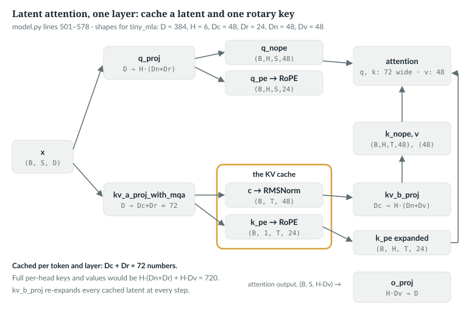
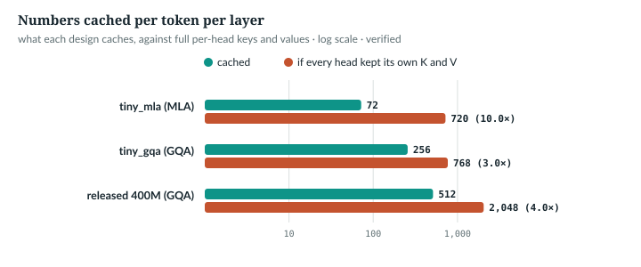

# 19  Latent attention (MLA)

The KV cache stores every past token's keys and values, layer by layer
(Chapter 27). Grouped-query attention shrinks it by sharing key/value heads
(Chapter 13). Multi-head latent attention, MLA, caches instead one small latent
vector per token and rebuilds every head's keys and values from it. That is far
smaller than every head keeping its own keys and values; against GQA it need
not be smaller (19.5). `anulm/model.py` has MLA as `MLAttention`, lines
501–578, selected with `attn="mla"`. **The released model does not use it** (it is GQA), but the
`tiny_mla` preset does. Every shape below is at
`tiny_mla`'s sizes.

**New words and symbols.**

| Term | Meaning | `tiny_mla` | in the code |
|---|---|---|---|
| latent, c | the compressed vector cached per token and layer | | `compressed` |
| D<sub>c</sub> | its width | 48 | `kv_lora_rank`, `Lkv` in comments |
| D<sub>r</sub> | the width of the rotary slice of queries and keys | 24 | `qk_rope_head_dim`, `Rk` |
| D<sub>n</sub> | the width of the non-rotary slice of a query or key | 48 | `qk_nope_head_dim` |
| D<sub>v</sub> | one head's value width | 48 | `v_head_dim`, `Vd` |
| decoupled rotary key | one rotated key slice per token, shared by all heads | | `k_pe` |

---

## 19.1  The idea, and why RoPE complicates it

MLA was introduced in DeepSeek-V2 with a decoupled RoPE strategy that shares
one rotary key across heads [R19]. In AnuLM, per token:

- **Compress.** One projection makes a D<sub>c</sub>-wide latent c and a
  D<sub>r</sub>-wide rotary key. Only these two are cached:
  D<sub>c</sub> + D<sub>r</sub> = 72 numbers.
- **Expand.** At attention time `kv_b_proj` turns each cached c into every
  head's D<sub>n</sub>-wide key part and D<sub>v</sub>-wide value.
- **Rotate separately.** RoPE turns a key by an angle set by its position
  (Chapter 14). Positions live in a separate D<sub>r</sub>-wide slice of each
  query and key, rotated once and shared by all heads; c is never rotated.

Why the separate slice? Not to make c cacheable: an implementation could cache
a position-free c, expand it every step, and rotate the expanded keys, which
is the expansion this repository pays anyway (19.5). The reason is a shortcut
called absorption. A query's score against a key from c is
q · (W<sub>UK</sub> c) = (W<sub>UK</sub>ᵀ q) · c, where W<sub>UK</sub> is
`kv_b_proj`'s key half, so the query can be moved into latent space once and
scored against the cached c directly, without expanding anything. A rotation
between W<sub>UK</sub> and c depends on the key's position, so it cannot be
folded into the query, and every key would have to be expanded again. Keeping
the rotation in its own slice keeps the shortcut open. DeepSeek-V2 introduced
the decoupled rotary key, and gives this same argument: W<sub>UK</sub> can be
absorbed into the query, and a position-dependent rotation between them would
force every prefix key to be recomputed [R19].

**This repository does not absorb.** It expands every step, so here the split
buys no cache saving over rotating after expansion; it even caches
D<sub>r</sub> extra numbers per token.

> **Details.** The code comment at lines 550–551 says the position-free latent
> "is exactly what lets the latent be cached"; as above, the latent could be
> cached either way. What the separate slice protects is absorption.

`IN THE REPO`

## 19.2  The projections

> **In the repo** · `anulm/model.py` · `MLAttention.__init__` · lines 516–533 · @b42998d

```python
        self.q_proj = nn.Linear(cfg.hidden_size, cfg.n_head * self.q_head_dim, bias=False)
        # The one projection that produces both the shared latent and the single
        # MQA-style positional key. Width = kv_lora_rank + qk_rope_head_dim.
        self.kv_a_proj_with_mqa = nn.Linear(
            cfg.hidden_size, cfg.kv_lora_rank + cfg.qk_rope_head_dim, bias=False
        )
        self.kv_a_layernorm = RMSNorm(cfg.kv_lora_rank, cfg.rms_norm_eps)
        self.kv_b_proj = nn.Linear(
            cfg.kv_lora_rank, cfg.n_head * (cfg.qk_nope_head_dim + cfg.v_head_dim), bias=False
        )
        self.o_proj = nn.Linear(cfg.n_head * cfg.v_head_dim, cfg.hidden_size, bias=False)

        self.use_qk_norm = cfg.use_qk_norm
        if cfg.use_qk_norm:
            self.q_layernorm = RMSNorm(self.q_head_dim, cfg.rms_norm_eps)

        # YaRN's temperature term lives here, not in the rotary tables.
        self.scale = self.q_head_dim ** -0.5 * (rotary.attn_mscale ** 2)
```

- **`q_proj`**: D → H·(D<sub>n</sub> + D<sub>r</sub>), 384 → 6·72 = 432. No
  query compression: DeepSeek-V2 also compresses the queries through a
  low-rank latent, to save activation memory in training [R19]; `MLAttention`
  does not.
- **`kv_a_proj_with_mqa`**: D → D<sub>c</sub> + D<sub>r</sub>, 384 → 72; "MQA"
  because the rotary key is one head shared by all, as in multi-query attention.
- **`kv_a_layernorm`**: an RMSNorm on the latent, D<sub>c</sub> wide.
- **`kv_b_proj`**: D<sub>c</sub> → H·(D<sub>n</sub> + D<sub>v</sub>), 48 → 576.
- **`o_proj`**: H·D<sub>v</sub> → D.
- **QK-norm** covers queries only; keys get `kv_a_layernorm` on the latent.
- **`scale`**: 1/√(D<sub>n</sub> + D<sub>r</sub>) = 1/√72 = 0.1179, times
  YaRN's temperature (Chapter 29).

The configuration ties the sizes together:

> **In the repo** · `anulm/model.py` · `AnuLMConfig.__post_init__` · lines 150–156 · @b42998d

```python
        if self.attn == "gqa":
            if self.head_dim is None:
                self.head_dim = self.hidden_size // self.n_head
            check(self.n_head % self.n_kv_head == 0,
                  f"n_kv_head={self.n_kv_head} must divide n_head={self.n_head}")
        else:
            self.head_dim = self.qk_nope_head_dim + self.qk_rope_head_dim
```

For MLA, `head_dim` is the query and key width, D<sub>n</sub> + D<sub>r</sub>;
and `AnuLM.__init__` builds the rotary tables only D<sub>r</sub> wide
(`rope_dim = cfg.qk_rope_head_dim if cfg.attn == "mla"`, line 837).

`IN THE REPO`

## 19.3  The forward pass, step by step

> **In the repo** · `anulm/model.py` · `MLAttention.forward` · lines 539–553 · @b42998d

```python
        B, S, _ = x.shape

        q = self.q_proj(x).view(B, S, self.n_head, self.q_head_dim).transpose(1, 2)
        if self.use_qk_norm:
            q = self.q_layernorm(q)
        q_nope, q_pe = q.split([self.qk_nope, self.qk_rope], dim=-1)

        compressed = self.kv_a_proj_with_mqa(x)                   # (B, S, Lkv+Rk)
        compressed, k_pe = compressed.split([self.kv_lora_rank, self.qk_rope], dim=-1)
        k_pe = k_pe.view(B, S, 1, self.qk_rope).transpose(1, 2)   # (B, 1, S, Rk)

        # RoPE touches only the rope slice; the latent stays position-free --
        # which is exactly what lets the latent be cached below.
        q_pe, k_pe = apply_rope(q_pe, k_pe, cos, sin)
        compressed = self.kv_a_layernorm(compressed)              # (B, S, Lkv)
```

- **Queries**, (B, H, S, D<sub>n</sub> + D<sub>r</sub>), normalised per head,
  then split into `q_nope` and `q_pe`.
- **`compressed`**, (B, S, D<sub>c</sub> + D<sub>r</sub>), split into the latent
  and `k_pe`, which becomes (B, 1, S, D<sub>r</sub>): one head.
- **`apply_rope`** rotates only `q_pe` and `k_pe`; the latent is normalised and
  never rotated.

> **In the repo** · `anulm/model.py` · `MLAttention.forward` · lines 564–578 · @b42998d

```python
        T = compressed.shape[1]

        kv = self.kv_b_proj(compressed)
        kv = kv.view(B, T, self.n_head, self.qk_nope + self.v_head_dim).transpose(1, 2)
        k_nope, v = kv.split([self.qk_nope, self.v_head_dim], dim=-1)
        k_pe = k_pe.expand(-1, self.n_head, -1, -1)               # (B, H, T, Rk)

        q = torch.cat([q_nope, q_pe], dim=-1)                     # (B, H, S, Qd)
        k = torch.cat([k_nope, k_pe], dim=-1)                     # (B, H, T, Qd)

        # SDPA allows V's head dim to differ from Q/K's -- which MLA needs.
        mask = bidir_mask if bidir_mask is not None else _attn_mask(S, T, start, window, x.device)
        y = _sdpa(q, k, v, mask, S, self.scale, self.dropout if self.training else 0.0)     # (B, H, S, Vd)
        y = y.transpose(1, 2).contiguous().view(B, S, self.n_head * self.v_head_dim)
        return self.o_proj(y)
```

- **`kv_b_proj`** expands all T latents, cached and new: (B, T, D<sub>c</sub>) →
  (B, H, T, D<sub>n</sub> + D<sub>v</sub>), split into `k_nope` and `v`.
- **`expand`** shows the one rotary key to all H heads without copying.
- **`cat`** builds queries and keys D<sub>n</sub> + D<sub>r</sub> = 72 wide;
  values stay D<sub>v</sub> = 48, which `scaled_dot_product_attention` allows.
- The rest is GQA's ending: mask, attention (Chapter 11), reassemble, `o_proj`.

The book example `book/code-examples/ch19_mla.py` (**Book example, not
repository code**) recomputes the forward pass line for line, prints each
shape, and checks it against the module:

```python
        compressed = a.kv_a_proj_with_mqa(x)
        c, k_pe = compressed.split([a.kv_lora_rank, a.qk_rope], dim=-1)
        k_pe = k_pe.view(B, S, 1, a.qk_rope).transpose(1, 2)
        q_pe, k_pe = M.apply_rope(q_pe, k_pe, cos, sin)
        c = a.kv_a_layernorm(c)
        kv = a.kv_b_proj(c).view(B, S, a.n_head, a.qk_nope + a.v_head_dim).transpose(1, 2)
        k_nope, v = kv.split([a.qk_nope, a.v_head_dim], dim=-1)
        k = torch.cat([k_nope, k_pe.expand(-1, a.n_head, -1, -1)], dim=-1)
        y = F.scaled_dot_product_attention(torch.cat([q_nope, q_pe], -1), k, v, is_causal=True, scale=a.scale)
        out = a.o_proj(y.transpose(1, 2).reshape(B, S, -1))
```

```
tiny_mla: D=384, H=6, Dc=48, Dr=24, Dn=48, Dv=48; scale = (Dn+Dr)^-0.5 = 0.1179
  x          (2, 5, 384)
  q          (2, 6, 5, 72)
  compressed (2, 5, 72)
  c          (2, 5, 48)
  k_pe       (2, 1, 5, 24)
  kv         (2, 6, 5, 96)
  k          (2, 6, 5, 72)
  v          (2, 6, 5, 48)
  y          (2, 6, 5, 48)
  out        (2, 5, 384)
recomputed vs MLAttention.forward: 0.0e+00
```

*verified*. (The script also prints `q_nope` and `q_pe`, (2, 6, 5, 48) and
(2, 6, 5, 24).)



*Figure 19.1 · Latent attention, one layer.* The cached pair, in gold, is the
latent and the shared rotary key; everything per head is rebuilt from them.
Shapes for `tiny_mla`.

`IN THE REPO`

## 19.4  What the cache holds

> **In the repo** · `anulm/model.py` · `MLAttention.forward` · lines 565–573 · @WORKTREE

```python
        if cache is not None:
            # MLA's cache IS the point of MLA: kv_lora_rank + qk_rope_head_dim
            # numbers per token (48 + 24 in tiny_mla) regardless
            # of head count, against GQA's 2 * Hkv * Dh. K and V are re-expanded
            # from it through kv_b_proj every step.
            if "c" in cache:
                compressed = torch.cat([cache["c"], compressed], dim=1)
                k_pe = torch.cat([cache["k_pe"], k_pe], dim=2)
            cache["c"], cache["k_pe"] = compressed, k_pe
```

The cache dict holds `c`, (B, T, D<sub>c</sub>), normalised, and `k_pe`,
(B, 1, T, D<sub>r</sub>), rotated. New tokens are appended along T. The example
runs a five-token prompt, then one more token, and compares with the uncached
pass:

```python
    with torch.no_grad():
        cos, sin = rot(6, x.device, x.dtype)
        full = a(x, cos, sin)                                   # all six tokens, no cache
        kv = {}
        c5, s5 = rot(5, x.device, x.dtype)
        a(x[:, :5], c5, s5, cache=kv)                           # prompt: five tokens
        print(f"after the prompt: c {shape(kv['c'])}, k_pe {shape(kv['k_pe'])}")
        c1, s1 = rot(1, x.device, x.dtype, start=5)
        step = a(x[:, 5:], c1, s1, cache=kv, start=5)           # one new token at position 5
```

```
after the prompt: c (1, 5, 48), k_pe (1, 1, 5, 24)
after one step:   c (1, 6, 48), k_pe (1, 1, 6, 24)
cached step vs uncached forward, last position: 1.8e-07
```

The test that pins the shared rotary key:

> **In the repo** · `tests/test_model.py` · `mla_shares_one_rope_key_across_heads` · lines 529–541 · @b42998d

```python
def mla_shares_one_rope_key_across_heads():
    """k_pe is projected once and broadcast; every head must see the same one."""
    torch.manual_seed(0)
    cfg = tiny(attn="mla", n_head=4, qk_nope_head_dim=8, qk_rope_head_dim=8,
               v_head_dim=8, kv_lora_rank=16)
    rot = Rotary(cfg, dim=8)
    a = MLAttention(cfg, rot).eval()
    x = torch.randn(1, 6, cfg.hidden_size)
    compressed = a.kv_a_proj_with_mqa(x)
    _, k_pe = compressed.split([a.kv_lora_rank, a.qk_rope], dim=-1)
    assert k_pe.shape == (1, 6, 8), f"k_pe has shape {tuple(k_pe.shape)}, expected one head's worth"
    kv = a.kv_b_proj(a.kv_a_layernorm(compressed.split([a.kv_lora_rank, a.qk_rope], -1)[0]))
    assert kv.shape[-1] == cfg.n_head * (8 + 8), "kv_b_proj output width is wrong"
```

It checks shapes: one head's worth of `k_pe`, and `kv_b_proj` wide enough for
every head. `incremental_forward_matches_full_forward` and
`dense_and_sparse_moe_agree` also run with `attn="mla"`.

`IN THE REPO`

## 19.5  Cache arithmetic, and the cost

Numbers cached per token per layer, computed by the example from `anulm/model.py`'s
configurations:

```python
    cm = M.AnuLMConfig.tiny_mla()
    rows.append(("tiny_mla, MLA (cached)", cm.kv_lora_rank + cm.qk_rope_head_dim))
    rows.append(("tiny_mla, same heads as full K and V",
                 cm.n_head * (cm.qk_nope_head_dim + cm.qk_rope_head_dim) + cm.n_head * cm.v_head_dim))
    cg = M.AnuLMConfig.tiny_gqa()
    rows.append(("tiny_gqa, GQA", 2 * cg.n_kv_head * cg.head_dim))
    rows.append(("tiny_gqa, if every head kept its K and V", 2 * cg.n_head * cg.head_dim))
    r = released()
    rows.append(("released 400M, GQA", 2 * r.n_kv_head * r.head_dim))
    rows.append(("released 400M, if every head kept its K and V", 2 * r.n_head * r.head_dim))
```

*verified*:

| model | attention | cached | if every head kept its own K and V |
|---|---|---|---|
| `tiny_mla` | MLA | 48 + 24 = 72 | 6·(72 + 48) = 720 |
| `tiny_gqa` | GQA | 2·2·64 = 256 | 2·6·64 = 768 |
| released 400M | GQA | 2·4·64 = 512 | 2·16·64 = 2,048 |

At `tiny_mla`'s sizes the latent is 10 times smaller than full per-head keys
and values: 1,728 bytes per token over its 12 layers in bf16. Against GQA the
saving depends on the sizes. `tiny_mla` caches fewer numbers than `tiny_gqa`,
72 against 256, but the released GQA model caches 512, and DeepSeek-V2's own
sizes, a latent of 512 and a rotary key of 64, cache 576: as much as GQA with
2.25 groups, in that paper's words [R19]. MLA's saving is measured against
full multi-head keys and values.



*Figure 19.2 · What each design caches.* Numbers per token per layer, cached
against full per-head keys and values, on a log scale. *verified*.

**The price is computation.** Every step, `kv_b_proj` re-expands all T cached
latents: T·D<sub>c</sub>·H·(D<sub>n</sub> + D<sub>v</sub>) multiply-adds per
layer, 7,077,888 for `tiny_mla` at its full context, T = `block_size` = 256.
Half of that, T·D<sub>c</sub>·H·D<sub>n</sub> = 3,538,944, makes the keys;
absorbing `kv_b_proj`'s key half into the query removes that half. The value
half needs its own move: weight the cached c by the attention weights first,
then apply `kv_b_proj`'s value half, which can be folded into `o_proj`. These
are the two absorptions DeepSeek-V2 describes for inference [R19]. Both
are possible because no rotation sits between `kv_b_proj` and c. Neither is
implemented here. The example checks the key-side algebra:

```python
    H, Dn, Dc = a.n_head, a.qk_nope, a.kv_lora_rank
    with torch.no_grad():
        q = a.q_layernorm(a.q_proj(x).view(1, 5, H, a.q_head_dim).transpose(1, 2))
        q_nope = q[..., :Dn]                                    # (1, H, S, Dn)
        c = a.kv_a_layernorm(a.kv_a_proj_with_mqa(x)[..., :Dc]) # (1, S, Dc)
        W = a.kv_b_proj.weight.view(H, Dn + a.v_head_dim, Dc)   # per head: rows for k_nope, then v
        W_uk = W[:, :Dn, :]                                     # (H, Dn, Dc)
        k_nope = torch.einsum("hnc,btc->bhtn", W_uk, c)        # what the repository expands
        repo = q_nope @ k_nope.transpose(-1, -2)                # (1, H, S, T)
        q_lat = torch.einsum("bhsn,hnc->bhsc", q_nope, W_uk)   # the query moved into latent space
        absorbed = q_lat @ c.unsqueeze(1).transpose(-1, -2)     # scores straight from the cache
```

```
latent part of the scores: expanded keys vs absorbed query, largest difference 2.4e-06
a rotated vector depends on its position: the same input at positions 0 and 4 differs by 3.38 after rotation (input identical)
```

The second line is why the rotary slice is kept apart: a rotation depends on
the key's position, so it cannot be folded into one fixed matrix (19.1).

**Quality.** `docs/RESULTS.md` §1–§2 compare the `tiny_mla` and `tiny_gqa`
presets, which differ in more than attention (12 layers against 8, twice the
active parameters, groups). At 600 steps on English the MLA preset reached
1.5467 against 1.5701, but at half the throughput (1,393 against 2,692 tokens
a second); a 1,000-step GQA run reached 1.5190 in less time. On Hindi it lost
at 1,000 steps, 0.7450 against 0.7373. What MLA alone is worth is *not
measured here*.

`NOT IN THE REPO` (absorption) · `MEASURED` (RESULTS §1–§2)

## 19.6  Common mistakes, and how to catch them

- **Rotating the latent.** `kv_b_proj` then mixes rotated dimensions, and
  scores stop depending on relative position only. A cache test still passes,
  since cached and uncached passes rotate alike. *Catch it:* shift the whole
  sequence. The example runs the repository's module and a mutant that also
  rotates c, at positions 0–7 and 100–107:

```
same tokens at positions 0-7 and 100-107: outputs differ by 1.8e-07 (only relative positions matter)
mutant with a rotated latent: positions 0-7 vs 100-107 differ by 1.202 (output scale 1.091)
```

> **Details.** The harness. The module runs twice on the same tokens; the
> mutant, written out in full, rotates c with tables as wide as the latent.
>
> ```python
>     with torch.no_grad():
>         y0 = a(x, *rot(8, x.device, x.dtype))                   # positions 0-7
>         y1 = a(x, *rot(8, x.device, x.dtype, start=100))        # the same tokens at 100-107
> ```
>
> ```python
>     def forward(start):
>         cos, sin = rot(S, x.device, x.dtype, start=start)
>         cc, sc = rot_c(S, x.device, x.dtype, start=start)
>         q = a.q_layernorm(a.q_proj(x).view(1, S, H, a.q_head_dim).transpose(1, 2))
>         q_nope, q_pe = q.split([a.qk_nope, a.qk_rope], dim=-1)
>         c, k_pe = a.kv_a_proj_with_mqa(x).split([a.kv_lora_rank, a.qk_rope], dim=-1)
>         q_pe, k_pe = M.apply_rope(q_pe, k_pe.view(1, S, 1, a.qk_rope).transpose(1, 2), cos, sin)
>         c = a.kv_a_layernorm(c)
>         c, _ = M.apply_rope(c[:, None], c[:, None], cc, sc)               # the mutation: rotate the latent
>         kv = a.kv_b_proj(c[:, 0]).view(1, S, H, a.qk_nope + a.v_head_dim).transpose(1, 2)
>         k_nope, v = kv.split([a.qk_nope, a.v_head_dim], dim=-1)
>         k = torch.cat([k_nope, k_pe.expand(-1, H, -1, -1)], dim=-1)
>         y = F.scaled_dot_product_attention(torch.cat([q_nope, q_pe], -1), k, v, is_causal=True, scale=a.scale)
>         return a.o_proj(y.transpose(1, 2).reshape(1, S, -1))
> ```

- **Sizing the rotary tables to `head_dim`.** For MLA they must be D<sub>r</sub>
  wide (line 837). *Catch it:* the shapes fail loudly in `apply_rope`.
- **Caching expanded keys.** It works and saves nothing. *Catch it:*
  `cache_holds_what_it_should` checks what each attention type stores.

`IN THE REPO`

## 19.7  Exercises

1. A latent of 64 with a rotary slice of 32: how many numbers per token per
   layer?
2. How many bytes does `tiny_mla`'s cache take per token over its 12 layers in
   fp32?
3. How wide is `tiny_mla`'s `q_proj` output?

**Answers.** 1. 96. 2. 72 · 12 · 4 = 3,456. 3. 6 · 72 = 432. *verified*:
printed by `ch19_mla.py`.

> **Build it.** The lab book's Chapter 6 (`course/ch06-attention`, exercise 5)
> has you build `MLAttention` from this description and measure its cache.

---

## Key points

- MLA caches a D<sub>c</sub>-wide latent and one D<sub>r</sub>-wide rotary key
  per token and layer, and rebuilds every head's keys and values from them.
- Positions live in a separate rotary slice, rotated once and shared by all
  heads, so that an implementation can absorb `kv_b_proj` into the query; the
  latent itself could be cached either way.
- `MLAttention` projects queries without compression, normalises only queries
  and the latent, and scales by 1/√(D<sub>n</sub> + D<sub>r</sub>).
- `tiny_mla` caches 72 numbers per token and layer, 10 times fewer than full
  per-head keys and values; against GQA the saving depends on the sizes.
- The repository re-expands the whole cache every step; absorbing
  `kv_b_proj`'s key half into the query and its value half into `o_proj` would
  avoid that, and is not implemented here.
- The released model uses GQA; the presets' comparison mixes MLA with other
  differences, so MLA's own quality effect is not measured here.

> **In one breath.** MLA compresses each token's keys and values into one
> small latent plus a shared rotary key, caches only those, and expands them
> per head when attending. It trades a cache far smaller than full per-head keys
> and values for extra work each step, and in this repository it is an option
> the released model leaves off.

## References

Research references cited in this chapter (`RESEARCH_REFERENCES.md`), each
used only for the claim in its register row:

| ID | Used for | Status |
|---|---|---|
| [R19] | multi-head latent attention; the decoupled RoPE strategy with a shared rope key; low-rank query compression; its sizes (latent 512, rotary key 64) and a cache equal to GQA with 2.25 groups; absorbing the key and value up-projections at inference, and why RoPE blocks that | CHECKED |

Repository evidence, all at @b42998d:
- `anulm/model.py`: `AnuLMConfig.__post_init__` 150–156; `MLAttention.__init__`
  516–533, `MLAttention.forward` 539–553, 564–578 (and 565–573 @WORKTREE); `AnuLM.__init__`
  line 837.
- `tests/test_model.py`: `mla_shares_one_rope_key_across_heads` 529–541;
  `incremental_forward_matches_full_forward`, `cache_holds_what_it_should`,
  `dense_and_sparse_moe_agree` (all run with MLA).
- `docs/RESULTS.md` §1, §2, "The two presets".

The book example is `code-examples/ch19_mla.py`.
