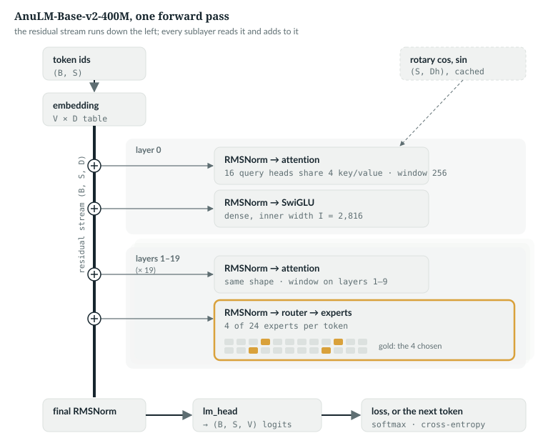
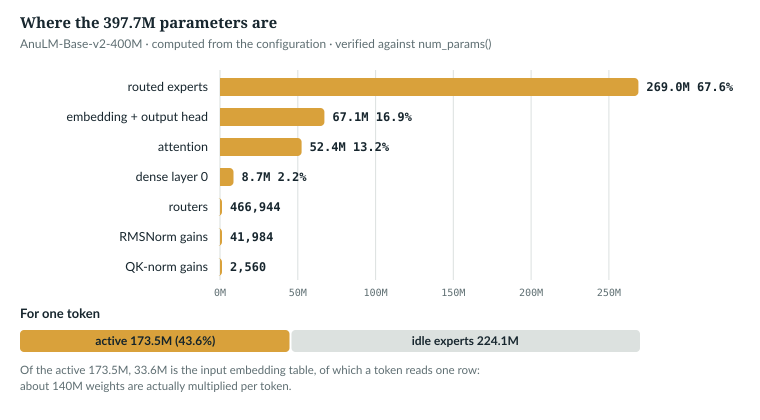
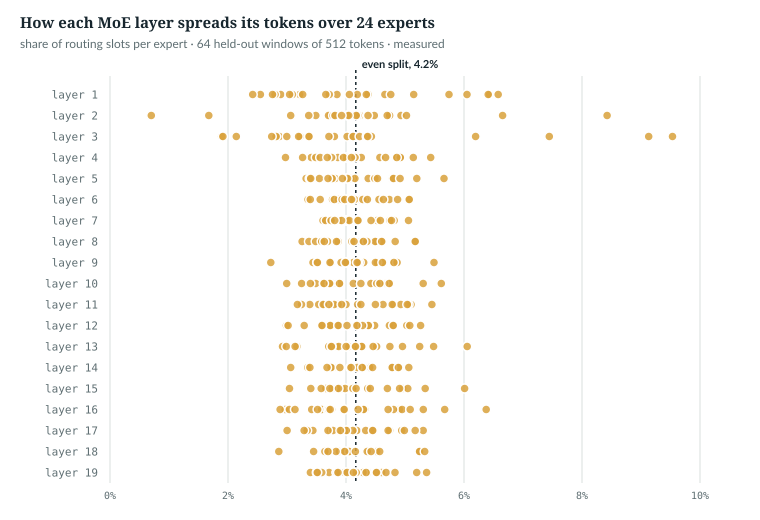

# 20  The whole model, traced end to end

Chapters 10 to 18 open the model one piece at a time; Chapter 19's latent
attention is an option neither model here uses. This chapter puts the pieces
back together. It follows one batch of token ids through `AnuLM.forward` to
the loss and on to a sampled token, then counts every parameter, for the small
test model and for the released 400M model.

Every shape below was printed by running the model, with
`book/code-examples/trace_forward.py` (**Book example, not repository code**).
It runs `anulm/model.py` unchanged and attaches forward hooks: functions PyTorch
calls after a module runs.

```python
    def watch(module, name, show_input=False):
        def hook(mod, inp, out):
            if show_input:
                log.append(f"{name:<33}in  {shape(inp[0])}")
            o = out[0] if isinstance(out, tuple) else out
            log.append(f"{name:<33}out {shape(o)}" + (f"  aux={out[1]}" if isinstance(out, tuple) and len(out) == 2
                                                       and not torch.is_tensor(out[1]) else ""))
        hooks.append(module.register_forward_hook(hook))
```

A hook gets the module's inputs and output. It may return a value, and a
value it returns replaces the output; this one returns `None`, so it only
observes and logs shapes. `apply_rope` and `_sdpa` are plain functions, not
modules, so they take no hooks: the script swaps each name in `anulm.model` for
a wrapper that logs the shapes and calls the original, and puts the originals
back after the forward pass.

---

## 20.1  The notation, with both models' values

The symbols are Part IV's, from Chapter 11, with the small test model's values
beside the released model's:

| Symbol | Meaning | `tiny()` | Released 400M |
|---|---|---|---|
| B | sequences in the batch | 2 | any |
| S | new tokens per sequence in this call | 5 | up to 1,024 |
| T | key length: tokens already in the KV cache plus the S new ones | 5 | up to 1,024 |
| D | hidden size (`hidden_size`) | 32 | 1,024 |
| H | query heads (`n_head`) | 4 | 16 |
| H<sub>kv</sub> | key/value heads (`n_kv_head`) | 2 | 4 |
| D<sub>h</sub> | width of one head (`head_dim`); written `Dh` in diagrams and printed output | 8 | 64 |
| L | layers (`n_layer`) | 3 | 20 |
| V | vocabulary size (`vocab_size`) | 64 | 32,768 |
| E | routed experts per MoE layer (`num_experts`) | 8 | 24 |
| A | experts active per token (`num_experts_per_tok`, `top_k` inside the router) | 2 | 4 |
| I | inner width of the dense layer 0 (`intermediate_size`) | 64 | 2,816 |
| I<sub>e</sub> | inner width of one expert (`moe_intermediate_size`) | 16 | 192 |
| N | tokens flattened for the router, N = B·S | 10 | B·S |
| `block_size` | the longest context accepted | 32 | 1,024 |
| shared expert | an expert every token uses | 1 | 0 |
| sliding window | attention limited to the last 256 tokens (Chapters 12, 29) | none | layers 0–9 |

*verified*: `tiny()` is `tests/test_model.py` lines 44–49 at @fdbb09a; the released
column is the configuration stored in `ckpt_base_v2.pt`. The last two rows
change no shape below.

## 20.2  The whole path in one picture



*Figure 20.1 · The whole model.* Every box exists in `anulm/model.py`. The residual
stream runs down the left: each sublayer reads it and adds its output back at
a ⊕. The router, in gold, makes the model sparse: 4 of 24 experts per token.
Layers 0–9 attend within a 256-token window. Drawn by `tools/make_figures.py`.

## 20.3  The same path as six equations

x<sup>(ℓ)</sup> is the residual stream entering layer ℓ, a (B, S, D) tensor
that each layer adds to:

| Step | Equation | Code @fdbb09a | Shape out |
|---|---|---|---|
| embed | x<sup>(0)</sup><sub>b,s</sub> = W<sub>emb</sub>[id<sub>b,s</sub>] | `anulm/model.py` 896 | (B, S, D) |
| attention half | h = x<sup>(ℓ)</sup> + Attn(RMSNorm(x<sup>(ℓ)</sup>)) | `anulm/model.py` 820 | (B, S, D) |
| feed-forward half | x<sup>(ℓ+1)</sup> = h + F<sub>ℓ</sub>(RMSNorm(h)) | `anulm/model.py` 822–824 | (B, S, D) |
| output | z = RMSNorm(x<sup>(L)</sup>) · W<sub>out</sub> | `anulm/model.py` 912, 922 | (B, S, V) |
| probabilities | p = softmax(z) over the V entries | inside `F.cross_entropy` (923); explicit in `generate` (1168) | (B, S, V) |
| loss | ℒ = −(1/\|P\|) Σ<sub>(b,s)∈P</sub> log p<sub>b,s</sub>[t<sub>b,s</sub>] + aux | `anulm/model.py` 923–927 | scalar |

| Symbol | Meaning |
|---|---|
| RMSNorm(x) | x / √(mean(x²) + ε) ⊙ γ, ε = 10⁻⁶, learned gain γ (`RMSNorm` 225–239; Chapter 15) |
| Attn | causal attention per head (Chapter 11), then the output projection |
| F<sub>0</sub> | a SwiGLU (20.5; Chapter 16) |
| F<sub>ℓ</sub>, ℓ ≥ 1 | F<sub>ℓ</sub>(u) = Σ<sub>i ∈ chosen</sub> w<sub>i</sub> · Expert<sub>i</sub>(u), u = RMSNorm(h), the A chosen experts, weights w<sub>i</sub> summing to 2.5 (20.5), plus a shared expert if configured |
| W<sub>out</sub> | the output matrix, (D, V); `nn.Linear` stores its transpose (Chapter 4) |
| t, P | target ids, and the positions whose target is not −1 |
| aux | the router's regulariser, present only when training with it on |

`IN THE REPO`

## 20.4  In: ids to vectors

The model's constructor builds everything this chapter traces:

> **In the repo** · `anulm/model.py` · `AnuLM.__init__` · lines 833–863 · @fdbb09a

```python
    def __init__(self, cfg: AnuLMConfig):
        super().__init__()
        self.cfg = cfg
        self.embed_tokens = nn.Embedding(cfg.vocab_size, cfg.hidden_size)
        rope_dim = cfg.qk_rope_head_dim if cfg.attn == "mla" else cfg.head_dim
        self.rotary = Rotary(cfg, rope_dim)
        self.layers = nn.ModuleList([Block(cfg, i, self.rotary) for i in range(cfg.n_layer)])
        self.norm = RMSNorm(cfg.hidden_size, cfg.rms_norm_eps)
        self.lm_head = nn.Linear(cfg.hidden_size, cfg.vocab_size, bias=False)
        if cfg.tie_word_embeddings:
            self.lm_head.weight = self.embed_tokens.weight

        self.grad_ckpt = False          # set via enable_gradient_checkpointing()
        self.ce_chunk = 0               # set via enable_chunked_loss()
        self.merge_P = None             # sparse (V, V), see merge_tree_matrix()
        self._merged = None             # eval-mode cache of composed tables
        self.aux_loss = None            # set by forward(): the router regulariser, detached
        self.imbalance_median = None    # set by update_expert_biases()
        self.text_vocab = None          # set by loaders of a grown speech/image model
        if cfg.merge_tree:
            if cfg.merge_tree not in ("in", "out", "both"):
                raise ValueError(f"merge_tree must be 'in', 'out' or 'both', not {cfg.merge_tree!r}")
            import json as _json
            with open(cfg.tokenizer_path, encoding="utf-8") as f:
                merges = _json.load(f)["merges"]
            self.merge_P = merge_tree_matrix(merges, cfg.vocab_size)
        self.apply(self._init_weights)
        # nanoGPT's scaled init for the residual output projections.
        for name, p in self.named_parameters():
            if name.endswith(("o_proj.weight", "dense.weight", "down_proj.weight")):
                nn.init.normal_(p, mean=0.0, std=cfg.initializer_range / math.sqrt(2 * cfg.n_layer))
```

| Lines | What they build |
|---|---|
| 836 | the (V, D) input table |
| 837–839 | **one** `Rotary`, handed to every `Block` |
| 840–843 | the final norm and the (D → V) output head; untied in both models (`tie_word_embeddings = False`) |
| 845–848, 852–858 | switches for checkpointing and chunked loss (20.5, 20.6) and the merge tree, off here (Chapter 10); a bad `merge_tree` raises `ValueError` |
| 849–851 | three attributes other code fills in later, declared here as `None` so every reader finds them on any model: the router's auxiliary loss (20.6), the median imbalance (Chapter 18), the text vocabulary of a grown model (Chapters 28, 35) |
| 859–863 | initialisation: every layer's output projection is shrunk by √(2L) (Chapter 15) |

`AnuLM.forward` takes `idx`, a (B, S) tensor of ids:

> **In the repo** · `anulm/model.py` · `AnuLM.forward` · lines 891–899 · @fdbb09a

```python
        if embeds is not None:
            B, S, _ = embeds.shape
            x = embeds
        else:
            B, S = idx.shape
            x = F.embedding(idx, self._table("in"))               # (B, S, D)
        if start + S > self.cfg.block_size:      # an error, not an assert: python -O strips those
            raise ValueError(f"positions up to {start + S} exceed block_size {self.cfg.block_size}")
        cos, sin = self.rotary(S, x.device, x.dtype, start=start)
```

Text takes the `else` branch: each id selects a row, (B, S) → (B, S, D). A call
past `block_size` raises `ValueError`; an `assert` would vanish under
`python -O`. The `if` branch is for audio and images, which arrive as vectors (Chapter 35). The rotary tables are built once
and only sliced per call:

> **In the repo** · `anulm/model.py` · `Rotary._grow`, `Rotary.forward` · lines 324–343 · @fdbb09a

```python
    def _grow(self, seq_len: int, device, dtype):
        # Keyed on device and dtype as well as length: a model moved with .to()
        # or run under a different autocast dtype must not be handed stale tables.
        key = (device, dtype)
        if seq_len <= self._cached_len and self._cached_key == key:
            return
        n = max(seq_len, self._cached_len)
        t = torch.arange(n, device=device, dtype=torch.float32)
        freqs = torch.outer(t, self.inv_freq.to(device))          # (T, dim/2)
        emb = torch.cat((freqs, freqs), dim=-1)                   # (T, dim)
        self.cos_cached = (emb.cos() * self.table_mscale).to(dtype)
        self.sin_cached = (emb.sin() * self.table_mscale).to(dtype)
        self._cached_len = n
        self._cached_key = key

    def forward(self, seq_len: int, device, dtype, start: int = 0):
        """cos/sin for absolute positions [start, start + seq_len). `start` is
        the number of tokens already in the KV cache when decoding; 0 otherwise."""
        self._grow(start + seq_len, device, dtype)
        return self.cos_cached[start:start + seq_len], self.sin_cached[start:start + seq_len]
```

Line 329 returns early when the cached tables are long enough for this device
and dtype. Line 343 slices positions `start` … `start + S − 1`, which is how a
cached decode step puts its new token at the right position (Chapters 14, 27).

```
input ids                        idx (2, 5)  (B, S)
rotary cos, sin                  out (5, 8) each  (S, Dh)
layer 0 input x                    (2, 5, 32)  (B, S, D)
```

*verified*: printed by `trace_forward.py`.

`IN THE REPO`

## 20.5  The layers, and the residual stream

> **In the repo** · `anulm/model.py` · `AnuLM.forward` · lines 900–911 · @fdbb09a

```python
        aux_total = None
        for i, layer in enumerate(self.layers):
            if self.grad_ckpt and self.training:
                # ...
                x, aux = torch.utils.checkpoint.checkpoint(
                    layer, x, cos, sin, use_reentrant=False)
            else:
                x, aux = layer(x, cos, sin, cache[i] if cache is not None else None, start)
            if aux is not None:
                aux_total = aux if aux_total is None else aux_total + aux
```

Each block returns the stream and its regulariser, summed into `aux_total`.
The first branch, activation checkpointing, recomputes activations in the
backward pass instead of storing them (Chapter 23); both compute the same
thing.

> **In the repo** · `anulm/model.py` · `Block.forward` · lines 816–824 · @fdbb09a

```python
    def forward(self, x, cos, sin, cache: Optional[dict] = None, start: int = 0,
                bidir_mask: Optional[torch.Tensor] = None):
        """Returns (x, aux). aux is the MoE regulariser or None. With bidir_mask
        the attention is bidirectional (the sliding window does not apply)."""
        x = x + self.attn(self.input_layernorm(x), cos, sin,
                          cache=cache, start=start, window=self.window, bidir_mask=bidir_mask)
        h = self.mlp(self.post_attention_layernorm(x))
        h, aux = h if self.is_moe else (h, None)
        return x + h, aux
```

Each half normalises a copy of `x`, transforms it and **adds** the result:
the residual stream, (B, S, D) from first layer to last. Normalising first is
pre-norm (Chapter 15); GPT-2 moved layer normalisation to each sub-block's input [R04],
and RMSNorm drops LayerNorm's re-centring [R08]. Line 823 unpacks an MoE's
`(output, regulariser)` pair, or pairs a dense output with `None`, so every
block returns the same shape.

### Inside the attention half

> **In the repo** · `anulm/model.py` · `GQAttention.forward` · lines 458–494 · @fdbb09a

```python
        qkv = self.query_key_value(x)
        qkv = qkv.view(B, S, self.n_head + 2 * self.n_kv_head, self.head_dim)
        q, k, v = qkv.split([self.n_head, self.n_kv_head, self.n_kv_head], dim=-2)
        q = q.transpose(1, 2)                         # (B, H,   S, Dh)
        k = k.transpose(1, 2)                         # (B, Hkv, S, Dh)
        v = v.transpose(1, 2)                         # (B, Hkv, S, Dh)

        if self.use_qk_norm:                          # before RoPE, as in the 30B
            q = self.query_layernorm(q)
            k = self.key_layernorm(k)
        q, k = apply_rope(q, k, cos, sin)
        # ...
        T = k.shape[2]
        # ...
        if NATIVE_GQA and self.n_rep > 1:
            # SDPA broadcasts the Hkv heads itself: no (B, H, T, Dh) copies.
            # ...
        else:
            # Broadcast each KV head across its query group explicitly.
            k = k.repeat_interleave(self.n_rep, dim=1)    # (B, H, T, Dh)
            v = v.repeat_interleave(self.n_rep, dim=1)
            y = _sdpa(q, k, v, mask, S, self.scale, drop)                    # (B, H, S, Dh)
        y = y.transpose(1, 2).contiguous().view(B, S, -1)
        return self.dense(y)
```

| Lines | What happens | `tiny()` | Released |
|---|---|---|---|
| 458–463 | one projection, (H + 2H<sub>kv</sub>)·D<sub>h</sub> wide; `view` cuts heads, `split` the roles, `transpose` puts heads first | 64 wide | 1,536 wide |
| 465–468 | per-head QK-norm (Chapter 11, 11.7), then rotation, so attention depends on relative position [R06] | | |
| first `# ...` | append to the KV cache, which holds the H<sub>kv</sub> heads (Chapter 27); T is then cached + new | | |
| second `# ...` | build the mask (Chapter 11, 11.6) and the dropout rate | | |
| 488–492 | grouped-query attention: query heads share a key/value head [R12]; with `NATIVE_GQA` off (line 387) each is copied to its group | 2 per group | 4 per group |
| 493–494 | heads back side by side (`contiguous` makes the copy `view` needs), then `dense` | H·D<sub>h</sub> = 32 | 1,024 |

```
layer 0 input_layernorm          out (2, 5, 32)
layer 0 attn.query_key_value     out (2, 5, 64)
  apply_rope q, k                  q (2, 4, 5, 8) (B, H, S, Dh), k (2, 2, 5, 8) (B, Hkv, S, Dh)
  _sdpa q, k, v -> y               k,v after repeat_interleave (2, 4, 5, 8); y (2, 4, 5, 8)
layer 0 attn.dense               in  (2, 5, 32)
layer 0 attn.dense               out (2, 5, 32)
```

*verified*: printed by `trace_forward.py`. That H·D<sub>h</sub> equals D in
both models is a coincidence the code does not need.

### The second half: dense in layer 0, experts after

Layer 0's feed-forward half, and every expert, is a SwiGLU, a gated
feed-forward network [R11]:

> **In the repo** · `anulm/model.py` · `SwiGLU` · lines 242–253 · @fdbb09a

```python
class SwiGLU(nn.Module):
    """The expert body and the dense layer-0 MLP. 3 * D * I params."""

    def __init__(self, hidden_size: int, intermediate_size: int):
        super().__init__()
        self.gate_proj = nn.Linear(hidden_size, intermediate_size, bias=False)
        self.up_proj = nn.Linear(hidden_size, intermediate_size, bias=False)
        self.down_proj = nn.Linear(intermediate_size, hidden_size, bias=False)

    def forward(self, x):
        # ...
        return self.down_proj(F.silu(self.gate_proj(x)) * self.up_proj(x))
```

Three bias-free matrices, so 3·D·I numbers. The gate's SiLU scales the up
projection element-wise before `down_proj` returns to width D (Chapter 16).
From layer 1 on, the half is a mixture of experts:

> **In the repo** · `anulm/model.py` · `MoE.forward` · lines 696–707 · @fdbb09a

```python
    def forward(self, x):                                     # (B, S, D)
        """Returns (y, aux): the routed + shared output, and the router's
        regulariser (None unless enabled and training)."""
        B, S, D = x.shape
        x_flat = x.view(-1, D)                                # (N, D)
        topk_idx, topk_w, aux = self.router(x_flat, seq_len=S)
        route = {"dense": self._route_dense,
                 "grouped": self._route_grouped}.get(self.impl, self._route_sparse)
        y = route(x_flat, topk_idx, topk_w).view(B, S, D)
        if self.shared_expert is not None:
            y = y + self.shared_expert(x)     # dense, every token, outside routing
        return y, aux
```

The router ignores which sequence a token came from, so the batch flattens to
N = B·S rows. It runs with autocast off:

> **In the repo** · `anulm/model.py` · `Router.forward` · lines 611–622 · @fdbb09a

```python
    def forward(self, x_flat, seq_len: Optional[int] = None):   # (N, D)
        """Returns (topk_idx, combine weights, aux) -- aux is None unless one of
        the regularisers is on and the module is training. `seq_len` lets the
        sequence-wise balance loss see the (B, S) layout of a flat batch."""
        # fp32 router: top-k is discrete, and bf16 rounding would flip choices.
        # Casting the inputs is not enough -- autocast re-casts F.linear to
        # bf16 whatever dtype it is handed, and every GPU run before this fix
        # routed in bf16 (3.2% of expert sets differed from fp32 on a real
        # checkpoint). Autocast has to be off for the whole gate.
        with torch.autocast(device_type=x_flat.device.type, enabled=False):
            topk_idx, w, aux = self._gate(x_flat.float(), seq_len)
        return topk_idx, w.to(x_flat.dtype), aux
```

Autocast runs chosen operations, chiefly matrix multiplies, in 16-bit while
norms, softmaxes and losses stay 32-bit; the repository uses it in training and
serving (Chapter 23). Picking experts is discrete, so the comment records that
16-bit routing changed 3.2% of expert sets. Chapter 23 measures
it on the released checkpoint: 3.17% of token-layer choices (19,717 of
622,592) over 32 held-out windows of 1,024 tokens, from 1.69% in layer 19 to
10.95% in layer 1 (*measured*). The choice itself:

> **In the repo** · `anulm/model.py` · `Router._gate` · lines 624–672 · @fdbb09a

```python
        logits = F.linear(x_flat, self.weight.float())             # (N, E)
        scores = torch.sigmoid(logits)                             # independent, not softmax

        scores_for_choice = scores + self.expert_bias[None, :]
        # ...
        topk_idx = scores_for_choice.topk(self.top_k, dim=-1)[1]           # (N, k)
        # Gather from the UNBIASED scores: the bias picks, it never weights.
        w = scores.gather(1, topk_idx)                                     # (N, k)
        if self.top_k > 1:
            w = w / (w.sum(-1, keepdim=True) + 1e-20)
        w = w * self.routed_scaling_factor
```

| Step | Code | Note |
|---|---|---|
| score | independent sigmoid per expert | following DeepSeek-V3 [R20] |
| choose | add the balancing bias, take the top A | the bias only selects [R18]; updated after each optimiser step (Chapter 18) |
| weight | gather the **unbiased** scores, normalise, × `routed_scaling_factor` | 2.5 in both models, so the weights sum to 2.5 |
| elided | restrict to the best groups when `n_group > 1` | both models have `n_group = 1` (Chapter 17) |

> **Details.** Three dispatch paths run each token through its A experts:
> `sparse` (the default, `tiny()`'s), `dense` (every expert on every token,
> for `torch.compile`) and `grouped` (one `F.grouped_mm` per projection over
> groups of different sizes, in bf16; the released model's).
> `dense_and_sparse_moe_agree` (`tests/test_model.py` line 474) holds the
> first two together to 10⁻⁵. `grouped_moe_matches_sparse_under_bf16` (line 694) holds
> grouped to sparse within 5% of the largest output; on a PyTorch without
> `F.grouped_mm` it is skipped, and reported as SKIP rather than a pass
> (Chapter 18).

```
layer 1 mlp.router               in  (10, 32)  -> expert ids (10, 2), weights (10, 2)  (N, A)
layer 1 mlp.shared_expert        out (2, 5, 32)
layer 1 mlp (MoE)                out (2, 5, 32)  aux=None
layer 1 output x                   (2, 5, 32)
```

*verified*: printed by `trace_forward.py`. `aux=None` because the model is in
evaluation mode and `tiny()`'s regularisers are off. The released run trained
with both on: a sequence-balance loss with weight 10⁻⁴ (`seq_balance_alpha`)
and a router z-loss with weight 10⁻³ (`router_z_alpha`); see Chapter 18.

`IN THE REPO`

## 20.6  Out: the loss, or one row of logits

> **In the repo** · `anulm/model.py` · `AnuLM.forward` · lines 912–928 · @fdbb09a

```python
        x = self.norm(x)
        self.aux_loss = aux_total.detach() if aux_total is not None else None

        if targets is None:
            # Inference shortcut: only the last position matters.
            logits = self._head(x[:, -1:, :])
            return logits, None
        if self.ce_chunk and self.training:
            loss = self._chunked_loss(x, targets)
            return None, (loss + aux_total if aux_total is not None else loss)
        logits = self._head(x)
        loss = F.cross_entropy(
            logits.view(-1, logits.size(-1)).float(), targets.reshape(-1), ignore_index=-1
        )
        if aux_total is not None:
            loss = loss + aux_total
        return logits, loss
```

| Lines | Detail | Later chapters |
|---|---|---|
| 915–918 | without targets, only the last position is projected: (B, 1, V), skipping B·(S − 1) rows of a V-wide multiply; with a KV cache each decode step already has S = 1, so the saving is on the prompt's first pass | 27 |
| 919–921 | with chunked loss in training (`--ce-chunk`), the head and loss run a few thousand positions at a time and the logits are `None` | 23 |
| 922 | `_head` makes the logits. `lm_head` is its own matrix, not tied to the embedding table (lines 841–843 tie only when `tie_word_embeddings` is set, and line 117 defaults it to `False`), so the arithmetic counts 2·V·D | 10 |
| 923–925 | cross-entropy in fp32; targets of −1 are not graded, which is how fine-tuning grades only answers | 30 |

The model does not shift the targets; the caller does:

> **In the repo** · `anulm/training/train.py` · `make_batch` · lines 237–250 · @fdbb09a

```python
def make_batch(data: torch.Tensor, ix: torch.Tensor, block_size: int, device: str):
    if isinstance(data, np.ndarray):            # a memory-mapped corpus (load_memmap)
        rows = np.stack([data[i: i + block_size + 1] for i in ix.tolist()]).astype(np.int64)
        x, y = torch.from_numpy(rows[:, :-1]), torch.from_numpy(rows[:, 1:])
    else:
        x = torch.stack([data[i: i + block_size] for i in ix]).long()
        y = torch.stack([data[i + 1: i + 1 + block_size] for i in ix]).long()
    if device.startswith("cuda"):
        return x.pin_memory().to(device, non_blocking=True), y.pin_memory().to(device, non_blocking=True)
    return x.to(device), y.to(device)
```

Each row is cut one token longer than the context; `x` drops the last token,
`y` the first, so position s of `y` is the token after position s of `x`.

```
final norm                       out (2, 5, 32)
lm_head (logits)                 out (2, 5, 64)
loss                               4.1550  (ln V = 4.1589)
without targets: logits            (2, 1, 64)  (B, 1, V): the last position only
```

*verified*: printed by `trace_forward.py`, on random targets. An untrained
model guesses almost uniformly, so its loss starts near ln V. On average it
sits slightly above (Chapter 3 shows why); 10 random targets are one noisy
draw, and this one lands 0.004 below ln 64. `initial_loss_is_ln_vocab`
(`tests/test_model.py` line 349) requires it within 0.35.

The released model shows what training buys. On 64 windows of 512 held-out
tokens (seed 0; 32,732 graded, as the 36 targets after an end-of-document
token are not graded) its loss is 3.379 nats, in fp32 except the experts, which
the checkpoint's grouped path runs in bf16 (`anulm/model.py` 756, 784), against
ln 32,768 = 10.397: about as uncertain as a uniform choice among
e<sup>3.379</sup> ≈ 29 tokens. *measured*: `measure_attention.py`, output in
`book/measurements/`. `docs/RESULTS.md` §39's 3.3523 ± 0.049 was measured
differently (400 windows of 1,024 tokens, bf16).

`IN THE REPO` · `MEASURED`

## 20.7  One step further: from logits to a token

> **In the repo** · `anulm/model.py` · `AnuLM.generate` · lines 1152–1169 · @fdbb09a

```python
            logits = logits[:, -1, :].float()
            # ...
            if temperature <= 0:
                nxt = logits.argmax(dim=-1, keepdim=True)              # (B, 1), no draw
            else:
                logits = logits / temperature
                if top_k is not None:
                    v, _ = torch.topk(logits, min(top_k, logits.size(-1)))
                    logits[logits < v[:, [-1]]] = -float("inf")
                probs = F.softmax(logits, dim=-1)
                nxt = torch.multinomial(probs, num_samples=1)          # (B, 1)
```

| Line | Effect |
|---|---|
| 1152 | (B, 1, V) → (B, V), in fp32 |
| 1161–1162 | temperature ≤ 0: exact greedy, the highest-scoring id per row, (B, 1), with no random draw |
| 1164 | otherwise divide by the temperature: above 1 flattens, below 1 sharpens (Chapter 5) |
| 1165–1167 | optional `top_k` cut: `v[:, [-1]]` is each row's smallest survivor, kept as a (B, 1) column by the list index so it compares across the row; everything below becomes −∞. This `top_k` is a sampling setting, unrelated to the router's |
| 1168–1169 | softmax, then one id drawn per sequence, (B, 1) |

The id is appended and fed back as the next call's only token, `start`
advanced by one. The elided lines block audio and image ids and apply an
optional repetition penalty. There is no top-p here (Chapter 28); the loop and
cache are Chapter 27's.

`IN THE REPO`

## 20.8  By hand: counting `tiny()`'s parameters

No `nn.Linear` in the model has a bias, so an (m, n) matrix holds m·n numbers,
and a SwiGLU holds 3·D·I. The trace script sums eight terms:

```python
    emb = 2 * V * D
    att = L * ((H + 2 * Hkv) * Dh * D + H * Dh * D)
    qk_norm = L * 2 * Dh if cfg.use_qk_norm else 0
    norms = L * 2 * D + D
    dense = cfg.first_k_dense_replace * 3 * D * cfg.intermediate_size
    moe_layers = L - cfg.first_k_dense_replace
    experts = moe_layers * E * 3 * D * cfg.moe_intermediate_size
    shared = moe_layers * 3 * D * cfg.moe_intermediate_size * cfg.num_shared_experts
    routers = moe_layers * E * D
```

| Term | Formula | `tiny()` |
|---|---|---|
| embedding and output head | 2·V·D | 2·64·32 = 4,096 |
| attention | L·((H + 2H<sub>kv</sub>)·D<sub>h</sub>·D + H·D<sub>h</sub>·D) | 3·(64·32 + 32·32) = 9,216 |
| QK-norm gains | L·2·D<sub>h</sub> | 3·16 = 48 |
| RMSNorm gains | 2·L·D + D | 192 + 32 = 224 |
| dense layer 0 | 3·D·I | 3·32·64 = 6,144 |
| routed experts | (L − 1)·E·3·D·I<sub>e</sub> | 2·8·1,536 = 24,576 |
| shared expert | (L − 1)·3·D·I<sub>e</sub> | 2·1,536 = 3,072 |
| routers | (L − 1)·E·D | 2·8·32 = 512 |
| **total** | | **47,888** |

Each token uses A = 2 of 8 routed experts in each of the two MoE layers, so
2 × 6 × 1,536 = 18,432 sit idle and `num_params()` reports **29,456** active.

> **In the repo** · `anulm/model.py` · `AnuLM.num_params` · lines 1104–1113 · @fdbb09a

```python
    def num_params(self) -> tuple[int, int]:
        """(total, active-per-token). Mirrors the count in the annotated files."""
        total = sum(p.numel() for p in self.parameters())
        cfg = self.cfg
        inactive = 0
        for layer in self.layers:
            if isinstance(layer.mlp, MoE):
                per_expert = sum(p.numel() for p in layer.mlp.experts[0].parameters())
                inactive += per_expert * (cfg.num_experts - cfg.num_experts_per_tok)
        return total, total - inactive
```

*verified*: `num_params()` returns (47,888, 29,456), equal to the script's sum.
Two conventions: buffers (tensors a module keeps but does not train, such as
the balancing bias and load counts) are not counted, and "active" subtracts
only idle experts, so the whole input table counts as active.

`IN THE REPO`

## 20.9  At real scale: the released model

| Term | Released 400M | Share |
|---|---|---|
| embedding and output head | 67,108,864 | 16.9% |
| attention | 52,428,800 | 13.2% |
| QK-norm gains | 2,560 | |
| RMSNorm gains | 41,984 | |
| dense layer 0 (I = 2,816) | 8,650,752 | 2.2% |
| routed experts (19 layers × 24 × 3·1,024·192) | 268,959,744 | 67.6% |
| shared expert | 0 | |
| routers | 466,944 | 0.1% |
| **total** | **397,659,648** | |
| **active per token, by `num_params()`** | **173,526,528** | 43.6% |



*Figure 20.2 · Where the parameters are.* The eight terms, and what one token
uses. *verified*: the figure's script asserts the sum against `num_params()`.

*verified*: recomputed by `trace_forward.py` from `released()`, which builds
`AnuLMConfig.nano_350m`, one of `anulm/model.py`'s presets, with the released
run's settings. It matches every field of `ckpt_base_v2.pt`'s configuration that
sets a shape or a parameter count. Six training and serving settings differ:
`tokenizer_path`, `bias_update_rate` (0.003 in the run), `moe_impl`
(`grouped`), the two regulariser weights (20.5) and `yarn_original_context`
(1,024). The total equals the checkpoint's tensors less its router buffers.

| Observation | Numbers |
|---|---|
| experts are two-thirds of the model, mostly idle per token | 19 × 20 × 589,824 = 224,133,120 idle; less the input table's 33,554,432 (a token reads one row), about 140M weights are multiplied per token (139,972,096) |
| the vocabulary is next | 67M in two untied tables, more than all attention |
| experts share the work unevenly, but all work | *measured* on 20.6's sample, each token filling 4 slots (even split 4.2%): in 17 of 19 MoE layers the busiest expert takes 5.1% to 6.6%, the idlest 2.4% to 3.6%; layers 2 and 3 run 8.4% and 9.5% busiest, 0.7% and 1.9% idlest; no expert unused |



*Figure 20.3 · Expert loads.* One row per MoE layer, one dot per expert.
*measured*, from `book/measurements/attention.json`.

The **KV cache** stores per token and layer one key and one value per
key/value head: 20 · 2 · 4 · 64 = 10,240 numbers.

| Stored as | Per token | 1,024-token sequence |
|---|---|---|
| all bf16 | 20 KiB | 20 MiB |
| as served: `anulm/inference/serve.py`, `anulm/inference/sample.py` and `anulm/inference/api.py` run bf16 autocast over fp32 weights, and QK-norm's fp32 gain keeps keys fp32 | 30 KiB (fp32 keys, bf16 values) | 30 MiB |
| all fp32, e.g. on a CPU | 40 KiB | 40 MiB |

*verified*: dtypes checked under autocast. The 256-token window does not
shrink this: `GQAttention.forward` appends and never trims (lines 470–476).
With 16 key/value heads instead of 4 every row would be four times larger
(Chapters 23, 27, 29).

`IN THE REPO` · `MEASURED`

## 20.10  The proof, and how to see it yourself

> **In the repo** · `tests/test_model.py` · `param_count_matches_analysis` · line 410 · @fdbb09a

It builds two more presets, `nano_30b` and `nano_105b`, small models shaped
like Sarvam's 30B and 105B, and requires 17,440,384 parameters (6,602,368 active)
and 47,389,728 (13,327,392 active), each within 1,000. That catches a missing
matrix, the smallest being 6,144 numbers, but not a missing gain vector (64 or 384
numbers in `nano_30b`, 48, 72 or 384 in `nano_105b`). `all_parameters_receive_gradients` (line 336) catches a parameter that
is built but never used, and `initial_loss_is_ln_vocab` (line 349) a badly
scaled initialisation. To print the trace:

```bash
python book/code-examples/trace_forward.py
```

> **Build it.** The lab book builds this path from stubs and holds each piece
> to `anulm/model.py`:
> - `course/` Chapter 4: the skeleton.
> - Chapter 5: positions.
> - Chapter 6: attention.
> - Chapter 7: experts, ending with your assembled model loading into
>   `anulm/model.py` (§7.4).
> - Chapter 8: pre-training it.

`IN THE REPO`

## 20.11  Common mistakes, and how to catch them

| Mistake | What happens | Catch it |
|---|---|---|
| expecting S rows of logits without targets | the shortcut returns (B, 1, V); the lab book's Chapter 16 check failed this way | assert the logits' shape |
| forgetting the shift | `targets = idx` trains copying; the loss falls for the wrong reason | `targets[:, :-1]` must equal `idx[:, 1:]` |
| counting parameters from the state dict | 397,660,560, not 397,659,648: it includes 912 router buffer numbers | count `model.parameters()` or use `num_params()` |
| routing under 16-bit autocast | discrete choices flip | compare `Router` outputs with autocast on and off |
| a sublayer never added to the stream | the loss still falls through the others | `all_parameters_receive_gradients`; a forward hook as in `trace_forward.py` |

`IN THE REPO`

## 20.12  Exercises

1. Using the eight terms, compute total and active parameters of
   `AnuLMConfig.nano_30b()`: one dense layer 0, QK-norm, D = 384, L = 8, H = 6,
   H<sub>kv</sub> = 2, D<sub>h</sub> = 64, V = 259, E = 16, A = 2, I = 768,
   I<sub>e</sub> = 96, one shared expert.
2. Set `n_kv_head = 1` in `tiny()`. Predict `query_key_value`'s output width
   and `k`'s shape before `repeat_interleave`, then rerun the script.
3. Bytes per token for the released KV cache with 16 key/value heads, all bf16?
4. Why `self._head(x[:, -1:, :])` and not `self._head(x[:, -1, :])`?
5. Predict `num_params()` for `tiny()` with `num_shared_experts = 0`.

**Answers.**
1. 17,440,384 and 6,602,368. From `book/code-examples`:
   `python -c "import trace_forward as t, model as M; t.arithmetic('nano_30b', M.AnuLMConfig.nano_30b())"`
2. (4 + 2·1)·8 = 48 wide; `k` is (2, 1, 5, 8), then (2, 4, 5, 8).
3. 20·2·16·64·2 = 81,920 bytes, 80 KiB.
4. (B, V) logits would break `generate`'s three-dimensional `logits[:, -1, :]`.
5. 47,888 − 3,072 = 44,816 total; 29,456 − 3,072 = 26,384 active.

*verified*: each answer recomputed with `anulm/model.py` at @fdbb09a.

---

## Key points

- One call runs ids (B, S) → embeddings (B, S, D) → L blocks → final norm →
  logits (B, S, V) → loss; the caller supplies targets already shifted by one.
- Every block is pre-norm twice, attention then feed-forward, and adds both
  results to the residual stream, which stays (B, S, D) throughout.
- Attention projects queries, keys and values in one matrix and shares each
  key/value head across a group of query heads; the cache stores only the
  shared heads.
- From layer 1 on, a router scores experts with a sigmoid in fp32, picks A with
  a bias that never weights, and normalises their weights.
- Without targets the model projects only the last position, (B, 1, V), and
  `generate` samples the next id from it (or, at temperature 0, takes the argmax).
- The released model has 397,659,648 parameters, about 140M of them multiplied
  per token; two-thirds of all weights are experts, all used but most idle for
  any one token.

> **In one breath.** Token ids become a (B, S, D) stream that twenty pre-norm
> blocks each add to, through attention and, from layer 1 on, 4 of 24 experts
> per token; a final norm and an untied head turn the stream into logits, which
> are either scored against the next tokens or sampled.

## References

Research references cited in this chapter (`RESEARCH_REFERENCES.md`), each
used only for the claim in its register row:

| ID | Used for | Status |
|---|---|---|
| [R04] | GPT-2 moved layer normalisation to the input of each sub-block | CHECKED |
| [R06] | rotary embeddings make attention depend on relative position | CHECKED |
| [R08] | RMSNorm normalises without re-centring | CHECKED |
| [R11] | SwiGLU as a gated feed-forward variant | CHECKED |
| [R12] | grouped-query attention: query heads share key/value heads | CHECKED |
| [R18] | the balancing bias is used only for selection | CHECKED |
| [R20] | sigmoid affinity scores in the router | CHECKED |

Repository evidence, all at @fdbb09a:
- `anulm/model.py`:
  - `RMSNorm` 225–239, `SwiGLU` 242–253, `Rotary._grow` / `forward` 324–343,
    `NATIVE_GQA` 387;
  - `GQAttention.forward` 451–494, `Router.forward` 611–622,
    `Router._gate` 624–672, `MoE.forward` 696–707, `Block.forward` 816–824;
  - `AnuLM.__init__` 833–863, `AnuLM.forward` 877–928,
    `AnuLM.num_params` 1104–1113, `AnuLM.generate` 1115–1180.
- `anulm/training/train.py`: `make_batch` 237–250.
- `tests/test_model.py`:
  - `tiny` 44–49;
  - `all_parameters_receive_gradients` 336, `initial_loss_is_ln_vocab` 349,
    `param_count_matches_analysis` 410;
  - `dense_and_sparse_moe_agree` 474, `grouped_moe_matches_sparse_under_bf16` 694.
- The released configuration, stored in `ckpt_base_v2.pt`.
- Measurements of the released model on held-out text:
  `book/measurements/attention.json`, written by
  `code-examples/measure_attention.py`; `docs/RESULTS.md` §39.
