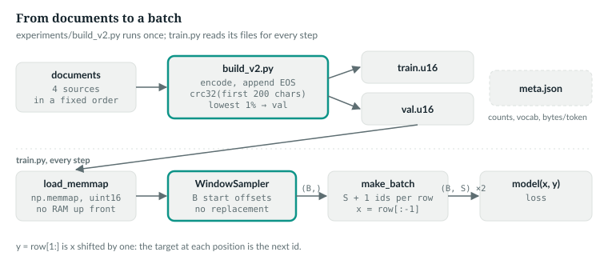
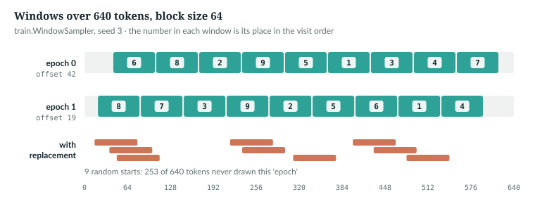
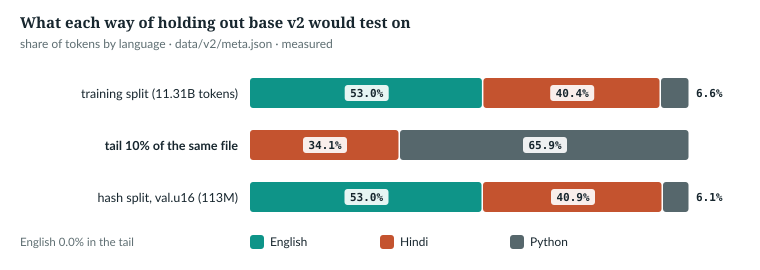

# 21  Data: corpora, documents, windows and splits

Part IV took a batch of token ids as given. This chapter follows the data that
fills it: documents become one long file of ids, the file is opened without
being read, and each step cuts windows from it. It ends on the question every
later number depends on: is the held-out text a fair sample of the rest?

The book example `book/code-examples/ch21_windows.py` (**Book example, not
repository code**) runs the same code on a corpus small enough to print.

## 21.1  The notation for Part V

| Symbol | Meaning | Released run |
|---|---|---|
| B | windows per micro-batch (`--batch-size`) | 4 |
| S | window length, the model's `block_size` (`--block-size`) | 1,024 |
| M | micro-batches per optimiser step (`--grad-accum`) | 1 |
| N | tokens in a split | 11,312,144,198 (train) |
| W | windows in one epoch, about N / S | 11,047,015 |
| V | vocabulary size | 32,768 |
| η | learning rate | 6e-4 at the peak |

S is Part IV's S: in training, every call is a whole window. A
**micro-batch** is the B windows one forward pass sees; an optimiser step can
add up the gradients of M of them (Chapter 22). An **epoch** is one pass over
the training split. *verified*: `experiments/v2_train.sh` lines
24–28 at @2e80b3e (M = 1 is the default); W is printed by
`ch21_measure_corpus.py`.

## 21.2  Documents become one file of ids

The build reads four sources in a fixed order, each with a token budget:

> **In the repo** · `experiments/build_v2.py` · `SOURCES` · lines 76–83 · @2e80b3e

```python
SOURCES = {
    "english": (6.0e9, lambda: parquet_docs(sorted((RAW / "HuggingFaceFW__fineweb-edu/sample/10BT").glob("*.parquet")))),
    "hindi_web": (4.5e9, lambda: parquet_docs(sorted((RAW / "HuggingFaceFW__fineweb-2/data/hin_Deva/train").glob("*.parquet")))),
    "hindi_wiki": (1e12, lambda: parquet_docs(sorted((ROOT / "data/rag/wiki/20231101.hi").glob("*.parquet")))),
    "python": (1e12, lambda: text_docs([ROOT / "data" / f for f in
                                        ("gh_python.clean.txt", "tb_opencode.txt", "tb_opc.txt")
                                        if (ROOT / "data" / f).exists()])),
}
```

Each entry pairs a budget in training tokens with a function that yields
documents. The budgets and the data on disk together set the **mixture**, how
much of each language the model reads: English and Hindi web stop at their
budgets, while `1e12` means every document there is, so the Hindi Wikipedia and
Python shares are whatever those files hold. The budget is checked only after
each batch of 1,000 documents (line 121), so a source overshoots it a little.
Both readers skip documents under 200 characters (`min_chars`, lines 48 and 58).
Each document then goes to one file:

> **In the repo** · `experiments/build_v2.py` · `main` · lines 103–114 · @2e80b3e

```python
        def flush(batch):
            nonlocal n_tr, n_va, n_docs, n_bytes
            for d, enc in zip(batch, tk.encode_batch(batch, add_special_tokens=False)):
                ids = np.array(enc.ids + [EOS], dtype=np.uint16)
                n_docs += 1
                n_bytes += len(d.encode("utf-8"))
                if zlib.crc32(d[:200].encode("utf-8")) % 10000 < a.val_pct * 100:
                    fva.write(ids.tobytes())
                    n_va += len(ids)
                else:
                    ftr.write(ids.tobytes())
                    n_tr += len(ids)
```

- **Encode, then EOS.** The `multi32k` tokenizer (Chapter 9) encodes each
  document, then appends `EOS = 32767` (line 45). The build loads its Rust
  `tokenizers` copy, `release/AnuLM-Base-400M/tokenizer.json` (line 44), which
  its docstring records as checked identical to `anulm/bpe.py`; `meta.json` names
  `data/multi32k.json`, the `anulm/bpe.py` file. `n_bytes` keeps the UTF-8
  size for bits per byte (Chapter 24).
- **Choose a side by hash.** The CRC-32 of the first 200 characters, modulo
  10,000, is below 100 for about 1% of documents (`--val-pct 1.0`): those go to
  `val.u16`. A document is held out whole, and a rebuild puts it on the same
  side. Documents whose first 200 characters agree, exact duplicates among
  them, share a side.
- **Raw bytes.** `tobytes()` writes `uint16` ids with no header: two bytes per
  token.

Text corpora mark the same boundary with `DOC_SEP` (Chapter 8). Because the
split is by hash, an exact duplicate cannot land in both splits, but a near-duplicate that differs within
its first 200 characters can, and nothing here removes copies inside the
training split. `NOT IN THE REPO`

`IN THE REPO`

## 21.3  The released corpus in numbers

The build ends by recording what it wrote:

> **In the repo** · `experiments/build_v2.py` · `main` · lines 136–140 · @2e80b3e

```python
    meta = {"format": "uint16", "vocab_size": 32768, "eos_id": EOS,
            "tokenizer": "data/multi32k.json", "train": "train.u16", "val": "val.u16",
            "train_tokens": tot_tr, "val_tokens": tot_va,
            "bytes_per_token": round(total_bytes / max(tot_tr + tot_va, 1), 3), "sources": stats}
    json.dump(meta, open(out / "meta.json", "w"), indent=2)
```

The file holds the vocabulary, the EOS id, the two file names, the totals, the
corpus-wide bytes per token, and `stats`: per source, the training and held-out
tokens, documents and bytes per token. For the released corpus:

| source | train tokens | share | held out | bytes/token | documents |
|---|---|---|---|---|---|
| English (fineweb-edu) | 6,000,573,711 | 53.05% | 0.99% | 4.426 | 5,665,000 |
| Hindi web (fineweb-2) | 4,500,023,402 | 39.78% | 1.01% | 9.371 | 6,918,000 |
| Hindi Wikipedia | 66,005,229 | 0.58% | 0.91% | 9.341 | 126,879 |
| Python | 745,541,856 | 6.59% | 0.92% | 4.039 | 1,663,520 |
| **total** | **11,312,144,198** | | **0.99%** | **6.397** | |

*measured*: read by `ch21_measure_corpus.py`, saved in
`book/measurements/part_v_a_corpus.json`. Each source is held out at about 1%.
English came out 573,711 tokens over its 6.0B budget and Hindi web 23,402 over
4.5B. `train.u16` is 22,624,288,396 bytes.

`MEASURED`

## 21.4  Opening 22 GB without reading it

`anulm/training/train.py` recognises the build by the file name given to `--data`:

> **In the repo** · `anulm/training/train.py` · `main` · lines 670–683 · @2e80b3e

```python
    memmapped = bool(args.data and args.data.endswith("meta.json"))
    # ...
    elif memmapped:
        train_data, val_data, meta = load_memmap(args.data)
        vocab_size, tokenizer_path = meta["vocab_size"], meta["tokenizer"]
        args.bytes_per_token = meta["bytes_per_token"]
        data = train_data
```

The `elif` follows a branch for a `splits.json` build (`load_encoded_splits`),
a newer document-grouped format with its own test split; the released model's
corpus is the `meta.json` kind.

The vocabulary size and the bytes per token come from the data, not from the
model's preset; Chapter 22 shows them reaching the configuration and the
bits-per-byte line. The files are opened by:

> **In the repo** · `anulm/training/train.py` · `load_memmap` · lines 166–176 · @2e80b3e

```python
def load_memmap(meta_path: str):
    # ...
    import json
    meta = json.load(open(meta_path))
    root = Path(meta_path).parent
    tr = np.memmap(root / meta["train"], dtype=np.uint16, mode="r")
    va = np.memmap(root / meta["val"], dtype=np.uint16, mode="r")
    return tr, va, meta
```

`np.memmap` maps the read-only file into memory; the operating system reads
only the pages a slice touches, at least one 4 KB page for a window of 1,025
ids (2,050 bytes), where loading the ids as one tensor would take 22.6 GB at
once.

> **In the repo** · `anulm/training/train.py` · `make_batch` · lines 240–253 · @2e80b3e

```python
def make_batch(data: torch.Tensor, ix: torch.Tensor, block_size: int, device: str):
    if isinstance(data, np.ndarray):            # a memory-mapped corpus (load_memmap)
        rows = np.stack([data[i: i + block_size + 1] for i in ix.tolist()]).astype(np.int64)
        x, y = torch.from_numpy(rows[:, :-1]), torch.from_numpy(rows[:, 1:])
    else:
        x = torch.stack([data[i: i + block_size] for i in ix]).long()
        y = torch.stack([data[i + 1: i + 1 + block_size] for i in ix]).long()
    if device.startswith("cuda"):
        return x.pin_memory().to(device, non_blocking=True), y.pin_memory().to(device, non_blocking=True)
    return x.to(device), y.to(device)
```

`ix` holds B start offsets, shape (B,). On the memory-mapped path each start
reads S + 1 ids into a (B, S + 1) array, widened to `int64`. `x` drops each
row's last id and `y` its first: (B, S) each, one id apart. The in-memory path
slices a tensor twice. On CUDA both go through **pinned memory**, page-locked
host memory the GPU can copy from directly, so `non_blocking=True` lets the
copy overlap other work.

Why `int64`? The file's `uint16` ids fit neither consumer: `F.embedding`
would take `int32`, but `F.cross_entropy`'s targets need `int64`.

> **Details.** The book example tries each id dtype on the model's two
> consumers of ids (*verified*: printed by `ch21_windows.py` with torch 2.11):
>
> ```python
>     emb, logits = torch.randn(10, 4), torch.randn(3, 10)
>     for dt in (torch.int64, torch.int32, torch.uint16):
>         ids = torch.tensor([1, 2, 3]).to(dt)
>         res = []
>         for f in (lambda: torch.nn.functional.embedding(ids, emb), lambda: torch.nn.functional.cross_entropy(logits, ids)):
>             try:
>                 f()
>                 res.append("ok")
>             except Exception as e:
>                 res.append(type(e).__name__)
>         print(f"ids as {str(dt)[6:]:6s}: F.embedding {res[0]:12s} F.cross_entropy {res[1]}")
> ```
>
> ```text
> ids as int64 : F.embedding ok           F.cross_entropy ok
> ids as int32 : F.embedding ok           F.cross_entropy RuntimeError
> ids as uint16: F.embedding RuntimeError F.cross_entropy RuntimeError
> ```

`IN THE REPO`

## 21.5  Run it small: build, map, batch

The book example runs `build_v2.main()` unchanged, with its `SOURCES` swapped
for three made-up sources and 10% held out:

```python
def build(out: Path):
    """Run build_v2.main() unchanged on three small sources, 10% held out by hash."""
    build_v2.SOURCES = {k: (1e12, (lambda k=k: iter(docs(k, 600)))) for k in WORDS}
    sys.argv = ["build_v2.py", "--out", str(out), "--val-pct", "10"]
    build_v2.main()
    return json.loads((out / "meta.json").read_text())
```

Then it maps the result and holds `make_batch` to both of its paths:

```python
        tr, va, _ = T.load_memmap(str(Path(d) / "meta.json"))
        # ...
        ix = torch.tensor([0, 500, 2000])
        x, y = T.make_batch(tr, ix, 16, "cpu")
        assert torch.equal(x[:, 1:], y[:, :-1]) and x.dtype == torch.long
        same = T.make_batch(torch.from_numpy(np.asarray(tr).astype(np.int64)), ix, 16, "cpu")
        assert torch.equal(x, same[0]) and torch.equal(y, same[1])
```

```text
meta.json: train 141,977 / val 15,851 tokens, EOS id 32767; 10.0% held out
make_batch: x (3, 16), y (3, 16); y[:, :-1] == x[:, 1:]; memmap and in-memory batches identical
```

*verified*: printed by `ch21_windows.py`, without the build's progress lines.



*Figure 21.1 · From documents to a batch.* The build runs once; every step maps
its files, draws B starts and cuts (B, S) inputs and targets. Every box is code
at @2e80b3e.

`IN THE REPO`

## 21.6  Windows without replacement

Random starts drawn with replacement miss a token with probability
(1 − S/N)<sup>N/S</sup> ≈ e<sup>−1</sup> per epoch of draws: 37% of the corpus
unread, other text read twice. `WindowSampler` replaces them:

> **In the repo** · `anulm/training/train.py` · `WindowSampler` · lines 121–163 · @2e80b3e

```python
    def __init__(self, n_tokens: int, block_size: int, batch_size: int, seed: int):
        self.n, self.bs, self.B = n_tokens, block_size, batch_size
        self.g = torch.Generator().manual_seed(seed)
        self.epoch = 0
        self._new_epoch()

    def _new_epoch(self):
        offset = int(torch.randint(self.bs, (1,), generator=self.g))
        n_win = (self.n - 1 - offset) // self.bs          # each window needs block_size + 1 ids
        starts = offset + self.bs * torch.arange(n_win)
        self.order = starts[torch.randperm(n_win, generator=self.g)]
        self.pos = 0

    def next(self) -> torch.Tensor:
        if self.pos + self.B > len(self.order):
            self.epoch += 1
            self._new_epoch()
        ix = self.order[self.pos: self.pos + self.B]
        self.pos += self.B
        return ix
    # ...
    def state(self) -> dict:
        return {"epoch": self.epoch, "pos": self.pos, "order": self.order, "g": self.g.get_state()}

    def load_state(self, s: dict):
        self.epoch, self.pos, self.order = s["epoch"], s["pos"], s["order"]
        self.g.set_state(s["g"])
```

- **Its own generator.** Other code's random draws cannot shift the order.
- **A grid from a random offset.** `offset` is in [0, S), and the grid holds
  W = ⌊(N − 1 − offset)/S⌋ windows, S apart. The −1 leaves room for the last
  window's extra target. Neighbouring windows share one id.
- **A random order.** `randperm` shuffles the grid across the corpus.
- **Epochs.** When fewer than B starts are left, `next` begins a new epoch with
  a new offset, so window boundaries move. Up to B − 1 windows are skipped.
- **Resumable.** `state` saves the order, position and generator (Chapter 25).
  The elided property `epochs_done` (lines 150–153) is `epoch + pos / W`, the
  fractional epoch Chapter 22's log line prints.

At real scale W = 11,047,015, and the released run's 1,900,000 steps of 4
windows were 0.688 of an epoch: no window read twice. *verified*:
`ch21_measure_corpus.py`; the run's log ends at `epoch 0.69` (Chapter 22).

The book example checks both claims on 100,000 tokens:

```python
    n, S, B = 100_000, 64, 8
    s = T.WindowSampler(n, S, B, seed=3)
    w0, off0 = len(s.order), int(s.order.min())
    seen = torch.cat([s.next() for _ in range(w0 // B)])
    assert len(set(seen.tolist())) == len(seen) and s.epoch == 0
    s.next()                                                    # the remainder starts epoch 1
    # ...
    g = torch.Generator().manual_seed(3)
    starts = torch.randint(n - S - 1, (w0,), generator=g)      # train.py --sample-with-replacement
    covered = torch.zeros(n, dtype=torch.bool)
    for a in starts.tolist():
        covered[a:a + S] = True
    # ...
    unseen, skipped = n - len(seen) * S, (w0 - len(seen)) * S
```

```text
WindowSampler: 1561 windows of 64 per epoch; epoch 0 offset 42, epoch 1 offset 22; 1560 windows in epoch 0, none repeated
with replacement, the same 1561 draws: 37.1% of tokens never seen (e^-1 = 36.8%); without: 0.2%
  the 160 unseen tokens without replacement: 64 in the one skipped window (1561 windows, 195 batches of 8), 42 before the offset, 54 after the grid
```

*verified*: printed by `ch21_windows.py`.



*Figure 21.3 · Windows without and with replacement.* Two epochs of
`WindowSampler` over 640 tokens, then as many windows drawn with replacement.
*verified*: drawn by running `WindowSampler` with seed 3.

> **Details.** `--sample-with-replacement` (line 599) keeps the old sampler
> for A/B runs (lines 703–704). `docs/RESULTS.md` §9 changed it together with
> two other things; the sampler's own gain is *not measured here*.

`IN THE REPO`

## 21.7  Windows cross documents

Windows ignore document boundaries. The measurement script counts EOS ids in
the released run's own 400 validation windows:

```python
    starts = np.concatenate([b.numpy() for b in T.strided_windows(va, 4, S, N_WIN)])
    crosses, mixed = 0, 0
    for st in starts:
        x = np.asarray(va[st: st + S])                  # the input half of the window
        pos = np.flatnonzero(x == eos)
        if len(pos):
            crosses += 1
            mixed += S - 1 - pos[0]                     # positions after the first EOS see an earlier document
```

```text
held-out documents: 143,364; tokens per document mean 790, median 480; longer than 1024: 18.6%
400 strided windows of 1024: 66.0% contain an end of document; 42.6% of positions can attend to an earlier document
```

*measured*: `ch21_measure_corpus.py` on `data/v2/val.u16`, counts only.

So 42.6% of predictions see an unrelated document; only the EOS id says it no
longer matters. Some training stacks mask attention at every EOS. This one does
not: `_attn_mask` (line 375) knows only causality and the sliding window.

`NOT IN THE REPO` · `MEASURED`

## 21.8  Splits: why the tail lies

Without a build that brings its own held-out file (`meta.json`, or a
`splits.json` with a validation split), `anulm/training/train.py` splits the ids
itself:

> **In the repo** · `anulm/training/train.py` · `main` · lines 700–706 · @2e80b3e

```python
    if memmapped or (split_encoded and val_data is not None):
        pass
    elif args.val_interleave:
        train_data, val_data = interleaved_split(data)
    else:
        n = int(0.9 * len(data))
        train_data, val_data = data[:n], data[n:]
```

The default holds out the last 10%, a fair sample only of a shuffled corpus.
Build scripts write one source after another. On the lab's three-language file,
60 random windows from the last 10% were 0 Hindi, 57 English and 3 code
(`docs/RESULTS.md` §32): every validation loss read on it was an English
number. The fix:

> **In the repo** · `anulm/training/train.py` · `interleaved_split` · lines 205–219 · @2e80b3e

```python
def interleaved_split(data: torch.Tensor, chunk: int = 262144, every: int = 10):
    # ...
    chunks = list(data.split(chunk))
    val = torch.cat(chunks[every // 2::every])
    train = torch.cat([c for i, c in enumerate(chunks) if i % every != every // 2])
    return train, val
```

Chunks of 262,144 ids numbered 5, 15, 25, … are held out, so the held-out
tenth spans the file; the two parts partition the data. A chunk boundary can
cut a document in two; the hash cannot. The book example splits per-token
source labels three ways:

```python
def composition(ranges, lo, hi):
    """Share of each source in token range [lo, hi), given each source's [start, end)."""
    return {k: max(0, min(hi, b) - max(lo, a)) / (hi - lo) for k, (a, b) in ranges.items()}
# ...
        tail = composition(edges, int(0.9 * n), n)
        lab = torch.zeros(n, dtype=torch.int16)
        for i, (a, b) in enumerate(edges.values()):
            lab[a:b] = i
        _, val_lab = T.interleaved_split(lab, chunk=256)          # same split, applied to source labels
        inter = {k: float((val_lab == i).float().mean()) for i, k in enumerate(edges)}
        hashed = {k: s["val_tokens"] / meta["val_tokens"] for k, s in meta["sources"].items()}
```

```text
held out                english    hindi   python
the corpus itself         31.5%    38.4%    30.1%
tail 10% (default)         0.0%     0.0%   100.0%
interleaved_split         30.9%    40.0%    29.1%
hash of each document     32.2%    34.9%    32.9%
```

*verified*: printed by `ch21_windows.py`. At real scale, the tail of `train.u16`
would be 65.9% Python and no English, from a corpus that is 53% English:



*Figure 21.2 · Three ways to hold data out.* *measured*: from
`data/v2/meta.json` by `ch21_measure_corpus.py`, in the order `build_v2.py`
writes the sources.

`IN THE REPO` · `MEASURED`

## 21.9  What data is worth, measured

On earlier Hindi models, one seed each: cleaning the corpus bought 0.054 bits
per byte (`docs/RESULTS.md` §8), 3.3× the unique text at the same steps bought
0.007 (§11), and a prose filter cost 0.023 (§13).

`MEASURED`

## 21.10  The proof, and common mistakes

- `memmap_batches_match_in_memory_batches` (line 1920): the same (x, y) from a
  memory map as from memory.
- `window_sampler_covers_every_window_once_per_epoch` (line 931) and
  `window_sampler_resumes_exactly` (line 956).
- `interleaved_split_samples_the_whole_corpus` (line 1942): on A-then-B data
  the tail is all B; the interleaved split holds out both.

No loss curve shows a tail split of an ordered file, or `y = x`, which trains
a copier. Count the sources in the held-out split, and assert
`torch.equal(x[:, 1:], y[:, :-1])`.

> **Build it.** The lab book's Chapter 2 (`course/ch02-data`) builds a corpus
> from your own text, with deduplication and decontamination.

`IN THE REPO`

## 21.11  Exercises

1. With N = 1,000 and S = 64, how many windows can an epoch have?
2. What fraction of 10M ids does `interleaved_split` hold out, and why not 10%?

**Answers.** 1. ⌊(999 − offset)/64⌋: 15 at offset 0, 14 at offset 63.
2. 1,048,576 ids, 10.49%: the 39th chunk is short, and the split counts chunks.
*verified*: printed by `ch21_windows.py`.

---

## Key points

- `build_v2.py` writes each document's ids and an EOS into one of two raw
  `uint16` files, chosen by a hash of its first 200 characters.
- Per-source token budgets set the mixture: the released corpus is 53% English,
  40% Hindi and 7% Python, 11.31B training tokens.
- `load_memmap` opens 22.6 GB without reading it; `make_batch` reads S + 1 ids
  per window and returns (x, y) shifted by one.
- `WindowSampler` visits a randomly offset grid of windows in random order,
  once per epoch, with its own seeded generator.
- A tail split of an ordered file tests one source: for base v2 it would have
  been two-thirds Python. Hold out by document hash or by interleaved chunks.
- Windows cross documents and nothing masks attention across an EOS: 42.6% of
  held-out positions can see an earlier document.

> **In one breath.** The build tokenises documents, ends each with EOS and
> hashes it into a training or held-out file; training memory-maps the files,
> visits a shuffled grid of windows without replacement, and cuts inputs and
> targets one id apart, while the held-out split stays a fair sample of every
> source.

## References

This chapter cites no research references. Its quality claims come from
`docs/RESULTS.md` §8, §9, §11, §13 and §32.

Repository evidence, all at @2e80b3e:
- `experiments/build_v2.py`: `TOKENIZER` 44, `EOS` 45, `parquet_docs` 48, `text_docs` 58,
  `SOURCES` 76–83, `main` 86–142 (`flush` 103–114, budget check 121, `meta.json` 136–140);
  `experiments/v2_train.sh` 24–28.
- `anulm/training/train.py`: `WindowSampler` 107–163 (`epochs_done` 150–153), `load_memmap` 166–176,
  `interleaved_split` 205–219, `make_batch` 240–253, `strided_windows`
  354–375, `main` 599, 670–683, 700–706, 867–868.
- `anulm/model.py`: `_attn_mask` 375–391.
- `tests/test_model.py`: `window_sampler_covers_every_window_once_per_epoch` 931,
  `window_sampler_resumes_exactly` 956,
  `memmap_batches_match_in_memory_batches` 1920,
  `interleaved_split_samples_the_whole_corpus` 1942.
- Statistics: `data/v2/meta.json`, `data/v2/val.u16` (counts only),
  `book/measurements/part_v_a_corpus.json`.
