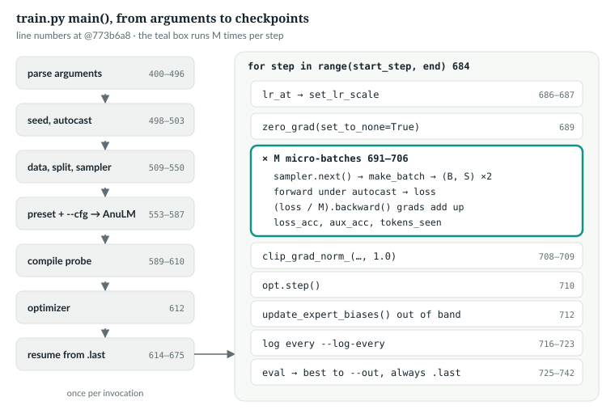
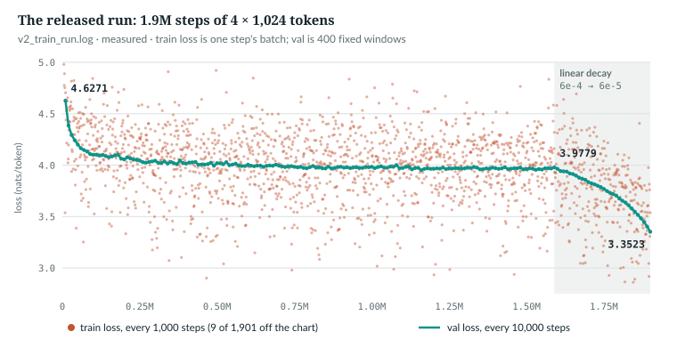

# 22  The training loop, line by line

`anulm/training/train.py`'s `main()` (lines 540–921) produced the released model. This chapter
reads it in order: how a command line becomes a model, how one optimiser step
is built from M micro-batches, and what is logged, evaluated and saved.

The book example is `book/code-examples/ch22_one_step.py` (**Book example, not
repository code**).

## 22.1  The whole function in one picture



*Figure 22.1 · The training loop.* Setup runs once per invocation; the loop runs
once per optimiser step. Line numbers are at @084cbdd.

The released run finished under this command (`experiments/v2_train.sh` lines
24–28 and 32 at @084cbdd, `$PRESET` expanded). It did not start under it: it
was planned with `--steps 2750000 --decay-frac 0.2` (the script at commit
a380a15), and shortened at step 1,590,000 by commit 5c1127c after a week lost
to a shutdown (22.8):

```bash
python -m anulm train --preset 350m --device cuda --moe-impl grouped --data data/v2/meta.json \
  --out ckpt_base_v2.pt --block-size 1024 --batch-size 4 --steps 1900000 --lr 6e-4 --min-lr 6e-5 \
  --warmup 2000 --schedule wsd --decay-frac 0.1631579 --eval-every 10000 --eval-windows 400 \
  --log-every 1000 --seed 2026 --seq-balance-alpha 1e-4 --router-z-alpha 1e-3 \
  --cfg num_experts=24 moe_intermediate_size=192 num_experts_per_tok=4 num_shared_experts=0 \
        sliding_window=256 max_window_layers=10 bias_update_rate=3e-3
```

`IN THE REPO`

## 22.2  From a preset and `--cfg` to a model

> **In the repo** · `anulm/training/train.py` · `main` · lines 715–734 · @084cbdd

```python
    builder = {"30b": AnuLMConfig.nano_30b,
               "105b": AnuLMConfig.nano_105b,
               "350m": AnuLMConfig.nano_350m}[args.preset]
    overrides = {}
    for kv in args.cfg:
        key, _, val = kv.partition("=")
        field = AnuLMConfig.__dataclass_fields__.get(key)
        assert field is not None and _, f"--cfg: unknown field {kv!r}"
        cast = {"int": int, "float": float, "bool": lambda s: s.lower() in ("1", "true", "yes"),
                "str": str}.get(str(field.type).replace("Optional[", "").rstrip("]"), str)
        overrides[key] = None if val.lower() == "none" else cast(val)
    if overrides:
        print(f"config overrides: {overrides}")
    kw = dict(block_size=args.block_size, yarn=args.yarn,
              yarn_original_context=args.block_size, moe_impl=args.moe_impl,
              vocab_size=vocab_size, tokenizer_path=tokenizer_path,
              seq_balance_alpha=args.seq_balance_alpha, router_z_alpha=args.router_z_alpha,
              sliding_window=args.sliding_window, max_window_layers=args.max_window_layers)
    kw.update(overrides)                      # --cfg wins over the named flags
    cfg = builder(**kw)
```

- **Preset.** `--preset 350m` picks `AnuLMConfig.nano_350m`, one of the
  configurations in `anulm/model.py` (Chapter 20).
- **Parse `KEY=VALUE`.** `partition("=")` splits at the first `=`; `_` is the
  `=` itself, so the assertion rejects both an unknown field and a missing `=`.
- **Cast by the declared type.** `anulm/model.py` starts with
  `from __future__ import annotations` (line 23), so each dataclass field's
  type is a string such as `"int"` or `"Optional[int]"`. Stripping
  `Optional[` and `]` leaves the name to look up. A boolean is true for `1`,
  `true` or `yes`, anything else false; `none` gives `None`.
- **Merge.** Flags the script knows become keyword arguments; the vocabulary
  size and tokenizer come from the data (Chapter 21). `kw.update(overrides)`
  runs last, so `--cfg` wins.

The ablations in `docs/RESULTS.md` change the model this way. The book example
runs `main()` with the released arguments and `--steps 0`: everything is
built, and no step is taken.

```python
def dry_run():
    """train.main() with the released arguments, zero steps, on the CPU."""
    with tempfile.TemporaryDirectory() as d:
        sys.argv = ["train.py", "--device", "cpu", "--out", str(Path(d) / "ckpt.pt")] + RELEASED.split()
        buf = io.StringIO()
        with contextlib.redirect_stdout(buf):
            T.main()
    lines = [l for l in buf.getvalue().splitlines() if l.startswith(("sampler", "config", "params", "optimizer"))]
    assert "397.66M total, 173.53M active/token" in buf.getvalue()
    return lines
```

```text
sampler: 11047015 windows/epoch, no replacement; 0.00 epochs planned
config overrides: {'num_experts': 24, 'moe_intermediate_size': 192, 'num_experts_per_tok': 4, 'num_shared_experts': 0, 'sliding_window': 256, 'max_window_layers': 10, 'bias_update_rate': 0.003}
params: 397.66M total, 173.53M active/token (43.6%)  |  device=cpu dtype=torch.float32
optimizer: AdamW, 397.7M params
```

*verified*: printed by `ch22_one_step.py`. The released run's log printed the
same parameter line with `device=cuda dtype=torch.bfloat16`, and
`optimizer: AdamW (fused)`. That `dtype` is autocast's compute dtype (lines 650
and 587); the weights were created in fp32 and stayed so (line 576, Chapter
23).

`IN THE REPO`

## 22.3  The compile probe, and two names for one model

> **In the repo** · `anulm/training/train.py` · `main` · lines 751–774 · @084cbdd

```python
    raw_model = model
    if args.compile:
        # ...
        print("compiling ...")
        compiled = torch.compile(model)
        # ...
        try:
            # eval(): nn.Module starts in training mode, and a probe forward
            # in it would bank 8 tokens of router load_counts before step 0.
            model.eval()
            with torch.no_grad():
                compiled(torch.zeros(1, 8, dtype=torch.long, device=args.device))
            model = compiled
            print("  compiled backend ready")
        except Exception as e:
            print(f"  compile unavailable ({type(e).__name__}: {str(e).splitlines()[0][:80]})")
            print("  falling back to eager")

    opt = make_optimizer(raw_model, args)
```

`torch.compile` [R52] wraps the model and compiles at the first call. The
elided comment (lines 759–761) says its default backend generates C++ and needs
a host compiler, which it discovers only then. That is Inductor's CPU code; on
CUDA it generates Triton kernels, and this machine's PyTorch has no Triton
(`import triton` fails). Either way the failure comes at the first real
forward. So `main` calls it once on 8 zero ids; if that fails, the run
continues uncompiled instead of crashing at step 1.
`IMPLEMENTATION-DEPENDENT` The probe runs in eval mode because a training-mode forward would
add 8 tokens to every router's `load_counts`, the expert loads behind the next
bias update (Chapter 18).

From here on `model` is what the loop calls, compiled or not, and `raw_model`
is the module: the optimiser, the bias update and the saves use it. The
released run did not compile (Chapter 23).

`IN THE REPO`

## 22.4  One step: M micro-batches

> **In the repo** · `anulm/training/train.py` · `main` · lines 846–870 · @084cbdd

```python
    end = min(args.steps, args.stop_at) if args.stop_at else args.steps
    for step in range(start_step, end):
        t_step = time.time()
        lr = lr_at(step, args, start_step)
        opt.set_lr_scale(lr / args.lr)

        opt.zero_grad(set_to_none=True)
        loss_acc = aux_acc = 0.0
        for _ in range(args.grad_accum):
            ix = (torch.randint(len(train_data) - args.block_size - 1, (args.batch_size,))
                  if args.sample_with_replacement else sampler.next())
            x, y = make_batch(train_data, ix, args.block_size, args.device)
            with args.autocast:
                logits, loss = model(x, y)
            lm_loss = loss
            tw = (teacher_weight(step, args.steps, args.bigram_teacher, args.teacher_until)
                  if teacher is not None else 0.0)
            if tw > 0:
                loss = loss + tw * teacher_kl(logits, x, teacher)
            (loss / args.grad_accum).backward()
            loss_acc += lm_loss.item() / args.grad_accum
            if raw_model.aux_loss is not None:
                aux_acc += raw_model.aux_loss.item() / args.grad_accum
            tokens_seen += x.numel()
```

- **Range.** `start_step` is 0 unless the run resumed; `--stop-at` ends an
  invocation early, so a long run proceeds in phases (Chapter 25).
- **Rate, then zero.** `set_lr_scale` multiplies every group's base rate by
  `lr / args.lr` (Chapter 7). `set_to_none=True` drops the old gradients.
- **Each micro-batch.** B windows come from the sampler (Chapter 21) and
  `make_batch` turns them into `x` and `y`, each (B, S). The forward runs under
  `args.autocast`, bf16 on a GPU (Chapter 23). The model returns the
  cross-entropy plus the router regularisers (Chapter 20).
- **The teacher.** `lm_loss` keeps the model's loss before an optional bigram
  teacher term (`--bigram-teacher`, `docs/RESULTS.md` §32) is added. It was
  off in the released run.
- **Backward.** `(loss / M).backward()` adds this micro-batch's gradient, M
  times smaller, into `.grad`.
- **Bookkeeping.** `loss_acc` and `aux_acc` average the losses for the log;
  each `.item()` waits for the GPU.

Why divide by M? Write L<sub>m</sub> for the mean loss of micro-batch m. When
every micro-batch has the same number of graded targets, as in pretraining,
the mean over the whole step is (1/M) Σ L<sub>m</sub>, and its gradient is
(1/M) Σ ∇L<sub>m</sub>. Calling `backward` on each L<sub>m</sub>/M builds
exactly that sum in `.grad`, one micro-batch at a time, so only one
micro-batch's activations are held at once. M micro-batches of B windows give
the gradient of one batch of M·B. Without the division, the gradient is M times
too large.

`IN THE REPO`

## 22.5  Clip, step, and the out-of-band update

> **In the repo** · `anulm/training/train.py` · `main` · lines 871–877 · @084cbdd

```python
        if args.grad_clip > 0:
            torch.nn.utils.clip_grad_norm_(raw_model.parameters(), args.grad_clip)
        opt.step()
        # Out-of-band, after the gradient step, never part of the loss.
        imbalance = raw_model.update_expert_biases()
        if step == start_step and args.device.startswith("cuda"):
            warn_if_spilling(args.device)
```

The order matters. Clipping follows all M backward passes, so it sees the whole
step's gradient: one L2 norm over every parameter, scaled down to `--grad-clip`
(1.0) if larger (Chapter 7). After `opt.step()`, `update_expert_biases` nudges
each router's bias by the sign rule from the loads counted in the M forwards,
outside the loss and the optimiser (Chapter 18). The first step of each
invocation, 17 in the released run, also checks for memory spilling
(Chapter 23).

The book example writes this step out with the repository's own pieces:

```python
def step(model, opt, batches, args, step_no, divide=True):
    """anulm/training/train.py lines 849–875 for one step, without the teacher, logging or eval."""
    lr = T.lr_at(step_no, args)
    opt.set_lr_scale(lr / args.lr)
    opt.zero_grad(set_to_none=True)
    loss_acc = aux_acc = 0.0
    for x, y in batches:
        _, loss = model(x, y)
        (loss / len(batches) if divide else loss).backward()
        loss_acc += loss.item() / len(batches)
        aux_acc += model.aux_loss.item() / len(batches)
    norm = torch.nn.utils.clip_grad_norm_(model.parameters(), args.grad_clip)   # returns the norm before clipping
    opt.step()
    imbalance = model.update_expert_biases()
    return loss_acc, aux_acc, float(norm), lr, imbalance
```

It runs three copies of one small model, the example's own configuration with
`test_model.tiny()`'s sizes and the router regularisers on:
two micro-batches of 4 windows, one batch of 8, and two micro-batches
without the division.

```text
M=2, divided      | loss 4.1701 | aux 0.0100 | lr 3.00e-06 | imbalance 1.41x | grad norm 0.8003
M=1, B=8          | loss 4.1701 | aux 0.0100 | lr 3.00e-06 | imbalance 1.41x | grad norm 0.8003
M=2, not divided  | loss 4.1701 | aux 0.0100 | lr 3.00e-06 | imbalance 1.41x | grad norm 1.6005

accumulated vs one big batch: loss differs by 4.8e-07, grad norm by 0.0e+00
not dividing by M: grad norm x2.000
after clip + one AdamW step the weights differ by at most 1.6e-07 (the step itself moved them by up to 3.1e-06)
```

*verified*: printed by `ch22_one_step.py`. The missing division doubles the
gradient, yet the weights barely move apart. Clipping caps the norm, and
AdamW divides each gradient by its own running size (Chapter 7). So this
bug cannot be found by comparing weights, nor in the log: line 703 averages
`lm_loss` into `loss_acc` separately, so the printed loss is unchanged. What
changes is the gradient's scale: what a clipping threshold means, any logged
gradient norm, and every update of an optimiser that is not scale-invariant,
such as plain SGD. Compare gradients, as the test does.

`IN THE REPO`

## 22.6  The log line

> **In the repo** · `anulm/training/train.py` · `main` · lines 879–886 · @084cbdd

```python
        if step % args.log_every == 0 or step == args.steps - 1:
            dt = time.time() - t0
            # `loss` is the LM cross-entropy alone, so it stays comparable
            # across runs with and without the regularisers.
            print(f"step {step:5d} | loss {loss_acc - aux_acc:6.4f} | "
                  f"{f'aux {aux_acc:.4f} | ' if aux_on else ''}lr {lr:.2e} | "
                  f"imbalance {imbalance:5.2f}x (median {getattr(raw_model, 'imbalance_median', imbalance):4.2f}x) | {tokens_seen/max(dt,1e-9):8.0f} tok/s | "
                  f"{(time.time()-t_step)*1e3:5.0f} ms/step | epoch {sampler.epochs_done:.2f}")
```

The model's loss is cross-entropy plus the regularisers, so `loss_acc - aux_acc`
is the cross-entropy alone, as the book example checks:

```text
model loss 4.182149 = cross-entropy 4.172154 + aux 0.009994
```

`tok/s` averages over the whole invocation; `ms/step` is this step alone. The
imbalance is the worst layer's busiest expert over its mean (Chapter 18).

The loss printed is one step's batch, 4 × 1,024 tokens in the released run,
and it is noisy. Over the run's last 20 log lines it ranged from 2.9181 to
3.9758, while the validation loss at the end read 3.3523 ± 0.0491. *measured*:
`ch22_read_run_log.py` on `v2_train_run.log`. Read progress from the
validation curve.

`IN THE REPO` · `MEASURED`

## 22.7  Evaluate, save, and bits per byte

> **In the repo** · `anulm/training/train.py` · `main` · lines 888–905 · @084cbdd

```python
        if (step + 1) % args.eval_every == 0 or step == end - 1:
            val, val_sem = evaluate(raw_model, val_data, args)
            flag = ""
            if val < best_val:
                best_val = val
                atomic_save({"model": raw_model.state_dict(), "cfg": cfg,
                             "step": step, "val_loss": val, "val_sem": val_sem,
                             "eval_spec": eval_spec}, args.out)
                flag = "  <- saved"
            # Always write the resume point, best or not: it exists to recover
            # from a kill, and the newest step is what we want to continue from.
            atomic_save({"model": raw_model.state_dict(), "opt": opt.state_dict(),
                         "cfg": cfg, "step": step, "val_loss": val, "val_sem": val_sem,
                         "eval_spec": eval_spec, "best_val": best_val,
                         "sampler": sampler.state()}, last_path)
            bpb = val / math.log(2) / args.bytes_per_token
            print(f"  eval @ {step:5d} | val loss {val:6.4f} +/- {val_sem:.4f} | "
                  f"bits/byte {bpb:5.3f}{flag}")
```

Every `--eval-every` steps, and at the last step of an invocation:

- **Evaluate.** `evaluate` returns the held-out loss and its standard error
  (Chapter 24).
- **Two files.** A new best writes the weights to `--out`, the file to sample
  from. `<out>.last` is written every time, with the optimiser state and the
  sampler position (Chapter 25).
- **Bits per byte.** Dividing nats per token by ln 2 gives bits per token, and
  by bytes per token gives bits per byte, a number that compares across
  tokenizers (Chapter 3). For the released model:
  3.3523 / ln 2 / 6.397 = 0.756. *verified*: `ch22_read_run_log.py`. The 6.397
  is the whole corpus's; the held-out split has slightly more Hindi, 6.425
  bytes per token, which gives 0.753 (Chapter 24).

`IN THE REPO`

## 22.8  The released run in numbers

The schedule is `lr_at`'s warmup-stable-decay branch:

> **In the repo** · `anulm/training/train.py` · `lr_at` · lines 379–395 · @084cbdd

```python
def lr_at(step: int, args, start_step: int = 0) -> float:
    if step < args.warmup:
        return args.lr * (step + 1) / max(args.warmup, 1)
    if getattr(args, "schedule", "cosine") == "wsd":
        # ...
        decay_start = int(args.steps * (1 - args.decay_frac))
        if step < decay_start:
            return args.lr
        frac = min((step - decay_start) / max(args.steps - decay_start, 1), 1.0)
        return args.lr + (args.min_lr - args.lr) * frac
```

A linear warmup over 2,000 steps, a flat 6e-4, then a straight line to 6e-5
over the last `decay_frac` of the steps. The odd `0.1631579` was chosen after
the fact. The run was planned for 2,750,000 steps with `--decay-frac 0.2`, a
decay from step 2,200,000. When it stopped near step 1,595,000 and lost 6–15
October, it was resumed from the step-1,589,999 checkpoint with `--steps
1900000` and the fraction that puts the decay start at the resume point:
1,900,000 × (1 − 0.1631579) = 1,590,000. Every step before that is flat at 6e-4
under both settings, so one `lr_at` call reproduces the whole log.
`ch22_read_run_log.py` reads every line the run printed, keeping the last line
for each step (a resumed run repeats the steps it lost):

```python
    for line in LOG.read_text(encoding="utf-8", errors="replace").splitlines():
        if m := STEP.match(line):
            s = int(m[1])
            train[s] = dict(loss=float(m[2]), aux=float(m[3]), lr=float(m[4]), imb=float(m[5]),
                            imb_median=float(m[6]), tok_s=int(m[7]), ms=int(m[8]), epoch=float(m[9]))
        elif m := EVAL.match(line):
            evals[int(m[1])] = dict(val=float(m[2]), sem=float(m[3]), bpb=float(m[4]))
        elif line.startswith("resuming from"):
            resumes += 1
        elif line.startswith("memory-mapped corpus"):
            invocations += 1
        elif line.startswith("sampler:"):
            planned.append(line.split("; ")[1])
```

It then checks every logged rate against `lr_at` with the final arguments, and
summarises the flat phase:

```python
    a = SimpleNamespace(lr=6e-4, min_lr=6e-5, warmup=2000, steps=1_900_000, schedule="wsd", decay_frac=0.1631579)
    worst = max(abs(T.lr_at(s, a) - train[s]["lr"]) / T.lr_at(s, a) for s in steps)
    # ...
    flat = [s for s in ev if s < 1_590_000]
    best = min(flat, key=lambda s: evals[s]["val"])
    late = [evals[s]["val"] for s in flat if s >= 1_000_000]
    last20 = [evals[s]["val"] for s in flat[-20:]]
    m, sd = statistics.mean(late), statistics.stdev(late)
```

```text
1901 training lines (steps 0 to 1,899,999), 190 evaluations, 16 resumes, 17 invocations
sampler lines: first 12 say '1.00 epochs planned', the last 5 say '0.69 epochs planned'
step 0: loss 10.5632 (ln 32768 = 10.3972), aux 0.2129, imbalance 3.75x
last 20 logged steps: train loss 2.9181 to 3.9758, stdev 0.271
eval @     9,999: val 4.6271 +/- 0.0494, bits/byte 1.044
eval @    99,999: val 4.1005 +/- 0.0505, bits/byte 0.925
eval @ 1,589,999: val 3.9779 +/- 0.0510, bits/byte 0.897
eval @ 1,899,999: val 3.3523 +/- 0.0491, bits/byte 0.756
the decay (steps 1,590,000 to 1,900,000, 16% of the run) lowered val by 0.6256 from its last flat eval
flat phase: best 3.9515 at 1,159,999; evals 1.0M-1.58M mean 3.9704 (sd 0.0089, n=59); 3.9779 ranks 2 of the last 20 flat evals from the top (highest 3.9800)
decay drop measured from the flat mean 0.6181, from the flat best 0.5992
throughput: median 12,718 tok/s (cumulative per invocation), median 325 ms/step
tokens trained: 1,900,000 steps x 4 x 1,024 = 7,782,400,000
lr_at: decay starts after step 1,589,999; lr at step 0 3.00e-07, at 1,899,999 6.00e-05; every logged lr matches to 0.44% (3 digits logged)
bits/byte with the held-out split's own 6.425 bytes/token: 0.7528
```



*Figure 22.2 · The released run's loss.* *measured*: `v2_train_run.log`, parsed
into `book/measurements/part_v_a_run.json`.

Three things to read off it:

- **The start.** The first cross-entropy, 10.5632, sits near ln V = 10.397,
  a uniform guess (Chapter 3).
- **The plateau.** At a constant 6e-4 the validation loss fell from 4.6271 to
  about 3.97, most of it by step 99,999 (4.1005), and stalled near step 1.1M:
  the flat phase's best was 3.9515 at step 1,159,999, and the 59 evaluations
  from 1.0M to 1.58M average 3.9704 with a standard deviation of 0.0089. Its
  last point, 3.9779, is the second highest of the final 20.
- **The decay.** The final linear decay of warmup-stable-decay [R23] lowered it
  to 3.3523 in the last 16% of the steps: 0.6181 below the plateau's mean, 0.5992
  below its best. Whether a cosine schedule would end lower is *not measured
  here*.

`MEASURED`

## 22.9  The proof, and common mistakes

`gradient_accumulation_equals_large_batch` (line 437) runs `tiny()` on 8
sequences at once and as two halves with `(l / 2).backward()`, and requires
the gradients to agree within 2·10⁻⁵. It passes at @084cbdd.

Two mistakes the loss will not show: reading progress from the train loss,
whose standard deviation over the last 20 log lines was 0.271; and
accumulating without dividing, which only a gradient comparison catches.

> **Build it.** The lab book's Chapter 8 (`course/ch08-pretrain`) writes this
> loop from stubs: schedule, accumulation, clipping and a resumable checkpoint.

`IN THE REPO`

## 22.10  Exercises

1. With `--batch-size 4 --grad-accum 8 --block-size 1024`, how many tokens
   does one optimiser step see?
2. Why is the probe forward run under `torch.no_grad()`?

**Answers.** 1. 4 × 8 × 1,024 = 32,768. 2. No backward follows, so there is
no reason to record the graph and keep activations for it.

---

## Key points

- `--preset` picks a configuration and `--cfg KEY=VALUE` overrides any field,
  cast by its declared type; `--cfg` wins over named flags.
- The compile probe catches a missing compiler at step 0 and falls back to
  eager; `raw_model` is the module the optimiser, the bias update and the saves
  use.
- One step: set the rate, zero, run M micro-batches each backward-ing loss / M,
  clip the global norm, step, then update the expert biases out of band.
- The logged loss is cross-entropy alone, from one step's batch: noisy. The
  validation loss, with its standard error, is the measure.
- Every evaluation writes `<out>.last` with optimiser and sampler state, and
  `--out` only on a new best.
- The released run plateaued near 3.97 at a flat rate, then fell about 0.6 in
  the final decay, to 3.3523 (0.756 bits per byte).

> **In one breath.** `main()` turns a preset and overrides into a model, probes
> the compiler, and then repeats one step: set the rate, accumulate M
> micro-batch gradients each divided by M, clip, step, rebalance the experts,
> log the cross-entropy, and every so often evaluate and save both the best and
> the latest checkpoint.

## References

| ID | Used for | Status |
|---|---|---|
| [R23] | the warmup-stable-decay schedule | CHECKED |
| [R52] | `torch.compile`, the API the probe calls | CHECKED |

Repository evidence, all at @084cbdd:
- `anulm/training/train.py`: `main` 540–921 (650, 715–734, 738, 749, 751–774, 846–870, 866,
  871–877, 879–886, 888–905), `lr_at` 379–404, `OptimizerSet.set_lr_scale` 420–424.
- `anulm/model.py`: `from __future__ import annotations` 23,
  `AnuLM.update_expert_biases` 1059–1089.
- `tests/test_model.py`: `gradient_accumulation_equals_large_batch` 437.
- `experiments/v2_train.sh` 24–28, 32; its earlier version at a380a15 (`--steps
  2750000 --decay-frac 0.2`) and the shortening commit 5c1127c.
- The run's log, `v2_train_run.log` (repository root), parsed by
  `code-examples/ch22_read_run_log.py` into `book/measurements/part_v_a_run.json`.
