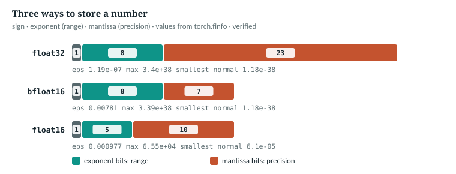
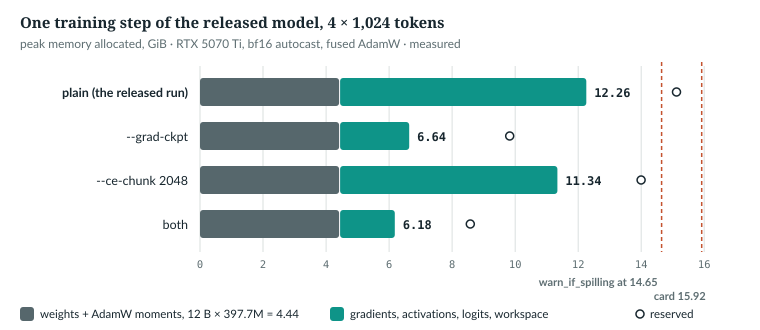

# 23  Precision, memory and speed

The released model trained on one 16 GB card. This chapter shows what made it
fit: 16-bit arithmetic where it is safe, 32-bit where it is not, and two
switches that trade compute for memory. The book example is
`book/code-examples/ch23_precision.py` (**Book example, not repository code**);
`ch23_measure.py` measures the released model on the GPU.

## 23.1  Three ways to store a number

A floating-point number is a sign, an exponent and a mantissa. The exponent
sets the **range**: the largest value, and the smallest normal one, below which
numbers lose precision and then underflow to zero. The mantissa sets the
**precision**: eps, the gap between 1 and the next number.

```python
def formats():
    print(f"{'format':9s} {'bits':>4s} {'exponent':>8s} {'mantissa':>8s} {'eps':>10s} {'max':>10s} {'min normal':>11s}")
    for dt, e, m in ((torch.float32, 8, 23), (torch.bfloat16, 8, 7), (torch.float16, 5, 10)):
        f = torch.finfo(dt)
        assert f.bits == 1 + e + m and f.eps == 2.0 ** -m
        print(f"{str(dt)[6:]:9s} {f.bits:4d} {e:8d} {m:8d} {f.eps:10.3g} {f.max:10.3g} {f.tiny:11.3g}")
    for v in (1 + 2 ** -8, 257.0, 3.3523, 1e-8, 70000.0):
        t = torch.tensor(v)
        print(f"  {v:<12g} -> bf16 {t.bfloat16().item():<12g} fp16 {t.half().item():g}")
```

```text
format    bits exponent mantissa        eps        max  min normal
float32     32        8       23   1.19e-07    3.4e+38    1.18e-38
bfloat16    16        8        7    0.00781   3.39e+38    1.18e-38
float16     16        5       10   0.000977   6.55e+04     6.1e-05
  1.00391      -> bf16 1            fp16 1.00391
  257          -> bf16 256          fp16 257
  3.3523       -> bf16 3.35938      fp16 3.35156
  1e-08        -> bf16 1.00117e-08  fp16 0
  70000        -> bf16 70144        fp16 inf
```

*verified*: printed by `ch23_precision.py`. bf16 keeps fp32's exponent and
range [R57], so 10⁻⁸ survives, but only about two decimal digits: 257 becomes 256.
fp16 has finer steps, but 10⁻⁸ underflows to zero and 70,000 overflows.



*Figure 23.1 · fp32, bf16 and fp16.* *verified*: bit counts and values from
`torch.finfo`, asserted by the figure script.

Mixed-precision training in fp16 keeps an fp32 copy of the weights and scales
the loss up so that small gradients do not underflow [R26]. This repository
trains in bf16 and has no loss scaler and no fp16 path. `NOT IN THE REPO`

## 23.2  Autocast: 16-bit where it is safe

> **In the repo** · `anulm/training/train.py` · `main` · lines 656–661 · @2e80b3e

```python
    torch.manual_seed(args.seed)
    dtype = (torch.bfloat16 if args.device.startswith("cuda")
             and torch.cuda.is_bf16_supported() else torch.float32)
    args.autocast = (torch.autocast(device_type="cuda", dtype=dtype)
                     if args.device.startswith("cuda") and dtype is torch.bfloat16
                     else torch.autocast(device_type="cpu", enabled=False))
```

On a GPU that supports it the dtype is bf16; elsewhere a disabled autocast
keeps `with args.autocast:` valid. The parameters, gradients and AdamW moments
stay fp32. **Autocast**, PyTorch's `torch.autocast` [R51], runs chosen
operations, chiefly matrix multiplies, on bf16 copies of their inputs. The book
example reads the dtypes with hooks on a small model under bf16 autocast:

```text
  embedding (layer 0 input) float32
  RMSNorm                float32
  attention projection   bfloat16
  router weights         float32
  one expert             bfloat16
  lm_head (logits)       bfloat16
  RMSNorm, bf16 input    float32
  router logits          float32 (Router.forward: autocast off)
    the gate unguarded   bfloat16 (the same _gate under autocast, as before the fix)
  loss                   float32
  weights                float32 (autocast casts copies, never the parameters)
```

*verified*: printed by `ch23_precision.py` under **CPU** autocast; CUDA's
autocast op lists differ in detail, so read the table as this mechanism, not as
a GPU trace. `IMPLEMENTATION-DEPENDENT`

> **Details.** The hooks. Forward hooks read each module's output dtype;
> `spy_on_gate`, a wrapper around one router's `_gate`, swaps `F.linear` for
> the length of one call and records the dtype of the logits it returns.
>
> ```python
> def spy_on_gate(router):
>     """Record the dtype of the F.linear output inside router._gate (the logits), each call."""
>     import torch.nn.functional as Fn
>     seen, gate, linear = [], router._gate, Fn.linear
>
>     def spy(*a, **k):
>         def lin(*la, **lk):
>             out = linear(*la, **lk)
>             seen.append(out.dtype)
>             return out
>         Fn.linear = lin                                          # model.py calls F.linear: the same module
>         try:
>             return gate(*a, **k)
>         finally:
>             Fn.linear = linear
>     router._gate = spy
>     return seen
> # ...
>
>     for n, mod in m.named_modules():
>         if n == "layers.0":
>             mod.register_forward_pre_hook(lambda _m, i: seen.update({"layers.0": i[0].dtype}))
>         elif n in names:
>             mod.register_forward_hook(lambda _m, _i, o, n=n: seen.update({n: (o[1] if isinstance(o, tuple) else o).dtype}))
>     x = torch.randint(0, 64, (2, 16))
>     with torch.autocast(device_type="cpu", dtype=torch.bfloat16):
>         _, loss = m(x, x)
> ```

The embedding is a lookup of fp32 rows. The norm computes in fp32 and
multiplies by an fp32 gain, so even a bf16 input comes out fp32:

> **In the repo** · `anulm/model.py` · `RMSNorm.forward` · lines 244–249 · @2e80b3e

```python
    def forward(self, x):
        dtype = x.dtype
        x = x.float()
        x = x * torch.rsqrt(x.pow(2).mean(-1, keepdim=True) + self.eps)
        return (x.to(dtype)) * self.weight
```

The product with the fp32 `weight` promotes the result to fp32, and the loss
casts the logits with `.float()` (`anulm/model.py` line 934). The stream stays fp32
between the bf16 matrix multiplies. One exception is not autocast's doing: the
`grouped` expert path casts its inputs and stacked weights to bf16 itself
(`anulm/model.py` lines 766 and 794), with or without autocast (Chapter 18).

`IN THE REPO`

## 23.3  The router stays in fp32

Choosing experts is discrete: `topk` picks 4 of 24, and a rounding error can
swap the fourth and fifth. So the gate runs with autocast off:

> **In the repo** · `anulm/model.py` · `Router.forward` · lines 625–632 · @2e80b3e

```python
        # fp32 router: top-k is discrete, and bf16 rounding would flip choices.
        # Casting the inputs is not enough -- autocast re-casts F.linear to
        # bf16 whatever dtype it is handed, and every GPU run before this fix
        # routed in bf16 (3.2% of expert sets differed from fp32 on a real
        # checkpoint). Autocast has to be off for the whole gate.
        with torch.autocast(device_type=x_flat.device.type, enabled=False):
            topk_idx, w, aux = self._gate(x_flat.float(), seq_len)
        return topk_idx, w.to(x_flat.dtype), aux
```

The measurement script runs the released model under bf16 autocast; a hook on
every router calls the same `_gate` under autocast, as before the fix:

```python
    def hook(router, args, kwargs, out):
        x_flat, seq_len = args[0], kwargs.get("seq_len")
        with torch.autocast(**BF16):                               # the gate as it ran before the fix
            idx16, _, _ = router._gate(x_flat.float(), seq_len)
        a, b = out[0].sort(-1).values, idx16.sort(-1).values
        d = stats.setdefault(router.layer_no, [0, 0])
        d[0] += int((a != b).any(-1).sum())                       # tokens whose expert set changed
        d[1] += len(a)
```

```text
router in bf16 vs fp32: 19,717 of 622,592 token-layer choices differ (3.17%), over 32 held-out windows of 1024
  per layer: lowest layer 19 1.69%, highest layer 1 10.95%
```

*measured*: `ch23_measure.py` on `ckpt_base_v2.pt` and 32 windows of
`data/v2/val.u16` (statistics only), saved in
`book/measurements/part_v_a_memory.json`. The comment's 3.2% holds on the
released checkpoint, and at layer 1 one choice in nine changes. This is the
book's reference figure for the flip rate; Chapters 17, 20 and 26 cite it, and
Chapter 26 reproduces it. The method compares two gate calls on the same input
at each layer, while the model itself keeps routing in fp32. A run that routed
every layer in bf16, as before the fix, would also feed later layers different
inputs, so its rate could differ (*not measured here*). Chapter 17 reports a
separate measurement, 3.18%, from a different setting: no autocast, 64 windows
of 512 tokens. The rate depends on the sample, the window length (layers 0–9 see at most 256
tokens either way, layers 10–19 see the whole window), the kernels and the
PyTorch version.

`IN THE REPO` · `MEASURED` · `IMPLEMENTATION-DEPENDENT`

## 23.4  What one step holds

Arithmetic first, on the released configuration:

```text
  parameters 397,659,648: weights fp32 1.48 GiB, gradients 1.48, AdamW moments 2.96: 5.93 GiB in all
  always resident between steps (weights + moments; zero_grad(set_to_none=True) frees the gradients): 4.44 GiB
  logits at 4 x 1,024 x 32,768: 134,217,728 numbers = 0.25 GiB in bf16 + 0.50 GiB as the fp32 copy the loss takes = 0.75 GiB
```

*verified*: printed by `ch23_precision.py`. Weights and moments, 12 bytes per
parameter, stay between steps. The gradients, 4 more, are freed by
`zero_grad(set_to_none=True)` and rebuilt during each backward pass, alongside
the activations, logits and workspace that grow with B·S. The measurement shows
the moments arrive late:

```text
weights + AdamW moments, resident between steps: 4.44 GiB; gradients 1.48 GiB
plain: peak after step 0 9.27 GiB (no moments yet), over 8 steps 12.26: +2.99 GiB, against moments of 2.96
```

*measured*: `ch23_measure.py --report`, from the saved measurement. The
first step peaks before AdamW has created its moments; every later step holds
them too. The step being measured is the training loop's own, in order:

```python
    for i, ix in enumerate(batches):
        x, y = T.make_batch(va, ix, S, DEV)
        torch.cuda.synchronize()
        t = time.perf_counter()
        opt.zero_grad(set_to_none=True)
        with torch.autocast(**BF16):
            _, loss = m(x, y)
        loss.backward()
        torch.nn.utils.clip_grad_norm_(m.parameters(), 1.0)
        opt.step()
        m.update_expert_biases()
        torch.cuda.synchronize()
        if i == 0:                                   # what warn_if_spilling sees: the peak after step 0
            first = (torch.cuda.max_memory_allocated(), torch.cuda.max_memory_reserved())
```



*Figure 23.2 · Memory per training step.* *measured*: `ch23_measure.py`, random
weights in the released configuration, eight steps at 4 × 1,024 on the 16 GB
card. The plain step peaks at 12.26 GiB, 4.44 resident and 7.81 for gradients,
activations, logits and workspace; its allocator reserves 15.12 of 15.92, which
leaves 0.80 GiB of headroom.

`MEASURED`

## 23.5  Gradient checkpointing

Backpropagation needs each layer's intermediate tensors. Gradient checkpointing
stores only each layer's input and recomputes the rest during the backward
pass, one extra forward for a fraction of the memory [R25]:

> **In the repo** · `anulm/model.py` · `AnuLM.forward` · lines 911–919 · @2e80b3e

```python
        for i, layer in enumerate(self.layers):
            if self.grad_ckpt and self.training:
                # Recompute activations in the backward pass instead of storing
                # them: roughly 30% slower per step, but frees the activation
                # memory that otherwise caps batch size on a small card.
                x, aux = torch.utils.checkpoint.checkpoint(
                    layer, x, cos, sin, use_reentrant=False)
            else:
                x, aux = layer(x, cos, sin, cache[i] if cache is not None else None, start)
```

`--grad-ckpt` calls `enable_gradient_checkpointing` (line 1074), which sets
`self.grad_ckpt`. Each layer is one segment, so stored inputs grow linearly
with depth; [R25]'s √n scheme stores fewer. The book example counts the bytes
autograd keeps:

```python
def saved_bytes(m, x, y):
    """Bytes autograd keeps for backward during one forward (each storage counted once)."""
    seen, params = {}, {p.untyped_storage().data_ptr() for p in m.parameters()}

    def pack(t):
        ptr = t.untyped_storage().data_ptr()
        if ptr not in params:                                     # weights exist anyway: not extra memory
            seen[ptr] = t.untyped_storage().nbytes()
        return t

    with torch.autograd.graph.saved_tensors_hooks(pack, lambda t: t):
        _, loss = m(x, y)
    return sum(seen.values()), loss
```

```text
4. what the backward pass keeps, B = 4, S = 256, V = 8,192, 4 layers
  plain                      saved for backward    80.1 MiB | loss 9.038807 | max gradient difference 0.0e+00
  gradient checkpointing     saved for backward    35.6 MiB | loss 9.038807 | max gradient difference 0.0e+00
  chunked loss (256 rows)    saved for backward    48.1 MiB | loss 9.038806 | max gradient difference 3.3e-09
  both                       saved for backward     3.6 MiB | loss 9.038806 | max gradient difference 3.3e-09
```

*verified*: printed by `ch23_precision.py`; the gradients match the plain path.
On the released model, checkpointing cut the peak from 12.26 GiB (23.4) to
6.64 GiB, a saving of 5.62 GiB. The time cost was +30% on this card (`docs/RESULTS.md` §32), which is
why the released run, which fitted without it, did not use it.

`IN THE REPO` · `MEASURED`

## 23.6  The loss in chunks

What is left after checkpointing is mostly the output end: (B·S, V) logits in
bf16, their fp32 copy, and the gradients of both. `--ce-chunk` computes the head
and the loss a slice of rows at a time:

> **In the repo** · `anulm/model.py` · `AnuLM._chunked_loss` · lines 952–966 · @2e80b3e

```python
        self.ce_chunk = rows

    def _chunked_loss(self, x, targets):
        xf = x.reshape(-1, x.shape[-1])
        tf = targets.reshape(-1)
        total = xf.new_zeros((), dtype=torch.float32)
        for i in range(0, xf.shape[0], self.ce_chunk):
            total = total + torch.utils.checkpoint.checkpoint(
                self._ce_sum, xf[i:i + self.ce_chunk], tf[i:i + self.ce_chunk],
                use_reentrant=False)
        # The mean over labelled positions, as F.cross_entropy(ignore_index=-1).
        return total / (tf != -1).sum().clamp(min=1)

    def _ce_sum(self, h, t):
        return F.cross_entropy(self._head(h).float(), t, ignore_index=-1, reduction="sum")
```

- **Flatten.** The final hidden states become (B·S, D) rows; targets (B·S,).
- **Sum per chunk.** `_ce_sum` runs `lm_head` and the cross-entropy on at most
  `ce_chunk` rows and returns their summed loss. Wrapped in `checkpoint`, a
  chunk's logits are freed after its forward and rebuilt in the backward.
- **Divide once.** The sum over chunks divided by the number of graded targets
  equals `F.cross_entropy`'s mean with `ignore_index=-1`, up to summation order.

Only one chunk's logits exist at a time. With `ce_chunk` set, the forward in
training mode returns `None` for the logits (`anulm/model.py` line 929, Chapter 20),
so `--bigram-teacher`, which needs them, refuses `--ce-chunk` with a usage error (`anulm/training/train.py` lines
701–702). On the released model the chunked loss alone took 0.92 GiB off the peak,
a little more than the logits and their fp32 copy (0.75 GiB); both figures are
printed by the scripts above. The test `chunked_loss_matches_the_full_loss_and_its_gradients` (line
1548) holds it to the plain loss and gradients, with ignored targets and a short
last chunk.

`IN THE REPO` · `MEASURED`

## 23.7  When memory runs out without an error

On Windows the display driver (WDDM) pages GPU memory to system RAM instead of
failing. In `docs/RESULTS.md` §6, on an 8 GB card, a 443M model without
checkpointing "works" at 31,573 ms per step; with checkpointing it ran at 2,716 ms
and still spilled. Two pieces of code answer it:

> **In the repo** · `anulm/training/train.py` · `warn_if_spilling` · lines 230–237 · @2e80b3e

```python
    total = torch.cuda.get_device_properties(device).total_memory
    peak = torch.cuda.max_memory_reserved(device)
    if peak > frac * total:
        print(f"WARNING: step 0 reserved {peak/2**30:.1f} of {total/2**30:.1f} GB. On Windows "
              f"this spills to system RAM silently and runs several times slower -- "
              f"lower --batch-size, or add --grad-ckpt / --ce-chunk.")
        return True
    return False
```

> **In the repo** · `anulm/model.py` · `fit_memory` · lines 1359–1367 · @2e80b3e

```python
    n = sum(p.numel() for p in model.parameters())
    if n > big_params:
        model.enable_gradient_checkpointing()
    if model.cfg.vocab_size > big_vocab:
        model.enable_chunked_loss(2048)
    if n > big_params or model.cfg.vocab_size > big_vocab:
        print(f"fit_memory: {n / 1e6:.0f}M params, vocab {model.cfg.vocab_size:,} -> "
              f"grad checkpointing {'on' if n > big_params else 'off'}, "
              f"chunked loss {'on' if model.cfg.vocab_size > big_vocab else 'off'}")
```

`warn_if_spilling` runs once per invocation, after its first step (`anulm/training/train.py`
line 889), and compares what this process's allocator reserved with 92% of the
card's total memory. It does not see memory other processes hold.

`fit_memory` sets each switch by its own threshold: checkpointing above 500M
parameters, the chunked loss above 100,000 vocabulary entries (defaults, line
1345). The released model is below both. `anulm/training/train.py` never calls it: the
callers at @2e80b3e are `anulm/multimodal/omni_train.py` (line 306), `anulm/tasks/decide.py` (475, 553),
`anulm/multimodal/speech_encoder.py` (231) and `anulm/multimodal/vision_encoder.py` (456). The pretraining loop
has only the warning, and the `--grad-ckpt` and `--ce-chunk` flags.

A measured caveat: after the first step the plain configuration had reserved
13.62 GiB, under the 14.65 GiB line, and over eight steps 15.12, over it. AdamW
allocates its moments in the first `opt.step()`, after that step's activations
are freed; later steps hold both. *measured*: `ch23_measure.py`. The released
run's log has no warning, and its 325 ms median step matches the unspilled
plain step here.

`IN THE REPO` · `MEASURED` · `IMPLEMENTATION-DEPENDENT`

## 23.8  Speed: `torch.compile` and the MoE paths

Chapter 18's three dispatch paths compute the same thing at different speeds.
In eager mode `tiny_gqa` took 574 ms per step with `sparse` and 1,350 ms with
`dense`. But `sparse` uses `nonzero`, whose output shape depends on the data.
Under `torch.compile` [R52] the model is captured as graphs of operations; a
**graph break** is a point where capture stops and Python runs the code instead:
`sparse` gave 9 graphs and 8 breaks, `dense` 1 and 0 (`docs/RESULTS.md` §4).
Two tests hold both directions:

> **In the repo** · `tests/test_model.py` · `dense_moe_compiles_without_graph_breaks` · lines 588–600 · @2e80b3e

```python
def dense_moe_compiles_without_graph_breaks():
    """moe_impl='dense' exists precisely so Dynamo can capture one graph."""
    import torch._dynamo as dynamo
    torch.manual_seed(0)
    m = AnuLM(tiny(moe_impl="dense")).eval()
    x = torch.randint(0, 64, (2, 16))
    dynamo.reset()
    exp = dynamo.explain(lambda t: m(t, t))(x)
    dynamo.reset()
    assert exp.graph_break_count == 0, \
        f"dense MoE broke the graph {exp.graph_break_count} times"
    assert exp.graph_count == 1, f"expected 1 graph, got {exp.graph_count}"
```

Its twin, `sparse_moe_breaks_the_graph_as_documented` (line 603), fails if a
future PyTorch stops breaking on `nonzero`. The released run chose a third
path, `grouped`: one `F.grouped_mm` [R53] per projection, bf16, static shapes,
uncompiled. Attention needs no flag: `_sdpa` calls PyTorch's
`scaled_dot_product_attention`, which picks among FlashAttention-2 and other
kernels by itself [R50]. What it can pick depends on the build and the mask.
Layers 0–9 pass an explicit window mask (`anulm/model.py` lines 389–390). On this
machine's PyTorch the flash kernel is not compiled in at all, and the
memory-efficient and cuDNN kernels accept both an explicit mask and
`is_causal`. The report forces each kernel in turn:

```text
SDPA kernels on this machine (torch 2.11.0+cu128, bf16, head width 64):
  FLASH_ATTENTION      is_causal: refused (this build was not compiled with flash attention); explicit mask: refused (this build was not compiled with flash attention)
  EFFICIENT_ATTENTION  is_causal: ok; explicit mask: ok
  CUDNN_ATTENTION      is_causal: ok; explicit mask: ok
  MATH                 is_causal: ok; explicit mask: ok
```

*verified*: printed by `ch23_measure.py --report`.

> **Details.** The probe. Each kernel is forced with `sdpa_kernel`, with
> `is_causal` and with an explicit mask; a refusal's warning says whether the
> build lacks the kernel.
>
> ```python
>     for be in (SDPBackend.FLASH_ATTENTION, SDPBackend.EFFICIENT_ATTENTION, SDPBackend.CUDNN_ATTENTION, SDPBackend.MATH):
>         row = []
>         for name, kw in (("is_causal", dict(is_causal=True)), ("explicit mask", dict(attn_mask=mask))):
>             with warnings.catch_warnings(record=True) as w:
>                 warnings.simplefilter("always")
>                 try:
>                     with sdpa_kernel(be):
>                         torch.nn.functional.scaled_dot_product_attention(q, q, q, **kw)
>                     row.append(f"{name}: ok")
>                 except RuntimeError:
>                     why = any("not compiled with flash" in str(x.message) for x in w)
>                     row.append(f"{name}: refused" + (" (this build was not compiled with flash attention)" if why else ""))
>         print(f"  {be.name:20s} " + "; ".join(row))
> ```

`IN THE REPO` · `MEASURED` · `IMPLEMENTATION-DEPENDENT`

## 23.9  Exercises

1. A 1B-parameter model trains with AdamW in fp32 as here. How much memory do
   weights, gradients and moments take before any activation?
2. Why would `--ce-chunk` save almost nothing with V = 259?

**Answers.** 1. 16 × 10⁹ bytes, 14.9 GiB (printed by `ch23_precision.py`): it
leaves almost nothing of a 16 GB card for activations. 2. The logits are
B·S·259 numbers, tiny beside the activations; chunking only adds recomputation.

---

## Key points

- bf16 has fp32's range and about two decimal digits; the repository trains in
  it with no loss scaler and has no fp16 path.
- Autocast runs matrix multiplies in bf16 on copies; weights, gradients, AdamW
  moments, norms and the loss stay fp32 (the grouped experts cast to bf16
  themselves).
- The router runs with autocast off: in bf16, 3.17% of the released model's
  expert choices change, 10.95% at layer 1.
- The released model keeps 4.44 GiB of weights and AdamW moments between
  steps; a step adds gradients and activations and peaks at 12.26 GiB.
- Gradient checkpointing cut that peak to 6.64 GiB, for about 30% more time;
  the chunked loss removes the full logit tensor, 0.92 GiB here.
- On Windows a full card spills silently; `warn_if_spilling` checks once per
  invocation, after a first step that is lighter than the steps that follow.

> **In one breath.** Train in bf16 for the matrix multiplies and fp32 for
> everything that accumulates or chooses, the router above all; when memory is
> short, recompute activations or chunk the loss, both exact, and watch for a
> card that spills to system RAM instead of failing.

## References

| ID | Used for | Status |
|---|---|---|
| [R25] | gradient checkpointing: recomputation for sublinear memory | CHECKED |
| [R26] | mixed precision: fp32 master weights and loss scaling | CHECKED |
| [R50] | SDPA chooses among FlashAttention-2 and other kernels | CHECKED |
| [R51] | the autocast API | CHECKED |
| [R52] | the `torch.compile` API | CHECKED |
| [R53] | `F.grouped_mm`, the grouped GEMM | CHECKED |
| [R57] | bf16 represents the same range of values as fp32 | CHECKED |

Repository evidence, all at @2e80b3e:
- `anulm/training/train.py`: `warn_if_spilling` 222–237, `main` 656–661, 712–713, 889.
- `fit_memory` callers: `anulm/multimodal/omni_train.py` 306, `anulm/tasks/decide.py` 485 and 563,
  `anulm/multimodal/speech_encoder.py` 231, `anulm/multimodal/vision_encoder.py` 456.
- `anulm/model.py`: `RMSNorm.forward` 244–249, `Router.forward` 621–632,
  `_attn_mask` 389–390, `MoE._stacked_weights` 766, `MoE._route_grouped` 794,
  `AnuLM.forward` 911–919, 929 and 934, `enable_chunked_loss` 940–952,
  `_chunked_loss` 954–963, `_ce_sum` 965–966,
  `enable_gradient_checkpointing` 1074–1078, `fit_memory` 1348–1367.
- `tests/test_model.py`: `dense_moe_compiles_without_graph_breaks` 588,
  `sparse_moe_breaks_the_graph_as_documented` 603,
  `chunked_loss_matches_the_full_loss_and_its_gradients` 1711.
- Measurements: `book/measurements/part_v_a_memory.json`
  (`code-examples/ch23_measure.py`); `docs/RESULTS.md` §4, §6, §32.
