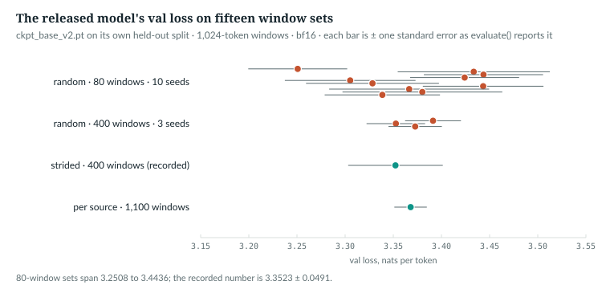
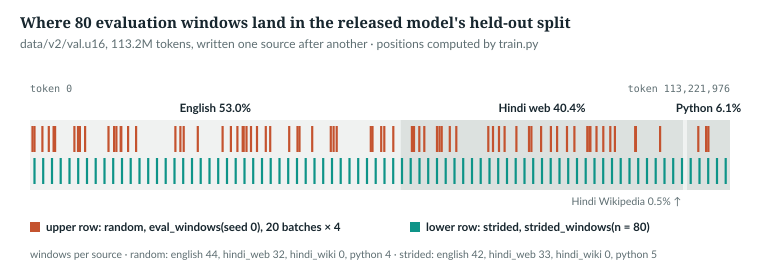
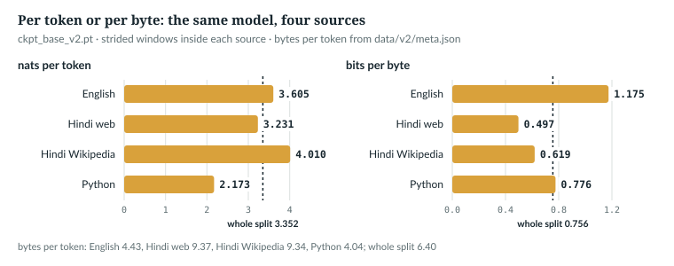

# 24  Measuring progress honestly

A training log prints a val loss to four decimals. This chapter reads the code
behind it, measures what the decimals are worth on the released model, and
ends with what a loss cannot say. Prerequisites: Chapters 3, 21 and 22. A
bare "§n" is a section of `docs/RESULTS.md`.

| Term | Meaning |
|---|---|
| held-out split | text the model never trains on, kept to measure it (`val_data` in `anulm/training/train.py`) |
| window | `block_size` + 1 consecutive token ids: inputs plus their next-token targets |
| val loss | mean cross-entropy, in nats per token, over a set of held-out windows |
| standard error | the typical distance between a sample's mean and the mean of the whole population: the spread of single values ÷ √n |
| paired comparison | two models scored on the same windows, so the windows' own difficulty cancels in the difference |
| bits per byte | the loss in bits, divided by the bytes of text a token covers; comparable across tokenizers |
| golden set | a fixed file of items with known answers, scored for accuracy |

## 24.1  A val loss is an estimate

Every window has its own loss, and the number you want is the mean over every
window of the split. `main` makes the split (lines 689–695): the build's
held-out file, every tenth chunk with `--val-interleave`, or the last 10%. The
released model's holds 113,221,976 tokens. The log prints a sample mean over a
few windows, whose standard error is s/√n for n values with spread s.

`IN THE REPO`

## 24.2  The same windows every time

> **In the repo** · `anulm/training/train.py` · `eval_windows` · lines 338–348 · @fdbb09a

```python
def eval_windows(data: torch.Tensor, batch_size: int, block_size: int, iters: int, seed: int = 0):
    # ...
    g = torch.Generator().manual_seed(seed)
    return [torch.randint(len(data) - block_size - 1, (batch_size,), generator=g)
            for _ in range(iters)]
```

`g`, a private generator reseeded on every call, gives every evaluation of a
run the same starts and leaves the training order alone. Each `torch.randint`
is one batch of starts, shape (`batch_size`,), with room for `block_size`
inputs plus a target; `--eval-iters` sets `iters`, 20 by default. Same windows
make evaluations *paired* (24.5), not accurate (24.4).

Every val loss logged before `--eval-windows` existed was read through this
function (§26; the docstring's "every val loss" is older than the strided runs
of §32 and §39), so a test freezes the indices it returns:

> **In the repo** · `tests/test_model.py` · `eval_windows_are_frozen_and_strided_windows_cover_the_split` · lines 994–998 · @fdbb09a

```python
    data = torch.arange(100_000)
    w = eval_windows(data, 8, 512, 20)
    assert len(w) == 20 and all(len(b) == 8 for b in w)
    assert w[0][:4].tolist() == [90040, 77448, 53808, 91071], w[0][:4].tolist()
    assert w[-1][:4].tolist() == [9859, 87228, 2271, 62460], w[-1][:4].tolist()
```

On the data 0 … 99,999 a start is its own value; a change to the draw would
silently restate every recorded number, and this fails first.

`IN THE REPO`

## 24.3  The error bar `evaluate()` prints

> **In the repo** · `anulm/training/train.py` · `evaluate` · lines 477–533 · @fdbb09a

```python
@torch.no_grad()
def evaluate(model, data, args, iters: int | None = None) -> tuple[float, float]:
    # ...
    model.eval()
    fixed = getattr(args, "eval_windows", 0)
    if fixed:
        batches = strided_windows(data, args.batch_size, args.block_size, fixed)
    else:
        iters = iters if iters is not None else getattr(args, "eval_iters", 20)
        batches = eval_windows(data, args.batch_size, args.block_size, iters)
    losses = torch.zeros(len(batches))
    counts = torch.zeros(len(batches))
    for i, ix in enumerate(batches):
        x, y = make_batch(data, ix, args.block_size, args.device)
        with args.autocast:
            _, loss = model(x, y)
        losses[i] = loss.item()
        counts[i] = len(ix)
    model.train()
    # Weighted by windows, because a strided set can end in a short batch.
    mean = float((losses * counts).sum() / counts.sum())
    if len(batches) > 1:
        var = float((counts * (losses - mean) ** 2).sum() / counts.sum())
        sem = (var / len(batches)) ** 0.5
    else:
        sem = float("nan")
    return mean, sem
```

1. **`model.eval()`** switches off the router's regularisers and load counts.
   It returns a pair, `(mean, sem)`, as its annotation says.
2. **`batches`**: (`batch_size`,) start tensors, strided (24.4) or random.
3. **The loop:** `make_batch` gives (B, S) inputs and targets, S =
   `block_size`; one mean loss and one window count are kept per batch.
4. **`mean`** is weighted by windows. **`sem`** is the spread of the *batch*
   losses over √(number of batches); one batch returns NaN, not a false zero.

The log prints `val loss 3.3523 +/- 0.0491`. `book/code-examples/ch24_error_bars.py`
(**Book example, not repository code**) trains `tiny()` 150 steps on an
ordered corpus, a repeating pattern then random ids, and recomputes the bar:

```python
    args = argparse.Namespace(batch_size=8, block_size=cfg.block_size, device="cpu",
                              autocast=contextlib.nullcontext(), eval_iters=20, eval_windows=0)
    mean, sem = T.evaluate(model, val, args)
    b = batch_losses(model, val, T.eval_windows(val, 8, cfg.block_size, 20), args)
    by_hand = (((b - b.mean()) ** 2).mean() / len(b)).sqrt().item()
```

```
1. evaluate(): 1.5702 +/- 0.1461
   by hand from its 20 batch losses: mean 1.5702, sqrt(var / 20) = 0.1461
```

*verified*: printed and asserted by the script.

`IN THE REPO`

## 24.4  What the bar is worth, and covering the split

The released checkpoint records 3.3523 ± 0.0491, and `evaluate()` with its
settings returns exactly that. `book/code-examples/ch24_measure_val_noise.py`
(**Book example, not repository code**) then scores other window sets with a
copy of `evaluate()`'s loop:

```python
@torch.no_grad()
def batch_losses(m, data, batches, ac):
    """The loss AnuLM.forward returns for each batch, exactly as train.evaluate() reads it."""
    m.eval()
    out = []
    for ix in batches:
        x, y = T.make_batch(data, ix, BLOCK, DEV)
        with ac:
            _, loss = m(x, y)
        out.append(loss.item())
    return torch.tensor(out, dtype=torch.float64)
```

| windows | sets | val loss | ± per set |
|---|---|---|---|
| random, 20 batches × 4 = 80 (the default) | 10 seeds | 3.2508 to 3.4436, sd 0.0658 | about 0.067 |
| random, 100 batches × 4 = 400 | 3 seeds | 3.3526 to 3.3912 | about 0.029 |
| strided, 400 (the recorded setting) | 1 | 3.3523 | 0.0491 |
| strided inside each source, 1,100 | 1 | 3.3680 | 0.0169 |

*measured*: `ckpt_base_v2.pt` on `data/v2/val.u16`, 1,024-token windows,
bf16; output in `book/measurements/part_v_b_val_noise.json`.



*Figure 24.2 · How much a val loss moves with its windows.* One dot per set,
± one standard error as `evaluate()` reports it. *measured*.

For random sets the bar is honest about the *level*: ten default sets spread
with sd 0.0658, each reporting about ± 0.067. It is not the error of a *move*:
every evaluation in a run reuses seed 0's windows, so a change between two is
paired (24.5), with an error from per-batch differences that is not printed.
§25 called a 0.015 "plateau" on the coder run noise against six window sets'
sd of 0.125, the level's error; the plateau was read against no valid bar.

Random starts also clump. On the released split that does not explain the
spread. `ch24_error_bars.py` recomputes each default set's windows, counts them
per source, and predicts the set's mean from the per-source means of 24.6:

```python
    class Length:                                      # eval_windows reads only len(data)
        def __len__(self):
            return n

    obs, pred = [], []
    print("\nreleased split: source mix of each default random set, and the mean it predicts")
    for s in r["random80"]["sets"]:
        ix = [int(i) for b in T.eval_windows(Length(), 4, r["block"], 20, seed=s["seed"]) for i in b]
        cnt = {k: sum(a <= p < z for p in ix) for k, (a, z) in edges.items()}
        pred.append(sum(cnt[k] * per[k]["loss"] for k in cnt) / len(ix))
        obs.append(s["mean"])
        print(f"  seed {s['seed']}: windows {list(cnt.values())}  predicted {pred[-1]:.4f}  observed {obs[-1]:.4f}")
    o, p = torch.tensor(obs), torch.tensor(pred)
    print(f"  correlation {torch.corrcoef(torch.stack([o, p]))[0, 1]:.3f}; sd predicted from the mix "
          f"{p.std():.3f}, sd observed {o.std():.3f}")
```

```
  seed 0: windows [44, 32, 0, 4]  predicted 3.3835  observed 3.2508
  correlation 0.005; sd predicted from the mix 0.017, sd observed 0.066
```

*verified* (windows as English, Hindi web, Hindi Wikipedia, Python): the mix
does not track the mean; the spread comes from how hard individual windows
are. `--eval-windows K` replaces random starts with K evenly spaced ones:

> **In the repo** · `anulm/training/train.py` · `strided_windows` · lines 351–372 · @fdbb09a

```python
def strided_windows(data: torch.Tensor, batch_size: int, block_size: int, n: int):
    # ...
    span = len(data) - block_size - 1
    assert span > 0, "validation split is shorter than one window"
    n = min(n, span)
    step = span / n
    # round-half-down on the midpoint of each cell: evenly spaced, no duplicates
    # until n approaches span, and independent of how they are then batched.
    idx = torch.tensor([int(i * step + step / 2) for i in range(n)], dtype=torch.long)
    return [idx[i:i + batch_size] for i in range(0, n, batch_size)]
```

`span` counts valid starts and clamps `n` (K above); `step` cuts the split into
K cells and `idx`, shape (K,), takes each midpoint, with no seed. Batches are sliced
afterwards, so unlike the random set it ignores `--batch-size`. The test:

> **In the repo** · `tests/test_model.py` · `eval_windows_are_frozen_and_strided_windows_cover_the_split` · lines 1000–1006 · @fdbb09a

```python
    flat = lambda bs: [int(i) for b in bs for i in b]
    a, b = strided_windows(data, 8, 512, 100), strided_windows(data, 16, 512, 100)
    assert flat(a) == flat(b), "the window set must not depend on batch size"
    assert len(set(flat(a))) == 100, "strided windows must not repeat"
    assert all(len(x) == 8 for x in a[:-1]) and len(flat(a)) == 100
    span = len(data) - 512 - 1
    assert min(flat(a)) < span * 0.02 and max(flat(a)) > span * 0.98, "must cover the split"
```



*Figure 24.1 · Random and strided windows* on the released model's split,
which `experiments/build_v2.py` writes one source after another. *verified*:
positions from the two functions. Seed 0, the lowest of the ten sets, has
nearly the strided set's mix (44/32/0/4 against 42/33/0/5).

On the toy's ordered corpus the mix does matter, and covering the split helps.
Against a reference, the mean over all 624 non-overlapping windows (not every
possible start, so itself an estimate):

```
2. reference, all 624 non-overlapping windows: 1.5529
   random, 160 windows, 25 seeds: mean 1.5726, sd 0.1260, worst error 0.2548
   strided, 160 windows: 1.5675 (+/- 0.4233 as evaluate() reports it), error 0.0146
```

*verified*. On tinyshakespeare at 320 windows: random sets missed the mean of
all 435 windows by up to 0.0197, the strided set by 0.0049 (§26).

> **Details.** A strided set's bar is conservative, on one assumption:
> `evaluate()` treats batches as independent, but a strided batch holds
> neighbours, which are more alike than random windows. The released model's
> 400 strided windows report ± 0.0311, 0.0491 and 0.0578 in batches of 1, 4 and
> 8, with one mean to 10⁻⁴; per-source scoring gives 3.3680 ± 0.0169
> (*measured*). At batch 1 the bar is the independent-sample formula; a strided
> set could do worse than it only if the data repeated with the stride's period.

`IN THE REPO` · `MEASURED`

## 24.5  Comparing two checkpoints

Score both on the same windows and take the error of the *differences*:

```python
    w = T.eval_windows(val, 8, cfg.block_size, 20)
    a, c = batch_losses(snapshots[140], val, w, args), batch_losses(snapshots[150], val, w, args)
    d = c - a
    se = lambda v: (((v - v.mean()) ** 2).mean() / len(v)).sqrt().item()
```

```
3. step 140: 1.5722 +/- 0.1440   step 150: 1.5702 +/- 0.1461
   difference on the same windows: -0.0020 +/- 0.0043 (paired)
   if the windows had been drawn independently: +/- 0.2052
   the paired error is 48x smaller
```

*verified*: the windows' shared difficulty cancels. Two runs on
different windows are not paired, so each checkpoint records its windows:

> **In the repo** · `anulm/training/train.py` · `main` · lines 782–786 · @fdbb09a

```python
    eval_spec = ({"mode": "strided", "windows": args.eval_windows,
                  "block_size": args.block_size}
                 if args.eval_windows else
                 {"mode": "random-seed0", "iters": args.eval_iters,
                  "batch_size": args.batch_size, "block_size": args.block_size})
```

Every evaluation argument is named, `batch_size` included for the random set.
The split is not: `--data` and `--val-interleave` change `val_data`
(lines 689–695), and `eval_spec` records neither. Adding the split method and
`len(val_data)` would close that gap; nothing does it now. The released
checkpoint holds `strided`, 400, 1,024; Chapter 25's resume path compares two
of these.

`IN THE REPO` · `EXTENSION`

## 24.6  Bits per byte: one axis across tokenizers

On the same Hindi, bytes scored 0.5975 nats per token and a 16k BPE 4.6795,
yet the BPE model was better: 0.700 bits per byte against 0.862 (§7).

> **In the repo** · `anulm/training/train.py` · `main` · lines 906–908 · @fdbb09a

```python
            bpb = val / math.log(2) / args.bytes_per_token
            print(f"  eval @ {step:5d} | val loss {val:6.4f} +/- {val_sem:.4f} | "
                  f"bits/byte {bpb:5.3f}{flag}")
```

÷ ln 2 gives bits; ÷ `bytes_per_token`, from the corpus metadata, gives bits
per byte: 3.3523 / ln 2 / 6.397 = 0.7560 for the released model. That one
ratio averages sources that differ:

| source | share of tokens | nats/token | bytes/token | bits/byte |
|---|---|---|---|---|
| English | 53.0% | 3.605 ± 0.018 | 4.426 | 1.175 |
| Hindi web | 40.4% | 3.231 ± 0.025 | 9.371 | 0.497 |
| Hindi Wikipedia | 0.5% | 4.010 ± 0.071 | 9.341 | 0.619 |
| Python | 6.1% | 2.173 ± 0.149 | 4.039 | 0.776 |



*Figure 24.3 · Loss per token and per byte, by source.* *measured*. Change the
mix and 0.756 moves with no change in the model. Comparing models also needs
shared text; `anulm/eval/eval_bench.py` scores one file, each model with its tokenizer:

> **In the repo** · `anulm/eval/eval_bench.py` · `score` · lines 55–71 · @fdbb09a

```python
    bs = cfg.block_size
    n_win = (len(ids) - 1) // bs
    ids = ids[: n_win * bs + 1]
    x = ids[:-1].view(n_win, bs)
    y = ids[1:].view(n_win, bs)
    dtype = torch.bfloat16 if device.startswith("cuda") else torch.float32
    nll_sum, n_tok, t0 = 0.0, 0, time.time()
    for i in range(0, n_win, batch_size):
        xb, yb = x[i: i + batch_size].to(device), y[i: i + batch_size].to(device)
        with torch.autocast(device_type="cuda", dtype=dtype, enabled=device.startswith("cuda")):
            _, loss = m(xb, yb)
        nll_sum += loss.item() * xb.numel()
        n_tok += xb.numel()
    nats_per_token = nll_sum / n_tok
    # The scored span covers n_tok tokens; convert with the file's own ratio.
    bytes_per_token = n_bytes / len(ids)
    bits_per_byte = nats_per_token / math.log(2) / bytes_per_token
```

`x` and `y`, (`n_win`, `bs`), cover the file in non-overlapping windows, so
nothing is sampled. Batch means are weighted back by token count, and the ratio
is this file's bytes over this tokenizer's ids. The text must be clean: with
11% of its documents leaked into one corpus, that model scored 0.637 bits per
byte, "best of all"; without them, 0.734, the worst of the BPE models (§9).

`IN THE REPO` · `MEASURED`

## 24.7  What a loss cannot say: golden sets

§19's 600 Hindi fill-in-the-blank (cloze) items (`anulm/data/make_golden.py`) cut a
passage before a content word and add three distractors. `anulm/eval/eval_golden.py`
scores every item twice, by exact match of a greedily decoded next word and by
multiple choice; the multiple-choice part:

> **In the repo** · `anulm/eval/eval_golden.py` · `score` · lines 85–102 · @fdbb09a

```python
        # --- multiple choice: one batch, the 4 choices right-padded ------
        cands = [codec.encode(" " + c) for c in it["choices"]]
        longest = max(len(c) for c in cands)
        keep = bs - longest
        pre = prefix[-keep:]
        rows = [pre + c + [0] * (longest - len(c)) for c in cands]
        x = torch.tensor(rows, dtype=torch.long, device=device)
        with ac:
            logits, _ = m(x[:, :-1], x[:, 1:])
        logp = F.log_softmax(logits.float(), dim=-1)
        totals = []
        for r, c in enumerate(cands):
            # tokens of the candidate sit at positions len(pre) .. len(pre)+len(c)-1
            # and are predicted from the position before each.
            pos = torch.arange(len(pre) - 1, len(pre) - 1 + len(c), device=device)
            tgt = x[r, len(pre): len(pre) + len(c)]
            totals.append(logp[r, pos, tgt].sum().item())
        mc = int(max(range(4), key=totals.__getitem__) == it["answer_idx"])
```

Each choice joins the same trimmed prefix, padded with 0: `x` is (4, L), and
one pass gives `logp`, (4, L − 1, V). A choice's tokens start at `len(pre)` and
are predicted one position earlier, hence `pos`; padding is never summed. The
highest total wins; a total is a sum of log-probabilities, so a choice of more
tokens is penalised. Chance is 25%; §19's best model scored 85.8% and the byte
model 51.8%. A test, `golden_items_are_well_formed_and_the_scorer_runs`,
pins the items' contract.

State how a number was made: the tuned coder scored 0.0% on HumanEval asked as
a question and 3.0% asked to continue (§25), so `anulm/eval/eval_code.py` takes `--mode`.
And a file mixed into training whole is not held out: one evaluation's
uniform 0.72 gain was its own training text (§28).

`IN THE REPO` · `MEASURED`

> **Build it.** The lab book's Chapter 16 measures loss by position (§16.3)
> and checks that no held-out document reaches the mix (§16.5).

## 24.8  Common mistakes, and how to catch them

| Mistake | Catch it |
|---|---|
| judging a move between two evaluations by the printed ± | the ± is the level's error; for a move, take the paired error of per-batch differences (24.5), which the log does not print |
| reading a level to 0.01 from the default 80 windows | pass `--eval-windows 400` on a new run |
| comparing runs whose window sets differ (`--batch-size` changes the random set) | compare the checkpoints' `eval_spec`, or rescore both with `anulm/eval/eval_bench.py` |
| comparing losses across tokenizers | bits per byte, on the same clean text |
| quoting one bits per byte for a mixed split as the model's | report each source |
| changing `--eval-iters` mid-run | never; new windows shift the mean |

## 24.9  Exercises

1. A random 80-window set reports ± 0.067. About how many random windows give
   ± 0.01?
2. Convert §7's losses to bits per byte: 0.5975 nats per token for bytes, and
   4.6795 at 9.64 bytes per token for the BPE model.
3. Hindi Wikipedia scores 4.010 ± 0.071 and English 3.605 ± 0.018, on
   different windows. Is the gap real?
4. A curve rises by 0.004 at three evaluations in a row, with
   `--eval-iters 20`. What can you conclude?

**Answers.** (1) 80 × (0.0674 / 0.01)² ≈ 3,635. (2) 0.862 and 0.700.
(3) Yes: 0.406 ± 0.074, 5.5 standard errors (different windows, so the errors
add in quadrature). (4) Nothing from the log: the moves are paired, so the
printed ± does not apply to them. Score the checkpoints on the same windows and
take the standard error of the per-batch differences (24.5).
*verified*: 1 to 3 are printed by `ch24_error_bars.py`.

---

## Key points

- A val loss is a sample mean over windows; `evaluate()` returns it with the
  standard error across batches.
- On the released model, default random sets of 80 windows range from 3.2508
  to 3.4436; their ± of about 0.067 is an honest error of the level.
- Fixed windows make evaluations paired: a move between them has its own,
  smaller error, from per-batch differences, which the log does not print.
- `--eval-windows K` covers the split and ignores the batch size; on the toy and
  on tinyshakespeare it lands closer to the reference; its printed ± is
  conservative.
- Per-token losses do not compare across tokenizers; bits per byte on shared,
  clean text does, and a mixed split's figure depends on the mix.
- Accuracy needs its own test, and every number needs its prompt mode and
  held-out guarantee stated.

> **In one breath.** A printed val loss is an estimate from a few windows,
> and its ± describes the level, not a move: compare checkpoints on the same
> windows with a paired error, cover the split rather than sample it, use bits
> per byte on shared clean text across tokenizers, and measure accuracy
> separately, saying exactly how.

## References

This chapter cites no external sources. Quality claims are measured here or in
`docs/RESULTS.md` §7, §9, §19, §25, §26 and §28.

Repository evidence, all at @fdbb09a:
- `anulm/training/train.py`: `eval_windows` 338–348, `strided_windows` 351–372, `evaluate`
  477–533, `main` 782–786 (`eval_spec`) and 906–908 (bits per byte).
- `tests/test_model.py`: `eval_windows_are_frozen_and_strided_windows_cover_the_split`
  980–1026, `golden_items_are_well_formed_and_the_scorer_runs` 1465–1507.
- `anulm/eval/eval_bench.py` `score` 32–80; `anulm/eval/eval_golden.py` `score` 59–118;
  `anulm/eval/eval_code.py` `score` 220–272 (`--mode`); `experiments/build_v2.py` (the
  ordered split).
- `anulm/training/train.py` `main` 689–695 (the split).
- Measurements: `book/measurements/part_v_b_val_noise.json` from
  `code-examples/ch24_measure_val_noise.py --save`; book example
  `code-examples/ch24_error_bars.py`.
