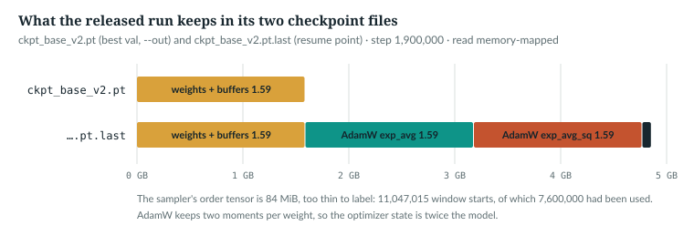
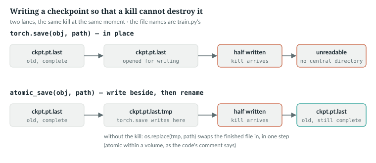
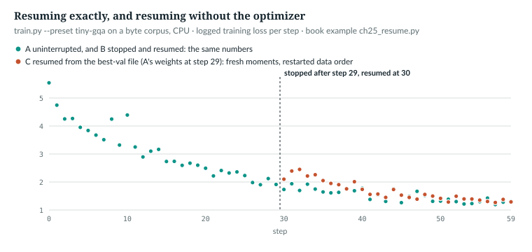

# 25  Checkpoints, resuming and failure

The released model trained for 1.9 million steps on one GPU, in phases, with
restarts. This chapter reads how `anulm/training/train.py` saves, resumes, and survives a
broken resume point; each mechanism came from a failure, told with it.
Prerequisites: Chapters 22 and 24. A bare "§n" is a section of `docs/RESULTS.md`.

| Term | Meaning |
|---|---|
| checkpoint | a file holding a model's state, written with `torch.save` |
| best-val file | `--out`: the weights at the lowest val loss so far, for sampling |
| resume point | `<out>.last`: the newest step, with everything needed to continue it |
| optimizer moments | AdamW's running averages of each gradient and its square (Chapter 7) |
| atomic write | here: a write that, if the process is killed, either completes or leaves the old file untouched |
| weights-only load | `torch.load(weights_only=True)`: rebuilds tensors and plain containers, and only the classes allow-listed by name |

## 25.1  Two files

At every evaluation `anulm/training/train.py` writes up to two checkpoints:

> **In the repo** · `anulm/training/train.py` · `main` · lines 891–905 · @b42998d

```python
        if (step + 1) % args.eval_every == 0 or step == end - 1:
            val, val_sem = evaluate(raw_model, val_data, args)
            flag = ""
            if val < best_val:
                best_val = val
                atomic_save({"model": raw_model.state_dict(), "cfg": cfg,
                             "step": step, "val_loss": val, "val_sem": val_sem,
                             "eval_spec": eval_spec}, args.out)
                flag = "  <- saved"
            # Always write the resume point, best or not: it exists to recover
            # from a kill, and the newest step is what we want to continue from.
            atomic_save({"model": raw_model.state_dict(), "opt": opt.state_dict(),
                         "cfg": cfg, "step": step, "val_loss": val, "val_sem": val_sem,
                         "eval_spec": eval_spec, "best_val": best_val,
                         "sampler": sampler.state()}, last_path)
```

- **When:** every `--eval-every` steps, and at this invocation's last step.
- **The best-val file**, only on improvement: weights, configuration, step and
  `eval_spec`, all a sampler needs.
- **The resume point**, every time: adds the optimizer state, `best_val` and
  the sampler's position.
- **`state_dict()`** holds parameters *and buffers*, such as each router's
  `expert_bias`, which steers routing without being trained (Chapter 18).

The released run's pair, read memory-mapped:



*Figure 25.1 · What a resume point holds.* *measured*:
`book/code-examples/ch25_measure_resume_point.py` (with `--save`, it writes
`book/measurements/part_v_b_resume_point.json`; not rerun at @b42998d: needs
`ckpt_base_v2.pt` and its `.last`, so the numbers are from the earlier run,
whose files have not changed). Sizes are decimal GB, as in the code's
comments; 1.59 GB is 1.48 GiB.

| | `ckpt_base_v2.pt` | `ckpt_base_v2.pt.last` |
|---|---|---|
| on disk | 1.59 GB | 4.86 GB |
| weights and buffers | 397,660,560 fp32 numbers, 1.59 GB | the same |
| AdamW `exp_avg`, `exp_avg_sq` | | 1.59 GB each |
| sampler | | epoch 0, 7,600,000 of 11,047,015 windows used |
| `step` (0-based), `val_loss`, `best_val` | 1,899,999, 3.3523 | 1,899,999, 3.3523, 3.3523 |

The optimizer state is twice the model. The run ended on its best
evaluation, so both files should hold the same weights. Equal `step` and
`val_loss` only suggest it, so the script checks it directly: it compares all
1,551 tensors of the two files with `torch.equal`, and every one is equal
(*verified*; `same_weights` in the saved JSON).

`IN THE REPO` · `MEASURED`

## 25.2  A write that a kill cannot destroy

> **In the repo** · `anulm/training/train.py` · `atomic_save` · lines 32–46 · @b42998d

```python
def atomic_save(obj, path) -> None:
    """torch.save, but a kill mid-write cannot destroy the existing file.

    `<out>.last` is 4.8 GB on the 400M coder and takes seconds to write.
    Killed in the middle -- and on Windows a scheduled task shares the
    interactive console, so Ctrl+C reaches it -- `torch.save` leaves a
    truncated zip that `torch.load` refuses with "failed finding central
    directory", i.e. the resume point is gone. That happened at step
    265,000 of the coder run on 2026-09-12 and cost the optimizer state.
    Write beside it and rename: `os.replace` is atomic within a volume, so
    the old checkpoint survives until the new one is complete.
    """
    tmp = Path(str(path) + ".tmp")
    torch.save(obj, tmp)
    os.replace(tmp, path)
```

`torch.save` writes to `<path>.tmp`, never to the file a resume reads; only a
finished write is swapped into place by `os.replace`, in one step. A kill
leaves a broken `.tmp` and the old checkpoint intact. `anulm/training/finetune.py` uses it too.
The sizes in the story are different runs: 4.8 GB is the 400M coder's resume
point, 4.6 GB the Hindi 350M run's (§8), 4.86 GB the released run's (25.1).

> **Details.** What it does not cover. There is no `fsync` before the rename,
> so it guards against a killed process, not necessarily against power loss or
> an operating-system crash; and what happens when another process holds the
> target open is left to the platform. Neither is handled or tested here. A
> kill *between* the two saves of 25.1 is possible too: the best-val file is
> new, `.last` is old, and the resumed run's older `best_val` can let a worse
> model overwrite the best-val file at its next evaluation.



*Figure 25.2 · In-place and atomic checkpoint writes.* *illustrative*; the
behaviour of each lane is verified by the book example below,
`book/code-examples/ch25_resume.py`.

After the kill at step 265,000, a scheduled task restarted training every 30
minutes; each restart died on the unreadable file in 11 seconds, and for about
three hours it looked like healthy self-restarting (§25). Earlier, a kill had
truncated the best-val file and `.last` restored it (§8).

`book/code-examples/ch25_resume.py` (**Book example, not repository code**)
swaps `torch.save` for a writer that stops halfway, then saves in place and
through `atomic_save`:

```python
    def killed_save(obj, path):                     # writes half the file, then the process "dies"
        real_save(obj, str(path) + ".full")
        data = Path(str(path) + ".full").read_bytes()
        os.remove(str(path) + ".full")
        Path(path).write_bytes(data[: len(data) // 2])
        raise KeyboardInterrupt("killed mid-write")

    # ...
    for how in ("torch.save in place", "train.atomic_save"):
        path = tmp / f"{how.split('.')[1].split()[0]}.pt"
        real_save(old, path)
        torch.save = killed_save
        try:
            (T.atomic_save if how.startswith("train") else torch.save)(new, path)
        except KeyboardInterrupt:
            pass
        finally:
            torch.save = real_save
```

```
Part 2. a kill in the middle of a checkpoint write
  torch.save in place  -> save.pt RuntimeError: PytorchStreamReader failed reading zip archive: failed findi
  train.atomic_save    -> atomic_save.pt loads; holds the old checkpoint
```

*verified*: in place, the error the docstring quotes; through `atomic_save`,
the old checkpoint survives.

`IN THE REPO` · `IMPLEMENTATION-DEPENDENT`

## 25.3  What a resume point must hold

To continue exactly, a resume point needs everything that decides the next
step: weights and buffers, both AdamW moments, the step (it sets the learning
rate), the data order, kept by `WindowSampler` (Chapter 21), and any other
random state. `anulm/training/train.py` saves all but the last: the global RNG is reseeded at
line 645 and not saved, so dropout above 0 or `--sample-with-replacement`
(line 859) would not resume exactly. The sampler's state:

> **In the repo** · `anulm/training/train.py` · `WindowSampler.state` · lines 152–160 · @b42998d

```python
    def state(self) -> dict:
        return {"epoch": self.epoch, "pos": self.pos, "order": self.order, "g": self.g.get_state()}

    def load_state(self, s: dict):
        self.epoch, self.pos, self.order = s["epoch"], s["pos"], s["order"]
        self.g.set_state(s["g"])
```

`order` is this epoch's shuffled starts, shape (W,) for W windows per epoch;
`pos` counts those used; `g`'s state makes the *next* epoch's shuffle match too:

> **In the repo** · `tests/test_model.py` · `window_sampler_resumes_exactly` · lines 956–966 · @b42998d

```python
def window_sampler_resumes_exactly():
    from anulm.training.train import WindowSampler
    a = WindowSampler(50_000, 128, 4, seed=11)
    for _ in range(137):
        a.next()
    state = a.state()
    b = WindowSampler(50_000, 128, 4, seed=999)     # different seed: state must win
    b.load_state(state)
    for _ in range(300):                             # crosses an epoch boundary
        assert torch.equal(a.next(), b.next()), "resumed sampler diverged from the original"
    assert a.epoch == b.epoch and a.pos == b.pos
```

`b` has another seed, so only the state can make it agree, and 300 batches
cross an epoch boundary, where `g` matters. `checkpoint_roundtrip_is_exact`
(line 460) requires a reloaded model's logits to match exactly.

`IN THE REPO`

## 25.4  The resume path

With `--resume`, `main` reads the resume point before the first step:

> **In the repo** · `anulm/training/train.py` · `main` · lines 788–840 · @b42998d

```python
    start_step, best_val = 0, float("inf")
    last_path = Path(str(args.out) + ".last")
    if args.resume and last_path.exists():
        # ...
        try:
            ck = safe_load(last_path, map_location="cpu")
        except UnsafeCheckpointError:
            # Readable but refused by the weights-only loader: a policy
            # decision for the user (the error names the escape), not damage
            # to paper over by silently dropping the optimizer state.
            raise
        except Exception as e:
            # ...
            print(f"WARNING: {last_path} is unreadable ({type(e).__name__}: "
                  f"{str(e)[:80]}).")
            if not Path(args.out).exists():
                raise
            ck = safe_load(args.out, map_location="cpu")
            ck = {"model": ck["model"], "step": ck["step"],
                  "best_val": ck.get("val_loss", float("inf"))}
            # ...
        raw_model.load_state_dict(ck["model"])
        if "opt" in ck:
            if len(ck["opt"]) != len(opt.opts):
                p.error(f"{last_path} holds state for {len(ck['opt'])} optimizer(s) but --optimizer "
                        f"{args.optimizer} builds {len(opt.opts)}; resume with the optimizer the run used")
            opt.load_state_dict(ck["opt"])
        start_step = ck["step"] + 1
        best_val = ck.get("best_val", float("inf"))
        if "sampler" in ck:
            sampler.load_state(ck["sampler"])
        prev = ck.get("eval_spec")
        if prev and prev != eval_spec:
            print(f"  NOTE: this run measures val loss differently from the one it "
                  f"resumes ({prev} -> {eval_spec}). The curve's earlier points are "
                  f"not comparable with the ones from here.")
        # ...
        del ck
        if args.device.startswith("cuda"):
            torch.cuda.empty_cache()
    elif args.resume:
        print(f"--resume given but {last_path} does not exist; starting fresh")
```

1. **To the CPU**, then `del ck`. Loading the 4.6 GB blob onto an 8 GB GPU and
   keeping it there spilled to system memory: 210 tokens per second, not about
   4,400 (§8).
2. **Refuse, or fall back.** `safe_load` (25.7) reads the file without
   running any code in it. A file it *refuses*, because it holds a Python
   object outside the allow-list, re-raises `UnsafeCheckpointError` and stops
   the run. Only a file that is *unreadable* (truncated, corrupt) takes the
   fallback: the best-val file's weights and step, with two warnings; if that
   is missing too, the error is raised.
3. **Restore** the weights and buffers, the optimizer (checking the count:
   Muon builds two, Chapter 7, and a mismatch is a `p.error`, a usage error
   that exits), the step, `best_val` and the sampler.
4. **Compare `eval_spec`** (Chapter 24), and say so if the method changed.

`IN THE REPO`

## 25.5  Stopping, resuming and falling back

`--stop-at` ends an invocation early, after an evaluation and a resume point;
the next invocation passes `--resume`:

> **In the repo** · `anulm/training/train.py` · `main` · lines 849–850 · @b42998d

```python
    end = min(args.steps, args.stop_at) if args.stop_at else args.steps
    for step in range(start_step, end):
```

`--steps` still sets the schedule. The book example runs `anulm/training/train.py`
unchanged on a byte corpus: A runs straight through 60 steps; B stops at 30 and
resumes; C does as B, with its resume point cut in half first.

```python
def run(folder: Path, *extra: str, env: dict | None = None) -> subprocess.CompletedProcess:
    return subprocess.run([sys.executable, "-m", "anulm.training.train", *CMD,
                           "--data", str(folder.parent / "corpus.txt"), "--out", str(folder / "ckpt.pt"), *extra],
                          cwd=ROOT, capture_output=True, text=True, encoding="utf-8", errors="replace",
                          env={**os.environ, "PYTHONPATH": str(ROOT), **(env or {})})


def train(folder: Path, *extra: str) -> str:
    r = run(folder, *extra)
    assert r.returncode == 0, r.stderr[-2000:]
    return r.stdout
```

```python
    log_a = train(A)
    log_b1 = train(B, "--stop-at", "30")
    log_b2 = train(B, "--resume")
    log_c1 = train(C, "--stop-at", "30")
    last = C / "ckpt.pt.last"
    last.write_bytes(last.read_bytes()[: last.stat().st_size // 2])      # a resume point cut in half
    log_c2 = train(C, "--resume")
```

```
Part 1. train.py, 60 steps, stopped at step 30 and resumed
  B> phase done at step 30 of 60 in 5s | best val 1.8364 | resume point <tmp>\B\ckpt.pt.last
  B> resuming from <tmp>\B\ckpt.pt.last at step 30 (best val so far 1.8364, epoch 0.26)
  C> WARNING: <tmp>\C\ckpt.pt.last is unreadable (RuntimeError: PytorchStreamReader failed reading zip archive: failed finding central directory).
  C> WARNING: falling back to <tmp>\C\ckpt.pt at step 30 WITHOUT optimizer state or sampler position.
  A and B agree on model   : True
  A and B agree on opt     : True
  A and B agree on sampler : True
  A and B agree on step    : True
  A and B agree on best_val: True
  C, after the fallback, agrees with A on model: False
  logged loss, steps 30-59 (the resumed half): A 1.5110  B 1.5110  C 1.6710
  step 30: A 1.7326  B 1.7326  C 2.1005
  final val loss: A 1.2510  C 1.2905
```

*verified* (CPU, default flags, deterministic). B ends bit for bit equal to A.
That holds for this setting; on a GPU, non-deterministic kernels make even two
uninterrupted runs differ. C continues with fresh moments and a sampler that
restarts its epoch.



*Figure 25.3 · Exact resume, and the fallback's dent.* Logged training loss
per step: the loss of each step's batch *before* its update. *verified*: from
the same run (`--save` writes `book/measurements/part_v_b_resume_curves.json`).

Read C carefully. Its best-val file was written at step 29, at the same
evaluation as `.last`, so C starts step 30 with A's exact weights. Its logged
2.1005 against A's 1.7326 is a different *batch*: the restarted sampler serves
step 0's windows again (the loss is computed before the update, lines 857–876).
The fresh moments first act on step 31. The means over steps 30–59 also
compare different batches; only the final val loss, 1.2905 against 1.2510, is
read on the same windows. That is the "visible dent" the fallback's comment
promises, and still better than starting over.

`IN THE REPO`

## 25.6  Extending a finished run

Resuming a cosine run with a larger `--steps` lands mid-cosine, at a much
higher rate; `--rewarmup N` ramps back to it:

> **In the repo** · `anulm/training/train.py` · `lr_at` · lines 394–399 · @b42998d

```python
    # Extending a finished run (--resume with a larger --steps) lands mid-cosine,
    # several times the lr the weights last saw. --rewarmup ramps back up to
    # the schedule over N steps instead of jumping.
    rewarmup = getattr(args, "rewarmup", 0)
    if rewarmup and start_step and step < start_step + rewarmup:
        lr *= (step - start_step + 1) / rewarmup
```

For N steps after `start_step` the rate is scaled by (step − `start_step` +
1)/N. It applies to the cosine schedule only: `lr_at` returns earlier, before
these lines, during the initial warmup and on every step of `--schedule wsd`
(lines 380–391). A WSD run needs none in its flat phase.

> **Details.** The coder run's owner was a Windows scheduled task, firing
> every 30 minutes and resuming from `.last` if no trainer was alive. Sharing
> the interactive console, it died to Ctrl+C at steps 10,000 and 105,000, until
> the trainer was launched with its own console (§25).

`IN THE REPO` · `IMPLEMENTATION-DEPENDENT`

## 25.7  Loading without running code

A `.pt` file is a zip holding tensors and a *pickle*: Python's own format,
which records how to rebuild each object. Rebuilding is not passive. A full
unpickle, `torch.load(path, weights_only=False)`, imports whatever module the
pickle names and calls whatever it says to, so a file from the Hub or a
colleague's disk can run any code on your machine the moment it is loaded.

`weights_only=True` swaps in a restricted unpickler: tensors, dicts, lists,
numbers and strings, and any class you allow-list by name. Every load now goes
through one function:

> **In the repo** · `anulm/model.py` · `safe_load` · lines 1231–1261 · @c4a39f8

```python
def safe_load(path, map_location="cpu", trust_pickle: Optional[bool] = None, **kwargs):
    # ...
    import os
    import pickle
    if trust_pickle is None:
        trust_pickle = os.environ.get(TRUST_PICKLE_ENV, "") not in ("", "0")
    if trust_pickle:
        return torch.load(str(path), map_location=map_location, weights_only=False, **kwargs)
    allowed = [AnuLMConfig, (AnuLMConfig, "model.AnuLMConfig")]
    try:
        with torch.serialization.safe_globals(allowed):
            return torch.load(str(path), map_location=map_location, weights_only=True, **kwargs)
    except pickle.UnpicklingError as e:
        # torch's message is a page long; keep the line that names the type
        lines = [l.strip() for l in str(e).splitlines() if l.strip()]
        why = next((l for l in lines if "Unsupported" in l or "global" in l), lines[0] if lines else "")
        raise UnsafeCheckpointError(
            f"{path}: the weights-only loader refused it ({why.split(' Please use')[0][:200]}). "
            f"If you made this file yourself and trust it, load it with trust_pickle=True or set "
            f"{TRUST_PICKLE_ENV}=1; unpickling an untrusted file can run arbitrary code.") from e
```

1. **The escape.** `trust_pickle=True`, or `ANULM_TRUST_PICKLE` set to
   anything but empty or `0`, loads the old way. It is never chosen for you.
2. **The allow-list.** Every project checkpoint stores its configuration as a
   pickled `AnuLMConfig`, so the class must be allowed, under both of the
   names it has been pickled as.
3. **The refusal.** Anything else raises `pickle.UnpicklingError`, which
   becomes `UnsafeCheckpointError` naming both escapes. It is its own type so
   a caller can tell "refused by policy" from "truncated or corrupt".

> **Details.** The two names. A pickle names a class by the module path it
> had *when it was saved*: `anulm.model.AnuLMConfig` (the plain entry) and
> `model.AnuLMConfig` (from before the `anulm/` package, when `anulm/model.py`
> sat at the root). The pair maps the old name onto today's class; without it,
> every older checkpoint would be refused.

That is why the resume path (25.4) re-raises it. If a refused `.last` took the
`except Exception` fallback, a run would quietly restart from the best-val
file without its optimizer moments or sampler position: run C's dent (25.5),
for a file that is not damaged at all. The user decides instead. Part 3 of the
book example writes a real resume point with one extra Python object, an
`argparse.Namespace`, and resumes it twice:

```python
    ck = safe_load(last)                                     # the real resume point loads safely
    ck["args"] = argparse.Namespace(lr=1e-3)                  # a Python object outside the allow-list
    torch.save(ck, last)
    # ...
    refused = run(D, "--resume")
    # ...
    trusted = run(D, "--resume", env={"ANULM_TRUST_PICKLE": "1"})
```

```
Part 3. a readable resume point that holds a Python object
  --resume                      -> exit 1, fell back: False
    anulm.model.UnsafeCheckpointError: <tmp>\D\ckpt.pt.last: the weights-only loader refused it (WeightsUnpickler error: Unsupported global: GLOBAL argpar ...
  --resume, ANULM_TRUST_PICKLE=1 -> exit 0, resuming from <tmp>\D\ckpt.pt.last at step 30
```

*verified* (CPU). The refused run exits without a fallback warning; the
trusted one resumes at step 30. The run's own resume points need no escape:
weights, an optimizer state dict, the sampler's generator state (a byte
tensor) and the configuration are all inside the allow-list.

The repository's own test of the refusal uses a class whose `__setstate__`,
called during a full unpickle, sets a flag:

> **In the repo** · `tests/test_quality_loading.py` · `SafeLoad.test_arbitrary_object_is_refused_with_the_escape_named` · lines 109–122 · @b42998d

```python
    def test_arbitrary_object_is_refused_with_the_escape_named(self):
        self.assertIsNotNone(safe_load, "anulm.model.safe_load is missing")
        torch.save({"x": Payload()}, self.d / "evil.pt")
        Payload.ran = False
        with patch.dict(os.environ, {model_mod.TRUST_PICKLE_ENV: ""}):
            with self.assertRaises(UnsafeCheckpointError) as cm:
                safe_load(self.d / "evil.pt")
            self.assertFalse(Payload.ran, "the object was unpickled anyway")
            self.assertIn("trust_pickle=True", str(cm.exception))
            self.assertIn("ANULM_TRUST_PICKLE", str(cm.exception))
            # load_checkpoint is the path every tool uses: it must refuse too
            with self.assertRaises(UnsafeCheckpointError):
                load_checkpoint(self.d / "evil.pt")
            self.assertFalse(Payload.ran)
```

With the escape variable cleared, both `safe_load` and `load_checkpoint`
must raise, the message must name both escapes, and `Payload.ran` must stay
`False`: the object's code never ran. Its neighbours check that a
`.last`-shaped file loads (line 66), that both legacy names load (line 96),
and that the escapes load the refused file (line 124).

`IN THE REPO`

## 25.8  Loading a checkpoint anywhere

Scripts that only *read* a checkpoint call `load_checkpoint`, which accepts a
`.pt`, a folder written by `anulm/hf/export_hf.py`, or a Hub id:

> **In the repo** · `anulm/model.py` · `load_checkpoint` · lines 1280–1316 · @b42998d

```python
def load_checkpoint(path, map_location="cpu", base: bool = True) -> dict:
    # ...
    p = _P(path)
    if not p.exists() and re.fullmatch(_HUB_ID, str(path).replace("\\", "/")):
        # Say so: a typo in a local path otherwise turns into a confusing
        # network error about a repository that does not exist.
        print(f"{path}: not found locally, trying the Hugging Face Hub")
        from huggingface_hub import snapshot_download
        p = _P(snapshot_download(str(path).replace("\\", "/")))
    if not p.is_dir():
        return safe_load(p, map_location)
    # ...
    if (p / "model.safetensors").exists():
        ck["model"] = load_file(str(p / "model.safetensors"), device=dev)
```

A file is a `.pt`, read by `safe_load`. A folder is read as safetensors, which
hold tensors only and cannot carry code; it holds no optimizer or sampler
state, so it can be sampled from or fine-tuned, not resumed. Chapter 39 covers
the folder format.

> **Details.** The other two paths. A path that does not exist and matches
> `_HUB_ID` (`owner/name`, line 1261) goes to the Hub, and says so first, so a
> mistyped local name is not a silent download or a puzzling network error. In
> a folder, the elided lines start `ck = {}`, rebuild the configuration from
> `config.json` keeping only known fields (an unknown one is dropped
> silently), then load `model.safetensors`. Paths read from a folder's
> `config.json` must stay inside the folder (Chapter 39). Scripts that call
> `torch.load` directly crash on such a folder (`docs/RESULTS.md` §27 found
> five); `an_exported_folder_loads_everywhere_a_pt_does` (line 1057)
> round-trips a folder and scans eleven scripts for `torch.load(ckpt`.

`IN THE REPO`

> **Build it.** The lab book's Chapter 8 writes the same atomic save (§8.5),
> and its checks `resume_is_exact` and
> `a_crash_mid_save_keeps_the_old_checkpoint` catch the two bugs this chapter
> describes (§8.6).

## 25.9  Common mistakes, and how to catch them

| Mistake | Catch it |
|---|---|
| saving weights only, then resuming | compare a resumed run with an uninterrupted one, as in 25.5 |
| writing the checkpoint in place | kill a save halfway (25.2) and load what is left |
| loading a resume point onto the GPU and keeping it | `map_location="cpu"`, then `del` it; watch tokens per second after a resume |
| a restart loop that dies on the same file | log each restart's exit; the coder run looped for three hours |
| saving `parameters()` instead of `state_dict()` | buffers such as `expert_bias` vanish; compare a resumed run with an uninterrupted one (25.5). `expert_bias_is_not_trainable` checks the model's state dict, not what a writer saves |
| trusting `atomic_save` and the fallback to keep working | no test in `tests/test_model.py` covers either; the book example's part 2 and run C are the checks |
| loading a downloaded `.pt` with `torch.load(weights_only=False)` | use `safe_load` or `load_checkpoint`; set `ANULM_TRUST_PICKLE=1` only for a file you made |
| catching every load error and falling back | a refusal is not damage: re-raise `UnsafeCheckpointError`, as 25.4 does. No repository test covers the resume path's re-raise; the book example's part 3 is the check |

## 25.10  Exercises

1. The released model has 397,659,648 parameters (Chapter 20). How many
   bytes do AdamW's two fp32 moments add?
2. Run C resumed from the best-val file at step 30. Which training windows does
   it see again, and why?
3. Why must `atomic_save` write `<path>.tmp` beside the target, rather than in
   a temporary directory elsewhere?
4. You resume a WSD run with `--steps` doubled. Do you need `--rewarmup`?
5. A resume point is refused with `UnsafeCheckpointError`. Why does
   `anulm/training/train.py` stop rather than fall back to the best-val file,
   as it does for a truncated one?

**Answers.** (1) 2 × 4 × 397,659,648 bytes = 3.18 GB, as measured. (2) Its sampler
starts epoch 0's permutation from the beginning, so the windows of steps 0–29.
(3) `os.replace` is atomic only within a volume; another directory may be on
another one. (4) Not if the run is still in its flat phase, and `--rewarmup`
would do nothing under WSD anyway. If the run had already begun its decay,
doubling `--steps` moves the decay's start later, the rate jumps back to the
peak, and `--rewarmup` cannot soften it. (5) The file is intact; the fallback
would throw away its optimizer moments and sampler position (run C's dent) to
avoid a decision only the user can make: trust the file and set the escape, or
not. *verified*: (1) is printed by `ch25_measure_resume_point.py`, (5)'s
behaviour by part 3 of `ch25_resume.py`.

---

## Key points

- `anulm/training/train.py` writes two files: the best-val weights for sampling, and a resume
  point with weights, buffers, optimizer moments, step, sampler and `eval_spec`.
- On the released run the resume point is 4.86 GB, three times the 1.59 GB
  model, because AdamW keeps two moments per weight.
- `atomic_save` writes beside the target and renames, so a process killed
  mid-write leaves the previous checkpoint intact (no `fsync`: not a guard
  against power loss).
- On the CPU with default flags, a resumed run matches an uninterrupted one bit
  for bit; one without moments or sampler position re-reads data and ends worse.
- The resume path loads to the CPU, falls back loudly to the best-val file
  when `.last` is unreadable, stops when it is refused, checks the optimizer
  count and warns when the evaluation method changed.
- `safe_load` unpickles weights-only, with `AnuLMConfig` allowed under its
  three pickled names; anything else needs an explicit `trust_pickle=True` or
  `ANULM_TRUST_PICKLE=1`, and `load_checkpoint` uses it for every `.pt`.

> **In one breath.** Save the newest step with everything that decides the
> next one, write it beside the old file and rename, keep a smaller best-val
> file as a second copy, and resume on the CPU with a loud fallback, so a kill
> costs a dent rather than the run. Load weights-only, and stop on a refusal.

## References

This chapter cites no external sources. Quality claims are measured here or in
`docs/RESULTS.md` §8, §25 and §27.

Repository evidence, all at @b42998d:
- `anulm/training/train.py`: `atomic_save` 32–46, `WindowSampler.state` and `load_state`
  152–160, `lr_at` 375–400, `main` 788–840 (resume), 849–850 (`--stop-at`),
  857–876 (one step), 891–905 (saves).
- `anulm/model.py`: `TRUST_PICKLE_ENV` 1219,
  `UnsafeCheckpointError` 1222–1225, `safe_load` 1228–1258, `_HUB_ID` 1261,
  `load_checkpoint` 1280–1342; `safe_load` 1231–1261 @c4a39f8.
- `tests/test_quality_loading.py`: `SafeLoad` 54–141.
- `tests/test_model.py`: `checkpoint_roundtrip_is_exact` 460–477,
  `window_sampler_resumes_exactly` 956–966, `expert_bias_is_not_trainable`
  400–407, `an_exported_folder_loads_everywhere_a_pt_does` 1057–1109.
- `anulm/training/finetune.py` line 52 imports `atomic_save`.
- Measurements: `book/measurements/part_v_b_resume_point.json` from
  `code-examples/ch25_measure_resume_point.py --save`, and
  `book/measurements/part_v_b_resume_curves.json` from the book example
  `code-examples/ch25_resume.py --save`.
