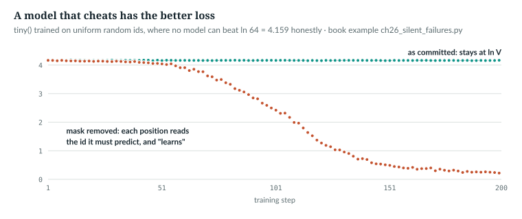
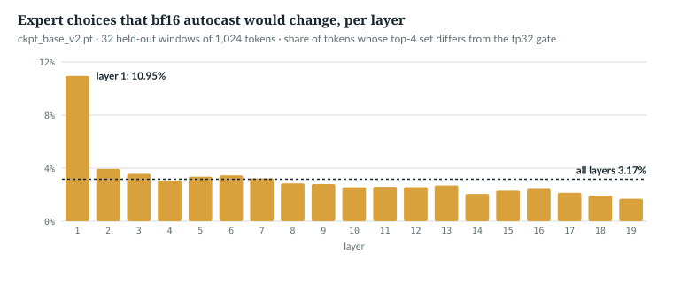

# 26  Debugging: when the loss goes down and the model is still wrong

Most bugs in a language model do not crash and do not stop the loss from
falling. This chapter is about those. It starts with a model that cheats and
gets the better loss, sets out the three kinds of check that catch such bugs,
and then takes the repository's real failures one at a time: what happened,
the code that fixes it, and the test that now fails if it comes back. Each
story is told from a code comment, a test docstring or a section of
`docs/RESULTS.md` (a bare "§n" below). Prerequisites: Chapters 11–25.

| Term | Meaning |
|---|---|
| silent failure | a bug that leaves training running and the loss falling |
| invariance test | changes something the output must *not* depend on, and checks that it did not move |
| equivalence test | runs two implementations of the same maths and checks that they agree |
| conservation test | counts something that must be preserved (tokens, windows, labels) and checks the count |
| mutant | a deliberately broken copy of the code, used to check that a test can fail |

## 26.1  The loss rewards a cheating model

`test_model.py` opens with its reason for existing:

> **In the repo** · `test_model.py` · `test_model` · lines 1–10 · @773b6a8

```python
"""
Tests for AnuLM. Plain asserts, no pytest needed:

    python test_model.py

These target the failure modes that TRAINING WOULD NOT CATCH. A leaky causal
mask still converges (it just cheats). Broken RoPE still converges (it just
loses long-range structure). A MoE that silently drops experts still converges.
Loss going down proves almost nothing about correctness.
"""
```

The book example `book/code-examples/ch26_silent_failures.py` (**Book example,
not repository code**) makes the first claim concrete. It trains `tiny()` on
uniform random ids, where no honest model can beat ln 64 = 4.159 nats, once as
committed and once with the causal mask removed by a mutant of `_sdpa`:

```python
def leaky_sdpa(q, k, v, mask, S, scale, dropout_p):
    """Mutant: attention with no causal mask -- every position sees the whole window."""
    return F.scaled_dot_product_attention(q, k, v, attn_mask=None, is_causal=False,
                                          scale=scale, dropout_p=dropout_p)


def train_curve(steps=200):
    torch.manual_seed(0)
    m = M.AnuLM(TM.tiny())
    opt = torch.optim.AdamW(m.parameters(), lr=3e-3)
    g = torch.Generator().manual_seed(1)
    out = []
    for _ in range(steps):
        x = torch.randint(0, 64, (16, 33), generator=g)
        _, loss = m(x[:, :-1], x[:, 1:])           # targets are the inputs shifted by one
        opt.zero_grad()
        loss.backward()
        opt.step()
        out.append(loss.item())
    return out
```

`leaky_sdpa` has `_sdpa`'s signature (`model.py` line 393) but passes neither
the mask nor `is_causal`, so every position attends to every other. The
training loop feeds (16, 32) inputs and the same ids shifted by one as targets.
The patch works only because `GQAttention` calls `_sdpa` while `NATIVE_GQA` is
off (lines 454–463); with it on, the native branch bypasses `_sdpa` and the
mutant would silently test nothing, so the script asserts it is off.
This leak is hypothetical: the module docstring names it, and no recorded run
had it.

```
Part 1. tiny() on uniform random ids; ln V = 4.159
  step   1: as committed 4.165   mask removed 4.163
  step  50: as committed 4.168   mask removed 4.035
  step 100: as committed 4.165   mask removed 2.437
  step 150: as committed 4.158   mask removed 0.503
  step 200: as committed 4.158   mask removed 0.218
```



*Figure 26.1 · The loss rewards a leaking mask.* *verified*: printed by the
book example (`--save` writes `book/measurements/part_v_b_silent_failures.json`).

The broken model's loss falls to 0.218 because position s can read input s + 1,
which is its own target. On real text the effect is smaller but has the same
sign: the leak looks like progress.

`IN THE REPO`

## 26.2  Three kinds of check

A check that catches a silent failure compares the model with something other
than the loss. The suite uses three kinds.

**Invariance.** Change something the output must not depend on, and require
that it did not move. Causality is the first test in the file:

> **In the repo** · `test_model.py` · `causal_mask_does_not_leak_future` · lines 45–63 · @773b6a8

```python
@test
def causal_mask_does_not_leak_future():
    """Changing token t+1.. must not change logits at positions <= t.

    If this fails the model is training on answers it can see, and every loss
    number reported so far is meaningless.
    """
    for attn in ("gqa", "mla"):
        torch.manual_seed(0)
        m = AnuLM(tiny(attn=attn)).eval()
        x = torch.randint(0, 64, (2, 16))
        with torch.no_grad():
            a, _ = m(x, x)
        x2 = x.clone()
        x2[:, 8:] = torch.randint(0, 64, (2, 8))     # rewrite the future
        with torch.no_grad():
            b, _ = m(x2, x2)
        drift = (a[:, :8] - b[:, :8]).abs().max().item()
        assert drift < 1e-5, f"{attn}: past logits moved by {drift:.2e} when the future changed"
```

Both attention types are built; `x` is (2, 16). Passing targets makes the model
return all (2, 16, 64) logits. Positions 8 to 15 are rewritten, and the logits
at positions 0 to 7 must not move by more than 10⁻⁵. Other invariance tests:
`rope_is_relative` (line 90) moves a query and key together and requires an
unchanged dot product; `sliding_window_limits_reach` (line 642) perturbs a
token outside the window.

**Equivalence.** Two implementations of the same maths must agree:

> **In the repo** · `test_model.py` · `dense_and_sparse_moe_agree` · lines 462–476 · @773b6a8

```python
@test
def dense_and_sparse_moe_agree():
    """The two dispatch implementations must be numerically interchangeable."""
    for attn in ("gqa", "mla"):
        torch.manual_seed(0)
        a = AnuLM(tiny(attn=attn, moe_impl="sparse")).eval()
        torch.manual_seed(0)
        b = AnuLM(tiny(attn=attn, moe_impl="dense")).eval()
        b.load_state_dict(a.state_dict())
        x = torch.randint(0, 64, (2, 16))
        with torch.no_grad():
            ya, _ = a(x, x)
            yb, _ = b(x, x)
        err = (ya - yb).abs().max().item()
        assert err < 1e-5, f"{attn}: sparse and dense MoE differ by {err:.2e}"
```

Two models with the same weights (`load_state_dict`) differ only in how the
experts are dispatched (Chapter 18), and their (2, 16, 64) logits must agree to
10⁻⁵. Most of the suite has this shape: cached against uncached decoding
(`cached_generation_matches_uncached`, line 593), chunked against full loss
(`chunked_loss_matches_the_full_loss_and_its_gradients`, line 1531), compiled
against eager, accumulated against one large batch.

**Conservation.** Count what must be preserved. The interleaved split must lose
no tokens and hold out both sources:

> **In the repo** · `test_model.py` · `interleaved_split_samples_the_whole_corpus` · lines 1753–1766 · @773b6a8

```python
@test
def interleaved_split_samples_the_whole_corpus():
    """An ordered corpus (source A then source B) split at the tail holds out
    only B; the interleaved split must hold out both, and lose nothing."""
    from train import interleaved_split
    data = torch.cat([torch.zeros(8_000_000, dtype=torch.int16),
                      torch.ones(8_000_000, dtype=torch.int16)])
    train, val = interleaved_split(data)
    assert len(train) + len(val) == len(data)
    assert 0.05 < len(val) / len(data) < 0.15
    frac_b = float((val == 1).float().mean())
    assert 0.3 < frac_b < 0.7, f"held-out split is {frac_b:.0%} source B"
    tail = data[int(0.9 * len(data)):]
    assert float((tail == 1).float().mean()) == 1.0, "the old tail split is all B"
```

Source A is 8M zeros, source B 8M ones. The split must keep every token
(`len(train) + len(val)`), hold out 5–15%, and hold out a mix of both sources;
the last line documents that the old tail split was all B. Other conservation
tests count each training window once per epoch
(`window_sampler_covers_every_window_once_per_epoch`, line 787) and each answer
token labelled exactly once (`qa_packing_masks_prompts_and_keeps_examples_whole`,
line 1494).

`IN THE REPO`

## 26.3  Does the check catch the bug? Mutate and see

A test that never fails proves nothing. The book example puts five bugs back
in as temporary patches: four failures the repository recorded, plus the
hypothetical leak of 26.1. It runs each one's test, four from `test_model.py`
and one proposed here (26.4), first against the mutant and then against the
committed code:

```python
class patched:
    """Set obj.name = value for the duration of a with-block."""
    def __init__(self, obj, name, value):
        self.obj, self.name, self.value = obj, name, value

    def __enter__(self):
        self.old = getattr(self.obj, self.name)
        setattr(self.obj, self.name, self.value)

    def __exit__(self, *exc):
        setattr(self.obj, self.name, self.old)
```

```python
    for name, (obj, attr, val), test in mutants:
        with patched(obj, attr, val):
            bad, msg = run(test)
        good, _ = run(test)
```

```
Part 2. mutant -> its test (four from test_model.py, one proposed here)
  causal mask removed                    mutant FAIL   committed PASS   [causal_mask_does_not_leak_future]
      gqa: past logits moved by 8.97e-02 when the future changed
  merge-tree cache kept across train()   mutant FAIL   committed PASS   [merge_tree_eval_cache_sees_optimizer_updates]
      eval after a training step reused stale tables
  validation = last 10% of the file      mutant FAIL   committed PASS   [interleaved_split_samples_the_whole_corpus]
      held-out split is 100% source B
  YaRN temperature dropped from GQA      mutant FAIL   committed PASS   [yarn_temperature_reaches_attention]
      gqa scale 0.3535533905932738 != 0.6625075083950688
  router gate left under bf16 autocast   mutant FAIL   committed PASS   [router_choices_survive_autocast]
      4.2% of expert sets changed under autocast
```

*verified*. Every mutant fails its test, and the committed code passes. The
last check is not in the suite; 26.4 explains why it is needed. The sections
that follow take the mutants one at a time.

> **Build it.** The lab book's checks work the same way: `--self-test` runs
> each chapter's checks against broken versions of the solution, and Chapter
> 8's run caught a gap in its own checks (§8.6 of the course).

`IN THE REPO`

## 26.4  Case: the router that rounded

The router picks experts with a discrete top-k (Chapter 17). Under bf16
autocast, small rounding changes can swap which experts win.

> **In the repo** · `model.py` · `Router.forward` · lines 576–587 · @773b6a8

```python
    def forward(self, x_flat, seq_len: Optional[int] = None):   # (N, D)
        """Returns (topk_idx, combine weights, aux) -- aux is None unless one of
        the regularisers is on and the module is training. `seq_len` lets the
        sequence-wise balance loss see the (B, S) layout of a flat batch."""
        # fp32 router: top-k is discrete, and bf16 rounding would flip choices.
        # Casting the inputs is not enough -- autocast re-casts F.linear to
        # bf16 whatever dtype it is handed, and every GPU run before this fix
        # routed in bf16 (3.2% of expert sets differed from fp32 on a real
        # checkpoint). Autocast has to be off for the whole gate.
        with torch.autocast(device_type=x_flat.device.type, enabled=False):
            topk_idx, w, aux = self._gate(x_flat.float(), seq_len)
        return topk_idx, w.to(x_flat.dtype), aux
```

The input is (N, D), with N here the tokens in the batch, flattened. `torch.autocast(..., enabled=False)`
switches autocast off for everything inside, so `_gate`'s `F.linear` and
sigmoid run in fp32; the weights come back in the caller's dtype. The comment
says why the earlier fix, casting `x_flat` to fp32, did nothing:

```
Part 3. under autocast, F.linear on fp32 tensors returns torch.bfloat16
```

*verified*. The comment's 3.2% was measured on "a real checkpoint". Chapter 23
(23.3) measures it on the released model, and that measurement is the book's
canonical one: 19,717 of 622,592 (token, layer) expert sets change, 3.17%, from
10.95% in layer 1 to 1.69% in layer 19 (`ch23_measure.py`,
`book/measurements/part_v_a_memory.json`). This chapter's script,
`ch26_measure_router_bf16.py`, repeats it on the same 32 windows for the
per-layer figure, and gives the same counts.



*Figure 26.2 · bf16 routing, measured on the released model.* *measured*: the
same measurement as 23.3, per layer, from
`book/measurements/part_v_b_router_bf16.json`. Only the gate's precision
differs between the two choices; the experts run in bf16 throughout, as on the
released grouped path. Rounding can only swap experts whose scores nearly tie,
so the loss would barely show it (*not measured here*); but routing statistics,
load balancing and any comparison with fp32 inference would be measuring a
different model.

No test in the suite pins this. The example's check is a proposed one:

```python
def router_choices_survive_autocast():
    """EXTENSION: the check the suite lacks. bf16 autocast must not change which experts a token gets."""
    torch.manual_seed(0)
    r = M.Router(released()).eval()                  # the released router's shape: 24 experts, top-4
    x = torch.randn(4096, r.weight.shape[1])
    want = r(x)[0].sort(-1)[0]
    with torch.autocast("cpu", dtype=torch.bfloat16):
        got = r(x)[0].sort(-1)[0]
    changed = (want != got).any(-1).float().mean().item()
    assert changed == 0.0, f"{100 * changed:.1f}% of expert sets changed under autocast"
```

It is an invariance test: autocast must not change the sorted (4096, 4)
expert ids. On random weights the mutant changes 4.2% of sets (26.3).

`IN THE REPO` · `MEASURED` · `EXTENSION`

## 26.5  Case: the cache that served stale tables

The merge-tree option (Chapter 10) composes the embedding tables from a sparse
matrix, and in evaluation mode caches the result:

> **In the repo** · `model.py` · `AnuLM._table` · lines 911–929 · @773b6a8

```python
    def _table(self, side: str):
        """The embedding ("in") or output ("out") table as the model uses it."""
        W = self.embed_tokens.weight if side == "in" else self.lm_head.weight
        if not self.cfg.merge_tree or self.cfg.merge_tree not in (side, "both"):
            return W
        if self.training:
            return self._compose(W)
        # Eval: compose once and reuse -- a decode step would otherwise redo
        # the whole-vocabulary product. The cache is dropped by train(), i.e.
        # every time training resumes. It must NOT be keyed on W._version:
        # the fused AdamW step updates weights without bumping it, and a
        # version-keyed cache served step-999 tables to every later eval of
        # the 400M check (val 6.37 -> 10.66 while train loss fell to 4.43).
        if self._merged is None:
            self._merged = {}
        if side not in self._merged:
            with torch.no_grad():
                self._merged[side] = self._compose(W)
        return self._merged[side]
```

In training mode the (V, D) table is recomposed on every call, so gradients
flow. In evaluation mode it is composed once per side and kept in
`self._merged`. The first version invalidated that cache when the weight's
version counter changed, but the fused AdamW step does not change it. Every
evaluation after the first therefore scored the current network with step
999's embeddings. The val loss "rose" from 6.37 to 10.66 while the training
loss fell to 4.43, which looked like the recipe diverging (§32). The fix ties
the cache to the mode instead:

> **In the repo** · `model.py` · `AnuLM.train` · lines 931–933 · @773b6a8

```python
    def train(self, mode: bool = True):
        self._merged = None             # weights may change from here on
        return super().train(mode)
```

`train.py` calls `model.train()` after every evaluation (`evaluate`, Chapter
24), so the cache cannot outlive a training step. The test reproduces the
update the counter cannot see:

> **In the repo** · `test_model.py` · `merge_tree_eval_cache_sees_optimizer_updates` · lines 1671–1681 · @773b6a8

```python
        x = torch.randint(0, 259, (2, 8))
        m.eval()
        with torch.no_grad():
            a, _ = m(x, x)
        m.train()
        with torch.no_grad():
            m.embed_tokens.weight.data.add_(0.5)      # an update invisible to _version
        m.eval()
        with torch.no_grad():
            b, _ = m(x, x)
        assert not torch.allclose(a, b), "eval after a training step reused stale tables"
```

Evaluate, switch to training, change the weights through `.data` (which, like
the fused step, leaves `_version` alone), evaluate again: the logits must
differ. The mutant `train` that keeps the cache fails it (26.3).

`IN THE REPO` · `MEASURED`

## 26.6  Case: the split that held out one language

> **In the repo** · `train.py` · `interleaved_split` · lines 164–178 · @773b6a8

```python
def interleaved_split(data: torch.Tensor, chunk: int = 262144, every: int = 10):
    """Hold out every `every`-th chunk of `chunk` tokens instead of the tail.

    The build scripts concatenate sources in order, so the tail is not a
    sample of the corpus. Measured on data/ctx_mix.multi32k.bin (Hindi,
    English, Python): 60 random windows from the first 30% were 43 Hindi /
    9 English / 8 code, and from the last 10% -- the default validation
    split -- 0 Hindi / 57 English / 3 code. Every val loss read on that file
    through the tail split is an English number. Interleaving gives the
    split the corpus's own mix (160 / 153 / 71 of 384 windows).
    """
    chunks = list(data.split(chunk))
    val = torch.cat(chunks[every // 2::every])
    train = torch.cat([c for i, c in enumerate(chunks) if i % every != every // 2])
    return train, val
```

`data.split(chunk)` cuts the corpus into 262,144-token chunks; every tenth,
starting at the fifth, goes to `val`, and the rest to `train`. The docstring
holds the evidence, also in §32: the first sweep of the lab (§32's small proxy
runs, `experiments/lab.py`) measured ideas aimed at Hindi on a validation split
with no Hindi in it. `--val-interleave` is off by default so older
curves stay comparable (Chapter 21); the test in 26.2 fails on the tail split.

`IN THE REPO` · `MEASURED`

## 26.7  Case: YaRN applied by half

YaRN extends context in two parts: a change to the rotary frequencies and a
softmax temperature (Chapter 29). The GQA path once applied only the first:

> **In the repo** · `model.py` · `GQAttention.__init__` · lines 421–424 · @773b6a8

```python
        # YaRN's temperature term lives here, not in the rotary tables --
        # the same place MLA puts it. Without this, `--yarn` on a GQA model
        # would apply the band blend and silently drop half of YaRN.
        self.scale = cfg.head_dim ** -0.5 * (rotary.attn_mscale ** 2)
```

`self.scale` multiplies every query-key score (Chapter 11); with YaRN off,
`attn_mscale` is 1 and it is the plain 1/√D<sub>h</sub>. The test's docstring
says the missing half "was caught by reading, not by any test, which is why
this covers both" attention types:

> **In the repo** · `test_model.py` · `yarn_temperature_reaches_attention` · lines 149–153 · @773b6a8

```python
    gqa = tiny(attn="gqa", yarn=True, yarn_factor=40.0, head_dim=8)
    g = GQAttention(gqa, Rotary(gqa, dim=8))
    expected = (8 ** -0.5) * (yarn_mscale(40.0, 1.0) ** 2)
    assert abs(g.scale - expected) < 1e-9, f"gqa scale {g.scale} != {expected}"
    assert g.scale > 8 ** -0.5, "gqa: YaRN temperature term was dropped"
```

It recomputes the expected scale from `yarn_mscale` and compares; the mutant's
0.354 against the expected 0.663 is the failure printed in 26.3.

`IN THE REPO`

## 26.8  Case: the instrument, not the model

The quietest failure was in the measurement. Plateaus of 0.015 were read off
the coder run's curve with no error bar at all (§25). Chapter 24 tells the
story, and why the 0.125 spread across window sets, which §25 then set against
them, is the error of the level and not of a move. What changed in code is that
`evaluate()` now returns a standard error and `--eval-windows` exists.
`eval_windows_are_frozen_and_strided_windows_cover_the_split` (line 971) pins
the old windows' indices and checks that the error is finite (NaN for one
batch); no test checks how a move between evaluations is read.

`IN THE REPO` · `MEASURED`

## 26.9  More failures, and what now catches each

| The failure | Recorded in | What catches it now |
|---|---|---|
| the `transformers` wrapper left the rotary tables as uninitialised memory; every weight loaded, positions were noise | test docstring | `transformers_wrapper_matches_the_native_model` (line 1271) |
| an exported question answerer reported itself a base model and hid its question mode | test docstring | `an_exported_qa_checkpoint_still_offers_its_question_mode` (line 1110) |
| exports dropped projectors, LoRA weights and labels, and still loaded as a plain language model | test docstring | `an_export_keeps_what_makes_a_checkpoint_more_than_a_language_model` (line 1170) |
| five evaluation scripts crashed on exported folders | §27; test docstring | `an_exported_folder_loads_everywhere_a_pt_does` (line 914) |
| a generated `random.py` could shadow the standard library for every later problem | `eval_code.py` docstring; test | `eval_code_sandbox_contains_generated_code` (line 1219) |
| the golden-set builder's check passed by luck on a small vocabulary | test comment ("It did, once.") | `golden_items_are_well_formed_and_the_scorer_runs` (line 1448), on 400 words |
| a project rename changed the tokenizer format id, which every older tokenizer (four on the Hub) still carries | test docstring | `bpe_files_load_under_both_format_ids` (line 1367) |
| a documented hazard, not a recorded incident: `is_causal` aligns top-left, wrong for a multi-token step against a cache | `_attn_mask` docstring | `incremental_forward_matches_full_forward` (line 550) |
| a checkpoint killed mid-write; a restart loop for three hours | §25 | `atomic_save` and the fallback (Chapter 25); no test |
| a benchmark with 11% of its documents leaked into a training corpus | §9 | `make_bench.py`'s signature filter; no test in the suite |
| an evaluation file mixed into the training mix whole | §28 | `mix_corpus.py` now holds out `data/bench_hindi.txt`; no test in the suite |
| HumanEval 0.0% from the wrong prompt mode | §25 | `eval_code.py --mode`; no test |
| batch 16 without checkpointing spilled to system RAM, 3,657 against 13,639 tokens per second | `warn_if_spilling` docstring | a warning at step 0, not a test |

Five rows end in "no test" or "a warning": the suite covers the model and its
files well, and the data and evaluation pipeline less. Those are where the next
checks belong.

`IN THE REPO` · `MEASURED`

## 26.10  Running the suite

The suite needs no framework: a decorator collects each test, and `main` runs
them all:

> **In the repo** · `test_model.py` · `main` · lines 1769–1782 · @773b6a8

```python
def main():
    passed, failed = [], []
    for fn in TESTS:
        try:
            fn()
            passed.append(fn.__name__)
            print(f"  PASS  {fn.__name__}")
        except Exception as e:
            failed.append((fn.__name__, e))
            print(f"  FAIL  {fn.__name__}")
            print("        " + "\n        ".join(
                traceback.format_exception_only(type(e), e)).rstrip())
    print(f"\n{len(passed)} passed, {len(failed)} failed, {len(TESTS)} total")
    return 1 if failed else 0
```

`TESTS` is filled by `@test` (line 28) in file order. Each test runs; any
exception counts as a failure and its message is printed; the exit code is 1
if anything failed, so a CI job can gate on it. Run it with
`python -m tests.test_model`. Some tests skip themselves, printing why, when an
optional package (`gradio`, `safetensors`, `transformers`) is missing, and the
grouped-GEMM tests return early on a PyTorch without `F.grouped_mm`; a skip
prints as a PASS.

`IN THE REPO`

## 26.11  Common mistakes, and how to catch them

| Mistake | Catch it |
|---|---|
| trusting a falling loss | add an invariance or equivalence test for the component |
| a test that has never failed | break the code on purpose and watch it fail (26.3) |
| a test with a tolerance wider than the bug | pick the tolerance from the bug's size; the causal test allows 10⁻⁵, the leak moved 0.0897 |
| a test that can pass by luck | make the luck unlikely: the golden builder's test uses 400 distinct words |
| testing on toy data only | measure on the real model too, as 26.4 did for routing |

## 26.12  Exercises

1. Which kind of check is `gradient_accumulation_equals_large_batch`
   (line 437)?
2. Write the mutant that would fail `window_sampler_resumes_exactly`
   (Chapter 25).
3. The leaky model in 26.1 reached 0.218 on random ids. Why can it not reach
   exactly 0?
4. Why does `router_choices_survive_autocast` compare *sorted* expert ids?

**Answers.** (1) Equivalence: two half-batches against one full batch.
(2) Make `WindowSampler.load_state` do nothing; the resumed sampler then follows
its own seed, and the test's `torch.equal` fails. (3) It can reach about ln 64 / 32 = 0.130 at best: the last position's target is
the id after the window, which no position can see. (4) `topk` may return the
same set in a different order when scores tie or nearly tie; only the set
decides the output.

---

## Key points

- A falling loss proves little: with its causal mask removed, `tiny()` reaches
  0.218 on random ids, where an honest model stays at 4.159.
- The suite catches silent failures with invariance, equivalence and
  conservation tests, each comparing the model with something other than its
  loss.
- A test is trusted only after it fails on a mutant: four recorded failures
  and one hypothetical leak, put back, each fail their test.
- bf16 autocast in the router would change 3.17% of the released model's
  expert sets (Chapter 23's measurement); no test in the suite pins it.
- A cache keyed on a version counter, a tail split and a half-applied YaRN all
  trained without error, and each now has a test.
- The model and its files are well covered; data, benchmarks and evaluation
  modes still rely on warnings and care.

> **In one breath.** Loss going down proves almost nothing, so test what the
> loss cannot see: outputs that must not move, implementations that must
> agree, counts that must hold; break the code to prove each test can fail,
> and write the next one where the last silent bug was found.

## References

This chapter cites no external sources. Quality claims are measured here or in
`docs/RESULTS.md` §9, §25, §27, §28 and §32.

Repository evidence, all at @773b6a8:
- `test_model.py`: module docstring 1–10; `test` 28–30;
  `causal_mask_does_not_leak_future` 45–63; `yarn_temperature_reaches_attention`
  132–161; `dense_and_sparse_moe_agree` 462–476;
  `merge_tree_eval_cache_sees_optimizer_updates` 1658–1681;
  `interleaved_split_samples_the_whole_corpus` 1753–1766; `main` 1769–1782;
  and the tests named in 26.2 and 26.9.
- `model.py`: `_sdpa` 393–397; `GQAttention.__init__` 421–424;
  `Router.forward` 576–587; `AnuLM._table` 911–929; `AnuLM.train` 931–933.
- `train.py`: `interleaved_split` 164–178; `warn_if_spilling` 181–196.
- `eval_code.py` (docstring); `make_bench.py`; `mix_corpus.py`.
- Chapter 23's canonical router-flip measurement: `book/measurements/part_v_a_memory.json`.
- Measurements: `book/measurements/part_v_b_router_bf16.json` from
  `code-examples/ch26_measure_router_bf16.py --save`;
  `book/measurements/part_v_b_silent_failures.json` from the book example
  `code-examples/ch26_silent_failures.py --save`.
