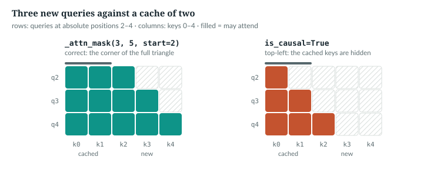
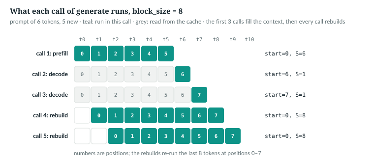
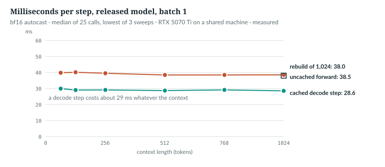

# 27  Autoregressive decoding and the KV cache

To write text, a model runs in a loop: read the sequence, score the next token,
pick one, append it, repeat. Done naively, every step re-reads the whole
sequence. This chapter reads `AnuLM.generate` and the KV cache that removes the
repeated work, and checks the cached path against the uncached one. Chapter 28
covers how a token is picked; Chapter 29, what happens past the context.

**New words.** Part VI starts here; these terms recur through Chapter 29.

| Term | Meaning |
|---|---|
| autoregressive decoding | producing a sequence one token at a time, each step conditioned on everything before it |
| KV cache | the keys and values of tokens already processed, kept per layer so they are not recomputed |
| prefill | the first call, which runs the whole prompt at once and fills the cache |
| decode step | a later call that runs one new token against the cache |
| context slide | keeping only the last `block_size` tokens once the sequence is longer |
| sampling | drawing the next token from the model's distribution, after reshaping it (Chapter 28) |
| top-k | keeping only the k most likely tokens before drawing (Chapter 28) |
| top-p (nucleus) | keeping the smallest set of most likely tokens whose probabilities reach p; not in this repository (Chapter 28) |
| n-gram block | forbidding any token that would repeat a sequence of n tokens already produced (Chapter 28) |
| sliding window | a layer's attention limited to the last W positions (Chapter 29) |
| YaRN | "Yet another RoPE extension": rescales rotary frequencies and the attention scale to run past the trained length (Chapter 29) |

The symbols are Part IV's (Chapter 20, 20.1), with T = `start` + S: the
`start` tokens already cached plus the S new ones.

---

## 27.1  The loop, and its cost without a cache

> **In the repo** · `anulm/model.py` · `AnuLM.generate` · lines 1140–1151 · @b42998d

```python
        B = idx.shape[0]
        bs = self.cfg.block_size
        done = torch.zeros(B, dtype=torch.bool, device=idx.device)
        cache, start, pending = None, 0, idx
        for _ in range(max_new_tokens):
            if not use_cache:
                logits, _ = self(idx[:, -bs:])
            else:
                if cache is None or start + pending.shape[1] > bs:
                    cache, start, pending = self.new_cache(), 0, idx[:, -bs:]
                logits, _ = self(pending, cache=cache, start=start)
                start += pending.shape[1]
```

- `idx` is the (B, S) prompt and grows one column per step; `done` marks rows
  that have ended (Chapter 28). The state is `cache`, `start` (tokens cached)
  and `pending` (tokens not yet run).
- **Uncached:** run the last `bs` tokens of the sequence, every step.
- **Cached:** on the first step, or when `pending` would not fit, start a fresh
  cache from the last `bs` tokens; then run only `pending` and advance `start`.

Lines 1152–1160 take the last position's logits and edit them, and the
elided lines 1164–1167 apply temperature and `top_k` (Chapter 28); the end of
the loop body picks a token and sets up the next step:

> **In the repo** · `anulm/model.py` · `AnuLM.generate` · lines 1161–1173 · @b42998d

```python
            if temperature <= 0:
                nxt = logits.argmax(dim=-1, keepdim=True)              # (B, 1), no draw
            else:
                # ...
                probs = F.softmax(logits, dim=-1)
                nxt = torch.multinomial(probs, num_samples=1)          # (B, 1)
            if eos_id is not None:
                nxt = torch.where(done[:, None], torch.full_like(nxt, eos_id), nxt)
            idx = torch.cat((idx, nxt), dim=1)
            pending = nxt
```

One id per row, (B, 1), is chosen, by argmax at temperature ≤ 0 and by a
random draw otherwise (rows already finished get `eos_id` instead,
Chapter 28), appended to `idx`, and becomes `pending`, the next call's only
input. So the cached path runs the prompt once, then one token
per step; the uncached path runs min(t, `bs`) tokens at length t. The book's
script counts both with the loop's rule:

```python
def positions_processed(prompt, new, bs, cached):
    """Token positions run, summed over generate's calls (its lines 1144–1151)."""
    total, length, start = 0, prompt, None
    for _ in range(new):
        if not cached:
            total += min(length, bs)
        elif start is None or start + 1 > bs:         # (re)build: last bs tokens
            total, start = total + min(length, bs), min(length, bs)
        else:
            total, start = total + 1, start + 1
        length += 1
    return total
```

```
== token positions run, released block_size 1,024, prompt 100
  100 new: uncached    14,950  cached       199  ratio  75.1
  900 new: uncached   494,550  cached       999  ratio 495.0
 1900 new: uncached 1,518,250  cached   999,424  ratio   1.5
```

*verified*: `book/code-examples/ch27_kv_cache.py` (**Book example, not
repository code**), checked against `generate`'s real calls. The last row is
27.5's: once the context is full, the cache stops saving work.

`IN THE REPO`

## 27.2  What the cache holds, and why queries are not in it

> **In the repo** · `anulm/model.py` · `AnuLM.new_cache` · lines 873–875 · @b42998d

```python
    def new_cache(self) -> list[dict]:
        """One dict per layer; each attention module owns its own entries."""
        return [dict() for _ in self.layers]
```

> **In the repo** · `anulm/model.py` · `GQAttention.forward` · lines 480–487 · @c4a39f8

```python
        if cache is not None:
            # Cache the Hkv heads, not their H broadcast copies -- that ratio
            # (4:1 in base v2) is GQA's entire inference saving.
            if "k" in cache:
                k = torch.cat([cache["k"], k], dim=2)
                v = torch.cat([cache["v"], v], dim=2)
            cache["k"], cache["v"] = k, v
        T = k.shape[2]
```

The cache is one dict per layer, filled by that layer's attention after QK-norm
and the rotation, so it holds keys already rotated to their positions. The new
(B, H<sub>kv</sub>, S, D<sub>h</sub>) keys and values are appended on the
position dimension and stored back as (B, H<sub>kv</sub>, T, D<sub>h</sub>).
Only the H<sub>kv</sub> shared heads are kept: sharing key/value heads exists
to cut the memory traffic of incremental decoding [R13], and grouped-query
attention keeps an intermediate number of them [R12].

Why not queries? Under the causal mask, position i's vectors in every layer
depend only on tokens 0 … i, so its key and value are final once computed and
every later step reads them. Its query is used once, by position i itself.

```python
    x = torch.randint(0, 64, (2, 7))                  # (B, S) = (2, 7)
    cache = m.new_cache()                             # one empty dict per layer
    logits, _ = m(x[:, :5], cache=cache, start=0)     # prefill: 5 tokens, one call
    print("prefill start=0 S=5  k", shape(cache[0]["k"]), " logits", shape(logits))
    for t in (5, 6):                                  # decode: one token per call
        logits, _ = m(x[:, t:t + 1], cache=cache, start=t)
        print(f"decode  start={t} S=1  k", shape(cache[0]["k"]), " logits", shape(logits))
    full, _ = m(x, x)                                 # no cache: all positions at once
    err = (logits[:, -1] - full[:, -1]).abs().max().item()
```

```
prefill start=0 S=5  k (2, 2, 5, 8)  logits (2, 1, 64)
decode  start=5 S=1  k (2, 2, 6, 8)  logits (2, 1, 64)
decode  start=6 S=1  k (2, 2, 7, 8)  logits (2, 1, 64)
last position, cached vs full forward: max |difference| 4.5e-08
```

*verified*: `tiny()`. Each call returns the last position only (Chapter 20,
20.6).

> **Details.** Latent attention caches its latent `c`, (B, T, `kv_lora_rank`),
> and one rotary key `k_pe` shared by all heads (`MLAttention.forward`, lines
> 555–564; Chapter 19).

`IN THE REPO`

## 27.3  Prefill, decode, and absolute positions

The **prefill** has S = prompt length and `start` = 0; each **decode step** has
S = 1 and `start` = tokens cached. The rotation needs `start`:

> **In the repo** · `anulm/model.py` · `AnuLM.forward` · lines 897–899 · @b42998d

```python
        if start + S > self.cfg.block_size:      # an error, not an assert: python -O strips those
            raise ValueError(f"positions up to {start + S} exceed block_size {self.cfg.block_size}")
        cos, sin = self.rotary(S, x.device, x.dtype, start=start)
```

> **In the repo** · `anulm/model.py` · `Rotary.forward` · lines 339–343 · @b42998d

```python
    def forward(self, seq_len: int, device, dtype, start: int = 0):
        """cos/sin for absolute positions [start, start + seq_len). `start` is
        the number of tokens already in the KV cache when decoding; 0 otherwise."""
        self._grow(start + seq_len, device, dtype)
        return self.cos_cached[start:start + seq_len], self.sin_cached[start:start + seq_len]
```

A call past `block_size` raises `ValueError`, a real check rather than an
assert, so `python -O` keeps it. `Rotary.forward` returns
the rows for positions `start` … `start` + S − 1, each (S, D<sub>h</sub>)
(Chapter 14). Without `start`, a new token would be rotated as position 0 and
scored at the wrong distances. `rotary_cache_tracks_dtype_and_positions`
(line 733) checks that rows asked for with `start=12` equal rows 12–15 of the
full table.

`IN THE REPO`

## 27.4  The offset mask

A decode step's single query may see every cached key, and a prefill's queries
and keys line up, so neither needs an explicit mask. A chunk of several tokens
against a non-empty cache does:

> **In the repo** · `anulm/model.py` · `_attn_mask` · lines 365–381 · @b42998d

```python
def _attn_mask(S: int, T: int, start: int, window: Optional[int], device):
    # ...
    if window is None and (start == 0 or S == 1):
        return None
    q_pos = torch.arange(start, start + S, device=device)[:, None]
    k_pos = torch.arange(T, device=device)[None, :]
    mask = k_pos <= q_pos
    if window is not None:
        mask &= k_pos > q_pos - window
    return mask
```

> **In the repo** · `anulm/model.py` · `_sdpa` · lines 414–418 · @b42998d

```python
def _sdpa(q, k, v, mask, S, scale, dropout_p):
    return F.scaled_dot_product_attention(
        q, k, v, attn_mask=mask, is_causal=(mask is None and S > 1),
        scale=scale, dropout_p=dropout_p,
    )
```

With no window, a prefill or a decode step gets `None`. Otherwise the queries
sit at absolute positions `start` … `start` + S − 1, a column (S, 1); the keys
at 0 … T − 1, a row (1, T); `k_pos <= q_pos` broadcasts to the (S, T) mask,
True where a query may attend [R50]. The window clause is Chapter 29's. With no
mask and S > 1, `_sdpa` asks for PyTorch's built-in causal mask, which, as the
docstring of `_attn_mask` says, aligns top-left. The script compares the two:

```python
    right = M._attn_mask(3, 5, 2, None, "cpu")        # queries at 2, 3, 4; keys 0..4
    top_left = torch.ones(3, 5, dtype=torch.bool).tril()   # is_causal for 3 x 5
    # ...
    for name, fn in (("_attn_mask", M._attn_mask), ("is_causal", lambda *a: None)):
        orig, M._attn_mask = M._attn_mask, fn         # None makes _sdpa use is_causal
        try:
            cache = m.new_cache()
            m(x[:, :2], cache=cache, start=0)         # two tokens cached
            got, _ = m(x[:, 2:], cache=cache, start=2)    # then a chunk of three
        finally:
            M._attn_mask = orig
```

```
_attn_mask  xxx..  xxxx.  xxxxx
is_causal   x....  xx...  xxx..
chunk of 3 after 2 cached, _attn_mask: max |diff| 6.0e-08
chunk of 3 after 2 cached, is_causal : max |diff| 5.7e-02
```

*verified*: `ch27_kv_cache.py`. Each group is one query's row. Top-left
alignment hides the cached keys, and the answer is wrong while nothing fails.
No caller at the pin sends a chunk after the prefill (`generate` sends one
token, `decode_from_embeds` too), but the test of 27.7 does, and so would any
chunked prefill.



*Figure 27.1 · The offset mask.* Three new queries at positions 2–4, five keys,
two of them cached. Left, `_attn_mask`: the bottom-right corner of the full
causal triangle. Right, `is_causal`. *verified*: the figure's script calls
`_attn_mask` and asserts both grids.

`IN THE REPO`

## 27.5  The slide at `block_size`

Positions stop at `block_size`, so a longer sequence must lose its oldest
tokens. Both branches of 27.1 read `idx[:, -bs:]`; the cached one rebuilds its
cache from them whenever `start + 1` would pass `bs`. The script records each
call `generate` makes, with `block_size = 8`, a six-token prompt and five new
tokens (`top_k=1` makes sampling greedy except at ties, Chapter 28):

```python
    m = M.AnuLM(tiny(block_size=8)).eval()
    calls = []

    def record(mod, args, kw):                        # runs before every forward
        calls.append((kw.get("start", 0), args[0].shape[1]))

    hook = m.register_forward_pre_hook(record, with_kwargs=True)
    idx = torch.randint(0, 64, (1, 6))
    a = m.generate(idx.clone(), 5, top_k=1, use_cache=True)
    hook.remove()
    b = m.generate(idx.clone(), 5, top_k=1, use_cache=False)
```

```
cached calls (start, S): [(0, 6), (6, 1), (7, 1), (0, 8), (0, 8)]
cached == uncached: True
```

A prefill of 6 and two decode steps fill the context; after that, every step is
a rebuild of 8. Why not drop the oldest entry and keep decoding? The script
fills a cache with 8 tokens of the sequence `seq`, drops the oldest entry, and
feeds the next token `nxt` at position 8:

```python
    for c in cache:                                   # the shortcut: forget the oldest
        c["k"], c["v"] = c["k"][:, :, 1:], c["v"][:, :, 1:]
    m.cfg.block_size = bs + 1                         # let position 8 past the check
    try:
        dropped, _ = m(nxt, cache=cache, start=bs)
    finally:
        m.cfg.block_size = bs
    ref, _ = m(seq[:, -bs:])                          # what generate computes instead
```

```
drop-the-oldest cache vs the rebuild: max |logit difference| 9.0e-03
```

The rotations are not the problem: scores depend only on relative position
(Chapter 14). The cached entries are the problem: from layer 1 on, each was computed while
the dropped token was visible. The error is five orders of magnitude above
rounding, so the repository rebuilds: past `block_size`, each step is a full
forward of `bs` tokens.

> **Details.** The served chat path never reaches the slide: `Generation`
> (`anulm/inference/api.py` line 389) keeps at most `block_size − 1` prompt tokens and caps
> `max_tokens` at `block_size` minus the prompt length (lines 398–399).



*Figure 27.2 · Prefill, decode and the slide.* The script's five calls: the
positions each runs, and the cache after it. *verified*: from the call list.

`IN THE REPO`

## 27.6  On the released model: bytes, time and rounding

**Bytes.** Under bf16 autocast the cache holds fp32 keys and bf16 values,
because QK-norm's fp32 gain promotes the keys (Chapter 20, 20.9). The script
reads the dtypes from a real cache and multiplies out the released sizes:

```python
        with ctx:
            m(torch.randint(0, 64, (1, 4)), cache=cache)
        k, v = cache[0]["k"], cache[0]["v"]
        print(f"{name:14s} keys {k.dtype}, values {v.dtype}")
    n = 20 * 4 * 64                                   # L * Hkv * Dh, released model
    for name, kb, vb in (("all bf16", 2, 2), ("fp32 K, bf16 V", 4, 2), ("all fp32", 4, 4)):
        per = n * (kb + vb)                           # keys plus values, in bytes
```

```
bf16 autocast  keys torch.float32, values torch.bfloat16
released, all bf16      : 20,480 bytes/token, 20 MiB per 1,024 tokens
released, fp32 K, bf16 V: 30,720 bytes/token, 30 MiB per 1,024 tokens
released, all fp32      : 40,960 bytes/token, 40 MiB per 1,024 tokens
```

*verified* on `tiny()`; *measured* on `ckpt_base_v2.pt` (CUDA, bf16) by
`ch27_measure_cache.py`: fp32 keys, bf16 values, 30,720 bytes per token.

**Rounding.** The same script compares a cached decode with a full forward over
the same tokens, on held-out windows:

```python
        with amp(dev, bf16):
            full, _ = m(row, row)                     # (1, S, V): every position
            cache = m.new_cache()
            got = [m(row[:, :prompt], cache=cache, start=0)[0][:, -1]]
            for t in range(prompt, prompt + steps - 1):
                got.append(m(row[:, t:t + 1], cache=cache, start=t)[0][:, -1])
        got = torch.cat(got).float()                  # (steps, V)
        ref = full[0, prompt - 1: prompt + steps - 1].float()
```

Each of 8 windows gets a 512-token prefill and 15 decode steps, 16 compared
positions, 128 in all. For fp32 the script switches the experts to the `sparse`
path, because the checkpoint's `moe_impl = "grouped"` casts them to bf16 even
without autocast (Appendix F, F.6). In fp32 the largest logit
difference is 5.1·10⁻⁵ and the top token agrees at all 128. Under bf16
autocast, as served, it is 1.09, and the top token differs at 3.

Greedy decoding needs care, because `top_k=1` keeps every logit tied with the
first and draws with `torch.multinomial` (Chapter 28, 28.3); `temperature=0`
takes the exact argmax. The script decodes 64 tokens after each of 8 held-out
256-token prompts, three ways:

- **The uncached path against itself, other seed:** 3 of 8 diverge, at new
  tokens 12, 33 and 57. These are bf16 ties at the top, broken by the draw.
- **Cached against uncached, same seed:** 1 of 8 diverges, at token 20.
- **Cached against uncached, true argmax:** 2 of 8, at tokens 5 and 20.

So on the released model in bf16, the cache itself changes the greedy output
of 1 or 2 prompts in 8; ties change more. The two paths run different kernel
shapes, which round differently in bf16; the cause is not isolated further.
*measured*, `book/measurements/part_vi_ch27_cache.json`.

> **Details.** The harness. For the third way it swaps `torch.multinomial`
> for an argmax, which is what `temperature=0` does in `generate`:
>
> ```python
>     def run(row, cache, seed):
>         torch.manual_seed(seed)
>         with amp(dev, True):
>             return m.generate(row[None].clone(), new, top_k=1, use_cache=cache)
>
>     def first_div(a, b):
>         return None if torch.equal(a, b) else int((a != b).nonzero()[0, 1]) - prompt
>
>     out = {"prompts": n, "prompt_tokens": prompt, "new_tokens": new}
>     out["uncached_vs_uncached_other_seed"] = [first_div(run(r, False, 1), run(r, False, 2)) for r in x]
>     out["cached_vs_uncached_same_seed"] = [first_div(run(r, False, 1), run(r, True, 1)) for r in x]
>     orig = torch.multinomial
>     torch.multinomial = lambda p, num_samples: p.argmax(-1, keepdim=True)
>     try:
>         out["cached_vs_uncached_argmax"] = [first_div(run(r, False, 1), run(r, True, 1)) for r in x]
>     finally:
>         torch.multinomial = orig
> ```

**Time.** One step at batch 1, bf16, on an RTX 5070 Ti: the median of 25
calls, and of three whole sweeps the lowest, because other jobs share the
machine and can double a sweep's time (every sweep is kept in the file;
*measured*, same file):

| context | cached decode step | uncached forward |
|---|---|---|
| 65 | 30.0 ms | 39.9 ms |
| 257 | 29.2 ms | 39.5 ms |
| 513 | 28.7 ms | 38.5 ms |
| 1,024 | 28.6 ms | 38.6 ms |
| rebuild at 1,024 | | 38.0 ms |



*Figure 27.3 · Time per step on the released model.* Teal: a cached decode
step; coral: an uncached forward over the whole context. *measured*, same file.

The cache cuts the work per step by 65× to 1,024× across the table, but the
time by only about a quarter: a step costs about 29 ms whatever the context.
Our reading, not isolated here, is that at batch 1 a 400M model leaves the GPU
mostly idle and the time goes to launching each layer's kernels.

`MEASURED` · `IMPLEMENTATION-DEPENDENT`

## 27.7  The proof

> **In the repo** · `tests/test_model.py` · `incremental_forward_matches_full_forward` · lines 658–675 · @b42998d

```python
def incremental_forward_matches_full_forward():
    # ...
    for attn in ("gqa", "mla"):
        torch.manual_seed(0)
        m = AnuLM(tiny(attn=attn)).eval()
        x = torch.randint(0, 64, (2, 20))
        with torch.no_grad():
            full, _ = m(x, x)                         # (B, 20, V), all positions
            cache = m.new_cache()
            outs = []
            for lo, hi in ((0, 7), (7, 8), (8, 15), (15, 20)):   # prefill, 1, chunk, chunk
                lg, _ = m(x[:, lo:hi], cache=cache, start=lo)
                outs.append(lg[:, -1, :])
        for (lo, hi), got in zip(((0, 7), (7, 8), (8, 15), (15, 20)), outs):
            err = (got - full[:, hi - 1, :]).abs().max().item()
            assert err < 1e-4, f"{attn}: cached logits at position {hi-1} differ by {err:.2e}"
```

For both attention types, 20 tokens go in as a prefill of 7, one decode step
and two chunks against a non-empty cache: the case `is_causal` gets wrong.
Passing targets makes the full forward return all 20 positions, (2, 20, 64),
so each piece's last logits are compared at the same position, to 10⁻⁴. A
forgotten `start` fails it too. `cached_generation_matches_uncached`
(line 701) decodes 30 greedy tokens past a `block_size` of 24, for GQA and
MLA. Against the drop-the-oldest shortcut of 27.5 it is weaker than it looks:
at its seed 0 the GQA half, the released architecture, gives the same tokens,
and only the MLA half fails. Over 20 seeds the comparison catches the shortcut
12 times in 20 for GQA and 20 in 20 for MLA (*verified*, `ch27_kv_cache.py`).
`cache_holds_what_it_should` (line 679) catches a cache of H copies. All run in
fp32; under bf16 they would need a tolerance (27.6).

> **Build it.** The lab book's Chapter 6, §6.5 (`course/ch06-attention`), adds
> this cache to your own attention and times generation with and without it.

`IN THE REPO`

## 27.8  Exercises

1. A 1,000-token prompt, 24 new tokens, `block_size` 1,024. How many token
   positions does each path run?
2. Why can a decode step skip the mask but a two-token chunk cannot?
3. How many MiB of cache do 8 sequences of 1,024 tokens take under bf16 autocast?

**Answers.**
1. Cached 1,000 + 23 = 1,023; uncached 1,000 + 1,001 + … + 1,023 = 24,276.
2. One query may see every key; queries at t and t + 1 must not both see t + 1.
3. 8 · 30 MiB = 240 MiB.

*verified*: answer 1 is printed by `ch27_kv_cache.py`.

---

## Key points

- `generate` prefills the prompt once, then runs one token per step against a
  per-layer cache of keys and values.
- Past keys and values are final under the causal mask; a query is used once,
  by its own position, so it is never cached.
- The cache stores the H<sub>kv</sub> shared heads, already rotated:
  (B, H<sub>kv</sub>, T, D<sub>h</sub>) per layer.
- `start` gives new tokens their absolute positions; `_attn_mask` builds the
  offset mask a chunk against a non-empty cache needs.
- Past `block_size` the cache is rebuilt from the last `bs` tokens every step:
  identical to the uncached loop, and as costly.
- On the released model a cached token costs 30 KiB under bf16 autocast; in
  bf16 the two paths change greedy output for 1 or 2 prompts in 8. In fp32
  their logits agree to 5·10⁻⁵ (released model, teacher-forced), and greedy
  output agrees in the tests (`tiny()`).

> **In one breath.** Generation is a loop of read, score, pick and append; the
> KV cache keeps every layer's past keys and values so each step runs one token
> at its absolute position, and once the context is full the repository
> rebuilds the cache each step to stay identical to the uncached loop.

## References

Research references cited in this chapter (`RESEARCH_REFERENCES.md`), each
used only for the claim in its register row:

| ID | Used for | Status |
|---|---|---|
| [R12] | grouped-query attention: an intermediate number of key/value heads | CHECKED |
| [R13] | sharing keys and values across heads reduces the memory bandwidth of incremental decoding | CHECKED |
| [R50] | in SDPA's boolean mask, True means take part | CHECKED |

KV caching has no single originating paper (`RESEARCH_REFERENCES.md` §5); this
chapter describes it from the code and tests only.

Repository evidence, all at @b42998d:
- `anulm/model.py`:
  - `Rotary.forward` 339–343, `_attn_mask` 365–381, `_sdpa` 414–418;
  - `GQAttention.forward` 470–477, `MLAttention.forward` 555–564;
  - `AnuLM.new_cache` 873–875, `AnuLM.forward` 897–899,
    `AnuLM.generate` 1140–1173.
- `anulm/inference/api.py`: `Generation` 389, lines 398–399.
- `tests/test_model.py`: `incremental_forward_matches_full_forward` 658,
  `cache_holds_what_it_should` 679, `cached_generation_matches_uncached` 701,
  `rotary_cache_tracks_dtype_and_positions` 733.
- Book examples: `code-examples/ch27_kv_cache.py` (CPU, `tiny()`);
  `code-examples/ch27_measure_cache.py` on `ckpt_base_v2.pt` and
  `data/v2/val.u16`, output in `book/measurements/part_vi_ch27_cache.json`.
