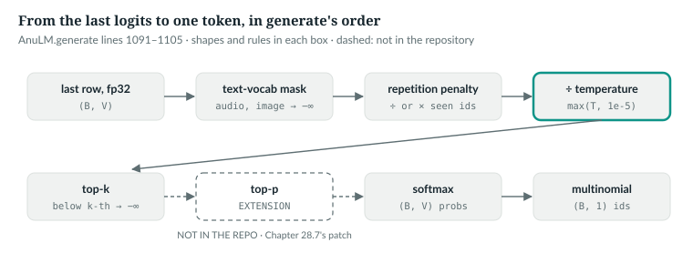
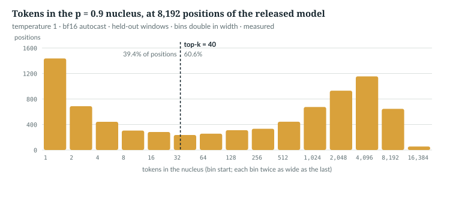

# 28  Choosing the next token

Each step of Chapter 27's loop ends with V logits. This chapter reads the
lines of `AnuLM.generate` that turn them into one id, the greedy decoder used
for audio and images, and the stop at end-of-sequence. Top-p sampling, which
the repository does not have, closes it as a tested patch.

---

## 28.1  The order of operations

> **In the repo** · `model.py` · `AnuLM.generate` · lines 1091–1105 · @773b6a8

```python
            logits = logits[:, -1, :].float()
            if getattr(self, "text_vocab", None):
                # a model grown for speech and images (speech_vocab.py) writes
                # text only here: its audio and image ids are never sampled
                logits[:, self.text_vocab:] = -float("inf")
            if repetition_penalty != 1.0:
                seen = logits.gather(1, idx)
                seen = torch.where(seen > 0, seen / repetition_penalty, seen * repetition_penalty)
                logits = logits.scatter(1, idx, seen)
            logits = logits / max(temperature, 1e-5)
            if top_k is not None:
                v, _ = torch.topk(logits, min(top_k, logits.size(-1)))
                logits[logits < v[:, [-1]]] = -float("inf")
            probs = F.softmax(logits, dim=-1)
            nxt = torch.multinomial(probs, num_samples=1)              # (B, 1)
```

In order, on a (B, V) tensor:
1. **Last row, fp32.** (B, 1, V) becomes (B, V). Under bf16 autocast the head
   produced bf16, so these are bf16 values held in fp32 (28.2).
2. **Vocabulary mask.** A model grown for audio and images samples text only
   (Chapter 35).
3. **Repetition penalty** (28.4): `gather` reads the logits of the (B, t) ids
   already in each row, `scatter` writes the penalised values back.
4. **Temperature**, floored at 10⁻⁵ so that 0 does not divide by zero (28.2).
5. **Top-k**: every logit below the k-th largest becomes −∞ (28.3).
6. **Draw**: a softmax, then one sample per row, (B, 1).



*Figure 28.1 · From logits to a token.* The steps in code order; top-p, dashed,
is not in the repository. *verified*: the figure's script finds the steps in
this order in the source.

The book's script watches these lines run: a subclass returns fixed logits,
the repository's `generate` samples, and a spy records what
`torch.multinomial` is given, checked against the steps above:

```python
class FixedLogits(M.AnuLM):
    """An AnuLM whose forward returns the same logits for every row."""

    def __init__(self, z):
        super().__init__(tiny(vocab_size=z.numel()))
        self.z = z

    def forward(self, idx, targets=None, cache=None, start=0, embeds=None):
        B = (idx if idx is not None else embeds).shape[0]
        return self.z.expand(B, 1, -1).clone(), None                # (B, 1, V)


def probs_from_generate(z, prompt, cls=FixedLogits, **kw):
    """Run the repository's generate for one token; return what it sampled from."""
    seen, orig = [], torch.multinomial

    def spy(p, num_samples):                         # generate calls this, line 1105
        seen.append(p.clone())
        return orig(p, num_samples)

    torch.multinomial = spy
    try:
        cls(z).generate(torch.tensor([prompt]), 1, **kw)
    finally:
        torch.multinomial = orig
    return seen[0][0]


def book_probs(z, seen_ids, temperature=1.0, top_k=None, penalty=1.0):
    """generate's lines 1096-1104, one row at a time, as Chapter 28 states them."""
    z = z.clone().float()
    for i in set(seen_ids) if penalty != 1.0 else ():
        z[i] = z[i] / penalty if z[i] > 0 else z[i] * penalty   # generate's sign rule
    z = z / max(temperature, 1e-5)
    if top_k is not None:
        kth = z.sort(descending=True).values[min(top_k, len(z)) - 1]
        z[z < kth] = -math.inf                       # ties with the k-th survive
    return z.softmax(-1)
```

`IN THE REPO`

## 28.2  Temperature, and greedy as its limit

With the *illustrative* logits [2.0, 1.0, 0.5, −1.0] and tokens 0 and 3
already in the sequence:

```
T = 1                              0.609  0.224  0.136  0.030
T = 0.5                            0.842  0.114  0.042  0.002
T = 2                              0.434  0.263  0.205  0.097
T = 0 (floored at 1e-5)            1.000  0.000  0.000  0.000
```

*verified*: `book/code-examples/ch28_sampling.py` (**Book example, not
repository code**); each row is what `generate` passed to `torch.multinomial`,
and equals `book_probs`. Dividing by T below 1 widens the gaps between logits
and sharpens the distribution; above 1 flattens it (Chapter 5). As T → 0 all
the mass goes to the largest logit: greedy decoding except at ties (28.3),
like `top_k=1`, which `generation_is_deterministic_at_top_k_1` (line 387)
checks.

`serve.py` (line 135) and `api.py` (line 387) floor the temperature at 10⁻³,
so "temperature 0" is greedy except at ties. On the released model under bf16
autocast, as served, the two largest logits are exactly equal at 1.8% of
positions (none of 4,096 in fp32, with the experts on the `sparse` path, since
the checkpoint's `grouped` path runs them in bf16), and there a draw is a coin
toss.
*measured*: `book/code-examples/ch28_measure_sampling.py`, 8,192 positions of
16 held-out windows (`data/v2/val.u16`, seed 0), in
`book/measurements/part_vi_ch28_sampling.json`.

`IN THE REPO` · `MEASURED`

## 28.3  Top-k, and its ties

`v[:, [-1]]` is each row's k-th largest logit, a (B, 1) column. The comparison
is strict, `<`, so a logit *equal* to the k-th survives:

```
top_k = 2                          0.731  0.269  0.000  0.000
ties, top_k = 2                    0.333  0.333  0.333  0.000
```

With logits [1, 1, 1, 0] and k = 2, three tokens survive. In bf16 this is
common: at k = 40, more than 40 tokens survived at 33.9% of the released
model's positions, at most 48. A fixed k also keeps very different amounts of
probability: at T = 1 the 40 hold a median 83% of the mass, 45% at the tenth
percentile. *measured*, same script and positions.

`IN THE REPO` · `MEASURED`

## 28.4  The repetition penalty

The CTRL paper introduced penalised sampling, which discounts the scores of
tokens already generated [R30]. `generate` applies it to every id in `idx`,
prompt included: a positive logit is divided by the penalty and a negative one
multiplied, so both move down.

```
repetition_penalty = 1.3           0.501  0.292  0.177  0.029
logit change from the penalty      -0.462  +0.000  -0.000  -0.300
```

*verified*, same script: token 0's 2.0 becomes 1.538, token 3's −1.0 becomes
−1.3. A token repeated in `idx` is penalised once: `scatter` writes the same
value for each copy. Whether it helps is *measured* in `docs/RESULTS.md` §30,
on 250 held-out continuation prompts through `serve.Engine`: greedy without a
penalty gave degenerate replies (4-grams more than half repeats) 80.8% of the
time; temperature 0.8 with penalty 1.3, 12.4%. The serving defaults
(*verified*):

| caller | temperature | top-k | penalty | lines |
|---|---|---|---|---|
| `api.py` chat | 0.3 | 40 | 1.15 | 544–546 |
| `api.py` completions | 0.7 | 40 | 1.0 | 582–583 |
| `serve.py` HTTP | 0.8 | 50 | 1.0 | 187–191 |
| `sample.py` | 0.8 | 50 | none | 31–32 |

`IN THE REPO` · `MEASURED`

## 28.5  Greedy with an n-gram block, and the stop

Speech and images decode through `decode_from_embeds`, which is greedy and
blocks repeated n-grams:

> **In the repo** · `model.py` · `AnuLM.decode_from_embeds` · lines 980–997 · @773b6a8

```python
        for _ in range(max_tokens):
            scores = logits[0, -1].float()
            if repetition_penalty != 1.0 and out:
                ids = torch.tensor(sorted(set(out)), device=scores.device)
                seen = scores[ids]
                scores[ids] = torch.where(seen > 0, seen / repetition_penalty, seen * repetition_penalty)
            n = no_repeat_ngram
            if n and len(out) >= n - 1:
                tail = tuple(out[len(out) - (n - 1):])
                for j in range(len(out) - n + 1):
                    if tuple(out[j:j + n - 1]) == tail:
                        scores[out[j + n - 1]] = float("-inf")
            nxt = int(scores.argmax())
            if stop(nxt):
                break
            out.append(nxt)
            if len(out) == max_tokens:
                break
```

It serves batch 1, `logits[0, -1]` being (V,), and penalises emitted ids only:
the prefix is audio or image vectors, which have no ids. For the n-gram block,
`tail` is the last n − 1 emitted ids; wherever that tail occurred before, the id
that followed it is set to −∞, so no n-gram is emitted twice. `argmax` picks,
and `stop(id)` is the caller's rule. On fixed logits [3, 2, 1, 0], where greedy
repeats token 0 for ever:

```
no_repeat_ngram = 0: [0, 0, 0, 0, 0, 0, 0, 0]
no_repeat_ngram = 2: [0, 0, 1, 0, 2, 0, 3, 0]
no_repeat_ngram = 3: [0, 0, 0, 1, 0, 0, 2, 0]
```

*verified*: `ch28_sampling.py`. `generate` stops on one id for a whole batch:

> **In the repo** · `model.py` · `AnuLM.generate` · lines 1106–1115 · @773b6a8

```python
            if eos_id is not None:
                nxt = torch.where(done[:, None], torch.full_like(nxt, eos_id), nxt)
            idx = torch.cat((idx, nxt), dim=1)
            pending = nxt
            if on_token is not None and on_token(nxt):
                break
            if eos_id is not None:
                done |= nxt[:, 0] == eos_id
                if bool(done.all()):
                    break
```

A finished row keeps receiving `eos_id`, so `idx` stays (B, t + 1). The loop
ends when every row is done, or when `on_token`, `api.py`'s streaming callback
(Chapter 38), returns True. `generation_stops_at_eos` (line 609) checks it.

`IN THE REPO`

## 28.6  Top-p sampling: not in the repository

Nucleus (top-p) sampling keeps the smallest set of top tokens whose
probabilities reach p, then renormalises [R31]; the set grows where the model
is unsure, which a fixed k cannot do. `api.py` accepts the argument and drops
it:

> **In the repo** · `api.py` · `ChatRequest` · lines 187–190 · @773b6a8

```python
    temperature: Optional[float] = Field(None, ge=0, le=2, description="Default 0.3. 0 = greedy.")
    top_p: Optional[float] = Field(None, description="Accepted for compatibility; AnuLM samples with top_k.")
    top_k: Optional[int] = Field(None, description="AnuLM extension. Default 40.")
    repetition_penalty: Optional[float] = Field(None, description="AnuLM extension. Default 1.15.")
```

`Generation` (`api.py` line 334) takes no `top_p`, and its call to `generate`
(lines 387–389) passes none. On the released model at T = 1, the nucleus for
p = 0.9 holds 1 token at the tenth percentile, a median 341, and about 7,650
at the ninetieth; it fits inside 40 tokens at only 39.4% of positions.
*measured* in bf16 autocast, as served, on a sample of 8,192 positions from 16
windows of `data/v2/val.u16` (seed 0), by the same script, which counts with
the rule of 28.7. The median depends on precision and sample: Chapter 41
measures its own in fp32 on 8 windows.

```python
def nucleus_size(logits, p):
    """Tokens Chapter 28's top_p_filter keeps: the smallest set whose probability
    reaches p, plus ties with the last one kept, at least the top token."""
    z = logits.sort(-1, descending=True).values
    probs = z.softmax(-1)
    keep = probs.cumsum(-1) - probs < p
    keep[..., 0] = True
    cut = z.masked_fill(~keep, math.inf).min(-1, keepdim=True).values
    return (logits >= cut).sum(-1)
```



*Figure 28.2 · How many tokens a 0.9 nucleus holds.* Positions by nucleus size,
against top-k's fixed 40. *measured*, `part_vi_ch28_sampling.json`. Whether
such nuclei make better text than top-40 is *not measured here*.

`NOT IN THE REPO` · `MEASURED`

## 28.7  The extension: a top-p patch and its test

The filter works on sorted logits:

```python
def top_p_filter(logits, p):
    """EXTENSION, not in the repository. Keep the smallest set of top tokens whose
    probability reaches p, plus any token tied with the last one kept (top-k's
    rule); the top token always survives. The rest become -inf. logits: (B, V)."""
    if p >= 1.0:
        return logits
    sorted_z = logits.sort(dim=-1, descending=True).values
    probs = sorted_z.softmax(-1)
    keep = probs.cumsum(-1) - probs < p              # mass ranked above is short of p
    keep[..., 0] = True                              # p <= 0 still keeps the top token
    cut = sorted_z.masked_fill(~keep, math.inf).min(-1, keepdim=True).values
    return logits.masked_fill(logits < cut, -math.inf)   # ties with the cut survive
```

- **p ≥ 1** changes nothing.
- **`keep`** marks a token while the mass ranked above it is still short of p,
  so the token that crosses p is kept.
- **The top token always survives.** Without that line, p = 0 would set every
  logit to −∞, the softmax would return NaN and `torch.multinomial` would fail;
  `api.py` puts no bound on `top_p`.
- **`cut`** is the smallest kept logit. Comparing the unsorted logits with it
  keeps every token tied with the last one kept, the same rule as top-k (28.3).
  A cut by sorted position would keep one of two tied tokens and drop the
  other, depending on how `torch.sort` happened to order them.

The patch to `generate` is a new argument and two lines before the softmax,
which then renormalises over the survivors; with the 12-line filter, that is
the whole extension. The script applies it to the pinned
source of `generate` and compiles the result, so the test runs the repository's
loop plus exactly this:

```python
PATCH = (("repetition_penalty: float = 1.0, on_token=None):",
          "repetition_penalty: float = 1.0, on_token=None, top_p: float | None = None):"),
         ("        probs = F.softmax(logits, dim=-1)\n",       # as indented after dedent
          "        if top_p is not None:\n"
          "            logits = top_p_filter(logits, top_p)\n"
          "        probs = F.softmax(logits, dim=-1)\n"))


def patched_generate():
    """The pinned generate's own source with PATCH applied, compiled in model.py's
    namespace."""
    src = textwrap.dedent(inspect.getsource(M.AnuLM.generate))
    for old, new in PATCH:
        assert src.count(old) == 1, f"patch does not apply: {old!r}"
        src = src.replace(old, new)
    ns = dict(vars(M), top_p_filter=top_p_filter)
    exec(src, ns)
    return ns["generate"]
```

The test calls the filter directly (only p = 0.7 and `top_p=None` go through
the patched `generate`). On probabilities 0.5, 0.3, 0.15, 0.05 the kept set for
p = 0.3, 0.7, 0.85 and 0 must be {0}, {0, 1}, {0, 1, 2} and {0}; on 0.4, 0.3,
0.3 with p = 0.6 it must keep both tied tokens; every result must sum to 1;
p = 1 must change nothing. Two classic bugs fail it:

```python
def off_by_one(z, p):                                # drops the token that crosses p
    s, order = z.sort(descending=True)
    keep = s.softmax(-1).cumsum(-1) <= p
    s = s.masked_fill(~keep, -math.inf)
    return torch.empty_like(z).scatter(0, order, s).softmax(-1)


def not_renormalised(z, p):                          # zeroes the tail after softmax
    probs = z.softmax(-1)
    s, order = probs.sort(descending=True)
    s = s.masked_fill(s.cumsum(-1) - s >= p, 0.0)
    return torch.empty_like(probs).scatter(0, order, s)
```

```
patched generate, top_p = 0.7      0.625  0.375  0.000  0.000
patched generate with top_p=None reproduces the original: True
right             passes
off_by_one        FAILS: p=0.3: kept []; p=0.7: kept [0]; p=0.85: kept [0, 1]; p=0.0: kept []; p=0.6: kept [0]
not_renormalised  FAILS: p=0.3: sums to 0.500; p=0.7: sums to 0.800; p=0.85: sums to 0.950; p=0.0: kept []; p=0.0: sums to 0.000; p=0.6: kept [0, 1]; p=0.6: sums to 0.700
```

*verified*: `ch28_sampling.py`. Through the patched `generate`, p = 0.7 keeps
0.5 and 0.3 and renormalises them to 0.625 and 0.375; with `top_p=None` it
draws exactly the tokens the original draws from the same seed. The off-by-one
version keeps nothing at p = 0.3, and its softmax over all −∞ is not a
distribution at all. Chapter 41 builds a variant, a filter on probabilities
after the softmax with p defaulting to 1, and tests it further.

`EXTENSION`

## 28.8  Exercises

1. Logits [3, 3, 1], temperature 10⁻³. What does `generate` sample from?
2. With penalty 2, what happens to logits 4 and −4 of seen tokens?
3. Why does the filter compare p with the mass ranked *above* a token, not the
   cumulative mass including it?

**Answers.**
1. [0.5, 0.5, 0]: the two tied tokens split the mass.
2. 4 → 2 and −4 → −8: both fall.
3. The cumulative mass includes the token itself, so testing it drops the
   token that reaches p, and the kept mass falls short of p: the `off_by_one`
   failure.

*verified*: answers 1 and 2 are checked by `ch28_sampling.py`.

---

## Key points

- `generate` masks non-text ids, applies the repetition penalty, divides by the
  temperature, cuts to top-k, softmaxes and draws, in that order.
- Temperature 0 is floored at 10⁻⁵ in `generate` and 10⁻³ in serving, so it is
  greedy except at ties, and bf16 logits tie at the top at 1.8% of positions.
- Top-k keeps every logit equal to the k-th, so ties can let more than k
  through; on the released model they do at a third of positions.
- The penalty divides positive and multiplies negative logits of every id
  already in the sequence, prompt included.
- `decode_from_embeds` is greedy with an n-gram block; `generate` stops when
  every row has emitted `eos_id`, padding finished rows with it.
- Top-p is not in the repository; `api.py` accepts and ignores it. The book's
  extension is a 12-line filter plus a new argument and two lines in
  `generate`, tested against two classic bugs, p = 0 and a tie.

> **In one breath.** `generate` turns the last logits into a token by masking,
> penalising repeats, dividing by the temperature, cutting to the top k and
> drawing; greedy is the zero-temperature limit, ties are common in bf16, and
> top-p, absent here, is a small tested patch.

## References

Research references cited in this chapter (`docs/reference/research-references.md`), each
used only for the claim in its register row:

| ID | Used for | Status |
|---|---|---|
| [R30] | penalised sampling: discounting the scores of tokens already generated | CHECKED |
| [R31] | nucleus (top-p) sampling | CHECKED |

Repository evidence, all at @773b6a8:
- `model.py`: `AnuLM.decode_from_embeds` 958–1005 (excerpt 980–997),
  `AnuLM.generate` 1091–1115.
- `api.py`: `ChatRequest` 187–190, `Generation` 334 and 387–389, chat defaults
  544–546, completion defaults 582–583.
- `serve.py`: temperature floor 135, HTTP defaults 187–191. `sample.py`: 31–32.
- `test_model.py`: `generation_is_deterministic_at_top_k_1` 387,
  `generation_stops_at_eos` 609.
- `docs/RESULTS.md` §30.
- Book examples: `code-examples/ch28_sampling.py` (CPU);
  `code-examples/ch28_measure_sampling.py` on `ckpt_base_v2.pt` and
  `data/v2/val.u16`, output in `book/measurements/part_vi_ch28_sampling.json`.
