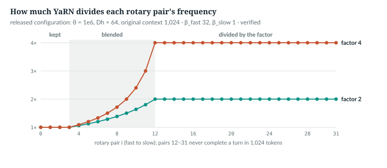
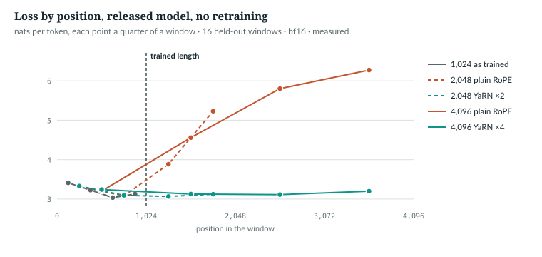
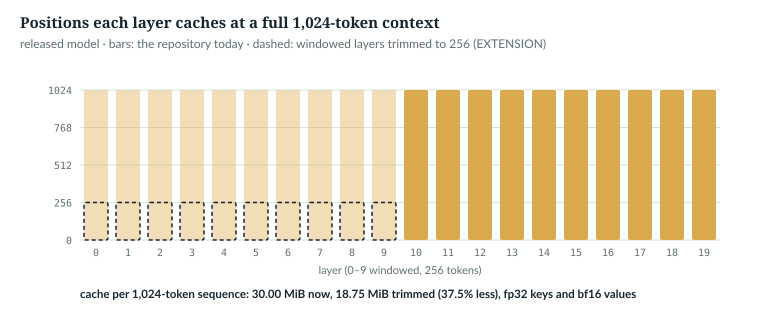

# 29  Long context: sliding windows and YaRN

The released model was trained on 1,024-token windows. Two mechanisms in
`anulm/model.py` bear on longer contexts: YaRN ("Yet another RoPE extension"), which
rescales the rotary frequencies and the attention scale, and a sliding window,
which limits how far some layers look. This chapter reads both, measures the released model at 2×
and 4× its training length, and gives the window, as an extension, the cache
saving it does not yet have.

---

## 29.1  Why RoPE fails past its training length

Each head's 64 dimensions form 32 pairs; pair i turns by
ω<sub>i</sub> = θ<sup>−2i/64</sup> radians per position, θ = 10<sup>6</sup>
(Chapter 14). The script turns frequencies into wavelengths:

```python
    inv = M.Rotary._build_inv_freq(cfg, cfg.head_dim)      # (Dh/2,) = (32,) frequencies
    lam = 2 * math.pi / inv                                 # tokens per full turn
    turns = cfg.block_size / lam                            # turns within the trained length
```

```
pair  0: wavelength          6.3 tokens,   162.975 turns in 1,024
pair 12: wavelength      1,117.3 tokens,     0.916 turns in 1,024
pair 16: wavelength      6,283.2 tokens,     0.163 turns in 1,024
pair 16 at a distance of 2,000: 0.32 of a turn
20 of 32 pairs never complete a turn within 1,024 tokens
```

*verified*: `book/code-examples/ch29_long_context.py` (**Book example, not
repository code**). The 20 slow pairs have seen only part of a turn: a key
2,000 positions back turns pair 16 twice as far as training ever did, an input
the model never learned. On the released model, plain RoPE at 2,048 tokens
scores 3.89 and 5.23 nats on the two quarters past 1,024, against 3.07 and
3.12 with YaRN (29.4).

`IN THE REPO`

## 29.2  NTK-by-parts: stretch only the slow pairs

Position interpolation scales every position down by the factor s, so position
2,000 looks like 1,000 [S02]. By our arithmetic, not the papers' rows, that
also slows the fast pairs: neighbours then differ by ω<sub>i</sub>/s instead
of ω<sub>i</sub>. YaRN's NTK-by-parts interpolation (NTK: the "neural tangent
kernel" analysis the method's name comes from; nothing here depends on it)
divides only the slow frequencies by s, keeps the fast ones and ramps between
[R07]. The ramp's
ends depend on how many turns a pair makes within the original context:

> **In the repo** · `anulm/model.py` · `_yarn_correction_dim` · lines 260–275 · @fdbb09a

```python
def _yarn_correction_dim(num_rotations, dim, base, orig_ctx):
    return (dim * math.log(orig_ctx / (num_rotations * 2 * math.pi))) / (2 * math.log(base))


def _yarn_correction_range(beta_fast, beta_slow, dim, base, orig_ctx):
    low = math.floor(_yarn_correction_dim(beta_fast, dim, base, orig_ctx))
    high = math.ceil(_yarn_correction_dim(beta_slow, dim, base, orig_ctx))
    return max(low, 0), min(high, dim - 1)


def yarn_mscale(scale: float, mscale: float) -> float:
    if scale <= 1:
        return 1.0
    return 0.1 * mscale * math.log(scale) + 1.0
```

`_yarn_correction_dim` solves 2π·θ<sup>2i/d</sup> = `orig_ctx /
num_rotations` for the pair i that makes exactly `num_rotations` turns
(`dim` = D<sub>h</sub> = 64). `low` is the pair making `beta_fast` = 32 turns,
`high` the pair making `beta_slow` = 1, rounded outward: the paper's β = 32 and
α = 1 [R07], the defaults at config lines 109–110. `yarn_mscale` is 29.3's.

> **In the repo** · `anulm/model.py` · `Rotary._build_inv_freq` · lines 305–322 · @fdbb09a

```python
    def _build_inv_freq(cfg: AnuLMConfig, dim: int) -> torch.Tensor:
        idx = torch.arange(0, dim, 2, dtype=torch.float32) / dim
        freq_extra = 1.0 / (cfg.rope_theta ** idx)
        if not cfg.yarn:
            return freq_extra
        # NTK-by-parts: keep the fast dims, divide the slow dims by `factor`,
        # ramp linearly between the two correction dims.
        freq_inter = 1.0 / (cfg.yarn_factor * (cfg.rope_theta ** idx))
        low, high = _yarn_correction_range(
            cfg.yarn_beta_fast, cfg.yarn_beta_slow, dim,
            cfg.rope_theta, cfg.yarn_original_context,
        )
        if low == high:
            high += 0.001
        ramp = (torch.arange(dim // 2, dtype=torch.float32) - low) / (high - low)
        ramp = ramp.clamp(0, 1)
        keep = 1.0 - ramp                     # 1 -> extrapolate, 0 -> interpolate
        return freq_inter * (1 - keep) + freq_extra * keep
```

`freq_extra` is plain RoPE's (32,) frequencies, `freq_inter` the same divided
by `yarn_factor`. `ramp` runs from 0 at pair `low` to 1 at pair `high`; the
result blends the two sets pair by pair (the `low == high` guard avoids a
division by zero). The script applies it to the released configuration:

```python
    plain = M.Rotary._build_inv_freq(released(), 64)        # plain RoPE, (32,)
    # ...
    for factor in (2.0, 4.0):
        cfg = released(yarn=True, yarn_factor=factor, yarn_original_context=1024)
        low, high = M._yarn_correction_range(cfg.yarn_beta_fast, cfg.yarn_beta_slow,
                                             64, cfg.rope_theta, 1024)
        div = plain / M.Rotary._build_inv_freq(cfg, 64)      # 1 = kept, factor = divided
```

```
divisor at pair                0     3     4     6     8    10    12    31
factor 2 (low 3, high 12):  1.00  1.00  1.06  1.20  1.38  1.64  2.00  2.00
factor 4 (low 3, high 12):  1.00  1.00  1.09  1.33  1.71  2.40  4.00  4.00
```

*verified*. Pairs 0–3 are kept; pairs 12–31, exactly those that never complete
a turn in 1,024 tokens, are divided by the factor; pairs 4–11 are blended. The
blend is linear in frequency, so pair 4's divisor at factor 2 is
1/(0.111/2 + 0.889) = 1.06.



*Figure 29.1 · Which pairs YaRN stretches.* The divisor on each pair's
frequency at factors 2 and 4, released configuration. *verified*: the figure's
script calls `_build_inv_freq` and asserts the band edges.

> **In the repo** · `tests/test_model.py` · `yarn_blends_the_right_bands` · lines 131–140 · @fdbb09a

```python
def yarn_blends_the_right_bands():
    """Fast dims keep their frequency, slow dims are divided by `factor`."""
    cfg = tiny(yarn=True, yarn_factor=8.0, yarn_original_context=32, rope_theta=10000.0)
    dim = 16
    plain = Rotary._build_inv_freq(tiny(yarn=False, rope_theta=10000.0), dim)
    yarned = Rotary._build_inv_freq(cfg, dim)
    ratio = (plain / yarned)
    assert abs(ratio[0].item() - 1.0) < 1e-4, f"fastest dim was scaled ({ratio[0]:.3f}), should be untouched"
    assert abs(ratio[-1].item() - 8.0) < 1e-3, f"slowest dim scaled by {ratio[-1]:.3f}, expected 8.0"
    assert torch.all(ratio[1:] >= ratio[:-1] - 1e-5), "the ramp is not monotonic"
```

The test pins the shape: fastest pair untouched, slowest divided by exactly
the factor, the divisor never decreasing between them.

`IN THE REPO`

## 29.3  The attention temperature

YaRN's second half multiplies the attention logits by 1/t, where the paper
fits √(1/t) = 0.1·ln(s) + 1 for LLaMA and Llama 2; it is not derived [R07].
Here √(1/t) is `yarn_mscale`, m, and m² lands on the attention scale:

> **In the repo** · `anulm/model.py` · `Rotary.__init__` · lines 293–298 · @fdbb09a

```python
        if cfg.yarn:
            self.attn_mscale = yarn_mscale(cfg.yarn_factor, cfg.yarn_mscale_all_dim)
            self.table_mscale = (yarn_mscale(cfg.yarn_factor, cfg.yarn_mscale)
                                 / yarn_mscale(cfg.yarn_factor, cfg.yarn_mscale_all_dim))
        else:
            self.attn_mscale = self.table_mscale = 1.0
```

> **In the repo** · `anulm/model.py` · `GQAttention.__init__` · lines 446–449 · @fdbb09a

```python
        # YaRN's temperature term lives here, not in the rotary tables --
        # the same place MLA puts it. Without this, `--yarn` on a GQA model
        # would apply the band blend and silently drop half of YaRN.
        self.scale = cfg.head_dim ** -0.5 * (rotary.attn_mscale ** 2)
```

The factor m is split as DeepSeek splits it (comment, lines 288–292).
`attn_mscale` goes on the scale squared, as scaling query and key by m
multiplies their product by m²; `table_mscale`, for the cos and sin tables, is
exactly 1 with the shipped settings. So m² = 1/t, as in the paper:

```python
        rot = M.Rotary(cfg, cfg.head_dim)
        attn = M.GQAttention(cfg, rot)
        ms = M.yarn_mscale(factor, 1.0)                     # 0.1 * ln(s) + 1
        assert abs(attn.scale - cfg.head_dim ** -0.5 * ms ** 2) < 1e-12
```

```
factor 2: mscale 1.0693, scale x 1.1434 (0.14293 instead of 0.12500); table factor 1.0
factor 4: mscale 1.1386, scale x 1.2965 (0.16206 instead of 0.12500); table factor 1.0
```

*verified*. This half was once missing from GQA: the scale was
`head_dim**-0.5`, so `yarn` applied the band blend alone and still ran.
`docs/RESULTS.md` §3 records the fix, after which YaRN's far-end loss on its
GQA preset fell from 1.7854 to 1.6882; `yarn_temperature_reaches_attention`
(line 144) now checks both attention types.

`IN THE REPO`

## 29.4  The released model at 2× and 4×, measured

`book/code-examples/ch29_measure_context.py` loads `ckpt_base_v2.pt` into
configurations that differ only in `block_size`, `yarn`, `yarn_factor` and
`yarn_original_context`, as in `anulm/eval/eval_context.py`, plus one with the window off,
which `anulm/eval/eval_context.py` never does. `block_size` must rise with the
length: `AnuLM.forward` raises `ValueError` for any position past it
(`anulm/model.py` lines 897–898). No retraining:

```python
    settings = {
        "1024 trained": replace(base),
        "1024 window off": replace(base, sliding_window=None),
        "2048 naive": replace(base, block_size=2 * trained, yarn=False),
        "2048 yarn": replace(base, block_size=2 * trained, yarn=True,
                             yarn_factor=2.0, yarn_original_context=trained),
        "4096 naive": replace(base, block_size=4 * trained, yarn=False),
        "4096 yarn": replace(base, block_size=4 * trained, yarn=True,
                             yarn_factor=4.0, yarn_original_context=trained),
    }
```

Each window is scored by quarter:

```python
        x = r[None, :-1].to(dev)
        y = r[None, 1:].to(dev).masked_fill(x == EOS, -1)
        with torch.autocast("cuda", dtype=torch.bfloat16, enabled=dev == "cuda"):
            logits, _ = m(x, y)
        nll = F.cross_entropy(logits[0].float(), y[0], ignore_index=-1, reduction="none")
        ok = (y[0] != -1).float()
        n, q = len(nll), []
        for j in range(4):
            sl = slice(j * n // 4, (j + 1) * n // 4)
            q.append((nll[sl] * ok[sl]).sum() / ok[sl].sum())
```

Targets after an end-of-document token are not graded. Sixteen held-out windows
(`data/v2/val.u16`, seed 0), the same starting offsets at every length, in bf16
autocast with the checkpoint's `grouped` experts (bf16 by contract), as served.
Nats per token; a mean is the plain average of a window's four quarter means
(end-of-document masking makes their token counts differ slightly):

| setting | 1st | 2nd | 3rd | 4th | mean |
|---|---|---|---|---|---|
| 1,024, as trained | 3.411 | 3.228 | 3.037 | 3.129 | 3.201 |
| 2,048, plain RoPE | 3.319 | 3.083 | 3.886 | 5.229 | 3.879 |
| 2,048, YaRN ×2 | 3.331 | 3.095 | 3.066 | 3.125 | 3.154 |
| 4,096, plain RoPE | 3.201 | 4.559 | 5.803 | 6.272 | 4.959 |
| 4,096, YaRN ×4 | 3.241 | 3.128 | 3.113 | 3.200 | 3.170 |



*Figure 29.2 · Loss by position past the training length.* Each point is a
quarter of a window at its middle position. *measured*, from
`book/measurements/part_vi_ch29_context.json`.

The comparisons are paired: each window's YaRN score minus its plain score, on
the same tokens, with standard error = standard deviation / √16:

```python
    for L in (2048, 4096):
        d = per[f"{L} yarn"].mean(1) - per[f"{L} naive"].mean(1)
        # ...
        q = per[f"{L} yarn"][:, 0] - per[f"{L} naive"][:, 0]     # first quarter: inside the trained range
```

- **Plain RoPE breaks past 1,024.** At 2,048 its third and fourth quarters are
  0.8 and 2.1 nats worse than YaRN's.
- **YaRN stays flat to 4×.** Paired over the same windows it beats plain RoPE
  by 0.725 ± 0.039 nats at 2,048 and 1.788 ± 0.064 at 4,096.
- **It costs a little in range:** on the first quarter, paired, +0.012 ± 0.002
  at 2,048 and +0.040 ± 0.004 at 4,096.

The windows cross document boundaries, so this tests soundness at unseen
positions, not the use of distant text. `docs/RESULTS.md` §27 found the
predecessor, `AnuLM-Base-400M`, trained at 512, losing only 0.13 nats at 4×
with plain RoPE; why v2 extends so much worse is *not measured here*.

`MEASURED`

## 29.5  The sliding window

> **In the repo** · `anulm/model.py` · `Block.__init__` · lines 812–814 · @fdbb09a

```python
        # Sliding window on the first max_window_layers layers, full attention
        # on the rest (Qwen2 semantics). None = full attention.
        self.window = cfg.sliding_window if layer_idx < cfg.max_window_layers else None
```

The released model sets 256 on layers 0–9. `_attn_mask` adds
`k_pos > q_pos - window` to the causal rule (Chapter 27, 27.4), so each query
sees itself and the `window − 1` positions before it:

```
prefill of 6, window 3: x.....  xx....  xxx...  .xxx..  ..xxx.  ...xxx
decode at 9, window 4:  ......xxxx
```

*verified*, same script. The window changes only what the model sees: the
cache keeps every position (Chapter 12, 12.5), and PyTorch gets an ordinary
mask, so no compute is skipped (Chapter 11). `docs/RESULTS.md` §15 *measured*
it no worse at the trained length and better past it. Switching it off at
1,024 tokens costs 0.851 ± 0.078 nats (paired, same measurement).

`IN THE REPO` · `MEASURED`

## 29.6  The extension: a cache the window can trim

Keys more than `window − 1` positions behind the newest query are masked
anyway, so a windowed layer can drop them. Before each decode step the script
keeps the last `W − 1` positions of each windowed layer, and turns the layer's
window off for that step, since all that remains is in reach:

```python
    W = 4
    m = M.AnuLM(tiny(sliding_window=W, max_window_layers=2, block_size=32)).eval()
    windowed = [i for i, b in enumerate(m.layers) if b.window is not None]
    x = torch.randint(0, 64, (1, 6 + steps))
    full, trim = m.new_cache(), m.new_cache()
    m(x[:, :6], cache=full, start=0)
    m(x[:, :6], cache=trim, start=0)
    worst = 0.0
    for t in range(6, 6 + steps):
        ref, _ = m(x[:, t:t + 1], cache=full, start=t)        # the repository's path
        for i in windowed:                                    # keep the last W - 1 keys
            c = trim[i]
            c["k"], c["v"] = c["k"][:, :, -(W - 1):], c["v"][:, :, -(W - 1):]
            m.layers[i].window = None                         # all W keys are in reach
        try:
            got, _ = m(x[:, t:t + 1], cache=trim, start=t)
        finally:
            for i in windowed:
                m.layers[i].window = W
        worst = max(worst, (got - ref).abs().max().item())
```

```
20 decode steps: max |logit difference| 8.9e-08; cached positions per layer, trimmed [4, 4, 26] vs 26
released model at 1,024 tokens: 30.00 MiB now, 18.75 MiB with trimmed windowed layers (37.5% less)
```

*verified*: `tiny()`, window 4 on layers 0 and 1. Unlike trimming a
full-attention cache (Chapter 27, 27.5), this changes only memory, for decode
steps (S = 1). It is decode-only: `_attn_mask` assumes T = `start` + S, so a
multi-token chunk against a trimmed cache would get a wrong mask. The
released arithmetic uses the served 1,536 bytes per token per layer. A real
version would keep a fixed buffer per windowed layer.



*Figure 29.3 · Cache per layer, with and without trimming.* Positions held per
layer at a full 1,024-token context; dashed: the `EXTENSION`. *verified*: from
the configuration.

`EXTENSION`

## 29.7  Exercises

1. At factor 8, what is m² on the released model's attention scale?
2. Why is trimming safe for a windowed layer but not for a full-attention one?

**Answers.**
1. m = 0.1·ln 8 + 1 = 1.2079; m² = 1.4591.
2. A windowed layer never reads the dropped keys; a full-attention layer
   would, and its later keys were computed from them (Chapter 27, 27.5).

*verified*: answer 1 is printed by `ch29_long_context.py`.

---

## Key points

- Past its training length, RoPE's slow pairs reach angles the model never
  saw; at 2,048 tokens the released model's last quarter is 2.1 nats worse
  with plain RoPE than with YaRN.
- YaRN divides the slow pairs' frequencies by the factor, keeps the fast ones
  and ramps between, with band edges at 32 turns and 1 turn as in the paper.
- Its temperature, 0.1·ln(s) + 1, lands squared on the attention scale; the GQA
  path once dropped it, and a test now checks both attention types.
- On the released model, zero-shot YaRN keeps the loss flat to 4,096 tokens
  for a cost of 0.012 ± 0.002 to 0.040 ± 0.004 nats inside the trained range.
- The window on layers 0–9 changes what the model sees, not what it stores or
  computes, and the trained model depends on it.
- A windowed layer's cache can drop keys beyond the window exactly; for the
  released model that would save 37.5% at 1,024 tokens. It is an extension.

> **In one breath.** RoPE fails past its training length because slow pairs
> meet unseen angles; YaRN stretches only those pairs and sharpens attention by
> m², which keeps the released model flat to 4× with no training, while the
> sliding window limits what lower layers see without, yet, shrinking the cache.

## References

Research references cited in this chapter (`RESEARCH_REFERENCES.md`), each
used only for the claim in its register row:

| ID | Used for | Status |
|---|---|---|
| [R07] | NTK-by-parts interpolation; α = 1, β = 32; the temperature √(1/t) = 0.1·ln(s) + 1, a fitted recommendation | CHECKED |
| [S02] | position interpolation: linearly down-scaling position indices | CHECKED |

The sliding window is described from the code only; sources for it and for a
rolling-buffer cache are proposed in
`technical-review/register-additions/part_vi.md`.

Repository evidence, all at @fdbb09a:
- `anulm/model.py`: configuration 109–110; `_yarn_correction_dim`,
  `_yarn_correction_range`, `yarn_mscale` 260–275; `Rotary.__init__` 288–298;
  `Rotary._build_inv_freq` 305–322; `_attn_mask` 365–381;
  `GQAttention.__init__` 446–449; `Block.__init__` 812–814.
- `tests/test_model.py`: `yarn_blends_the_right_bands` 131,
  `yarn_temperature_reaches_attention` 144.
- `docs/RESULTS.md` §3, §15, §27.
- Book examples: `code-examples/ch29_long_context.py` (CPU);
  `code-examples/ch29_measure_context.py` on `ckpt_base_v2.pt` and
  `data/v2/val.u16`, output in `book/measurements/part_vi_ch29_context.json`.
