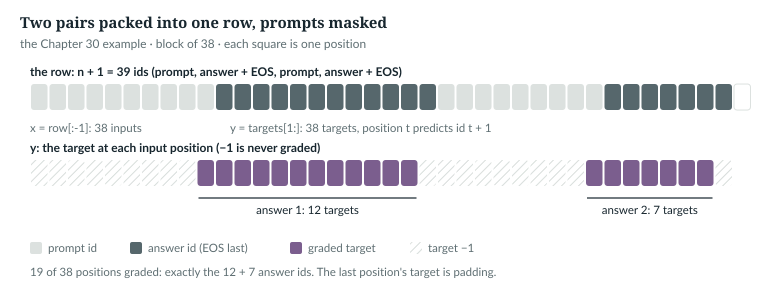
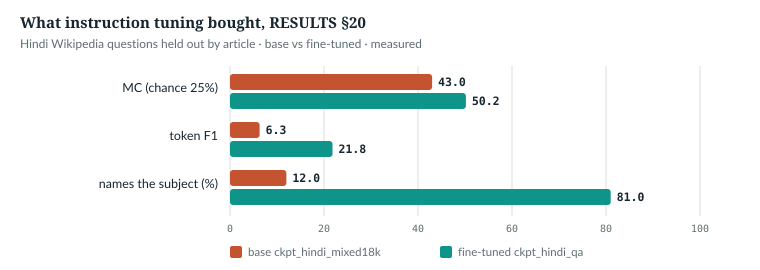

# 30  Instruction tuning

A pre-trained model continues text; asked a question, it writes whatever
most often follows such words. Supervised fine-tuning (SFT) turns it into a
model that answers: the same loss, on question–answer pairs, grading only the
answer. It is the first of InstructGPT's three stages, before a reward model
and reinforcement learning [R39]; this repository stops after it (Chapter 34).
The code is `anulm/training/finetune.py`, which reuses `anulm/training/train.py`'s machinery (Chapter 22).

**New words for Part VII.**

| Term | Meaning |
|---|---|
| instruction tuning, SFT | further training on prompt–answer pairs, with the loss on the answers |
| template | the fixed text a question is wrapped in, such as `Question: {q}\nAnswer:` |
| prompt mask | target −1 on every prompt position, so that only answer tokens are graded |
| packing | laying several short examples end to end in one training row |
| adapter | a small trainable module added beside frozen weights (Chapter 31) |
| calibration | how well a stated confidence matches the observed accuracy (Chapter 32) |
| retriever, reader | the part that finds passages, and the part that answers from them (Chapter 33) |
| policy, reference | the model being trained, and a frozen copy of where it started (Chapter 34) |

**Notation for Part VII.** Shapes keep Part IV's letters: B rows, S positions,
D width, V vocabulary.

| Symbol | Meaning | Chapter |
|---|---|---|
| p, a | the prompt's ids and the answer's ids (EOS included) | 30, 34 |
| L | ids per packed row: `block_size + 1` | 30 |
| **W**, **A**, **B** | a frozen weight (out × in) and the two LoRA factors, r × in and out × r | 31 |
| r, α | the LoRA rank and its scale numerator | 31 |
| K, τ | options per decision, and the softmax temperature | 32 |
| π<sub>θ</sub>, π<sub>ref</sub>, β | the policy, the reference, and the strength of the pull towards it | 34 |
| R, Â | a reward, and an answer's advantage over its group | 34 |

Each symbol keeps one meaning in this part: r is only the LoRA rank, and L
only the packed row length. Quoted code keeps its own names, such as
`n_layer` for the layer count and `rank` for a position in a ranked list.

---

## 30.1  A template, and where the space goes

Every pair is wrapped in one template per language. They live in `anulm/data/make_qa.py`:

> **In the repo** · `anulm/data/make_qa.py` · `PROMPTS` · lines 51–62 · @fdbb09a

```python
PROMPT = "प्रश्न: {q}\nउत्तर:"          # the answer follows a single space, then EOS
# One template per language. Python questions are written in English, so
# they share its template; the model tells them apart from the content.
PROMPT_EN = "Question: {q}\nAnswer:"
# Translation pairs carry their direction as `lang`; serve.py's translate
# mode picks the direction from the script of the input.
PROMPTS = {"hi": PROMPT, "en": PROMPT_EN, "py": PROMPT_EN,
           "en-hi": "English: {q}\nHindi:", "hi-en": "Hindi: {q}\nEnglish:",
           # Retrieval-augmented reading (make_rc.py, rag.py): `q` holds the
           # numbered passages and then the question line.
           "rc-en": "Answer from the passages.\n\n{q}\nAnswer:",
           "rc-hi": "अनुच्छेदों से उत्तर दीजिए।\n\n{q}\nउत्तर:"}
```

A pair's `lang` field picks the key. A tuned checkpoint stores the
dictionary as `qa_templates` (`anulm/training/finetune.py` line 386), so `anulm/inference/serve.py` asks the
way training did.

> **In the repo** · `anulm/training/finetune.py` · `_pair_ids` · lines 55–60 · @fdbb09a

```python
def _pair_ids(tok: BPE, it: dict) -> tuple[list[int], list[int]]:
    """(prompt ids, answer ids + EOS). The answer is encoded with its leading
    space attached, the way the BPE chunks text, so prompt + answer tokenises
    identically to the joined string."""
    template = PROMPTS.get(it.get("lang", "hi"), PROMPT)
    return tok.encode(template.format(q=it["question"])), tok.encode(" " + it["answer"]) + [tok.eos_id]
```

Two details carry the whole format:
- **The space belongs to the answer.** The BPE's pre-tokeniser keeps a space
  with the word after it (Chapter 9), so ` New` is one chunk. Encoding the
  answer as `" " + answer` gives the same ids as encoding the joined string,
  which is what the model sees when serving.
- **EOS ends every answer.** It is the only thing that teaches the model to
  stop.

`IN THE REPO`

## 30.2  Packing, and the prompt mask

Pairs are short and rows are long, so `pack` lays pairs end to end:

> **In the repo** · `anulm/training/finetune.py` · `pack` · lines 91–118 · @fdbb09a

```python
def pack(pairs, block_size: int, eos: int) -> tuple[torch.Tensor, torch.Tensor]:
    # ...
    L = block_size + 1
    rows, tgts = array("i"), array("i")
    ids, lab = [], []

    def flush():
        rows.extend(ids + [eos] * (L - len(ids)))
        tgts.extend(lab + [-1] * (L - len(lab)))

    for p, a in pairs:
        ex = p + a
        if len(ex) > block_size:
            continue
        if len(ids) + len(ex) > L:
            flush()
            ids, lab = [], []
        ids += ex
        lab += [-1] * len(p) + a
    if ids:
        flush()
    x = torch.frombuffer(rows, dtype=torch.int32).clone().view(-1, L) if len(rows) else torch.zeros(0, L, dtype=torch.int32)
    y = torch.frombuffer(tgts, dtype=torch.int32).clone().view(-1, L) if len(tgts) else torch.zeros(0, L, dtype=torch.int32)
    return x[:, :-1].contiguous(), y[:, 1:].contiguous()
```

In order:
- **`L = block_size + 1`.** A row holds one id more than the model reads, so
  that the usual shift, inputs `row[:-1]` and targets `row[1:]`, yields
  `block_size` predictions.
- **`flush`** pads the open row to L: ids with EOS, labels with −1.
- **The loop.** An example longer than the block is dropped, never cut, so no
  answer is ever trained without its end. An example that would overflow the
  open row closes it first, so an example never straddles two rows. The
  labels copy the answer ids and put −1 under every prompt id.
- **The end.** Two flat `int32` arrays become (N, L) tensors; the shift gives
  x and y, both (N, `block_size`).

The mask works because `AnuLM.forward` already ignores −1:

> **In the repo** · `anulm/model.py` · `AnuLM.forward` · lines 922–928 · @fdbb09a

```python
        logits = self._head(x)
        loss = F.cross_entropy(
            logits.view(-1, logits.size(-1)).float(), targets.reshape(-1), ignore_index=-1
        )
        if aux_total is not None:
            loss = loss + aux_total
        return logits, loss
```

The mean runs over graded positions only. In training mode the router's
regulariser is added when the configuration switches it on, as the released
one does (weights 1e-4 and 1e-3, Chapter 18). The measurement script checks
the size on one made-up pair, with `ckpt_base_v2.pt` in fp32:

```python
    p, a = _pair_ids(tok, {"question": "What is the capital of India?", "answer": "New Delhi.", "lang": "en"})
    xb, yb = pack([(p, a)], len(p) + len(a), tok.eos_id)
    with torch.no_grad():
        _, ev = model.eval()(xb.long(), yb.long())
        _, tr = model.train()(xb.long(), yb.long())
        aux = float(model.aux_loss)
```

```
released model, one made-up pair: loss 2.5636 in eval mode, 2.5673 in train mode (router regulariser 0.0038; without it 2.5636)
```

*measured*: `book/code-examples/ch30_measure_chat_split.py`. `finetune.evaluate`
runs in evaluation mode, so its held-out loss is the answer loss alone.



*Figure 30.1 · Packing with masked prompts.* The two pairs of the book example
below, 10 + 12 and 9 + 7 ids, in one row. The prediction of an answer's first
id is made at the prompt's last position, which is why each graded stretch
starts one square left of its answer. *verified*: drawn from `finetune.pack`'s
output, asserted against the example.

`IN THE REPO`

## 30.3  By hand: the same packing, checked

The book example writes the packing out plainly and holds it to `pack`
(`book/code-examples/ch30_sft_packing.py`, **Book example, not repository
code**):

```python
def pack_by_hand(pairs, block_size, eos):
    """Greedy packing: whole examples only, prompt targets -1, pad with EOS / -1."""
    L = block_size + 1                       # one extra id so x = row[:-1], y = row[1:]
    rows, tgts, ids, lab = [], [], [], []
    for p, a in pairs:
        if len(p) + len(a) > block_size:     # too long for any row: dropped, never cut
            continue
        if len(ids) + len(p) + len(a) > L:   # does not fit: close this row first
            rows.append(ids + [eos] * (L - len(ids)))
            tgts.append(lab + [-1] * (L - len(lab)))
            ids, lab = [], []
        ids += p + a
        lab += [-1] * len(p) + a             # the prompt is never graded
    if ids:
        rows.append(ids + [eos] * (L - len(ids)))
        tgts.append(lab + [-1] * (L - len(lab)))
    x = torch.tensor(rows)[:, :-1]
    y = torch.tensor(tgts)[:, 1:]            # target at position t is the id at t + 1
    return x, y
```

It then checks its rows, the loss, and one side effect against the repository:

```python
    x, y = pack_by_hand(pairs, n, tok.eos_id)
    xr, yr = pack(pairs, n, tok.eos_id)
    assert torch.equal(x, xr.long()) and torch.equal(y, yr.long())
    # ...
        logits, loss = model(x, y)
        keep = y != -1
        mine = F.cross_entropy(logits[keep].float(), y[keep])
    # ...
        _, alone = model(xa.long(), ya.long())
```

```
pair: 10 prompt ids + 12 answer ids (EOS last: True); joined string tokenises the same: True
pair: 9 prompt ids + 7 answer ids (EOS last: True); joined string tokenises the same: True
packed into a block of 38: x (1, 38), y (1, 38); equal to finetune.pack: True
targets, one mark per position (P prompt or padding, A answer, E answer EOS):
   PPPPPPPPPAAAAAAAAAAAEPPPPPPPPPAAAAAAEP
graded positions: 19 of 38 (= answer ids 19)
block of 37: 1 row(s) of 37
block of 36: 2 row(s) of 36
model loss 5.672933 = mean CE over the 19 graded positions 5.672934
second answer's loss alone 5.7287, after the first example 5.7294: differs by 0.0007
```

*verified*: printed by the example, on a 300-id BPE and the untrained `tiny()`
shape. Three things to read in it:
- The first prompt has 10 ids but only 9 `P` marks: position 0's target is the
  second id, so the first id is never a target at all.
- A block of 37 still fits all 38 ids in one row, because a row is L = 38 ids
  long. A block of 36 needs two rows.
- **Packing has no wall between examples.** `anulm/training/finetune.py` passes no attention
  mask, so the second answer attends to the whole first example; only the EOS
  between them marks the boundary. Positions run on too: the second example
  starts at position 22, not 0, so its rotary angles (Chapter 14) are those of
  position 22 onwards. The difference is small here and on untrained weights.
  What it costs a trained model is *not measured here*.

`IN THE REPO`

## 30.4  The loop is `anulm/training/train.py`'s

Everything after the data is the pre-training machinery:

> **In the repo** · `anulm/training/finetune.py` · `main` · lines 360–375 · @fdbb09a

```python
    for step in range(start_step, end):
        if pos + args.batch_size > len(order):
            order, pos = torch.randperm(len(x), generator=g), 0
        ix = order[pos: pos + args.batch_size]
        pos += args.batch_size
        lr = lr_at(step, args)
        opt.set_lr_scale(lr / args.lr)
        xb, yb = x[ix].long().to(args.device), y[ix].long().to(args.device)
        with args.autocast:
            _, loss = model(xb, yb)
        opt.zero_grad(set_to_none=True)
        loss.backward()
        if args.grad_clip > 0:
            torch.nn.utils.clip_grad_norm_(model.parameters(), args.grad_clip)
        opt.step()
        imbalance = model.update_expert_biases()
```

Rows come from a seeded permutation, saved for `--resume` (Chapter 25); the
rate follows `lr_at`, 5e-5 to 5e-6 by default (Chapter 7). The last line keeps
the router's balancing bias moving (Chapter 18); Chapter 31 shows why that
matters when the weights are frozen.

The held-out score is a token-weighted mean:

> **In the repo** · `anulm/training/finetune.py` · `evaluate` · lines 207–219 · @fdbb09a

```python
@torch.no_grad()
def evaluate(model, x, y, batch_size, device, autocast) -> float:
    model.eval()
    tot, n = 0.0, 0
    for i in range(0, len(x), batch_size):
        xb, yb = x[i: i + batch_size].long().to(device), y[i: i + batch_size].long().to(device)
        with autocast:
            _, loss = model(xb, yb)
        k = int((yb != -1).sum())
        tot += loss.item() * k
        n += k
    model.train()
    return tot / max(n, 1)
```

Each batch's loss is a mean over its k graded tokens, so this is the exact
mean over every held-out answer token. The best checkpoint by it is kept.

`IN THE REPO`

## 30.5  The data, and a held-out set that leaked

`anulm/data/make_qa.py` mines Hindi Wikipedia: one question per article about its title,
in one of six phrasings, answered by the lead sentence. It splits 98/2 *by
article*. `anulm/data/make_chat.py` builds the chat set from Dolly, OpenAssistant, Aya's
Hindi rows, 4,000 mined Wikipedia pairs and 11 identity questions repeated 20
times, and writes `data/chat_train.jsonl` and `data/chat_heldout.jsonl`.

The files on disk were built by the split `make_chat.py` used until November
2026. The measurement script keeps a verbatim copy of it
(`book/code-examples/ch30_measure_chat_split.py`, **Book example, not
repository code**):

```python
def make_chat_split(rows_in: list[dict], rng: random.Random):
    """make_chat.py main() at @773b6a8, lines 109-112, unchanged: the split that built data/chat_*.jsonl."""
    rows = list(rows_in)
    rng.shuffle(rows)
    held = [r for r in rows if r["source"] != "identity"][:300]
    held_ids = {id(r) for r in held}
    train = [r for r in rows if id(r) not in held_ids]
    return train, held
```

It held out the first 300 shuffled rows, by Python object (`id(r)`). Nothing
removed duplicates first or keyed the split on the question, so when a source
held the same question twice, one copy could be held out while its twin
trained; any split by row leaks the same way. The script counts it on the
files on disk, printing counts only:

```
train 23,022 rows, held-out 300 rows
held-out questions also in train: 4 of 300 (1.3%), 2 with the same answer
training questions that occur more than once: 279 (11 of them 20 or more times: the identity rows, which are never held out)
leaked questions that occur at least twice in data/dolly_train.jsonl: 3 of 4
finetune's rule (question_key: NFKC, case-folded, whitespace collapsed): drops 4 of 300 held-out rows
made-up rows, one question present twice: with seed 0 one copy is held out and the other trained on: True
split_chat_rows on the same rows plus a re-spaced, re-cased copy with another answer, 20 seeds: question on both sides 0 times; copies kept [2] of 3 (the exact duplicate dropped); held out with 15 seeds
packed cache: 23,022 pairs -> 3,689 rows of 1024; 47.4% of positions carry a target (1,791,532 tokens)
```

*measured*: run with `--save`, the script writes
`book/measurements/part_vii_chat_split.json`. Three of the four leaked
questions occur twice in Dolly's own training file. The lab book's Chapter 18
(`course/ch18-chat`) found the same 4 of 300.

The code at the pin splits by question. Two questions count as the same when
they share a key:

> **In the repo** · `anulm/data/make_qa.py` · `question_key` · lines 66–72 · @fdbb09a

```python
def question_key(question: str) -> str:
    # ...
    import unicodedata
    return " ".join(unicodedata.normalize("NFKC", question).casefold().split())
```

NFKC folds Unicode look-alikes into one form, `casefold` removes case, and
`split` then `join` collapses every run of whitespace to one space. The split
works on these keys:

> **In the repo** · `anulm/data/make_chat.py` · `split_chat_rows` · lines 119–145 · @fdbb09a

```python
def split_chat_rows(rows: list[dict], held_groups: int = 300, seed: int = 0) -> tuple[list[dict], list[dict]]:
    # ...
    import unicodedata
    reserved = {question_key(r["question"]) for r in rows if r.get("source") == "identity"}
    groups = sorted({question_key(r["question"]) for r in rows} - reserved)
    if len(groups) < 2:
        raise ValueError("splitting needs at least two distinct non-identity questions")
    random.Random(seed).shuffle(groups)
    held_keys = set(groups[:min(held_groups, len(groups) - 1)])
    train, held, seen = [], [], set()
    for r in rows:
        key = question_key(r["question"])
        if r.get("source") != "identity":
            same = (key, unicodedata.normalize("NFKC", r["answer"]).strip(), r.get("lang"))
            if same in seen:
                continue
            seen.add(same)
        (held if key in held_keys else train).append(r)
    return train, held
```

In order:
- **`reserved`**: the identity questions. They are taken out of `groups`, so
  no question an identity row asks is ever held out, and all 20 copies train.
- **`groups`**: every other distinct key, sorted and then shuffled with a
  seeded generator, so the split is reproducible. The first 300 keys, or all
  but one if there are fewer, are held out: 300 *questions*, not 300 rows.
- **The loop**: a non-identity row whose key, answer and language were seen
  before is an exact duplicate and is dropped; every other row goes to the
  side its key belongs to. All copies of a question land on one side.

`main` calls it as `train, held = split_chat_rows(rows)` (line 176). The
script's made-up rows show the difference: the old split puts one copy on
each side; `split_chat_rows` never does, over 20 seeds, and keeps 2 of the 3
copies (the exact duplicate goes). The toy has 401 questions and holds 300 of
them out, so the repeated one is held out with 15 of the 20 seeds.

The files on disk are still the old split, and rebuilding them would change
every number measured on them, so `finetune` guards the held-out side itself:

> **In the repo** · `anulm/training/finetune.py` · `main` · lines 307–320 · @fdbb09a

```python
        # A held-out loss over questions the model trained on is optimistic, and
        # it picks the "best" checkpoint. The release chat files share 4 such
        # prompts, so drop them from the held-out side (with a count) rather
        # than refusing to train.
        held = read_jsonl(args.heldout)
        trained = {question_key(it["question"]) for it in read_jsonl(args.qa)}
        kept = [it for it in held if question_key(it["question"]) not in trained]
        if not kept:
            raise SystemExit(f"every question in {args.heldout} is also in {args.qa}: nothing is held out")
        if len(kept) < len(held):
            print(f"held-out: dropped {len(held) - len(kept)} of {len(held)} rows whose question is also in {args.qa}")
            hx, hy = pack(encode_pairs(tok, kept), cfg.block_size, tok.eos_id)
        else:
            hx, hy = load_packed(args.heldout, cfg.tokenizer_path, cfg.block_size, tok.eos_id, args.workers)
```

`trained` holds the key of every training question. A held-out row whose key
is in it is dropped, and the count is printed; if nothing is left, the run
stops rather than score an empty set. Only when rows were dropped is the
held-out set packed afresh from `kept`; otherwise the packed cache of the
whole file is used. On the chat files the script's copy of this rule drops 4
of 300, the same 4 as the exact-string count (*measured*).

**What the leak touched.** The held-out loss does two jobs. `finetune` keeps
the checkpoint with the best one (30.4), and the chat model's release gate is
one: `experiments/omni_one.py` passes the joint model only if
`chat_heldout_loss` is at most 3.30 (line 100), set against chat v3's 3.146.
Both numbers come from `omni_eval.chat_loss` (`anulm/multimodal/omni_eval.py`
lines 115–131), which scores every row of `data/chat_heldout.jsonl` (lines
192–195), the 4 shared prompts included; it drops nothing at the pin. So the
gate's threshold, its baseline and the score it is compared with were all
measured on a split that contains 4 prompts the model trained on. How much
those 4 of 300 move the mean is *not measured here*. Scoring the gate on the
296 disjoint rows, or rebuilding the files with `split_chat_rows`, would remove
the doubt.

`IN THE REPO` · `MEASURED`

## 30.6  What it buys, and what it costs

`docs/RESULTS.md` §20 tuned a 364M Hindi model on 56,478 mined pairs: 6,806
packed rows of 512, 73% of positions graded, two epochs, 1,702 steps, 15
minutes. Held-out answer loss fell from 3.719 to 3.202, most of it in the
first 250 steps.



*Figure 30.2 · What instruction tuning bought.* MC 43.0% → 50.2%, token F1
(word overlap with the gold answer, defined in Chapter 33) 6.3 → 21.8, names the subject 12% → 81%. *measured*: RESULTS §20, on held-out
questions; MC is choosing the gold answer among four by mean log-probability.

The model learned the *format*: it names the subject (12% → 81%) and stops.
It learned few new facts: MC rose only from 43.0% to 50.2%. RESULTS §23 found
the same with three languages from one tune (Hindi MC 40.0 → 48.3; English
34.3 → 37.2). RESULTS §25 shows the price: a coder tuned on 1.38M pairs went
from 0% to 12.5% on MBPP, but its HumanEval score as a plain continuation
fell from 4.9% to 3.0%.

> **Details.** One guard against that loss is *replay*: mixing some
> pre-training text into each fine-tuning step. `anulm/training/finetune.py` does not do it;
> it trains on pairs only. Its effect on this repository's models is *not
> measured here*; the lab book's Chapter 9 measures it on its own small model.

`MEASURED` · `NOT IN THE REPO` (replay)

## 30.7  Common mistakes, and how to catch them

- **Grading the prompt**, **dropping the answer's space**, **forgetting EOS**,
  **cutting long examples**: each still trains, and each is caught by one
  assertion of the test below.
- **A split by row, not by question**: 30.5. Every copy of a question must
  sit on one side; check with the question key, not the exact string.

The proof is `qa_packing_masks_prompts_and_keeps_examples_whole` (line 1511):

> **In the repo** · `tests/test_model.py` · `qa_packing_masks_prompts_and_keeps_examples_whole` · lines 1525–1544 · @fdbb09a

```python
    for it, (p, a) in zip(items, pairs):
        joined = tok.encode(PROMPT.format(q=it["question"]) + " " + it["answer"]) + [tok.eos_id]
        assert p + a == joined, "prompt + answer must tokenise like the joined string"
        assert a[-1] == tok.eos_id
    x, y = pack(pairs, block_size=48, eos=tok.eos_id)
    assert x.shape == y.shape and x.shape[1] == 48
    n_ans = sum(len(a) for _, a in pairs)
    assert int((y != -1).sum()) == n_ans, "every answer token labelled once, nothing else"
    # Each row's labelled positions reproduce whole answers, in order, never split.
    labelled = [int(v) for row in y for v in row if v != -1]
    assert labelled == [t for _, a in pairs for t in a]
    for row_x, row_y in zip(x, y):
        marks = (row_y != -1).tolist()
        # Within a row, a labelled stretch must end on EOS (an answer is whole).
        for i in range(len(marks)):
            if marks[i] and (i + 1 == len(marks) or not marks[i + 1]):
                assert int(row_x[i + 1]) == tok.eos_id if i + 1 < len(marks) else True
    # A pair longer than the block is dropped rather than truncated mid-answer.
    x2, _ = pack(pairs, block_size=8, eos=tok.eos_id)
    assert x2.shape[0] == 0
```

In order: the tokenisation contract of 30.1; the graded count; the graded ids
in order, so nothing is split or reordered; each graded stretch ending on EOS
(the input at i + 1 is the target at i); and the drop rule.

`IN THE REPO`

## 30.8  Exercises

1. A pair has 7 prompt ids and 5 answer ids, EOS included. How many of its
   positions are graded, and at which offsets from the pair's first id?
2. Pairs of 20, 20 and 30 ids, `block_size` 39. How many rows does `pack`
   make?
3. Why does `evaluate` multiply each batch's loss by k instead of averaging
   the batch losses?

**Answers.**
1. 5, at offsets 6 to 10: position 6 (the last prompt id) predicts the first
   answer id.
2. Two. L = 40: the first two fill one row exactly; the third opens a second.
3. Batches hold different numbers of graded tokens; averaging batch means
   would weight a token in a sparse batch more.

*verified*: answers 1 and 2 follow from `pack` at @fdbb09a; run them through
`finetune.pack` to see.

> **Build it.** The lab book's Chapter 9 (`course/ch09-sft`) has you write
> `pair_ids` and `pack` from stubs, then teach the Shakespeare model to add,
> with and without the prompt mask and with replay. Its Chapter 18
> (`course/ch18-chat`) extends the mask to conversations and counts the leak
> of 30.5.

---

## Key points

- Instruction tuning is the pre-training loss on prompt–answer pairs, with
  every prompt target set to −1 so that only answer tokens are graded.
- The answer is encoded with its leading space and ends with EOS, so that
  training ids match serving ids and the model learns to stop.
- `pack` lays whole pairs end to end in rows of `block_size + 1` ids, drops
  pairs that cannot fit, and never splits one across rows.
- Packed examples can attend to each other: only an EOS separates them.
- The loop is `anulm/training/train.py`'s, including the router-bias update after each step.
- On this repository's models SFT taught the format far more than facts, and
  cost a little of the base's raw continuation.

> **In one breath.** Wrap each question in a template, encode the answer with
> its space and an EOS, pack whole pairs into rows with prompt targets set to
> −1, and train with the pre-training loop; the model learns to answer and
> stop, and, at this scale, learns little it did not already know.

## References

Research references cited in this chapter (`RESEARCH_REFERENCES.md`), each
used only for the claim in its register row:

| ID | Used for | Status |
|---|---|---|
| [R39] | SFT as the first stage, before a reward model and PPO | CHECKED |

Repository evidence, all at @fdbb09a:
- `anulm/data/make_qa.py`: `PROMPTS` 51–62, `question_key` 66–72.
- `anulm/training/finetune.py`: `_pair_ids` 55–60, `pack` 91–118, `evaluate` 207–219,
  `main` 222–423 (the held-out guard 307–320, the step 360–375, `qa_templates` 386).
- `anulm/data/make_chat.py`: `split_chat_rows` 119–145, `main` 148–184 (the call 176).
- `anulm/multimodal/omni_eval.py`: `chat_loss` 115–131, its call 192–195;
  `experiments/omni_one.py`: `GATES` 92–104 (`chat_heldout_loss` 100).
- The old split: `make_chat.py` `main` lines 109–112 at @773b6a8, copied in
  `book/code-examples/ch30_measure_chat_split.py`.
- `anulm/model.py`: `AnuLM.forward` 922–928 (`ignore_index=-1`; the regulariser 926–927).
- `tests/test_model.py`: `qa_packing_masks_prompts_and_keeps_examples_whole` 1511.
- `docs/RESULTS.md` §20, §23, §25.
- Measurements: `book/measurements/part_vii_chat_split.json`.
