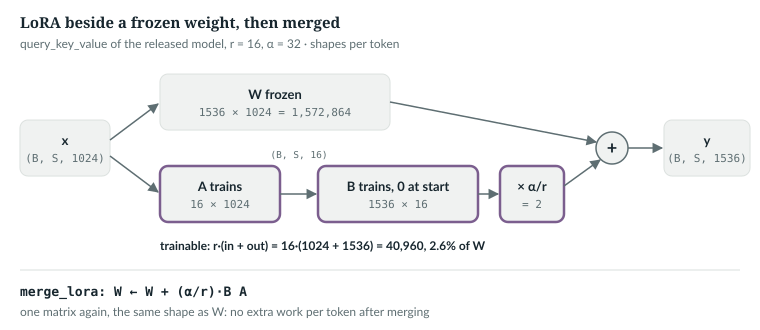
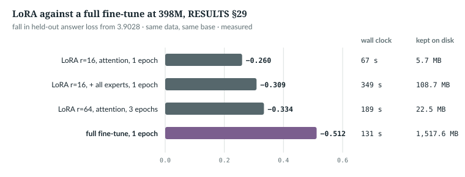

# 31  LoRA

Chapter 30's fine-tune updates all 398M weights and keeps a 1.6 GB copy per
task. Low-rank adaptation (LoRA) freezes them and trains, beside each chosen
matrix, a small correction of rank r [R32]. Adapter modules between layers
came first [S09]; LoRA's correction can instead be folded into the weight.
This chapter reads `lora.py` and shows the trap a mixture of experts adds: the
router's balancing bias is not a weight, so freezing weights does not freeze it.

---

## 31.1  A correction of rank r

Take a frozen weight **W** of shape out × in. LoRA learns **A** (r × in) and
**B** (out × r) and uses

  y = x**W**<sup>T</sup> + (α/r) · x**A**<sup>T</sup>**B**<sup>T</sup>,

so the change to the weight is (α/r)·**BA**, a matrix of rank at most r. **B**
starts at zero, so the model starts exactly as the base, and α/r scales the
update [R32]. Instead of out·in numbers, the correction holds r·(in + out).
In the book example (`book/code-examples/ch31_lora.py`, **Book example, not
repository code**) the two formulas are two functions:

```python
def lora_forward(x, W, A, B, alpha, r):
    """y = x W^T + (alpha / r) * x A^T B^T: the frozen path plus a rank-r correction."""
    return x @ W.T + (x @ A.T @ B.T) * (alpha / r)


def lora_merge(W, A, B, alpha, r):
    """Fold the correction into the weight: W + (alpha / r) * B A, same shape as W."""
    return W + (alpha / r) * (B @ A)
```

The order `x @ A.T @ B.T` matters: x (…, in) first shrinks to (…, r), then
grows to (…, out). The (out × in) product **BA** is never formed while
training; it is formed once, to merge.



*Figure 31.1 · LoRA beside a frozen weight.* The released model's fused
query–key–value projection with r = 16: 40,960 trainable numbers beside
1,572,864 frozen ones. *verified*: shapes from the released configuration.

`IN THE REPO`

## 31.2  `LoRALinear`

> **In the repo** · `lora.py` · `LoRALinear` · lines 50–81 · @773b6a8

```python
class LoRALinear(nn.Module):
    """A frozen Linear plus a trainable rank-r correction."""

    def __init__(self, base: nn.Linear, r: int = 16, alpha: float = 32.0,
                 dropout: float = 0.0):
        super().__init__()
        assert r > 0, "rank must be positive"
        self.base = base
        for p in self.base.parameters():
            p.requires_grad_(False)
        self.r, self.alpha = r, alpha
        self.scale = alpha / r
        self.lora_a = nn.Parameter(torch.empty(r, base.in_features))
        self.lora_b = nn.Parameter(torch.zeros(base.out_features, r))
        # ...
        nn.init.kaiming_uniform_(self.lora_a, a=math.sqrt(5))
        self.drop = nn.Dropout(dropout) if dropout else nn.Identity()

    def forward(self, x: torch.Tensor) -> torch.Tensor:
        out = self.base(x)
        h = self.drop(x) @ self.lora_a.t().to(x.dtype)
        return out + (h @ self.lora_b.t().to(x.dtype)) * self.scale

    @torch.no_grad()
    def merged_weight(self) -> torch.Tensor:
        return self.base.weight + (self.lora_b @ self.lora_a) * self.scale
    # ...
```

In order:
- **The base is kept and frozen**, as a child module named `base`.
- **`scale = alpha / r`**: 32/16 = 2 at the defaults.
- **A random, B zero.** **B** is zeros, so the correction is zero until the
  first step. The paper draws **A** from a Gaussian [R32]; `lora.py` uses
  PyTorch's default `Linear` initialisation, Kaiming-uniform. Either way
  **BA** starts at 0.
- **`forward`** is `lora_forward`; the `.to(x.dtype)` casts let fp32 factors
  run inside bf16 autocast. **`merged_weight`** is `lora_merge`.

The example holds the two together on one 32 → 48 layer with **B** moved off
zero:

```
by hand vs LoRALinear.forward:      largest difference 0.0e+00
by hand vs LoRALinear.merged_weight: largest difference 0.0e+00
merged weight used alone vs adapted: largest difference 4.8e-07
```

*verified*: printed by the example. The merged weight reproduces the adapted
layer to float rounding, because x(**W** + c**BA**)<sup>T</sup> = x**W**<sup>T</sup>
+ c·x**A**<sup>T</sup>**B**<sup>T</sup>, computed in a different order.

`IN THE REPO`

## 31.3  Which layers: `apply_lora`

> **In the repo** · `lora.py` · `apply_lora` · lines 84–109 · @773b6a8

```python
def apply_lora(model: nn.Module, r: int = 16, alpha: float = 32.0,
               dropout: float = 0.0, targets=DEFAULT_TARGETS) -> int:
    # ...
    for p in model.parameters():
        p.requires_grad_(False)
    hits = 0
    for name, module in list(model.named_modules()):
        for child_name, child in list(module.named_children()):
            full = f"{name}.{child_name}" if name else child_name
            if isinstance(child, nn.Linear) and any(full.endswith(t) for t in targets):
                setattr(module, child_name, LoRALinear(child, r, alpha, dropout))
                hits += 1
    if not hits:
        raise ValueError(f"no Linear matched {targets}; nothing would train")
    # ...
    cfg = getattr(model, "cfg", None)
    if getattr(cfg, "moe_impl", None) == "grouped" and any(
            ".experts." in n for n, m in model.named_modules() if isinstance(m, LoRALinear)):
        raise ValueError(
            "adapting the experts needs --moe-impl sparse: the grouped path stacks "
            "expert weights directly and cannot see through an adapter. Measured, "
            "it is also the worse trade -- docs/RESULTS.md 29.")
    return hits
```

Every parameter is frozen first; then each `nn.Linear` whose dotted name ends
in a target is replaced in its parent with `setattr`. The default targets are
`("attn.query_key_value", "attn.dense")` (line 47). The last check refuses
expert adapters under the grouped dispatch path, which reads expert weights
directly (Chapter 18).

On the released configuration, with the defaults:

```python
    qkv = r * (D + (H + 2 * Hkv) * Dh)                         # A: r x D, B: (H+2Hkv)Dh x r
    dense = r * (H * Dh + D)
    formula = n_layer * (qkv + dense)
    # ...
    n = apply_lora(big, r=r, alpha=32.0)
    train = sum(p.numel() for p in lora_parameters(big))
```

```
released config, r = 16: 40 adapters, 1,474,560 trainable (0.37% of 397,659,648); formula 1,474,560
adapter file: 5.90 MB of fp32 factors + 456 router biases
```

*verified*: printed by the example. Per layer, 16·(1,024 + 1,536) +
16·(1,024 + 1,024) = 73,728; times 20 layers (`n_layer`). RESULTS §29's file
sizes are binary megabytes: 5,898,240 bytes are 5.63 MiB, its 5.7 with the
biases and metadata, and four times that, 22.5 MiB, is its r = 64 row.

`IN THE REPO`

## 31.4  The trap: a router bias is not a weight

The balancing bias of each router (Chapter 17) is a buffer, not a parameter.
`apply_lora` freezes parameters, so it never touches the bias, and
`finetune.py` still calls `update_expert_biases()` after every step (Chapter
30, 30.4). The bias keeps moving while the weights stand still. `lora.py`
therefore saves it with the adapters:

> **In the repo** · `lora.py` · `router_state_dict` · lines 121–132 · @773b6a8

```python
def router_state_dict(model: nn.Module) -> dict:
    # ...
    return {n: b.detach().cpu() for n, b in model.named_buffers()
            if n.endswith("expert_bias")}
```

and `finetune.py` writes it next to them:

> **In the repo** · `finetune.py` · `main` · lines 335–342 · @773b6a8

```python
                if args.lora:
                    from lora import lora_state_dict, router_state_dict
                    # A few MB: the adapters, plus what they were trained on top
                    # of. lora.py merge turns this back into a full checkpoint.
                    atomic_save({**meta, "lora": lora_state_dict(model),
                                 "router": router_state_dict(model),
                                 "lora_cfg": {"r": args.lora_r, "alpha": args.lora_alpha,
                                              "targets": list(targets)}}, args.out)
```

The book example takes ten steps the way `finetune.py` does, then rebuilds
the model from a pristine base twice, with the saved biases and without:

```python
    for _ in range(10):                                         # as finetune.py: step, then the balancer
        _, loss = model(xb, xb.roll(-1, 1))
        opt.zero_grad(set_to_none=True)
        loss.backward()
        opt.step()
        model.update_expert_biases()
    # ...
    def rebuild(with_router: bool):
        m = M.AnuLM(cfg)
        m.load_state_dict(base_sd)
        apply_lora(m, r=4, alpha=8.0)
        load_lora(m, ad)
        if with_router:
            m.load_state_dict(router, strict=False)
        merge_lora(m)
        return m.eval()
```

```
step 0, adapted vs base logits: largest difference 4.5e-08
after 10 steps: router biases moved by up to 0.010 (frozen weights, but a buffer)
merged with router biases: logits differ by up to 1.0e-07; tokens whose expert set changed: 0%
merged without router biases: logits differ by up to 5.9e-04; tokens whose expert set changed: 9%
```

*verified*: printed by the example, on `tiny()` with random data. Without the
biases, 9% of the tokens reach a different set of experts than they did in
training. The example reads the choices off each router with a forward hook:

```python
def expert_sets(model, x):
    """The top-k expert ids each token reaches in every MoE layer, as one tensor."""
    out = []
    hooks = [m.register_forward_hook(lambda mod, i, o: out.append(o[0]))
             for m in model.modules() if isinstance(m, M.Router)]
    with torch.no_grad():
        model(x)
    for h in hooks:
        h.remove()
    return torch.stack([o.sort(-1).values for o in out])          # (layers, N, k)
```

A `Router` returns the expert ids first (Chapter 17); sorting each token's k
ids makes two choices compare equal whatever their order.

On the released model the scale is larger. Its `bias_update_rate` is 0.003
per step, and the spread of bias values within one layer is between 0.018 and
0.281 (*measured*, `book/code-examples/ch31_measure_lora.py`, saved in
`book/measurements/part_vii_lora.json`). A fine-tune of 100 steps can move a
bias by up to 0.3, more than the widest layer's spread.

`IN THE REPO` · `MEASURED`

## 31.5  Merging

> **In the repo** · `lora.py` · `merge_lora` · lines 142–158 · @773b6a8

```python
@torch.no_grad()
def merge_lora(model: nn.Module) -> int:
    # ...
    merged = 0
    for name, module in list(model.named_modules()):
        for child_name, child in list(module.named_children()):
            if isinstance(child, LoRALinear):
                base = child.base
                base.weight.copy_(child.merged_weight())
                setattr(module, child_name, base)
                merged += 1
    return merged
```

Each base weight becomes **W** + (α/r)**BA**, and the plain `nn.Linear` goes
back in the wrapper's place: an ordinary AnuLM, as fast as the base, which is
LoRA's "no additional inference latency" [R32]. The command-line merge
restores the biases first:

> **In the repo** · `lora.py` · `_merge_cli` · lines 186–194 · @773b6a8

```python
    model.load_state_dict(base["model"])
    cfg = ad.get("lora_cfg") or {}
    apply_lora(model, cfg.get("r", 16), cfg.get("alpha", 32.0),
               targets=tuple(cfg.get("targets") or DEFAULT_TARGETS))
    load_lora(model, ad["lora"])
    if ad.get("router"):
        model.load_state_dict(ad["router"], strict=False)
        print(f"restored {len(ad['router'])} router biases")
    n = merge_lora(model)
```

On the released checkpoint, in fp32 on the GPU, with every **B** set to
random values of standard deviation 10⁻³ (**A** and **B** drawn with seed 0) on a 21-token made-up
sentence: at step 0 the adapted logits equal the base's exactly; the random
**B** moves them by up to 0.314; and the merged model is within 1.3 × 10⁻⁵ of
the adapted one, with no LoRA tensor left. *measured*:
`part_vii_lora.json`.

`IN THE REPO` · `MEASURED`

## 31.6  The proof, and what it does not exercise

> **In the repo** · `test_model.py` · `lora_starts_as_the_base_model_and_merges_back_exactly` · lines 1047–1061 · @773b6a8

```python
    model = AnuLM(cfg).eval()
    model.load_state_dict(base_sd)
    n = apply_lora(model, r=4, alpha=8.0)
    assert n > 0
    with torch.no_grad():
        got, _ = model(x)
    # ...
    d0 = (want - got).abs().max().item()
    assert d0 < 1e-6, f"B must start at zero: step 0 moved the logits by {d0}"

    trainable = {name for name, p in model.named_parameters() if p.requires_grad}
    assert trainable and all("lora_" in name for name in trainable), \
        f"something other than the adapters is trainable: {sorted(trainable)[:3]}"
```

`lora_starts_as_the_base_model_and_merges_back_exactly` (line 1021) checks step 0 to 10⁻⁶ and that only `lora_` tensors
train. It then takes one optimiser step, saves the adapter and biases,
rebuilds from the base, and requires the merged model within 10⁻⁴ of the
adapted one. Its last block is meant to show the router drift:

> **In the repo** · `test_model.py` · `lora_starts_as_the_base_model_and_merges_back_exactly` · lines 1102–1106 · @773b6a8

```python
    trained_bias = router[sorted(router)[0]]
    base_bias = base_sd[sorted(router)[0]]
    if not torch.equal(trained_bias, base_bias):
        assert not torch.equal(naive.state_dict()[sorted(router)[0]], trained_bias), \
            "the test is not exercising the router drift it claims to"
```

> **Details.** The test's single step never calls `update_expert_biases()`, so
> the bias does not move: run as written, `trained_bias` equals `base_bias`
> and the `if` skips the assertion (checked by running the test's steps at
> @773b6a8). The drift is exercised by the book example in 31.4, not by the
> suite. Calling `model.update_expert_biases()` after `opt.step()` in the
> test would make the block run.

`IN THE REPO`

## 31.7  Is it worth it at 398M?

LoRA was made for models too large to fine-tune whole. RESULTS §29 asked
whether it pays at this size, on 17,143 Hindi pairs, from `AnuLM-Base-400M`:
the first 400M base, not `ckpt_base_v2.pt`. Their configurations differ only
in `block_size` and YaRN context length (512 against 1,024), so 31.3's
adapter arithmetic holds for both.



*Figure 31.2 · LoRA against a full fine-tune.* Held-out loss fell by 0.260
(67 s, 5.7 MB kept), 0.309 (349 s, 108.7 MB) and 0.334 (189 s, 22.5 MB) for the
three LoRA runs, and by 0.512 (131 s, 1,517.6 MB) for the full fine-tune.
*measured*: RESULTS §29, one RTX 5070 Ti, from 3.9028.

The full fine-tune improves about 1.5 times as much as the best LoRA run
(0.512 against 0.334, the table's 65%) in less time, and twice as much as the
r = 16 attention run. RESULTS' prose, and `lora.py`'s docstring (line 34),
say "twice" against the best run; the table gives 1.5.
LoRA buys size: 5.7 MB against 1,517.6 MB, and optimiser state that fits a
small card. Adapting the experts is the worst trade, +0.049 for five times the
wall clock: each expert trains only on the tokens routed to it.

> **Details.** `decide.py` has its own LoRA (lines 236–271), attached by
> forward hooks so that the backbone's modules and state dict stay untouched
> and the same weights still chat (Chapter 32). Its **A** is drawn with
> standard deviation 1/r, and its `LoRAQV` adapts only the Q and V slices of
> the fused projection, writing zeros into K's.

QLoRA keeps the frozen base in 4-bit NormalFloat, with double quantisation and
paged optimisers [R33]. None of it is in the repository: `lora.py` keeps the
base in fp32. The lab book's Chapter 10 writes NF4 from scratch.

`MEASURED` · `NOT IN THE REPO` (QLoRA)

## 31.8  Common mistakes, and how to catch them

- **B initialised randomly**: step 0 is no longer the base. *Catch it:* logits
  before and after `apply_lora`.
- **The scale forgotten when merging**: *catch it* with merged vs adapted
  logits, as in 31.5.
- **Only the adapters saved, on an MoE model**: *catch it* by comparing the
  expert choices of the merged and the trained model (31.4).

`IN THE REPO`

## 31.9  Exercises

1. How many trainable numbers does r = 64 on the default targets add to the
   released model?
2. With r = 16 and α = 32, by what does **BA** get multiplied? What if you
   double r and keep α?
3. How many adapters does `apply_lora` add to `tiny()` with the default
   targets?
4. A fine-tune of 1,702 steps at `bias_update_rate` 0.003: how far can one
   bias move?

**Answers.**
1. 4 × 1,474,560 = 5,898,240.
2. 2; then 1.
3. Six: two attention projections in each of its three layers.
4. 1,702 × 0.003 = 5.106, since each step moves it by exactly ±0.003 or not
   at all.

*verified*: 3 by running `apply_lora(AnuLM(tiny()))`; the rest is arithmetic
from 31.3 and `update_expert_biases` (`model.py` lines
1014–1044).

> **Build it.** The lab book's Chapter 10 (`course/ch10-lora-qlora`) builds
> LoRA and NF4 QLoRA from stubs and teaches the Shakespeare model Hindi, with
> the router-bias trap as one of its checks.

---

## Key points

- LoRA freezes **W** and learns **B**·**A** of rank r beside it, scaled by α/r;
  **B** starts at zero, so training starts from the base model exactly.
- The released model's attention adapters at r = 16 are 1,474,560 numbers,
  0.37% of the model, about 5.9 MB in fp32.
- `apply_lora` wraps attention projections by default and refuses expert
  adapters on the grouped dispatch path.
- Router biases are buffers: they keep moving during a LoRA run, so the
  adapter file carries them, and merging restores them.
- `merge_lora` folds the update into **W** and gives back a plain AnuLM with no
  extra cost per token.
- At 398M a full fine-tune beat every LoRA run on quality, and the best one
  on time too; LoRA buys small files and small optimiser state. QLoRA is not
  in the repository.

> **In one breath.** LoRA trains a rank-r product beside each frozen projection,
> starting from zero so step 0 is the base model, then folds it back into the
> weight; on this MoE model the router biases move during training and must
> travel with the adapter, and at 398M a full fine-tune still learns more.

## References

Research references cited in this chapter (`docs/reference/research-references.md`), each
used only for the claim in its register row:

| ID | Used for | Status |
|---|---|---|
| [R32] | frozen weights plus a trainable low-rank product; B = 0 at the start; α/r scaling; no added inference latency | CHECKED |
| [R33] | QLoRA: 4-bit NormalFloat, double quantisation, paged optimisers | CHECKED |
| [S09] | adapter modules for parameter-efficient transfer, before LoRA | CHECKED |

Repository evidence, all at @773b6a8:
- `lora.py`: `DEFAULT_TARGETS` 47, `LoRALinear` 50–81, `apply_lora` 84–109,
  `router_state_dict` 121–132, `merge_lora` 142–158, `_merge_cli` 171–204.
- `finetune.py`: adapter save 335–342; `update_expert_biases` call 317.
- `model.py`: `AnuLM.update_expert_biases` 1014–1044.
- `decide.py`: `LoRA` 236–249, `LoRAQV` 252–271.
- `test_model.py`: `lora_starts_as_the_base_model_and_merges_back_exactly` 1021.
- `docs/RESULTS.md` §29.
- Measurements: `book/measurements/part_vii_lora.json`.
