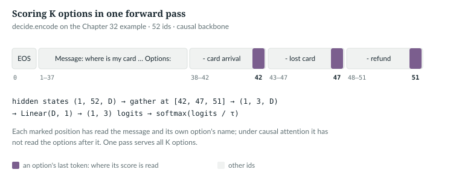
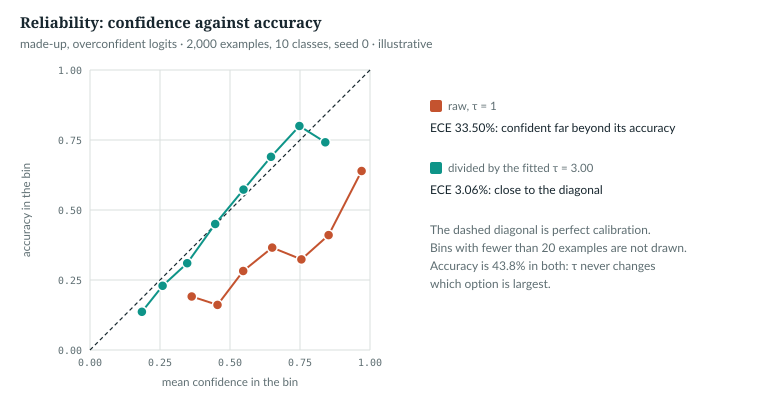

# 32  Classification heads and calibration

Much software needs a decision, not prose: which queue, which intent.
Generating a label's name token by token gives no guarantee the result is a
label. `anulm/tasks/decide.py` reads the message and every option's name in one forward
pass and returns one probability per option; after calibration, 0.9 means
right about nine times in ten. You need the softmax and temperature (Chapter
5) and the causal mask (Chapter 12).

---

## 32.1  One prompt, every option

> **In the repo** · `anulm/tasks/decide.py` · `encode` · lines 89–101 · @fdbb09a

```python
def encode(tok, text: str, options: list[str], max_len: int = 1024):
    """-> (ids, positions) where positions[k] is the index of the last token of
    option k's name. Pieces are encoded separately so the positions are exact.
    Raises ValueError past `max_len` (the backbone's block_size): the message
    and options come from API callers, so this is input validation."""
    ids = [tok.eos_id] + tok.encode(f"Message: {text.strip()}\nWhich of these does it ask for?\nOptions:")
    pos = []
    for o in options:
        ids += tok.encode(f"\n- {readable(o)}")
        pos.append(len(ids) - 1)
    if len(ids) > max_len:
        raise ValueError(f"{len(ids)} tokens; too many options for the context")
    return ids, pos
```

A start token, the message and a question, then one line per option, made
readable (`card_arrival` → `card arrival`, line 83). Each option is encoded on
its own, so `len(ids) - 1` is exactly its last token's position. A prompt
longer than `max_len` raises `ValueError`, not an `assert`, so `python -O`
cannot remove the check; `Decide.__call__` passes the backbone's own
`block_size` (line 696). The book
example (`book/code-examples/ch32_decide_calibration.py`, **Book example, not
repository code**) prints it:

```
52 ids; option last-token positions [42, 47, 51]
  ids[:43] ends with '- card arrival'
  ids[:48] ends with '- lost card'
  ids[:52] ends with '- refund'
```

*verified*: printed by the example.



*Figure 32.1 · Scoring K options in one pass.* *verified*: positions from
`decide.encode` on the example, asserted by the figure script.

`IN THE REPO`

## 32.2  The head

> **In the repo** · `anulm/tasks/decide.py` · `Decider.forward` · lines 240–246 · @fdbb09a

```python
    def forward(self, idx, pos, mask=None):
        """idx (B, S); pos (B, K) option positions; mask (B, K) real options
        when the examples in a batch have different numbers of them -> (B, K)."""
        h = self.hidden(idx)
        g = h.gather(1, pos[..., None].expand(-1, -1, h.shape[-1]))
        logits = self.head(g).squeeze(-1).float()
        return logits if mask is None else logits.masked_fill(~mask, float("-inf"))
```

Shapes, in order: `hidden` gives (B, S, D); the expanded positions are a
(B, K, D) index, and `gather` picks K hidden vectors per row; `head`,
`nn.Linear(D, 1)` (line 120), leaves (B, K) logits. Padded option slots get
−∞, so their probability is 0. Training is cross-entropy over the K logits
(line 596), with options shuffled on every example (`make_examples`, line
309), so the head learns names, not slots. Rows are padded on the right:

> **In the repo** · `anulm/tasks/decide.py` · `batchify` · lines 291–306 · @fdbb09a

```python
def batchify(examples, tok, pad, with_mask=False):
    L = max(len(e[0]) for e in examples)
    K = max(len(e[1]) for e in examples)
    x = torch.full((len(examples), L), pad, dtype=torch.long)
    pos = torch.zeros(len(examples), K, dtype=torch.long)
    mask = torch.zeros(len(examples), K, dtype=torch.bool)
    for b, e in enumerate(examples):
        x[b, :len(e[0])] = torch.tensor(e[0])
        pos[b, :len(e[1])] = torch.tensor(e[1])
        mask[b, :len(e[1])] = True
    y = torch.tensor([e[2] for e in examples])
    return (x, pos, y, mask) if with_mask else (x, pos, y)
```

The causal backbone is `AnuLM.forward` without the head and the loss:

> **In the repo** · `anulm/tasks/decide.py` · `Decider._hidden` · lines 200–218 · @fdbb09a

```python
    def _hidden(self, idx):
        # ...
        attn = idx != self.pad_id
        attn[:, 0] = True
        if self.kind == "hf":
            return self.model(input_ids=idx, attention_mask=attn.long()).last_hidden_state
        if self.kind == "bidir":
            from anulm.bidirectional import bidir_hidden
            return bidir_hidden(self.model, idx, attn)
        m = self.model                         # causal: right padding never reaches real tokens
        x = F.embedding(idx, m._table("in"))
        cos, sin = m.rotary(idx.shape[1], x.device, x.dtype)
        for layer in m.layers:
            if m.grad_ckpt and self.training:
                x, _ = torch.utils.checkpoint.checkpoint(layer, x, cos, sin, use_reentrant=False)
            else:
                x, _ = layer(x, cos, sin)
        return m.norm(x)
```

The causal branch needs no padding mask: padding is on the right, and a
causal position never reads to its right. Position 0 is forced real because
the start token shares its id with the padding. `hf` runs a borrowed encoder
as a reference; `bidir` is 32.3's.

The example writes the head out by hand and holds it to `Decider`:

```python
def score_options(model, head, idx, pos):
    """idx (B, S) ids; pos (B, K) positions of each option's last token -> (B, K) logits."""
    x = F.embedding(idx, model._table("in"))                 # (B, S, D): the causal backbone
    cos, sin = model.rotary(idx.shape[1], x.device, x.dtype)
    for layer in model.layers:
        x, _ = layer(x, cos, sin)
    h = model.norm(x)                                        # (B, S, D)
    g = h.gather(1, pos[..., None].expand(-1, -1, h.shape[-1]))   # (B, K, D)
    return head(g).squeeze(-1)                               # (B, K)
```

```
Decider logits (1, 3): [0.0923, -0.0826, 0.0909]; by hand: largest difference 0.0e+00
change the last option: first two logits move by 1.5e-08 (causal), 4.5e-03 (bidirectional)
```

*verified*: printed by the example on the untrained `tiny()` backbone.
Replacing the last option leaves the first two scores unchanged to float
rounding: under the causal mask an option never sees the options after it.

`IN THE REPO`

## 32.3  Reading both ways

`anulm/bidirectional.py` removes that limit. It implements the first two of
LLM2Vec's three steps, bidirectional attention and masked next-token
prediction, and not its third, unsupervised contrastive learning [R35].

> **In the repo** · `anulm/bidirectional.py` · `bidir_hidden` · lines 40–53 · @fdbb09a

```python
def bidir_hidden(m: AnuLM, idx: torch.Tensor, attn: torch.Tensor | None = None) -> torch.Tensor:
    """Final hidden states with bidirectional attention. `attn` (B, S) marks
    real tokens; padding is never attended to."""
    if attn is None:
        attn = torch.ones_like(idx, dtype=torch.bool)
    key = attn.bool()[:, None, None, :]
    x = F.embedding(idx, m._table("in"))
    cos, sin = m.rotary(idx.shape[1], x.device, x.dtype)
    for layer in m.layers:
        if m.grad_ckpt and m.training:
            x, _ = torch.utils.checkpoint.checkpoint(layer, x, cos, sin, None, 0, key, use_reentrant=False)
        else:
            x, _ = layer(x, cos, sin, bidir_mask=key)
    return m.norm(x)
```

`key`, (B, 1, 1, S), broadcasts over heads and queries: every query may see
every real key. `anulm/model.py` uses it in place of the causal mask:

> **In the repo** · `anulm/model.py` · `GQAttention.forward` · lines 479–481 · @fdbb09a

```python
        # bidir_mask (B, 1, 1, T), True = a real token: BIDIRECTIONAL attention
        # over the unpadded tokens (bidirectional.py's encoder use). None = causal.
        mask = bidir_mask if bidir_mask is not None else _attn_mask(S, T, start, window, x.device)
```

`adapt` (lines 56–105) hides 20% of tokens and predicts each from the
position before it. It was tested on BANKING77, a public set of banking
support messages labelled with 77 intents: trained on that set, and
zero-shot, that is, trained only on other label sets and tested on BANKING77's
unseen intents. It did not help: 89.5% against the decoder's 89.2% trained,
+0.3 points and within noise by RESULTS' reading; 41.6% against 43.2%
zero-shot (*measured*, RESULTS §36).

`IN THE REPO` · `MEASURED`

## 32.4  Calibration: one temperature

A classifier is calibrated when, among the cases it gives confidence 0.8, it
is right 80% of the time. Modern neural networks are often poorly
calibrated, and dividing the logits by one fitted temperature τ is an
effective fix [R34]:

> **In the repo** · `anulm/tasks/decide.py` · `fit_temperature` · lines 368–374 · @fdbb09a

```python
def fit_temperature(logits: torch.Tensor, y: torch.Tensor) -> float:
    """The single T minimising held-out NLL of softmax(logits / T)."""
    best = (float("inf"), 1.0)
    for t in [x / 100 for x in range(30, 501, 5)]:
        nll = F.cross_entropy(logits / t, y).item()
        best = min(best, (nll, t))
    return best[1]
```

A grid over τ from 0.30 to 5.00 in steps of 0.05, keeping the lowest held-out
negative log-likelihood. Dividing by τ > 0 never reorders a row, so only the
confidence changes. `train` fits τ when it saves (line 611); `Decide.__call__`
applies it (line 697).

`IN THE REPO`

## 32.5  Three numbers for a calibrated classifier

> **In the repo** · `anulm/tasks/decide.py` · `metrics` · lines 377–397 · @fdbb09a

```python
def metrics(probs: torch.Tensor, y: torch.Tensor, bins: int = 15) -> dict:
    conf, pred = probs.max(1)
    correct = (pred == y).float()
    ece = 0.0
    for b in range(bins):
        lo, hi = b / bins, (b + 1) / bins
        m = (conf > lo) & (conf <= hi)
        if m.any():
            ece += m.float().mean().item() * abs(conf[m].mean().item() - correct[m].mean().item())
    onehot = F.one_hot(y, probs.shape[1]).float()
    brier = ((probs - onehot) ** 2).sum(1).mean().item()
    out = {"accuracy": correct.mean().item(), "ece": ece, "brier": brier,
           "mean_confidence": conf.mean().item(), "n": len(y)}
    for tau in (0.5, 0.7, 0.9):
        keep = conf >= tau
        out[f"answer_if_conf>={tau}"] = {"coverage": keep.float().mean().item(),
                                         "accuracy": correct[keep].mean().item() if keep.any() else float("nan")}
    return out
```

- **Expected calibration error (ECE)** [R34]. Group predictions into 15 bins
  by confidence; in each, take |mean confidence − accuracy|; average the gaps
  weighted by each bin's share of predictions. 0 is perfect.
- **Brier score.** The squared distance between the probability vector and
  the one-hot answer, summed over options and averaged. It rewards being both
  right and appropriately sure.
- **Selective accuracy.** Answer only when confidence ≥ 0.5, 0.7 or 0.9, and
  report the share answered (coverage) and the accuracy on those. The rest go
  to a human. In `metrics` that threshold is named `tau`; it is not the
  temperature τ of 32.4.

By hand: five predictions at confidence 0.8, four of them right, fall in one
bin with |0.8 − 0.8| = 0, so ECE = 0. That is the test's own case (printed by
the example as `ECE 0.0e+00`).

The example then makes 2,000 overconfident predictions: logits three times
too large, on 10 classes, seed 0 (*illustrative*;
`book/code-examples/ch32_decide_calibration.py`). It checks its own ECE
against `metrics` and lets `fit_temperature` find τ:

```python
    tau = D.fit_temperature(logits, y)
    for name, t in (("raw", 1.0), (f"tau {tau:.2f}", tau)):
        probs = F.softmax(logits / t, 1)
        m = D.metrics(probs, y)
        assert abs(ece_by_hand(probs, y) - m["ece"]) < 1e-6
```

```
raw       accuracy 43.8%  mean confidence 77.3%  ECE 33.50%  Brier 0.840  conf>=0.9: answers 38.6% at 63.9%
tau 3.00  accuracy 43.8%  mean confidence 44.7%  ECE 3.06%  Brier 0.695  conf>=0.9: answers 0.7% at 92.9%
ece_by_hand equals decide.metrics: True; argmax unchanged by tau: True
```

*illustrative*: printed by `book/code-examples/ch32_decide_calibration.py`.
The grid finds the factor of 3 put
in; accuracy is unchanged, and confidence falls to match it.



*Figure 32.2 · Reliability before and after temperature scaling.*
*illustrative*: the made-up data of `book/code-examples/ch32_decide_calibration.py`,
recomputed and asserted by the figure script.

`IN THE REPO`

## 32.6  Measured on BANKING77

RESULTS §34 fine-tuned the whole model, backbone and head, on BANKING77 and
tested on 3,080 queries: 89.2% accuracy, against 93.6% for a fine-tuned BERT
reported in the literature it cites. (Training the head alone, on the chat
model, reached 37.9%: RESULTS §37.) Calibration, with τ = 2.70 fitted on 1,000
held-out training queries:

| | ECE | Brier | mean confidence |
|---|---|---|---|
| raw | 7.58% | 0.177 | 96.8% |
| τ = 2.70 | 2.38% | 0.159 | 88.6% |

| answer only when confidence ≥ | answers | accuracy on those |
|---|---|---|
| 0.5 | 91.4% | 93.5% |
| 0.7 | 84.4% | 96.3% |
| 0.9 | 73.9% | 97.7% |

*measured*: RESULTS §34; 53 ms per query on the RTX 5070 Ti. RESULTS §37 kept
the chat model fixed and trained hook-based LoRA (Chapter 31): 86.4%, and the
same weights still chat. RESULTS §38: 15 to 16 points ahead of a borrowed
English encoder on Hindi intents.

`MEASURED`

> **Details.** Serving. `/v1/decide` (Chapter 38) calls `Decide.__call__` and
> turns a `ValueError` (too many options for the context, or the case below)
> into a 400. With the one joint Omni model loaded (Chapter 37), the call goes
> instead to `omni.Intent`, which has the same signature but no trained head:
> it scores each label by the model's own mean log-probability of writing it
> after an intent prompt, softmaxed over the labels (sharpened ×10, line 158;
> no fitted temperature, so the calibration numbers above are not its own).
> It therefore refuses options it never learned to write:
>
> > **In the repo** · `anulm/multimodal/omni.py` · `Intent.choices` · lines 124–139 · @fdbb09a
>
> ```python
>     def choices(self, options: list[str] | None) -> list[str]:
>         # ...
>         if options is None:
>             return self.labels
>         known = set(self.labels)
>         unknown = [o for o in options if o not in known]
>         if unknown:
>             raise ValueError("custom options are not supported by the joint model: it scores only "
>                              f"its trained labels, and {unknown[:3]} are not among them. Pass a subset "
>                              "of the trained labels, or none for all of them.")
>         return list(dict.fromkeys(options))
> ```
>
> No options means every trained label; a subset is scored with the softmax
> renormalised over it, duplicates dropped; one unknown label is a 400.
> `Decide`, by contrast, accepts any option list, zero-shot. Not measured
> here: how accurate the joint model's subset scores are.

## 32.7  The proof, and common mistakes

> **In the repo** · `tests/test_model.py` · `decide_scores_each_option_at_its_last_token_and_calibrates` · lines 1712–1725 · @fdbb09a

```python
    ids, pos = D.encode(tok, "where is my card", opts)
    for k, o in enumerate(opts):
        assert tok.decode(ids[:pos[k] + 1]).endswith(D.readable(o)), o
    torch.manual_seed(0)
    d = D.Decider(AnuLM(tiny(vocab_size=300, block_size=128))).eval()
    x, p, y = D.batchify([(ids, pos, 0, opts), (ids, pos, 2, opts)], tok, tok.eos_id)
    with torch.no_grad():
        logits = d(x, p)
    assert logits.shape == (2, 3)
    probs = torch.tensor([[0.8, 0.1, 0.1]] * 5)
    y5 = torch.tensor([0, 0, 0, 0, 1])                     # 80% confident, 80% right
    assert D.metrics(probs, y5)["ece"] < 1e-6
    t = D.fit_temperature(logits.repeat(4, 1), torch.tensor([0, 2] * 4))
    assert (F.softmax(logits / t, 1).argmax(1) == logits.argmax(1)).all()
```

`decide_scores_each_option_at_its_last_token_and_calibrates` (line 1702)
pins the positions, the shape, ECE and the argmax under τ. Mistakes to avoid:
- **Reading the score one token early**, before the option's name is read.
- **Options in a fixed order in training**: the head learns slots.
- **Fitting τ on test data, or another task's**: RESULTS §36's borrowed
  encoder kept an ECE of 18.12% zero-shot.

`IN THE REPO`

## 32.8  Exercises

1. With K options, how many sequences does `Decider` run through the model,
   and how many would scoring each option's name as a generated answer need?
2. A bin holds 200 predictions at mean confidence 0.95 with 160 right, and is
   10% of all predictions. What does it add to ECE?
3. Why can temperature scaling not change accuracy?
4. Under the causal backbone, which option's score has read the whole list?

**Answers.**
1. One; K, one prompt-plus-option sequence per option (batchable into one
   call of K rows, but K times the tokens).
2. 0.10 × |0.95 − 0.80| = 0.015.
3. Dividing a row of logits by τ > 0 keeps their order, so the argmax is the
   same.
4. The last one.

> **Build it.** The lab book's Chapter 12 (`course/ch12-decide-rag`) builds
> the option scorer and temperature scaling from stubs and calibrates them on
> its own data.

---

## Key points

- `anulm/tasks/decide.py` puts the message and every option's name in one prompt and reads
  a score at the last token of each option: K logits from one forward pass.
- A linear head on the gathered (B, K, D) hidden states gives (B, K) logits; a
  softmax over the options gives the probabilities.
- Under causal attention an option is judged against the options before it
  only; a bidirectional version exists and measured no better.
- Temperature scaling divides the logits by one τ fitted on held-out NLL; it
  changes confidence and never the prediction.
- ECE, Brier score and selective accuracy judge a classifier whose
  confidence is meant to be used.
- On BANKING77 the head reached 89.2%, and τ = 2.70 cut ECE from 7.58% to
  2.38%.

> **In one breath.** Write the message and the options into one prompt, read
> a hidden state at the end of each option's name, score it with a linear
> head, and soften the scores with one temperature fitted on held-out data;
> the answer is always an option and its confidence can be trusted.

## References

Research references cited in this chapter (`RESEARCH_REFERENCES.md`), each
used only for the claim in its register row:

| ID | Used for | Status |
|---|---|---|
| [R34] | networks are often poorly calibrated; temperature scaling; expected calibration error | CHECKED |
| [R35] | LLM2Vec: bidirectional attention and masked next-token prediction | CHECKED |

Repository evidence, all at @fdbb09a:
- `anulm/tasks/decide.py`: `readable` 83, `encode` 89–101, `Decider` 105–246 (`head` 120,
  `_hidden` 200–218, `forward` 240–246), `LoRA` 249–264, `batchify` 291,
  `make_examples` 309, `fit_temperature` 368–374, `metrics` 377–397, `train`
  545–616 (loss 596, temperature 611), `Decide.__call__` 691–704.
- `anulm/bidirectional.py`: `bidir_hidden` 40–53, `adapt` 56–105.
- `anulm/multimodal/omni.py`: `Intent.choices` 124–139, `Intent.__call__` 141–164.
- `tests/test_quality_loading.py`: `test_decide_prompt_too_long` 241.
- `anulm/model.py`: `GQAttention.forward` 479–481.
- `tests/test_model.py`: `decide_scores_each_option_at_its_last_token_and_calibrates` 1702.
- `docs/RESULTS.md` §34, §36, §37, §38.
