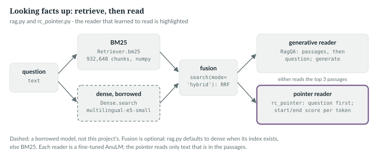
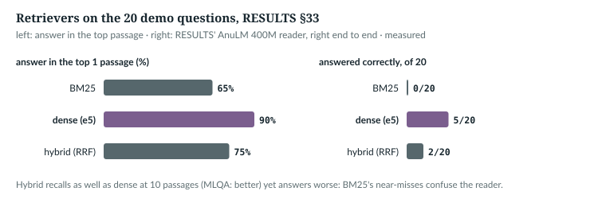

# 33  Retrieval and readers

A model that has read a few hundred million tokens stores few facts: asked
for the capital of India, the demo's question-answering model named "the
Roman Empire" (RESULTS §33). Retrieval changes the job: find passages that
hold the answer, then read it out of them. `anulm/inference/rag.py` and `anulm/tasks/rc_pointer.py` hold a
BM25 index written from scratch, a borrowed dense retriever, their fusion, and
two readers. You need Chapter 30's templates and Chapter 32's head on hidden
states.



*Figure 33.1 · Retrieve, then read.* Every box exists in the repository.
*verified*: `anulm/inference/rag.py` and `anulm/tasks/rc_pointer.py` at @b42998d; the chunk count from
`data/rag/meta.json`.

---

## 33.1  Words to hashed ids

> **In the repo** · `anulm/inference/rag.py` · `term_ids` · lines 42–60 · @b42998d

```python
BUCKETS = 1 << 24
K1, B = 1.2, 0.75
# ...
WORD = re.compile(r"[0-9A-Za-zÀ-ɏऀ-ॿ]+")
# ...
def words(text: str) -> list[str]:
    return WORD.findall(text.lower())


def term_ids(text: str) -> np.ndarray:
    return np.array([zlib.crc32(w.encode()) & (BUCKETS - 1) for w in words(text)], dtype=np.int64)
```

A word is a lower-cased run of Latin letters, digits or Devanagari, vowel
signs included. Each is hashed with CRC-32 into one of 2<sup>24</sup>
buckets: no vocabulary to build or share between workers, at the price of
occasional collisions. `K1` and `B` are BM25's two constants. A passage is
indexed as its article title plus its text (`term_ids(title + " " + chunk)`,
line 91), because a paragraph about Delhi often does not say "Delhi".

`IN THE REPO`

## 33.2  BM25, weighted at build time

BM25 scores a passage d for a query q as a sum over the query's words
[R36]:

  score(q, d) = Σ<sub>w ∈ q</sub> idf(w) · tf·(k<sub>1</sub> + 1) /
  (tf + k<sub>1</sub>·(1 − b + b·|d| / avgdl))

where tf counts w in d, |d| is d's length in words, and avgdl is the mean length.
A word's weight grows with tf but saturates (k<sub>1</sub>), and long passages
are discounted (b). `anulm/inference/rag.py` computes every (word, passage) weight once, when
it builds the index:

> **In the repo** · `anulm/inference/rag.py` · `build` · lines 136–145 · @b42998d

```python
    N, avgdl = len(pairs), float(lens.mean())
    df = np.bincount(terms, minlength=BUCKETS)
    idf = np.log1p((N - df + 0.5) / (df + 0.5)).astype(np.float32)
    w = idf[terms] * tfs * (K1 + 1) / (tfs + K1 * (1 - B + B * lens[rows] / avgdl))
    order = np.argsort(terms, kind="stable")
    indptr = np.zeros(BUCKETS + 1, dtype=np.int64)
    indptr[1:] = np.cumsum(np.bincount(terms, minlength=BUCKETS))
    np.save(RAG / "indptr.npy", indptr)
    np.save(RAG / "docs.npy", rows[order].astype(np.int32))
    np.save(RAG / "weights.npy", w[order].astype(np.float16))
```

`terms`, `rows` and `tfs` are three parallel arrays with one entry per
posting: a (word, passage) pair and its count. Line by line:
- `df` counts the passages holding each bucket. The idf is a variant:
  BM25's own idf, ln((N − df + 0.5)/(df + 0.5)), goes negative for a word in
  more than half the passages [R36]; `log1p` adds 1 inside the logarithm, so
  this one never does.
- `w` is the formula above for every posting at once.
- The postings are sorted by word. `indptr[t]` to `indptr[t + 1]` is then
  word t's stretch of `docs` and `weights`: a compressed sparse row layout.
- Weights are stored as float16 to halve the file.

A query is then a weighted count per query word:

> **In the repo** · `anulm/inference/rag.py` · `Retriever.bm25` · lines 288–308 · @b42998d

```python
        scores = np.zeros(self.n, dtype=np.float32)
        qt = set(term_ids(query).tolist())
        for t in qt:
            a, b = self.indptr[t], self.indptr[t + 1]
            if b > a:
                scores += np.bincount(self.docs[a:b], weights=self.weights[a:b].astype(np.float32),
                                      minlength=self.n).astype(np.float32)
        # ...
        if lang in self._lm:
            scores[~self._lm[lang]] = 0
        top = np.argpartition(-scores, min(k, self.n - 1))[:k]
        top = top[np.argsort(-scores[top])]
        return [{**self.chunks[i], "score": float(scores[i]), "_i": int(i)} for i in top if scores[i] > 0]
```

Each distinct query word adds its weights into a dense score vector with one
`bincount`; `argpartition` finds the k best without sorting every score. The
elided lines add a title and a lead-paragraph bonus, both off: RESULTS §33
measured that each cost recall.

The book example (`book/code-examples/ch33_retrieval.py`, **Book example, not
repository code**) builds a real index of four made-up articles with
`rag.build`, then recomputes every score from the formula:

```python
def bm25_by_hand(query, docs, k1=rag.K1, b=rag.B):
    # ...
    N, avgdl = len(docs), sum(map(len, docs)) / len(docs)
    df = Counter(w for d in docs for w in set(d))
    scores = []
    for d in docs:
        tf, s = Counter(d), 0.0
        for w in set(rag.words(query)):
            if tf[w]:
                idf = math.log1p((N - df[w] + 0.5) / (df[w] + 0.5))
                s += idf * tf[w] * (k1 + 1) / (tf[w] + k1 * (1 - b + b * len(d) / avgdl))
        scores.append(s)
    return scores
```

```
query 'What is the capital of India?': rag.bm25 ranks ['Delhi', 'Tokyo', 'Ganga', 'Vaishali']
  Delhi     rag 1.4937   by hand 1.4935
  Tokyo     rag 1.0127   by hand 1.0129
  Ganga     rag 0.9241   by hand 0.9241
  Vaishali  rag 0.8495   by hand 0.8496
data/rag/meta.json: 932,648 chunks, 56,442,861 postings, avgdl 91.5 hashed words, k1 1.2, b 0.75, 16,777,216 buckets
```

*verified*: printed by the example; the differences come from float16 storage. The
last line reads the real index's metadata. Tokyo, Ganga and Vaishali each
match four query words with the same idf; the length discount orders them,
shortest first.

`IN THE REPO`

## 33.3  Dense retrieval and fusion

BM25 matches words. A dense retriever embeds questions and passages as
vectors and matches meaning. `anulm/inference/rag.py` borrows one, multilingual E5 in its
small size [R38]:

> **In the repo** · `anulm/inference/rag.py` · `Dense.embed` · lines 195–205 · @b42998d

```python
    def embed(self, texts: list[str], max_len: int = 256):
        torch = self.torch
        b = self.tok(texts, padding=True, truncation=True, max_length=max_len,
                     return_tensors="pt").to(self.device)
        with torch.no_grad():
            h = self.m(**b).last_hidden_state
        mask = b["attention_mask"][..., None]
        v = (h * mask).sum(1) / mask.sum(1)
        return torch.nn.functional.normalize(v.float(), dim=-1).to(self.dtype)
```

The last hidden states, (B, S, 384), are averaged over real tokens and
scaled to unit length, so a dot product is a cosine. Passages are embedded once
as `"passage: {title}. {text}"`, questions as `"query: {question}"` (lines
216 and 228);
a search is one (932,648 × 384) matrix–vector product and a top-k.

> **Details.** The 384 is multilingual-e5-small's hidden size, read from the
> copy in `data/rag/e5-small/config.json`; the code takes it from
> `self.m.config.hidden_size` (line 213). `self.device` is where E5 runs:
> `Dense(device)` falls back to CUDA when it is available and no device is
> given (line 187), in fp16 there and fp32 on the CPU. `Retriever(root,
> device)` keeps the device it is given and builds `Dense(self.device)` on
> first use (line 271, in the excerpt below), and the readers pass their own
> model's device (`RagQA`, line 342), so `--device cpu` keeps retrieval off a
> GPU another job owns.

Fusion combines the two rankings by reciprocal rank [R37]:

> **In the repo** · `anulm/inference/rag.py` · `Retriever.search` · lines 267–281 · @b42998d

```python
        mode = mode or self.mode
        if mode == "bm25":
            return self.bm25(query, k, lang, title_w, lead_b)
        if self.dense is None:
            self.dense = Dense(self.device)
        di, dv = self.dense.search(query, 100 if mode == "hybrid" else k)
        if mode == "dense":
            return [{**self.chunks[i], "score": v} for i, v in zip(di, dv)]
        fused: dict[int, float] = {}
        for rank, i in enumerate(di):
            fused[i] = fused.get(i, 0.0) + 1.0 / (60 + rank)
        for rank, h in enumerate(self.bm25(query, 100, lang, title_w, lead_b)):
            fused[h["_i"]] = fused.get(h["_i"], 0.0) + 1.0 / (60 + rank)
        top = sorted(fused, key=fused.get, reverse=True)[:k]
        return [{**self.chunks[i], "score": fused[i]} for i in top]
```

Each list's top 100 adds 1/(60 + rank) per passage, ranks counted from 0.
The paper ranks from 1 and adds 1/(k + rank) with k = 60 [R37]; with ranks from
0, the code's sum is that formula with k = 59. Only ranks matter, so BM25 scores and cosines need no common scale. The
example checks `search(mode="hybrid")`, with a stand-in dense ranking,
against a hand version:

```python
def rrf_by_hand(rankings, k=60):
    """Each list ranks chunk ids best first; an id at 0-based position `rank` scores 1 / (k + rank)."""
    fused = Counter()
    for ranking in rankings:
        for rank, i in enumerate(ranking):
            fused[i] += 1 / (k + rank)
    return fused.most_common()
```

```
bm25 ranking [0, 2, 3, 1], dense ranking [2, 0, 3, 1]
fused: [('Tokyo', 0.03306), ('Delhi', 0.03306), ('Ganga', 0.03226), ('Vaishali', 0.03175)]
Retriever.search(mode='hybrid') gives the same order and scores: True
```

*verified*: printed by the example. Delhi and Tokyo tie at 1/60 + 1/61; the
stable sort keeps the dense list's first-seen order, so Tokyo wins.



*Figure 33.2 · Retrievers on the demo questions.* Answer in the top passage:
BM25 65%, dense 90%, hybrid 75%; answered end to end by the pointer reader of
33.5: 0, 5 and 2 of 20. *measured*: RESULTS §33.

Dense retrieval found the answer most often and answered the most questions,
so `Retriever` defaults to it when the dense index exists (line 256).

> **Details.** RESULTS §33 labels the end-to-end reader "AnuLM 400M reader
> (ours)" without naming its file; its BM25 result, 0/20, is the pointer
> reader's (33.5). The comment at lines 253–254 gives the same 0/20 to 5/20.
> The dense 5/20 includes one false positive of the substring check, so
> strictly it is 4.

`IN THE REPO` · `MEASURED`

## 33.4  The generative reader, which failed

`RagQA` loads a checkpoint that `anulm/training/finetune.py` tuned on `anulm/data/make_rc.py`'s 59,400
reading examples, and prompts it with the `rc-en` or `rc-hi` template of
Chapter 30, chosen by the question's script: numbered passages, then the
question:

> **In the repo** · `anulm/inference/rag.py` · `RagQA.prompt` · lines 344–351 · @b42998d

```python
    def prompt(self, question: str, passages: list[str]) -> tuple[str, str]:
        lang = "hi" if DEVANAGARI.search(question) else "en"
        qword = "प्रश्न" if lang == "hi" else "Question"
        body = "\n\n".join(f"[{i + 1}] {' '.join(p.split()[:120])}" for i, p in enumerate(passages))
        return self.templates[f"rc-{lang}"].format(q=f"{body}\n\n{qword}: {question}"), lang
```

```
reader prompt (en), 241 characters:
  Answer from the passages.

  [1] Delhi is the capital of India. New Delhi hosts the government of India.

  [2] Vaishali was an ancient city. It was a capital of the Vajji league in ancient India.

  Question: What is the capital of India?
  Answer:
```

*verified*: printed by the example. The reader decodes greedily (`read`,
lines 354–364). Trained on 59,400 examples, it learned the format and to say
"not found", but it did not learn to read: F1 4.9 on SQuAD English, against 3.4 untuned
(RESULTS §33). Two causes are recorded there: the question comes after the
passages, so no passage token knows what to look for; and only about 1% of
positions carried loss.

`MEASURED`

## 33.5  The pointer reader, which half-worked

`anulm/tasks/rc_pointer.py` fixes both. The question goes first, and a two-way linear head
scores every position as the answer's start and its end:

> **In the repo** · `anulm/tasks/rc_pointer.py` · `Pointer.forward` · lines 60–72 · @b42998d

```python
    def forward(self, idx):
        m = self.model
        x = F.embedding(idx, m._table("in"))
        cos, sin = m.rotary(idx.shape[1], x.device, x.dtype)
        for layer in m.layers:
            if m.grad_ckpt and self.training:
                x, _ = torch.utils.checkpoint.checkpoint(layer, x, cos, sin, use_reentrant=False)
            else:
                x, _ = layer(x, cos, sin)
        s, e = self.head(m.norm(x)).float().unbind(-1)
        return s, e                                             # (B, S) each
```

The backbone loop is `Decider._hidden`'s (Chapter 32). The head is
`nn.Linear(D, 2)`: (B, S, D) → (B, S, 2), unbound into start scores and end
scores, (B, S) each. Training is two cross-entropies over positions:

> **In the repo** · `anulm/tasks/rc_pointer.py` · `train` · lines 185–190 · @b42998d

```python
    def loss_of(items):
        x, mask, st, en = batch(items)
        with ac:
            s, e = p(x)
        s, e = s.masked_fill(~mask, -1e4), e.masked_fill(~mask, -1e4)
        return (F.cross_entropy(s, st) + F.cross_entropy(e, en)) / 2
```

Every position is in the softmax, so the signal is dense; padding is pushed
to −10⁴. The targets come from `encode`:

> **In the repo** · `anulm/tasks/rc_pointer.py` · `encode` · lines 82–102 · @b42998d

```python
def encode(tok, qword, q, body, answer=None, max_len: int = MAX_LEN):
    # ...
    head = [tok.eos_id] + tok.encode(f"{qword}: {q}\n\n")
    if answer and answer not in NOT_FOUND:
        i = body.find(answer)
        if i >= 0:
            a0 = i - 1 if i > 0 and body[i - 1] == " " else i      # BPE keeps the space with the word
            pre, span, post = tok.encode(body[:a0]), tok.encode(body[a0:i + len(answer)]), \
                tok.encode(body[i + len(answer):])
            ids = head + pre + span + post
            st = len(head) + len(pre)
            en = st + len(span) - 1
            if en < max_len and span:
                return ids[:max_len], st, en
            return None
        return None
    return (head + tok.encode(body))[:max_len], 0, 0
```

The question comes first, after a start token at position 0. The passages are
encoded in three pieces around the answer's first occurrence, the space before
it going with the answer (Chapter 30, 30.1), so `st` and `en` are exact. An
example whose answer is not in the passages, or falls past `max_len`, is
dropped; an unanswerable one, 15% of the data, points both ends at 0.

> **Details.** `max_len` belongs to the reader, not the module:
>
> **In the repo** · `anulm/tasks/rc_pointer.py` · `load` · lines 136–152 · @b42998d
>
> ```python
> def load(ckpt, device, max_len: int | None = None):
>     # ...
>     ck = load_checkpoint(ckpt, "cpu")
>     cfg = replace(ck["cfg"], moe_impl="grouped" if device.startswith("cuda") else "sparse")
>     m = AnuLM(cfg)
>     m.load_state_dict(ck["model"])
>     p = Pointer(m)
>     p.max_len = ck.get("max_len", max_len if max_len is not None else MAX_LEN)
>     if "pointer_head" in ck:
>         p.head.load_state_dict(ck["pointer_head"])
>     from anulm.hf_tok import load_tokenizer
>     return p.to(device), load_tokenizer(cfg.tokenizer_path), ck
> ```
>
> A trained reader brings the `max_len` it was trained with; a plain backbone
> takes the caller's, or `MAX_LEN` = 640 (line 43). It is stored on the
> `Pointer`, and `PointerQA` passes `self.p.max_len` to every `encode` (lines
> 267 and 279). `PointerMaxLen.test_two_readers_keep_their_own_max_len`
> (`tests/test_quality_loading.py` line 281) loads two readers and checks the
> module-level `MAX_LEN` is untouched and each keeps its own.

At inference, `best_span` picks the answer:

> **In the repo** · `anulm/tasks/rc_pointer.py` · `best_span` · lines 120–133 · @b42998d

```python
def best_span(s, e, n):
    # ...
    s, e = s[:n], e[:n]
    na = float(s[0] + e[0])
    S = s[1:, None] + e[None, 1:]                                   # (n-1, n-1)
    i = torch.arange(n - 1, device=s.device)
    ok = (i[None, :] >= i[:, None]) & (i[None, :] < i[:, None] + MAX_ANS)
    S = S.masked_fill(~ok, float("-inf"))
    k = int(S.argmax())
    st, en = divmod(k, n - 1)
    if float(S.view(-1)[k]) <= na:
        return None
    return st + 1, en + 1
```

`S[i, j]` is start score i plus end score j, every pair at once by
broadcasting. `ok` keeps spans that end at or after their start and are at most
`MAX_ANS` = 30 tokens long. `divmod` turns the flat `argmax` back into (row,
column); the + 1 undoes the skipped position 0. If no span beats s[0] + e[0],
there is no answer. The example checks it against a loop over all spans:

```
best_span (4, 6), brute force (4, 6), no-answer score 0.684
with position 0 at 9 + 9: best_span returns None
```

*verified*: printed by the example, on made-up scores.

| reader (RESULTS §33) | SQuAD en, F1 | MLQA hi, F1 | demo: right of 20, end to end |
|---|---|---|---|
| untuned QA model | 3.4 | 2.6 | 0 |
| generative reader | 4.9 | 1.5 | 0 |
| pointer reader | 37.4 (EM 21.0) | 7.1 | 0 with BM25; 5 with dense |

*measured*: RESULTS §33. The F1 columns use 300 questions per test set, each
given the right passage plus two hard negatives, not open retrieval. The two
scores are `anulm/inference/rag.py`'s:

> **In the repo** · `anulm/inference/rag.py` · `em_f1` · lines 378–400 · @b42998d

```python
_PUNCT = re.compile(r"[\"'()\[\],;:।.!?\-–—]")


def _norm(s: str) -> list[str]:
    s = _PUNCT.sub(" ", s.lower())
    return [w for w in s.split() if w not in ("a", "an", "the")]


def em_f1(pred: str, golds: list[str]) -> tuple[float, float]:
    from collections import Counter
    p = _norm(pred)
    best_em = best_f1 = 0.0
    for g in golds:
        gt = _norm(g)
        best_em = max(best_em, float(p == gt))
        common = sum((Counter(p) & Counter(gt)).values())
        if common:
            pr, rc = common / len(p), common / len(gt)
            best_f1 = max(best_f1, 2 * pr * rc / (pr + rc))
    return best_em, best_f1
```

Both compare word lists after lower-casing and dropping punctuation and
articles. EM (exact match) is 1 only for identical lists; token F1 is the
harmonic mean of the share of predicted words that are right (precision) and
of gold words that are found (recall). Each takes the best over the gold
answers. English F1 rose from 4.9 to 37.4. Hindi barely moved:
its training data is machine-translated, its tests native. The same pointer
reader on a borrowed, far better-read backbone (Qwen3-0.6B, not from scratch)
reached F1 79.9 in English, which locates the limit in this project's
backbone, not in the method.

`IN THE REPO` · `MEASURED`

## 33.6  Common mistakes, and how to catch them

- **The question after the passages, for a causal reader**: no passage token
  can condition on it.
- **Fusing scores instead of ranks**: the scales differ. *Catch it:* a list
  scaled by 10 must fuse the same.
- **Judging retrieval by recall alone**: hybrid recalled at least as well as
  dense (MLQA R@3 45% against 43%, R@10 59% against 56%; demo R@10 100% for
  both) and answered worse, 2/20 against 5/20 (RESULTS §33).

`IN THE REPO`

## 33.7  Exercises

1. In the example's index, which query words have the lowest idf, and why is
   it still positive?
2. A passage is first in the dense list and absent from the BM25 top 100.
   Another is 10th in both. Which ranks higher after fusion?
3. With n = 640 positions, what is the shape of `S` in `best_span`, and how
   many of its entries survive the `ok` mask?
4. What does `rc_pointer.encode` return when the answer is not found in the
   passages, and why not (ids, 0, 0)?

**Answers.**
1. "the" and "of", which occur in all four articles. With df = N = 4,
   idf = ln(1 + 0.5/4.5) ≈ 0.105 > 0.
2. The second: 10th place is rank 9, so 2/69 ≈ 0.0290 against 1/60 ≈ 0.0167.
3. (639, 639); each start i allows ends i to i + 29 within range, which is
   30·639 − (1 + 2 + … + 29) = 19,170 − 435 = 18,735 entries.
4. `None`: the example is dropped. (ids, 0, 0) would teach "no answer" for a
   question whose answer may be in the passages under other wording.

*verified*: 1 and 2 by arithmetic; 3 by counting `ok.sum()` for n = 640.

> **Build it.** The lab book's Chapter 12 (`course/ch12-decide-rag`) writes
> BM25 from stubs and looks things up before deciding.

---

## Key points

- `anulm/inference/rag.py` hashes words into 2<sup>24</sup> buckets and stores every BM25
  weight at build time, so a query is one `bincount` per query word.
- BM25 rewards rare words that a passage repeats, with saturation (k<sub>1</sub>)
  and a length discount (b).
- A borrowed E5 encoder retrieves by meaning: mean-pooled, unit-length vectors
  compared by dot product.
- Reciprocal-rank fusion adds 1/(60 + rank) from each list and ignores scores.
- A generative reader with the question last learned the format but not to
  read; a pointer reader with the question first and a start/end head reached
  F1 37.4 in English.
- On the demo questions dense retrieval did best end to end; better recall
  alone did not mean better answers.

> **In one breath.** Hash words, store BM25 weights at build time and add them
> up per query, or embed by meaning with a borrowed encoder and fuse the two
> by rank; then put the question first and let a start/end head point at the
> answer, which a model this size does far better than generating it.

## References

Research references cited in this chapter (`RESEARCH_REFERENCES.md`), each
used only for the claim in its register row:

| ID | Used for | Status |
|---|---|---|
| [R36] | the probabilistic relevance framework and BM25 | CHECKED |
| [R37] | reciprocal rank fusion of several rankings | CHECKED |
| [R38] | multilingual E5 embedding models, small, base and large | CHECKED |

Repository evidence, all at @b42998d:
- `anulm/inference/rag.py`: constants 42–43, `words` 51, `term_ids` 57, title + text indexed 91 (in `_tokenise`),
  `em_f1` 378–400, `build` 103–168 (weights
  136–145), `Dense` 174–230 (device 184–193, `embed` 195–205), `Retriever` 233–308 (device 241, default
  mode 256, `search` 261–281, `bm25` 283–308), `RagQA` 324–375.
- `anulm/tasks/rc_pointer.py`: `MAX_LEN` 43, `Pointer` 49–72, `encode` 82–102, `best_span` 120–133, `load` 136–152,
  `train` 155–229 (loss 185–190).
- `docs/RESULTS.md` §33.
- `data/rag/meta.json` (the index as built on this machine).
