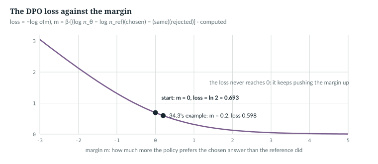
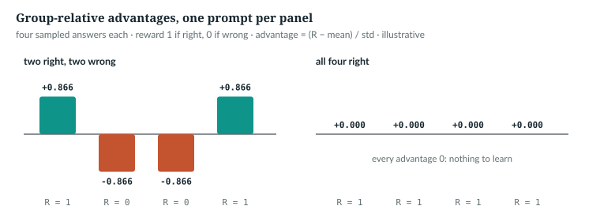

# 34  Preference optimisation and reinforcement learning

Supervised fine-tuning (Chapter 30) needs the right answer written down.
Preference optimisation learns from pairs, one answer preferred to another;
reinforcement learning learns from scores given to the model's own samples.
**None of this is in the repository's main code** (source map §4). The lab
book implements DPO (its Chapter 11) and GRPO (its Chapter 19); this chapter
teaches the mathematics, reads the lab book's DPO, and ports it onto `anulm/model.py`.

---

## 34.1  From SFT to preferences

InstructGPT has three stages: supervised fine-tuning, a reward model, and PPO
against that reward with a per-token KL penalty towards the SFT model [R39].
PPO clips the ratio of new to old probabilities [S12]. Two later methods drop
parts of that machinery:

| Method | Learns from | Needs | Year |
|---|---|---|---|
| RLHF with PPO [R39], [S12] | a reward model's scores | a reward model; PPO with a KL penalty towards the SFT model | 2022 |
| DPO [R40] | pairs: a chosen and a rejected answer | a reference policy; no explicit reward model | 2023 |
| GRPO [R41] | scores of a group of answers to one prompt | no critic: the baseline comes from the group's scores | 2024 |

The **policy**, π<sub>θ</sub>, is the model being trained; the **reference**,
π<sub>ref</sub>, a frozen copy of where it started.

`NOT IN THE REPO`

## 34.2  The one number every method needs

Each method needs log π(a | p), the sum over an answer's ids of
log p(id | everything before it). It is Chapter 30's masked loss, summed
instead of averaged. The lab book computes it so:

> **In the repo** · `course/build/solutions/ch11.py` · `answer_logprobs` · lines 17–30 · @fdbb09a

```python
def answer_logprobs(model, prompts, answers, pad: int = 0) -> torch.Tensor:
    # ...
    seqs = [list(p) + list(a) for p, a in zip(prompts, answers)]
    T = max(len(s) for s in seqs)
    ids = torch.full((len(seqs), T), pad, dtype=torch.long)
    mask = torch.zeros(len(seqs), T - 1)
    for i, (p, a) in enumerate(zip(prompts, answers)):
        ids[i, :len(seqs[i])] = torch.tensor(seqs[i])
        mask[i, len(p) - 1: len(p) - 1 + len(a)] = 1.0       # position t predicts id t + 1
    logits, _ = model(ids[:, :-1])
    logp = F.log_softmax(logits.float(), dim=-1).gather(-1, ids[:, 1:, None]).squeeze(-1)
    return (logp * mask).sum(-1)
```

The mask marks the positions that predict answer ids; `gather` picks each
position's next id from (B, T − 1, V) log-probabilities; the masked sum is
(B,). This needs logits at every position. `anulm/model.py` gives them only with
targets:

> **In the repo** · `anulm/model.py` · `AnuLM.forward` · lines 915–921 · @fdbb09a

```python
        if targets is None:
            # Inference shortcut: only the last position matters.
            logits = self._head(x[:, -1:, :])
            return logits, None
        if self.ce_chunk and self.training:
            loss = self._chunked_loss(x, targets)
            return None, (loss + aux_total if aux_total is not None else loss)
```

Without targets the logits are (B, 1, V) and the `gather` raises; with
chunked loss on, a training-mode call returns no logits (Chapter 23). The book example
(`book/code-examples/ch34_preferences.py`, **Book example, not repository
code**) passes targets, the prompt marked −1:

```python
def answer_token_logprobs(model, prompt, answer):
    """log p(id | everything before it) for each answer id, shape (len(answer),).
    Targets are passed so that model.py returns logits for every position, not just the last."""
    ids = torch.tensor([prompt + answer])
    x, tgt = ids[:, :-1], ids[:, 1:].clone()
    tgt[:, :len(prompt) - 1] = -1                       # position t predicts id t + 1: grade the answer only
    logits, _ = model(x, tgt)                           # (1, S, V)
    logp = F.log_softmax(logits.float(), -1)
    keep = tgt != -1
    return logp[keep].gather(-1, tgt[keep][:, None]).squeeze(-1)


def answer_logprob(model, prompt, answer):
    """log p(answer | prompt): the sum of its ids' log-probabilities, shape (1,)."""
    return answer_token_logprobs(model, prompt, answer).sum()[None]
```

```
lab-book answer_logprobs on model.py: RuntimeError (Size does not match at dimension 1 expected index [1, 6, 1] ...)
log p(chosen | prompt) = -12.6873; -(SFT loss x 3 answer ids) = -12.6873
```

*verified*: printed by the example on `tiny()`. An answer's log-probability is
minus its SFT loss times its length in evaluation mode; in training mode the
released configuration adds the router regulariser to the loss (Chapter 30),
so take log-probabilities from the logits, as here.

`NOT IN THE REPO` (the root) · `IN THE REPO` (the shortcut)

## 34.3  DPO

DPO optimises a preference loss against a reference, with no explicit reward
model [R40]. For a chosen answer a<sup>+</sup> and a rejected a<sup>−</sup>:

  m = β·[(log π<sub>θ</sub> − log π<sub>ref</sub>)(a<sup>+</sup>) −
  (log π<sub>θ</sub> − log π<sub>ref</sub>)(a<sup>−</sup>)]

and the loss is −log σ(m), σ the logistic sigmoid.

> **In the repo** · `course/build/solutions/ch11.py` · `dpo_loss` · lines 33–37 · @fdbb09a

```python
def dpo_loss(pol_chosen, pol_rejected, ref_chosen, ref_rejected, beta: float = 0.1):
    """-log sigmoid(beta * ((pol_chosen - ref_chosen) - (pol_rejected - ref_rejected))), averaged.
    Returns (loss, reward margin per pair). The reference terms carry no gradient."""
    margin = beta * ((pol_chosen - ref_chosen.detach()) - (pol_rejected - ref_rejected.detach()))
    return -F.logsigmoid(margin).mean(), margin.detach()
```

**By hand** (*illustrative*). β = 0.1; policy −12.0 (chosen) and −15.0
(rejected); reference −13.0 and −14.0: m = 0.1·(1 + 1) = 0.2, loss
−log σ(0.2) = 0.5981. At the first step m = 0 and the loss is ln 2. The
gradient on log π<sub>θ</sub>(a<sup>+</sup>) is −β·σ(−m), whose size grows
towards β as m falls. `book/code-examples/ch34_preferences.py` recomputes it:

```python
    pc, pr, rc, rr = torch.tensor([-12.0]), torch.tensor([-15.0]), torch.tensor([-13.0]), torch.tensor([-14.0])
    margin = beta * ((pc - rc) - (pr - rr))
    by_hand = -math.log(1 / (1 + math.exp(-margin.item())))
    loss, m = ch11.dpo_loss(pc, pr, rc, rr, beta)
```

```
DPO: margin 0.200, loss by hand 0.5981, ch11.dpo_loss 0.5981; at margin 0 the loss is ln 2 = 0.6931
d loss / d log p(chosen) = -0.0450 = -beta * sigmoid(-margin) = -0.0450
```

*verified*: printed by the example, against the lab book's `dpo_loss`.



*Figure 34.1 · The DPO loss against the margin.* *verified*: computed, and
asserted at m = 0 and m = 0.2 by the figure script.

`NOT IN THE REPO`

## 34.4  A DPO step on an MoE model

> **In the repo** · `course/build/solutions/ch11.py` · `dpo_step` · lines 48–63 · @fdbb09a

```python
    with torch.no_grad():
        ref_c = answer_logprobs(reference, prompts, chosen)
        ref_r = answer_logprobs(reference, prompts, rejected)
    pol_c = answer_logprobs(policy, prompts, chosen)
    pol_r = answer_logprobs(policy, prompts, rejected)
    loss, margin = dpo_loss(pol_c, pol_r, ref_c, ref_r, beta)
    if sft_weight:
        loss = loss + sft_weight * -pol_c.sum() / sum(len(c) for c in chosen)
    opt.zero_grad(set_to_none=True)
    loss.backward()
    if clip > 0:
        torch.nn.utils.clip_grad_norm_(policy.parameters(), clip)
    opt.step()
    if hasattr(policy, "update_expert_biases"):              # Chapter 8: the balancer moves after every step
        policy.update_expert_biases()
    return loss.item(), margin.mean().item(), (margin > 0).float().mean().item()
```

Two passes through the frozen reference without gradients, two through the
policy; `sft_weight` adds the chosen answers' SFT loss; then the router-bias
update of Chapter 18 (18.5). The port to `anulm/model.py` swaps in `answer_logprob`:

```python
def dpo_step(policy, opt, prompt, chosen, rejected, ref_c, ref_r, beta=0.1):
    """The lab book's dpo_step for model.py: answer_logprob in place of answer_logprobs."""
    pol_c, pol_r = answer_logprob(policy, prompt, chosen), answer_logprob(policy, prompt, rejected)
    loss, margin = ch11.dpo_loss(pol_c, pol_r, ref_c, ref_r, beta)
    opt.zero_grad(set_to_none=True)
    loss.backward()
    opt.step()
    policy.update_expert_biases()                       # an MoE policy keeps balancing, as in finetune.py
    return loss.item(), margin.item(), pol_c.item(), pol_r.item()
```

```
step  0: loss 0.6931  margin +0.000  log p chosen -12.687  rejected -12.458
step 10: loss 0.4422  margin +0.587  log p chosen  -9.955  rejected -15.594
step 20: loss 0.3025  margin +1.041  log p chosen  -8.085  rejected -18.263
```

*illustrative*: twenty steps on `tiny()`, one made-up pair, printed by
`book/code-examples/ch34_preferences.py`. The chosen answer
rises here, but the loss sees only the difference: both can fall while it
falls. The lab book's Chapter 11 reports both falling on its sums task, cured
by the SFT term; whether that happens on `anulm/model.py` is *not measured here*.

`NOT IN THE REPO`

## 34.5  GRPO: better than its own group

GRPO is a PPO variant without a critic: its baseline comes from the scores of
a group of answers to the same prompt [R41]. Sample G answers, score each with
a reward R, and give each the advantage Â<sub>i</sub> = (R<sub>i</sub> −
mean(R)) / std(R). (In this chapter R is a reward; r stays the LoRA rank of
Chapter 31.)

```python
def group_advantages(rewards, eps=1e-4):
    """rewards (prompts, G) -> each answer's reward minus its group's mean, over the group's std."""
    mean, std = rewards.mean(1, keepdim=True), rewards.std(1, keepdim=True)
    return torch.where(std > 0, (rewards - mean) / (std + eps), torch.zeros_like(rewards))
```

**By hand** (*illustrative*). Rewards 1, 0, 0, 1: mean 0.5, sample standard
deviation √(4·0.25/3) = 0.5774, advantages ±0.866. A group all right or all
wrong has every advantage 0 and teaches nothing.
`book/code-examples/ch34_preferences.py` prints:

```
group advantages: [[0.866, -0.866, -0.866, 0.866], [0.0, 0.0, 0.0, 0.0]]
```



*Figure 34.2 · Group-relative advantages.* *illustrative*: from
`group_advantages` in `book/code-examples/ch34_preferences.py`, asserted by the
figure script.

The loss raises every id of an answer by the answer's advantage, and
penalises drift from the reference with a KL estimate at each position:

```python
def grpo_loss(logp, ref_logp, adv, beta=0.04):
    """logp, ref_logp (G, n): per-id log-probabilities of G answers; adv (G,). Push every id of an answer
    up by its advantage, plus beta times the per-position KL estimate exp(d) - d - 1."""
    pg = -(adv[:, None] * logp).mean()
    d = ref_logp - logp                                 # log pi_ref - log pi_theta at each position
    return pg + beta * (torch.exp(d) - d - 1).mean()
```

PPO clips the ratio of new to old probabilities [S12]; with one update per
batch of samples, as here, the ratio is exactly 1, and the clipped
objective's gradient is the plain policy gradient of the first term.

At one position, with d = log π<sub>ref</sub>(y) − log π<sub>θ</sub>(y) for a
sampled id y, e<sup>d</sup> − d − 1 ≥ 0, and its mean is the KL divergence of
the two next-id distributions, since e<sup>d</sup> has mean 1 under
π<sub>θ</sub>. The plain −d has the same mean but can be negative; applied to
a per-answer average of d, the estimate would run below the KL. The example
checks one position, two 50-way distributions:

```python
    x = torch.multinomial(p_theta, 200_000, replacement=True, generator=g)
    d = (p_ref[x] / p_theta[x]).log()
    est = torch.exp(d) - d - 1
```

```
KL(theta || ref) = 1.0275; mean of exp(d) - d - 1 over 200,000 samples = 1.0200 (standard error 0.0066); smallest single estimate 1.14e-03
```

One step samples a group with `anulm/model.py`'s own `generate`, scores it, and
updates:

```python
def grpo_step(policy, reference, opt, prompt, reward_fn, G=8, n_new=4):
    """Sample G answers to one prompt, score them, and take one GRPO step. Returns the mean reward."""
    out = policy.generate(torch.tensor([prompt] * G), n_new, temperature=1.0)     # (G, len(prompt) + n_new)
    answers = [row[len(prompt):] for row in out.tolist()]
    rewards = torch.tensor([[reward_fn(a) for a in answers]])                    # (1, G)
    adv = group_advantages(rewards)[0]                                           # (G,)
    logp = torch.stack([answer_token_logprobs(policy, prompt, a) for a in answers])   # (G, n_new)
    with torch.no_grad():
        ref = torch.stack([answer_token_logprobs(reference, prompt, a) for a in answers])
    loss = grpo_loss(logp, ref, adv)
    opt.zero_grad(set_to_none=True)
    loss.backward()
    opt.step()
    policy.update_expert_biases()
    return rewards.mean().item()
```

```python
    even = lambda a: sum(t % 2 == 0 for t in a) / len(a)
    curve = [grpo_step(policy, reference, opt, prompt, even) for _ in range(60)]
```

```
GRPO, mean reward per 10 steps: [0.541, 0.622, 0.734, 0.85, 0.9, 0.956]
```

*illustrative*: sixty steps on `tiny()`, printed by
`book/code-examples/ch34_preferences.py`; the made-up reward, the share of even
answer ids, stands in for a checker.

`NOT IN THE REPO`

## 34.6  What adding them here would take

| Piece | From | Status |
|---|---|---|
| prompt and answer ids | `finetune._pair_ids` (Chapter 30) | in the repo |
| an answer's log-probability | `AnuLM.forward` with targets (34.2) | the summing is `EXTENSION` |
| a reference | a frozen copy, or LoRA's base with the adapters bypassed (Chapter 31) | `EXTENSION` |
| groups of samples | `AnuLM.generate`, below | in the repo |
| a reward | a checker, such as `anulm/eval/eval_code.py`'s test runs | scoring exists; no reward API |
| the step | `anulm/training/finetune.py`'s loop with a new loss | `EXTENSION` |
| router balancing | `update_expert_biases()` after each step | in the repo |

> **In the repo** · `anulm/model.py` · `AnuLM.generate` · lines 1161–1169 · @fdbb09a

```python
            if temperature <= 0:
                nxt = logits.argmax(dim=-1, keepdim=True)              # (B, 1), no draw
            else:
                # ...
                nxt = torch.multinomial(probs, num_samples=1)          # (B, 1)
```

These are the ends of `generate`'s sampling lines, quoted in full in Chapter
28. In the `else` branch each row of a (G, S) batch draws its own id, so one call
yields G different answers. The group needs a temperature above 0: at T ≤ 0
every row takes the same argmax, the G copies of one prompt give G identical
answers, and every advantage is 0. The example samples at T = 1. A
full-copy reference doubles the weights to about 3.2 GB in fp32 (2 ×
397,659,648 × 4 bytes). With LoRA as the policy the reference could share the
frozen weights, but `anulm/lora.py` has no switch to bypass its adapters, and the
router biases drift during training (Chapter 31, 31.4): the reference needs
its own copy of the 456 biases. What any of this buys here is *not measured
here*.

`EXTENSION` · `IN THE REPO` (`generate`)

## 34.7  Common mistakes, and exercises

Mistakes: scoring an answer on `anulm/model.py` without targets; letting gradient
reach the reference; watching only the DPO loss; all-equal GRPO groups.

**Exercises.**
1. Policy −10 and −20, reference −11 and −18 (chosen, rejected), β = 0.1. The
   margin? Is the loss above or below ln 2?
2. Rewards 1, 0, 0, 0: the advantages?
3. Why is the first DPO loss ln 2 for every β?
4. d = 0.5: what are e<sup>d</sup> − d − 1 and −d?

**Answers.** 1. 0.1·(1 + 2) = 0.3; below (0.5544). 2. +1.5, −0.5, −0.5,
−0.5 (`group_advantages` prints 1.4997 and −0.4999, because of `eps`).
3. The margin is 0 when the policy is the reference. 4. 0.1487 and −0.5.
*verified*: arithmetic, and 2 with `group_advantages`.

> **Build it.** The lab book's Chapter 11 (`course/ch11-dpo`) builds
> `answer_logprobs`, `dpo_loss` and `dpo_step` from stubs; its Chapter 19
> (`course/ch19-rl`) builds GRPO with a checker as the reward.

`NOT IN THE REPO`

---

## Key points

- RLHF, DPO and GRPO are not in the repository's main code; the lab book
  implements DPO and GRPO from scratch.
- Every method needs an answer's log-probability: Chapter 30's masked loss,
  summed. On `anulm/model.py` it needs targets, or only the last position's logits come back.
- DPO minimises −log σ(β·margin), the margin comparing how much the policy
  raised the chosen and the rejected answer against a frozen reference.
- The DPO loss starts at ln 2 and can fall while both answers fall.
- GRPO scores sampled answers against their own group, needs no critic,
  and learns nothing from all-equal groups; e<sup>d</sup> − d − 1 keeps its KL
  penalty non-negative.
- Adding them here is `anulm/training/finetune.py`'s loop with a new loss, a reference, and
  `generate` for samples.

> **In one breath.** Preference methods learn from comparisons, not targets:
> DPO raises a chosen answer against a rejected one relative to a frozen
> reference, GRPO raises sampled answers that beat their own group, and both
> need only an answer's log-probability, which `anulm/model.py` gives when handed
> targets.

## References

Research references cited in this chapter (`RESEARCH_REFERENCES.md`), each
used only for the claim in its register row:

| ID | Used for | Status |
|---|---|---|
| [R39] | SFT, a reward model, and PPO with a per-token KL penalty from the SFT model | CHECKED |
| [R40] | a preference loss optimised directly against a reference, with no explicit reward model | CHECKED |
| [R41] | GRPO: a PPO variant without a critic, its baseline from group scores | CHECKED |
| [S12] | PPO's objective with clipped probability ratios | CHECKED |

Repository evidence, all at @fdbb09a:
- `course/build/solutions/ch11.py`: `answer_logprobs` 17–30, `dpo_loss` 33–37,
  `dpo_step` 40–63.
- `anulm/model.py`: `AnuLM.forward` 915–921, `AnuLM.generate` 1161–1169.
- `book/REPOSITORY_SOURCE_MAP.md` §4: DPO, RLHF and GRPO absent in the root.
- The lab book's Chapter 19 (`course/ch19-rl`) is cross-linked, not quoted.
