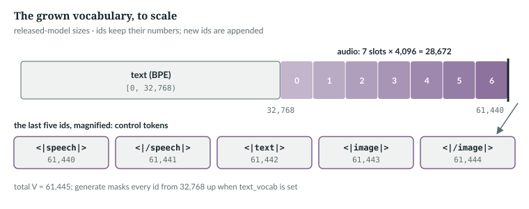
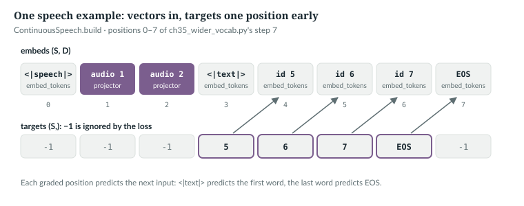

# 35  A wider vocabulary and inputs that are not tokens

Part VIII lets a text model hear and see. This chapter opens two ways in:
growing the vocabulary, so audio codes become ids the model can read and
write, and skipping it, so vectors with no id go straight in. It ends with the
line in `generate` that keeps a grown model writing text.

Prerequisites: the embedding and output tables (Chapter 10), the forward pass
(Chapter 20), the generation loop (Chapter 27).

**New words for Part VIII.**

| Term | Meaning |
|---|---|
| codec | a model that turns a waveform into a short sequence of integer codes and back |
| codebook | the table of vectors one level of a codec chooses from; a code is an index into it |
| control token | an id that marks structure (audio starts, a transcript follows) rather than content |
| frozen encoder | a pretrained network whose weights are never updated here; it only turns input into vectors |
| projector | the small trained network that maps an encoder's vectors to the model's width D |
| frame | one time step of an audio representation: one encoder output vector |
| patch | one square piece of an image, which a vision transformer treats as one input vector |

**Notation for Part VIII.** As in Part IV, with three additions:
V<sub>text</sub> is the vocabulary the checkpoint was trained on (32,768 for
the released model), V is the grown vocabulary, and T<sub>a</sub> is the number
of audio positions after projection.

---

## 35.1  Where every id lives

`anulm/multimodal/speech_vocab.py` appends the new ids after the old ones, so every id the
checkpoint knew keeps its number:

> **In the repo** · `anulm/multimodal/speech_vocab.py` · `SpeechVocab` · lines 60–85 · @fdbb09a

```python
CONTROL = ["<|speech|>", "<|/speech|>", "<|text|>", "<|image|>", "<|/image|>"]
N_CONTROL = len(CONTROL)
# ...
    def __init__(self, text_vocab: int):
        self.text = text_vocab
        self.audio_base = text_vocab
        self.speech_bos = text_vocab + AUDIO_VOCAB
        self.speech_eos = self.speech_bos + 1
        self.text_bos = self.speech_bos + 2
        self.image_bos = self.speech_bos + 3
        self.image_eos = self.speech_bos + 4
        self.total = text_vocab + AUDIO_VOCAB + N_CONTROL
```

Text ids `[0, text_vocab)` are untouched; the audio block starts at the old
size and is `AUDIO_VOCAB` = 7 × 4,096 = 28,672 ids wide (`anulm/multimodal/audio_codec.py` line
55); five control ids follow. The two image markers were put in the speech
file before any model was grown. The comment above `CONTROL` (lines 56–59)
gives the wrong reason: appending ids after the last control token would shift
nothing. The real cost of adding them later is that `total` changes, so every
checkpoint grown before would carry a `vocab_size` that is neither the text size
nor the new total, and `grow_checkpoint` refuses such a checkpoint (lines
135–140; exercise 2).



*Figure 35.1 · The grown vocabulary of the released model's size, drawn to
scale.* *verified*: the ids are printed by `ch35_wider_vocab.py`.

> **Details.** The module docstring still says three control tokens and
> 28,675 new ids. The code adds five and 28,677. Quote the code.

`IN THE REPO`

## 35.2  Audio as ids: one block per codec slot

SNAC is a codec with three levels of codes; each level runs at a different
time resolution [R45]. Here the second level has two codes and the third has
four for every code of the first. `flatten` interleaves one coarse frame's
seven codes, and gives each of the seven slots its own block of 4,096 ids:

> **In the repo** · `anulm/multimodal/audio_codec.py` · `flatten` · lines 121–139 · @fdbb09a

```python
def flatten(codes: list) -> np.ndarray:
    # ...
    l0, l1, l2 = (np.asarray(c).reshape(-1) for c in codes)
    t = l0.size
    out = np.empty(t * FRAME_SLOTS, dtype=np.int64)
    out[0::7] = l0 + 0 * LEVEL_VOCAB
    out[1::7] = l1[0::2] + 1 * LEVEL_VOCAB
    out[2::7] = l2[0::4] + 2 * LEVEL_VOCAB
    out[3::7] = l2[1::4] + 3 * LEVEL_VOCAB
    out[4::7] = l1[1::2] + 4 * LEVEL_VOCAB
    out[5::7] = l2[2::4] + 5 * LEVEL_VOCAB
    out[6::7] = l2[3::4] + 6 * LEVEL_VOCAB
    return out
```

The input is three arrays: t coarse codes, 2t middle codes, 4t fine codes.
The output has 7t ids. Slot 0 gets the coarse code, slots 1 and 4 the two
middle codes, and slots 2, 3, 5 and 6 the four fine ones. Each slot adds
j × 4,096, so an id's block says which level and which position in the frame
it came from. `unflatten` (lines 142–170) subtracts the offsets again, and
first cuts a stream to whole frames, because a model that stops mid-frame
would shift every level after it. Adding `audio_base` to these ids gives the
vocabulary ids of 35.1.

```
2. SNAC: levels of 6, 12, 24 codes -> 42 flat ids; slot j lives in block [0, 1, 2, 3, 4, 5, 6]; round trip exact: True
```

*verified*: printed by `ch35_wider_vocab.py` on random codes.

`IN THE REPO`

## 35.3  Growing both tables

A checkpoint's embedding table is (V<sub>text</sub>, D) and its output head
(V<sub>text</sub>, D). Both need new rows:

> **In the repo** · `anulm/multimodal/speech_vocab.py` · `_grow` · lines 108–114 · @fdbb09a

```python
def _grow(weight: torch.Tensor, n_new: int, gen: torch.Generator) -> torch.Tensor:
    """Append rows drawn around the existing distribution's mean."""
    mean = weight.mean(dim=0, keepdim=True)
    std = weight.std().item()
    noise = torch.randn(n_new, weight.shape[1], generator=gen,
                        dtype=weight.dtype) * (std * 0.1)
    return torch.cat([weight, mean.expand(n_new, -1) + noise], dim=0)
```

`mean` is the average row, shape (1, D). `std` is one number, the spread of
the whole table. Each new row is the average row plus noise a tenth as wide as
that spread. `torch.cat` appends the n<sub>new</sub> rows below the old ones,
which stay as they were. `grow_checkpoint` applies this to both tables:

> **In the repo** · `anulm/multimodal/speech_vocab.py` · `grow_checkpoint` · lines 140–156 · @fdbb09a

```python
    gen = torch.Generator().manual_seed(seed)
    n_new = v.total - text_vocab
    for key in ("embed_tokens.weight", "lm_head.weight"):
        full = next((k for k in sd if k.endswith(key)), None)
        # ...
        before = sd[full].shape
        sd[full] = _grow(sd[full].float(), n_new, gen).to(sd[full].dtype)
        print(f"  {full}: {tuple(before)} -> {tuple(sd[full].shape)}")

    from dataclasses import replace
    ck["cfg"] = replace(cfg, vocab_size=v.total)
    ck["speech_text_vocab"] = text_vocab
    ck["base_ckpt"] = ckpt
    atomic_save(ck, out)
    added = n_new * cfg.hidden_size * 2
```

The loop grows `embed_tokens` and `lm_head` with one seeded generator. Both are
needed because the tables are untied (Chapter 10): growing only the embedding
lets the model read audio but never write it. The checkpoint then records the
new `vocab_size`, and **`speech_text_vocab`**, the old size. Every later stage
reads that key to know where text ends.

The book example does the same to a live `tiny()` model and checks that the
old rows are untouched: every text logit is unchanged.

```python
def grow(model: M.AnuLM, n_new: int, seed: int = 0) -> M.AnuLM:
    """speech_vocab.grow_checkpoint's middle, on a live model instead of a file."""
    from dataclasses import replace
    gen = torch.Generator().manual_seed(seed)
    sd = model.state_dict()
    for key in ("embed_tokens.weight", "lm_head.weight"):
        sd[key] = SV._grow(sd[key].float(), n_new, gen)        # the repository's own _grow
    big = M.AnuLM(replace(model.cfg, vocab_size=model.cfg.vocab_size + n_new)).eval()
    big.load_state_dict(sd)
    return big
```

```
3. grown tiny(): vocab 64 -> 28741; logits (2, 1, 64) -> (2, 1, 28741); text logits differ by at most 0.0e+00
   ...
4. released model: +28,677 ids x D 1024 x 2 tables = 58,730,496 parameters
   total  397,659,648 -> 456,390,144  (+14.8%)
   active 173,526,528 -> 232,257,024  (+33.8%)
```

*verified*: printed by `ch35_wider_vocab.py`; the released model's counts come
from `num_params()` on its configuration, built on PyTorch's `meta` device,
which records shapes without allocating memory. The `...` elides step 3's
row-norm line.

Identical text logits do not make the grown model identical on text. The
softmax now runs over 61,445 entries, and the new rows take some probability
from the text ids. The book example grows the released checkpoint with the
same `grow` and scores it twice, over all 61,445 ids and over the text ids only:

```python
    big = grow(base, SV.SpeechVocab(V).total - V).to(dev)     # the same _grow, seed 0
# ...
            _, l0 = base(x, y)
            logits, l1 = big(x, y)
            l2 = torch.nn.functional.cross_entropy(logits[..., :V].reshape(-1, V).float(), y.reshape(-1),
                                                   ignore_index=-1)
```

```
8. ckpt_base_v2.pt grown to 61,445 ids, held-out loss over 32,732 tokens (fp32):
   text model             3.37907  (+0.00000)
   grown, full softmax    3.44360  (+0.06452)
   grown, text ids only   3.37907  (+0.00000)
```

*measured*: `ch35_wider_vocab.py --measure`, 64 held-out windows of 512 tokens
(Chapter 20's), seed 0, float32 throughout (the MoE on its sparse path); one
sample. So generation with `text_vocab` set (35.5), which masks the new ids, is
unchanged, but any loss over the full vocabulary, as in `anulm/multimodal/omni_train.py`
(Chapter 37), starts about 0.065 nats higher, until training teaches the new
rows to stay quiet on text.

The new rows add 14.8% to the total but 33.8% to the active count: both tables
count as active, while most of the old total is idle experts (Chapter 20). The
effect on training speed is *not measured here*.

`IN THE REPO`

## 35.4  Vectors with no id: the `embeds=` bypass

A frozen encoder produces vectors, not ids, so there is nothing to look up.
`AnuLM.forward` accepts them directly:

> **In the repo** · `anulm/model.py` · `AnuLM.forward` · lines 887–896 · @fdbb09a

```python
        # `embeds` bypasses the embedding table: (B, S, D) straight in. Audio
        # and images arrive as continuous vectors from a frozen encoder, and
        # there is no id to look up for them (speech_encoder.py). With embeds
        # `idx` is ignored and may be None.
        if embeds is not None:
            B, S, _ = embeds.shape
            x = embeds
        else:
            B, S = idx.shape
            x = F.embedding(idx, self._table("in"))               # (B, S, D)
```

With `embeds` the shapes come from the tensor itself and the lookup is skipped;
everything after line 896 is unchanged. So a caller can build any mix of
vectors: control tokens and text through `embed_tokens`, audio through a
projector, concatenated along the sequence. The book example checks that
nothing else differs:

```
5. forward(idx) and forward(None, embeds=embed_tokens(idx)) equal: True
```

The speech path builds its sequence like this:

> **In the repo** · `anulm/multimodal/speech_encoder.py` · `ContinuousSpeech.build` · lines 105–134 · @fdbb09a

```python
    def build(self, states: torch.Tensor, text_ids: list[int], answer_ids: list[int],
              example: str | None = None, task: str | None = None):
        # ...
        dev = states.device
        emb = self.model.embed_tokens
        audio = self.proj(states[None])[0]                       # (Ta, D)
        pre = emb(torch.tensor([self.vocab.speech_bos], device=dev))
        mid = emb(torch.tensor([self.vocab.text_bos], device=dev))
        ans = emb(torch.tensor(answer_ids, device=dev))
        embeds = torch.cat([pre, audio, mid, ans], dim=0)
        limit = self.model.cfg.block_size
        if embeds.shape[0] > limit:
            prefix = f"{task}: " if task else ""
            name = f" {example!r}" if example is not None else ""
            raise ValueError(
                f"{prefix}ASR example{name} builds {embeds.shape[0]} positions "
                f"(audio, markers, and answer), exceeding model block_size {limit}. "
                "Shorten the clip or transcript, or use a model with a larger context.")
        # -1 everywhere the loss must not look: the prompt, and the audio that
        # has no id to predict in the first place.
        targets = torch.full((embeds.shape[0],), -1, dtype=torch.long, device=dev)
        start = pre.shape[0] + audio.shape[0] + mid.shape[0]
        targets[start - 1: start - 1 + len(answer_ids)] = torch.tensor(answer_ids, device=dev)
        return embeds, targets
```

Line by line:

1. **Audio.** The projector (Chapter 36) turns encoder states
   (T<sub>frames</sub>, d<sub>enc</sub>) into (T<sub>a</sub>, D).
2. **Markers and answer.** `<|speech|>`, `<|text|>` and the transcript ids go
   through the ordinary embedding table, each (n, D).
3. **One sequence.** `torch.cat` gives (1 + T<sub>a</sub> + 1 + n, D).
4. **Length check.** A sequence longer than `block_size` raises, naming the
   task and the clip, so a too-long example stops training with its name
   instead of being cut to a wrong label.
5. **Targets, shifted by one.** `AnuLM.forward` does not shift targets
   (Chapter 20). So the position *before* each answer token holds that token's
   id: `<|text|>` predicts the first word. Everything else is −1, which the
   loss ignores.



*Figure 35.2 · One speech example as the model sees it.* Top: the vectors.
Bottom: the targets. *verified*: the layout is `ch35_wider_vocab.py`'s step 7:

```python
    v = SV.SpeechVocab(64)
    sm = ContinuousSpeech(big, v, in_dim=8, stack=4)
    states = torch.randn(10, 8)                      # 10 encoder frames: 2 whole groups of 4, 2 dropped
    answer = [5, 6, 7, 1]                            # three text ids and an EOS
    with torch.no_grad():
        embeds, targets = sm.build(states, [], answer)
```

```
7. ContinuousSpeech.build: states (10, 8) -> embeds (8, 32)
   position: [0, 1, 2, 3, 4, 5, 6, 7]
   targets:  [-1, -1, -1, 5, 6, 7, 1, -1]
```

*verified*: 10 frames with a stack of 4 give 2 audio positions; the two left
over are dropped (Chapter 36). The last position is the EOS's own input, and it
has nothing to predict.

> **Details.** The trainers call `model(None, tb, embeds=eb)` with targets
> (`anulm/multimodal/speech_encoder.py` line 287). Without them, `forward` returns only the last
> position's logits and no loss (Chapter 20).

`IN THE REPO`

## 35.5  Writing text only

A grown model has 61,445 output rows, and only the first 32,768 are text. When
the job is a text reply, the rest must never be sampled:

> **In the repo** · `anulm/model.py` · `AnuLM.generate` · lines 1152–1156 · @fdbb09a

```python
            logits = logits[:, -1, :].float()
            if getattr(self, "text_vocab", None):
                # a model grown for speech and images (speech_vocab.py) writes
                # text only here: its audio and image ids are never sampled
                logits[:, self.text_vocab:] = -float("inf")
```

`text_vocab` is not a configuration field. It is an attribute a caller sets on
the model; `getattr` with a default makes it optional. The serving engine sets
it from the checkpoint's `speech_text_vocab`:

> **In the repo** · `anulm/inference/serve.py` · `Engine.__init__` · lines 66–68 · @fdbb09a

```python
        self.model = AnuLM(cfg).to(device).eval()
        self.model.load_state_dict(ck["model"])
        self.model.text_vocab = ck.get("speech_text_vocab")      # set on the one joint model (omni_train.py)
```

For a text-only checkpoint it is `None` and the block does nothing. Why it
is needed:

```python
def text_only_generation(big: M.AnuLM) -> None:
    x = torch.randint(0, 64, (1, 4))
    torch.manual_seed(1)
    free = big.generate(x, 200, temperature=1.0)[0, 4:]
    big.text_vocab = 64                              # what serve.Engine sets from speech_text_vocab
    torch.manual_seed(1)
    held = big.generate(x, 200, temperature=1.0)[0, 4:]
    del big.text_vocab
    print(f"\n6. 200 sampled ids: without text_vocab {int((free >= 64).sum())} are audio or control ids; "
          f"with it {int((held >= 64).sum())}")
    assert int((held >= 64).sum()) == 0
```

```
6. 200 sampled ids: without text_vocab 199 are audio or control ids; with it 0
```

*verified*: on the grown, untrained `tiny()`, 28,677 of 28,741 rows are not
text. Only the mask guarantees that no audio id reaches the detokeniser.

`IN THE REPO`

## 35.6  Decoding after a prompt of vectors

`generate` takes ids. A transcript or caption starts from vectors, so
`decode_from_embeds` prefills the vector prompt once and then feeds back ids:

> **In the repo** · `anulm/model.py` · `AnuLM.decode_from_embeds` · lines 1033–1057 · @fdbb09a

```python
        dev = prefix.device
        cache = self.new_cache() if use_cache else None
        logits, _ = self(None, embeds=prefix[None], cache=cache, start=0)
        pos, out = prefix.shape[0], []
        for _ in range(max_tokens):
            scores = logits[0, -1].float()
            # ...
            nxt = int(scores.argmax())
            if stop(nxt):
                break
            out.append(nxt)
            if len(out) == max_tokens:
                break
            if use_cache:
                logits, _ = self(torch.tensor([[nxt]], device=dev), cache=cache, start=pos)
                pos += 1
```

The prefix is (T, D), so `prefix[None]` is (1, T, D). That call fills the KV
cache with T positions. Each later step sends one id at absolute position
`pos` (Chapter 27). Decoding is greedy; the elided lines apply Chapter 28's
repetition penalty and n-gram block. `stop` decides when to end:

> **In the repo** · `anulm/multimodal/speech_encoder.py` · `transcribe` · lines 383–404 · @fdbb09a

```python
    texts = []
    for chunk in audio_chunks(audio):
        # In the projector's dtype, so a model cast to bf16 for serving works too.
        states = torch.from_numpy(enc.encode(chunk)).to(device, next(sm.proj.parameters()).dtype)
        projected = sm.proj(states[None])[0]
        prefix = torch.cat([
            emb(torch.tensor([sm.vocab.speech_bos], device=device)), projected,
            emb(torch.tensor([sm.vocab.text_bos], device=device))], dim=0)
        # The transcript must fit beside the audio in the context: a 30 s chunk
        # is ~377 positions, and decode_from_embeds asserts past block_size.
        budget = min(max_tokens, sm.model.cfg.block_size - prefix.shape[0])
        if budget < 1:
            raise ValueError(f"a {len(chunk) / ASR_RATE:.1f} s chunk fills the model's "
                             f"{sm.model.cfg.block_size}-position context; no room for a transcript")
        with autocast:
            out = sm.model.decode_from_embeds(
                prefix, budget, stop=lambda t: t == tok.eos_id or t >= sm.vocab.text,
                no_repeat_ngram=no_repeat_ngram, use_cache=use_cache)
        text = tok.decode(out).strip().split("\n")[0]
        if text:
            texts.append(text)
    return " ".join(texts)
```

`audio_chunks` (`anulm/multimodal/audio_codec.py` line 104) splits a recording
into non-overlapping 30-second pieces, Whisper's window; a shorter clip is one
chunk. Each chunk gets its own prefix, `<|speech|>`, the projected audio and
`<|text|>`, shape (T, D). The token budget is `max_tokens` capped at what is
left of the context after the prefix, and a chunk that leaves no room raises.
EOS, or any id from the end of the text block up, ends a chunk's transcript:
this function's version of 35.5's mask. The chunk transcripts are joined with
spaces. The chunks are decoded independently, so a word cut at a 30-second
boundary is not repaired. The test
`cached_embeds_decoding_matches_prefix_replay` (`tests/test_model.py` line 1577)
holds the cached path to the uncached one, which re-runs the whole prefix for
every token, for GQA and MLA, with and without the n-gram block and penalty.

> **Build it.** The lab book's Chapter 13 (`course/ch13-senses`) grows your
> own model's tables and writes the `embeds` forward pass from a stub.

`IN THE REPO`

## 35.7  Exercises

1. A checkpoint's text vocabulary is 259 bytes. What ids do `<|speech|>` and
   `<|/image|>` get after growing?
2. Why does `grow_checkpoint` refuse a checkpoint whose `vocab_size` is
   neither the text size nor the grown size?
3. In `ContinuousSpeech.build`, what would the model learn if the targets were
   written at `start` instead of `start - 1`?

**Answers.** 1. 259 + 28,672 = 28,931 and 28,935. 2. It cannot tell where text
ends, and guessing would put audio ids on text rows. 3. Each position would be
trained to predict its own input: copying, not transcribing.

*verified*: answer 1 is `SpeechVocab(259)`'s arithmetic.

---

## Key points

- `anulm/multimodal/speech_vocab.py` appends 28,672 audio ids and five control ids after the
  text ids, so every old id keeps its number and row.
- SNAC's three levels flatten into seven slots per coarse frame, and each slot
  has its own block of 4,096 ids.
- Both tables grow, from the average row plus small noise; text logits are
  unchanged, but over the full softmax the released model's held-out loss rises
  0.065 nats until the new rows are trained.
- Growing the released model adds 58.7M parameters: 14.8% of the total, 33.8%
  of the active count.
- `embeds=` skips the lookup, so a caller can mix projected audio or image
  vectors with embedded control and text tokens; targets sit one position
  early.
- `generate` masks every id from `text_vocab` up, and `decode_from_embeds`
  stops on one, so a grown model writes only text.

> **In one breath.** A grown vocabulary puts audio codes and control tokens
> after the untouched text ids in both tables, at a cost of 58.7M parameters;
> vectors without ids enter through `embeds=`, with targets one position early;
> and a single mask keeps a grown model writing text.

## References

Research references cited in this chapter (`RESEARCH_REFERENCES.md`), each
used only for the claim in its register row:

| ID | Used for | Status |
|---|---|---|
| [R45] | SNAC: a codec whose quantisers work at different time resolutions | CHECKED |

Repository evidence, all at @fdbb09a:
- `anulm/multimodal/speech_vocab.py`: `CONTROL` 60–61, `SpeechVocab` 69–105, `_grow` 108–114,
  `grow_checkpoint` 117–159.
- `anulm/multimodal/audio_codec.py`: `AUDIO_VOCAB` 55, `audio_chunks` 104–114, `flatten` 121–139,
  `unflatten` 142–170.
- `anulm/model.py`: `AnuLM.forward` 877–928, `AnuLM.decode_from_embeds` 1015–1062,
  `AnuLM.generate` 1115–1180.
- `anulm/multimodal/speech_encoder.py`: `ContinuousSpeech.build` 105–134, the trainer's call
  287, `transcribe` 360–404.
- `anulm/inference/serve.py`: `Engine.__init__` 58–112.
- `tests/test_model.py`: `cached_embeds_decoding_matches_prefix_replay` 1577.
- Book example and measurement: `book/code-examples/ch35_wider_vocab.py`,
  `book/measurements/part_viii_ix_grow.json`.
