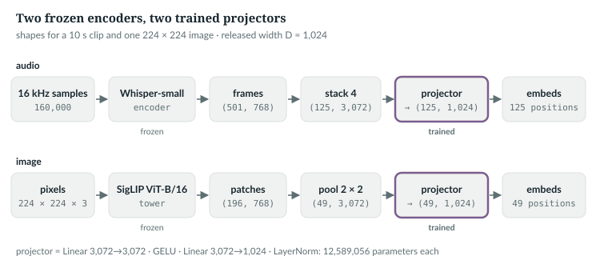
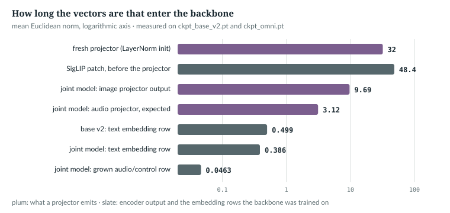

# 36  Seeing and hearing: frozen encoders and projectors

Chapter 35's `embeds=` lets vectors with no id into the model. This chapter
is where they come from: two pretrained encoders, Whisper-small for audio and
SigLIP for images, that are never trained here, and a small trained projector
per encoder that maps their vectors to the model's width D. It ends by
measuring how large the projected vectors are.

Prerequisites: Chapter 35, the training loop (Chapter 22).

---

## 36.1  Two encoders that are never trained

The image encoder is a vision transformer, which treats an image as a
sequence of patches [R43]; its weights come from SigLIP, which trained an
image encoder against text with a sigmoid loss [R42]. The repository loads it
with `timm` and freezes it:

> **In the repo** · `anulm/multimodal/vision_encoder.py` · `VisionTower` · lines 74–106 · @fdbb09a

```python
    def __init__(self, name: str = DEFAULT_TOWER, device: str | None = None):
        import timm
        self.device = device or ("cuda" if torch.cuda.is_available() else "cpu")
        # num_classes=0 drops the head; this returns patch tokens, not a logit.
        self.model = timm.create_model(name, pretrained=True, num_classes=0).eval().to(self.device)
        for p in self.model.parameters():
            p.requires_grad_(False)
        # ...
    @torch.no_grad()
    def encode(self, image) -> torch.Tensor:
        # ...
        feats = self.model.forward_features(image)       # (1, P, D), no class token in siglip
        return feats[0].float()
```

`num_classes=0` removes the classifier, so `forward_features` returns one
vector per patch, (1, P, 768). The default tower should cut a 224 × 224 image
into 14 × 14 = 196 patches: inferred from its name (`patch16_siglip_224`) and
consistent with the feature cache's 196 vectors per image (36.6); the tower
was not run here. `requires_grad_(False)` and `no_grad` stop gradients,
and `VisionTower` is a plain class, not an `nn.Module`, so no optimiser can
pick up its weights by accident.

Whisper is a speech recogniser trained on 680,000 hours of weakly supervised
audio [R44]. Only its encoder is used, through `faster-whisper` and
`ctranslate2`:

> **In the repo** · `anulm/multimodal/audio_codec.py` · `WhisperEncoder` · lines 220–255 · @fdbb09a

```python
    def __init__(self, size: str = "small", device: str = "auto", compute_type: str | None = None):
        ensure_cuda_dlls()
        import ctranslate2
        from faster_whisper import WhisperModel
        # ...
        if compute_type is None:
            compute_type = "float16" if device.startswith("cuda") else "int8"
        self.ct2 = ctranslate2
        self.size, self.device = size, device
        self.whisper = WhisperModel(size, device=device, compute_type=compute_type)
        self.dim = WHISPER_DIM.get(size, 768)

    def encode(self, audio) -> np.ndarray:
        # ...
        if isinstance(audio, (str, Path)):
            audio = read_wav(audio, ASR_RATE)
        audio = np.asarray(audio, dtype=np.float32)
        if audio.ndim != 1 or audio.size == 0:
            raise ValueError("Expected a nonempty mono audio clip at 16 kHz.")
        if audio.size > 30 * ASR_RATE:
            raise ValueError("Audio duration exceeds 30 seconds; chunk the audio and align its transcript first.")
        if not np.isfinite(audio).all():
            # NaN or inf samples (a corrupt file, a bad resample) do not fail
            # downstream: they produce a confident, meaningless transcript.
            raise ValueError("Audio contains NaN or infinite samples.")
        feats = self.whisper.feature_extractor(np.ascontiguousarray(audio, dtype=np.float32))
        # Whisper's fixed maximum feature window, after the explicit duration check.
        sv = self.ct2.StorageView.from_array(np.ascontiguousarray(feats[np.newaxis, :, :3000]))
        out = self.whisper.model.encode(sv).to_device(self.ct2.Device.cpu)
        return np.asarray(out)[0].astype(np.float32)
```

`ctranslate2` runs the encoder as a compiled graph with no autograd: frozen
by construction, in int8 on a CPU and float16 on a GPU. `encode` first
refuses three inputs: one that is not a non-empty mono clip, one longer than
30 seconds, and one with NaN or infinite samples. The feature extractor then
turns 16 kHz samples into a log-mel spectrogram, `[:, :, :3000]` keeps
Whisper's 30-second window, and the result is (frames, 768). On synthetic
tones:

```
6. WhisperEncoder('small', 'cpu') frames for a 3 / 10 / 30 / 40 s tone: 151 / 501 / 1500 / refused
```

*measured*: `ch36_projectors.py --whisper`, on the CPU. That is 50 frames a
second. The 40-second tone raises `ValueError`. Until November 2026 the slice
cut it to the first 30 seconds without a word, so a long clip was trained
against its whole transcript (36.6).

`IN THE REPO` · `MEASURED`

## 36.2  Audio: stack four frames, then project

At 50 frames a second, 20 seconds of speech would fill the released model's
1,024 positions. The audio projector first stacks four neighbouring frames
into one vector:

> **In the repo** · `anulm/multimodal/speech_encoder.py` · `AudioProjector` · lines 75–92 · @fdbb09a

```python
    def __init__(self, in_dim: int, out_dim: int, stack: int = STACK, hidden: int | None = None):
        super().__init__()
        self.stack = stack
        d = in_dim * stack
        hidden = hidden or max(out_dim, d)
        self.net = nn.Sequential(
            nn.Linear(d, hidden), nn.GELU(), nn.Linear(hidden, out_dim), nn.LayerNorm(out_dim),
        )

    def forward(self, states: torch.Tensor) -> torch.Tensor:
        # ...
        B, T, D = states.shape
        T = T - T % self.stack
        if T == 0:
            return states.new_zeros(B, 0, self.net[-1].normalized_shape[0])
        return self.net(states[:, :T].reshape(B, T // self.stack, D * self.stack))
```

With `STACK = 4` (line 55), Whisper-small and the released model:

1. **Trim.** `T - T % 4` drops a partial group: 501 frames become 500.
2. **Stack.** `reshape` puts four consecutive frames side by side:
   (B, 500, 768) becomes (B, 125, 3,072).
3. **Project.** Linear 3,072 → 3,072, GELU [S04], linear 3,072 → 1,024,
   LayerNorm [R09].

A 10-second clip costs 125 positions: 12.5 a second.

```
1. AudioProjector(768 -> 1024, stack 4): 12,589,056 parameters
   (1, 501, 768) -> (1, 125, 1024): 1 frame dropped
```

*verified*: `ch36_projectors.py`; the count is
3,072² + 3,072 + 3,072·1,024 + 1,024 + 2·1,024.

`IN THE REPO`

## 36.3  Images: pool 2 × 2 patches, then project

196 patches per image is the same problem. The image projector concatenates
each 2 × 2 neighbourhood of the patch grid into one vector:

> **In the repo** · `anulm/multimodal/vision_encoder.py` · `ImageProjector.forward` · lines 127–141 · @fdbb09a

```python
    def forward(self, patches: torch.Tensor) -> torch.Tensor:
        # ...
        P, D = patches.shape
        if self.pool > 1:
            g = int(math.isqrt(P))
            if g * g != P:
                raise SystemExit(f"{P} patches is not a square grid; use --pool 1")
            x = patches.reshape(g, g, D)
            gp = g // self.pool
            x = x[: gp * self.pool, : gp * self.pool]
            x = x.reshape(gp, self.pool, gp, self.pool, D).permute(0, 2, 1, 3, 4)
            patches = x.reshape(gp * gp, D * self.pool * self.pool)
        return self.net(patches)
```

The network after the pooling is built like the audio one:

> **In the repo** · `anulm/multimodal/vision_encoder.py` · `ImageProjector.__init__` · lines 118–125 · @fdbb09a

```python
    def __init__(self, in_dim: int, out_dim: int, pool: int = POOL, hidden: int | None = None):
        super().__init__()
        self.pool = pool
        d = in_dim * pool * pool
        hidden = hidden or max(out_dim, d)
        self.net = nn.Sequential(
            nn.Linear(d, hidden), nn.GELU(), nn.Linear(hidden, out_dim), nn.LayerNorm(out_dim),
        )
```

Shapes for one SigLIP image, P = 196 and D = 768:

1. **Grid.** g = 14; `reshape` gives (14, 14, 768): row, column, feature.
2. **Split each axis.** `reshape(7, 2, 7, 2, 768)`: block row, row in block,
   block column, column in block.
3. **Gather.** `permute(0, 2, 1, 3, 4)` gives (7, 7, 2, 2, 768), each block's
   four patches together.
4. **Flatten.** (49, 3,072), into the same two-layer network as audio, with
   the same 12,589,056 parameters.

The book example checks the pooling alone by replacing the network with
`nn.Identity`, and compares with a plain loop over the grid:

```python
    D, g = 3, 14
    patches = torch.arange(g * g * D, dtype=torch.float32).reshape(g * g, D)
    probe = ImageProjector(D, 4, POOL)
    probe.net = torch.nn.Identity()
    pooled = probe(patches)                                     # (49, 4*D)
    naive = torch.stack([torch.cat([patches[(2 * i + a) * g + 2 * j + c] for a in (0, 1) for c in (0, 1)])
                         for i in range(g // 2) for j in range(g // 2)])
    flat = patches.reshape(-1, 4 * D)                           # the bug the docstring warns about
```

```
   196 patches -> (49, 12); equals a plain 2x2 loop: True
   a flat stride of 4 would instead join two grid rows in 7 of 49 groups
```

*verified*: `ch36_projectors.py`. A flat `reshape` would group four patches
of one row, and 7 of its groups would wrap from one row's right edge to the
next row's left.

`IN THE REPO`

## 36.4  The image sequence, graded on the answer only

`VisionLanguage.build` lays out an image example the way Chapter 35's speech
example was laid out:

> **In the repo** · `anulm/multimodal/vision_encoder.py` · `VisionLanguage.build` · lines 162–183 · @fdbb09a

```python
        dev = patches.device
        emb = self.model.embed_tokens
        img = self.proj(patches)
        pre = emb(torch.tensor([self.vocab.image_bos], device=dev))
        post = emb(torch.tensor([self.vocab.image_eos], device=dev))
        parts = [pre, img, post]
        if prompt_ids:
            parts.append(emb(torch.tensor(prompt_ids, device=dev)))
        parts.append(emb(torch.tensor(answer_ids, device=dev)))
        embeds = torch.cat(parts, dim=0)
        targets = torch.full((embeds.shape[0],), -1, dtype=torch.long, device=dev)
        start = embeds.shape[0] - len(answer_ids)
        targets[start - 1: start - 1 + len(answer_ids)] = torch.tensor(answer_ids, device=dev)
        return embeds, targets
```

The sequence is `<|image|>`, 49 projected vectors, `<|/image|>`, an optional
question, and the answer. Only the answer is graded, one position early as in
Chapter 35; a question is input, never a target. The book example builds one:

```python
    v = SpeechVocab(64)
    m = M.AnuLM(tiny(vocab_size=v.total)).eval()
    vl = VisionLanguage(m, v, in_dim=8, pool=POOL)
    with torch.no_grad():
        e, t = vl.build(torch.randn(196, 8), answer_ids=[9, 1], prompt_ids=[20, 21, 22])
```

```
3. VisionLanguage.build: 196 patches, a 3-id question, a 2-id answer -> embeds (56, 32)
   graded positions [(53, 9), (54, 1)]
```

*verified*: 1 + 49 + 1 + 3 + 2 = 56 positions on `tiny()`; position 53, the
last question id, predicts the first answer id.



*Figure 36.1 · From pixels and samples to positions.* Only the projectors,
outlined in plum, are trained. *verified*: shapes from `ch36_projectors.py`.

`IN THE REPO`

## 36.5  How large are the projected vectors?

The backbone was trained only on rows of its embedding table. The projectors'
docstrings say the final LayerNorm is there on purpose, to give the pre-norm
blocks a fixed scale. Which scale was not chosen: it is the LayerNorm's. At its initial gain of 1 and bias of 0, each output vector has
mean 0 and variance 1 over its D entries, so its length is √D = 32. A text
token's embedding row is far shorter:

```
5. a fresh projector's output norm: 32.00 (LayerNorm, gain 1, bias 0: sqrt(1024) = 32)
7. norms (mean over rows or vectors):
   base_v2_text_embedding_norm_mean       0.4989
   omni_text_embedding_norm_mean          0.3856
   omni_new_row_norm_mean                 0.0463
   omni_vision_proj_output_norm_mean      9.6928
   siglip_patch_norm_mean                 48.3898
   omni_audio_proj_ln_expected_norm       3.125
   omni_vision_proj_ln_expected_norm      8.1266
   fresh_over_base_text                   64.1
   fresh_over_omni_text                   83.0
   trained_vision_over_omni_text          25.1
```

The measurement loads the joint model's trained image projector and runs it on
cached SigLIP features:

```python
    vp = ImageProjector(768, omni["cfg"].hidden_size, omni.get("pool", POOL)).eval()
    vp.load_state_dict(omni["vision_proj"])
    mm = np.memmap(ROOT / "data" / "omni" / "caption_train.feats.f16", dtype="float16", mode="r",
                   shape=(49_345, 196, 768))
    pick = np.sort(np.random.default_rng(0).choice(49_345, 64, replace=False))
    with torch.no_grad():
        out = torch.cat([vp(torch.from_numpy(np.asarray(mm[i])).float()) for i in pick])
    res["omni_vision_proj_output_norm_mean"] = round(out.norm(dim=-1).mean().item(), 4)
    res["siglip_patch_norm_mean"] = round(float(np.linalg.norm(
        np.asarray(mm[pick], dtype=np.float32), axis=-1).mean()), 4)
```

*measured*: `ch36_projectors.py --measure` on `ckpt_base_v2.pt` and
`ckpt_omni.pt` as the October 2026 run left it, the joint model of Chapter 37
(a new run now writes that path, so this was not rerun); the image projector and the
SigLIP norm use the cached features of 64 training images drawn with seed 0. The two
"expected norm" rows are √(Σγ² + Σβ²) over the final LayerNorm's gain γ and
bias β, the length its output would have if every normalised entry had
variance 1.

A fresh projector is about 64 times louder than a base-v2 text token
(32 / 0.499), and 83 times louder than the joint model's text rows (32 / 0.386);
the lab book's "about 80 times" (Chapter 14) uses the chat model's rows as
its denominator. Trained, the joint model's image vectors are still about 25 times
louder than its text tokens (9.69 / 0.386). Pre-norm blocks rescale each
sublayer's input, but the residual stream carries these sizes (Chapter 15).
Whether that hurts the text tasks is *not measured here*.



*Figure 36.2 · The scale a projector hands over*, on a logarithmic axis.
*measured*: `book/measurements/part_viii_ix_scale.json`.

> **Details.** Starting a projector at the text embeddings' scale is in the
> code at @fdbb09a, behind a flag that is off by default. With
> `--proj-scale embed` (`anulm/multimodal/omni_train.py` line 502; default `ln`),
> `Omni._match_scale` (lines 249–263) multiplies the final LayerNorm's gain
> and bias by one factor, the text rows' mean norm over √(Σγ² + Σβ²), so the
> expected output length starts at a text token's. Both stay learnable. The
> lab book's Chapter 14 tells how it was tested. The release recipe,
> `experiments/omni_one.py`, does not pass the flag, and the October joint
> model measured above was trained before it existed.

`IN THE REPO` · `MEASURED`

## 36.6  Training: two learning rates, and features computed once

The projector starts from random weights; the backbone is already trained. The
trainers give each its own learning rate:

> **In the repo** · `anulm/multimodal/vision_encoder.py` · `train` · lines 485–488 · @fdbb09a

```python
    opt = torch.optim.AdamW(
        [{"params": vl.proj.parameters(), "lr": args.proj_lr},
         {"params": model.parameters(), "lr": args.lr}],
        weight_decay=0.1, betas=(0.9, 0.95), fused=dev.startswith("cuda"))
```

The projector learns at `--proj-lr`, default 1e-3; the backbone at `--lr`,
5e-5 (lines 653–654). The tower is in neither group.

Because the tower never changes, its output for an image never changes either,
so it can be computed once and stored:

> **In the repo** · `anulm/multimodal/vision_encoder.py` · `build_cache` · lines 312–361 · @fdbb09a

```python
    path = Path(path)
    uniq = sorted({r["image"] for r in rows})
    if not uniq:
        raise ValueError("Cannot build an image cache from an empty manifest.")
    index = {p_: i for i, p_ in enumerate(uniq)}
    probe = tower.encode(uniq[0])
    shape = (len(uniq), probe.shape[0], probe.shape[1])
    dtype = np.dtype(dtype)
    identity = {
        "version": 2,
        "images": [{"path": str(Path(image).resolve()), "sha256": _file_digest(image)}
                   for image in uniq],
        "tower": getattr(tower, "name", type(tower).__qualname__),
        "weights_sha256": _tower_digest(tower),
        "transform": repr(getattr(tower, "transform", None)),
        "dtype": dtype.name,
        "shape": list(shape),
    }
    fingerprint = hashlib.sha256(json.dumps(
        identity, ensure_ascii=False, sort_keys=True, separators=(",", ":"),
    ).encode("utf-8")).hexdigest()
    metadata = {k: v for k, v in identity.items() if k != "images"}
    metadata["fingerprint"] = fingerprint
    meta_path = Path(str(path) + ".json")
    try:
        cached = json.loads(meta_path.read_text(encoding="utf-8"))
        expected_size = int(np.prod(shape)) * dtype.itemsize
        if (cached == metadata and path.stat().st_size == expected_size):
            print(f"cache: reusing {path} {shape}")
            return np.memmap(path, dtype=dtype, mode="r", shape=shape), index
    except (OSError, ValueError):
        pass
    # ...
    tmp = Path(str(path) + ".tmp")
    mm = np.memmap(tmp, dtype=dtype, mode="w+", shape=shape)
    # ...
    for i, img in enumerate(uniq):
        mm[i] = tower.encode(img).detach().cpu().numpy().astype(dtype)
    # ...
    mm.flush()
    del mm
    os.replace(tmp, path)
    meta_tmp = Path(str(meta_path) + ".tmp")
    meta_tmp.write_text(json.dumps(metadata, sort_keys=True), encoding="utf-8")
    os.replace(meta_tmp, meta_path)
    # ...
    return np.memmap(path, dtype=dtype, mode="r", shape=shape), index
```

In order:

1. **Distinct images.** `uniq` deduplicates images that have several
   captions, in sorted path order; `index` maps a path to its row.
2. **Identity.** `identity` records every image's resolved path and the
   SHA-256 of its file bytes, the tower's name, a hash of its weights
   (`_tower_digest`, lines 283–295, which also refuses a tower that is not
   frozen and in evaluation mode), its preprocessing, the dtype and the shape.
   `fingerprint` is the SHA-256 of all of that as canonical JSON.
3. **Reuse.** The sidecar `<cache>.json` holds the same record without the
   image list, plus the fingerprint. The cache is reused only when the sidecar
   matches and the file has exactly N × 196 × 768 × 2 bytes. A missing or
   unreadable sidecar falls through to a rebuild.
4. **Build.** Features go to `<cache>.tmp`, a memory-mapped float16 array
   (N, 196, 768), which `os.replace` moves into place only when complete; the
   sidecar is written after it the same way. An interrupted build leaves no
   cache that looks finished.

```
4. one cached image: 196 x 768 float16 = 301,056 bytes; float16 keeps 11 significant bits, a relative rounding error of at most 4.9e-04
   caption_train.feats.f16: 14,855,608,320 bytes = 49,345 images
   vqa_train.feats.f16: 6,609,082,368 bytes = 21,953 images
```

*verified*: arithmetic and the files on disk. The cache is exact up to that
float16 rounding, not bit for bit.

Until November 2026 the reuse test was the byte count alone, and nothing
recorded which images built the file: a changed image set of the same size,
or the same paths with new pixels, reused stale features without a warning.
The fingerprint closes both cases. Because it covers every image's bytes, a
reuse check reads every image file once, which is cheaper than re-encoding
it but not free. A cache written by the old code has no sidecar and is
rebuilt on first use.

The speech path has no such cache. It runs Whisper on every clip, every epoch:

> **In the repo** · `anulm/multimodal/speech_encoder.py` · `batches` · lines 197–203 · @fdbb09a

```python
        for r in chunk:
            wav = read_wav(r["audio"], ASR_RATE)
            states = torch.from_numpy(enc.encode(wav)).to(device)
            if states.shape[0] // sm.proj.stack > MAX_AUDIO_FRAMES:
                continue
            answer = tok.encode(" " + r["text"].strip()) + [tok.eos_id]
            built.append(sm.build(states, [], answer, example=r["audio"], task=task))
```

The limit is set beside the stack:

> **In the repo** · `anulm/multimodal/speech_encoder.py` · `MAX_AUDIO_FRAMES` · lines 55–56 · @fdbb09a

```python
STACK = 4                      # 50 Hz -> 12.5 Hz
MAX_AUDIO_FRAMES = 400         # 400 stacked frames = 32 s, well inside 2048
```

The skip can never fire. `WhisperEncoder.encode` accepts at most 30 seconds,
so `states` has at most 1,500 rows (36.1) and at most 375 stacked positions,
under the limit of 400. What guards the length instead is a filter applied to
the training rows before any batch is built:

> **In the repo** · `anulm/multimodal/speech_encoder.py` · `whisper_window_rows` · lines 159–182 · @fdbb09a

```python
WHISPER_SECONDS = 30.0      # the encoder's window; WhisperEncoder.encode refuses anything longer


def clip_seconds(row: dict) -> float:
    # ...
    if row.get("seconds") is not None:
        return float(row["seconds"])
    import soundfile as sf
    return float(sf.info(row["audio"]).duration)


def whisper_window_rows(rows: list[dict], name: str = "asr") -> list[dict]:
    # ...
    kept = [r for r in rows if clip_seconds(r) <= WHISPER_SECONDS]
    if len(kept) < len(rows):
        print(f"{name}: dropped {len(rows) - len(kept)} of {len(rows)} clips longer than "
              f"{WHISPER_SECONDS:.0f} s (Whisper's window)", flush=True)
    return kept
```

`clip_seconds` takes the manifest's recorded duration, or reads only the WAV
header. `whisper_window_rows` keeps the clips of at most 30 seconds and prints
how many it dropped. Both trainers call it on their training rows:
`speech_encoder.py`'s `train` (line 216) and the joint trainer
(`anulm/multimodal/omni_train.py` line 99, Chapter 37). Its docstring gives the reason: cropping a long clip would
pair part of the audio with the whole transcript, a wrong label; five
FLEURS Hindi training clips run 31 to 36 seconds, and they stopped the first
joint-training step. Evaluation keeps long
clips, because `transcribe` decodes them in 30-second chunks (Chapter 35).

What the frozen-encoder models reached, each trained alone on base v2
(`docs/RESULTS.md` §39, *measured*, one seed). WER, word error rate, is the
fraction of words a transcript gets wrong (substituted, dropped or added).
LibriSpeech is English audiobook speech; FLEURS is read speech in many
languages, here Hindi; A-OKVQA is a set of image questions with four answer
choices:

| model | measure | result |
|---|---|---|
| speech to text, English | WER, 100 held-out LibriSpeech clips | 7.1% |
| speech to text, Hindi | WER, first 50 FLEURS dev clips | 35.0% |
| image questions | A-OKVQA val, 4-way multiple choice (1,145) | 43.5% |

> **Build it.** The lab book's Chapter 13 (`course/ch13-senses`) builds the
> image projector and asks whether your model actually looks at the picture.

`IN THE REPO` · `MEASURED`

## 36.7  Exercises

1. With `--pool 1`, how many positions does one image take, and how wide is
   the projector's first layer's input?
2. A clip has 1,203 Whisper frames. How many audio positions does it get?
3. Why is it safe to cache SigLIP features but not the projector's outputs?

**Answers.** 1. 196 positions; 768 wide. 2. 1,200 / 4 = 300; 3 frames are
dropped. 3. The tower is frozen, so its output for an image is fixed; the
projector is trained, so its output changes every step.

*verified*: the arithmetic of `ImageProjector` and `AudioProjector`.

---

## Key points

- Whisper-small and a SigLIP vision transformer are frozen: one through a
  compiled `ctranslate2` graph, the other through `requires_grad_(False)`.
- Whisper gives 50 frames a second, up to its 30-second window; four are
  stacked into each position, 12.5 a second.
- 196 SigLIP patches are pooled 2 × 2 on the grid, not along a flat stride,
  into 49 positions.
- Each projector is two linear layers and a LayerNorm, 12.6M parameters, trained
  at 1e-3 beside a backbone at 5e-5.
- Only the answer is graded; markers, audio, patches and questions are −1.
- A fresh projector emits vectors of length 32, against 0.50 for a text
  embedding; even trained, image vectors stay about 25 times longer.

> **In one breath.** Frozen Whisper and SigLIP turn sound and pixels into
> vectors; a trained two-layer projector stacks or pools them into far fewer
> positions at the model's width, the sequence is graded only on the answer,
> and the projector's final LayerNorm, at whatever gain it starts or learns,
> sets how loud those vectors are.

## References

Research references cited in this chapter (`RESEARCH_REFERENCES.md`), each
used only for the claim in its register row:

| ID | Used for | Status |
|---|---|---|
| [R09] | LayerNorm: normalising with the mean and variance within a layer | CHECKED |
| [R42] | SigLIP: a pairwise sigmoid loss for language–image pre-training | CHECKED |
| [R43] | a transformer applied to sequences of image patches | CHECKED |
| [R44] | Whisper: speech recognition trained on 680,000 hours of weak supervision | CHECKED |
| [S04] | the GELU activation | CHECKED |

Repository evidence, all at @fdbb09a:
- `anulm/multimodal/vision_encoder.py`: `POOL` 55, `VisionTower` 69–106, `ImageProjector` 109–141,
  `VisionLanguage.build` 153–183, `build_cache` 298–361, `train` 443–534
  (optimiser 485–488, defaults 653–654).
- `anulm/multimodal/speech_encoder.py`: `STACK` 55, `AudioProjector` 64–92, `WHISPER_SECONDS` 159,
  `clip_seconds` 162–168, `whisper_window_rows` 171–182, `batches` 185–213, `train`'s call 249.
- `anulm/multimodal/omni_train.py`: the joint trainer's call to `whisper_window_rows` 99.
- `anulm/multimodal/audio_codec.py`: `WhisperEncoder` 211–255.
- `docs/RESULTS.md` §39.
- Book example and measurements: `book/code-examples/ch36_projectors.py`,
  `book/measurements/part_viii_ix_scale.json`.
