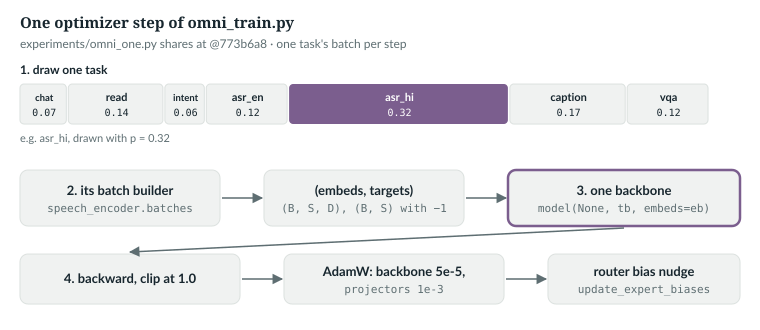
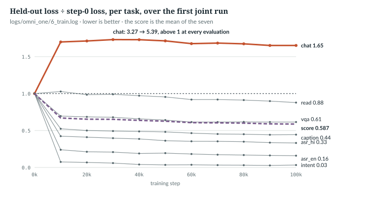

# 37  One model, many tasks

Before `anulm/multimodal/omni_train.py`, every skill was its own copy of the backbone.
`anulm/multimodal/omni_train.py` trains one decoder on chat, reading, intents, two speech tasks,
captions and image questions at once. It can, because Chapters 35 and 36
reduced every task to one pair, (embeds, targets), with −1 wherever the loss
must not look. This chapter reads the trainer and the release recipe, then the
first full run, from October 2026, whose score improved at every evaluation
while the skill it was meant to keep got worse.

Every excerpt is quoted at @084cbdd. The October run used an earlier version
of the trainer, at commit `773b6a8`, with one batch per optimizer step; the
book example loads that version to check the run's log. Where the two differ,
the text says so. A new run with the current recipe is training now. Its
results are not in this chapter: they are pending.

Prerequisites: Chapters 30 (instruction tuning), 35 and 36.

---

## 37.1  Every task becomes (embeds, targets)

Speech and image batches come from `speech_encoder.batches` and
`vision_encoder.batches` (Chapter 36). Text needs its own builder, because a
text row has no projector but must arrive in the same form:

> **In the repo** · `anulm/multimodal/omni_train.py` · `text_batches` · lines 104–174 · @084cbdd

```python
def pad(built, device):
    S = max(e.shape[0] for e, _ in built)
    eb = torch.zeros(len(built), S, built[0][0].shape[1], device=device, dtype=built[0][0].dtype)
    tb = torch.full((len(built), S), -1, dtype=torch.long, device=device)
    for k, (e, t) in enumerate(built):
        eb[k, : e.shape[0]] = e
        tb[k, : t.shape[0]] = t
    return eb, tb
# ...
def text_batches(rows, model, device, batch_size, shuffle=True, seed=0):
    order = np.arange(len(rows))
    if shuffle:
        np.random.default_rng(seed).shuffle(order)
    emb = model.embed_tokens
    for i in range(0, len(order), batch_size):
        built = []
        for j in order[i: i + batch_size]:
            p, a = rows[j]["p"], rows[j]["a"]
            ids = torch.tensor(p + a, device=device)
            t = torch.full((len(ids),), -1, dtype=torch.long, device=device)
            t[len(p) - 1: len(p) - 1 + len(a)] = ids[len(p):]
            built.append((emb(ids), t))
        yield pad(built, device)
```

Each row is a prompt `p` and an answer `a`, tokenised with the chat template
(`load_rows`, lines 85–96). The ids go through `embed_tokens`, (len, D), and
the targets are −1 except one position before each answer token (Chapter 35).
`pad` right-pads to the longest example, zeros and −1; causal attention keeps
padding from touching earlier positions. Unlike `anulm/training/finetune.py`, nothing is
packed.

The book example checks that this path is the plain id path in disguise:

```
2. text_batches: embeds (2, 6, 32), targets [[-1, -1, 9, 10, 1, -1], [-1, 11, 1, -1, -1, -1]]
   loss through embeds= 4.138337, through ids 4.138337
```

*verified*: `ch37_task_mix.py` on `tiny()`, with `text_batches` as of
`773b6a8`; lines 104–111 and 161–174 are identical at @084cbdd.

`IN THE REPO`

## 37.2  Describing tasks, and holding some back

A task is one command-line string, `name=kind:path[:weight[:batch]]`:

> **In the repo** · `anulm/multimodal/omni_train.py` · `Task.__init__` · lines 69–82 · @084cbdd

```python
    def __init__(self, spec: str):
        name, rest = spec.split("=", 1)
        parts = rest.split(":")
        # a Windows drive letter ("C:\...") splits too; glue it back on
        if len(parts) > 2 and len(parts[1]) == 1 and parts[1].isalpha() and parts[2].startswith(("\\", "/")):
            parts[1:3] = [parts[1] + ":" + parts[2]]
        self.name, self.kind, self.path = name, parts[0], parts[1]
        assert self.kind in KINDS, f"{spec}: kind must be one of {KINDS}"
        self.weight = float(parts[2]) if len(parts) > 2 and parts[2] else None
        self.batch = int(parts[3]) if len(parts) > 3 and parts[3] else DEFAULT_BATCH[self.kind]
        self.rows: list[dict] = []
        self.held: list[dict] = []
        self.epoch = 0
        self._it = None
```

The kind is `text`, `asr` or `image` (line 64). A missing batch size falls back
to `DEFAULT_BATCH`, 8 for text and images and 4 for speech (line 65). The
drive-letter repair matters on Windows, where `C:\data` would otherwise split
into a path `C` and a weight `\data`:

```
   asr_hi=asr:C:\data\hindi:0.32            -> name asr_hi, kind asr, path C:\data\hindi, weight 0.32, batch 4
   vqa=image:data/vqa.jsonl                 -> name vqa, kind image, path data/vqa.jsonl, weight None, batch 8
```

`Omni.__init__` then loads each task and splits off its held-out set:

> **In the repo** · `anulm/multimodal/omni_train.py` · `Omni.__init__` · lines 216–235 · @084cbdd

```python
        self.caches = {}
        held = dict(h.split("=", 1) for h in (args.held or []))
        for t in self.tasks:
            rows = load_rows(t, self.tok, self.cfg.block_size)
            if t.name in held:
                t.rows, t.held = rows, load_rows(Task(f"{t.name}={t.kind}:{held[t.name]}"), self.tok,
                                                  self.cfg.block_size)
                t.held = disjoint_held(t.rows, t.held, t.kind, t.name)
            else:
                t.rows, t.held = split_rows(rows, t.kind)
            check_split(t.rows, t.held, t.kind, t.name)
            self._validate_context(t)
            if t.kind == "image":
                from .vision_encoder import build_cache
                self.caches[t.name] = build_cache(t.rows + t.held, self.tower,
                                                  Path(t.path).with_suffix(".feats.f16"))
            if t.weight is None:
                t.weight = float(len(t.rows))
            print(f"task {t.name:8s} {t.kind:5s} {len(t.rows):7d} train {len(t.held):5d} held  "
                  f"batch {t.batch}  weight {t.weight:g}  ({t.path})", flush=True)
```

In order:

1. **Load.** `load_rows` (lines 85–101) drops text rows longer than the
   context, and passes speech rows through Chapter 36's `whisper_window_rows`,
   so no training clip is longer than Whisper's 30-second window.
2. **Held-out set.** With `--held`, a separate file is loaded and every row
   whose input training also sees is dropped (`disjoint_held`, below).
   Without it, `split_rows` holds out the first 2% of distinct inputs.
3. **Check.** `check_split` (lines 139–144) refuses an empty side, or an input
   on both sides.
4. **Context.** `_validate_context` (lines 265–296) builds, at startup, every
   speech or image example that could exceed `block_size`, so an over-long
   one raises now instead of hours into the run (Chapter 35's `build`).
5. **Cache and weight.** Image tasks get Chapter 36's feature cache, over the
   training and held-out rows together. A task with no weight is weighted by
   its size.

Both splits work on *input groups*, not rows:

> **In the repo** · `anulm/multimodal/omni_train.py` · `split_rows` · lines 123–136 · @084cbdd

```python
def split_rows(rows, kind, held_fraction=0.02):
    # ...
    groups = list(dict.fromkeys(_row_group(row, kind) for row in rows))
    if len(groups) < 2:
        raise ValueError(f"{kind}: need at least two independent input groups for train/held-out splits.")
    cut = min(len(groups) - 1, max(1, int(len(groups) * held_fraction)))
    selected = set(groups[:cut])
    training = [row for row in rows if _row_group(row, kind) not in selected]
    held = [row for row in rows if _row_group(row, kind) in selected]
    return training, held
```

`_row_group` (lines 114–120) is an image's resolved path, a recording's
resolved path, or a text row's prompt ids. `dict.fromkeys` keeps the groups
unique in first-seen order; the first 2% of them, at least one and never all,
are held out, with every row that belongs to them. Five captions of one image
therefore land on the same side. An explicit held-out file gets the same
treatment from the other direction:

> **In the repo** · `anulm/multimodal/omni_train.py` · `disjoint_held` · lines 148–159 · @084cbdd

```python
def disjoint_held(training, held, kind, name):
    # ...
    seen = {_row_group(row, kind) for row in training}
    kept = [row for row in held if _row_group(row, kind) not in seen]
    if len(kept) < len(held):
        print(f"{name}: dropped {len(held) - len(kept)} held-out rows whose input is also in training", flush=True)
    return kept
```

Its docstring gives the case that prompted it: the release data's chat train
and held-out files share some prompts, and a held-out score over prompts seen
in training is optimistic. Such rows are dropped with a count rather than
refusing to train.

> **Details.** The October run's code split by rows, `rows[:cut]` with
> `cut = max(1, int(len(rows) * 0.02))`, and did not compare a `--held` file
> with training. Its held-out numbers (37.4) are therefore on different sets
> from any run of the current code; the module docstring (lines 33–37) says
> such results must be rebaselined.

The release recipe sets every weight explicitly, in `experiments/omni_one.py`
(lines 77–87). Weights are normalised by their sum, so they are shares of the
draws:

| task | kind | weight now | October run | batch |
|---|---|---|---|---|
| chat | text | 0.25 | 0.07 | 8 |
| read | text | 0.14 | 0.14 | 4 |
| intent | text | 0.06 | 0.06 | 8 |
| asr_en | asr | 0.12 | 0.12 | 4 |
| asr_hi | asr | 0.32 | 0.32 | 4 |
| caption | image | 0.17 | 0.17 | 8 |
| vqa | image | 0.12 | 0.12 | 8 |

*verified*: "now" from `experiments/omni_one.py` at @084cbdd; "October run"
printed by `ch37_task_mix.py` from the file at `773b6a8`. The October weights
sum to 1.00. Today's sum to 1.18, so chat gets 0.25 / 1.18 = 21.2% of the
draws and asr_hi 27.1% (arithmetic).

> **Details.** Those weights share out *draws*, not examples: a speech batch
> holds 4 clips, a chat batch 8 rows. What the data itself does to a skill is
> separate: adding 28.5k mostly synthetic Hindi chat pairs (machine-translated,
> or answered by Llama-2-70B) raised the
> single-task chat model's held-out loss from 3.1445 to 3.5662
> (`docs/RESULTS.md` §40, *measured*).

`IN THE REPO`

## 37.3  One step: several draws, one update

> **In the repo** · `anulm/multimodal/omni_train.py` · `train` · lines 422–451 · @084cbdd

```python
    w = np.array([t.weight for t in om.tasks], dtype=float)
    w /= w.sum()
    rng = np.random.default_rng(args.seed + start)
    run_loss = {t.name: [] for t in om.tasks}
    model.train()
    for step in range(start, args.steps + 1):
        # linear warmup, then cosine to 10%: the same shape finetune.py uses
        frac = min(1.0, step / max(1, args.warmup))
        if step > args.warmup:
            prog = (step - args.warmup) / max(1, args.steps - args.warmup)
            frac = 0.1 + 0.9 * 0.5 * (1 + math.cos(math.pi * prog))
        for g, lr in zip(opt.param_groups, base_lrs):
            g["lr"] = lr * frac
        # Every AdamW step moves the weights by about lr whatever the batch
        # held, and an intent or VQA batch is ~30 answer tokens: --accum sums
        # several batches (any tasks) into one step so each step averages more.
        for _ in range(args.accum):
            t = om.tasks[rng.choice(len(om.tasks), p=w)]
            eb, tb = om.next_batch(t)
            with autocast:
                _, loss = model(None, tb, embeds=eb)
            if not torch.isfinite(loss):
                raise ValueError(f"{t.name}: non-finite training loss at step {step}.")
            (loss / args.accum).backward()
            seen[t.name] += 1
            run_loss[t.name].append(loss.item())
        torch.nn.utils.clip_grad_norm_(params, 1.0)
        opt.step()
        opt.zero_grad(set_to_none=True)
        imbalance = model.update_expert_biases()
```

In order:

1. **Weights to probabilities.** `w /= w.sum()`.
2. **Schedule.** Linear warmup, then a cosine down to 10%, applied as one factor
   to every parameter group (Chapter 7). It counts optimizer steps.
3. **Microbatches.** `--accum` times: draw a task with probability w, take its
   next batch (`next_batch`, lines 309–320, restarts a task's iterator with a
   new shuffle when it runs out, and raises if a fresh one yields nothing),
   run it with `embeds=` under bf16 autocast, and refuse a non-finite loss.
   Each draw is independent, so one step can hold several tasks.
4. **Sum.** `(loss / args.accum).backward()` adds each microbatch's gradient
   into the same `.grad`, so after the loop it is the mean of the `accum`
   batch gradients. `seen` counts batches, not steps.
5. **One update.** Clip at 1.0, step, clear the gradients, and nudge the router
   biases (Chapter 18).

The comment states the reason. AdamW moves each weight by about the learning
rate whatever the batch held, so with one batch per step a 30-token intent
batch moves the shared decoder as far as a full chat batch. Summing batches
makes each step an average over several. `--accum` defaults to 1, and `main`
refuses 0 (lines 504 and 516–517).

The optimizer has the backbone in one group and each projector in another,
at `--lr` (default 5e-5) and `--proj-lr` (1e-3) (lines 372–376, 493–494), as
in Chapter 36.

Two seeds make a run repeatable, and the resume path checks that it is still
the same run:

> **In the repo** · `anulm/multimodal/omni_train.py` · `train` · lines 365–402 · @084cbdd

```python
    # Fresh projectors (vision always, audio without --audio-proj-from) are
    # initialised from torch's global generator: seed it so a rerun, or an A/B
    # probe against it, starts from the same weights.
    torch.manual_seed(args.seed)
    om = Omni(args)
    recipe = recipe_of(args, om.tasks)
    # ...
    if args.resume and last.exists():
        st = torch.load(last, map_location=dev, weights_only=False)
        if "recipe" not in st:
            print(f"warning: {last} predates recorded recipes; cannot check it matches this run", flush=True)
        elif st["recipe"] != recipe:
            changed = sorted(k for k in recipe if st["recipe"].get(k) != recipe[k])
            raise SystemExit(f"{last} was written with a different recipe ({', '.join(changed)}): "
                             "resume with the original settings, or train to a new --out")
```

`torch.manual_seed` runs before `Omni` builds the projectors, so a fresh
projector starts from the same weights in every run with the same `--seed`.
The task draw has its own generator, `default_rng(args.seed + start)`. `recipe`
comes from `recipe_of`:

> **In the repo** · `anulm/multimodal/omni_train.py` · `recipe_of` · lines 353–359 · @084cbdd

```python
def recipe_of(args, tasks) -> dict:
    # ...
    return {"accum": args.accum, "proj_scale": args.proj_scale, "lr": args.lr, "proj_lr": args.proj_lr,
            "steps": args.steps, "warmup": args.warmup,
            "tasks": [[t.name, float(t.weight), int(t.batch)] for t in tasks]}
```

It is stored in `<out>.last` at every evaluation (line 474). A resume under a
different accumulation, learning rate, schedule, projector scale or task mix
stops with the names of the settings that changed; a `.last` written before
recipes were recorded gets a warning. Otherwise the run reloads the model,
both projectors, the optimizer and the step-0 losses, and continues at the
next step with a new shuffle per task (lines 403–413).

> **Details.** `--stop-after N` (line 505) ends the run at step N while keeping
> `--steps`' learning-rate schedule, and writes no resume file: a short probe
> that follows the first N steps of a full run exactly (lines 470–471).

`IN THE REPO`

## 37.4  One number for seven tasks

The trainer keeps the best checkpoint, so it needs one number. Each task's
held-out loss is divided by its value before training, and the ratios are
averaged:

> **In the repo** · `anulm/multimodal/omni_train.py` · `train` · lines 457–464 · @084cbdd

```python
        if step % args.eval_every == 0 or step == args.steps:
            losses = evaluate()
            score = float(np.mean([losses[k] / first[k] for k in losses]))
            flag = ""
            if score < best:
                best = score
                atomic_save(om.state(step, score, losses), args.out)
                flag = "  <- saved"
```

`first` holds the held-out losses at step 0 (line 415), which must all be
finite and positive (lines 416–417). Dividing by them puts every task on the
same footing: a caption loss of 5.5 and a speech loss of 6.6 both start at
1.0. Lower is better, and a checkpoint is saved whenever the mean improves.

The October run used the recipe at `773b6a8`: 100,000 steps of one batch
each, `--lr` 5e-5, chat at 0.07, evaluated every 10,000 steps. The book
example replays its seeded task draw, one draw per step as that code did:

```python
def replay_draw(names, w, resumed_at, last_step) -> dict:
    """train()'s draw: rng = default_rng(args.seed + start), one task per step; seed 0."""
    seen = {n: 0 for n in names}
    starts = [1] + [r + 1 for r in resumed_at] + [last_step + 1]
    for a, b in zip(starts[:-1], starts[1:]):
        rng = np.random.default_rng(0 + a)
        for _ in range(a, b):
            seen[names[rng.choice(len(names), p=w)]] += 1
    return seen
```

```
   replayed draw to step 100000 (resumed at [90000]): {'chat': 7017, 'read': 13921, 'intent': 6013, 'asr_en': 12131, 'asr_hi': 31708, 'caption': 17046, 'vqa': 12164}
   the log's batches seen:                         {'chat': 7017, 'read': 13921, 'intent': 6013, 'asr_en': 12131, 'asr_hi': 31708, 'caption': 17046, 'vqa': 12164}
```

*verified*: `ch37_task_mix.py` against the October run's
`logs/omni_one/6_train.log`. The run was interrupted and resumed at step
90,000, and a resume reseeds the draw with the new `start`. The match confirms
that this run executed one batch per optimizer step. Chat got 7,017 of
100,000 steps.



*Figure 37.1 · One training step of the October run.* One task is drawn, its
batch built, and the one backbone stepped. *verified*: the shares are
`experiments/omni_one.py`'s `TASKS` at `773b6a8`. The current code repeats
steps 1 to 3 `--accum` times before step 4.

The October run's scores, recomputed from its log:

```
   step    score  recomputed      chat     read   intent   asr_en   asr_hi  caption      vqa
      0   1.0000      1.0000     1.000    1.000    1.000    1.000    1.000    1.000    1.000
    10000   0.6690      0.6690     1.699    1.028    0.075    0.239    0.423    0.524    0.696
    50000   0.6259      0.6259     1.713    0.955    0.034    0.194    0.362    0.481    0.641
    90000   0.5902      0.5902     1.651    0.898    0.027    0.163    0.336    0.442    0.615
   100000   0.5873      0.5873     1.651    0.878    0.033    0.159    0.331    0.444    0.615
   chat: 3.2651 at step 0 -> 5.391 at step 100000 (x1.651) while the score fell to 0.5873
```

*measured*: the October run's `logs/omni_one/6_train.log`, every row
recomputed by `ch37_task_mix.py` (rows for 20,000–80,000 omitted here; all are
in `book/measurements/part_viii_ix_omni_log.json`).

The score fell at every evaluation, so every evaluation saved a checkpoint.
Six tasks improved, the new skills enormously: intent classification went to
3% of its starting loss. Chat, the skill the model started with, got about
70% worse within the first 10,000 steps (ratio 1.699) and ended 65% worse. A
mean of seven ratios cannot show that: six large gains outweigh one large loss.

The run started from `ckpt_chat_mm.pt`: the chat model `ckpt_chat_v3.pt` grown
by `anulm/multimodal/speech_vocab.py` (`experiments/omni_one.py` line 456;
`logs/omni_one/3_grow.log`). So step 0 is already the grown model, and its
chat loss already includes the full-softmax cost of growing, about 0.065 nats
on base v2's text (Chapter 35).



*Figure 37.2 · The score improved; chat did not.* Held-out loss ÷ step-0 loss
per task, and their mean, in the October run. *measured*:
`book/measurements/part_viii_ix_omni_log.json`.

`IN THE REPO` · `MEASURED`

## 37.5  One checkpoint, every skill

What the trainer saves is the backbone plus the small parts that differ per
input:

> **In the repo** · `anulm/multimodal/omni_train.py` · `Omni.state` · lines 336–350 · @084cbdd

```python
    def state(self, step, score, losses) -> dict:
        a = self.args
        # ...
        st = {"model": self.model.state_dict(), "cfg": replace(self.cfg, moe_impl=self.ck["cfg"].moe_impl),
              "speech_text_vocab": self.ck["speech_text_vocab"], "step": step, "val_loss": score,
              "task_losses": losses, "tasks": [t.name for t in self.tasks], "base_ckpt": a.ckpt,
              "qa_templates": qa_templates}
        if self.sm is not None:
            st.update(proj=self.sm.proj.state_dict(), whisper=a.whisper, stack=a.stack)
        if self.vl is not None:
            st.update(vision_proj=self.vl.proj.state_dict(), tower=a.tower, pool=a.pool)
        return st
```

The elided lines (338–341) take the chat templates from the starting
checkpoint, or `make_qa.PROMPTS` when it has none and a text task is present.
The audio projector is saved as `proj`, the key `anulm/multimodal/speech_encoder.py` uses, and
the image projector as `vision_proj`. The encoders are not saved, only their
names (`whisper`, `tower`), because they are frozen and downloaded on use.
`val_loss` holds the score, not a loss. `anulm/multimodal/omni.py` then builds every skill on
one loaded copy:

> **In the repo** · `anulm/multimodal/omni.py` · `Omni.ear` · lines 47–57 · @084cbdd

```python
    def ear(self):
        """voice.OwnASR's interface over the shared decoder."""
        if self._ear is None:
            from .audio_codec import WhisperEncoder
            # ...
            enc = WhisperEncoder(self.meta.get("whisper", "small"), self.device)
            sm = ContinuousSpeech(self.model, vocab_of(self.meta), enc.dim, self.meta.get("stack", 4)).to(self.device)
            sm.proj.load_state_dict(self.proj)
```

`self.model` is the chat engine's model (line 39), and the serving engine has
already set its `text_vocab` (Chapter 35). The ear wraps that same module with
the saved projector; `eye()` does the same with `vision_proj`. One decoder in
memory serves chat, reading, intents, speech and images.

`IN THE REPO`

## 37.6  A score picks checkpoints; gates decide releases

The pipeline that runs this training, `experiments/omni_one.py`, does not trust
the score with the release. Each task gets a gate: how much it may lose against
the separate model it would replace.

> **In the repo** · `experiments/omni_one.py` · `gates` · lines 375–383 · @084cbdd

```python
def gates(res) -> dict:
    hi = [res.get(k) for k in ("wer_hi_fleurs", "wer_hi_kathbath", "wer_hi_mucs")]
    if all(v is not None for v in hi):
        res["wer_hi_mean"] = round(sum(hi) / 3, 1)
    out = {}
    for k, (op, thr) in GATES.items():
        v = res.get(k)
        out[k] = v is not None and (v <= thr if op == "<=" else v >= thr)
    return out
```

A missing measurement fails its gate (`v is not None and ...`). Hindi speech
is gated on the mean of three test sets, because each set alone pulled a
different way (comment, lines 94–97). The rule and the thresholds are the same
at `773b6a8` and @084cbdd. Applied by the book example to the October run's
evaluation results:

```
5. release gates (experiments/omni_one.py GATES at the pin) on logs/omni_one/results.json
   wer_en                  12.2  <= 9.0    FAIL
   wer_hi_mean             46.2  <= 50.9   pass
   wer_hi_fleurs           48.8  <= 43.0   FAIL
   chat_heldout_loss     5.3181  <= 3.3    FAIL
   read_squad_en           24.6  >= 30.0   FAIL
   intent_banking77        90.0  >= 80.0   pass
   vqa_acc                 17.6  >= 10.0   pass
   all pass: False
```

*measured*: the October run's `logs/omni_one/results.json`, written by the
pipeline's evaluation step; copied into
`book/measurements/part_viii_ix_omni_log.json`. Four gates failed, so the
model was not published. For comparison, the separate English speech model
scored 7.1% WER on the same 100-clip measure (`docs/RESULTS.md` §39).
`docs/RESULTS.md` at @084cbdd records no result for the joint model.

Two different chat numbers appear in this chapter. The trainer's held-out loss
(5.391 at step 100,000, 37.4) comes from `Omni.held_loss`:

> **In the repo** · `anulm/multimodal/omni_train.py` · `Omni.held_loss` · lines 322–334 · @084cbdd

```python
    @torch.no_grad()
    def held_loss(self, t: Task, autocast) -> float:
        self.model.eval()
        tot = n = 0.0
        for eb, tb in self.batches(t, t.held[: self.args.eval_n], 1, shuffle=False):
            with autocast:
                _, loss = self.model(None, tb, embeds=eb)
            k = int((tb != -1).sum())
            tot, n = tot + loss.item() * k, n + k
        self.model.train()
        if n <= 0 or not math.isfinite(tot):
            raise ValueError(f"{t.name}: held-out set has no finite graded tokens.")
        return tot / n
```

It scores embeddings under the trainer's autocast, one example per batch,
token-weighted over at most `--eval-n` examples. A held-out set with no graded
tokens, or a non-finite total, now raises; the October code returned
`tot / max(n, 1)`, which would have reported 0 for an empty set. The gate's
5.3181 comes from a separate scorer:

> **In the repo** · `anulm/multimodal/omni_eval.py` · `chat_loss` · lines 115–131 · @084cbdd

```python
def chat_loss(m, tok, path, device):
    from anulm.training.finetune import _pair_ids
    tot = n = 0.0
    for line in open(path, encoding="utf-8"):
        r = json.loads(line)
        p, a = _pair_ids(tok, r)
        ids = (p + a)[: m.cfg.block_size]
        x = torch.tensor([ids], device=device)
        t = torch.full_like(x, -1)
        t[0, len(p) - 1: len(ids) - 1] = x[0, len(p):]
        logits, _ = m(x, t)
        lp = F.log_softmax(logits.float()[0, :-1], -1)
        tgt = x[0, 1:]
        mask = t[0, :-1] != -1
        tot += float(-lp[mask].gather(1, tgt[mask][:, None]).sum())
        n += int(mask.sum())
    return round(tot / max(n, 1), 4)
```

It feeds ids, one example at a time, and takes its own log-softmax over the
whole held-out file. Its threshold, 3.3, was set from `ckpt_chat_v3.pt`'s
3.146 under that same scorer (comment, `omni_one.py` line 100), measured before
the vocabulary was grown. They measure the same held-out file in different
ways, and the trainer's version now drops prompts seen in training (37.2), so
compare each only with its own kind.

`IN THE REPO` · `MEASURED`

## 37.7  The recipe after October

Short probes after the October run pointed to the cause in 37.3: one batch per
optimizer step. The release recipe now reads:

> **In the repo** · `experiments/omni_one.py` · `ACCUM` · lines 65–87 · @084cbdd

```python
# Each optimizer step sums ACCUM batches. One batch per step (the first run,
# 100,000 steps) let the ~30-token intent and VQA batches each move the shared
# decoder a full AdamW step: chat held-out went 3.27 -> 5.39. Summing 8 kept
# every task better at equal batches (logs/ab_projscale, 2026-10-30).
ACCUM = 8
STEPS = 12_500                  # x ACCUM = the first run's 100,000 batches
# 3,000-batch probes, chat held-out loss on the gate's metric (start 3.335):
# 15% chat at 5e-5 3.50, 25% at 5e-5 3.457, 15% at 2.5e-5 3.43. Both levers
# are used together here (not probed as a pair).
LR = 2.5e-5
# Share of steps per task (not of examples): Hindi speech is the largest and the
# weakest skill, chat the one that already works and must only be kept.
TASKS = [
    # 0.07 let the other tasks pull chat off course even with --accum; 0.25 with
    # half the learning rate (LR below) kept it closest to where it started.
    ("chat", "text", "data/chat_train.jsonl", 0.25, 8),
    ("read", "text", "data/rc_train.jsonl", 0.14, 4),
    ("intent", "text", "data/omni/intent_train.jsonl", 0.06, 8),
    ("asr_en", "asr", "data/speech_ls100", 0.12, 4),
    ("asr_hi", "asr", "data/omni/hindi_train", 0.32, 4),
    ("caption", "image", "data/omni/caption_train.jsonl", 0.17, 8),
    ("vqa", "image", "data/omni/vqa_train.jsonl", 0.12, 8),
]
```

Three levers moved, and the comments record why:

1. **Accumulation.** Eight batches per step, for 12,500 steps: the same
   100,000 batches as the October run, in an eighth of the updates.
2. **Learning rate.** 2.5e-5, half the trainer's default.
3. **Chat's weight.** 0.25 instead of 0.07.

The probe numbers in the comments are the recipe's own record, on chat's
held-out loss by the gate's scorer, from 3,000-batch probes; they were not
rerun for this book. The comment says plainly that the learning rate and the
chat weight were never probed together. The pipeline turns these constants
into the training command:

> **In the repo** · `experiments/omni_one.py` · `main` · lines 460–469 · @084cbdd

```python
        args = ["-m", "anulm.multimodal.omni_train", "--ckpt", "ckpt_chat_mm.pt", "--out", OUT, "--steps", str(a.steps),
                "--accum", str(ACCUM), "--warmup", str(max(1, 500 // ACCUM)), "--lr", str(LR),
                "--eval-every", "625", "--eval-n", "200", "--log-every", "125", "--resume",
                "--grad-ckpt"]     # unattended: an out-of-memory at 3 a.m. would stop the night
        if (ROOT / "ckpt_asr_en_v3.pt").exists():      # LibriSpeech-only projector; a clone starts fresh
            args += ["--audio-proj-from", "ckpt_asr_en_v3.pt"]
        for name, kind, path, w, b in TASKS:
            args += ["--task", f"{name}={kind}:{path}:{w}:{b}"]
        for name, path in HELD.items():
            args += ["--held", f"{name}={path}"]
```

The warmup is divided by `ACCUM` too, 500 // 8 = 62 steps, so it still spans
about 500 batches; an evaluation every 625 steps is every 5,000 batches. Chat
and reading keep their own held-out files (`HELD`, line 88), now filtered by
`disjoint_held`. `--seed` is not passed, so it is 0. Before training,
`prepare_training` (lines 222–238) hashes the code, this command and the data;
a change archives the previous outputs and reruns training and every step after
it, and an unchanged interrupted run keeps its resume file.

A run with this recipe is training now. Its scores, its gate results and
whether chat holds are **pending**: none is claimed here.

> **Build it.** The lab book's Chapter 14 (`course/ch14-one-model`) builds the
> task draw, the score and the gates on a small model, with checks that catch
> each silent bug, and tells the story of the probes.

`IN THE REPO`

## 37.8  Exercises

1. A task spec reads `cap=image:D:/imgs/train.jsonl::16`. What are its path,
   weight and batch?
2. Three tasks end at ratios 0.2, 0.3 and 1.6. What is the score, and is it
   better than a run that ends at 0.6, 0.6, 0.6?
3. Why must a resumed run not reuse the seed it started with?
4. With `--accum 8`, how many task draws does step 100 make, and can its
   batches come from different tasks?

**Answers.** 1. `D:/imgs/train.jsonl`; weight `None`, so its size; batch 16.
2. 0.7, which is worse than 0.6, although one task in the first run is 60%
worse than at step 0 and none in the second is. 3. It would replay
the same task sequence from step 1, not continue it; the run would see the
early order twice. 4. Eight, each drawn independently with probability w, so
yes; their gradients are averaged into one update.

*verified*: exercise 1 by `omni_train.Task` at `773b6a8` (the same lines
69–82 at @084cbdd); exercises 2 and 4 by arithmetic and the loop in 37.3.

---

## Key points

- `anulm/multimodal/omni_train.py` turns every task into (embeds, targets) with −1 off the
  answer, so one optimizer and one backbone serve text, speech and images.
- A task is `name=kind:path[:weight[:batch]]`; held-out sets are split by
  input group, a `--held` file loses any input training sees, and speech
  clips over 30 seconds are dropped from training.
- Each optimizer step sums `--accum` batches, each task drawn by weight; the
  seeds and a recorded recipe make a run repeatable and a resume checked.
- The checkpoint score is the mean of held-out losses divided by their step-0
  values, so a task with a large loss cannot drown out one with a small loss.
- In the October run, one batch per step, that mean improved at every
  evaluation while chat's held-out loss rose 65%; four release gates failed.
- The recipe now sums 8 batches per step at lr 2.5e-5 with chat at 0.25; the
  run with it is pending.

> **In one breath.** One decoder learns seven tasks because each arrives as
> embeddings with answer-only targets. Each step sums several drawn batches; a
> mean of step-0-normalised losses picks checkpoints, and per-task gates, not
> that mean, decide whether the model ships.

## References

This chapter cites no external research. Its evidence is the repository, the
October run's logs and `docs/RESULTS.md`.

Repository evidence, all at @084cbdd:
- `anulm/multimodal/omni_train.py`: `KINDS`, `DEFAULT_BATCH` 64–65, `Task` 68–82, `load_rows`
  85–101, `pad` 104–111, `_row_group` 114–120, `split_rows` 123–136,
  `check_split` 139–144, `disjoint_held` 148–159, `text_batches` 161–174,
  `Omni.__init__` 181–235, `Omni._validate_context` 265–296,
  `Omni.next_batch` 309–320, `Omni.held_loss` 322–334, `Omni.state` 336–350,
  `recipe_of` 353–359, `train` 362–478, `main` 481–518.
- `anulm/multimodal/omni.py`: `Omni` 33–86.
- `experiments/omni_one.py`: `ACCUM`, `STEPS`, `LR` 65–74, `TASKS` 77–87, `HELD` 88,
  `GATES` 92–104, `prepare_training` 222–238, `gates` 375–383, the training
  command 460–469.
- `anulm/multimodal/omni_eval.py`: `chat_loss` 115–131.
- `docs/RESULTS.md` §39, §40.
- The October run: `logs/omni_one/6_train.log` and `logs/omni_one/results.json`
  (outside the repository's history; numbers copied into
  `book/measurements/part_viii_ix_omni_log.json`). It ran `omni_train.py` and
  `experiments/omni_one.py` at commit `773b6a8`.
- Book example: `book/code-examples/ch37_task_mix.py` (loads the `773b6a8`
  code; not rerun for @084cbdd, because `logs/omni_one/` now belongs to the
  new run).
