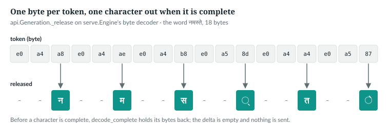
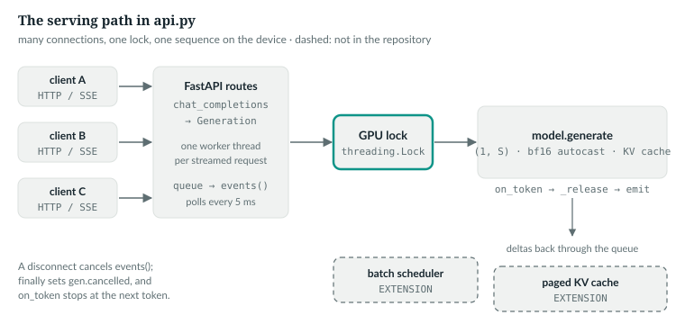

# 38  Serving: engine, API and streaming

A checkpoint becomes a service in two files. `anulm/inference/serve.py` is a small web server
built only on Python's standard library. `anulm/inference/api.py` speaks OpenAI's HTTP
protocol, so existing clients work unchanged, and it streams the chat model's
replies token by token. Both are thin: they load the model once, hold one lock around the
device, and call Chapter 27's `generate`. This chapter reads both, and shows
what streaming has to get right that a batch evaluation never sees: half a
character, half a stop sequence, and a client that hangs up. It ends with
what guards the door: the API key, the upload caps and the error ids.

Prerequisites: generation and the KV cache (Chapters 27–28), the grown
vocabulary (Chapter 35).

**New words for Part IX.**

| Term | Meaning |
|---|---|
| engine | the object that owns one loaded model and turns a prompt into a reply |
| endpoint | one URL path and HTTP method a server answers, such as `POST /v1/chat/completions` |
| lock | a flag only one thread can hold at a time; others wait until it is released |
| streaming | sending a reply in pieces as it is generated, instead of all at the end |
| SSE | server-sent events: an HTTP response that stays open and carries `data:` lines, one per event |
| throughput | work finished per second across all requests; latency is the wait for one |

---

## 38.1  The engine: load once, hold one lock

> **In the repo** · `anulm/inference/serve.py` · `Engine.__init__` · lines 58–68 · @b42998d

```python
    def __init__(self, ckpt: str, device: str):
        ck = load_checkpoint(ckpt, device)          # a .pt, or a folder from export_hf.py
        cfg = ck["cfg"]
        # grouped = one grouped GEMM per projection, bf16, CUDA only; sparse
        # is the portable path. A checkpoint trained with either decodes with
        # either, so pick by device rather than by what the checkpoint says.
        cfg = replace(cfg, moe_impl="grouped" if device.startswith("cuda") else "sparse")
        self.cfg, self.device = cfg, device
        self.model = AnuLM(cfg).to(device).eval()
        self.model.load_state_dict(ck["model"])
        self.model.text_vocab = ck.get("speech_text_vocab")      # set on the one joint model (omni_train.py)
```

`load_checkpoint` reads a `.pt`, an exported folder or a Hub id (Chapter 39).
The mixture-of-experts dispatch path is chosen by device, not by the
checkpoint: the grouped matrix multiply on a GPU, the portable sparse path on
a CPU (Chapter 18). `text_vocab` keeps a grown model writing text
(Chapter 35). The constructor ends:

> **In the repo** · `anulm/inference/serve.py` · `Engine.__init__` · lines 110–112 · @b42998d

```python
        self.lock = threading.Lock()
        # Warm up: the first CUDA call and the grouped-GEMM weight stack are slow.
        self.generate("def f(" if self.coder else "भारत", 4, 0.8, 50, 0)
```

One lock per engine, and a four-token generation at start-up so the first real
request does not pay for CUDA initialisation.

`IN THE REPO`

## 38.2  One request

> **In the repo** · `anulm/inference/serve.py` · `Engine.generate` · lines 152–166 · @b42998d

```python
        ids = self.encode(prompt)[-(self.cfg.block_size - 1):]
        x = torch.tensor([ids], dtype=torch.long, device=self.device)
        with self.lock:
            torch.manual_seed(seed)
            t0 = time.time()
            with torch.autocast("cuda", dtype=torch.bfloat16, enabled=self.device.startswith("cuda")):
                out = self.model.generate(x, max_tokens, temperature=temperature,   # 0 = exact greedy
                                          top_k=top_k or None, eos_id=self.eos_id,
                                          repetition_penalty=repetition_penalty)
            dt = time.time() - t0
        new = out[0, len(ids):].tolist()
        stopped = self.eos_id is not None and self.eos_id in new
        # Decode only what came before EOS: a HF tokenizer would otherwise
        # write the control token ("<|endoftext|>") into the reply.
        text = self.decode(new[:new.index(self.eos_id)] if stopped else new)
```

In order:

1. **Truncate from the left.** Keep the last `block_size − 1` prompt ids, so at
   least one new token fits. The released model keeps 1,023.
2. **One sequence.** `x` is (1, S): a request is never batched with another.
3. **Under the lock.** Seeding and generation happen while holding it, so two
   threads can neither interleave on the device nor reseed each other's
   sampling.
4. **bf16 autocast on CUDA.** Weights stay fp32; matrix multiplies run in bf16
   (Chapter 23). On a CPU autocast is disabled.
5. **Temperature as sent.** It is passed unclamped: `generate` treats
   `temperature <= 0` as exact greedy, an argmax with no random draw
   (Chapter 27). `top_k=0` becomes `None`, no top-k filter.
6. **Decode up to EOS.** Only the ids before EOS are decoded.

Before line 152, the prompt is wrapped in the template the checkpoint was
tuned with, when the mode asks for one (lines 146–151).

`IN THE REPO`

## 38.3  The standard-library server

> **In the repo** · `anulm/inference/serve.py` · `make_handler` · lines 203–240 · @b42998d

```python
        def do_POST(self):
            if self.path != "/generate":
                return self._json({"error": "not found"}, 404)
            try:
                n = int(self.headers.get("Content-Length", 0))
            except ValueError:
                return self._json({"error": "bad Content-Length"}, 400)
            # n comes straight from the client: without a cap one request could
            # ask the server to allocate and wait for gigabytes.
            if n < 0 or n > MAX_BODY_BYTES:
                return self._json({"error": f"request body must be at most {MAX_BODY_BYTES} bytes"}, 413)
            try:
                req = json.loads(self.rfile.read(n).decode("utf-8") or "{}")
            except (UnicodeDecodeError, ValueError):
                return self._json({"error": "the body must be UTF-8 JSON"}, 400)
            # ...
            try:                                         # a client's mistake is a 400, not a 500
                kw = dict(max_tokens=max(1, min(int(req.get("max_tokens", 150)), 400)),
                          temperature=float(req.get("temperature", 0.8)),
                          top_k=int(req.get("top_k", 50)),
                          seed=int(req.get("seed", 1337)),
                          mode=req.get("mode") if req.get("mode") in ("question", "translate") else "continue",
                          repetition_penalty=float(req.get("repetition_penalty", 1.0)))
            except (TypeError, ValueError):
                return self._json({"error": "max_tokens, temperature, top_k, seed and repetition_penalty "
                                            "must be numbers"}, 400)
            try:
                self._json(engine.generate(prompt, **kw))
            except Exception:                            # report, don't die
                # The details (exception text, file paths) go to the server log
                # only; the client gets an id to quote, which finds them there.
                eid = uuid.uuid4().hex[:12]
                print(f"error {eid} on POST /generate:\n{traceback.format_exc()}", file=sys.stderr, flush=True)
                self._json({"error": f"internal error (id {eid}); the server log has the details"}, 500)
```

In order:

1. **Cap the body.** `Content-Length` is the client's own claim. Above
   `MAX_BODY_BYTES`, 1 MB (line 47), the reply is 413 before a byte is read.
2. **Parse.** A body that is not UTF-8 JSON is a 400. The elided lines
   (218–222) also refuse a body that is not a JSON object, and an empty prompt.
3. **Read the numbers.** `max_tokens` is clamped to 1–400 and defaults are
   filled. A value that is not a number is the client's mistake, so it gets a
   400, not a 500.
4. **Generate, and fail quietly.** Any exception from the engine becomes a 500
   reply instead of a dead server. The reply carries only a 12-character id;
   the traceback goes to the server's log under the same id. An exception's
   text can hold file paths and checkpoint names, which a client should not
   see.

`main` serves the handler with `ThreadingHTTPServer` (line 264): one thread per connection.
The threads overlap on parsing and sending, but every generation waits for the
engine's lock, so the device runs one request at a time.

`IN THE REPO`

## 38.4  An OpenAI-compatible API

`anulm/inference/api.py` uses FastAPI and accepts OpenAI's request shapes:

> **In the repo** · `anulm/inference/api.py` · `ChatRequest` · lines 218–224 · @b42998d

```python
    temperature: Optional[float] = Field(None, ge=0, le=2, description="Default 0.3. 0 = greedy.")
    top_p: Optional[float] = Field(None, description="Accepted for compatibility; AnuLM samples with top_k.")
    top_k: Optional[int] = Field(None, ge=0, description="AnuLM extension. Default 40; 0 turns it off.")
    repetition_penalty: Optional[float] = Field(None, description="AnuLM extension. Default 1.15.")
    stop: Union[str, list[str], None] = None
    seed: Optional[int] = None
    n: int = Field(1, description="Only 1 is supported.")
```

`top_p` is accepted so OpenAI clients that send it do not fail, and then never
used: nucleus sampling [R31] is `NOT IN THE REPO` (Chapter 28). `top_k` and
`repetition_penalty` are additions. The handler is single-turn:

> **In the repo** · `anulm/inference/api.py` · `chat_completions` · lines 570–575 · @b42998d

```python
    users = [m for m in req.messages if m.role == "user"]
    if not users:
        raise APIError(400, "messages must contain a user message.", param="messages")
    last = users[-1]
    question, images = text_of(last.content), images_of(last.content)
    mid = "anulm-vision" if images else req.model
```

Only the last user message is read. Earlier turns and any system message are
dropped, because the chat model was tuned on single questions. An image part
routes the request to the vision model. All device work shares one lock,
declared once for the whole server:

> **In the repo** · `anulm/inference/api.py` · `GPU` · lines 295–296 · @b42998d

```python
models: A.Models | None = None
GPU = threading.Lock()                # one request on the device at a time
```

The lock also covers the first load of each model: `Generation.__init__` asks
for the chat engine under it (lines 396–397), so two first requests cannot
load the model twice. The book example confirms that `top_p` is accepted and
never reaches `Generation`; 38.6 checks the lock:

```
5. ChatRequest(top_p=0.1).top_p = 0.1; Generation takes ['prompt', 'max_tokens', 'temperature', 'top_k', 'repetition_penalty', 'seed', 'stops']
```

*verified*: `ch38_streaming.py`.

`IN THE REPO` · `NOT IN THE REPO` (top-p)

## 38.5  Streaming: release only what is safe to show

`generate` takes an `on_token` callback, called with each new (B, 1) token;
returning True stops (lines 1174–1175). `Generation.run` passes one:

> **In the repo** · `anulm/inference/api.py` · `Generation.run` · lines 430–448 · @b42998d

```python
        def on_token(nxt):
            t = int(nxt[0, 0])
            if eos is not None and t == eos:
                self.finish = "stop"
                return True
            self.new.append(t)
            delta = self._release(final=False)
            if delta and emit:
                emit(delta)
            return self.finish == "stop" or self.cancelled

        with GPU:
            if self.seed is not None:
                torch.manual_seed(self.seed)
            with torch.no_grad(), torch.autocast("cuda", dtype=torch.bfloat16,
                                                 enabled=self.eng.device.startswith("cuda")):
                self.eng.model.generate(x, self.max_tokens, temperature=self.temperature,  # 0 = exact greedy
                                        top_k=self.top_k or None, eos_id=eos,
                                        repetition_penalty=self.rep, on_token=on_token)
```

For each token: EOS ends the reply without being shown; anything else is
appended, and `_release` decides how much new text may go out. Generation stops
on a stop sequence or a cancellation. The release rule:

> **In the repo** · `anulm/inference/api.py` · `Generation._release` · lines 407–423 · @b42998d

```python
    def _release(self, final: bool) -> str:
        # Whole characters only: a Devanagari letter split across tokens is held
        # back until complete, while a genuine U+FFFD in the text is kept.
        text = self.eng.decode_complete(self.new)
        cut = len(text)
        for s in self.stops:
            i = text.find(s, max(0, len(self.sent) - len(s)))
            if i >= 0:
                cut, self.finish, self.matched_stop = min(cut, i), "stop", True
        text = text[:cut]
        if not self.matched_stop and not final:
            # Hold back what could still turn out to be the start of a stop string.
            hold = max((len(s) - 1 for s in self.stops), default=0)
            text = text[:len(text) - hold] if hold else text
        delta, self.sent = text[len(self.sent):], text if len(text) > len(self.sent) else self.sent
        self.text = self.sent
        return delta
```

Step by step:

1. **Decode the complete characters so far.** A token can end inside a
   multi-byte character. `decode_complete` decodes only up to the last complete
   UTF-8 character and holds the unfinished bytes back; bytes that can never
   be valid, and a real U+FFFD in the text, still come out as `�`.
2. **Cut at a stop sequence.** The search starts a little before what was
   already sent, so a stop string split across two tokens is still found. A
   match sets `finish = "stop"` and `matched_stop = True`.
3. **Hold back.** While no stop string has matched and the call is not final,
   keep back the last `len(s) − 1` characters, which could be the start of a
   stop string.
4. **Send the difference.** `delta` is what is new since `self.sent`.

For a byte-level model the decoder is one call into the standard library:

> **In the repo** · `anulm/bpe.py` · `complete_utf8` · lines 51–61 · @b42998d

```python
def complete_utf8(data: bytes) -> str:
    # ...
    import codecs
    return codecs.getincrementaldecoder("utf-8")(errors="replace").decode(data, final=False)
```

An incremental decoder called with `final=False` keeps an incomplete trailing
sequence in its buffer instead of replacing it. The engine picks the decoder:

> **In the repo** · `anulm/inference/serve.py` · `Engine.decode_complete` · lines 129–137 · @b42998d

```python
    def decode_complete(self, ids) -> str:
        # ...
        if self.tok:
            fn = getattr(self.tok, "decode_complete", None)
            return fn(ids) if fn else self.tok.decode(ids)
        from anulm.bpe import complete_utf8
        return complete_utf8(bytes(i for i in ids if i < 256))
```

A tokenizer with its own `decode_complete` uses it; one without falls back to
plain `decode`, with no hold. A byte model drops ids 256 and up (BOS, EOS,
PAD) and calls `complete_utf8`. The book example feeds a Hindi word one byte
at a time; the `decode` column is the plain decoder, the `released` column is
`_release`:

```
1. 'नमस्ते': 6 characters, 18 UTF-8 bytes, one byte per token
   byte  0 0xe0  decode -> '�'     released ''
   byte  1 0xa4  decode -> '�'     released ''
   byte  2 0xa8  decode -> 'न'     released 'न'
   ...
   byte 17 0x87  decode -> 'े'     released 'े'

2. stop sequence '\n\n' over 'Hi.\n\nNext': released ['', 'H', 'i', '.', '', '', '', '', '']; finish 'stop'; text 'Hi.'
```

*verified*: `ch38_streaming.py` (rows 3–16 elided; every third byte completes a
character). Plain `decode` shows `�` for the half-written character;
`_release` sends nothing until the character is whole. In the second case
each character goes out one token late, the one-character hold, and nothing
from the stop string on is ever sent.

Only `anulm-chat`, and `anulm-answer` when it falls back to the chat model,
stream this way. `anulm-vision` and a found `anulm-answer` compute the whole
reply first and send it as one piece (`one_shot_reply`, lines 540–557).



*Figure 38.1 · Releasing text safely.* Bytes arrive one token at a time; text
leaves only when a character is complete. *verified*: `ch38_streaming.py`.

### The end of a reply

While the reply runs, up to `max(len(s)) − 1` characters sit in the hold. The
end of `run` must send them, unless a stop string is what ended the reply:

> **In the repo** · `anulm/inference/api.py` · `Generation.run` · lines 449–456 · @b42998d

```python
        # Release the held-back tail unless a stop string ended the reply. Ending
        # on EOS also sets finish to "stop", which once skipped this and lost the
        # last characters of every streamed reply that used `stop`.
        if not self.matched_stop:
            delta = self._release(final=True)
            if delta and emit:
                emit(delta)
        return self.text
```

Both EOS and a stop string set `finish` to `"stop"`, what the client is told;
only a stop string sets `matched_stop` (False from line 405). After EOS or
`max_tokens`, the final `_release` skips the hold and the rest is emitted. It
still uses `decode_complete`, so a `max_tokens` cut inside a character drops
the unfinished bytes instead of ending in `�`.

**Why `matched_stop`, not `finish`.** `on_token` sets `finish = "stop"` on EOS
without a release, so a final flush keyed on `finish` would lose the
held-back tail of every reply that ended on EOS with `stop` strings set, in
the stream and in the returned text. Keying it on the stop match does the
flush in one place, after the loop, where the delta is also emitted.

One more edge: OpenAI's `stop` may be an empty string, and `"".find("")` is 0,
which would end every reply before its first character. The request's `stop`
goes through `stops_of` first:

> **In the repo** · `anulm/inference/api.py` · `stops_of` · lines 381–386 · @b42998d

```python
def stops_of(stop) -> list[str]:
    # An empty string is no stop at all: "".find("") is 0, so treating it as
    # one ended every reply before its first character.
    if isinstance(stop, str):
        return [stop] if stop else []
    return [s for s in (stop or []) if s]
```

The book example drives `Generation.run` with a stand-in model that emits
fixed bytes:

```python
    for stops in ([], ["###"], ["\n\n", "User:"]):
        eng = byte_engine(Scripted(list(b"Hello") + [eos]))
        eng.eos_id = eos
        g = generation(eng, prompt="hi", stops=stops)
        streamed = []
        text = g.run(emit=streamed.append)
```

```
6. a model that writes 'Hello' then EOS, through Generation.run:
   stops []                   streamed 'Hello'  returned text 'Hello'  finish 'stop'
   stops ['###']              streamed 'Hello'  returned text 'Hello'  finish 'stop'
   stops ['\n\n', 'User:']    streamed 'Hello'  returned text 'Hello'  finish 'stop'
   max_tokens=5 over 'Hi न' (bytes 48 69 20 e0 a4): streamed ['H', 'i', ' ']
   a real U+FFFD (bytes ef bf bd) in the reply: returned text 'a�b'
   stops_of(''): []; stops_of(['', '###']): ['###']
```

*verified*: `ch38_streaming.py`, against `anulm/inference/api.py`.

`IN THE REPO`

## 38.6  Streaming over HTTP, and hanging up

> **In the repo** · `anulm/inference/api.py` · `stream_generation` · lines 476–510 · @b42998d

```python
    q: queue.Queue = queue.Queue()

    def work():
        try:
            gen.run(emit=lambda d: q.put(("delta", d)))
            q.put(("done", None))
        except Exception as e:                                   # pragma: no cover
            q.put(("error", internal_error_message(log_error("streaming generation", e))))

    async def events():
        threading.Thread(target=work, daemon=True).start()
        try:
            # ...
            while True:
                try:
                    kind, val = q.get_nowait()
                except queue.Empty:
                    await asyncio.sleep(0.005)
                    continue
                # ...
            yield "data: [DONE]\n\n"
        finally:
            gen.cancelled = True
```

Generation runs in its own thread and puts each released piece on a queue. The
async generator `events` polls the queue every 5 ms and yields each piece as an
SSE `data:` line. When the client hangs up, `finally` sets `gen.cancelled`,
and `on_token` returns True at the next token. How soon `finally` runs depends
on the web stack. Starlette's `StreamingResponse` (1.6.0, installed here with
uvicorn 0.52.2, read, not run) either listens for the disconnect and cancels
`events` at its `await`, or, depending on the protocol version the server
reports, waits for a send to fail, so the stop comes at the next piece sent.
The book example tests only the last step, setting `cancelled` itself; the
HTTP path was not tested end to end.

```
3. generate(max_new_tokens=50) with on_token returning True on the 5th token: 5 new tokens
   Generation.run, cancelled after 3 deltas: 3 tokens generated of max 40
4. two requests sent at once: on the device 0.000-0.186 s and 0.186-0.321 s; overlap: False
```

*verified*: `ch38_streaming.py` on `tiny()` and a CPU. The random model emits
bytes that can never be valid UTF-8; they decode to `�` at once, so every token
is a delta and the stop comes on the third token. The times
in line 4 vary from run to run; that the spans never overlap does not.



*Figure 38.2 · The serving path.* Many connections, one lock, one sequence on
the device. Dashed: what `anulm/inference/api.py` does not have. *verified*: from `anulm/inference/api.py`
and `anulm/inference/serve.py` at @b42998d.

`IN THE REPO` · `IMPLEMENTATION-DEPENDENT` (disconnect handling)

## 38.7  Guarding the door

The API assumes a trusted network, but it still checks who calls, how much
they send, and what they are told when something breaks. The key check comes
first, as a dependency of every `/v1/` route:

> **In the repo** · `anulm/inference/api.py` · `check_key` · lines 173–180 · @b42998d

```python
def check_key(authorization: Optional[str] = Header(default=None)):
    key = os.environ.get("ANULM_API_KEY")
    # compare_digest takes the same time wherever the strings first differ, so
    # response timing cannot be used to guess the key one character at a time.
    if key and not hmac.compare_digest((authorization or "").encode("utf-8"),
                                       f"Bearer {key}".encode("utf-8")):
        raise APIError(401, "Missing or wrong API key: send 'Authorization: Bearer <ANULM_API_KEY>'.",
                       "authentication_error", code="invalid_api_key")
```

With no `ANULM_API_KEY` set, every caller is let in. With one set, the
`Authorization` header must be `Bearer` and the key, or the reply is 401. A
plain `!=` returns as soon as two strings differ, so a guess with the right
first character takes slightly longer to refuse than one without, and a
patient caller could find the key one character at a time.
`hmac.compare_digest` takes the same time wherever the strings differ. A
missing header is compared as an empty string.

When there is no key and the server listens on an address other machines can
reach, `main` prints a warning at start-up (lines 817–819; `exposure_warning`,
lines 183–188). It warns and does not refuse: a trusted LAN is a fair use.

Every upload is read into memory and decoded, so each has a cap:

> **In the repo** · `anulm/inference/api.py` · module constants · lines 195–200 · @b42998d

```python
MAX_AUDIO_BYTES = 25 * 1024 * 1024
MAX_AUDIO_SECONDS = 60
MAX_IMAGE_BYTES = 10 * 1024 * 1024
MAX_DECIDE_INPUTS = 64               # messages per /v1/decide request
MAX_DECIDE_OPTIONS = 256             # BANKING77 has 77; the context limits the rest anyway
MAX_TEXT_CHARS = 8000                # one decide message or option: far past the 1,024-token context
```

1. **Audio, 25 MB.** `transcriptions` reads at most one byte more than the cap;
   if it got that byte, the reply is 413 (lines 748–751).
2. **Audio, 60 s.** Checked on the decoded 16 kHz samples, also a 413 (lines
   764–767). It keeps one request from holding the device for minutes.
3. **Images, 10 MB.** Checked on the base64 text before it is decoded: base64
   writes 4 characters per 3 bytes, so the limit is `MAX_IMAGE_BYTES * 4 // 3`
   plus 64 for the `data:` prefix (lines 524–527), a 413.
4. **Decide, 64 inputs, 256 options, 8,000 characters each.** These are
   `max_length` constraints on `DecideRequest` (lines 251–257). FastAPI checks
   them before the handler runs and replies 422.

The `serve.py` body cap of 38.3 is the same idea for the small server.

When a handler raises anything other than an `APIError`, one handler answers:

> **In the repo** · `anulm/inference/api.py` · `log_error`, `_any_error` · lines 305–323 · @b42998d

```python
def log_error(where: str, e: BaseException) -> str:
    # ...
    eid = uuid.uuid4().hex[:12]
    print(f"error {eid} in {where}:\n{''.join(traceback.format_exception(type(e), e, e.__traceback__))}",
          flush=True)
    return eid


def internal_error_message(eid: str) -> str:
    return f"Internal server error (id {eid}); the server log has the details."


@app.exception_handler(Exception)
async def _any_error(request: Request, e: Exception):
    eid = log_error(f"{request.method} {request.url.path}", e)
    return JSONResponse(status_code=500, content={"error": {
        "message": internal_error_message(eid), "type": "server_error", "param": None, "code": eid}})
```

`log_error` makes a 12-character id and prints the full traceback under it to
the server's log. The client's 500 reply carries the id twice, in the message
and in `code`, and never the exception's text. A user can quote the id; the
operator searches the log for `error <id>`. A failed stream sends the same
message (line 483, in 38.6's excerpt).

`/v1/decide` picks a decider and calls it under the lock:

> **In the repo** · `anulm/inference/api.py` · `decide` · lines 698–709 · @b42998d

```python
    t0, results = time.time(), []
    with GPU:
        d = decider_for(req.model)                           # a first call loads it onto the device
        d.threshold = req.threshold                         # the decider is shared between requests
        for s in inputs:
            try:
                out = d(s.strip(), req.options, top=req.top)
            # Too many options for the context (decide.encode: an assert, now a
            # ValueError), or options the joint model was never trained on (omni.Intent).
            except (AssertionError, ValueError) as e:
                raise APIError(400, str(e), param="options")
            results.append({"input": s, **out})
```

1. **Load and set under the lock.** The decider is shared by every request,
   so its threshold is set inside the lock, right before the calls that read
   it. Set outside, one request's threshold could decide another's action.
2. **Two kinds of decider.** `d` is a `decide.Decide` (Chapter 32) or, when
   the server runs the one joint model, an `omni.Intent`, the joint model of
   Chapter 37 scoring each label. `Intent` has no trained head: it scores each
   label by the model's own mean log-probability of writing it after an intent
   prompt, softmaxed over the labels (sharpened ×10, `omni.py` line 158; no
   fitted temperature). Both take `(message, options, top=...)`.
3. **A bad option list is a 400.** `Decide` raises `ValueError` when the
   options do not fit the context. `Intent` scores only labels it was trained
   on: no options means every trained label, a subset is scored with the
   softmax renormalised over it, and any other option raises `ValueError`
   (`anulm/multimodal/omni.py` `Intent.choices`, lines 131–139). `Decide`, by
   contrast, accepts any option list, zero-shot.

The Gradio demo, `anulm/apps/app_omni.py`, serves visitors from a thread pool
and has one lock of its own:

> **In the repo** · `anulm/apps/app_omni.py` · `Models.__init__`, `Models._get` · lines 181–189 · @b42998d

```python
        self.shared = threading.RLock()

    def _get(self, key, make):
        with self.shared:
            if key not in self._m:
                t0 = time.time()
                self._m[key] = make()
                print(f"loaded {key} in {time.time() - t0:.1f}s", flush=True)
            return self._m[key]
```

`_get` loads a model the first time it is asked for, inside the lock, so two
first requests load it once. The lock is an `RLock`, re-entrant: the thread
that holds it may take it again. That matters because one loader calls another
(a Decide adapter loads the chat model first) and every caller that holds the
lock may trigger a first load. The demo's helpers `chat_text`, `hear`, `look`,
`decide` and `answer_text` (lines 302–355) each hold it around their call: with
the one joint model, chat, hearing, seeing and reading all run on the same
decoder.

The book example checks each guard:

```
7. the guards at the door:
   check_key with no header, a wrong key, the right key: [401, 401, 'ok']
   exposure_warning: 127.0.0.1 None, 0.0.0.0 with a key None, 0.0.0.0 without one: 'warning: listening on 0.0.0.0 with no ANULM_'...
   /v1/decide with 65 inputs: 422
   a failing /v1/completions: 500, message 'Internal server error (id <id>); the server log has the details.'
   the server log has the id and the exception: True True; the reply has the exception: False
   omni.Intent.choices(['lost_or_stolen_card', 'card_arrival']): ['lost_or_stolen_card', 'card_arrival']
   omni.Intent.choices(['card_arrival', 'pizza']): ValueError
   serve.py, a 1 MB + 1 byte body: 413; max_tokens 'many': 400; a failing generation: 500, exception text in the reply: False, in the server log: True
```

*verified*: `ch38_streaming.py` on a CPU, against the code at @b42998d. No
model is loaded, so `/v1/completions` fails inside `Generation` and shows the
500 path; `serve.py` runs on a local port with a stand-in engine that raises.
The id differs on every run. The timing of `check_key` was not measured.

`IN THE REPO`

## 38.8  What this serving path is not

- **No batching across requests.** The lock serialises device work, so
  throughput is one sequence's speed. `docs/RESULTS.md` §39 records the chat
  model at about 30 tokens/s end to end through the API benchmark (*measured*).
- **No top-p, no multi-turn, no tool calls.** `top_p` and earlier turns are
  accepted and silently ignored; `tools` is refused with a 400 (line 567).
- **What it has been held to.** `docs/RESULTS.md` §30 drove `serve.Engine` with
  4,131 prompts: no errors and no empty replies, and translations within 0.3
  chrF of the evaluation script's scores (*measured*).

Chapter 40 sizes what a serving stack adds. `NOT IN THE REPO`

> **Build it.** The lab book's Chapter 15 (`course/ch15-shipping`) takes a
> model from checkpoint to release.

## 38.9  Exercises

1. A prompt is 1,500 tokens long. How many reach the released model, and how
   many new tokens can `Generation` then produce?
2. With stops `["###", "\n"]`, how many characters does `_release` hold back
   while streaming?
3. Why does `anulm/inference/serve.py` seed inside the lock and not before it?

**Answers.** 1. The last 1,023; `max_tokens` is clamped to
1,024 − 1,023 = 1 (`anulm/inference/api.py` line 399). 2. Two, from the longest stop string;
if the reply then ends with EOS, the final release in `run` sends them.
3. Another thread could reseed between the seeding and the generation, and
both replies would stop being reproducible.

*verified*: answers 1 and 2 from the code at @b42998d; the EOS case by the
example's step 6.

---

## Key points

- `serve.Engine` loads the model once, picks the MoE path by device, sets
  `text_vocab`, and warms up with a four-token generation.
- Every generation runs under one lock, with one sequence, bf16 autocast on
  CUDA, and the prompt cut to `block_size − 1` from the left.
- `anulm/inference/api.py` speaks OpenAI's request shapes, reads only the last user message,
  and accepts `top_p` without using it.
- Streaming uses `generate`'s `on_token`: only complete characters
  (`decode_complete`) before any possible stop string are sent, and at the end
  the held-back tail is sent unless a stop string matched (`matched_stop`).
- The key is compared in constant time; uploads and `/v1/decide` have caps
  (413, 422); a 500 reply carries an error id, and the details stay in the
  server log.
- There is no batching across requests: throughput is one sequence's speed.

> **In one breath.** One engine loads the model once and holds one lock;
> requests, over a standard-library server or OpenAI-shaped FastAPI routes,
> each run alone through `generate`, whose per-token callback streams complete
> characters, holds back what could start a stop string, and sends the held
> tail when EOS or the token limit ends the reply. Caps, a constant-time key
> check and error ids guard the door.

## References

Research references cited in this chapter (`RESEARCH_REFERENCES.md`), each
used only for the claim in its register row:

| ID | Used for | Status |
|---|---|---|
| [R31] | nucleus (top-p) sampling, which the API accepts and ignores | CHECKED |

Repository evidence, all at @b42998d:
- `anulm/inference/serve.py`: `Engine` 55–176 (`__init__` 58–112, `decode_complete` 129–137,
  `generate` 139–176),
  `MAX_BODY_BYTES` 47, `make_handler` 179–245 (`do_POST` 203–240), `main` 248–269.
- `anulm/inference/api.py`: `check_key` 173–180, `exposure_warning` 183–188, caps 195–200,
  `DecideRequest` 249–263, `ChatRequest` 212–229, `GPU` 296, `log_error` 305–312,
  `_any_error` 319–323, `stops_of` 381–386,
  `Generation` 389–456 (`_release` 407–423, `run` 425–456),
  `one_shot_reply` 540–557,
  `save_image` 520–537, `stream_generation` 471–512, `chat_completions` 560–638,
  `decide` 685–711, `transcriptions` 734–776, `main` 804–822.
- `anulm/multimodal/omni.py`: `Intent.choices` 124–139, `Intent.__call__` 142.
- `anulm/apps/app_omni.py`: `Models.__init__` 169–181, `Models._get` 183–189,
  `chat_text` … `answer_text` 302–355.
- `anulm/model.py`: `AnuLM.generate` 1115–1180 (`on_token` 1174–1175).
- `anulm/bpe.py`: `complete_utf8` 51–61.
- `docs/RESULTS.md` §30, §39.
- Book example: `book/code-examples/ch38_streaming.py`.
