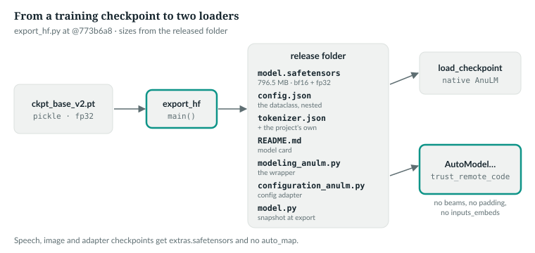
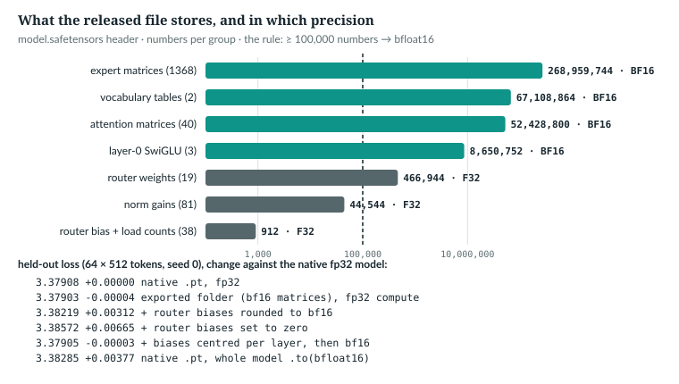

# 39  Exporting to the ecosystem

A training checkpoint is a pickled Python dict: a full unpickle of it can run
code (this repository loads it weights-only, Chapter 25), it needs this
repository's classes, and it holds the weights in 32-bit floats.
`anulm/hf/export_hf.py` turns it into a folder that anyone can download: weights in
safetensors, a JSON configuration, the tokenizer and a model card. Two thin
files let the Hugging Face `transformers` library load it, reusing
`anulm/model.py`'s modules instead of reimplementing them. This chapter reads the
exporter, the check it runs on every folder it writes, both loaders and the
wrapper, and measures what the export's 16-bit storage costs the released
model.

Prerequisites: checkpoints (Chapter 25), the KV cache (Chapter 27).

---

## 39.1  What a release folder holds

A release folder holds the weights in safetensors, a JSON configuration, the
tokenizer, a model card, and the three code files `transformers` needs to load
it. The released base model is published as `toonist/AnuLM-Base-v2-400M`
on the Hugging Face Hub. Its local copy:

```
5. release\AnuLM-Base-v2-400M (local copy; release/ is git-ignored)
           2,301  config.json
           3,124  configuration_anulm.py  differs from anulm/hf/configuration_anulm.py @fdbb09a
          61,044  model.py  differs from anulm/model.py @fdbb09a
     796,522,272  model.safetensors
          12,275  modeling_anulm.py  differs from anulm/hf/modeling_anulm.py @fdbb09a
           6,946  README.md
       1,533,692  tokenizer.json
         413,097  tokenizer.multi32k.json
             232  tokenizer_config.json
```

*measured*: `ch39_export_roundtrip.py --measure`. None of the three code files
matches the code this book quotes: the exporter copies the checkout as it was
on export day (39.3), so a release is a snapshot. A safetensors file is an
8-byte length, a JSON header naming each tensor's dtype, shape and offsets,
then the raw numbers (39.2 reads one): no pickle, so reading it runs no code.

> **Details.** The listing was made at an earlier pin and not rerun (it needs
> `release/` and `ckpt_base_v2.pt`); the two wrapper files have not changed
> since and `anulm/model.py` has, so each "differs" still holds. This release
> predates the `anulm/` package.



*Figure 39.1 · From a training checkpoint to two loaders.* *verified*: from
`anulm/hf/export_hf.py` at @fdbb09a and the folder listing above.

`IN THE REPO` · `MEASURED`

## 39.2  Weights: big tensors in 16 bits, small ones in 32

> **In the repo** · `anulm/hf/export_hf.py` · `to_bf16` · lines 52–61 · @fdbb09a

```python
def to_bf16(sd: dict[str, torch.Tensor]) -> dict[str, torch.Tensor]:
    """Weights to bfloat16; small floating tensors (norm gains, router
    biases) stay in float32 because they are cheap and precision-sensitive."""
    out = {}
    for k, v in sd.items():
        v = v.detach().cpu().contiguous()
        if v.is_floating_point() and v.numel() >= 100_000:
            v = v.to(torch.bfloat16)
        out[k] = v
    return out
```

The rule is by size: a floating tensor of 100,000 numbers or more becomes
bfloat16, anything smaller stays float32. Big matrices dominate the bytes;
small tensors cost nothing to keep exact. It is the default, not the only
choice:

> **In the repo** · `anulm/hf/export_hf.py` · `main` · lines 271–276 · @fdbb09a

```python
    n_params, sd, flat_groups = 0, None, {}
    if "model" in ck:
        sd = (to_bf16(ck["model"]) if args.weights_dtype == "mixed"
              else {k: v.detach().cpu().contiguous() for k, v in ck["model"].items()})
        save_file(sd, str(out / "model.safetensors"), metadata={"format": "pt", "exported_from": Path(args.ckpt).name})
        n_params = sum(v.numel() for v in sd.values())
```

`--weights-dtype` (lines 231–233) is `mixed` by default, which applies
`to_bf16`; `float32` writes every tensor as trained, for an export that must
match the `.pt` exactly, at twice the size. `sd` is kept: it is what the
parity check of 39.4 compares the written file against. The book example
exports a small model both ways:

```
   --weights-dtype float32: dtypes {'float32': 84}; every tensor equal to the .pt's: True; logits equal: True
   config.json weights_dtype: 'float32 on disk: every weight exactly as trained'; model.safetensors 1,751,736 bytes against 1,227,376 mixed
```

*verified*: `ch39_export_roundtrip.py`. The small model's two vocabulary
tables are most of its numbers, so the float32 file is 1.43 times the mixed
one, not twice. The released folder was exported with the default. On it:

```
6. model.safetensors: 796,522,272 bytes = 8 + 176,344 header + data
   F32:   138 tensors, 2,049,600 bytes = 512,400 numbers
   BF16:  1413 tensors, 794,296,320 bytes = 397,148,160 numbers
   float32 tensors by kind: {'norm gains': 81, 'router expert_bias': 19, 'router load_counts': 19, 'router weight': 19}; rule numel >= 100,000 <=> BF16 holds for every tensor
   numbers in all: 397,660,560; ckpt_base_v2.pt is 1,591,281,456 bytes, 2.00x the safetensors file
```

*measured*: the file's header only, read by `ch39_export_roundtrip.py`.

The float32 group is every norm gain and all three router tensors of the 19
MoE layers. The router *weight*, 24 × 1,024 = 24,576 numbers, falls under the
threshold too. The bfloat16 group is the 1,413 large matrices: 1,368 expert
matrices, 40 attention matrices, 3 for layer 0's SwiGLU and the two vocabulary
tables. The counts add up to the 397,660,560 numbers of Chapter 20's state
dict, buffers included, and the file is half the size of the `.pt`.

What 16 bits cost, on held-out text. The book example loads each variant with
`moe_impl="sparse"`, so every matrix multiply runs in float32 unless the
variant says otherwise (the checkpoint's own `grouped` path would run the
experts in bfloat16, Chapter 18). A forward hook on each router records which
experts it picks, to compare with the native model:

```python
    variants = [  # name, source, state-dict edit, run the whole model in bfloat16
        ("native .pt, fp32", ROOT / "ckpt_base_v2.pt", None, False),
        ("exported folder (bf16 matrices), fp32 compute", RELEASE, None, False),
        ("  + router biases rounded to bf16", RELEASE, lambda sd: bias(sd, bf), False),
        ("  + router biases set to zero", RELEASE, lambda sd: bias(sd, torch.zeros_like), False),
        ("  + biases centred per layer, then bf16", RELEASE, lambda sd: bias(sd, lambda v: bf(v - v.mean())), False),
        ("native .pt, whole model .to(bfloat16)", ROOT / "ckpt_base_v2.pt", None, True),
    ]
```

```
   router biases, 19 layers: mean 216.0 to 798.1; spread (max - min) 0.018 to 0.281; distinct values per layer after bf16 rounding: 1 to 2 (of 24)
   native .pt, fp32                               loss 3.37908 (+0.00000); expert sets changed: median layer 0.0%, max 0.0%
                                                  greedy, 8 prompts x 128 tokens: distinct-token share 0.218
   exported folder (bf16 matrices), fp32 compute  loss 3.37903 (-0.00004); expert sets changed: median layer 0.9%, max 1.5%
     + router biases rounded to bf16              loss 3.38219 (+0.00312); expert sets changed: median layer 50.9%, max 99.4%
     + router biases set to zero                  loss 3.38572 (+0.00665); expert sets changed: median layer 51.8%, max 99.4%
     + biases centred per layer, then bf16        loss 3.37905 (-0.00003); expert sets changed: median layer 1.1%, max 2.9%
   native .pt, whole model .to(bfloat16)          loss 3.38285 (+0.00377); expert sets changed: median layer 50.9%, max 99.4%
                                                  greedy, 8 prompts x 128 tokens: distinct-token share 0.227
   graded tokens per variant: 32,732
```

*measured*: on the windows of Appendix F, F.6, except that the experts run in
float32 on `sparse`, so the native loss is 3.37908 rather than Chapter 20's
3.37895 (both round to 3.379); one sample, one seed. Greedy prompts are the
first 64 tokens of 8 of those windows; only statistics are printed. Saved in
`book/measurements/part_viii_ix_export.json`.

> **Details.** The windows are 64 of 512 tokens of `data/v2/val.u16`, seed 0.
> These numbers ran on the GPU; a CPU rerun (2026-11-03) moved each loss by at
> most 0.00005.

Three readings:

- **Storing the matrices in bfloat16 is free here**: −0.00004 nats.
- **Rounding the router biases erases them.** Each layer's 24 biases sit
  together around a large common value, 216 to 798, and differ by at most
  0.281. At that size bfloat16 keeps too few bits to tell them apart: they
  round to one or two values per layer, which is the same as no bias at all.
  About half the expert choices change, and the loss rises 0.003 nats; zeroing
  the biases costs 0.007. Centring each layer's biases first makes the
  rounding free, and the centring itself changes no choice, since top-k
  ignores a shift shared by every expert.
- **A whole-bfloat16 model does not collapse.** Casting every parameter and
  buffer to bfloat16 and computing in it cost 0.004 nats, and greedy
  continuations do not fall into one repeated token: their distinct-token
  share was 0.227 on the GPU and 0.187 on the CPU, against the float32 model's
  0.218. On the CPU they repeat somewhat more.



*Figure 39.2 · What the released file stores.* Per group of tensors, on a
logarithmic axis. *measured*: `book/measurements/part_viii_ix_export.json`.

> **Details.** Keeping the small tensors in float32 remains the safe choice,
> since it is exact and costs 2 MB. An export that must reproduce the `.pt`
> bit for bit uses `--weights-dtype float32`, and its `config.json` says so
> in `weights_dtype`. The exporter's comment (lines 328–331) and the wrapper's
> warning (39.6) predict a worse outcome than the one measured here.

`IN THE REPO` · `MEASURED` · `IMPLEMENTATION-DEPENDENT` (bfloat16 greedy text)

## 39.3  The configuration, and the code that travels with it

> **In the repo** · `anulm/hf/export_hf.py` · `main` · lines 313–362 · @fdbb09a

```python
    if cfg is not None:
        cfg_d = dataclasses.asdict(cfg)
        cfg_d["tokenizer_path"] = tok_file  # resolved relative to the folder by load_checkpoint
        meta.update({
            "architectures": ["AnuLMForCausalLM"],
            # trust_remote_code: transformers fetches these two modules from the
            # repo, and they pull model.py down with them.
            "auto_map": {
                "AutoConfig": "configuration_anulm.AnuLMConfig",
                "AutoModelForCausalLM": "modeling_anulm.AnuLMForCausalLM",
            },
            # ...
            "config": cfg_d,
            # ...
            "dtype": "float32",
            "torch_dtype": "float32",
            # ...
        })
    if args.kind != "lm":
        # Not a plain language model: transformers' AutoModelForCausalLM
        # would load the backbone and silently drop what makes it this model.
        for k in ("architectures", "auto_map"):
            meta.pop(k, None)
        meta["kind"] = args.kind
    # ...
    if args.kind == "lm":
        for mod in ("configuration_anulm.py", "modeling_anulm.py", "model.py"):
            shutil.copyfile(Path(__file__).resolve().parents[1 if mod == "model.py" else 0] / mod, out / mod)
```

Three choices:

- **The whole dataclass, nested.** `config` is `AnuLMConfig` field for field,
  so nothing is renamed. The tokenizer path is made relative to the folder.
- **Load in float32.** `dtype` tells `transformers` to build the model in
  float32, whatever the file stores; the comment gives the router as the
  reason (39.2 measures it). The elided `weights_dtype` entry is a note for
  readers: mixed storage and the advice to load in float32, or, with
  `--weights-dtype float32`, "every weight exactly as trained".
- **`auto_map` only for plain language models.** `transformers` loads the
  classes it names, from the files copied beside the weights, when the caller
  passes `trust_remote_code=True`. A speech or image checkpoint has no
  `auto_map`, so `AutoModelForCausalLM` cannot load it as a text model and
  silently drop its projector. Its projector and other extras go to
  `extras.safetensors` instead (lines 287–293).

`IN THE REPO`

## 39.4  Loading it back without `transformers`

`load_checkpoint` accepts a `.pt`, a folder or a Hub id:

> **In the repo** · `anulm/model.py` · `load_checkpoint` · lines 1296–1319 · @fdbb09a

```python
    p = _P(path)
    if not p.exists() and re.fullmatch(_HUB_ID, str(path).replace("\\", "/")):
        # Say so: a typo in a local path otherwise turns into a confusing
        # network error about a repository that does not exist.
        print(f"{path}: not found locally, trying the Hugging Face Hub")
        from huggingface_hub import snapshot_download
        p = _P(snapshot_download(str(path).replace("\\", "/")))
    if not p.is_dir():
        return safe_load(p, map_location)
    from safetensors.torch import load_file
    dev = map_location if isinstance(map_location, str) else str(map_location)
    meta = json.loads((p / "config.json").read_text(encoding="utf-8"))
    ck = {}
    if "config" in meta:
        cfg_d = dict(meta["config"])
        if cfg_d.get("tokenizer_path"):
            cfg_d["tokenizer_path"] = _inside(p, cfg_d["tokenizer_path"], "tokenizer_path")
        known = {f.name for f in dataclasses.fields(AnuLMConfig)}
        ck["cfg"] = AnuLMConfig(**{k: v for k, v in cfg_d.items() if k in known})
    if (p / "model.safetensors").exists():
        ck["model"] = load_file(str(p / "model.safetensors"), device=dev)
    for k in ("step", "val_loss", "qa_templates", "base_ckpt"):
        if meta.get(k) is not None:
            ck[k] = meta[k]
```

A string shaped `owner/name` (`_HUB_ID`, line 1261) that is not a local path
is downloaded first, and the loader prints that it is trying the Hub, so a
mistyped local path is not a silent download. A file goes to `safe_load`, the
weights-only unpickler of Chapter 25: a `.pt` from elsewhere cannot run code
on load. A folder is rebuilt into the same dict a `.pt` holds: `cfg`, with
unknown fields dropped so an older `anulm/model.py` can read a newer export,
and `model`, the tensors in their stored dtypes. `load_state_dict` copies them
into the float32 model, so bfloat16 becomes float32 on the way in. The test
`an_exported_folder_loads_everywhere_a_pt_does` (`tests/test_model.py` line 924)
holds the round trip, and checks that eleven named scripts (lines 970–972) call
`load_checkpoint` rather than `torch.load`; scripts outside that list are not
checked.

A downloaded folder is untrusted data too. Its `config.json` names paths the
loader follows: the tokenizer, an encoder shipped inside the folder, and the
backbone of an adapter-only folder. The loader refuses any path that is
absolute, contains `..`, or resolves outside the folder through a symlink;
the backbone must be a Hub id, `owner/name`, never a local path; and the
exporter refuses to write a folder its own loader would refuse.

> **Details.** The three paths are `config.tokenizer_path`,
> `extras.hf_backbone` (an open encoder shipped inside the folder) and
> `extras.base_model` (the backbone of an adapter-only folder). Each must stay
> inside the folder:
>
> **In the repo** · `anulm/model.py` · `_inside` · lines 1264–1277 · @fdbb09a
>
> ```python
> def _inside(root, value: str, what: str) -> str:
>     # ...
>     from pathlib import Path as _P, PurePosixPath, PureWindowsPath
>     v = str(value)
>     if (PureWindowsPath(v).anchor or PurePosixPath(v.replace("\\", "/")).is_absolute()
>             or ".." in PurePosixPath(v.replace("\\", "/")).parts):
>         raise ValueError(f"{root}/config.json: {what} {v!r} must be a relative path inside the folder")
>     full = _P(root) / v
>     # Resolve too, so a symlink inside the folder cannot lead out of it.
>     if not full.resolve().is_relative_to(_P(root).resolve()):
>         raise ValueError(f"{root}/config.json: {what} {v!r} resolves outside the folder")
>     return str(full)
> ```
>
> Two tests around a join. The first refuses a drive or root (`C:/…`, `/etc/…`)
> and any `..` part, on either slash. The second resolves the joined path,
> following symlinks, and requires it still to lie under the folder. The
> exporter writes `tokenizer_path` and `hf_backbone` as bare relative names, so
> its own folders pass. `base_model` is checked harder, because the loader
> fetches it:
>
> **In the repo** · `anulm/model.py` · `load_checkpoint` · lines 1328–1340 · @fdbb09a
>
> ```python
>     if "model" not in ck and base and extras.get("base_model"):
>         # base_model comes from an untrusted config.json: a Hub id only, never
>         # a local path, and its side-by-side copy must sit beside this folder.
>         bm = str(extras["base_model"])
>         side = p.parent / bm.split("/")[-1]                     # downloaded side by side: no fetch
>         # The Hub forbids ".." and a leading or trailing "." in a name, so
>         # "../x" or "a/.." is never a real id -- only a way out of the folder.
>         if (not re.fullmatch(_HUB_ID, bm) or ".." in bm
>                 or any(part.startswith(".") or part.endswith(".") for part in bm.split("/"))
>                 or side.resolve().parent != p.parent.resolve()):
>             raise ValueError(f"{p}/config.json: extras.base_model {bm!r} is not a Hugging Face "
>                              f"Hub id (owner/name)")
>         b = load_checkpoint(side if side.is_dir() else bm, map_location)
> ```
>
> `base_model` must be exactly `owner/name`, never a local path. If a folder
> named `name` sits beside the adapter folder, it is used without a download;
> otherwise the id is fetched. The exporter enforces the same rule when it
> writes one: `--adapter-of` without `--base-model`, or a `--base-model` that is
> not `owner/name`, is a usage error (`p.error`), so an export cannot produce a
> folder its own loader would refuse:
>
> **In the repo** · `anulm/hf/export_hf.py` · `main` · lines 254–259 · @fdbb09a
>
> ```python
>     if args.adapter_of:
>         if not args.base_model:
>             p.error("--adapter-of needs --base-model (the Hub id the backbone is fetched from)")
>         if not re.fullmatch(r"[\w.-]+/[\w.-]+", args.base_model):
>             # load_checkpoint accepts nothing else from a folder's config.json
>             p.error(f"--base-model {args.base_model!r} is not a Hugging Face Hub id (owner/name)")
> ```
>
> `tests/test_quality_loading.py`'s `FolderContainment` (lines 144–215) feeds
> the loader `../outside.json`, `/etc/passwd`, `C:/Windows/win.ini` and
> `..\outside.json` as a tokenizer path, two escapes as an encoder folder, and
> a local path, `../secret`, `a/..` and `a/b/c` as a base model, and requires a
> `ValueError` for each; a side-by-side base and an inside tokenizer path still
> load, and the Hub message is printed.

Every export reads itself back through this loader before it reports success.
The last step of `main` (lines 378–379) calls `check_parity` unless
`--skip-parity` is given:

> **In the repo** · `anulm/hf/export_hf.py` · `check_parity` · lines 115–140 · @fdbb09a

```python
def check_parity(out: Path, weights: dict | None, groups: dict, tok_src: Path | None, tok_file: str | None) -> None:
    # ...
    back = load_checkpoint(str(out), "cpu", base=False)
    bad = []
    for name, want, got in [("model", weights, back.get("model"))] + \
            [(g, sd, back.get(g)) for g, sd in groups.items()]:
        if want is None:
            continue
        if not isinstance(got, dict) or set(got) != set(want):
            bad.append(f"{name}: tensor names differ")
            continue
        bad += [f"{name}/{k}" for k, v in want.items()
                if got[k].dtype != v.dtype or not torch.equal(got[k], v.detach().cpu())]
    if tok_src is not None and tok_file:
        from anulm.hf_tok import load_tokenizer
        a, b = load_tokenizer(tok_src), load_tokenizer(out / tok_file)
        bad += [f"tokenizer: {t[:20]!r}" for t in PARITY_TEXTS if a.encode(t) != b.encode(t)]
    if bad:
        raise SystemExit(f"export parity FAILED for {out}: {len(bad)} mismatch(es), e.g. {', '.join(bad[:5])}")
    n = len(weights or {}) + sum(len(sd) for sd in groups.values())
    print(f"  parity: reloaded {n} tensors bit-identical to what was written"
          + (", tokenizer agrees on sample text" if tok_file else ""))
```

In order:
- **`back`**: the folder, loaded the way every script loads it. `base=False`
  stops an adapter-only folder from fetching its backbone.
- **The loop**: the backbone's state dict, `weights`, then every extra group
  (projector, LoRA, heads). For each, the tensor names must match, then each
  tensor's dtype and every value (`torch.equal`, not a tolerance).
- **The tokenizer**: the checkpoint's own and the copied file must encode the
  three `PARITY_TEXTS` (line 112: English, Hindi, Python) to the same ids.
- **The verdict**: any mismatch ends the export with `SystemExit` naming up to
  five; otherwise one line reports the count.

`weights` is `sd`, the tensors *meant* to be written, so with the default the
check compares against the bfloat16-rounded matrices: it proves the file holds
what the exporter intended, not that it equals the `.pt`. Only a
`--weights-dtype float32` export also equals the `.pt`. The book example's
small export prints:

```
   it printed: parity: reloaded 84 tensors bit-identical to what was written
```

*verified*: `ch39_export_roundtrip.py` (the small model has no tokenizer, so the
tokenizer clause is absent).

`IN THE REPO`

## 39.5  The `transformers` wrapper reuses the real modules

> **In the repo** · `anulm/hf/modeling_anulm.py` · `AnuLMForCausalLM.__init__` · lines 155–167 · @fdbb09a

```python
    def __init__(self, config: AnuLMConfig):
        super().__init__(config)
        native = config.to_native()
        core = NativeAnuLM(native)
        # Adopt the real modules under their own names. `embed_tokens`,
        # `layers`, `norm` and `lm_head` are exactly the top-level names in
        # model.safetensors; `rotary` holds only non-persistent buffers.
        self.cfg = native
        self.embed_tokens = core.embed_tokens
        self.rotary = core.rotary
        self.layers = core.layers
        self.norm = core.norm
        self.lm_head = core.lm_head
```

`to_native()` (`anulm/hf/configuration_anulm.py` lines 75–78) hands back the
dataclass. The wrapper builds a native `AnuLM` and adopts its modules under the
same attribute names, so the parameter names match the file and no key is
remapped. Only the outer loop is new:

> **In the repo** · `anulm/hf/modeling_anulm.py` · `AnuLMForCausalLM.forward` · lines 220–255 · @fdbb09a

```python
        if inputs_embeds is not None:
            raise NotImplementedError("AnuLM takes input_ids, not inputs_embeds")
        start = past_key_values.seen if past_key_values is not None else 0
        cache = past_key_values.layers if past_key_values is not None else None
        # ...
        x = self.embed_tokens(input_ids)
        cos, sin = self.rotary(S, x.device, x.dtype, start=start)
        for i, layer in enumerate(self.layers):
            # ...
                x, aux = layer(x, cos, sin, cache[i] if cache is not None else None, start)
        x = self.norm(x)
        logits = self.lm_head(x)

        loss = None
        if labels is not None:
            loss = F.cross_entropy(
                logits[:, :-1].reshape(-1, logits.size(-1)).float(),
                labels[:, 1:].reshape(-1), ignore_index=-100)
        # ...
        if use_cache:
            if past_key_values is None:
                past_key_values = AnuLMCache([dict() for _ in self.layers])
            past_key_values.seen = start + S
            present = past_key_values
```

Three differences from `AnuLM.forward`, each to fit `transformers`:

- **Logits for every position**, (B, S, V). The native forward returns only
  the last position without targets (Chapter 20).
- **Labels are shifted here**, and −100 is ignored. Native callers pass targets
  already shifted, with −1 (Chapter 20).
- **The cache is the native one.** `AnuLMCache` wraps the list of per-layer
  dicts and counts `seen` tokens, the absolute `start` of Chapter 27. MLA
  caches a latent, not keys and values, so `transformers`' own cache would not
  fit (lines 257–272).

The book example exports a small model with `export_hf.main()` and loads it
both ways, then compares:

```python
    hf = AnuLMForCausalLM.from_pretrained(str(folder), dtype=torch.float32).eval()
    ck = M.load_checkpoint(str(folder))
    nat = M.AnuLM(ck["cfg"]).eval()
    nat.load_state_dict(ck["model"])                      # the same bf16-rounded weights as hf
    x = torch.randint(0, native.cfg.vocab_size, (1, 24))
    with torch.no_grad():
        full = hf(input_ids=x).logits
        last, _ = nat(x)
        hf_loss = hf(input_ids=x, labels=x).loss
        _, nat_loss = nat(x[:, :-1], x[:, 1:])
```

```
3. AnuLMForCausalLM.from_pretrained(folder): logits (1, 24, 2048) (every position), native (1, 1, 2048)
   last-position difference 1.8e-07; loss with labels=x 7.649740, native with shifted targets 7.649740
   greedy 12 tokens equal: True
```

*verified*: `ch39_export_roundtrip.py`. The test
`transformers_wrapper_matches_the_native_model` (`tests/test_model.py` line 1285)
holds the same, cached and uncached.

> **Details.** The rotary tables are buffers registered as non-persistent, so
> they are not in the file. `transformers` builds the model on the `meta`
> device and fills in what the file lacks with uninitialised memory; the
> wrapper once loaded every weight correctly and computed with noise for
> positions. `rebuild_rotary` (lines 91–109) recomputes the tables after every
> `from_pretrained`, and the test checks them.

`IN THE REPO`

## 39.6  What the wrapper does not do

> **In the repo** · `anulm/hf/modeling_anulm.py` · `AnuLMForCausalLM._reorder_cache` · lines 284–291 · @fdbb09a

```python
    @staticmethod
    def _reorder_cache(past_key_values, beam_idx):
        # Beam search would have to reorder every tensor each attention module
        # put in its dict, and nothing here has been tested against it.
        raise NotImplementedError(
            "beam search is not supported; use greedy or sampling "
            "(num_beams=1), which is how every number in docs/RESULTS.md "
            "was measured")
```

- **No beam search**: the cache's dicts are not reordered.
- **No padding mask**: `attention_mask` is accepted and ignored (docstring,
  lines 212–218), so a left-padded batch is wrong. Send one sequence at a time.
- **No `inputs_embeds`**: the speech and image models load through this
  repository's own code (Chapter 36), not `AutoModelForCausalLM`.
- **16-bit loading warns**, in `from_pretrained`:

> **In the repo** · `anulm/hf/modeling_anulm.py` · `AnuLMPreTrainedModel.from_pretrained` · lines 111–134 · @fdbb09a

```python
    @classmethod
    def from_pretrained(cls, *args, **kwargs):
        model = super().from_pretrained(*args, **kwargs)
        model.rebuild_rotary(device=next(model.parameters()).device)
        dtype = next(model.parameters()).dtype
        if dtype in (torch.bfloat16, torch.float16):
            warnings.warn(
                f"AnuLM loaded with {dtype} weights. This model does not "
                "survive that: the aux-loss-free router keeps a per-expert "
                "bias whose differences decide which experts fire, and "
                "rounding it to 16 bits changes the routing -- the output "
                "degrades to repeated tokens rather than getting slightly "
                "worse. The export keeps those tensors in float32 for this "
                "reason. Load with dtype=torch.float32 (the default) and use "
                "torch.autocast for speed, which is how every number in the "
                "model card was measured.",
                RuntimeWarning, stacklevel=2)
        return model
```

  The load rebuilds the rotary tables, then checks the first parameter's dtype.
  The warning's mechanism is right, since rounding does erase the bias
  differences, but its outcome is not: 39.2 measured 0.004 nats, not repeated
  tokens.

```
4. refusals: inputs_embeds: AnuLM takes input_ids, not inputs_embeds
             bfloat16 load: RuntimeWarning 'AnuLM loaded with torch.bfloat16 weights. This model does ...'
```

*verified*: `ch39_export_roundtrip.py`.

> **Build it.** The lab book's Chapter 15 (`course/ch15-shipping`) exports
> your own model and decides whether it is fit to release.

`IN THE REPO`

## 39.7  Exercises

1. A model has D = 512 and V = 1,000. Which of its vocabulary tables does
   `to_bf16` store in bfloat16?
2. Why does the exporter copy `anulm/model.py` into the folder, and what is the
   risk?
3. A caller passes `labels=targets` where `targets` is already shifted. What
   does the wrapper compute?

**Answers.** 1. Both: 1,000 × 512 = 512,000 ≥ 100,000. 2. `trust_remote_code`
needs the module beside the weights; the copy freezes the code at export time,
so a later fix to `anulm/model.py` does not reach the release. 3. It shifts again
and grades each position against the token two ahead.

*verified*: answer 1 is arithmetic on `to_bf16`'s threshold.

---

## Key points

- `anulm/hf/export_hf.py` writes safetensors weights, a JSON config with the whole
  native dataclass, the tokenizer, a card and the code `transformers` needs,
  then reloads the folder and requires every tensor to be bit-identical.
- By default tensors of 100,000 numbers or more are stored in bfloat16; norm
  gains and all router tensors stay float32, and the folder is half the `.pt`'s
  size. `--weights-dtype float32` keeps every tensor as trained.
- On held-out text bfloat16 storage moved the loss by −0.00004 nats. Rounding
  the router biases erases them and changes about half the expert choices, yet
  cost only 0.003 nats; a whole-bfloat16 model cost 0.004 and did not collapse.
- `load_checkpoint` turns a folder or Hub id into the same dict a `.pt` gives,
  reads a `.pt` weights-only, and refuses folder paths that lead outside the
  folder or a `base_model` that is not a Hub id.
- The `transformers` wrapper adopts `anulm/model.py`'s modules by name, returns every
  position's logits, shifts labels itself and carries the native cache.
- It has no beam search, no padding mask and no `inputs_embeds`, and it warns
  on 16-bit loading.

> **In one breath.** By default the exporter stores big matrices in bfloat16
> and every norm and router tensor in float32, which costs the released model
> nothing measurable (the biases would otherwise round away), and checks the
> folder bit for bit; one loader reads `.pt`, folder or Hub id alike, and a thin
> `transformers` wrapper reuses the native modules, so its tokens match the
> repository's own.

## References

This chapter cites no external research. Its evidence is the repository at
@fdbb09a, the local release folder and the measurements:
- `anulm/hf/export_hf.py`: `to_bf16` 52–61, `PARITY_TEXTS` 112, `check_parity`
  115–140, `tensor_groups` 143–147, `main` 211–383 (`--weights-dtype` 231–233,
  `--base-model` checks 254–259, weights 271–293, config 313–357, code copy
  360–362, parity 378–379).
- `anulm/model.py`: `safe_load` 1228–1258, `_HUB_ID` 1261, `_inside` 1264–1277,
  `load_checkpoint` 1280–1342 (`base_model` 1328–1340).
- `anulm/hf/configuration_anulm.py`: `AnuLMConfig` 34–84.
- `anulm/hf/modeling_anulm.py`: `AnuLMCache` 45–70, `AnuLMPreTrainedModel` 73–143,
  `AnuLMForCausalLM` 146–291.
- `tests/test_model.py`: `an_exported_folder_loads_everywhere_a_pt_does` 924,
  `transformers_wrapper_matches_the_native_model` 1285.
- `tests/test_quality_loading.py`: `FolderContainment` 144–215.
- `release/AnuLM-Base-v2-400M/` (git-ignored local copy of
  huggingface.co/toonist/AnuLM-Base-v2-400M).
- Book example and measurements: `book/code-examples/ch39_export_roundtrip.py`,
  `book/measurements/part_viii_ix_export.json`.
