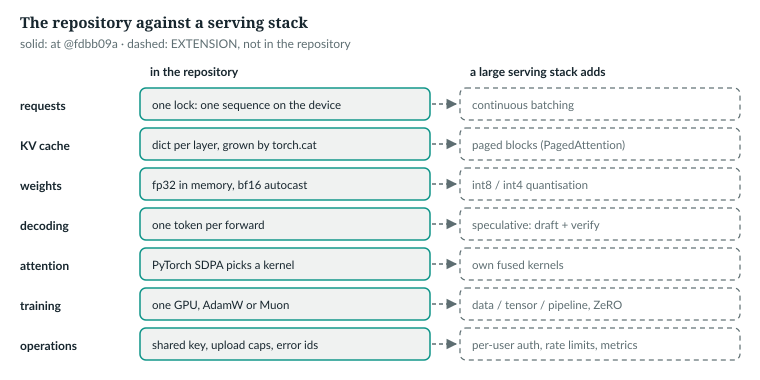
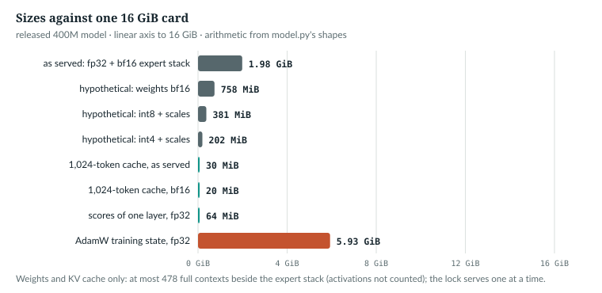

# 40  The production gap

> **Current companion update, 2 November 2026:** See the [current workflow](../docs/reader/current-workflow.md) and [language coverage](../docs/reader/language-coverage.md) for revised setup, training, evaluation and limitations. This chapter's cited implementation and numerical results remain historical; new workflow checks do not clear its open release gates.

Chapter 38's server runs one sequence at a time behind one lock. A large
serving stack shares the device between many requests, stores weights in
fewer bits, guesses several tokens per step and trains on many GPUs. **None of
that is in this repository.** This chapter names each piece, cites where it
comes from, and works out what it would face on the released 400M model, with
numbers printed by `ch40_gap_arithmetic.py` from `model.py`'s own shapes.

Prerequisites: the KV cache (Chapter 27), precision (Chapter 23), serving
(Chapter 38).

---

## 40.1  What the repository has: one sequence, one growing cache

> **In the repo** · `model.py` · `AnuLM.new_cache` · lines 818–820 · @773b6a8

```python
    def new_cache(self) -> list[dict]:
        """One dict per layer; each attention module owns its own entries."""
        return [dict() for _ in self.layers]
```

> **In the repo** · `model.py` · `GQAttention.forward` · lines 441–447 · @773b6a8

```python
        if cache is not None:
            # Cache the Hkv heads, not their H broadcast copies -- that ratio
            # (16:1 in the real 30B) is GQA's entire inference saving.
            if "k" in cache:
                k = torch.cat([cache["k"], k], dim=2)
                v = torch.cat([cache["v"], v], dim=2)
            cache["k"], cache["v"] = k, v
```

`torch.cat` allocates a new tensor and copies the old cache into it, at every
step, in every layer. When the context is full, `generate` throws the cache
away and rebuilds it from the last `block_size` tokens:

> **In the repo** · `model.py` · `AnuLM.generate` · lines 1083–1090 · @773b6a8

```python
        for _ in range(max_new_tokens):
            if not use_cache:
                logits, _ = self(idx[:, -bs:])
            else:
                if cache is None or start + pending.shape[1] > bs:
                    cache, start, pending = self.new_cache(), 0, idx[:, -bs:]
                logits, _ = self(pending, cache=cache, start=start)
                start += pending.shape[1]
```

The book example checks the per-token size against a real cache, then applies
it to the released model:

```python
def kv_per_token(cfg, bytes_per: int) -> int:
    return cfg.n_layer * 2 * cfg.n_kv_head * cfg.head_dim * bytes_per


def check_cache_formula() -> None:
    cfg = tiny()
    m = M.AnuLM(cfg).eval()
    cache = m.new_cache()
    with torch.no_grad():
        m(torch.randint(0, 64, (1, 20)), cache=cache, start=0)
    held = sum(t.numel() * t.element_size() for layer in cache for t in layer.values())
# ...
    served = kv["autocast (fp32 keys, bf16 values)"]
    copied = sum(t * served for t in range(1, ctx + 1))
```

```
1. tiny(): cache after 20 tokens holds 7,680 bytes = 20 x 384 (formula L*2*Hkv*Dh*4 = 384)
   released: 20,480 B/token in bf16, 30,720 under autocast, 40,960 in fp32; a full 1,024-token context = 20 MiB (bf16), 30 MiB as served

2. growing the cache with torch.cat over 1,024 steps copies 16.12 GB as served (10.75 GB in bf16), against 31.5 MB (30 MiB) if each step wrote only its own token
```

*verified* against `tiny()`'s cache. As served (fp32 weights, bf16 autocast)
the cache holds fp32 keys and bf16 values, 30 KiB per token (Chapter 20); the
bf16 figures are a hypothetical bf16 cache. MB and MiB are decimal and binary
units of the same bytes. The copying's effect on speed is *not measured here*.

Every request then runs alone, under the API's single lock:

> **In the repo** · `api.py` · `Generation.run` · lines 382–389 · @773b6a8

```python
        with GPU:
            if self.seed is not None:
                torch.manual_seed(self.seed)
            with torch.no_grad(), torch.autocast("cuda", dtype=torch.bfloat16,
                                                 enabled=self.eng.device.startswith("cuda")):
                self.eng.model.generate(x, self.max_tokens, temperature=max(self.temperature, 1e-3),
                                        top_k=self.top_k or None, eos_id=eos,
                                        repetition_penalty=self.rep, on_token=on_token)
```

One sequence, `x` of shape (1, S), holds the lock for its whole reply.

`IN THE REPO`

## 40.2  Paged KV cache and continuous batching

PagedAttention divides the KV cache into blocks of a fixed number of tokens,
in the vLLM serving system [R46], so memory can be reserved a block at a time.
A second technique usually comes with it, continuous batching: requests join
and leave the running batch between decoding steps. The register has no source
for it yet. Both are absent here. With made-up request lengths:

```python
    rng = np.random.default_rng(0)
    lens = rng.integers(16, ctx + 1, size=1000)
    block = 16
    contiguous = len(lens) * ctx
    paged = int(sum(math.ceil(n / block) * block for n in lens))
    used = int(lens.sum())
```

```
4. 1,000 requests, lengths uniform in [16, 1024] (seed 0, illustrative): tokens used 536,109
   reserved: contiguous 1,024,000 (47.6% idle); pages of 16: 543,488 (1.4% idle)
```

*illustrative*. A weights-and-cache budget gives an upper bound: as served,
495 full contexts fit on 16 GiB beside the fp32 weights, 478 beside the grouped
path's bf16 copy of the experts too (40.3). This excludes prefill activations,
kernel workspaces, allocator effects and other runtime memory. It is not a
measured concurrency limit. The current lock serialises requests; measure
latency, throughput and peak memory on the intended workload before deciding
whether batching is the next improvement.



*Figure 40.1 · The repository against a serving stack.* Dashed boxes are
`EXTENSION`s. *verified*: from `model.py`, `serve.py` and `api.py` at @773b6a8.

`NOT IN THE REPO` · `EXTENSION`

## 40.3  Quantisation

Quantisation stores weights in fewer bits, with a scale per group to map the
integers back. Four formats, sized from the released shapes:

```python
    with torch.device("meta"):
        m = M.AnuLM(cfg)
    total, active = m.num_params()
    mats = [p for n, p in m.named_parameters() if p.dim() == 2]
    rows = sum(p.shape[0] for p in mats)
    n_mat = sum(p.numel() for p in mats)
    other = total - n_mat
    card = 16 * GiB
    w = {"fp32": 4 * total, "bf16": 2 * total,
         "int8 (per-row fp16 scales)": n_mat + 2 * rows + 4 * other,
         "int4 (fp16 scale per 64 weights)": n_mat // 2 + 2 * (n_mat // 64) + 4 * other}
# ...
    experts = sum(p.numel() for n, p in m.named_parameters() if ".experts." in n)
    stack = 2 * experts                                   # MoE._stacked_weights: a bf16 copy for grouped_mm
    as_served = int((card - w["fp32"]) // (ctx * served))
    with_stack = int((card - w["fp32"] - stack) // (ctx * served))
```

The serving engine picks the grouped expert path on CUDA (Chapter 38), and that
path keeps a second, bf16 copy of every expert's matrices beside the fp32
weights:

> **In the repo** · `model.py` · `MoE._stacked_weights` · lines 712–719 · @773b6a8

```python
        key = sum(p._version for e in self.experts for p in e.parameters())
        if not self.training and self._stacked is not None and self._stacked[0] == key:
            return self._stacked[1]
        stacked = tuple(
            torch.stack([getattr(e, name).weight.t() for e in self.experts]).to(torch.bfloat16)
            for name in ("gate_proj", "up_proj", "down_proj"))
        self._stacked = (key, stacked) if not self.training else None
        return stacked
```

In evaluation the stacked copy is cached until a weight changes, so as served
the experts occupy memory twice: fp32 parameters plus 0.54 GB of bf16.

```
3. 397,659,648 parameters; 397,615,104 in 1432 matrices with 765,896 rows; 44,544 in vectors
   fp32                                1.591 GB   full bf16 contexts beside it on 16 GiB: 743
   bf16                                0.795 GB   full bf16 contexts beside it on 16 GiB: 781
   int8 (per-row fp16 scales)          0.399 GB   full bf16 contexts beside it on 16 GiB: 800
   int4 (fp16 scale per 64 weights)    0.211 GB   full bf16 contexts beside it on 16 GiB: 809
   as served: fp32 weights, 30,720 B/token of cache: 495 full contexts on 16 GiB; 478 with the grouped path's bf16 expert stack (0.54 GB)
```

*illustrative* formats, *verified* arithmetic: four hypothetical deployments
with a bf16 cache, then the model as served. QLoRA's 4-bit NormalFloat (NF4)
is one published 4-bit format [R33]. The quality cost is *not measured here*,
but Chapter 39 found a trap: the router biases share a large offset, so plain
bf16 rounding erases their differences, changing about half the expert
choices for 0.003 nats; centring them first made it free. The only quantised
component here is borrowed:

> **In the repo** · `audio_codec.py` · `WhisperEncoder.__init__` · lines 214–218 · @773b6a8

```python
        if compute_type is None:
            compute_type = "float16" if device.startswith("cuda") else "int8"
        self.ct2 = ctranslate2
        self.size, self.device = size, device
        self.whisper = WhisperModel(size, device=device, compute_type=compute_type)
```

On a CPU, Whisper's frozen encoder runs in int8 (Chapter 36). AnuLM's own
weights are never quantised.



*Figure 40.2 · A 16 GiB card for the released model*, as served and in
hypothetical lower precisions. *verified* arithmetic from
`ch40_gap_arithmetic.py`.

`NOT IN THE REPO` · `IN THE REPO` (int8 Whisper only)

## 40.4  Speculative decoding

Each `generate` step runs the whole model for one token. In speculative
decoding a small draft proposes tokens that the large model checks in one
pass, which decoded T5-XXL 2–3 times faster with identical outputs [R47];
speculative sampling also gets several tokens per target call [S10]. Neither
exists here.

If each of γ drafted tokens is accepted independently with probability α, and
the target adds one token after the accepted run, a call yields on average the
geometric sum 1 + α + … + α<sup>γ</sup>:

```python
    spec = {}
    for a in (0.6, 0.8, 0.9):
        e = (1 - a ** 5) / (1 - a)                       # gamma = 4: expected accepted + 1 corrected
        spec[str(a)] = round(e, 3)
        print(f"   alpha {a}: {e:.2f} tokens per target call (gamma 4)")
```

```
   alpha 0.6: 2.31 tokens per target call (gamma 4)
   alpha 0.8: 3.36 tokens per target call (gamma 4)
   alpha 0.9: 4.10 tokens per target call (gamma 4)
```

*illustrative*: no α is measured; the draft's cost comes off these counts.

`NOT IN THE REPO`

## 40.5  Attention kernels

> **In the repo** · `model.py` · `_sdpa` · lines 393–397 · @773b6a8

```python
def _sdpa(q, k, v, mask, S, scale, dropout_p):
    return F.scaled_dot_product_attention(
        q, k, v, attn_mask=mask, is_causal=(mask is None and S > 1),
        scale=scale, dropout_p=dropout_p,
    )
```

PyTorch picks among FlashAttention-2, a memory-efficient kernel and a C++
reference, the optimised ones on CUDA only [R50]. FlashAttention computes exact
attention in tiles, cutting GPU memory traffic [R29]; FlashAttention-2 improves
its parallelism [S08]. What a tiled kernel never writes out:

```python
    scores = cfg.n_head * ctx * ctx * 4
```

```
6. one layer's scores for one 1,024-token sequence: H x S x S x 4 B = 64 MiB in fp32; x 20 layers = 1.25 GiB if all were kept
```

*verified* arithmetic. That is the documentation. On this machine Chapter 11
(11.9) observed PyTorch 2.11 choosing a fused flash kernel even on the CPU,
for causal and boolean-mask calls. A fused kernel may already run; the
repository neither chooses nor writes one.

`IN THE REPO` (the SDPA call) · `IMPLEMENTATION-DEPENDENT`

## 40.6  Distributed training

`train.py` builds one optimizer for one device:

> **In the repo** · `train.py` · `make_optimizer` · lines 326–334 · @773b6a8

```python
    fused = args.device.startswith("cuda") and "fused" in torch.optim.AdamW.__init__.__code__.co_varnames
    if args.optimizer == "muon":
        from muon import build_optimizers
        opts, desc = build_optimizers(model, muon_lr=args.muon_lr, adamw_lr=args.lr,
                                      weight_decay=args.weight_decay, fused=fused)
        print(f"optimizer: {desc}")
        return OptimizerSet(opts)
    adamw = torch.optim.AdamW(groups, lr=args.lr, betas=(0.9, 0.95), eps=1e-8,
                              **({"fused": True} if fused else {}))
```

AdamW keeps two moment estimates per parameter, a moving average of the
gradient and of its square [R21], beside the weight and its gradient:

```python
    n = 8
    plain = 16 * total                                    # fp32 weights, grads, two moments
    zero = {"optimizer states": 4 + 4 + 8 / n, "+ gradients": 4 + 12 / n, "+ parameters": 16 / n}
    for k, b in zero.items():
        print(f"   partitioning {k:18s} over {n} GPUs: {b:5.2f} B/param = {b * total / 1e9:.2f} GB per GPU")
```

```
7. AdamW in fp32: 4 (weights) + 4 (grads) + 8 (two moments) = 16 B/param = 6.36 GB = 5.93 GiB
   partitioning optimizer states   over 8 GPUs:  9.00 B/param = 3.58 GB per GPU
   partitioning + gradients        over 8 GPUs:  5.50 B/param = 2.19 GB per GPU
   partitioning + parameters       over 8 GPUs:  2.00 B/param = 0.80 GB per GPU
   one data-parallel step exchanges gradients the size of the model: 1.59 GB in fp32
```

*verified* arithmetic, activations excluded; 6.36 GB is Chapter 23's 5.93 GiB
in decimal units. ZeRO observes that these model states dominate memory and
partitions them across GPUs [R48]; the three lines are this book's arithmetic
for partitioning one more kind of state at a time. Data parallelism runs a full
copy of the model on each GPU, on different batches, and averages gradients
every step; PyTorch buckets them and overlaps that with the backward pass
[S13]. Tensor parallelism splits each weight matrix across GPUs, and pipeline
parallelism gives each GPU a contiguous run of layers; both are absent too.

`NOT IN THE REPO`

## 40.7  Monitoring, safety and prompt injection

`api.py` has one access control:

> **In the repo** · `api.py` · `check_key` · lines 165–169 · @773b6a8

```python
def check_key(authorization: Optional[str] = Header(default=None)):
    key = os.environ.get("ANULM_API_KEY")
    if key and authorization != f"Bearer {key}":
        raise APIError(401, "Missing or wrong API key: send 'Authorization: Bearer <ANULM_API_KEY>'.",
                       "authentication_error", code="invalid_api_key")
```

Unset, there is no check. There are no rate limits, metrics or content
filters, and nothing separates instructions from data:

> **In the repo** · `omni.py` · `Reader.ask` · lines 106–110 · @773b6a8

```python
        body = "\n\n".join(f"[{i + 1}] {' '.join(h['text'].split()[:120])}" for i, h in enumerate(hits))
        q = f"{body}\n\n{'प्रश्न' if hi else 'Question'}: {question.strip()}"
        prompt = PROMPTS["rc-hi" if hi else "rc-en"].format(q=q)
        out = self.om.engine.generate(prompt, 40, 0.0, 1, 0, mode="continue")
        return {"answer": out["completion"].strip(), "sources": [h["title"] for h in hits],
```

Retrieved passages enter the prompt with the same standing as the question,
so a passage holding instructions can steer the reply: prompt injection. Its
effect here is *not measured*.

`IN THE REPO` (the key check) · `NOT IN THE REPO` (everything else)

> **Build it.** The lab book's Chapter 20 (`course/ch20-many-gpus`) builds
> data parallelism, and its Chapter 10 NF4 quantisation, both as course code.

## 40.8  Exercises

1. How many bytes of bf16 cache do 64 sequences of 512 tokens need?
2. Why does rounding the router biases to bfloat16 change many expert choices
   when rounding the expert matrices changes almost none?
3. With α = 0.8, how many tokens per target call does γ = 2 give?

**Answers.** 1. 64 × 512 × 20,480 = 671,088,640 bytes, 640 MiB. 2. The biases
sit near a common value of hundreds and differ by under 0.3, below bfloat16's
spacing at that size, so rounding makes them equal; the choice is discrete, so
every token whose choice depended on them changes expert. A matrix's rounding
only perturbs the scores slightly. 3. 2.44.

*verified*: printed by `ch40_gap_arithmetic.py`.

---

## Key points

- The repository caches keys and values in one dict per layer, grown by
  `torch.cat`, for one sequence at a time behind one lock.
- As served, the cache is 30 KiB per token (fp32 keys, bf16 values); 478 full
  contexts is a weights-and-cache upper bound on 16 GiB, not a measured
  concurrency limit. Runtime memory and workload latency still need testing.
- Paging (PagedAttention) and continuous batching are absent; with made-up
  request lengths, paging cut idle reservation from 47.6% to 1.4%.
- Quantisation is absent apart from borrowed int8 Whisper; plain bf16 rounding
  erases the router biases' differences (0.003 nats), which centring avoids.
- Speculative decoding is absent; the repository writes no attention kernel,
  though PyTorch's SDPA picks a fused one by itself on this machine.
- Training is single-GPU: AdamW's state is 6.36 GB in fp32, which ZeRO-style
  partitioning would divide across GPUs.

> **In one breath.** AnuLM serves one sequence at a time from a concatenated
> cache and full-precision weights on one GPU; paging, batching, quantisation,
> speculative decoding, its own kernels, multi-GPU training and most safety
> controls are absent. The lock serialises requests; workload measurements
> must determine which changes are needed for deployment.

## References

Research references cited in this chapter (`docs/reference/research-references.md`), each
used only for the claim in its register row:

| ID | Used for | Status |
|---|---|---|
| [R21] | Adam: moving averages of the gradient and its square | CHECKED |
| [R29] | FlashAttention: exact attention in tiles, fewer reads and writes to GPU memory | CHECKED |
| [R33] | QLoRA's 4-bit NormalFloat (NF4) | CHECKED |
| [R46] | PagedAttention: the KV cache in fixed-size blocks; vLLM | CHECKED |
| [R47] | speculative decoding: 2–3× faster T5-XXL decoding with identical outputs | CHECKED |
| [R48] | ZeRO: model states dominate memory and are partitioned | CHECKED |
| [R50] | PyTorch SDPA chooses among three implementations automatically | CHECKED |
| [S08] | FlashAttention-2: better parallelism and work partitioning | CHECKED |
| [S10] | speculative sampling: several tokens per target-model call | CHECKED |
| [S13] | PyTorch DDP: bucketing gradients, overlapping communication | CHECKED |

Repository evidence, all at @773b6a8:
- `model.py`: `_sdpa` 393–397, `GQAttention.forward` 441–447,
  `AnuLM.new_cache` 818–820.
- `train.py`: `make_optimizer` 310–337.
- `audio_codec.py`: `WhisperEncoder.__init__` 207–219.
- `api.py`: `check_key` 165–169, `GPU` 260, `Generation.run` 366–394.
- `omni.py`: `Reader.ask` 97–111.
- Book example and measurements: `book/code-examples/ch40_gap_arithmetic.py`,
  `book/measurements/part_viii_ix_gap.json`; Chapter 39's
  `book/measurements/part_viii_ix_export.json`.
