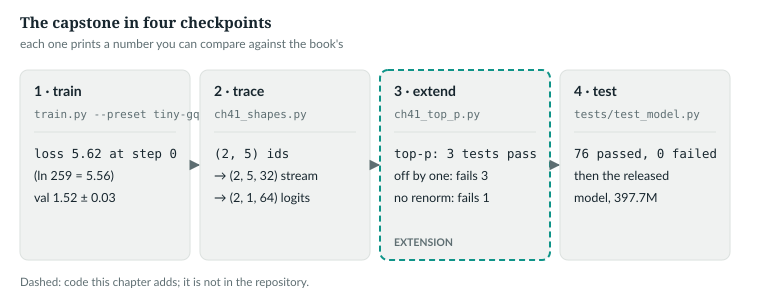
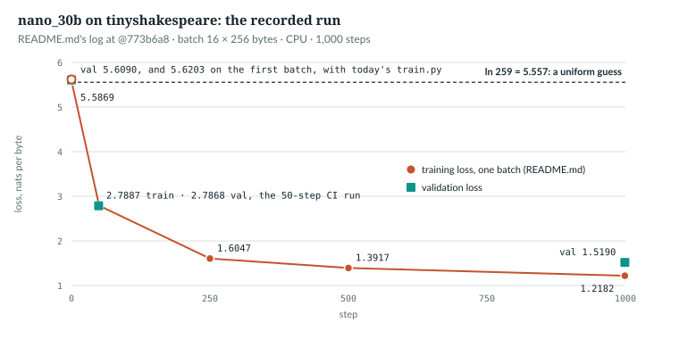
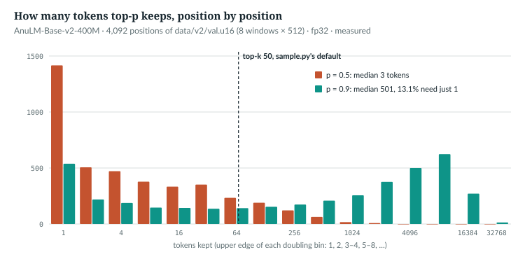

# 41  Capstone: train it, open it, change it

This chapter is a lab in four checkpoints, each ending in a number to compare:

1. **Train** the 17M preset `nano_30b` on text. Its loss starts near ln V and
   falls along a recorded curve.
2. **Trace** one prediction through the code of every earlier chapter, printing
   shapes that match Appendix A.
3. **Change** the model: add top-p sampling, which `generate` lacks, and prove it
   with three tests that two known-wrong versions fail.
4. **Test** everything: run the full suite, then put your model beside the
   released 400M.

All four run on a CPU; only the training run takes long, about 22 minutes.



*Figure 41.1 · The four checkpoints.* What each prints; the dashed one is new
code. *verified* and *measured*, as each section says.

**New words for Part X.**

| Term | Meaning |
|---|---|
| top-p | sampling only from the smallest set of most likely tokens whose probabilities add up to at least p |
| nucleus | that set, renormalised to sum to 1 |
| known-wrong implementation | a copy of the code with one classic bug planted, used to prove a test can fail |
| resume point | `<out>.last`, the checkpoint that holds optimiser state and sampler position as well as weights |

---

## 41.1  Checkpoint 1: before the first step

The run you will reproduce is the repository's own reference run, on the CPU:

```bash
python -m anulm train --preset 30b --steps 1000 --device cpu --out ckpt_capstone.pt
```

With no `--data`, `anulm/training/train.py` reads `data/input.txt`, downloading
tinyshakespeare (1.1 MB) the first time. Pass `--steps 1000`, because the
default is 2,000 although `docs/TUTORIAL.md` says 1,000. Pass `--device cpu`,
because the default is `cuda` whenever a GPU is visible (lines 575–576), and
then `anulm/training/train.py` runs under bf16 autocast. A GPU run should land within 41.2's
tolerance, but the book's numbers come from the CPU.

For a one-minute check first, run the first 50 steps, as the repository's CI
does (`.github/workflows/tests.yml` line 132):

```bash
python -m anulm train --preset 30b --steps 50 --eval-every 25 --device cpu --out ckpt_check.pt
```

These are exactly the first 50 steps of the 1,000-step run. The warmup lasts
100 steps (`--warmup`, line 554), and inside it the learning rate does not
depend on `--steps`:

> **In the repo** · `anulm/training/train.py` · `lr_at` · lines 375–381 · @fdbb09a

```python
def lr_at(step: int, args, start_step: int = 0) -> float:
    if step < args.warmup:
        return args.lr * (step + 1) / max(args.warmup, 1)
```

`docs/TUTORIAL.md` reports this check's validation loss as 2.7868.

`--preset 30b` picks a configuration, and `--cfg` can override any field of it:

> **In the repo** · `anulm/training/train.py` · `main` · lines 712–731 · @fdbb09a

```python
    builder = {"30b": AnuLMConfig.nano_30b,
               "105b": AnuLMConfig.nano_105b,
               "350m": AnuLMConfig.nano_350m}[args.preset]
    overrides = {}
    for kv in args.cfg:
        key, _, val = kv.partition("=")
        field = AnuLMConfig.__dataclass_fields__.get(key)
        if field is None or not _:
            p.error(f"--cfg: unknown field {kv!r}")
        cast = {"int": int, "float": float, "bool": lambda s: s.lower() in ("1", "true", "yes"),
                "str": str}.get(str(field.type).replace("Optional[", "").rstrip("]"), str)
        overrides[key] = None if val.lower() == "none" else cast(val)
    if overrides:
        print(f"config overrides: {overrides}")
    kw = dict(block_size=args.block_size, yarn=args.yarn,
              yarn_original_context=args.block_size, moe_impl=args.moe_impl,
              vocab_size=vocab_size, tokenizer_path=tokenizer_path,
              seq_balance_alpha=args.seq_balance_alpha, router_z_alpha=args.router_z_alpha,
              sliding_window=args.sliding_window, max_window_layers=args.max_window_layers)
    kw.update(overrides)                      # --cfg wins over the named flags
```

- **Lines 712–714** map the preset name to an `AnuLMConfig` static method
  (Appendix B lists every field).
- **Lines 716–723** parse each `KEY=VALUE`. A misspelt field makes
  `p.error` print the usage and exit with status 2 (a real error, which
  `python -O` cannot strip as it would an `assert`); the field's declared
  type picks the cast, so
  `--cfg n_kv_head=1 sliding_window=None` gives an int and a `None`.
- **Lines 726–731** add the command-line flags and the data's vocabulary
  (259 for bytes), then let `--cfg` override them all.

Before training you can check two things: the parameter count, which
`param_count_matches_analysis` pins, and the untrained loss. A model that knows
nothing gives all V = 259 byte ids the same probability: a loss of ln 259 nats
per byte. `code-examples/ch41_checkpoints.py` (**Book example, not repository
code**) builds what `anulm/training/train.py` builds, from the same seed, and scores it with
`anulm/training/train.py`'s own `evaluate`:

```python
def first_loss() -> None:
    torch.manual_seed(1337)                                  # train.py's default --seed
    data = T.load_bytes(None)                                # data/input.txt, as train.py with no --data
    n = int(0.9 * len(data))
    train_data, val_data = data[:n], data[n:]
    # ...
    sampler = T.WindowSampler(len(train_data), 256, 16, 1337)
    # ...
    cfg = M.AnuLMConfig.nano_30b(block_size=256, yarn=False, yarn_original_context=256, moe_impl="sparse",
                                 vocab_size=259, tokenizer_path=None, seq_balance_alpha=0.0,
                                 router_z_alpha=0.0, sliding_window=None, max_window_layers=0)
    model = M.AnuLM(cfg)
    total, active = model.num_params()
    # ...
    x, y = T.make_batch(train_data, sampler.next(), 256, "cpu")       # the batch train.py's step 0 uses
    with torch.no_grad():
        _, loss0 = model.train()(x, y)
    # ...
    args = argparse.Namespace(batch_size=16, block_size=256, device="cpu", eval_iters=20, eval_windows=0,
                              autocast=contextlib.nullcontext())
    val, sem = T.evaluate(model, val_data, args)
```

The keyword arguments are those of lines 726–730 for this command. The sampler
has its own random generator, so it leaves the weights' seed untouched, and its
first draw is the batch `anulm/training/train.py` trains on at step 0.

```
corpus 1.12M bytes  ->  train 1.00M / val 0.11M
sampler: 3920 windows/epoch; 1000 steps of 16 = 4.08 epochs
params: 17,440,384 total, 6,602,368 active per token (37.9%)
step 0 training loss (first batch, before the update): 5.6203
val loss before any step: 5.6090 +/- 0.0014   ln V = ln 259 = 5.5568   (difference 0.0521)
```

*verified*: printed by `ch41_checkpoints.py first-loss` (CPU, 6 s), which then
prints Exercise 1's answer. Your run's first log line should read
`step     0 | loss 5.6203`. Both losses sit near ln 259; the validation loss is
0.0521 above it, inside the 0.35 that `initial_loss_is_ln_vocab` allows:

> **In the repo** · `tests/test_model.py` · `initial_loss_is_ln_vocab` · lines 349–359 · @fdbb09a

```python
def initial_loss_is_ln_vocab():
    for attn in ("gqa", "mla"):
        torch.manual_seed(0)
        cfg = tiny(attn=attn)
        m = AnuLM(cfg).eval()
        x = torch.randint(0, cfg.vocab_size, (4, 32))
        with torch.no_grad():
            _, loss = m(x, x)
        expected = math.log(cfg.vocab_size)
        assert abs(loss.item() - expected) < 0.35, \
            f"{attn}: init loss {loss.item():.3f}, expected ~{expected:.3f} -- init is off"
```

The test scores random ids with `tiny()`, for both attention types. A first
loss well above ln V means logits too large at initialisation: a model
confidently wrong before it starts (Chapter 3).

`IN THE REPO` · `MEASURED`

## 41.2  Checkpoint 1: the run, and what to expect

Each step of the loop runs one batch forward and backward, then updates the
weights:

> **In the repo** · `anulm/training/train.py` · `main` · lines 855–878 · @fdbb09a

```python
        opt.zero_grad(set_to_none=True)
        loss_acc = aux_acc = 0.0
        for _ in range(args.grad_accum):
            ix = (torch.randint(len(train_data) - args.block_size - 1, (args.batch_size,))
                  if args.sample_with_replacement else sampler.next())
            x, y = make_batch(train_data, ix, args.block_size, args.device)
            with args.autocast:
                logits, loss = model(x, y)
            lm_loss = loss
            # ...
            (loss / args.grad_accum).backward()
            loss_acc += lm_loss.item() / args.grad_accum
            if raw_model.aux_loss is not None:
                aux_acc += raw_model.aux_loss.item() / args.grad_accum
            tokens_seen += x.numel()

        if args.grad_clip > 0:
            torch.nn.utils.clip_grad_norm_(raw_model.parameters(), args.grad_clip)
        opt.step()
        # Out-of-band, after the gradient step, never part of the loss.
        imbalance = raw_model.update_expert_biases()
```

- **Lines 857–860:** `--grad-accum` micro-batches (1 by default) of 16 window
  starts, drawn without replacement (Chapter 21). `make_batch` cuts (16, 256)
  inputs `x` and, shifted by one, targets `y`.
- **Lines 861–862:** the forward pass, under an autocast that is disabled on a
  CPU, so everything stays fp32 (Chapter 23).
- **Line 868:** the backward pass, divided so that accumulated gradients equal
  one large batch's (`gradient_accumulation_equals_large_batch`). The elided
  lines add an optional bigram-teacher term, off by default.
- **Lines 874–878:** clip the gradient norm to 1.0, step AdamW (Chapter 7), and
  move the router biases by the sign rule, outside the loss (Chapter 18).

Every 250 steps, and at the last step, the loop evaluates and saves:

> **In the repo** · `anulm/training/train.py` · `main` · lines 891–908 · @fdbb09a

```python
        if (step + 1) % args.eval_every == 0 or step == end - 1:
            val, val_sem = evaluate(raw_model, val_data, args)
            flag = ""
            if val < best_val:
                best_val = val
                atomic_save({"model": raw_model.state_dict(), "cfg": cfg,
                             "step": step, "val_loss": val, "val_sem": val_sem,
                             "eval_spec": eval_spec}, args.out)
                flag = "  <- saved"
            # ...
            atomic_save({"model": raw_model.state_dict(), "opt": opt.state_dict(),
                         "cfg": cfg, "step": step, "val_loss": val, "val_sem": val_sem,
                         "eval_spec": eval_spec, "best_val": best_val,
                         "sampler": sampler.state()}, last_path)
            bpb = val / math.log(2) / args.bytes_per_token
            print(f"  eval @ {step:5d} | val loss {val:6.4f} +/- {val_sem:.4f} | "
                  f"bits/byte {bpb:5.3f}{flag}")
```

`--out` gets the weights only when the validation loss improves. The resume
point `<out>.last` gets them at every evaluation, with the AdamW moments and the
sampler's position, which `--resume` needs (Chapter 25). Line 906 converts nats
to bits per byte; for byte data `bytes_per_token` is 1.0.

The repository's `README.md` records this run from an older `anulm/training/train.py`. That
version printed fewer columns and drew its windows with replacement; the
`WindowSampler` (lines 104–160) now draws different batches, so your step
losses will not match these, starting with step 0 (5.6203, not 5.5869). The
shape of the curve and the end point are what carry over:

```
step    0 | loss 5.5869 | imbalance 4.43x
step   50 | loss 2.7887 | imbalance 5.19x     <- peak
step  250 | loss 1.6047 | imbalance 1.77x
step  500 | loss 1.3917 | imbalance 1.53x
step  999 | loss 1.2182 | imbalance 1.16x
eval @ 999 | val loss 1.5190 | bits/byte 2.192
```



*Figure 41.2 · The run you are reproducing.* *measured*: the curve and val
1.5190 from `README.md` "Status: trained and verified" and "Results" (1,345 s
on a CPU, torch 2.14.0+cpu; also `docs/RESULTS.md` §1); 2.7868 from
`docs/TUTORIAL.md`; the step-0 values 5.6203 and 5.6090 from this chapter.

What should match, and how closely:

- **The validation loss: 1.52 ± 0.03 after 1,000 steps.** `docs/TUTORIAL.md`
  gives "around 1.52" (§3) and ±0.03 as the noise of a 20-window reading. Its
  section "How much does the machine matter?" has the 50-step run at 2.7868,
  2.7867 and 2.7865 on three machines. If your run lands further off than the
  noise, suspect the data or the flags, not the hardware. The `+/-` that `anulm/training/train.py` prints is the
  standard error over its fixed evaluation windows, not a run-to-run
  tolerance (`docs/RESULTS.md` §26).
- **The imbalance column** rose to 5.19× at step 50 in the recorded run, then
  fell to 1.16×. Expect the same rise and fall, not the same values: at
  `bias_update_rate` 1e-3 the bias moves only ±0.05 in 50 steps, slower than
  the router's early preferences grow (`README.md`; `docs/RESULTS.md` §5).
- **The sample.** `python -m anulm sample --ckpt ckpt_capstone.pt --prompt "KING
  RICHARD II:"` should give Shakespeare-shaped text (`docs/TUTORIAL.md` §3).

**Your own text.** Pass `--data mytext.txt`: any UTF-8 file, since the model
reads bytes. Three newlines (`bpe.DOC_SEP`) separate documents, and
`load_bytes` puts the end-of-document id 257 at each boundary (Chapter 8). The
first loss should again be near 5.557; the rest depends on your corpus. A
small corpus is seen several times (4.08 epochs here), so watch the validation
loss.

`IN THE REPO` · `MEASURED`

## 41.3  Checkpoint 2: one prediction, through every chapter's code

A forward hook is a function PyTorch calls after a module runs. The trace puts
one on every module of the first two layers and on the modules around them;
each records shapes and changes nothing. From `code-examples/ch41_shapes.py`
(**Book example, not repository code**):

```python
def record(model, layers=(0, 1)):
    """Forward hooks on the top-level modules and on every module inside the chosen layers."""
    rows, hooks = [], []
    wanted = {"embed_tokens", "rotary", "norm", "lm_head"}
    for name, mod in model.named_modules():
        parts = name.split(".")
        inside = parts[0] == "layers" and len(parts) > 1 and int(parts[1]) in layers
        if not (name in wanted or inside):
            continue
        if ".experts." in name and name.count(".") > 4:
            continue                              # an expert's own Linears: same as layer 0's SwiGLU

        def hook(m, inp, out, name=name):
            rows.append((name, type(m).__name__, shp(inp[:1]), shp(out)))
        hooks.append(mod.register_forward_hook(hook))
    return rows, hooks
```

`name=name` binds each hook to its own module's name; without it, every hook
would report the loop's last name. The script runs `tiny()` on a (2, 5) prompt
with a KV cache, then one decode step. Selected rows around layer 1, an MoE layer,
with the chapter that explains each row:

```
--- prefill: ids (2, 5) -> logits (2, 1, 64)
    rotary                                 Rotary       in                  out (5, 8) (5, 8)       Ch 14
    layers.1.input_layernorm               RMSNorm      in (2, 5, 32)       out (2, 5, 32)          Ch 15
    layers.1.attn.query_key_value          Linear       in (2, 5, 32)       out (2, 5, 64)          Ch 13
    layers.1.attn.query_layernorm          RMSNorm      in (2, 4, 5, 8)     out (2, 4, 5, 8)        Ch 11, 13
    layers.1.attn.key_layernorm            RMSNorm      in (2, 2, 5, 8)     out (2, 2, 5, 8)        Ch 13
    layers.1.attn.dense                    Linear       in (2, 5, 32)       out (2, 5, 32)          Ch 13
    layers.1.post_attention_layernorm      RMSNorm      in (2, 5, 32)       out (2, 5, 32)          Ch 15
    layers.1.mlp.router                    Router       in (10, 32)         out (10, 2) (10, 2)     Ch 17
    layers.1.mlp.experts.0                 SwiGLU       in (6, 32)          out (6, 32)             Ch 16, 18
    layers.1.mlp.shared_expert             SwiGLU       in (2, 5, 32)       out (2, 5, 32)          Ch 18
    layers.1.mlp                           MoE          in (2, 5, 32)       out (2, 5, 32)          Ch 18
    norm                                   RMSNorm      in (2, 5, 32)       out (2, 5, 32)          Ch 15
    lm_head                                Linear       in (2, 1, 32)       out (2, 1, 64)          Ch 10, 20
    cache[0] after prefill: {'k': '(2, 2, 5, 8)', 'v': '(2, 2, 5, 8)'}       Ch 27
--- decode: ids (2, 1) -> logits (2, 1, 64)
    cache[0] after decode: {'k': '(2, 2, 6, 8)', 'v': '(2, 2, 6, 8)'}
```

*verified*: printed by `ch41_shapes.py`, chapter column added; Appendix A has
the full output for three models.

- **The router** sees N = B·S = 10 flattened rows (Chapter 17).
- **Expert 0** got 6 of the 20 (token, slot) pairs. The count depends on the
  data, which is why the sparse path breaks `torch.compile`'s graph (Chapter 23).
- **`lm_head`** gets only the last position: no targets were passed.
- **The cache** grows from 5 to 6 positions and holds 2 key/value heads, not 4.
- **`embed_tokens` is missing:** `forward` reads its table with `F.embedding`
  and never calls the module.

`IN THE REPO`

## 41.4  Checkpoint 3: add top-p, and prove it

`generate` turns logits into a token here:

> **In the repo** · `anulm/model.py` · `AnuLM.generate` · lines 1161–1169 · @fdbb09a

```python
            if temperature <= 0:
                nxt = logits.argmax(dim=-1, keepdim=True)              # (B, 1), no draw
            else:
                logits = logits / temperature
                if top_k is not None:
                    v, _ = torch.topk(logits, min(top_k, logits.size(-1)))
                    logits[logits < v[:, [-1]]] = -float("inf")
                probs = F.softmax(logits, dim=-1)
                nxt = torch.multinomial(probs, num_samples=1)          # (B, 1)
```

A temperature of 0 or less is exact greedy decoding: the argmax, with no
random draw. Any other temperature divides the logits, and the rest of the
`else` branch samples. `top_k` keeps a fixed number of tokens. Nucleus sampling, top-p, keeps a fixed
share of the probability, however many tokens that takes [R31]. Chapter 28
filters the logits before the softmax. This version works on the
probabilities after line 1168, so that renormalising is a step of its own, one
you can get wrong and must test. From `code-examples/ch41_top_p.py` (**Book
example, not repository code**):

```python
def top_p(probs: torch.Tensor, p: float) -> torch.Tensor:
    """(B, V) probabilities -> (B, V) probabilities of the nucleus: the smallest set of
    most likely tokens whose mass reaches p, renormalised; zero everywhere else."""
    if p >= 1.0:
        return probs
    sorted_probs, order = torch.sort(probs, dim=-1, descending=True)        # (B, V) each
    mass_before = sorted_probs.cumsum(dim=-1) - sorted_probs   # mass ranked above each token
    drop = mass_before >= p                    # the set already reached p without this token
    drop[:, 0] = False                         # always keep the most likely token
    sorted_probs = sorted_probs.masked_fill(drop, 0.0)
    sorted_probs = sorted_probs / sorted_probs.sum(dim=-1, keepdim=True)     # renormalise
    return torch.empty_like(probs).scatter_(-1, order, sorted_probs)       # vocabulary order
```

1. **Sort** each (B, V) row, largest first; `order` remembers the positions.
2. **Mass before** (`cumsum − probs`) is the mass ranked above each token. A
   token is dropped when that already reaches p, so the token that crosses p
   stays: the smallest set whose mass is at least p.
3. **Keep one.** The top token always stays, so p near 0 is greedy.
4. **Renormalise** the survivors to sum to 1, and **unsort** with `scatter_`.

In `anulm/model.py` it would be that function, renamed `_top_p` to free the name
for the argument, plus one argument and one line, an `EXTENSION`:

```diff
     def generate(self, idx, max_new_tokens: int, temperature: float = 1.0,
                  top_k: int | None = None, eos_id: int | None = None, use_cache: bool = True,
-                 repetition_penalty: float = 1.0, on_token=None):
+                 repetition_penalty: float = 1.0, on_token=None, top_p: float = 1.0):
...
                 probs = F.softmax(logits, dim=-1)
+                probs = _top_p(probs, top_p)                # 1.0 keeps today's behaviour
                 nxt = torch.multinomial(probs, num_samples=1)          # (B, 1)
```

The new argument goes last, as in Chapter 28's patch, so that every existing
call that passes arguments by position still means what it did.

The book does not patch the repository. It copies `generate`'s uncached path
and adds the line:

```python
def generate_top_p(model, idx, max_new_tokens, temperature=1.0, top_k=None, p=1.0):
    """AnuLM.generate's uncached path (no cache, no text_vocab mask, no penalty, no EOS), plus top_p."""
    bs = model.cfg.block_size
    for _ in range(max_new_tokens):
        logits, _ = model(idx[:, -bs:])
        logits = logits[:, -1, :].float()
        if temperature <= 0:
            nxt = logits.argmax(dim=-1, keepdim=True)                        # (B, 1), no draw
        else:
            logits = logits / temperature
            if top_k is not None:
                v, _ = torch.topk(logits, min(top_k, logits.size(-1)))
                logits[logits < v[:, [-1]]] = -float("inf")
            probs = F.softmax(logits, dim=-1)
            probs = top_p(probs, p)                                          # the one new line
            nxt = torch.multinomial(probs, num_samples=1)                    # (B, 1)
        idx = torch.cat((idx, nxt), dim=1)
    return idx
```

**Two known-wrong versions.** A test proves something only if a wrong
implementation fails it. These carry the two classic bugs:

```python
def wrong_off_by_one(probs, p):
    """Drops the token that crosses the threshold, so the kept mass falls short of p."""
    sorted_probs, order = torch.sort(probs, dim=-1, descending=True)
    sorted_probs = sorted_probs.masked_fill(sorted_probs.cumsum(dim=-1) > p, 0.0)
    sorted_probs = sorted_probs / sorted_probs.sum(dim=-1, keepdim=True)
    return torch.empty_like(probs).scatter_(-1, order, sorted_probs)


def wrong_no_renorm(probs, p):
    """The right set, but the tail is zeroed and the rest is not divided by the kept mass."""
    keep = top_p(probs, p) > 0
    return probs * keep
```

**Three tests.** Chapter 28 (28.7) tests its patch on the kept set, the sum and
p = 1. These take that test further: two use a four-token toy you can check by
hand, and the third samples.

```python
TOY = torch.tensor([[0.50, 0.25, 0.15, 0.10]])          # four tokens, already in order


def test_keeps_the_smallest_set_reaching_p(f):
    """p = 0.6 needs tokens 0 and 1 (0.50 < 0.6 <= 0.75); p = 0.8 needs a third."""
    for p, want in ((0.4, [0]), (0.6, [0, 1]), (0.8, [0, 1, 2]), (0.95, [0, 1, 2, 3])):
        kept = (f(TOY, p)[0] > 0).nonzero().flatten().tolist()
        assert kept == want, f"p={p}: kept {kept}, want {want}"


def test_renormalises_within_the_nucleus(f):
    """The kept probabilities sum to 1 and keep their ratios to one another."""
    q = f(TOY, 0.6)[0]
    assert abs(q.sum().item() - 1.0) < 1e-6, f"the nucleus sums to {q.sum():.4f}"
    assert abs(q[0].item() - 0.50 / 0.75) < 1e-6 and abs(q[1].item() - 0.25 / 0.75) < 1e-6, \
        f"ratios changed: {q.tolist()}"
```

The third samples, as `generate` would. Its expected answer must not come from
the code under test, so a plain loop computes it:

```python
def nucleus_by_loop(probs: list[float], p: float) -> dict[int, float]:
    """The oracle, written independently of top_p: walk the tokens from most to least
    likely, adding each one until the kept mass reaches p, then renormalise."""
    kept, mass = {}, 0.0
    for i in sorted(range(len(probs)), key=lambda i: -probs[i]):
        if mass >= p:
            break
        kept[i] = probs[i]
        mass += probs[i]
    return {i: q / mass for i, q in kept.items()}


def test_samples_match_the_nucleus(f):
    """20,000 draws from each of three random 50-token distributions land where the oracle says."""
    for seed in (0, 1, 2):
        g = torch.Generator().manual_seed(seed)
        probs = F.softmax(torch.randn(1, 50, generator=g) * 2, dim=-1)
        oracle = nucleus_by_loop(probs[0].tolist(), 0.9)
        want = torch.zeros(50)
        want[list(oracle)] = torch.tensor(list(oracle.values()))
        draws = torch.multinomial(f(probs, 0.9).expand(4, -1), 5000, replacement=True, generator=g).flatten()
        got = torch.bincount(draws, minlength=50).float() / draws.numel()
        assert (got[want == 0] == 0).all(), f"seed {seed}: a token outside the nucleus was sampled"
        assert (got[want >= 0.002] > 0).all(), f"seed {seed}: a nucleus token was never sampled"
        assert (got - want).abs().max() < 0.015, f"seed {seed}: frequencies off by {(got - want).abs().max():.3f}"
```

A nucleus token of probability 0.002 is expected 40 times in 20,000 draws, so
"never sampled" is no accident. The script runs all three on each version:

```
nucleus of the toy [0.50, 0.25, 0.15, 0.10] at p = 0.6: [0.6667, 0.3333, 0.0, 0.0]

top_p:
  PASS  test_keeps_the_smallest_set_reaching_p
  PASS  test_renormalises_within_the_nucleus
  PASS  test_samples_match_the_nucleus

wrong_off_by_one:
  FAIL  test_keeps_the_smallest_set_reaching_p: p=0.4: kept [], want [0]
  FAIL  test_renormalises_within_the_nucleus: ratios changed: [1.0, 0.0, 0.0, 0.0]
  FAIL  test_samples_match_the_nucleus: seed 0: a nucleus token was never sampled

wrong_no_renorm:
  PASS  test_keeps_the_smallest_set_reaching_p
  FAIL  test_renormalises_within_the_nucleus: the nucleus sums to 0.7500
  PASS  test_samples_match_the_nucleus

against the repository:
  generate_top_p matches AnuLM.generate at p = 1 and at p = 1e-9 ((2, 16) ids each); at p = 1 - 1e-6 top_p changes tiny()'s probabilities by at most 1.9e-09
```

*verified*: printed by `ch41_top_p.py`. Read the failures:

- **Off by one** keeps nothing at p = 0.4: the top token alone (0.50) exceeds
  p, so `cumsum > p` drops it too, and the renormalisation divides 0 by 0. In
  `generate` that row is NaN, and `torch.multinomial` raises an error.
- **Off by one, sampled.** It fails the sampling test structurally, not by
  chance: for each of the three seeds it drops the token that crosses 0.9,
  whose nucleus probability is 0.0201, 0.0119 and 0.0173 (the script prints
  them), so that token is never
  drawn.
- **No renormalisation** passes the sampling test, because `torch.multinomial`
  normalises its input itself. The bug shows only where the probabilities are
  used as numbers: returned log-probabilities, perplexity, calibration. Hence
  the second test.

The last line holds the extension to the repository at its two limits, and
just below the upper one:

```python
def agrees_with_generate() -> None:
    """At p = 1 and at p -> 0 the extension must reproduce the repository's generate; just
    below 1, where the filter really runs, it must leave a model's distribution unchanged."""
    torch.manual_seed(0)
    m = M.AnuLM(tiny()).eval()
    start = torch.randint(0, 64, (2, 4))
    torch.manual_seed(1)
    ref = m.generate(start.clone(), 12, temperature=1.0, use_cache=False)
    torch.manual_seed(1)
    ours = generate_top_p(m, start.clone(), 12, temperature=1.0, p=1.0)
    assert torch.equal(ref, ours), "p = 1 must leave sampling exactly as generate does it"
    greedy = m.generate(start.clone(), 12, temperature=1.0, top_k=1, use_cache=False)
    tiny_p = generate_top_p(m, start.clone(), 12, temperature=1.0, p=1e-9)
    assert torch.equal(greedy, tiny_p), "p -> 0 must keep one token: greedy decoding"
    with torch.no_grad():
        probs = F.softmax(m(start)[0][:, -1, :].float(), dim=-1)            # (2, 64)
    near = top_p(probs, 1 - 1e-6)
    err = (near - probs).abs().max().item()
    assert err < 1e-6, f"p = 1 - 1e-6 moved the distribution by {err:.1e}"
```

Reseeding makes both calls draw the same random numbers. At p = 1 that shows
only the plumbing, since `top_p` returns at its first line; at p = 1 − 10⁻⁶ the
filter runs in full and must change nothing; at p = 1e-9 it must be greedy,
the repository's own pattern:

> **In the repo** · `tests/test_model.py` · `generation_is_deterministic_at_top_k_1` · lines 398–406 · @fdbb09a

```python
def generation_is_deterministic_at_top_k_1():
    torch.manual_seed(0)
    cfg = tiny()
    m = AnuLM(cfg).eval()
    start = torch.randint(0, cfg.vocab_size, (1, 4))
    a = m.generate(start.clone(), 12, temperature=1.0, top_k=1)
    b = m.generate(start.clone(), 12, temperature=1.0, top_k=1)
    assert torch.equal(a, b), "greedy decoding is not deterministic"
    assert a.shape == (1, 16), f"generate returned {tuple(a.shape)}, expected (1, 16)"
```

Greedy decoding twice from a cloned prompt must give identical tokens and the
shape (1, 4 + 12). To add top-p to the suite, wrap the three tests as `@test`
functions in `tests/test_model.py`.

`EXTENSION` · `IN THE REPO`

## 41.5  Checkpoint 4: the whole suite, then the released model

`tests/test_model.py` needs no framework: `@test` appends each function to a list,
and `main` runs it:

> **In the repo** · `tests/test_model.py` · `main` · lines 2250–2271 · @fdbb09a

```python
def main():
    passed, skipped, failed = [], [], []
    for fn in TESTS:
        try:
            fn()
            passed.append(fn.__name__)
            print(f"  PASS  {fn.__name__}")
        except unittest.SkipTest as e:        # before Exception: SkipTest is one
            skipped.append((fn.__name__, e))
            print(f"  SKIP  {fn.__name__}  ({e})")
        except Exception as e:
            failed.append((fn.__name__, e))
            print(f"  FAIL  {fn.__name__}")
            print("        " + "\n        ".join(
                traceback.format_exception_only(type(e), e)).rstrip())
    # With nothing skipped this is the line the docs and the course quote
    # ("76 passed, 0 failed, 76 total"), so it keeps that exact shape.
    if skipped:
        print(f"\n{len(passed)} passed, {len(skipped)} skipped, {len(failed)} failed, {len(TESTS)} total")
    else:
        print(f"\n{len(passed)} passed, {len(failed)} failed, {len(TESTS)} total")
    return 1 if failed else 0
```

A failure is caught, printed and counted, and the run goes on. A test that
cannot run raises `unittest.SkipTest`, prints SKIP and is counted apart
(Chapter 26, 26.10). The return value is the exit status (line 2296), so CI
stops on any failure. At the pin:

```
  PASS  causal_mask_does_not_leak_future
  ...
  PASS  from_scratch_pipeline_runs_and_skips_completed_stages

76 passed, 0 failed, 76 total
```

*verified*: 46 s here, run as `python -m tests.test_model` with
`CUDA_VISIBLE_DEVICES=-1` (Python 3.14.7, torch 2.11.0, CPU);
`book/measurements/part_x_tests.json`. `README.md` (line 115) gives the same
count, 76, and "under a minute". A test that needs an optional package
(`gradio`, `safetensors`, `transformers`, `tokenizers`, the API's or apps'
dependencies) or `F.grouped_mm` raises `unittest.SkipTest` without it, and the
last line then reads "N passed, M skipped, F failed, T total". Here nothing
skipped. The same 76 also run as `python -m unittest tests.test_model`.
Appendix C lists all 76, and C.5 what they miss.

A second suite, `tests/test_quality_*.py`, holds 63 regression tests for
safe loading, serving and the repository's layout. It uses `unittest`
directly:

```bash
python -m unittest discover -s tests -p "test_quality_*.py" -t .
```

*verified*: "Ran 63 tests in 4.725s", OK, on the same CPU.

**Beside the released model.** This needs two files that are not in git:

- **`ckpt_base_v2.pt`**, the released run's own checkpoint. The Hugging Face
  repository `toonist/AnuLM-Base-v2-400M` (front matter) holds an export
  instead, with its large tensors in bf16, the default `--weights-dtype mixed`
  (`anulm/hf/export_hf.py` lines 328–339; `--weights-dtype float32`, lines
  231–233, keeps every weight as trained);
  `--ckpt <folder>` accepts it. On this machine's local export, the median at
  p = 0.9 below is 507, not 501. The Hub copy itself was not compared.
- **`data/v2/val.u16`**, the held-out split, which `experiments/build_v2.py`
  rebuilds (`docs/DATASETS.md`).

`python book/code-examples/ch41_checkpoints.py released` loads the checkpoint
and prints its configuration's differences from `released()`:

```
fields where ckpt_base_v2.pt differs from released():
  tokenizer_path         released() None           checkpoint 'data/multi32k.json'
  bias_update_rate       released() 0.001          checkpoint 0.003
  moe_impl               released() 'sparse'       checkpoint 'grouped'
  seq_balance_alpha      released() 0.0            checkpoint 0.0001
  router_z_alpha         released() 0.0            checkpoint 0.001
  yarn_original_context  released() 256            checkpoint 1024
params: 397,659,648 total, 173,526,528 active; stored step 1,899,999, val 3.3523 +/- 0.0491 ({'mode': 'strided', 'windows': 400, 'block_size': 1024})
against nano_30b (17,440,384 / 6,602,368): 22.8x the parameters, 26.3x the active
```

*verified*. None changes a parameter's shape: they are training settings, the
dispatch path and the tokenizer file. The released model's loss is per token of
a 32,768-token vocabulary, not per byte, so 3.3523 and your 1.52 are not
comparable.

The same script counts the nucleus top-p would keep at every position of 8
windows of 512 tokens from `data/v2/val.u16` (seed 0), printing statistics
only. It runs in true fp32, which the checkpoint's own `moe_impl`, `grouped`,
does not: it casts the experts' inputs, and their stacked weights (line 756),
to bf16 even without autocast.

> **In the repo** · `anulm/model.py` · `MoE._route_grouped` · lines 784–787 · @fdbb09a

```python
        xs = x_flat[order // k].to(torch.bfloat16)                          # (N*k, D) expert-sorted
        w_gate, w_up, w_down = self._stacked_weights()
        h = F.silu(F.grouped_mm(xs, w_gate, offs=offs)) * F.grouped_mm(xs, w_up, offs=offs)
        ys = F.grouped_mm(h, w_down, offs=offs)                              # (N*k, D) expert-sorted
```

The (N·A, D) rows, one per token and chosen expert, become bf16 before the three grouped matrix
multiplies, whatever dtype came in. So the script switches the loaded model to
`sparse`, whose experts are ordinary fp32 `nn.Linear`s, and counts:

```python
    with torch.no_grad():
        for s in starts:
            row = torch.from_numpy(val[s: s + seq + 1].astype(np.int64))[None].to(dev)
            x, y = row[:, :-1], row[:, 1:]
            logits, _ = m(x, y)                                        # (1, seq, V): targets ask for every row
            probs = F.softmax(logits[0].float(), dim=-1)               # (seq, V)
            keep = x[0] != 32767                                       # skip the position after a document end
            for p in sizes:
                sizes[p] += (top_p(probs, p) > 0).sum(-1)[keep].tolist()
            top50 += probs.topk(50, dim=-1).values.sum(-1)[keep].tolist()
```

Passing targets makes `forward` return all 512 rows of logits, not just the last
(Chapter 20). The output:

```
data/v2/val.u16: 8 windows of 512 tokens, seed 0; fp32 weights and activations, moe_impl sparse, no autocast; cuda
top-p 0.5: nucleus size percentiles {10: 1, 25: 1, 50: 3, 75: 15, 90: 61}, min 1, max 1973; size 1 at 34.6% of positions, over 50 at 11.7%
top-p 0.9: nucleus size percentiles {10: 1, 25: 6, 50: 501, 75: 3633, 90: 7138}, min 1, max 19060; size 1 at 13.1% of positions, over 50 at 64.4%
mass inside sample.py's default top-k 50: 10th pct 0.480, median 0.815, 90th pct 0.994  (4,092 positions)
```



*Figure 41.3 · Nucleus sizes on the released model.* At p = 0.9, 13.1% of
positions need one token and the median needs 501. *measured* on 4,092
positions from 8 windows of 512 tokens of `data/v2/val.u16` (seed 0), in true
fp32 (`moe_impl` `sparse`, no autocast); Chapter 28's Figure 28.2 is the
reference measurement, in bf16 on 16 windows;
`book/measurements/part_x_released.json`.

No fixed k fits both: where one token holds 90% of the mass, `top_k=50` still
admits 49 more, and where the mass is spread, 50 tokens hold under 0.480 of it
at one position in ten. Chapter 28's measurement (28.6) is the book's
reference one. It differs from this one in three ways: 16 windows instead of
8, bf16 autocast as the serving code runs instead of true fp32, and tokens
tied at the boundary counted. It found a median of 341 at p = 0.9
(`part_vi_ch28_sampling.json`). With a spread this wide, the median moves with
the sample; the range, from 1 token to thousands, does not. Whether top-p's
samples are better is *not measured here*.

`IN THE REPO` · `MEASURED`

## 41.6  Three larger extensions

None of these is in the repository. Their arithmetic on the released model
comes from `code-examples/ch41_arithmetic.py`:

```python
    tables = [mod for mod in m.modules() if isinstance(mod, (torch.nn.Linear, torch.nn.Embedding))]
    big = sum(t.weight.numel() for t in tables)                      # every matrix and table
    rows = sum(t.weight.shape[0] for t in tables)                    # one fp32 scale per row for int8
    small = rel["total"] - big                                       # routers and norm gains
    bias = sum(b.numel() for n, b in m.named_buffers() if n.endswith("expert_bias"))   # decides routing
    kv, kv_mixed = rel["kv"]["bf16"], rel["kv"]["fp32_keys_bf16_values"]
    int8 = big + 4 * rows + 4 * small + 4 * bias
```

```
extensions, on the released model:
  paged KV cache: a 16-token block, all 20 layers, holds 327,680 B (320 KiB) in bf16, 491,520 B (480 KiB) with the fp32 keys autocast leaves; a full 1024-token context 20 MiB in bf16
  int8 weights: 397,148,160 matrix numbers at 1 B + 765,440 row scales at 4 B + 511,488 router and norm numbers and 456 router-bias numbers kept fp32 = 402,257,696 B (384 MiB), against fp32 1,590,638,592 B (1517 MiB) and bf16 758 MiB
  DPO: a frozen fp32 reference copy adds 1.59 GB (1.48 GiB) to the 6.36 GB (5.93 GiB) of AdamW state: 7.95 GB (7.41 GiB) before activations
```

*verified*: arithmetic, printed by the script.

- **A paged KV cache.** PagedAttention stores the cache in blocks of a fixed
  number of tokens [R46]. Each block above spans all 20 layers, with fp32 keys
  under autocast (Appendix B.4). A block table would replace `new_cache`'s
  dict and the `torch.cat` lines in `GQAttention.forward`;
  `incremental_forward_matches_full_forward` and
  `cached_generation_matches_uncached` already test the result (Chapter 40).
- **Int8 weight-only inference.** Keep the routers, norms and router bias in
  fp32, as `anulm/hf/export_hf.py` does: the model card warns that a 16-bit router bias
  changes which experts fire. Write the test first: expert choices before and
  after quantising must match.
- **DPO.** A preference loss against a frozen reference model [R40], built in
  the lab book (`course/ch11-dpo/lab.py`); the reference copy is the extra
  1.59 GB (Chapter 34).

> **Build it.** The lab book's Chapter 8 trains the model you assembled from
> stubs, Chapter 11 builds DPO, and Chapter 15 ships a checkpoint. The lab book
> is the repository's `course/` folder, which the pin includes; it is not yet
> on GitHub's `main` (`ae59238`).

`NOT IN THE REPO` · `EXTENSION`

## 41.7  Common mistakes, and how to catch them

- **Trusting a bare command's step count.** The default is 2,000 steps.
  *Catch it:* read the epochs planned on the `sampler:` line before you wait.
- **Comparing a val loss across tokenizers.** Nats per token from a 32k
  tokenizer and nats per byte are different units. *Catch it:* compare
  bits/byte, which `anulm/training/train.py` prints for both (Chapter 24).
- **A test that cannot fail.** The sampling test alone passes the
  unrenormalised top-p. *Catch it:* keep a known-wrong version beside each
  extension, and require that it fail.
- **Checking only that sampling runs.** Off by one, with p above the top
  token's probability, runs fine on too small a set, and is right where a
  cumulative sum equals p. *Catch it:* hand-worked sets, at a p below the top
  probability and one between two cumulative sums.
- **Reading "76 passed" without the rest of the line.** A test that cannot
  run is counted as skipped, not passed (41.5). *Catch it:* read the summary
  for "skipped", and the SKIP lines for why; install the missing package and
  run again.

`IN THE REPO`

## 41.8  Exercises

1. Run `python -m anulm train --preset 30b --steps 1000 --device cpu --out
   ckpt_kv1.pt --cfg n_kv_head=1`, with its own `--out` so that checkpoint 1's
   file survives. Before it starts, predict the parameter count (Chapter 20's
   eight terms; D = 384, D<sub>h</sub> = 64, L = 8).
2. Your step-0 loss is 6.4. List two causes, and the test that would catch each.
3. On the toy distribution, which tokens do `top_p` and `wrong_off_by_one`
   keep at p = 0.75, and at p = 0.7?
4. Why does `top_p` sort, rather than use `torch.topk`?
5. With top-p 0.9 and `top_k=50` both set, as in the patched `generate`, which
   one decides at a position whose nucleus needs 501 tokens?

**Answers.**
1. Each layer's `query_key_value` shrinks from (6 + 4)·64 to (6 + 2)·64
   outputs: 2·64·384 = 49,152 fewer per layer, 393,216 over 8 layers. The total
   is 17,440,384 − 393,216 = 17,047,168, and the active count 6,209,152.
2. Logits too large at initialisation (`initial_loss_is_ln_vocab`); or a
   larger vocabulary than you meant, since the first loss sits near ln V of
   the V the model was built with: compare it with ln `cfg.vocab_size`.
3. Mass before each token: 0, 0.50, 0.75, 0.90. At p = 0.75 both keep 0 and 1:
   token 1's cumulative mass equals p exactly, so the bug hides. At p = 0.7
   `top_p` keeps 0 and 1; the wrong version drops token 1 (0.75 > 0.7).
4. The cut-off is a mass, not a count, so the number of tokens to keep is not
   known in advance. A sort orders all V tokens once, and the cumulative sum
   finds the cut-off.
5. Both. `top_k` acts first and caps the set at 50 tokens; the softmax
   renormalises those 50, and top-p 0.9 then keeps the fewest of them that reach
   0.9 of their mass.

*verified*: answers 1 and 3 are printed by `ch41_checkpoints.py first-loss` and
`ch41_top_p.py`, which build the configuration and run both versions on the
toy.

---

## Key points

- `python -m anulm train --preset 30b --steps 1000 --device cpu` builds a
  17,440,384-parameter model whose first logged loss, 5.6203, and validation
  loss before any step, 5.6090, sit near ln 259 = 5.5568.
- Expect val 1.52 ± 0.03 after 1,000 steps; the first 50 steps, run alone as CI
  does, reach 2.7868, the same on three machines to within 3e-4.
- Forward hooks print every module's shapes without changing the model, and
  each row maps to one chapter of this book.
- Top-p keeps the smallest set of tokens whose mass reaches p, then
  renormalises; it slots in after the softmax in `generate`.
- A test earns trust when a known-wrong version fails it: here the off-by-one
  filter fails all three tests, and the missing renormalisation fails one.
- The suite runs 76 tests in 46 s on a CPU; the released model needs 501 tokens
  to reach 0.9 of the mass at the median position, so no fixed top-k fits.

> **In one breath.** Train the 17M preset and watch its loss fall from ln 259;
> trace one prediction through every module with hooks; add top-p in one line
> after the softmax and prove it with tests that two planted bugs fail; then
> run all 76 tests and compare your model with the released 400M.

## References

Research references cited in this chapter (`RESEARCH_REFERENCES.md`), each
used only for the claim in its register row:

| ID | Used for | Status |
|---|---|---|
| [R31] | nucleus sampling (top-p) | CHECKED |
| [R40] | DPO: a preference loss against a reference policy, without a reward model | CHECKED |
| [R46] | PagedAttention: the KV cache in blocks of a fixed number of tokens | CHECKED |

Repository evidence, all at @fdbb09a:
- `anulm/training/train.py`: `main` 536–924 (preset builder 712–723, keyword arguments
  726–731, the step 855–878, evaluation and saves 891–908), `load_bytes` 62–98,
  `WindowSampler` 104–160, `lr_at` 375–400, `evaluate` 477–533; defaults:
  `--steps` 2000 (line 548), `--warmup` 100 (554), `--device` (575–576).
- `.github/workflows/tests.yml` line 132: the CI's 50-step run.
- `anulm/model.py`: `AnuLM.generate` 1115–1180 (greedy and sampling 1161–1169),
  `AnuLM.num_params` 1104–1113, `MoE._route_grouped` 766–790 (bf16 casts at
  756 and 784).
- `tests/test_model.py`: `initial_loss_is_ln_vocab` 349,
  `generation_is_deterministic_at_top_k_1` 398, `param_count_matches_analysis`
  410, `gradient_accumulation_equals_large_batch` 448,
  `incremental_forward_matches_full_forward` 561,
  `cached_generation_matches_uncached` 604, `main` 2250–2271; skips raise
  `unittest.SkipTest` at 699, 720, 738, 864, 901, 940, 1134, 1138, 1186,
  1299, 1358, 1977 and 2028; `sys.exit(main())` 2296; 76 tests.
- `tests/test_quality_layout.py`, `tests/test_quality_loading.py`,
  `tests/test_quality_serving.py`: 63 `unittest` tests (18, 19 and 26).
- `anulm/hf/export_hf.py`: `--weights-dtype` 231–233; `to_bf16` 52–61; the
  float32 config and its comment 328–339: by default big tensors are stored in
  bf16, small ones in fp32.
- `experiments/build_v2.py` and `docs/DATASETS.md`: the held-out split.
- Documentation: `README.md` "Status: trained and verified" and "Results";
  `docs/TUTORIAL.md` §2–3 and "How much does the machine matter?";
  `docs/RESULTS.md` §1, §5, §26; `docs/MODEL_CARD_BASE_V2.md` (limitations);
  `anulm/bpe.py` `DOC_SEP` line 45.
- The lab book (`course/`, branch `course-book`, not yet public): Chapters 8,
  11 and 15, `course/ch11-dpo/lab.py`.
- Book examples: `code-examples/ch41_checkpoints.py`, `ch41_shapes.py`,
  `ch41_top_p.py`, `ch41_arithmetic.py`; measurements
  `book/measurements/part_x_released.json`, `part_x_tests.json`,
  `part_x_arithmetic.json`.
