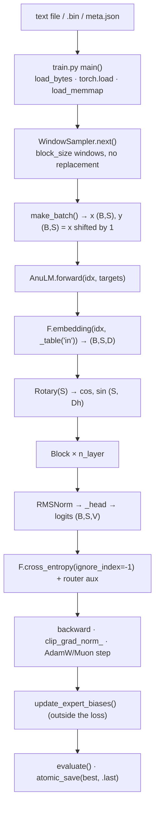
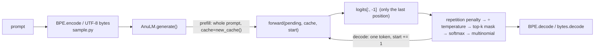

# Repository architecture (Stage 1)

What this repository implements, traced through the code rather than read off
the README. Every claim cites a file and symbol, and line numbers are taken at
commit `@773b6a8` on the `course-book` branch. The working tree had
uncommitted edits to eight files when this was written (`app_omni.py`,
`convert_parquet.py`, `eval_code.py`, `omni_train.py` and others), but not to
`model.py`, `train.py`, `bpe.py` or `sample.py`. The core line numbers below are
therefore stable.

---

## 1. What kind of model this is

**A decoder-only, sparse Mixture-of-Experts transformer, written from
scratch in PyTorch.** Its design follows Sarvam AI's released 30B and 105B
models, which descend from DeepSeek's architectures.
`model.py` lines 1–21 say so, and `docs/ARCHITECTURE.md` documents the
reading of Sarvam's code that it rests on.

It is **not** a GPT-2 clone. The textbook model the book's prompt assumes
(absolute positional embeddings, LayerNorm, a dense GELU MLP, multi-head
attention, tied embeddings) differs from this one in nearly every
component.

| Component | Textbook GPT-2 | This repository |
|---|---|---|
| Tokens | 50k BPE | byte-level (259 ids) **or** the repo's own byte-level BPE (`bpe.py`); released models use `multi32k`, 32,768 ids |
| Position | learned absolute table | **RoPE**, split-halves convention, plus optional **YaRN** (`Rotary`, `apply_rope`) |
| Norm | LayerNorm, post or pre | **RMSNorm**, pre-norm, plus **QK-norm** inside attention |
| Attention | MHA | **GQA** (fused QKV) **or MLA** (latent KV), one config switch; optional **sliding window** per layer |
| FFN | dense, GELU, 4× | **SwiGLU**. Layer 0 is dense; layers 1+ are **MoE** with a sigmoid router, top-k, an optional shared expert and aux-loss-free bias balancing |
| Output | tied to the embedding | **untied** by default (`tie_word_embeddings=False`) |
| Attention kernel | hand-written | `F.scaled_dot_product_attention` (SDPA) |

### The released configuration (real numbers for the book)

Read from `ckpt_base_v2.pt`, the `AnuLM-Base-v2-400M` checkpoint
(`docs/MODEL_CARD_BASE_V2.md`). Evidence level: **verified**, loaded on
2026-10-31.

| field | value |
|---|---|
| `vocab_size` | 32,768 (`data/multi32k.json`) |
| `block_size` | 1,024 |
| `n_layer` / `hidden_size` | 20 / 1,024 |
| `n_head` / `n_kv_head` / `head_dim` | 16 / 4 / 64 (GQA 4:1) |
| `sliding_window` / `max_window_layers` | 256 on layers 0–9, full attention on layers 10–19 |
| `intermediate_size` (dense layer 0) | 2,816 |
| `num_experts` / `num_experts_per_tok` / `moe_intermediate_size` | 24 / 4 / 192, no shared expert |
| `routed_scaling_factor`, `bias_update_rate` | 2.5, 3e-3 |
| `seq_balance_alpha`, `router_z_alpha` | 1e-4, 1e-3 |
| `rope_theta` | 1e6, YaRN off |
| floating-point parameters in the state dict | 397,660,560 |
| step / val loss | 1,899,999 / 3.3523 |

The parameter split below was computed by hand from the config. The audit
script still has to check it.

- Embedding and output table: 2 × 32,768 × 1,024 = 67.1M.
- Attention: 20 layers × (24 × 64 × 1,024 + 1,024²) = 52.4M.
- Dense layer 0: 3 × 1,024 × 2,816 = 8.7M.
- Experts: 19 layers × 24 × 3 × 1,024 × 192 = 269.0M, plus routers.
- Total: ≈ 397.7M, which matches the state dict.
- Active per token: about 173M, since 20 of the 24 experts sit idle in each of the 19 MoE layers.
- KV cache: 2 × 20 × 4 × 64 × 2 bytes = **20 KiB per token** in bf16.

---

## 2. Layout of the repository

The repository root is flat. Grouped by role:

| Role | Files |
|---|---|
| **Core model** | `model.py` (1,224 lines) |
| **Tokenizer** | `bpe.py`; `hf_tok.py`, `tools_hf_tokenizer.py` (conversion to the HF format) |
| **Pre-training** | `train.py`, `muon.py`, `bigram_teacher.py`; corpus builders `experiments/build_v2.py`, `mix_corpus.py`, `filter_prose.py`, `fetch_*.py`, `convert_*.py` |
| **Generation** | `AnuLM.generate`, `AnuLM.decode_from_embeds` in `model.py`; `sample.py`, `sample_many.py`, `ask.py` |
| **Post-training** | `finetune.py` (SFT), `lora.py`, `make_chat.py`, `make_qa*.py`, `decide.py`, `rc_pointer.py`, `bidirectional.py` |
| **Retrieval** | `rag.py` |
| **Multimodal** | `vision_encoder.py`, `speech_encoder.py`, `speech_vocab.py`, `audio_codec.py`, `omni*.py` |
| **Serving / UI** | `serve.py`, `api.py` (OpenAI-compatible), `app*.py` (Gradio), `langchain_anulm.py`, `web/`, `space/` |
| **Export** | `export_hf.py`, `modeling_anulm.py`, `configuration_anulm.py` (a Hugging Face `transformers` wrapper) |
| **Evaluation** | `eval_*.py`, `make_golden.py`, `make_bench.py`, `omni_eval.py`, `tools_contamination.py`, `tools_eval_noise.py` |
| **Tests** | `test_model.py`: 66 named tests, each run through a `@test` decorator; there is no pytest dependency |
| **Reference reading** | `sarvam/*_annotated.py`, annotated walkthroughs of Sarvam's released modelling code |
| **Records** | `docs/RESULTS.md` (experiment log, §1–§39+), `docs/ARCHITECTURE.md`, model cards, `logs/` |
| **Course (existing book)** | `course/`: *Build Your Own LLM, from Scratch to Omni*, with 15 chapters, labs, checks and stub code |

Dependencies (`requirements.txt`): the training path needs **only `torch`**.
`safetensors` is used for export, `pyarrow` for parquet. Gradio, FastAPI,
timm, snac and faster-whisper are optional and are imported only by the demo
and multimodal scripts.

---

## 3. Execution path: text in, loss out (training)

| Stage | Where | Shape |
|---|---|---|
| Corpus → ids | `train.py` `load_bytes` lines 62–98 (byte mode, EOS 257 at `DOC_SEP`); `.bin` from `bpe.py cmd_encode` lines 264–312; memmap `load_memmap` lines 151–161 | 1-D id tensor |
| Window choice | `WindowSampler` lines 104–148 | `ix` (B,) start offsets |
| Batch | `make_batch` lines 199–208 | `x`, `y`: (B, S) int64; `y[t] = x[t+1]` |
| Embedding | `AnuLM.forward` line 841, `_table` lines 911–929 | (B, S, D) |
| Positions | `Rotary.forward` lines 320–324; `_build_inv_freq` 286–303 | cos, sin (S, Dh) |
| Block | `Block.forward` lines 771–779: `x + attn(norm(x))`, then `x + mlp(norm(x))` | (B, S, D) |
| Attention | `GQAttention.forward` lines 426–465 | q (B,H,S,Dh); k,v (B,Hkv,S,Dh) → (B,S,D) |
| Mask | `_attn_mask` lines 344–360; `_sdpa` lines 393–397 (`is_causal`) | (S, T) bool or None |
| FFN | `SwiGLU.forward` line 236 / `MoE.forward` lines 656–667 | (B, S, D) |
| Router | `Router._gate` lines 589–637 | topk_idx (N,k), weights (N,k) |
| Head + loss | `AnuLM.forward` lines 857–873 | logits (B,S,V); scalar loss |
| Optimiser | `make_optimizer` lines 310–337 (decay on 2-D weights only); `muon.py` | — |
| LR | `lr_at` lines 248–269 (warmup → cosine, or WSD) | — |
| Step | `main` loop lines 684–742 | — |

## 4. Execution path: prompt in, text out (inference)

- **KV cache.** It is a list of dicts, one per layer (`new_cache`, line 818).
  GQA stores `k` and `v` for the **Hkv** heads, before they are repeated
  across query groups (lines 441–447). MLA stores the latent `c` and the
  shared rope key `k_pe` (lines 520–528). The cache grows with `torch.cat`,
  and there is no paging.
- **Position continuity.** `Rotary.forward(start=...)` gives absolute
  positions. When the cache is non-empty and a step adds several tokens,
  `_attn_mask` builds the mask explicitly, because SDPA's `is_causal`
  aligns top-left (lines 344–360).
- **Context overflow.** When the context is full, `generate` rebuilds the
  cache from the last `block_size` tokens on every step (lines 1087–1090),
  so cached and uncached decoding agree token for token. The test
  `cached_generation_matches_uncached` holds them to it.
- **Sampling controls in the model.** Temperature, top-k, the CTRL
  repetition penalty, EOS and a streaming callback. There is **no top-p**:
  `api.py` line 188 accepts `top_p` for OpenAI compatibility and ignores it.
  There is no beam search; `modeling_anulm.py` lines 258–263 raise on it.
- **Inputs that are not tokens.** `forward(embeds=...)` bypasses the
  embedding table (lines 836–839), and `decode_from_embeds` (lines 959–1005)
  decodes greedily after an audio or image prefix.

---

## 5. Engineering features beyond the textbook (all present)

| Feature | Where |
|---|---|
| Three interchangeable MoE dispatch paths: sparse, dense, grouped-GEMM | `MoE._route_sparse` / `_route_dense` / `_route_grouped`, lines 669–749 |
| Router computed in fp32, with autocast off | `Router.forward` lines 576–587 |
| Aux-loss-free balancing, sequence balance loss, router z-loss | `Router._gate` lines 612–635; `AnuLM.update_expert_biases` lines 1014–1044 |
| Gradient checkpointing | `AnuLM.forward` lines 847–852 |
| Chunked cross-entropy, so the full logit tensor never exists | `enable_chunked_loss`, `_chunked_loss`, lines 875–901 |
| Merge-tree reparameterisation of the token tables | `merge_tree_matrix` lines 369–390; `_compose`, `_table`, `bake_merge_tree` |
| Scaled init of the residual output projections | `AnuLM.__init__` lines 805–808 |
| bf16 autocast, fused AdamW, `torch.compile` probe | `train.py` lines 498–503, 326, 590–610 |
| Gradient accumulation | `train.py` lines 691–707 |
| Atomic checkpoints, resume with optimizer and sampler state | `atomic_save` lines 32–46; resume lines 628–675 |
| Eval noise accounting (standard error) and strided eval windows | `evaluate` lines 340–396; `strided_windows` 224–245 |
| Interleaved validation split | `interleaved_split` lines 164–178 |
| Muon optimiser (Newton–Schulz) | `muon.py` |
| Bigram-teacher KL warm start | `bigram_teacher.py` |
| A memory guard for large models | `fit_memory` lines 1205–1224 |

## 6. Not implemented in this repository

The book has to present these as background or extensions, never as
features of this code.

| Topic | Status |
|---|---|
| Learned absolute or sinusoidal positional embeddings | **Absent.** RoPE only. Teach them as history. |
| LayerNorm | **Absent.** RMSNorm only. |
| Plain multi-head attention as its own class | GQA with `n_kv_head == n_head` *is* MHA (a config choice, not a class). MQA is `n_kv_head = 1`. |
| Hand-written attention kernel or FlashAttention | Absent. SDPA chooses the kernel (`IMPLEMENTATION-DEPENDENT`). |
| Top-p (nucleus) sampling | **Absent** from `generate`. `api.py` ignores `top_p`. |
| Beam search, speculative decoding, multi-token prediction | Absent. |
| PagedAttention or a paged KV cache, continuous batching | **Absent.** The cache is a per-layer `torch.cat`. `api.py` serialises requests behind one GPU lock. |
| Quantised inference (INT8/INT4/FP8) | **Absent** for AnuLM. The export stores bf16 weights, and the only int8 anywhere is ctranslate2's Whisper on CPU. A QLoRA-style `quantize` path exists only in the course stub `course/build/post.py`. |
| Distributed training (DDP, FSDP, tensor or pipeline parallel) | **Absent.** Single-GPU by design (`model.py` line 19). |
| fp16 with `GradScaler` | Absent. Only bf16 autocast. |
| DPO, RLHF or GRPO in the core code | Absent from the repo root. DPO appears in the course stubs (`course/build/post.py`) and RL in `course/build/further.py`. |
| Dropout | The field exists, defaults to 0.0 and is wired into SDPA. It is effectively off. |

## 7. How this was established

- `model.py`, `train.py`, `bpe.py`, `sample.py` were read in full.
- `muon.py` and `bigram_teacher.py` were read in part.
- The test names in `test_model.py` were listed.
- `requirements.txt`, the headers of `docs/ARCHITECTURE.md`, the index of
  `docs/RESULTS.md` and the base-v2 model card were read.
- The config was loaded from `ckpt_base_v2.pt`.
- The post-training, multimodal, serving and export modules (25 files) were
  read in full by two read-only inventory agents. Their line numbers were
  spot-checked against the files, and 14 of 14 matched. See
  `docs/reference/repository-source-map.md` §§4–5.

**Not yet inspected:** `experiments/` (about 40 scripts), `eval_*.py`,
`app*.py` beyond their headers, `web/`, `space/` and `sarvam/`.
