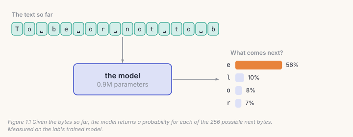
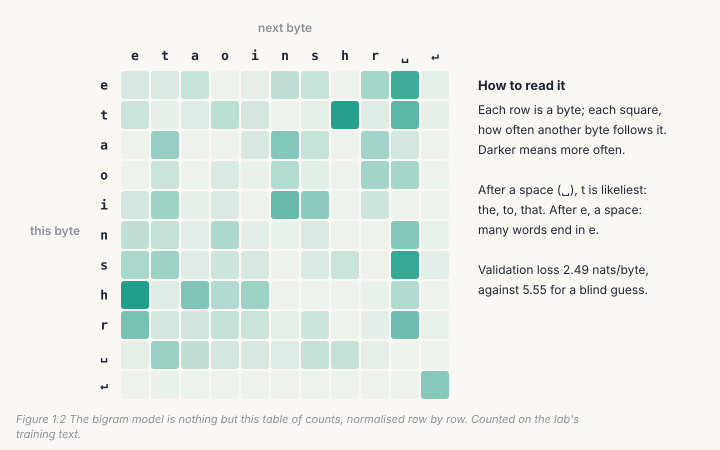
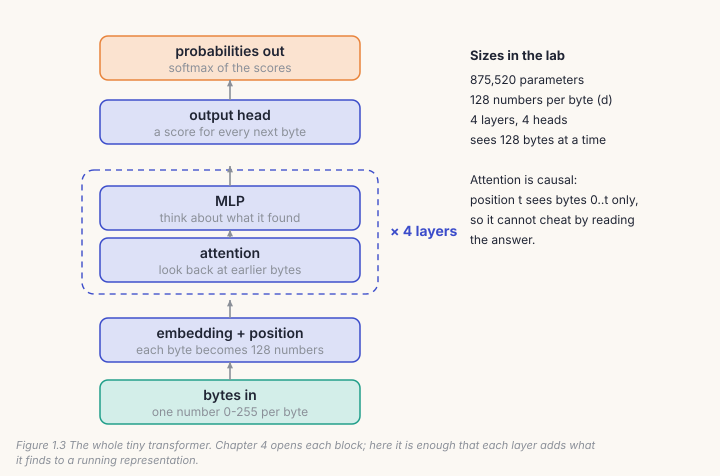
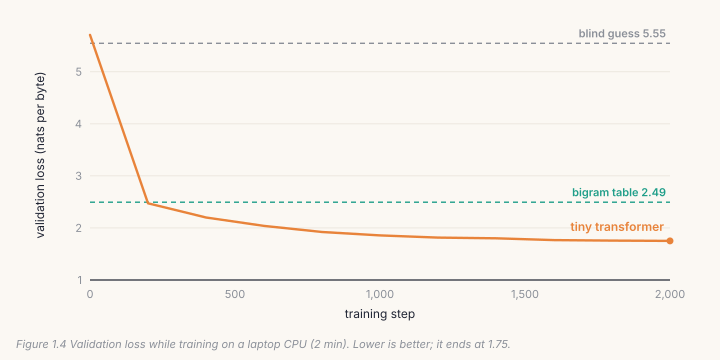

By the end of this chapter you will have trained a language model on your
own laptop, from nothing, in about two minutes, and you will know exactly
what the number it prints means. Every model in this book, up to the one
that listens and sees in Chapter 13, does the same single job you meet here.

## 1.1 One job: guess what comes next

A language model reads some text and guesses what comes next. That is the
whole job. Everything else, from answering questions to writing code, is
built on top of doing that one guess well.

Computers store text as **bytes**, numbers from 0 to 255. English letters
are one byte each; a Hindi letter like भ takes three. In this chapter the
model reads and writes bytes directly, which means it works on any language
without any setup. (Chapter 3 replaces bytes with *tokens*, which is faster.)

So the model's job, precisely: given the bytes so far, give a probability
to each of the 256 possible next bytes.



After *"To be or not to b"*, the model you are about to train gives *e*
a 56% chance. It has never been told about *Hamlet*. It worked out from
examples that after *b* in this kind of text, *e* is common.

**How we score a guess.** If the real next byte was *e* and the model gave
it probability 0.56, its *surprise* is −log(0.56) = 0.58. A model that was
certain and right scores 0; one that gave the right answer 1% scores 4.6.
The **loss** is the average surprise over many real next bytes, on text the
model did not train on. Lower is better. It is measured in *nats*; divide
by 0.693 to get *bits*.

One number anchors everything: a model that knows nothing gives every byte
1/256, and its loss is log(256) = **5.545**. Any model worth having must
beat that.

## 1.2 A model that only counts

The simplest model that beats a blind guess doesn't learn anything in the
usual sense. It counts. For every byte in the training text, it notes which
byte came next, and keeps a 256 × 256 table of counts. To guess, it looks
up the row for the current byte.



This is called a **bigram** model ("two bytes"). Here is all of it:

```python
# lab.py, bigram()
counts = torch.ones(256, 256)                   # every pair starts at 1
counts.index_put_((train[:-1], train[1:]),      # +1 for each (this, next)
                  torch.ones(len(train) - 1), accumulate=True)
probs = counts / counts.sum(1, keepdim=True)    # each row now sums to 1
loss = -probs[val[:-1], val[1:]].log().mean()   # average surprise on unseen text
```

On Shakespeare it scores **2.49**: already far better than 5.545. And
yet, ask it to write and it produces this:

```
ROMEO:
wire!
JUELLIAndirstyo iod w,
I bel Hadvabr'lllly anre braunco seary hor, iveandeerph dileatore
```

Each pair of letters is plausible; the words are not. The model sees
exactly one byte back, so it cannot know it is halfway through *Romeo*.

> **Note**
> Every count starts at 1, not 0, so that no pair is ever impossible
> (*add-one smoothing*). The price shows in its samples: once in a while
> it picks a byte that never appears in English and prints `�`.

## 1.3 Looking further back: a tiny transformer

To do better, the model has to look further back than one byte and decide
for itself which earlier bytes matter. That is what a **transformer** does.



Read the figure from the bottom. Each byte becomes a list of 128 numbers
(an **embedding**), plus a second list that says where it sits in the text.
Then four identical **layers** each do two things:

- **Attention** lets every position look back at all earlier positions and
  pull in what is relevant. In *"To be or not to b"*, the last *b* can
  attend to the first *be*.
- An **MLP**, a small two-layer network, then processes what was gathered.

Each layer *adds* its result to a running representation rather than
replacing it, so information is never lost on the way up. At the top, an
**output head** turns the final 128 numbers into 256 scores, one per
possible next byte, and *softmax* turns the scores into probabilities.

The heart of it is five lines:

```python
# lab.py, Block.forward()
q, k, v = self.qkv(self.ln1(x)).split(D, dim=2)          # what I want, what I have, what I give
q, k, v = (t.view(B, T, self.heads, D // self.heads).transpose(1, 2) for t in (q, k, v))
y = F.scaled_dot_product_attention(q, k, v, is_causal=True)   # never look ahead
x = x + self.proj(y.transpose(1, 2).reshape(B, T, D))         # add what attention found
return x + self.mlp(self.ln2(x))                              # add what the MLP made of it
```

`is_causal=True` is what makes this a language model: position *t* can see
positions 0 to *t* and nothing after, so it can't cheat by reading the
answer.

This model has **875,520 parameters**: numbers it can adjust. At the start
they are random, and it guesses no better than blind.

## 1.4 Learning by being surprised

Training repeats one small loop thousands of times: show the model a batch
of real text, measure its surprise at every real next byte, and nudge every
parameter slightly in the direction that would have made it less surprised.

```python
# lab.py, main()
for step in range(1, steps + 1):
    x, y = batch(train, ctx, 32, g)       # 32 windows of 128 bytes; y is x shifted by one
    _, loss = model(x, y)                 # how surprised was it?
    opt.zero_grad(set_to_none=True)
    loss.backward()                       # which way should each parameter move?
    opt.step()                            # move it a little (AdamW)
```

The direction comes from `loss.backward()`, which computes the *gradient*:
for each of the 875,520 parameters, how much the loss would change if it
moved. The optimizer, **AdamW**, takes a small step downhill.



Within 200 steps it matches the table of counts. By 2,000 it reaches
**1.75**, and its writing has changed character:

```
AUTOLYCUS:
In is good I entring thalt some the fail of the demear
Hereful man, for her for since; and for the fair:
Who here and would gider the alooker:
```

Real names, line breaks where a play has them, speeches that start with a
speaker. The words are still often wrong. It is a 0.9M-parameter model that
has read about one megabyte, for two minutes.

## Lab: train it yourself

```bash
cd course/ch01-smallest-model
python lab.py                         # about 2.5 minutes on a laptop CPU
python lab.py --data my_text.txt      # your own text, any language
python make_figures.py                # redraw this chapter's figures from your run
```

What you should see on the default data (Shakespeare, public domain):

| | validation loss (nats/byte) | bits/byte |
|---|---|---|
| blind guess | 5.545 | 8.00 |
| bigram table | 2.493 | 3.60 |
| tiny transformer, 2,000 steps | 1.750 | 2.52 |

Our run took 139 seconds of training on a desktop CPU. The lab fixes its
random seed, so your numbers should land within a few hundredths of ours;
different CPUs round slightly differently.

It saves `tiny_lm.pt`. Keep it: in Chapter 10 you teach this exact model a
new language.

> **From the lab notebook**
> The AnuLM base model, the one under every later chapter, is this same
> loop, scaled up. It has 398 million parameters instead of 0.9 million.
> Its corpus was 11.3 billion tokens of English, Hindi and Python instead of
> one megabyte of Shakespeare, and in 1.9 million steps it read 7.8 billion
> of them: about a week of training on one consumer GPU, spread over three
> weeks of calendar. It finished at **0.756 bits per byte** on its own
> validation text. (That isn't the same text as this lab's 2.52, so the
> comparison is rough, but the direction is the point.)
>
> The loop never changed. What changed was how much data it saw, and how
> to keep it running for three weeks on a home PC that Windows Update could
> restart overnight. Chapter 8 is about surviving that.

## Try it on your own data

1. Run the lab on a text file of your own: notes, an exported chat, a book
   you have the rights to. Compare its bits/byte with Shakespeare's. Which
   is more predictable, and why?
2. Run it on Hindi (`--data ../../data/bench_hindi.txt`, or your own). A
   Devanagari letter is three bytes, so look at the *samples*, not just the
   loss. Does it ever produce a broken letter?
3. Change `temperature=0.8` in `generate()` to 0.3 and to 1.5. What happens
   to the writing, and why?
4. Make the model see 32 bytes instead of 128 (`TinyLM(ctx=32)`). How much
   worse does it get? What does that say about what attention is using?
5. *Open-ended:* the bigram looks one byte back. Write a *trigram* (two bytes
   back) with a 256 × 256 × 256 table. How big is the table, and how much
   of it ever gets a count from one megabyte of text?

## Key takeaways

- A language model has one job: a probability for every possible next piece
  of text.
- **Loss** is average surprise on text it did not train on; a blind guess
  over bytes scores 5.545.
- Counting pairs already halves the loss; looking further back is what a
  transformer adds.
- Training is one loop: predict, measure surprise, nudge every parameter
  downhill, repeat.
- The same loop, scaled up about 450×, is how the AnuLM base model was made.
