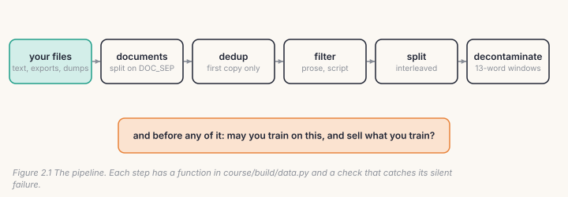
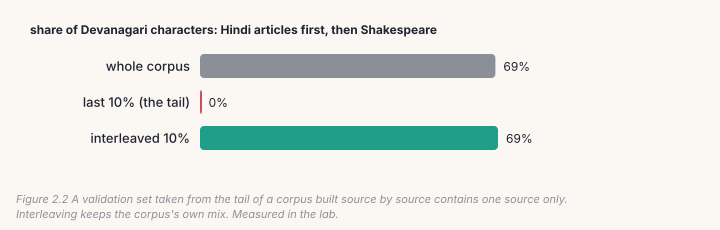
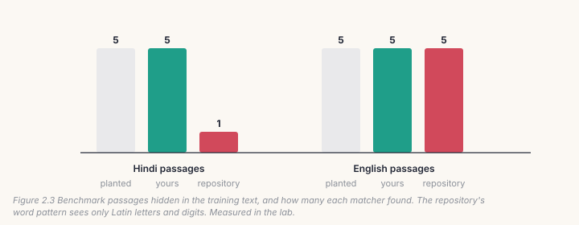

A model is mostly its data. This chapter turns text on your own disk into a
corpus you can train on: documents, deduplication, filtering, a validation
split that tells the truth, decontamination against the benchmarks you'll be
scored on, and the question that comes before all of them: are you allowed to
use this text at all? Every one of these steps fails silently. Nothing
crashes; the model trains; and it learns from duplicates, from list debris, or
from the very test it is later graded on.

## 2.1 The pipeline



You build each step as a small function in `course/build/data.py`, checked
against the repository's own tools: `bpe.py`, `filter_prose.py`,
`fetch_hindi.py`, `convert_parquet.py` and `train.py`.

## 2.2 Documents

The repository stores a corpus as one big text file, with documents separated
by three newlines (`DOC_SEP`). The boundary matters later: Chapter 3 puts an
end-of-document token there, so the model learns where one text stops and the
next begins, instead of reading two articles as one.

```python
DOC_SEP = "\n\n\n"
def split_documents(text):
    return [d for d in text.split(DOC_SEP) if d.strip()]
```

## 2.3 Cleaning: duplicates, debris and scripts

**Duplicates.** Web text repeats itself: mirrored pages, boilerplate, quoted
articles. A model trained on a document ten times memorises it and learns
everything else less. The simplest fix removes exact copies by hashing each
document and keeping the first one seen, in order:

```python
def exact_dedup(docs):
    seen, kept = set(), []
    for d in docs:
        h = hashlib.sha1(d.encode("utf-8")).digest()
        if h not in seen:
            seen.add(h)
            kept.append(d)
    return kept, len(docs) - len(kept)
```

**Debris.** Wikipedia dumps carry infoboxes, station lists and filmographies
that survive cleaning as bare lines. `filter_prose.py` measured that on the
Hindi dump: the median article has 64% of its lines ending in a sentence mark,
the bottom quarter under 34%. A model trained on that learns to write lists.
The filter drops short lines that don't end a sentence (`.` `!` `?` or the
Devanagari danda `।`), then drops a whole document if too few of its lines are
sentences or too little text remains. The title, the first paragraph, is kept.

**Scripts.** A share-of-script function tells you what language a document
mostly is, cheaply: the fraction of its characters in one Unicode block.
Devanagari is U+0900 to U+097F.

## 2.4 A validation split that tells the truth

A validation set must look like the training data. The obvious way, the last
10% of the file, fails whenever the corpus was built one source at a time:
then the tail *is* one source. The repository's `interleaved_split` instead
holds out every tenth chunk across the whole file:

```python
def interleaved_split(data, chunk, every=10):
    chunks = [data[i:i + chunk] for i in range(0, len(data), chunk)]
    val   = [c for i, c in enumerate(chunks) if i % every == every // 2]
    train = [c for i, c in enumerate(chunks) if i % every != every // 2]
```



In the lab's corpus, Hindi articles then Shakespeare, the whole corpus is 69%
Devanagari. The tail is **0%**: a validation loss read on it would measure
English only. The interleaved split is 69%, the corpus's own mix.

## 2.5 Decontamination

A benchmark measures something only if the model hasn't seen it. Benchmark
items leak into training data constantly, through copies, quotes and
model-generated text. The standard test, used by the Llama and phi papers and
by `tools_contamination.py`, flags a benchmark item if it shares any run of 13
consecutive words with the training text.

```python
WORDS = re.compile(r"[a-z0-9_ऀ-ॿ]+")
def word_ngrams(text, n=13):
    w = WORDS.findall(text.lower())
    return {tuple(w[i:i + n]) for i in range(max(len(w) - n + 1, 0))}
```

Look at the pattern. The repository's version is `[a-z0-9_]+`: Latin letters,
digits and underscores. It was written for Python benchmarks (MBPP, HumanEval),
where that is exactly right. But run it on Hindi and it finds no words at all,
so it reports any Hindi text as clean, however much of a benchmark it copies.
Your version adds the Devanagari block, and gives the same answer on English.



The lab hides 5 Hindi and 5 English benchmark passages inside training
documents. Your matcher finds all 10, with no false alarms. The repository's
finds all 5 English ones and 1 of the Hindi ones, and that one only because the
passage happened to open with map coordinates (`26°37′24′′N 79°08′40′′E…`):
it matched the digits, not the Hindi. The repository's Hindi benchmark is
protected a different way: `make_bench.py` compares Devanagari-only signatures.
The lesson stands: **a check that sees nothing reports "clean"**. Test your
checks on the scripts you actually use.

## 2.6 Licences: may you use it, and sell what you make?

Before any of this, ask what the text allows. `docs/DATASETS.md` records the
answer for every source this project used:

- **Allow commercial use** (most with attribution, some share-alike):
  fineweb-edu and fineweb-2 (ODC-BY), Wikipedia (CC BY-SA 4.0), LibriSpeech,
  Kathbath and FLEURS (CC BY 4.0), BANKING77 and MASSIVE (CC BY 4.0).
- **Left out on purpose**: Flickr30k and COCO photos (not for commercial use),
  IndicTTS (terms unclear), and a set written with an AI assistant whose terms
  forbid training models on its output.
- **Open questions, disclosed**: the base model's Python came partly from
  codeparrot-clean, GitHub code that includes GPL and AGPL files.

The last one teaches the hardest rule. Data can't be removed from a trained
model. Once those files were in base v2's pre-training, every model built on
it inherits the question, and the only fix is to pre-train again without them.
Check licences *first*.

## 2.7 Catch it

```bash
python course/checks/ch02.py              # your course/build/data.py
python course/checks/ch02.py --self-test  # proves the checks catch their bugs
```

| check | the silent bug it catches |
|---|---|
| `split_documents_matches_bpe` | blank documents kept |
| `dedup_keeps_the_first_copy_in_order` | the last copy kept, or the order shuffled |
| `script_share_matches_fetch_hindi` | counting every non-ASCII character as Devanagari |
| `filter_doc_matches_filter_prose` | the title dropped; list debris kept |
| `ngrams_match_the_repo_on_english` | words split on spaces only, punctuation left attached |
| `ngrams_see_hindi` | the ASCII-only pattern: Hindi invisible |
| `contamination_finds_planted_copies_in_both_scripts` | a matcher blind to one script |
| `interleaved_split_matches_train` | chunks offset, or the tail used |
| `validation_is_not_the_tail` | a validation set with one source in it |

The self-test runs nine broken versions; all nine are caught. Two of them first
slipped through. The script-share check had no non-ASCII text outside
Devanagari, and the n-gram check used an English sentence with no
punctuation, so splitting on spaces happened to work. Checks need test inputs
as messy as real data.

## Lab: run it on real text

```bash
cd course/ch02-data
python lab.py                      # yours; seconds on a CPU
python lab.py --impl solution
python make_figures.py
```

The lab mixes 407 Hindi Wikipedia articles with 370 Shakespeare speeches,
plants 35 copies of 25 documents, and hides the 10 benchmark passages. Our run:

| step | result |
|---|---|
| dedup | 812 documents in, **35 copies removed** (35 planted) |
| prose filter | 352 of 407 Hindi articles kept, 89% of their text |
| validation split | Devanagari share: corpus 69%, tail **0%**, interleaved 69% |
| contamination | yours: 5/5 Hindi, 5/5 English, 0 false; repository's: 1/5 Hindi, 5/5 English |

> **From the lab notebook**
> `interleaved_split` exists because of a measurement (`train.py`). The
> three-language corpus was built Hindi first, then English, then Python.
> Sixty random windows from its first 30% were 43 Hindi, 9 English and 8 code.
> Sixty from its last 10%, the default validation split, were **0 Hindi**, 57
> English and 3 code. Every validation loss read on that split had been an
> English number, for a model whose main language was Hindi. Interleaving gave
> the split the corpus's own mix: 160 Hindi, 153 English and 71 code windows of
> 384.

## Try it on your own data

1. Run your pipeline on a folder of your own text. What fraction are exact
   duplicates? Which documents does the prose filter cut, and is it right?
2. Exact dedup misses near-copies (a page with a changed date). Implement
   near-duplicate detection with 5-word shingles and Jaccard similarity above
   0.8. How many more do you find?
3. Extend `WORDS` to Tamil (U+0B80 to U+0BFF) and test it with a planted Tamil
   passage.
4. Lower `min_sentence_frac` to 0.2 and raise it to 0.7. Look at what each
   keeps. Where would you set it for your corpus?
5. *Open-ended:* write the licence table for your own corpus, one row per
   source: licence, commercial use, attribution, share-alike. Which source
   would stop you selling the model?

## Key takeaways

- A corpus is documents with clear boundaries; keep them, Chapter 3 needs them.
- Remove exact duplicates (first copy, in order) and list debris before
  training, not after.
- Take validation from across the corpus, never from the tail of a corpus built
  source by source.
- Decontaminate with 13-word windows, in every script you use: a matcher that
  can't read Hindi reports Hindi as clean.
- Check licences first. Data can't be taken out of a trained model.
