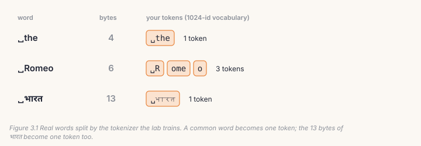
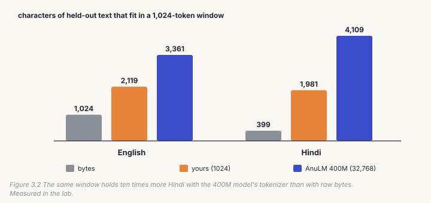

Chapter 1's model read one byte at a time. That works for any language, and
it's expensive: a Hindi letter is three bytes, so a 1,024-position window holds
only about 400 Hindi characters, a few sentences. A **tokenizer** groups bytes
that often occur together into single tokens, so the same window holds far more
text, and the model learns more per step. In this chapter you build AnuLM's
tokenizer, byte-level BPE, from scratch, prove it matches the repository's
`bpe.py` merge for merge, and measure what it buys.

## 3.1 The idea: merge the most common pair

**Byte-pair encoding** (BPE) starts with the 256 possible bytes as its
vocabulary. It finds the most frequent pair of adjacent tokens in your text,
makes that pair a new token, and repeats. After a few thousand merges, common
words and word pieces are single tokens:



Because every text is made of bytes, nothing is ever "unknown". A script the
tokenizer never saw, such as Tamil in a Hindi-and-English tokenizer, simply
falls back to smaller pieces, down to single bytes.

## 3.2 Training

The text is first cut into **chunks**: a word together with the spaces before
it, or a run of spaces. Merges never cross a chunk boundary, so a token never
glues the end of one word to the start of the next. Then the loop:

```python
# build/solutions/ch03.py, train_bpe
chunks = Counter(c.encode("utf-8") for c in CHUNK_RE.findall(text))     # CHUNK_RE = r"\s*\S+|\s+"
words = [(list(c), f) for c, f in chunks.items() if 2 <= len(c) <= MAX_TRAIN_CHUNK_BYTES]
while 256 + len(merges) < vocab_size - 1:              # one id stays free for end-of-document
    counts = Counter()
    for seq, f in words:
        for p in zip(seq, seq[1:]):
            counts[p] += f                               # each unique chunk, weighted by its count
    best = max(counts.values())
    if best < 2:
        break                                            # nothing left worth an id
    pair = min(p for p, c in counts.items() if c == best)   # ties: the smallest pair
    merges.append(pair)
    words = [(_merge(seq, pair, 256 + len(merges) - 1), f) for seq, f in words]
```

Two details decide whether your merges match `bpe.py`'s exactly. **Ties**: when
several pairs are equally frequent, `bpe.py`'s heap picks the smallest pair, so
yours must too. And **stopping**: a pair seen only once isn't worth an id.

This plain loop recounts every pair after every merge. `bpe.py` keeps the counts
up to date incrementally and finds the best pair with a heap: same merges, same
order. In the lab, for 767 merges, your loop takes 10.6 seconds and `bpe.py`
0.4. On the 12.6 MB Hindi corpus, `bpe.py` trains 16,384 ids in 10 seconds.

## 3.3 Encoding and decoding

To encode a chunk, start from its bytes and repeatedly apply the merge that was
learned *earliest* among the pairs present, until none applies. Applying merges
in training order is what makes the result unique; merging greedily from left
to right gives different tokens, which no model trained with this tokenizer has
ever seen.

Decoding is simpler: join each token's bytes and decode UTF-8. That makes
`decode(encode(x)) == x` exact for any text, including spaces, tabs and emoji.

## 3.4 Documents end with a token

Chapter 2 kept document boundaries for this. `encode_documents` puts one extra
id, **end-of-document** (EOS), after every document. It is the id kept free
during training, `256 + len(merges)`. EOS teaches the model where a text stops,
which is what `generate` stops on (Chapter 8).

## 3.5 Catch it

```bash
python course/checks/ch03.py              # your course/build/data.py
python course/checks/ch03.py --self-test  # proves the checks catch their bugs
```

| check | the silent bug it catches |
|---|---|
| `merges_match_bpe_py` | words without their leading spaces; no id kept for EOS |
| `ties_go_to_the_smallest_pair` | ties broken the other way |
| `merges_stop_when_nothing_repeats` | ids spent on pairs seen once |
| `encode_matches_bpe_py` | merging left to right instead of by rank |
| `decode_inverts_encode_exactly` | lossy decoding |
| `merges_never_cross_chunks` | merges learned across word boundaries |
| `documents_end_with_eos` | EOS after every line instead of every document |

A tokenizer bug is permanent in a way no other bug is: a checkpoint only works
with the exact tokenizer it was trained on. The self-test runs eight broken
versions; all eight are caught.

## Lab: train it, measure it

```bash
cd course/ch03-tokenizer
python lab.py                      # yours; about a minute on CPU
python lab.py --impl solution
python make_figures.py
```

The lab trains a 1,024-id tokenizer on 120,000 characters each of Shakespeare
and Hindi Wikipedia. Its merges are identical to `bpe.py`'s. The *first* things
it learns are pieces of Hindi letters: every Devanagari character is three bytes
in UTF-8, so the most common byte pairs in this text are halves of Hindi letters.
Its longest tokens are `"\n\nCORIOLANUS:"` and the Hindi word `" आर्किमिडीज़"`
(Archimedes).



| bytes per token, held-out text | bytes | yours (1,024) | AnuLM 400M (32,768) |
|---|---|---|---|
| English | 1.00 | 2.07 | 3.28 |
| Hindi | 1.00 | 4.97 | **10.31** |

Hindi gains most, because its letters are the most expensive in bytes. With the
400M model's tokenizer, a 1,024-token window holds about 4,100 Hindi characters,
against 400 as raw bytes.

> **From the lab notebook**
> The biggest single improvement in this project came from the tokenizer
> (`docs/RESULTS.md` §7). Two Hindi models were trained identically, same size,
> same steps, same schedule, same GPU, one reading bytes and one reading a
> 16,384-id BPE. Losses per token can't be compared across vocabularies, so
> they were compared in bits per byte of text. The BPE model reached **0.700**
> against the byte model's 0.862: a gain of 0.162 bits per byte, larger than the
> 0.110 that a twenty-times larger model had bought. The mechanism is simple:
> every training step saw 9.6 times more Hindi.

## Try it on your own data

1. Train tokenizers of 512, 1,024 and 4,096 ids on your own text. Plot bytes
   per token against vocabulary size. Where does it flatten?
2. Train on English only, then measure it on Hindi. What happens, and why does
   it still work at all?
3. Encode a Tamil sentence with your tokenizer. How many bytes per token? Why?
4. Remove the leading-space rule (`\S+|\s+` instead of `\s*\S+|\s+`) and train.
   Which tokens appear now, and what is wrong with them?
5. *Open-ended:* make your training loop incremental, like `bpe.py`'s, without
   changing a single merge. How fast can you make it?

## Key takeaways

- BPE starts from bytes and repeatedly merges the most frequent adjacent pair;
  nothing is ever unknown.
- Merges stay inside chunks (a word with its leading spaces), ties go to the
  smallest pair, and encoding applies merges in the order they were learned.
- Decoding inverts encoding exactly; one reserved id marks the end of each
  document.
- A good tokenizer is a large win: the 400M model's tokenizer fits ten times
  more Hindi into a window than bytes, and BPE bought more than a 20× larger
  model did.
