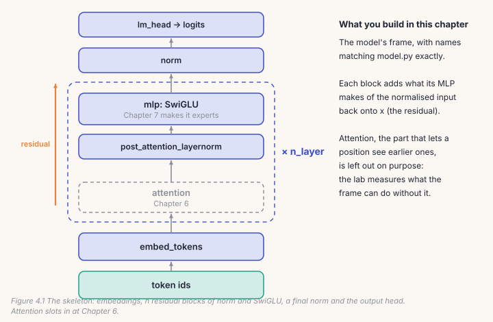
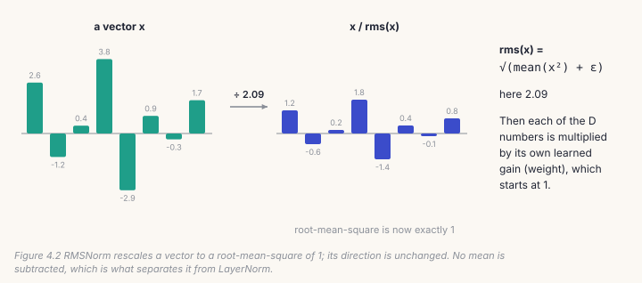
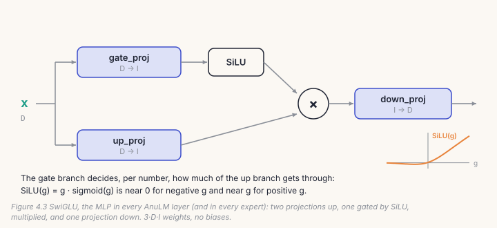
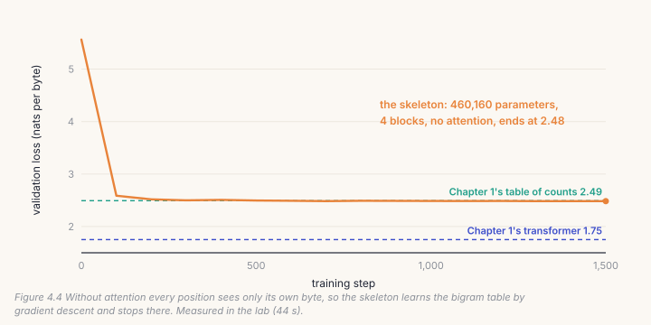

From this chapter on you build the AnuLM model yourself, one piece at a
time, in `course/build/anulm.py`. By Chapter 8 your file does everything the
repository's `model.py` does, and the course's checks prove it weight for
weight. This chapter builds the frame everything else hangs on: token
embeddings, the normalisation layer, the MLP, the residual block, the output
head, and the way all of it starts before training. You'll also learn why
"the loss went down" is not enough to say any of it is right.

## 4.1 The frame



Every AnuLM model is described by one config object, `AnuLMConfig` in
`model.py`. The fields this chapter uses:

| field | what it sets | `30b` preset |
|---|---|---|
| `vocab_size` | how many different tokens exist | 259 (256 bytes, plus begin, end and padding) |
| `hidden_size` (D) | numbers per token as it flows through the model | 384 |
| `n_layer` | how many blocks are stacked | 8 |
| `intermediate_size` (I) | how wide the MLP expands inside a block | 768 |
| `rms_norm_eps` | a small constant that keeps the norm stable | 1e-6 |
| `initializer_range` | the spread of the starting weights | 0.02 |

The `30b` preset, a scaled-down copy of Sarvam 30B's shape, has
**17,440,384 parameters**, of which 6,602,368 are used for any one token (the
rest are experts that token was not routed to; Chapter 7). The model under
every later chapter, AnuLM base v2, is the same design at 398M.

Names matter more than they look. Your modules use exactly `model.py`'s
names (`embed_tokens`, `post_attention_layernorm`, `gate_proj`, ...), so a
checkpoint trained by `model.py` loads into your code and the checks can
compare the two directly.

## 4.2 RMSNorm: keep the numbers in range

As a token's vector passes through block after block, each block adds to it.
Without control, those numbers drift larger or smaller layer by layer, and
training becomes unstable. A **normalisation layer** rescales each vector to
a standard size before a block reads it.



AnuLM uses **RMSNorm**: divide the vector by its root-mean-square, then
multiply each of its D numbers by a learned gain. It is LayerNorm without
subtracting the mean and without a bias: cheaper, and in practice just as
good.

```python
# build/solutions/ch04.py, RMSNorm (identical to model.py's)
def __init__(self, dim, eps=1e-6):
    self.weight = nn.Parameter(torch.ones(dim))    # gain starts at 1: the identity scale
    self.eps = eps

def forward(self, x):
    dtype = x.dtype
    x = x.float()                                    # statistics in float32, whatever x is
    x = x * torch.rsqrt(x.pow(2).mean(-1, keepdim=True) + self.eps)
    return x.to(dtype) * self.weight
```

Two lines look like housekeeping and aren't. `x.float()` computes the mean of
squares in 32-bit precision even when training runs in bfloat16, where it
would quietly lose accuracy. And `eps` sits *inside* the square root, so a
vector of near-zeros is divided by about 0.001 instead of by nearly nothing.

## 4.3 SwiGLU: the MLP

After a token has gathered information (attention, Chapter 6), the **MLP**
processes it on its own. AnuLM's MLP is **SwiGLU**: it expands the vector
from D to I numbers twice in parallel, lets one copy *gate* the other, and
projects back down to D.



```python
# build/solutions/ch04.py, SwiGLU (identical to model.py's)
self.gate_proj = nn.Linear(hidden_size, intermediate_size, bias=False)
self.up_proj   = nn.Linear(hidden_size, intermediate_size, bias=False)
self.down_proj = nn.Linear(intermediate_size, hidden_size, bias=False)

def forward(self, x):
    return self.down_proj(F.silu(self.gate_proj(x)) * self.up_proj(x))
```

That is 3 · D · I weights and no biases. In AnuLM, layer 0 has one dense
SwiGLU like this; every later layer replaces it with a set of smaller ones,
the *experts* of Chapter 7. Each expert is exactly this module.

## 4.4 The residual block

A block never replaces the vector it is given. It computes something from a
normalised copy and **adds** the result back:

```python
# build/solutions/ch04.py, MLPBlock
def forward(self, x):
    return x + self.mlp(self.post_attention_layernorm(x))
```

This is the *pre-norm residual* design. The original vector always survives
unchanged along the `x +` path, so information and gradients pass straight
through many blocks, and each block only has to learn a correction. The
normalisation sits on the branch, not on the main path.

> **Note**
> The name `post_attention_layernorm` will make sense in Chapter 6, when
> attention is added in front of the MLP with its own `input_layernorm`.

## 4.5 Embeddings, the head, and the starting point

**Embeddings** turn each token id into D numbers: a table of `vocab_size` × D
learned values (`embed_tokens`). At the top, after a final RMSNorm, the
**output head** (`lm_head`) turns D numbers back into one score per token.
AnuLM keeps these two tables separate (*untied*), as Sarvam's models do;
tying them saves V × D parameters.

How the weights start matters. `model.py` draws every weight from a normal
distribution with standard deviation 0.02, then redraws each `down_proj`,
the layer that writes into the residual path, with 0.02 / √(2 · n_layer).
Each block adds its output to the same running vector, so with many blocks
those additions must start small or their sum starts large.

A correct starting model knows nothing, and should be equally unsure of
every token: its loss on random text should be ln(vocab_size) =
ln(259) = **5.557**. Your skeleton, in the lab, starts at 5.562.

## 4.6 Catch it: checks that loss can't give you

Every mistake in this chapter still *trains*. A norm computed in bfloat16,
silu on the wrong branch, a missing residual: the loss goes down anyway, to a
slightly different, slightly worse model. So the course checks what training
can't:

```bash
python course/checks/ch04.py                  # your build/anulm.py
python course/checks/ch04.py --impl solution  # the reference
```

| check | the silent bug it catches |
|---|---|
| `rmsnorm_matches_model` | wrong formula: eps outside the root, sum for mean |
| `rmsnorm_gain_starts_at_one` | a gain that starts at zero or random |
| `rmsnorm_is_scale_invariant` | a missing square root |
| `rmsnorm_statistics_are_float32` | statistics computed in bfloat16 |
| `swiglu_matches_model` | silu on the up branch instead of the gate |
| `swiglu_has_no_biases_and_3DI_parameters` | extra biases, wrong names |
| `block_is_a_pre_norm_residual` | post-norm, or no residual at all |
| `initialisation_matches_model` | PyTorch's default init; unscaled `down_proj` |
| `initial_loss_is_ln_vocab` | logits that start large and confident |
| `all_parameters_receive_gradients` | a layer that is built but never used |
| `targets_of_minus_one_are_ignored` | padding counted in the loss |
| `parameter_count_is_what_the_formula_says` | anything extra or missing |
| `same_weights_same_logits_as_the_reference` | anything else, end to end |

How do we know the checks themselves work? `--self-test` runs them against
twelve deliberately broken versions of the solution, one bug each, and every
one is caught.

One result surprised us. Leaving the embeddings at PyTorch's default, a
normal distribution with standard deviation **1**, fifty times too large,
did *not* trip `initial_loss_is_ln_vocab`. The final RMSNorm rescales the
vector and the small output head keeps the logits modest, so the starting
loss looked perfectly healthy. Only the check that measures the weights
directly caught it. One healthy-looking number is never enough.

## Lab: build it, check it, train it

1. Fill in the four classes in `course/build/anulm.py`. Each stub says which
   section to read.
2. Run `python course/checks/ch04.py` until all 13 pass.
3. Train what you built:

```bash
cd course/ch04-skeleton
python lab.py                      # your build/anulm.py; about a minute on CPU
python lab.py --impl solution      # the reference, to compare
python make_figures.py
```



Our run: 460,160 parameters, 1,500 steps in 44 seconds, ending at **2.484**,
against **2.493** for Chapter 1's table of counts. It learned exactly the
bigram table and stopped. (The 0.01 difference is the table's add-one
smoothing plus sampling noise.)

That is the result this chapter was built to show. Without attention, every
position sees only its own byte, so however many blocks you stack, the model
can only learn "what usually follows this byte". Chapter 1's tiny
transformer, at 0.9M parameters about twice this size, reached 1.75. Twice
the parameters didn't buy that; looking back did.
In Chapter 6, you give your skeleton that ability.

## Code tour: the same pieces in `model.py`

- **`RMSNorm`** (`model.py`, line 213) and **`SwiGLU`** (line 226) are the
  classes you wrote, line for line.
- **`Block`** (line 756) has your MLP block's shape plus what Chapters 6 and
  7 add: an `input_layernorm` and attention before the MLP, and
  `is_moe`, which makes every layer after `first_k_dense_replace` (1) a
  mixture of experts instead of one SwiGLU.
- **`AnuLM.__init__`** (line 782) builds `embed_tokens`, the blocks, `norm`
  and an untied `lm_head`, then initialises as you did. It scales three
  residual-writing projections, not one: `o_proj` and `dense` (attention's
  outputs) as well as `down_proj`. Each block writes into the residual twice,
  which is where the 2 in √(2 · n_layer) comes from.

> **From the lab notebook**
> *float32 is not optional* (`docs/DEVELOPING.md`). AnuLM's exported
> checkpoints store the big matrices in bfloat16 and the small tensors, the
> norms' gains and the router's balancing bias, in float32. The Hugging Face
> `transformers` library otherwise loads everything as bfloat16. Rounding
> that bias changed which experts each token was sent to, and the model's
> output didn't degrade gracefully: it collapsed into repeated tokens. Every
> weight had loaded and nothing warned. The fix was a config that declares
> float32, a wrapper that warns if you override it, and a test,
> `transformers_wrapper_matches_the_native_model`, that now guards it.
> Small tensors with large effects are where precision bugs hide.

## Try it on your own data

1. Write each of the twelve broken versions yourself, one at a time, and
   watch which check fails. Then find a thirteenth bug that **none** of the
   checks catch, and write the check for it.
2. Replace RMSNorm with `nn.LayerNorm` in the lab. Does the final loss
   change? Does the speed?
3. Remove the `down_proj` rescaling, set `--layers 16`, and compare the first
   200 steps with and without it.
4. Train with `tie_word_embeddings=True`. How many parameters do you save,
   and what does it cost in loss?
5. *Open-ended:* run the lab with `--layers 1`, `4` and `16`. Depth doesn't
   beat the bigram ceiling. Write down, in one paragraph, exactly why, and
   predict what attention will change before you build it.

## Key takeaways

- The skeleton is embeddings, residual blocks of norm and SwiGLU, a final
  norm and an output head, named exactly as in `model.py`.
- RMSNorm rescales each vector to a root-mean-square of 1, computing in
  float32; SwiGLU is a gated MLP with 3 · D · I weights and no biases.
- Blocks *add* to the residual; the residual-writing projections start small,
  0.02 / √(2 · n_layer).
- A correct untrained model scores ln(vocab); but one healthy number doesn't
  prove the weights are right.
- Without attention, depth buys nothing past the bigram table: 2.484 against
  2.493, measured.
