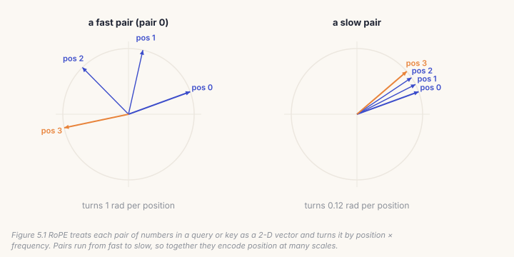
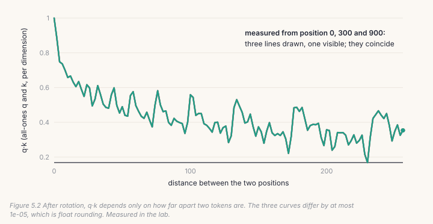
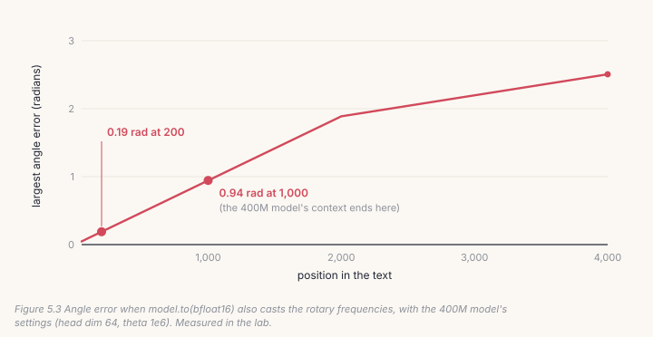
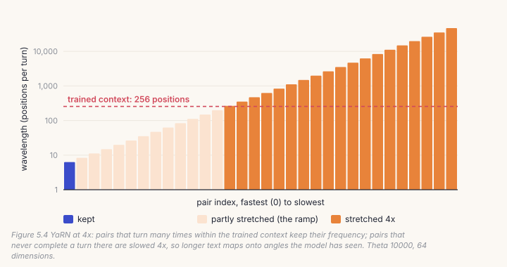

Attention, the subject of Chapter 6, compares every token with every earlier
one, but on its own it has no idea how far apart they are. *"Dog bites man"*
and *"man bites dog"* contain the same three words. This chapter builds how
AnuLM tells them apart: **rotary position embeddings** (RoPE), and **YaRN**,
the extension that lets a model read text longer than it was trained on.
Neither does anything until attention exists, so this chapter's lab doesn't
train. It *measures*, with `model.py`'s own code: that RoPE depends only on
distance, how much precision it needs, and what YaRN changes.

## 5.1 Why attention needs positions

In Chapter 4's skeleton every position saw only itself, so order never came
up. Attention changes that: a token's *query* is compared with the *keys* of
earlier tokens, and the result decides what it pays attention to. That
comparison is a dot product, and a dot product doesn't know where the two
vectors came from.

There are two ways to give it positions. You can *add* a learned vector for
each position to the embeddings, as Chapter 1's tiny transformer did. Or you
can *rotate* each query and key by an angle that grows with its position, so
the dot product itself becomes position-aware. AnuLM, like Sarvam's models and
most current LLMs, rotates.

## 5.2 Rotary embeddings: turn every pair by its position

RoPE splits each query and key into pairs of numbers. It treats each pair as
a 2-D vector, and turns it by an angle: position × that pair's frequency.



The frequencies run from fast to slow. In a 64-dimension head there are 32
pairs. Pair 0 turns a full radian per position, and the slowest pair barely
moves across a whole document. Together they work like the hands of a
clock: some tell you the second, others the hour.

The rotation itself is two lines:

```python
# build/solutions/ch05.py (identical to model.py's)
def rotate_half(x):
    x1, x2 = x[..., : x.shape[-1] // 2], x[..., x.shape[-1] // 2:]
    return torch.cat((-x2, x1), dim=-1)

def apply_rope(q, k, cos, sin):
    cos, sin = cos[None, None], sin[None, None]          # broadcast over batch and heads
    return q * cos + rotate_half(q) * sin, k * cos + rotate_half(k) * sin
```

`q * cos + rotate_half(q) * sin` is the 2-D rotation formula, applied to every
pair at once. *Which* numbers form a pair is a convention. AnuLM pairs
dimension *i* with *i* + 32 (the "split-halves" layout, from GPT-NeoX).
Sarvam's 105B checkpoint pairs neighbours (*i* with *i* + 1). Both are
correct; mixing them is not.

## 5.3 Why it works: the angles subtract

When a query at position *i* meets a key at position *j*, both have been
turned. In a dot product of two rotated vectors, only the *difference* of
their angles survives. So q·k depends on *i* − *j*, the distance, and not on
where in the text the pair sits. The lab measures it:



The cos and sin values come from a small table, built once and shared by
every layer:

```python
# build/solutions/ch05.py, Rotary.forward
t = torch.arange(n, device=device, dtype=torch.float32)        # angles in float32, always
freqs = torch.outer(t, self.inv_freq.to(device).float())        # position x frequency
emb = torch.cat((freqs, freqs), dim=-1)                          # the split-halves layout
self.cos_cached = (emb.cos() * self.table_mscale).to(dtype)
self.sin_cached = (emb.sin() * self.table_mscale).to(dtype)
```

Two details matter. The table is indexed by *absolute* position, with a
`start` offset, because in Chapter 6 the model generates one token at a time
and asks for, say, position 700 alone. And the angles are computed in float32
whatever precision the model runs in. The lab shows why:



This is a real bug from this project. Casting the whole model to bfloat16 with
`model.to(torch.bfloat16)` also cast the rotary frequencies. With the 400M
model's settings, angles were off by 0.19 radians at position 200, and by
**0.94 radians** at position 1,000, the end of its context: tokens near the end
of a long prompt were placed somewhere else entirely. The demo app now rebuilds
the frequencies in float32 after casting.

## 5.4 Past the trained length: YaRN

A model trained on 256-token windows has never seen the angles that slow pairs
reach at position 1,000. Some pairs complete many turns within 256 positions,
so every angle is familiar. Others never complete one turn, and beyond the
trained length they reach angles the model has never seen.



**YaRN** fixes the slow pairs and leaves the fast ones alone. Pairs that turn
many times keep their frequency; pairs that never complete a turn are slowed
by the extension factor, so position 1,000 lands on an angle position 250 used
to have; the pairs in between are ramped smoothly. With a 4× extension of a
256-position context, 64 dimensions and theta 1e4, the lab finds 1 pair kept,
19 slowed 4×, and 12 on the ramp.

YaRN has a second half that is easy to miss: a **temperature**. Slowing the
pairs makes attention scores slightly flatter, so YaRN multiplies the
attention logits by mscale², where mscale = 0.1 · ln(factor) + 1. At 4× that
is 1.1386² = **1.2965**. `Rotary` computes it as `attn_mscale`; the attention
layer in Chapter 6 must use it.

Does it work? Here are our own measurements (`docs/RESULTS.md` §3). Two
Shakespeare models were trained on 256-byte windows, then read 1,024 bytes
with no fine-tuning, plainly ("naive") or with YaRN at 4×. Loss by position,
lower is better:

| positions | `105b` naive | `105b` YaRN | `30b` naive | `30b` YaRN |
|---|---|---|---|---|
| 0–256 (trained range) | **1.5421** | 1.6802 | **1.5076** | 1.6808 |
| 256–512 | 1.7924 | **1.6989** | **1.6046** | 1.7052 |
| 512–768 | 2.8697 | **1.7034** | **1.6861** | 1.6898 |
| 768–1,024 | 3.0342 | **1.7131** | 1.8616 | **1.6882** |

For the `105b` preset, YaRN is the difference between working and not: 3.03
against 1.71 at the far end. For the `30b` preset, whose high `rope_theta`
(1e6) already extends gently, YaRN only wins in the last quarter. Both pay
for it inside the trained range (1.68 against 1.51–1.54). That is why Sarvam
chose opposite strategies for its two models: a very high theta and no YaRN
for the 30B, YaRN at 40× for the 105B.

## 5.5 Catch it

Broken positions are the classic silent failure. The model trains; it just
loses track of order and distance.

```bash
python course/checks/ch05.py                  # your build/anulm.py
python course/checks/ch05.py --self-test      # proves the checks catch their bugs
```

| check | the silent bug it catches |
|---|---|
| `rotate_half_matches_model` | the rotation turning the other way |
| `apply_rope_matches_model` | k left unrotated |
| `rope_preserves_norms` | a table laid out differently from the rotation |
| `rope_is_relative` | anything that makes q·k depend on absolute position |
| `inv_freq_matches_model` | the frequency formula off (a missing factor of 2) |
| `position_zero_is_not_rotated` | positions counted from 1 |
| `tables_match_model` | anything else in the table |
| `angles_are_computed_in_float32` | angles computed in bfloat16 |
| `cache_tracks_dtype_and_positions` | a stale cache; `start` ignored |
| `yarn_mscale_matches_model`, `yarn_correction_range_matches_model`, `yarn_inv_freq_matches_model` | wrong YaRN formulas |
| `yarn_keeps_fast_pairs_and_stretches_slow_ones` | the ramp reversed |
| `yarn_temperature_is_set` | YaRN's temperature dropped |

The self-test runs eleven broken versions; all eleven are caught. One taught
us something. Flipping the sign in `rotate_half` turns every vector the other
way. That is still a perfectly good rotation: lengths are preserved, q·k
still depends only on distance, and the model would train just as well. Only
comparing with `model.py` catches it, and it matters, because no checkpoint
trained with the other sign would work in your code. **Some bugs break the
model; others break compatibility.** You need checks for both.

## Lab: measure it

1. Fill in the Chapter 5 section of `course/build/anulm.py` and run the
   checks until all 14 pass.
2. Run the measurements on your code, and on `model.py`:

```bash
cd course/ch05-positions
python lab.py --impl build      # yours
python lab.py                   # model.py's, a few seconds on CPU
python make_figures.py
```

What you should see, with the 400M model's settings (64 dimensions, theta 1e6):

```
1. q·k depends only on distance: largest difference between start 0, 300, 900 = 1.00e-05
2. largest angle error (radians) with frequencies stored in bfloat16:
   pos 200: 0.189  pos 1000: 0.944  pos 2000: 1.888  pos 4000: 2.507
3. YaRN at 4x a 256-position context: 1 pairs kept, 19 stretched 4x, 12 in between;
   attention temperature 1.1386 (logits scaled by its square, 1.2965)
```

## Code tour: the same pieces in `model.py`

- **`rotate_half`** and **`apply_rope`** (`model.py`, lines 327 and 332) are
  yours, line for line.
- **`Rotary`** (line 259) takes the whole config instead of separate
  arguments, and is created once by `AnuLM` and shared by every layer, the
  30B's pattern. (The real 105B builds one per layer and pays 2.15 GB for it at
  load time.)
- **`_build_inv_freq`** (line 286) is your frequency code, YaRN ramp included;
  **`_grow`** (line 305) is your cache.
- The temperature is used in attention, in Chapter 6: each attention module
  multiplies its softmax scale by `attn_mscale ** 2`.

> **From the lab notebook**
> YaRN's two halves were once applied unevenly (`docs/RESULTS.md` §3). The
> multi-head latent attention carried the temperature from the day it was
> written. Grouped-query attention set its scale to `head_dim ** -0.5` and
> never applied it, so the first published GQA results measured the frequency
> blend alone, while the text credited both halves. Nothing failed: the model
> ran, extended, and produced plausible numbers. It was found by reading the
> code, not by a test. With the temperature applied, YaRN's win at the far end
> of the window roughly doubled (1.6882 against the earlier 1.7854; naive
> 1.8616), and its cost inside the trained range grew (1.6808 against
> 1.6482). The conclusion survived; the numbers didn't. A test,
> `yarn_temperature_reaches_attention`, now checks both attention paths, and
> this chapter's `yarn_temperature_is_set` is its first half.

## Try it on your own data

1. Implement the other pairing convention (neighbours: *i* with *i* + 1).
   Show that it passes `rope_preserves_norms` and `rope_is_relative`, and
   fails the equivalence checks. Then explain, in two sentences, why a
   checkpoint can't be moved between the two without permuting weights.
2. Run the lab with `--theta 10000` and `--theta 1e6`. How do the
   wavelengths change, and how many pairs would YaRN keep at each?
3. Measure the bfloat16 drift with `--dim 128`. Is it worse or better, and
   why?
4. In the drift measurement, also cast the *positions* to bfloat16. Integers
   above 256 aren't exact in bfloat16. What happens at position 300?
5. *Open-ended:* YaRN costs accuracy inside the trained range (1.68 against
   1.54 in §3's table). Using Figure 5.4, explain where that cost comes from,
   and propose an experiment to reduce it.

## Key takeaways

- Attention compares vectors with a dot product, which knows nothing of
  position; RoPE rotates queries and keys so that it does.
- After rotation, q·k depends only on the distance between tokens, measured
  here to within 1e-5.
- Compute the angles in float32: in bfloat16 they drift by nearly a radian
  within the 400M model's 1,024-position context.
- YaRN extends context by slowing only the pairs that never complete a turn
  in the trained range, plus an attention temperature. Both halves are
  needed.
- Some bugs break the model, others break compatibility with checkpoints.
  Check for both.
