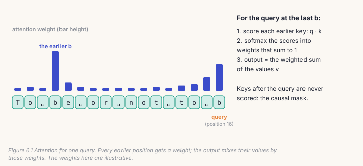
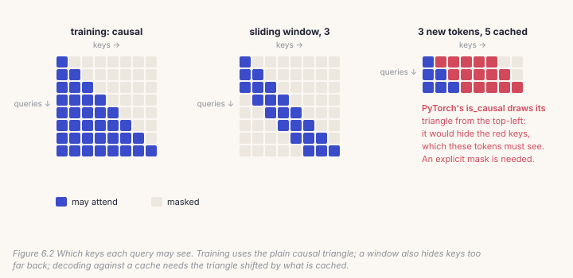
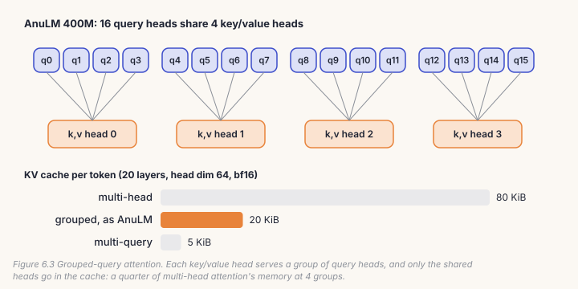
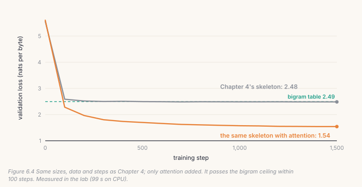
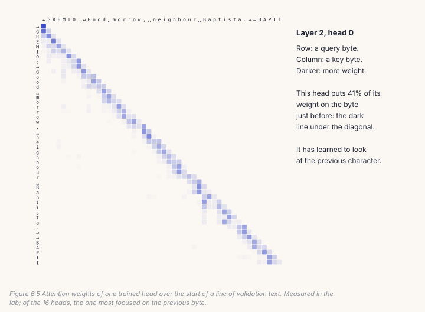

Chapter 4's skeleton stalled at the bigram table, 2.48, because every position
could see only itself. This chapter gives it the ability to look back:
**attention**. You build the causal mask, grouped-query attention as AnuLM uses
it, the full transformer block, and the **KV cache** that makes generation
fast. Then you retrain Chapter 4's exact setup with nothing changed but
attention added, and watch the ceiling disappear. Along the way you'll meet
the most dangerous bug in this book: a model that can see the future.

## 6.1 What attention does

At every position, attention asks: which earlier positions matter here, and
what should I take from them? Each position produces three vectors from its
current representation:

- a **query** q: what this position is looking for;
- a **key** k: what this position offers to others looking;
- a **value** v: what it hands over if chosen.



The query is compared with every earlier key by a dot product, scaled down by
√(head dimension) so the numbers stay moderate. A softmax turns the scores
into weights that sum to 1, and the output is the weighted sum of the values.
PyTorch does all of it in one call:

```python
y = F.scaled_dot_product_attention(q, k, v, attn_mask=mask, is_causal=..., scale=self.scale)
```

Models run several of these side by side, **heads**, each with its own
projections, so each can look for something different. In the lab, one head
learns to look almost entirely at the previous byte; you'll see it at the end
of the chapter.

## 6.2 The causal mask: never look ahead

A language model is trained to predict the next token. If position 5 could
attend to position 6, it could simply read the answer, and training would
reward it for doing so. The **causal mask** forbids it: a query may only attend
to keys at its own position or earlier.



```python
# build/solutions/ch06.py (identical to model.py's _attn_mask)
def attn_mask(S, T, start, window, device):
    if window is None and (start == 0 or S == 1):
        return None                                  # is_causal (or no mask) is enough, and faster
    q_pos = torch.arange(start, start + S, device=device)[:, None]
    k_pos = torch.arange(T, device=device)[None, :]
    mask = k_pos <= q_pos                            # never a key after the query
    if window is not None:
        mask &= k_pos > q_pos - window               # nor one window or more back
    return mask
```

Three cases need care.

- **Training** (`start == 0`): PyTorch's built-in `is_causal=True` draws exactly
  the right triangle and uses a faster kernel, so the function returns `None`.
- **Decoding against a cache** (Section 6.5): the queries are new tokens at
  positions 5, 6, 7, but the keys include the 5 cached ones. `is_causal` always
  draws its triangle from the top-left corner, so it would hide keys these
  queries must see (red in the figure). An explicit mask is needed.
- **A sliding window** also hides keys that are too far back. The deployed 400M
  model uses a 256-token window on its first 10 of 20 layers; the other 10 see
  everything.

A leaking mask is the worst bug in this book. The model trains *beautifully*,
because it is reading the answers, and the loss it reports means nothing.
Nothing in the training curve will warn you. Only a check will.

## 6.3 Grouped-query attention

AnuLM uses **grouped-query attention** (GQA): many query heads, fewer key and
value heads, each key/value head shared by a group of query heads. The 400M
model has 16 query heads sharing 4 key/value heads.



```python
# build/solutions/ch06.py, GQAttention.forward (identical to model.py's)
qkv = self.query_key_value(x).view(B, S, self.n_head + 2 * self.n_kv_head, self.head_dim)
q, k, v = qkv.split([self.n_head, self.n_kv_head, self.n_kv_head], dim=-2)
q, k, v = q.transpose(1, 2), k.transpose(1, 2), v.transpose(1, 2)   # (B, heads, S, Dh)
if self.use_qk_norm:                                    # normalise, THEN rotate
    q, k = self.query_layernorm(q), self.key_layernorm(k)
q, k = apply_rope(q, k, cos, sin)                       # Chapter 5
...                                                     # the cache, Section 6.5
k = k.repeat_interleave(self.n_rep, dim=1)              # each kv head serves n_rep query heads
v = v.repeat_interleave(self.n_rep, dim=1)
y = F.scaled_dot_product_attention(q, k, v, attn_mask=mask,
                                   is_causal=(mask is None and S > 1), scale=self.scale)
return self.dense(y.transpose(1, 2).reshape(B, S, -1))
```

Four details, each a place for a silent bug:

- **One fused projection** makes q, k and v together, split on the head axis.
- **QK-norm** (an RMSNorm on each query and key head) keeps the attention scores
  from growing too large. It must come *before* RoPE. We measured what happens if
  it comes after: with the norm's gains at their starting value of 1, the two
  orders agree to 0.0000005, because a rotation doesn't change a vector's
  length. Once training moves the gains, outputs differ by up to 0.99. So the
  bug is invisible at the start and only grows as the model learns.
- **`repeat_interleave`**, not `repeat`: query heads 0–3 share key head 0. `repeat`
  would give query head 1 key head 1's values instead, still a working model,
  just not the one any checkpoint was trained as.
- **The scale** is 1/√(head dim), times YaRN's temperature from Chapter 5.

## 6.4 The full block

Chapter 4's block had only the MLP. The real one writes into the residual
twice: once from attention, once from the MLP, each reading its own normalised
copy.

```python
# build/solutions/ch06.py, Block.forward (model.py's layer 0)
x = x + self.attn(self.input_layernorm(x), cos, sin, cache=cache, start=start, window=self.window)
return x + self.mlp(self.post_attention_layernorm(x))
```

This is why `model.py` scales both `dense` (attention's output) and `down_proj`
at initialisation by 1/√(2 · n_layer): two writes per layer.

## 6.5 Generating fast: the KV cache

To generate, the model predicts a token, appends it, and predicts again. Done
naively, every step re-reads the whole text. But the keys and values of earlier
tokens never change: the causal mask means they never see later tokens. So
keep them. With a **KV cache**, the prompt is read once, and each later step
feeds only the newest token, attending to the cached keys and values.

```python
if cache is not None:
    if "k" in cache:
        k = torch.cat([cache["k"], k], dim=2)        # earlier keys, then the new one
        v = torch.cat([cache["v"], v], dim=2)
    cache["k"], cache["v"] = k, v                    # the n_kv_head heads, not their copies
```

Two things must be right. The new token's rotary angle must be for its *real*
position, which is what Chapter 5's `start` offset is for. And the cache must
hold the shared key/value heads, not their repeated copies, because that is the
whole memory saving of GQA. At the 400M model's sizes, a token's cache costs:

| attention | key/value heads | cache per token | for a 1,024-token context |
|---|---|---|---|
| multi-head | 16 | 80 KiB | 80 MiB |
| **grouped (AnuLM)** | **4** | **20 KiB** | **20 MiB** |
| multi-query | 1 | 5 KiB | 5 MiB |

In the lab, generating 240 tokens took 0.43 s without the cache and 0.21 s with
it, and the two produced **exactly the same tokens**. The gap grows with length:
without a cache, each step costs more than the last.

## 6.6 Catch it

```bash
python course/checks/ch06.py              # your build/anulm.py
python course/checks/ch06.py --self-test  # proves the checks catch their bugs
```

| check | the silent bug it catches |
|---|---|
| `attn_mask_matches_model` | a window one position too wide |
| `gqa_matches_model` | QK-norm after RoPE, heads tiled instead of interleaved, a wrong scale |
| `gqa_scale_carries_yarn_temperature` | YaRN's temperature dropped |
| `causal_mask_does_not_leak_future` | **attending to the future** |
| `causality_holds_under_gradients_too` | the future leaking through gradients |
| `cache_stores_the_shared_kv_heads` | a cache of copies, which wastes GQA's saving |
| `incremental_matches_full` | `is_causal` used against a non-empty cache |
| `sliding_window_limits_reach`, `sliding_window_agrees_with_cache` | windows wrong in either path |
| `block_matches_model_layer_zero` | the attention residual missing |
| `model_initial_loss_and_gradients` | a broken start; unused parameters |
| `model_scales_both_residual_projections` | `dense` left unscaled |
| `model_refuses_more_than_block_size` | positions past the rotary tables, silently |
| `model_cached_generation_matches_uncached` | wrong rotary positions while decoding |
| `model_matches_the_reference` | anything else, end to end |

The self-test runs thirteen broken versions; all thirteen are caught.

## Lab: give the skeleton eyes

1. Fill in the Chapter 6 section of `course/build/anulm.py`; run the checks until
   all 15 pass.
2. Train it, with Chapter 4's exact sizes, data and steps:

```bash
cd course/ch06-attention
python lab.py                      # yours; about two minutes on CPU
python lab.py --impl solution      # the reference
python make_figures.py
```



Our run: 657,536 parameters, 1,500 steps in 99 seconds, ending at **1.541**,
against **2.484** for the same skeleton without attention, and 2.493 for the
table of counts. It even beats Chapter 1's tiny transformer (1.75 after 2,000
steps). It writes like this:

```
ROMEO:
That is the dead entreat-gilding privatation.

QUEEN:
Who happy wisdom suits of the suplant grow;
Lay is Romeo; and this native my lord,
```

And here is what one of its 16 heads learned to do:



Nobody told it to look at the previous character. Attention gave it the
*ability* to look anywhere earlier; training found that this is worth looking
at.

## Code tour: the same pieces in `model.py`

- **`_attn_mask`** (`model.py`, line 344) and **`GQAttention`** (line 404) are
  yours, plus two extras: a `NATIVE_GQA` switch that lets PyTorch broadcast the
  shared heads itself instead of copying them, and a `bidir_mask` argument for
  `bidirectional.py`, which reuses the model as a two-way encoder.
- **`MLAttention`** (line 472) is the alternative, *multi-head latent
  attention* (DeepSeek-V2, 2024). Instead of caching keys and values, it caches one small latent
  vector per token (48 numbers in the `tiny-mla` preset, 512 in DeepSeek-V2) plus
  one shared rotary key, and rebuilds keys and values from it at every step.
  Its cache is smaller still, at the cost of extra computation. Exercise 5
  builds it.
- **`AnuLM.generate`** (line 1059) is your `generate`, plus top-k sampling,
  a repetition penalty, stopping at EOS, and rebuilding the cache once the
  context is full.

> **From the lab notebook**
> Is the sliding window worth having? (`docs/RESULTS.md` §15.) A window saves
> cache memory on the layers that use it, but you'd expect it to cost
> quality. We trained two 386M models for 2,000 steps at a 512-token
> context, one with a 256-token window on layers 0–9 and one without, then
> read longer texts with no fine-tuning. At the trained length, the windowed
> model was no worse (5.2656 against 5.2782). Past it, it was *better*: at
> 2,048 tokens, in the far quarter of the text, 5.5007 against 5.6454, a gap of
> 0.145 nats. Half its layers never see a distance beyond 256, so fewer layers
> meet angles they have never seen. That's why the deployed model has the
> window. The cheapest cache saving available turned out to be free.

## Try it on your own data

1. Remove the mask entirely (`is_causal=False`, no `attn_mask`) and train for 300
   steps. What does the loss do? Now generate some text. Explain the
   difference, and name the check that would have told you before training.
2. Train with `n_kv_head=4` (multi-head) and `n_kv_head=1` (multi-query) instead
   of 2. How much does the loss change, and how much does the cache?
3. Add a sliding window of 16 to the first two layers. What does it cost at this
   size? Try 4.
4. Pick a different head in the lab and plot its weights. Can you describe what
   it attends to?
5. *Open-ended:* build `MLAttention` from `model.py`'s description, add a check
   that compares it with the original, and measure its cache per token against
   GQA's for the `tiny-mla` preset.

## Key takeaways

- Attention lets each position mix information from earlier positions, weighted
  by how well their keys match its query.
- The causal mask must hide the future in the forward pass *and* the gradients;
  a leak trains beautifully and means nothing.
- Grouped-query attention shares each key/value head across a group of query
  heads; the cache stores only the shared heads, a quarter of the memory at 4
  groups.
- The KV cache makes generation fast and must give exactly the same tokens;
  decoding needs real positions and a mask shifted by what is cached.
- With attention, the same skeleton went from 2.484 to 1.541: looking back is
  what breaks the bigram ceiling.
