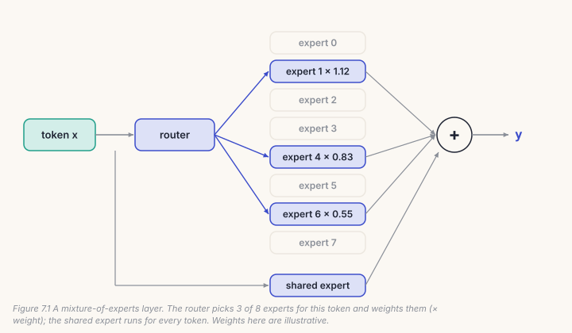
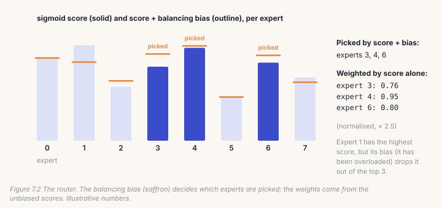
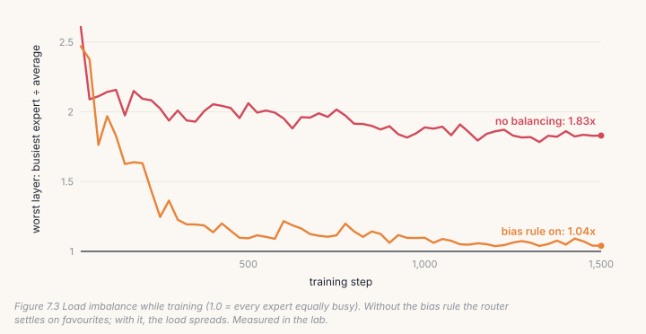
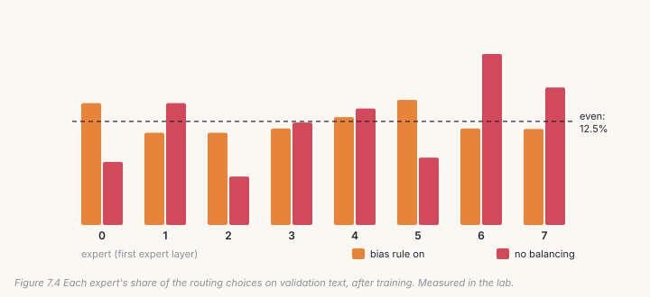
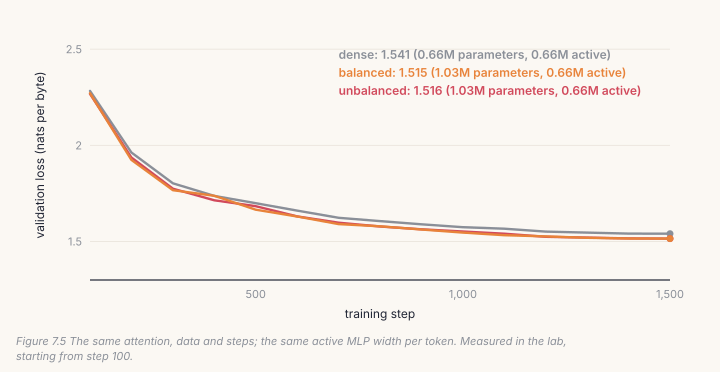

A bigger model learns more, but every parameter normally costs compute on
every token. A **mixture of experts** (MoE) breaks that link. It replaces one
MLP with many smaller ones, the *experts*, and a **router** that sends each
token to only a few of them. The model gets more parameters while each token
does about the same work. This chapter builds AnuLM's router, its experts,
and the rule that keeps the experts evenly used, all without an extra loss.
At the end, your model is no longer *like* `model.py`'s: your weights load
into it and give the same outputs, digit for digit.

## 7.1 More parameters, the same work



In AnuLM, every layer after the first replaces its MLP with:

- **routed experts**: 16 small SwiGLU MLPs in the `tiny-gqa` preset, each
  an eighth of the dense MLP's width (96 against 768); the router picks 2 per
  token;
- **a shared expert**, one more SwiGLU that every token goes through, outside
  the routing.

So the `tiny-gqa` preset has **17,440,384 parameters, but any one token uses
6,602,368** of them: the experts it wasn't routed to do no work for it. That
ratio is the point of the design. Large MoE models push it much further, with
hundreds of experts.

## 7.2 The router

The router scores every expert for every token, and keeps the top *k*:

```python
# build/solutions/ch07.py, Router._gate (identical to model.py's)
logits = F.linear(x, self.weight.float())             # (tokens, experts)
scores = torch.sigmoid(logits)                         # each expert scored on its own
choice = scores + self.expert_bias[None, :]            # the balancing bias steers the choice ...
idx = choice.topk(self.top_k, dim=-1)[1]               # the k winners
w = scores.gather(1, idx)                              # ... but the weights come from the plain scores
w = w / (w.sum(-1, keepdim=True) + 1e-20) * self.routed_scaling_factor
```



Three choices here are DeepSeek-V3's (2024).

- **Sigmoid, not softmax.** Each expert is scored independently, so one expert
  winning doesn't push the others down.
- **The bias picks, but never weights.** `expert_bias`, introduced in Section
  7.5, is added only when choosing. The winners are then weighted by their
  *unbiased* scores, normalised to sum to 1 and scaled by 2.5.
- **Group-limited routing** (the `tiny-mla` preset): experts are split into
  groups, and a token may only use experts from its best few groups. On large
  machines, each group lives on one device, so this limits traffic.

The router runs in **float32**, even when the rest of the model runs in
bfloat16. Picking the top *k* is a discrete choice, and rounding can flip it.
The lab-notebook box at the end of this chapter tells how we found that out.

## 7.3 The MoE layer

Once every token has its *k* experts, each expert runs **once**, on all the
tokens sent to it, and the outputs are put back, weighted:

```python
# build/solutions/ch07.py, MoE.forward (model.py's "sparse" path)
flat_expert = idx.reshape(-1)                                   # one entry per (token, slot)
token_of_slot = torch.arange(N).repeat_interleave(self.top_k)   # which token each slot belongs to
out = x_flat.new_zeros(N * self.top_k, D)
for e in range(self.num_experts):
    sel = (flat_expert == e).nonzero(as_tuple=True)[0]          # the slots routed to expert e
    if sel.numel():
        out[sel] = self.experts[e](x_flat[token_of_slot[sel]])
y = (out.view(N, self.top_k, D) * w.unsqueeze(-1)).sum(1)       # weighted sum per token
y = y + self.shared_expert(x)                                   # every token, outside routing
```

`model.py` has two more ways to do the same arithmetic. `dense` runs every
expert on every token and keeps the chosen outputs: wasteful, but its shapes
never change, so `torch.compile` handles it in one piece. `grouped` sorts
tokens by expert and runs all experts in a single grouped matrix multiply,
which is 1.48× faster on a GPU (`docs/RESULTS.md` §4). All three give the same
outputs; the tests hold them to it.

## 7.4 Your model is now `model.py`

`ExpertBlock` is Chapter 6's block with the MLP replaced by an MoE layer, and
`MoELM` stacks them: one dense block first, then expert blocks, exactly as
AnuLM does (`first_k_dense_replace = 1`). Its default settings are the
`tiny-gqa` preset. That gives the strongest check in this book so far:

```python
theirs = model.AnuLM(model.AnuLMConfig(**settings))
theirs.load_state_dict(mine.state_dict(), strict=True)   # nothing missing, nothing extra
```

Your weights load into the repository's model, and the logits and the loss
come out identical: a difference of exactly 0.0 on our run. From here on,
whatever `model.py` can do with a checkpoint, your code can do too.

## 7.5 Keeping the experts busy, without a loss

Left alone, a router tends to find a few favourite experts and send them most
of the traffic. The others get few tokens, learn little, and get chosen even
less. The classic fix adds a *balancing loss* to training, which also pulls the
model away from what it is trying to learn.

AnuLM uses DeepSeek-V3's alternative: a **bias with no gradient at all**. Each
router counts how many tokens every expert received. After each optimizer step,
each expert's bias moves by a fixed small step: down if it was busier than
average, up if it was quieter.

```python
# build/solutions/ch07.py, MoELM.update_expert_biases
load, mean = m.load_counts, m.load_counts.mean()
m.expert_bias += self.bias_update_rate * torch.sign(mean - load)   # busy: down; idle: up
load.zero_()
```

Because the bias only affects *which* experts are picked, never how their
outputs are weighted, balancing never touches the gradient the model learns
from. And because `expert_bias` is a *buffer*, not a parameter, the optimizer
never sees it.



In the lab, both runs start badly unbalanced: the busiest expert gets about
2.5× its fair share. With the bias rule, imbalance falls to **1.04×**; without
it, the router settles at **1.83×**.



Our records describe how the rule behaves (`docs/RESULTS.md` §5): imbalance
*rises* before it falls (peaks of 5–8× in our runs), because the bias moves
slowly at first. Because `sign()` takes a full step however small the error,
it never settles exactly, and oscillates around balance instead.

## 7.6 Catch it

```bash
python course/checks/ch07.py              # your build/anulm.py
python course/checks/ch07.py --self-test  # proves the checks catch their bugs
```

| check | the silent bug it catches |
|---|---|
| `router_matches_model` | softmax instead of sigmoid; group limits ignored |
| `bias_picks_but_never_weights` | weights taken from the biased scores |
| `router_respects_group_limits` | tokens spread over too many groups |
| `expert_bias_is_a_buffer_not_a_parameter` | an optimizer fighting the balancer |
| `load_is_counted_in_training_only` | load counted during evaluation |
| `routing_stays_float32_under_autocast` | routing in bfloat16 |
| `balance_and_z_losses_match_model` | the optional regularisers wrong |
| `moe_matches_model`, `moe_matches_a_per_token_loop` | unweighted outputs; slots sent to the wrong tokens |
| `shared_expert_sees_every_token` | the shared expert left out |
| `expert_block_matches_model_layer` | anything in the expert block |
| `your_model_is_model_py` | anything, end to end, against the real model |
| `thirty_b_preset_has_the_right_parameter_count` | every expert counted as active |
| `config_rejects_unreachable_top_k` | a top *k* the groups can't supply |
| `bias_update_moves_the_right_way` | a balancer pushing the wrong way; counts never reset |
| `balancer_recovers_from_collapse` | a balancer too weak to undo a collapse |

The self-test runs fourteen broken versions; all fourteen are caught. It also
caught a mistake in our own check. `model.py`'s config and `MoELM` have
different default rotary settings (theta 1e4 against the `tiny-gqa` preset's 1e6),
so the first version of `your_model_is_model_py` compared two different models
and failed on the correct solution. An equivalence check must set every
setting explicitly, never trust two sets of defaults to agree.

## Lab: experts against dense

1. Fill in the Chapter 7 section of `course/build/anulm.py`; run the checks
   until all 16 pass.
2. Run three models with Chapter 6's attention, data and steps, and the
   **same active MLP width per token** (256):

```bash
cd course/ch07-experts
python lab.py                      # yours; about eight minutes on CPU
python lab.py --impl solution
python make_figures.py
```



| run | parameters | active per token | validation loss | time |
|---|---|---|---|---|
| dense: one MLP of 256 | 657,536 | 657,536 | 1.541 | 101 s |
| **experts**: 8 of 64, top 3, plus a shared 64 | 1,029,248 | 660,608 | **1.515** | 156 s |
| the same experts, no balancing | 1,029,248 | 660,608 | 1.516 | 160 s |

Two results. First, **experts win at the same compute**: 1.515 against 1.541,
paid for with 57% more parameters in memory. (The dense run lands exactly on
Chapter 6's 1.541, because it is the same model.) On a CPU the expert run is
slower, because of the loop over experts; the `grouped` path exists to replace
that loop with one multiply on a GPU.

Second, and this one is worth a moment: **turning off balancing didn't hurt the
loss here** (1.516 against 1.515), even though the load was far less even. Our
386M runs found the same (`docs/RESULTS.md` §16: "the imbalance is not costing
loss"). So what is balancing for? Speed and safety. When experts live on
different GPUs, the busiest one sets the pace for all of them. And an
unbalanced router can collapse onto very few experts over a long run, leaving
most of the parameters you paid for unused. Balancing is insurance, and on a
small CPU run you don't see the bill.

## Code tour: the same pieces in `model.py`

- **`Router`** (`model.py`, line 550) is yours. Its comment records the
  float32 story in the box below.
- **`MoE`** (line 640) holds the three dispatch paths: `_route_sparse` (yours,
  line 669), `_route_dense` (689) and `_route_grouped` (725), selected by
  `moe_impl`.
- **`AnuLM.update_expert_biases`** (line 1015) is yours, and also records the
  *median* layer's imbalance, because the worst layer alone misleads: on one
  checkpoint the worst layer read 4.33× while the median layer sat at 2.15×.
- **`AnuLM.num_params`** (line 1047) is your active-parameter count.

> **From the lab notebook**
> The router once ran in bfloat16 on every GPU run (`model.py`, `Router.forward`).
> Its inputs were cast to float32, which looked like enough, but PyTorch's
> autocast re-casts every linear layer to bfloat16 whatever it is handed. On a
> real checkpoint, 3.2% of tokens chose a different set of experts than they
> would in float32. Nothing crashed, and training went on as normal; the
> routing was simply a little arbitrary. The fix turns autocast off for the
> whole router. The check `routing_stays_float32_under_autocast` exists because
> of it. In this chapter's lab, on a much smaller and less trained router, the
> same mistake flipped 0.4% of tokens (2 of 512): smaller, still not zero.

## Try it on your own data

1. Run the lab with top 1, 2 and 4 experts (keeping the active width equal by
   changing the expert width). Which is best?
2. Remove the shared expert (`num_shared_experts=0`) and give its width to the
   routed experts. Our 386M runs found the shared expert wasn't earning its
   parameters (§10). Does that hold here?
3. Try 16 experts of 32, top 6 (the "fine-grained" design, the largest win in
   our §10 ablations). Same active compute: better or worse?
4. Set `bias_update_rate` to 0.01 and plot the imbalance. Can you see the
   oscillation §5 describes?
5. *Open-ended:* write the `dense` dispatch path, prove with a check that it
   gives the same output as the sparse one, and time both.

## Key takeaways

- A mixture of experts gives a model more parameters at the same compute per
  token: the `tiny-gqa` preset has 17.4M parameters, 6.6M active.
- The router scores experts with sigmoids and picks the top *k*; a balancing
  bias steers the choice, but the weights come from the unbiased scores.
- Balance is kept by a bias nudged after each step, with no gradient and no
  extra loss.
- With the expert layers built, your weights load into `model.py`'s AnuLM and
  give identical outputs.
- At equal compute, experts beat a dense MLP in the lab (1.515 against 1.541).
  Balancing didn't change the loss here; it buys speed on many devices and
  protection against collapse.
